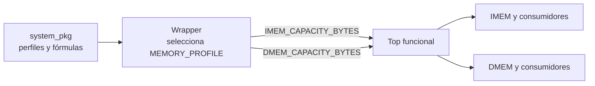

# Configuración común de la FPGA

- **Tipo:** arquitectura.
- **Estado documental:** especificación vigente.

**Estado:** Diseño aprobado el 2026-10-05.

## Propósito y alcance

Este documento define la configuración de elaboración común a los bloques del sistema FPGA. Esa configuración fija las capacidades de memoria, las constantes compartidas y las fórmulas con las que cada módulo obtiene anchos y límites.

Los siguientes bloques operan sobre las mismas capacidades y los mismos derivados:

- Loader.
- Instruction Memory (IMEM).
- Validación de Instruction Fetch (IF).
- Control de imagen.
- Session Preparation.
- Data Memory (DMEM).
- Serializador.

Una autoridad única impide contratos incompatibles: una memoria no reserva 1000 bytes mientras otro bloque valida o recorre 1024.

El alcance comprende:

- la tabla de perfiles aprobados y la selección única del perfil en el wrapper de placa;
- la resolución de cada perfil en las capacidades de IMEM y DMEM;
- la propagación explícita de esas capacidades hacia el top funcional y los módulos que las necesitan;
- las constantes, tipos, funciones de validación y fórmulas de anchos que comparten los módulos;
- los valores ya aprobados de clock, UART, controles de CPU, protocolo y estado global, conservando sus contratos.

La [tabla de perfiles](memory/memory_architecture.md#perfiles-definidos) es la fuente oficial de capacidades. [Composición](system_composition.md) define el empaquetado de puertos y registros interetapa. Los pines y constraints de placa permanecen en el XDC ya especificado: no se trasladan a constantes HDL ni se duplican como una segunda autoridad.

El formato de configuración de la aplicación PC se concretará junto con su diseño y tomará el mismo perfil de esa tabla. UART no transporta un puerto de perfil ni un generador de software.

## Organización

El paquete SystemVerilog **`system_pkg`**, en `system_pkg.sv`, concentra las definiciones compartidas. El paquete se compila antes de los módulos que lo importan. Sus definiciones son constantes de elaboración. El perfil se selecciona en el wrapper y las capacidades se pasan como parámetros de instancia.

### Perfiles publicados

El paquete ofrece dos perfiles: `REFERENCE` y `ALT_1000`. Para cada uno guarda las capacidades de IMEM y DMEM como valores `unsigned`. También contiene las funciones comunes que calculan anchos y validan la configuración.

| Perfil | `IMEM_CAPACITY_BYTES` | `DMEM_CAPACITY_BYTES` | Uso |
|---|---:|---:|---|
| `REFERENCE`, por defecto | 1024 | 2048 | elaboración, simulación y realización física |
| `ALT_1000` | 1000 | 1000 | elaboración/simulación y smoke tests, sin obligación física |

### Selección y jerarquía

El parámetro de elaboración `MEMORY_PROFILE` selecciona el perfil. Su valor por defecto es `REFERENCE`. Cada nivel tiene una responsabilidad:

| Nivel | Responsabilidad |
|---|---|
| Wrapper de placa | Recibe `MEMORY_PROFILE`, lo convierte una sola vez en `IMEM_CAPACITY_BYTES` y `DMEM_CAPACITY_BYTES`, e instancia el sistema pasando esos dos valores. Ningún módulo interno vuelve a elegir el perfil. |
| Top funcional | Recibe `IMEM_CAPACITY_BYTES` y `DMEM_CAPACITY_BYTES`. |
| Módulos internos | Reciben solo las capacidades que necesitan, siempre por conexión explícita de parámetros del padre. |

Esta distribución permite elaborar el top funcional y bloques en simulación sin el Clocking Wizard ni la placa. Las capacidades alternativas para las pruebas locales de aritmética se suministran al bloque probado.

### Interfaz de perfiles implementada

El [paquete compartido](../../rtl/system_pkg.sv) publica `memory_profile_t`,
un identificador de elaboración de 32 bits con cuatro estados. Sus
constantes son `system_pkg::REFERENCE` y `system_pkg::ALT_1000`, con
representaciones internas `0` y `1`. Los consumidores utilizan esos nombres;
los identificadores no son códigos del protocolo UART.

`memory_capacity_t` es `longint unsigned` de 64 bits. Las constantes
`REFERENCE_IMEM_CAPACITY_BYTES`, `REFERENCE_DMEM_CAPACITY_BYTES`,
`ALT_1000_IMEM_CAPACITY_BYTES` y `ALT_1000_DMEM_CAPACITY_BYTES` conservan
las capacidades de la tabla de perfiles.

Todas las funciones de esta interfaz reciben un `memory_profile_t`:

- `memory_profile_supported(profile)` indica si el perfil está admitido.
  Los identificadores desconocidos o con `X`/`Z` se rechazan.
- `imem_capacity_bytes(profile)` y `dmem_capacity_bytes(profile)` devuelven
  las capacidades correspondientes y se pueden usar en expresiones
  constantes de elaboración.
- `memory_profile_diagnostic(profile)` devuelve una cadena vacía para los
  perfiles admitidos o `CONFIG_UNSUPPORTED` para los demás.

Un perfil no admitido devuelve capacidad cero como centinela. El consumidor
debe comprobar `memory_profile_supported` y separar mediante `generate`
la rama rechazada de los recursos. El cero no representa un perfil válido
ni una sustitución por `REFERENCE`.

Este fragmento muestra la selección y resolución en un consumidor:

~~~systemverilog
parameter system_pkg::memory_profile_t MEMORY_PROFILE = system_pkg::REFERENCE;

localparam system_pkg::memory_capacity_t IMEM_CAPACITY_BYTES =
    system_pkg::imem_capacity_bytes(MEMORY_PROFILE);
localparam system_pkg::memory_capacity_t DMEM_CAPACITY_BYTES =
    system_pkg::dmem_capacity_bytes(MEMORY_PROFILE);
~~~

El [banco del paquete](../../tb/system_pkg_tb.sv) muestra el guard
de elaboración y emite el diagnóstico con `$fatal(1, ...)` en la rama
rechazada.

### Interfaz de capacidades implementada

`MIN_MEMORY_CAPACITY_BYTES` y `MAX_MEMORY_CAPACITY_BYTES` fijan el dominio
de `4` a `2^32` bytes. `memory_capacity_valid(C)` exige además que `C` sea
múltiplo de cuatro. `memory_capacity_diagnostic(C)` devuelve una cadena
vacía para capacidades válidas o `CONFIG_INVALID_CAPACITY` para las demás.

`byte_address_width(C)`, `word_index_width(C)`, `row_index_width(C)` y
`capacity_inclusive_width(C)` implementan las fórmulas de anchos de este
documento. `memory_word_count(C)` devuelve `C/4` para capacidades válidas.
Todas reciben `memory_capacity_t` y se pueden evaluar como constantes de
elaboración. `C + 1` se calcula con aritmética de 64 bits.

Para capacidades inválidas, los anchos y la cantidad auxiliar de palabras
devuelven `1`. Son centinelas que permiten emitir el diagnóstico;
el consumidor debe separar los recursos mediante `memory_capacity_valid`
y `generate` antes de reservarlos.

### Soporte físico declarado

`basys3_memory_supported(IMEM_C, DMEM_C)` admite únicamente el par de
capacidades de `REFERENCE`, conforme a
[DEC-ARCH-006](../decisions/DEC-ARCH-006.md). `ALT_1000` conserva su alcance
de elaboración, simulación y pruebas de parametrización.

`basys3_memory_diagnostic(IMEM_C, DMEM_C)` devuelve
`CONFIG_INVALID_CAPACITY` si alguna capacidad es inválida;
`CONFIG_UNSUPPORTED` si ambas son válidas pero el par no está declarado
soportado; y una cadena vacía para la configuración admitida.
Estas funciones se evalúan antes de elaborar recursos y comprueban el
soporte declarado. La utilización y el timing se verifican con la
implementación física.

### Configuración compartida de clock y UART

El paquete publica las constantes aprobadas por
[plataforma](platform/platform_reference.md#propósito-y-alcance) y el
[enlace UART](../protocol.md#enlace-uart):

| Constante                | Valor                |
| ------------------------ | -------------------- |
| `FUNCTIONAL_CLOCK_HZ`    | 50 MHz               |
| `UART_BAUD_RATE`         | 19200 baud nominales |
| `UART_DATA_BITS`         | 8                    |
| `UART_PARITY_ENABLED`    | false                |
| `UART_STOP_BITS`         | 1                    |
| `UART_OVERSAMPLE_FACTOR` | 16                   |
| `UART_FIFO_DEPTH`        | 4                    |

Las frecuencias utilizan `longint unsigned` de 64 bits; los tamaños y
factores utilizan `int unsigned`, y la habilitación de paridad es `bit`.
`UART_FIFO_DEPTH` se aplica a las FIFO independientes de RX y TX.
El divisor y el ancho del contador del
[generador de ticks](uart/uart_baud_tick_gen.md#divisor-y-frecuencia-efectiva)
se derivan localmente de la configuración compartida.

### Tiempos compartidos del protocolo

`PROTOCOL_LOAD_INACTIVITY_*` representa T, el tiempo de
[inactividad de recepción LOAD](../protocol.md#recepción-incompleta).
`PROTOCOL_RECOVERY_SILENCE_*` representa R, el
[silencio de recuperación](../protocol.md#descarte-y-silencio).
Ambos plazos están fijados en 100 ms:

| Constante                          | Valor   | Unidad             |
| ---------------------------------- | ------- | ------------------ |
| `PROTOCOL_LOAD_INACTIVITY_MS`      | 100     | ms                 |
| `PROTOCOL_RECOVERY_SILENCE_MS`     | 100     | ms                 |
| `PROTOCOL_LOAD_INACTIVITY_CYCLES`  | 5000000 | ciclos funcionales |
| `PROTOCOL_RECOVERY_SILENCE_CYCLES` | 5000000 | ciclos funcionales |

Las cuatro constantes son `longint unsigned` de 64 bits. Los ciclos se
calculan como `FUNCTIONAL_CLOCK_HZ * plazo_ms / 1000`, con aritmética de
64 bits desde la multiplicación: el producto intermedio es 5000000000
a 50 MHz. Los valores en ciclos representan intervalos completos;
el [contrato del controlador](debug/protocol_controller.md#tiempos-y-prioridades)
distingue esa duración del valor previo de contador 4999999 al vencer.

T limita las pausas durante tamaño o contenido; R exige silencio continuo
y se reinicia por actividad RX. El contador compartido, su ancho y las
reglas de actualización pertenecen al controlador del protocolo.

### Tipos y controles de los registros interetapa

`word_t` representa palabras, PC, instrucciones y resultados de 32 bits;
`register_index_t` representa índices de registros de cinco bits. Los
controles utilizan `alu_op_t`, `alu_src_t`, `result_sel_t`, `flow_op_t`,
`mem_op_t` y `fault_cause_t`, con los anchos de
[interfaces](../interfaces.md#02-convenciones-anchos-y-codificaciones).
Son vectores `logic` sin signo que conservan los cuatro estados.

Las constantes `ALU_OP_*`, `ALU_SRC_*`, `RESULT_SEL_*`, `FLOW_OP_*` y
`MEM_OP_*` conservan las
[codificaciones de ID](cpu/stage_id.md#codificación-de-los-controles).
`FAULT_*` conserva las
[causas aprobadas](session/faults_and_termination.md#referencia-de-causas).

Los payloads internos usan `struct packed`, con los campos en el orden de
[pipeline](cpu/cpu_pipeline.md) y del fixture compartido:

| Tipo       | Campos | Bits |
| ---------- | -----: | ---: |
| `if_id_t`  |      5 |   69 |
| `id_ex_t`  |     15 |  193 |
| `ex_mem_t` |      8 |  139 |
| `mem_wb_t` |      6 |  103 |

El primer campo ocupa los bits más significativos. Las estructuras suman
504 bits funcionales, sin padding. El contrato de observación mantiene
sus 34 puertos Debug individuales y forma el padding UART al serializar.

### Selectores compartidos de CPU

`forward_sel_t` y `access_size_t` son vectores `logic` sin signo de dos
bits que conservan `X` y `Z`. Publican las codificaciones de
[forwarding](cpu/control_and_hazards.md#selectores) y
[tamaño de acceso](cpu/stage_mem.md#mem-decode):

| Tipo            | Constante              | Código |
| --------------- | ---------------------- | ------ |
| `forward_sel_t` | `FORWARD_SEL_ID_EX`    | `00`   |
| `forward_sel_t` | `FORWARD_SEL_EX_MEM`   | `01`   |
| `forward_sel_t` | `FORWARD_SEL_MEM_WB`   | `10`   |
| `access_size_t` | `ACCESS_SIZE_BYTE`     | `00`   |
| `access_size_t` | `ACCESS_SIZE_HALFWORD` | `01`   |
| `access_size_t` | `ACCESS_SIZE_WORD`     | `10`   |

El selector de forwarding elige, respectivamente, el operando registrado
en `ID/EX`, el resultado de `EX/MEM` o el valor de writeback de `MEM/WB`.
El tamaño de acceso distingue byte, halfword y word. `11` está reservado
en ambas familias. Estos controles se derivan combinacionalmente en sus
consumidores y no agregan campos a los registros interetapa.

### Códigos compartidos del protocolo

El paquete publica las tres tablas de códigos del
[protocolo](../protocol.md#solicitudes-y-respuestas) mediante tipos `logic`
unsigned de ocho bits, con cuatro estados:

| Familia        | Tipo                  | Constantes     |
| -------------- | --------------------- | -------------- |
| Comandos       | `protocol_opcode_t`   | `CMD_*`        |
| Resultados     | `protocol_result_t`   | `RESULT_*`     |
| Estado externo | `global_state_code_t` | `STATE_CODE_*` |

`CMD_*` conserva los cinco
[códigos de operación](../protocol.md#códigos-de-operación);
`RESULT_*`, los doce
[resultados](../protocol.md#cabecera-común-de-respuesta);
y `STATE_CODE_*`, los catorce
[códigos externos de estado](../protocol.md#global_state).
Por ejemplo, `CMD_CHECK_READY=8'h05`, `RESULT_READY=8'h03` y
`STATE_CODE_READY=8'h03` pertenecen a familias independientes.

El código externo se utiliza en la observación Debug. La representación
one-hot y las transiciones del estado interno permanecen en `Global FSM`.

### Layout compartido del protocolo

Las constantes `PROTOCOL_*_BYTES` y `DEBUG_*_BYTES` describen los tamaños
en bytes del [formato UART](../protocol.md#representación-de-los-mensajes).
Son `int unsigned` de elaboración. Los campos de código o control ocupan
un byte (`PROTOCOL_CODE_BYTES`), las palabras cuatro
(`PROTOCOL_WORD_BYTES`), el contador de ciclos ocho
(`PROTOCOL_COUNTER_BYTES`) y los tamaños/cantidades cinco
(`PROTOCOL_SIZE_BYTES`).

| Constante                        | Bytes |
| -------------------------------- | ----- |
| `PROTOCOL_SIZE_BYTES`            | 5     |
| `PROTOCOL_LOAD_HEADER_BYTES`     | 6     |
| `PROTOCOL_RESPONSE_HEADER_BYTES` | 2     |
| `DEBUG_FIXED_BYTES`              | 228   |
| `DEBUG_RESPONSE_FIXED_BYTES`     | 230   |
| `DEBUG_MEMORY_ENTRY_BYTES`       | 5     |

`PROTOCOL_LOAD_SIZE_OFFSET` vale uno: el tamaño `N` comienza después del
opcode. La cabecera LOAD ocupa seis bytes; los cinco bytes corresponden
solo a `N`. `PROTOCOL_RESPONSE_OPCODE_OFFSET` y
`PROTOCOL_RESPONSE_RESULT_OFFSET` valen cero y uno, respectivamente.

Los offsets `DEBUG_*_OFFSET` del snapshot se cuentan desde el primer byte
del cuerpo, después de la cabecera de respuesta. Incluyen los campos del
contexto, RF, los cuatro latches, `used_count` y el comienzo de la lista,
según el [layout fijo](../protocol.md#estructura-del-snapshot).
`DEBUG_<LATCH>_<FIELD>_OFFSET` publica el comienzo de cada uno de los 34
campos de latches. El inicio de RF es `DEBUG_RF_OFFSET`; cada registro
ocupa `PROTOCOL_WORD_BYTES`. Para obtener una posición dentro de la respuesta
completa se suma `PROTOCOL_RESPONSE_HEADER_BYTES`.

`DEBUG_MEMORY_ADDRESS_OFFSET` y `DEBUG_MEMORY_VALUE_OFFSET` son relativos
al inicio de cada entrada de la lista y valen cero y cuatro. La
[longitud completa](../protocol.md#final-y-longitud) para `K` entradas es
`DEBUG_RESPONSE_FIXED_BYTES + DEBUG_MEMORY_ENTRY_BYTES * K`.
El cálculo de esa longitud utiliza aritmética unsigned de 64 bits para
conservar el resultado cuando `K` alcanza la capacidad máxima de DMEM.
Los campos de varios bytes mantienen little-endian. Los campos pequeños
se completan a un byte en el transporte; los structs funcionales de
latches conservan sus 504 bits sin padding UART.

## Definiciones compartidas de `system_pkg`

El paquete contiene las constantes y tipos que varios módulos utilizan juntos. 

### Memorias

- Perfiles `REFERENCE`/`ALT_1000`.
- Capacidades.
- Límites del dominio.
- Funciones comunes para calcular anchos y validar la configuración.

### Clock y UART

- Frecuencia funcional fija de 50 MHz.
- Configuración nominal 19200/8N1/16.
- Profundidad FIFO de cuatro.
- Tiempos de protocolo.

### Controles compartidos de CPU

- Códigos y anchos de ALU.
- `flow_op`.
- `mem_op`.
- Selectores y causas usados por productores y consumidores.

### Protocolo y estado global

- Comandos y resultados.
- Códigos externos de estado.
- Layouts fijos usados por el controlador y el serializador.

### Tipos compartidos

- Definiciones de tipos necesarias para las conexiones.

Los anchos que dependen de la capacidad se calculan localmente desde el parámetro recibido, con las funciones comunes del paquete.

## Tipos y aritmética de configuración

Los tipos distinguen tres papeles: 

- Capacidades de elaboración.
- Direcciones arquitectónicas.
- Extremos de validación. 

La siguiente tabla relaciona cada valor con su propósito, su representación y la regla que deben seguir el paquete y los módulos que lo importan:

| Valor | Para qué se usa | Representación | Regla de uso |
|---|---|---|---|
| Capacidad `C` y parámetros | Definir durante la elaboración cuántos bytes tiene una memoria y configurar los módulos | `longint unsigned` de 64 bits | Permite representar `2^32` y calcular `C + 1` sin overflow de 32 bits. |
| Dirección arquitectónica (PC/EA) | Representar las direcciones que utiliza la CPU | `logic unsigned [31:0]` | Conserva los 32 bits que utiliza la arquitectura. La EA se forma módulo `2^32`. |
| Capacidad y extremos de validación | Comprobar que un acceso completo permanece dentro de la memoria | `logic unsigned [32:0]` | Se usa después de validar `4 <= C <= 2^32`. El bit adicional conserva el acarreo para comparar `EA + N` y `fetch PC + 4` sin perder un desbordamiento. |
| Anchos derivados | Dimensionar índices, direcciones internas y recursos a partir de `C` | Constante entera positiva; las señales usan `logic unsigned` del ancho calculado | Se calcula con las funciones comunes para capacidades válidas. No se pasa como parámetro independiente, para evitar que contradiga a `C`. El máximo requerido es 33 bits. |
| Tamaño LOAD original | Conservar y validar el tamaño recibido por el protocolo | `logic unsigned [39:0]` | Se valida el valor completo contra la capacidad y el múltiplo de cuatro antes de reducirlo. Nunca se truncan bits altos para fabricar un tamaño legal. |

Las operaciones de configuración deben realizarse con un tipo `unsigned` suficientemente ancho desde el principio. Por ejemplo, `2^32` se representa como `64'h0000000100000000`, porque una dirección de 32 bits llega hasta `2^32 - 1`, mientras que la capacidad máxima puede ser `2^32`. No debe calcularse como `1 << 32` usando un entero de 32 bits y convertir el resultado después: el desbordamiento ya habría ocurrido y el valor obtenido sería incorrecto.

## Fórmulas únicas de anchos

Para una capacidad válida `C`, con `Q = C/4`, el paquete proporciona las funciones correspondientes. Cada módulo calcula sus `localparam` a partir de la capacidad que recibe. El top utiliza nombres diferenciados, `IMEM_…` y `DMEM_…`, para evitar ambigüedades. Dentro de cada módulo, `BYTE_ADDRESS_WIDTH` se refiere exclusivamente a la memoria que ese módulo implementa. Todos los anchos se derivan de `C` y no se propagan como parámetros independientes que puedan entrar en contradicción con ella.

La siguiente tabla muestra los resultados de las fórmulas para varias capacidades:

| Propiedad | Fórmula matemática | `C=4` | `C=1000` | `C=1024` | `C=2048` | `C=2^32` |
|---|---|---:|---:|---:|---:|---:|
| `BYTE_ADDRESS_WIDTH` | max(1,ceil(log2(C))) | 2 | 10 | 10 | 11 | 32 |
| `WORD_INDEX_WIDTH` | max(1,ceil(log2(Q))) | 1 | 8 | 8 | 9 | 30 |
| `ROW_INDEX_WIDTH` | max(1,ceil(log2(Q))) | 1 | 8 | 8 | 9 | 30 |
| `CAPACITY_INCLUSIVE_WIDTH` | max(1,ceil(log2(C+1))) | 3 | 10 | 11 | 12 | 33 |

`CAPACITY_INCLUSIVE_WIDTH` se utiliza para representar capacidades y límites inclusivos, como el tamaño de una imagen y los bytes faltantes durante una carga. Los índices y contadores de cada bloque se derivan de la capacidad de la memoria correspondiente mediante las funciones comunes. Los detalles de aplicación —como lanes, máscaras, direcciones internas y serialización— pertenecen a los contratos de cada módulo.

## Propagación concreta

Los padres intermedios reenvían a sus hijos las capacidades que recibieron. Ningún módulo intermedio vuelve a seleccionar el perfil ni reemplaza esas capacidades por valores predeterminados.

Cada hijo recibe del padre una capacidad y deriva de ella las propiedades que usa:

| Consumidor funcional | Parámetro recibido del padre | Propiedades que deriva/usa |
|---|---|---|
| IMEM | `IMEM_CAPACITY_BYTES` | palabras, índice de escritura y guard de fila |
| `Fetch Fault Check` / IF | `IMEM_CAPACITY_BYTES` | límite de 33 bits, región completa y ancho de tamaño confirmado |
| Loader | `IMEM_CAPACITY_BYTES` | dirección de byte e índice de palabra; tamaño/posición vienen del controlador existente |
| `Global FSM` / estado de imagen | `IMEM_CAPACITY_BYTES` | `IMAGE_SIZE_WIDTH`; único tamaño confirmado persistente |
| `protocol_controller` | `IMEM_CAPACITY_BYTES` | tamaño validado, `remaining_bytes` y `load_byte_offset`; tamaño original sigue de 40 bits |
| `Data Memory` | `DMEM_CAPACITY_BYTES` | filas/lanes, direcciones CPU/Debug/preparación, bitmap único |
| `EX Fault Check` | `DMEM_CAPACITY_BYTES` | límite y región completa en 33 bits |
| `Session Preparation` | `DMEM_CAPACITY_BYTES` | índice inclusivo, dirección y límite de recorrido |
| `response_serializer` | `DMEM_CAPACITY_BYTES` | dirección de consulta y count/recorrido/lista; layout UART fijo |

> **Nota:** La capacidad física de IMEM y DMEM se define durante la elaboración. El tamaño de la imagen cargada solo indica cuánto contenido se utiliza durante una sesión: no modifica la capacidad de IMEM ni determina la capacidad de DMEM.

## Rechazo antes de ejecutar

La validación de la configuración ocurre en la etapa de build, durante la elaboración. En esta etapa, se realizan distintas comprobaciones para asegurar que la configuración sea válida y compatible con el target. Se distinguen dos categorías de error y en caso de detectar alguno, se detiene la ejecución antes de elaborar recursos que sean ilegales.

### `CONFIG_INVALID_CAPACITY`

Se produce cuando la capacidad de memoria de IMEM o DMEM no cumple con los requisitos de ser múltiplo de cuatro y estar dentro del rango permitido (4 a 2^32 bytes).

### `CONFIG_UNSUPPORTED`
Se produce cuando se selecciona un perfil desconocido o cuando la capacidad de memoria es legal desde el punto de vista arquitectónico pero no está soportada por el target declarado.

### `C + 1` y anchos derivados

La etapa de build calcula `C + 1` y los anchos derivados de la capacidad utilizando aritmética unsigned suficientemente ancha. Esto permite verificar los recursos y puertos frente a las fórmulas y errores anteriores antes de ejecutar.

### Parámetros inválidos

En módulos genéricos, un parámetro de capacidad omitido se detecta como configuración inválida. Si el HDL necesita un default, usa el centinela cero y lo comprueba.

Los parámetros inválidos no deben provocar errores secundarios durante la elaboración. Por eso, los anchos y las profundidades auxiliares se mantienen como mínimo en uno mientras se genera el diagnóstico. El build informa la configuración inválida antes de elaborar arrays y comprueba el soporte del target antes de reservar recursos.

Las pruebas de las fórmulas pueden evaluar el caso límite `C = 2^32` sin crear una memoria de ese tamaño. En síntesis y generación del bitstream, en cambio, el build comprueba primero si el target soporta la capacidad seleccionada y solo después elabora los arrays. De este modo, una capacidad inválida y una capacidad válida pero no soportada producen diagnósticos diferentes, sin crear una interfaz externa nueva.

## Verificación y evidencia

Las fórmulas de anchos y límites se verificaron mediante un modelo matemático que incluye la capacidad mínima, valores que no son potencias de dos y el extremo `C = 2^32`. La comprobación confirma que:

- `C + 1` y los extremos de validación se representan sin truncamiento;
- las direcciones arquitectónicas conservan 32 bits;
- los extremos de validación usan 33 bits;
- los anchos derivados son siempre suficientes;
- cada consumidor recibe la capacidad de la memoria correspondiente.

La comprobación RTL descrita a continuación cubre las funciones de perfiles, capacidades y anchos del paquete.

### Comprobación RTL del paquete

Dentro del contenedor, desde `/workspace/tp3`:

~~~bash
bash scripts/run_tests.sh --test TEST-PLAT-001 --test TEST-PIPE-001
~~~

Las ejecuciones están registradas en el
[manifiesto](../verification/cases.json). El
[ejecutor común](../verification/test_selection.md) aplica los parámetros
de elaboración, compila el paquete antes del banco y prepara los datos de
cada caso. El banco SystemVerilog compara las capacidades y el diagnóstico
con esos datos mediante el
[intercambio de datos externos](../verification/case_data.md).

Las ejecuciones registradas cubren `C001`/`C002` (resolución de perfiles),
`C003` (elaboración mínima con consumidores de prueba),
`C004`–`C008` (anchos y representación de índices y capacidades),
`C009`–`C013` (capacidades inválidas y protección de elaboración),
`C014` (perfil desconocido) y `C015` (capacidad legal sin soporte físico
declarado). Se pueden combinar sus IDs con `--test`.

Para las capacidades, el parámetro `CAPACITY_BYTES` se toma de `inputs.C`
antes de compilar. El banco compara los anchos constantes con `expected`
y comprueba que los vectores resultantes representen los índices y la
capacidad sin truncamiento. El caso `2^32` usa únicamente señales de hasta
33 bits, sin arrays de memoria.

`C003` utiliza `system_pkg_minimum_tb`, en el mismo archivo del banco.
Recibe las capacidades de IMEM y DMEM desde `inputs.IMEM_C` y `inputs.DMEM_C`
e instancia dos consumidores auxiliares. Cada uno deriva sus vectores con
las funciones del paquete y elabora un array de una palabra de 32 bits.
El banco comprueba los anchos positivos y el tamaño real de los arrays
frente a `expected.positive_widths` y `expected.one_row`. El fixture reserva
el array únicamente cuando la capacidad es válida y produce una fila.
Esta comprobación cubre la geometría de elaboración del paquete.

`C015` utiliza `system_pkg_target_tb`. Consulta el soporte de la capacidad
`inputs.C` para IMEM y DMEM por separado, manteniendo la otra memoria en
`REFERENCE`. Comprueba la legalidad arquitectónica, el diagnóstico y la
exclusión de recursos contra las expectativas del caso. Un módulo centinela
indefinido en la rama aceptada hace fallar la elaboración si cualquiera de
las consultas admite esa capacidad. El banco no declara arrays grandes.

Las ejecuciones declaran el nivel `Unidad`. Un `PASS` acredita las funciones
del paquete, la geometría de los consumidores de prueba y las protecciones
del banco. El funcionamiento de las memorias, la propagación por la jerarquía
funcional y la realización física requieren sus comprobaciones propias.
El comando de grupo ejecuta estas comprobaciones de unidad para sus quince
casos; la verificación completa de `TEST-PLAT-001` incluye también la
propagación y la revisión de configuración.

`C001` registra además `system_pkg_clock_uart_tb` para comprobar las
constantes compartidas de clock y UART contra
`expected.clock_uart_configuration` y los tiempos T/R contra
`expected.protocol_timing`. Para los tiempos verifica tanto los valores
en milisegundos y ciclos como su ancho y representación unsigned, y
rechaza constantes del catálogo sin comprobar. Esta ejecución valida la
configuración del paquete;
la generación de ticks, las tramas, las operaciones de FIFO y el
comportamiento de los temporizadores requieren las comprobaciones
funcionales de sus bloques.

El mismo caso registra `system_pkg_protocol_codes_tb` en el archivo del
banco para comprobar los comandos, resultados y códigos externos de estado
contra `expected.protocol_codes`. Verifica los valores y anchos de todas
las constantes, los tipos unsigned de cuatro estados y que ninguna entrada
del catálogo quede sin comprobar. Esta ejecución acredita las definiciones
compartidas del paquete; los intercambios UART y las transiciones de las
FSM requieren las pruebas funcionales de sus bloques.

`C001` también registra `system_pkg_protocol_layout_tb` en el archivo del
banco. Compara todas las constantes de tamaños y offsets con
`expected.protocol_layout` y rechaza entradas sin comprobar. Los valores
esperados conservan los offsets del cuerpo definidos por el protocolo;
las posiciones del serializador incluyen además la cabecera. Esta prueba
acredita las definiciones del paquete y no ejecuta una serialización UART.

El banco informa `PASS` o `FAIL`; para configuraciones rechazadas informa
`REJECT` y termina con código `1`. El ejecutor solo aprueba ese rechazo
si coinciden el ID, el diagnóstico de `expected` y el código registrado.
Las instancias temporales, los datos y los ejecutables se eliminan al terminar.

`TEST-PIPE-001` registra una ejecución `Unidad` con
`system_pkg_latches_tb`, en el mismo archivo del banco. Lee nombres, anchos
y valores de `latch_fixture` para comprobar los miembros de los cuatro
tipos y su empaquetado. También deriva máscaras por campo para comprobar
su posición, su representación sin signo y la conservación de `X`.
Los valores esperados de las constantes de control se leen de
`expected.control_codes` del caso.

La misma ejecución compara los anchos y códigos de los selectores de
forwarding y tamaño de acceso con `expected.selectors`. Comprueba además
que sus tipos sean unsigned y conserven `X` y `Z`, y rechaza entradas del
catálogo de selectores que no hayan sido comprobadas.

Esta ejecución cubre la estructura de los payloads y las codificaciones.
La traza del programa y sus efectos en RF requieren la ejecución funcional
de la CPU.

### Límites

La evidencia del modelo es documental y matemática. La comprobación RTL local se limita a las funciones del paquete y a la protección de elaboración del banco descrito. Estas comprobaciones no acreditan síntesis, timing ni soporte físico para todas las capacidades del dominio. Este acuerdo no modifica el diseño de la aplicación PC ni autoriza implementación.

[Acuerdo de configuración común](../decisions/DEC-ARCH-006.md#acuerdo-de-concreción-de-dec-arch-006--paquete-común-y-propagación-de-configuración).

## Referencias y trazabilidad

- [Mapa de autoridad documental](system_overview.md#autoridad-documental-por-tema): contratos vigentes y origen de las decisiones.
- [Requisitos](../requirements.md): obligaciones y criterios de aceptación.
- [Decisiones pendientes](../decisions/pending_decisions.md): decisiones de diseño abiertas y condiciones de cierre.
