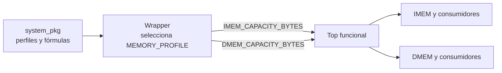

# Configuración común de la FPGA

- **Tipo:** arquitectura.
- **Estado documental:** especificación vigente.

**Estado:** Diseño aprobado el 2026-10-05.

## Propósito y alcance

Este documento define la configuración de elaboración común a los bloques del sistema FPGA. Esa configuración fija las capacidades de memoria, las constantes compartidas y las fórmulas con las que cada módulo obtiene anchos y límites.

Los siguientes bloques operan sobre las mismas capacidades y los mismos derivados:

- Loader.
- Instruction Memory (IMEM).
- Validación de Instruction Fetch (IF).
- Control de imagen.
- Session Preparation.
- Data Memory (DMEM).
- Serializador.

Una autoridad única impide contratos incompatibles: una memoria no reserva 1000 bytes mientras otro bloque valida o recorre 1024.

El alcance comprende:

- la tabla de perfiles aprobados y la selección única del perfil en el wrapper de placa;
- la resolución de cada perfil en las capacidades de IMEM y DMEM;
- la propagación explícita de esas capacidades hacia el top funcional y los módulos que las necesitan;
- las constantes, tipos, funciones de validación y fórmulas de anchos que comparten los módulos;
- los valores ya aprobados de clock, UART, controles de CPU, protocolo y estado global, conservando sus contratos.

La [tabla de perfiles](memory/memory_architecture.md#perfiles-definidos) es la fuente oficial de capacidades. [Composición](system_composition.md) define el empaquetado de puertos y registros interetapa. Los pines y constraints de placa permanecen en el XDC ya especificado: no se trasladan a constantes HDL ni se duplican como una segunda autoridad.

El formato de configuración de la aplicación PC se concretará junto con su diseño y tomará el mismo perfil de esa tabla. UART no transporta un puerto de perfil ni un generador de software.

## Organización

El paquete SystemVerilog **`system_pkg`**, en `system_pkg.sv`, concentra las definiciones compartidas. El paquete se compila antes de los módulos que lo importan. Sus definiciones son constantes de elaboración. El perfil se selecciona en el wrapper y las capacidades se pasan como parámetros de instancia.

### Perfiles publicados

El paquete ofrece dos perfiles: `REFERENCE` y `ALT_1000`. Para cada uno guarda las capacidades de IMEM y DMEM como valores `unsigned`. También contiene las funciones comunes que calculan anchos y validan la configuración.

| Perfil                   | `IMEM_CAPACITY_BYTES` | `DMEM_CAPACITY_BYTES` | Uso                                                         |
|--------------------------|----------------------:|----------------------:|-------------------------------------------------------------|
| `REFERENCE`, por defecto |                  1024 |                  2048 | elaboración, simulación y realización física                |
| `ALT_1000`               |                  1000 |                  1000 | elaboración/simulación y smoke tests, sin obligación física |

### Selección y jerarquía

El parámetro de elaboración `MEMORY_PROFILE` selecciona el perfil. Su valor por defecto es `REFERENCE`. Cada nivel tiene una responsabilidad:

| Nivel            | Responsabilidad                                                                                                                                                                                        |
|------------------|--------------------------------------------------------------------------------------------------------------------------------------------------------------------------------------------------------|
| Wrapper de placa | Recibe `MEMORY_PROFILE`, lo convierte una sola vez en `IMEM_CAPACITY_BYTES` y `DMEM_CAPACITY_BYTES`, e instancia el sistema pasando esos dos valores. Ningún módulo interno vuelve a elegir el perfil. |
| Top funcional    | Recibe `IMEM_CAPACITY_BYTES` y `DMEM_CAPACITY_BYTES`.                                                                                                                                                  |
| Módulos internos | Reciben solo las capacidades que necesitan, siempre por conexión explícita de parámetros del padre.                                                                                                    |

Esta distribución permite elaborar el top funcional y bloques en simulación sin el Clocking Wizard ni la placa. Las capacidades alternativas para las pruebas locales de aritmética se suministran al bloque probado.

## Definiciones compartidas de `system_pkg`

El paquete contiene las constantes y tipos que varios módulos utilizan juntos. 

### Memorias

- Perfiles `REFERENCE`/`ALT_1000`.
- Capacidades.
- Límites del dominio.
- Funciones comunes para calcular anchos y validar la configuración.

### Clock y UART

- Frecuencia funcional fija de 50 MHz.
- Configuración nominal 19200/8N1/16.
- Profundidad FIFO de cuatro.
- Tiempos de protocolo.

### Controles compartidos de CPU

- Códigos y anchos de ALU.
- `flow_op`.
- `mem_op`.
- Selectores y causas usados por productores y consumidores.

### Protocolo y estado global

- Comandos y resultados.
- Códigos externos de estado.
- Layouts fijos usados por el controlador y el serializador.

### Tipos compartidos

- Definiciones de tipos necesarias para las conexiones.

Los anchos que dependen de la capacidad se calculan localmente desde el parámetro recibido, con las funciones comunes del paquete.

## Tipos y aritmética de configuración

Los tipos distinguen tres papeles: 

- Capacidades de elaboración.
- Direcciones arquitectónicas.
- Extremos de validación. 

La siguiente tabla relaciona cada valor con su propósito, su representación y la regla que deben seguir el paquete y los módulos que lo importan:

| Valor                              | Para qué se usa                                                                         | Representación                                                                   | Regla de uso                                                                                                                                                              |
|------------------------------------|-----------------------------------------------------------------------------------------|----------------------------------------------------------------------------------|---------------------------------------------------------------------------------------------------------------------------------------------------------------------------|
| Capacidad `C` y parámetros         | Definir durante la elaboración cuántos bytes tiene una memoria y configurar los módulos | `longint unsigned` de 64 bits                                                    | Permite representar `2^32` y calcular `C + 1` sin overflow de 32 bits.                                                                                                    |
| Dirección arquitectónica (PC/EA)   | Representar las direcciones que utiliza la CPU                                          | `logic unsigned [31:0]`                                                          | Conserva los 32 bits que utiliza la arquitectura. La EA se forma módulo `2^32`.                                                                                           |
| Capacidad y extremos de validación | Comprobar que un acceso completo permanece dentro de la memoria                         | `logic unsigned [32:0]`                                                          | Se usa después de validar `4 <= C <= 2^32`. El bit adicional conserva el acarreo para comparar `EA + N` y `fetch PC + 4` sin perder un desbordamiento.                    |
| Anchos derivados                   | Dimensionar índices, direcciones internas y recursos a partir de `C`                    | Constante entera positiva; las señales usan `logic unsigned` del ancho calculado | Se calcula con las funciones comunes para capacidades válidas. No se pasa como parámetro independiente, para evitar que contradiga a `C`. El máximo requerido es 33 bits. |
| Tamaño LOAD original               | Conservar y validar el tamaño recibido por el protocolo                                 | `logic unsigned [39:0]`                                                          | Se valida el valor completo contra la capacidad y el múltiplo de cuatro antes de reducirlo. Nunca se truncan bits altos para fabricar un tamaño legal.                    |

Las operaciones de configuración deben realizarse con un tipo `unsigned` suficientemente ancho desde el principio. Por ejemplo, `2^32` se representa como `64'h0000000100000000`, porque una dirección de 32 bits llega hasta `2^32 - 1`, mientras que la capacidad máxima puede ser `2^32`. No debe calcularse como `1 << 32` usando un entero de 32 bits y convertir el resultado después: el desbordamiento ya habría ocurrido y el valor obtenido sería incorrecto.

## Fórmulas únicas de anchos

Para una capacidad válida `C`, con `Q = C/4`, el paquete proporciona las funciones correspondientes. Cada módulo calcula sus `localparam` a partir de la capacidad que recibe. El top utiliza nombres diferenciados, `IMEM_…` y `DMEM_…`, para evitar ambigüedades. Dentro de cada módulo, `BYTE_ADDRESS_WIDTH` se refiere exclusivamente a la memoria que ese módulo implementa. Todos los anchos se derivan de `C` y no se propagan como parámetros independientes que puedan entrar en contradicción con ella.

La siguiente tabla muestra los resultados de las fórmulas para varias capacidades:

| Propiedad                  | Fórmula matemática     | `C=4` | `C=1000` | `C=1024` | `C=2048` | `C=2^32` |
|----------------------------|------------------------|------:|---------:|---------:|---------:|---------:|
| `BYTE_ADDRESS_WIDTH`       | max(1,ceil(log2(C)))   |     2 |       10 |       10 |       11 |       32 |
| `WORD_INDEX_WIDTH`         | max(1,ceil(log2(Q)))   |     1 |        8 |        8 |        9 |       30 |
| `ROW_INDEX_WIDTH`          | max(1,ceil(log2(Q)))   |     1 |        8 |        8 |        9 |       30 |
| `CAPACITY_INCLUSIVE_WIDTH` | max(1,ceil(log2(C+1))) |     3 |       10 |       11 |       12 |       33 |

`CAPACITY_INCLUSIVE_WIDTH` se utiliza para representar capacidades y límites inclusivos, como el tamaño de una imagen y los bytes faltantes durante una carga. Los índices y contadores de cada bloque se derivan de la capacidad de la memoria correspondiente mediante las funciones comunes. Los detalles de aplicación —como lanes, máscaras, direcciones internas y serialización— pertenecen a los contratos de cada módulo.

## Propagación concreta

Los padres intermedios reenvían a sus hijos las capacidades que recibieron. Ningún módulo intermedio vuelve a seleccionar el perfil ni reemplaza esas capacidades por valores predeterminados.

Cada hijo recibe del padre una capacidad y deriva de ella las propiedades que usa:

| Consumidor funcional            | Parámetro recibido del padre | Propiedades que deriva/usa                                                                |
|---------------------------------|------------------------------|-------------------------------------------------------------------------------------------|
| IMEM                            | `IMEM_CAPACITY_BYTES`        | palabras, índice de escritura y guard de fila                                             |
| `Fetch Fault Check` / IF        | `IMEM_CAPACITY_BYTES`        | límite de 33 bits, región completa y ancho de tamaño confirmado                           |
| Loader                          | `IMEM_CAPACITY_BYTES`        | dirección de byte e índice de palabra; tamaño/posición vienen del controlador existente   |
| `Global FSM` / estado de imagen | `IMEM_CAPACITY_BYTES`        | `IMAGE_SIZE_WIDTH`; único tamaño confirmado persistente                                   |
| `protocol_controller`           | `IMEM_CAPACITY_BYTES`        | tamaño validado, `remaining_bytes` y `load_byte_offset`; tamaño original sigue de 40 bits |
| `Data Memory`                   | `DMEM_CAPACITY_BYTES`        | filas/lanes, direcciones CPU/Debug/preparación, bitmap único                              |
| `EX Fault Check`                | `DMEM_CAPACITY_BYTES`        | límite y región completa en 33 bits                                                       |
| `Session Preparation`           | `DMEM_CAPACITY_BYTES`        | índice inclusivo, dirección y límite de recorrido                                         |
| `response_serializer`           | `DMEM_CAPACITY_BYTES`        | dirección de consulta y count/recorrido/lista; layout UART fijo                           |

> **Nota:** La capacidad física de IMEM y DMEM se define durante la elaboración. El tamaño de la imagen cargada solo indica cuánto contenido se utiliza durante una sesión: no modifica la capacidad de IMEM ni determina la capacidad de DMEM.

## Rechazo antes de ejecutar

La validación de la configuración ocurre en la etapa de build, durante la elaboración. En esta etapa, se realizan distintas comprobaciones para asegurar que la configuración sea válida y compatible con el target. Se distinguen dos categorías de error y en caso de detectar alguno, se detiene la ejecución antes de elaborar recursos que sean ilegales.

### `CONFIG_INVALID_CAPACITY`

Se produce cuando la capacidad de memoria de IMEM o DMEM no cumple con los requisitos de ser múltiplo de cuatro y estar dentro del rango permitido (4 a 2^32 bytes).

### `CONFIG_UNSUPPORTED`
Se produce cuando se selecciona un perfil desconocido o cuando la capacidad de memoria es legal desde el punto de vista arquitectónico pero no está soportada por el target declarado.

### `C + 1` y anchos derivados

La etapa de build calcula `C + 1` y los anchos derivados de la capacidad utilizando aritmética unsigned suficientemente ancha. Esto permite verificar los recursos y puertos frente a las fórmulas y errores anteriores antes de ejecutar.

### Parámetros inválidos

En módulos genéricos, un parámetro de capacidad omitido se detecta como configuración inválida. Si el HDL necesita un default, usa el centinela cero y lo comprueba.

Los parámetros inválidos no deben provocar errores secundarios durante la elaboración. Por eso, los anchos y las profundidades auxiliares se mantienen como mínimo en uno mientras se genera el diagnóstico. El build informa la configuración inválida antes de elaborar arrays y comprueba el soporte del target antes de reservar recursos.

Las pruebas de las fórmulas pueden evaluar el caso límite `C = 2^32` sin crear una memoria de ese tamaño. En síntesis y generación del bitstream, en cambio, el build comprueba primero si el target soporta la capacidad seleccionada y solo después elabora los arrays. De este modo, una capacidad inválida y una capacidad válida pero no soportada producen diagnósticos diferentes, sin crear una interfaz externa nueva.

## Verificación y evidencia

Las fórmulas de anchos y límites se verificaron mediante un modelo matemático que incluye la capacidad mínima, valores que no son potencias de dos y el extremo `C = 2^32`. La comprobación confirma que:

- `C + 1` y los extremos de validación se representan sin truncamiento;
- las direcciones arquitectónicas conservan 32 bits;
- los extremos de validación usan 33 bits;
- los anchos derivados son siempre suficientes;
- cada consumidor recibe la capacidad de la memoria correspondiente.

La implementación de los validadores, sus mensajes y la distinción entre `CONFIG_INVALID_CAPACITY` y `CONFIG_UNSUPPORTED` deberá verificarse cuando se implemente el RTL.

### Límites

Esta evidencia es documental y matemática. No sustituye las pruebas de simulación, síntesis ni hardware, y no acredita soporte físico para todas las capacidades del dominio. Aún no hay elaboración RTL. Este acuerdo no modifica el diseño de la aplicación PC ni autoriza implementación.

[Acuerdo de configuración común](../decisions/DEC-ARCH-006.md#acuerdo-de-concreción-de-dec-arch-006--paquete-común-y-propagación-de-configuración).

## Referencias y trazabilidad

- [Mapa de autoridad documental](system_overview.md#autoridad-documental-por-tema): contratos vigentes y origen de las decisiones.
- [Requisitos](../requirements.md): obligaciones y criterios de aceptación.
- [Decisiones pendientes](../decisions/pending_decisions.md): decisiones de diseño abiertas y condiciones de cierre.
