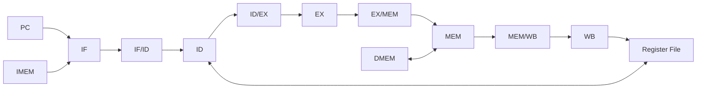

# Pipeline de la CPU

- **Tipo:** arquitectura. 
- **Estado documental:** especificación vigente.

## Índice

- [Propósito y alcance](#propósito-y-alcance)
- [Organización general](#organización-general)
- [Avance del pipeline](#avance-del-pipeline)
- [IF — Instruction Fetch](#if--instruction-fetch)
- [ID — Instruction Decode](#id--instruction-decode)
- [EX — Execute](#ex--execute)
- [MEM — Memory](#mem--memory)
- [WB — Write Back](#wb--write-back)
- [Comportamiento ante cambios del avance normal](#comportamiento-ante-cambios-del-avance-normal)
- [Drenado del pipeline](#drenado-del-pipeline)
- [Observación del pipeline](#observación-del-pipeline)
- [Referencias y trazabilidad](#referencias-y-trazabilidad)

## Propósito y alcance

Este documento define la organización y el funcionamiento temporal del pipeline in-order de cinco etapas de la CPU: IF, ID, EX, MEM y WB.

El alcance comprende:

- la responsabilidad de cada etapa;
- los cuatro registros interetapa;
- el avance normal de las instrucciones;
- la conservación del orden arquitectónico;
- los stalls, flushes y cambios del avance normal;
- el drenado del pipeline;
- las señales y el estado necesarios para observar el pipeline.

Cada etapa desarrolla sus propios bloques y contratos locales. Los hazards, faults, accesos a memoria y control de ejecución se especifican en sus documentos especializados; este documento describe cómo esos mecanismos afectan al avance global del pipeline.

Este documento no define la implementación interna de cada etapa, la codificación completa de instrucciones, el protocolo UART ni el reset global. Esos contratos pertenecen a [Stage ID](stage_id.md), [Control y hazards](control_and_hazards.md), [Faults y terminación](../session/faults_and_termination.md), [Arquitectura de memoria](../memory/memory_architecture.md), [Integración del reset](../platform/reset_integration.md) y [Protocolo](../../protocol.md).

## Organización general

La CPU utiliza un pipeline **in-order de cinco etapas**: `IF`, `ID`, `EX`, `MEM` y `WB`. Cada etapa realiza una parte distinta del procesamiento de una instrucción y puede trabajar, en el mismo ciclo, sobre una instrucción diferente.

Entre las etapas se encuentran cuatro registros interetapa —`IF/ID`, `ID/EX`, `EX/MEM` y `MEM/WB`— que conservan la información necesaria para que cada instrucción continúe su recorrido en el ciclo siguiente.

El recorrido permanece ordenado: las instrucciones ingresan siguiendo el orden del programa y los efectos arquitectónicos visibles conservan ese mismo orden. El solapamiento cambia cuántas instrucciones se encuentran activas al mismo tiempo, pero no altera la semántica secuencial del programa.

## Avance del pipeline

### Ciclo efectivo

El estado del pipeline cambia únicamente durante un **ciclo efectivo de la CPU**. En un avance ordinario, cada registro interetapa captura el trabajo producido por la etapa anterior y la instrucción activa continúa hacia la etapa siguiente.

Cada registro interetapa captura, en el flanco de actualización, los valores que la etapa anterior produjo durante el ciclo; por eso, todas las capturas se basan en el estado previo a ese flanco. Una instrucción avanza como máximo una etapa por ciclo: `IF` carga `IF/ID`, `ID` carga `ID/EX`, `EX` carga `EX/MEM` y `MEM` carga `MEM/WB`.

Cuando la CPU se encuentra en `HOLD` no ocurre un ciclo efectivo y el estado del pipeline permanece retenido. La relación entre el clock físico, `RUN`, `STEP`, `HOLD` y la autorización de ciclos se desarrolla en [Control de ejecución y sesión](../session/execution_control.md).

### Validez

Cada registro interetapa conserva una indicación de **validez** que distingue una instrucción activa de datos residuales almacenados en ese registro.

Una entrada inválida puede conservar valores en sus campos, pero esos valores no representan una instrucción en ejecución y no producen efectos arquitectónicos. Tampoco participan como productores o consumidores válidos en la resolución de dependencias.

Esta distinción entre valores válidos e inválidos permite representar distintas situaciones sin borrar físicamente todos los campos del registro:

- **Bubble:** una posición del pipeline queda inválida porque no contiene una instrucción activa. La posición puede conservar valores residuales en sus campos, pero esos valores no se interpretan ni generan efectos arquitectónicos. Una bubble permite que una etapa quede vacía durante un ciclo sin ejecutar una instrucción inexistente.

- **Stall:** una parte del pipeline conserva su estado durante un ciclo porque una instrucción todavía no puede avanzar. La instrucción que provoca la espera continúa su recorrido cuando corresponde, mientras las etapas afectadas retienen sus registros y no aceptan nuevo trabajo. Un stall retrasa el avance, pero no invalida la instrucción retenida.

- **Flush:** una o más instrucciones que ya habían ingresado al pipeline se invalidan porque dejaron de pertenecer al camino correcto. Puede ocurrir, por ejemplo, después de resolver un branch, detectar un fault o aplicar una acción de control que descarta instrucciones especulativas. Un flush elimina su posibilidad de producir efectos arquitectónicos; no necesariamente borra físicamente los campos de los registros.

- **`HOLD`:** la CPU no realiza un ciclo efectivo. Los registros interetapa, el PC y el estado de ejecución conservan sus valores, y ninguna etapa captura nuevo trabajo. `HOLD` no crea una bubble ni invalida instrucciones: simplemente pausa temporalmente todo el pipeline.

La selección exacta de capturas, retenciones, bubbles e invalidaciones se encuentra en [Control del pipeline y hazards](control_and_hazards.md).

### Identidad de una instrucción

El pipeline puede contener varias instrucciones simultáneamente. Para conservar la identidad de cada una, los registros interetapa transportan su palabra de instrucción y, cuando corresponde, la dirección desde la que fue obtenida.

Esa dirección es el **PC propio** de la instrucción. Acompaña a la instrucción durante las etapas que necesitan identificar su origen, por ejemplo para resolver un cambio de flujo, detectar un fault o informar un resultado.

El PC propio es distinto del **PC global de IF**. El PC global indica la próxima dirección que debe buscarse, mientras que el PC propio identifica una instrucción que ya ingresó al pipeline. Por eso ambos pueden tener valores diferentes: mientras una instrucción con PC `0x10` está en EX, IF puede estar buscando otra en `0x18`.

## IF — Instruction Fetch

IF es la puerta de entrada al pipeline. Utiliza el PC global para seleccionar en IMEM la palabra de 32 bits correspondiente a la búsqueda actual. En un recorrido secuencial, la siguiente búsqueda utiliza la dirección siguiente; un cambio de flujo puede reemplazar ese recorrido por otro destino.

La búsqueda también se valida antes de tratar su resultado como una instrucción. Si la dirección de fetch presenta un problema de alineación o queda fuera de la imagen ejecutable, IF genera un **candidato de fault de fetch** en lugar de una instrucción activa. Ese candidato no constituye todavía un fault arquitectónico confirmado.

La detección y la confirmación de los faults de fetch se describen en [Faults, redirects y terminación](../session/faults_and_termination.md), mientras que los límites y la validación de IMEM se detallan en [Arquitectura de memoria](../memory/memory_architecture.md).

### Registro IF/ID

`IF/ID` conserva una instrucción obtenida correctamente o la información asociada a un candidato de fault de fetch. Ambas situaciones utilizan el mismo PC de origen, pero se distinguen mediante indicadores de validez separados.

| Campo | Ancho | Tipo | Función |
|---|---:|---|---|
| `valid` | 1 | Control | Indica una instrucción obtenida y activa en ID. |
| `pc` | 32 | Data | PC propio de la instrucción o del fetch candidato. |
| `instruction` | 32 | Data | Palabra obtenida de IMEM; carece de significado como instrucción cuando el fetch falló. |
| `fetch_fault_valid` | 1 | Control | Indica un candidato de fault de fetch transportado hacia ID. |
| `fetch_fault_cause` | 3 | Data | Conserva la causa del candidato de fetch. |

En un estado legal, `valid` y `fetch_fault_valid` no se encuentran activos simultáneamente.

Las entradas de `IF/ID` distinguen estos casos:

| Búsqueda | `valid` | `fetch_fault_valid` | Interpretación |
|---|---:|---:|---|
| Fetch normal | 1 | 0 | Instrucción activa. |
| Búsqueda que falla | 0 | 1 | Candidato que conserva el PC de esa búsqueda; no representa una instrucción activa. |

Cuando `IF/ID` se invalida, ambos indicadores dejan de representar trabajo activo. Cuando se retiene, sus cinco campos permanecen sin cambios.

## ID — Instruction Decode

`ID` recibe la entrada de `IF/ID` y:

- Interpreta la instrucción activa. 
- Reconoce la operación y sus operandos
- Lee los registros fuente.
- Genera el inmediato cuando corresponde.

El decoder también determina la legalidad de la codificación y produce la información de control que se utilizará en las etapas posteriores. 

Cuando una escritura de `WB` coincide con una lectura de `ID` en el mismo ciclo, el camino `WB → ID` proporciona directamente el valor actualizado. De esta forma, `ID/EX` conserva como valores base los operandos correctos para la instrucción que avanza hacia `EX`.

La codificación del decoder y las señales funcionales generadas en `ID` se detallan en [Etapa ID](stage_id.md#decoder). La reconstrucción de inmediatos pertenece a [Datapath](datapath.md#inmediato); el bypass `WB → ID` y las dependencias entre instrucciones se desarrollan en [Control del pipeline y hazards](control_and_hazards.md).

En `ID` puede confirmarse un fault por una instrucción ilegal o por un candidato de fetch. Su confirmación respeta el orden de las instrucciones y se coordina con el control del pipeline. Ese comportamiento se especifica en [Faults, redirects y terminación](../session/faults_and_termination.md).

### Registro ID/EX

`ID/EX` conserva el contexto completo que `EX` utiliza para ejecutar la instrucción. Además de la identidad de la instrucción, transporta los índices y valores base de los operandos, el inmediato y las señales de control necesarias para determinar el comportamiento de la etapa.

| Campo | Ancho | Tipo | Función |
|---|---:|---|---|
| `valid` | 1 | Control | Instrucción activa en EX. |
| `pc` | 32 | Data | PC propio de la instrucción. |
| `instruction` | 32 | Data | Palabra de instrucción. |
| `rs1` | 5 | Data | Índice del primer registro fuente. |
| `rs2` | 5 | Data | Índice del segundo registro fuente. |
| `rd` | 5 | Data | Índice del registro destino. |
| `rs1_value` | 32 | Data | Valor base de la primera fuente después del bypass WB→ID. |
| `rs2_value` | 32 | Data | Valor base de la segunda fuente después del bypass WB→ID. |
| `immediate` | 32 | Data | Inmediato generado y extendido a 32 bits. |
| `alu_op` | 6 | Control | Operación seleccionada para la ALU. |
| `alu_src` | 1 | Control | Selección entre segundo operando de registro e inmediato. |
| `result_sel` | 2 | Control | Selección del resultado producido por EX. |
| `flow_op` | 3 | Control | Tipo de operación de flujo: `NONE`, `BEQ`, `BNE`, `JAL`, `JALR` o `HALT`. |
| `mem_op` | 4 | Control | Tipo de operación de memoria o `NONE`. |
| `reg_write` | 1 | Control | Indica que la instrucción produce un resultado destinado al banco de registros. |

## EX — Execute

`EX` recibe desde `ID/EX` los operandos, el inmediato y las señales de control de la instrucción. Con esa información ejecuta la operación correspondiente y produce los resultados que necesitan las etapas siguientes.

En un avance normal, EX utiliza los valores de operandos capturados durante `ID`. Sin embargo, como varias instrucciones avanzan simultáneamente, una instrucción anterior puede haber calculado un resultado que todavía no fue escrito en el banco de registros cuando la siguiente instrucción necesita utilizarlo.

Para resolver esa dependencia, la etapa EX puede recibir un operando reenviado directamente desde el resultado más reciente producido por una instrucción anterior. Este mecanismo se denomina **forwarding** o **bypass**. Si el resultado todavía no está disponible para ser reenviado —por ejemplo, en ciertas dependencias posteriores a un `load`—, el control de hazards debe detener temporalmente el avance correspondiente.

Con los operandos efectivos, EX cumple estas funciones:

- Realiza las operaciones aritméticas, lógicas, comparaciones y desplazamientos.
- Calcula las direcciones utilizadas por loads y stores.
- Forma los destinos de branches y jumps.
- Produce el valor de enlace cuando corresponde.

EX también es la etapa donde se resuelven los cambios de flujo y se validan los accesos de datos y la alineación de los destinos de los saltos que se toman. Un fault propio de la instrucción prevalece sobre sus efectos normales. `halt` también alcanza su punto de confirmación en esta etapa.

Los bloques concretos que forman estos caminos —ALU, muxes, sumadores, generación de targets y selección de resultados— se detallan en [Datapath](datapath.md). La selección de operandos reenviados se especifica en [Control del pipeline y hazards](control_and_hazards.md), y el descarte de instrucciones por redirects, faults y `halt` se desarrolla en [Faults, redirects y terminación](../session/faults_and_termination.md).

### Registro EX/MEM

Después de `EX`, la instrucción ya no necesita conservar sus operandos base ni el inmediato. El registro `EX/MEM` transporta el resultado consolidado de la etapa `EX` y la información que `MEM` va a utilizar.

| Campo | Ancho | Tipo | Función |
|---|---:|---|---|
| `valid` | 1 | Control | Instrucción activa en MEM. |
| `pc` | 32 | Data | PC propio de la instrucción. |
| `instruction` | 32 | Data | Palabra de instrucción. |
| `rd` | 5 | Data | Destino utilizado por writeback y forwarding. |
| `reg_write` | 1 | Control | Indica que la instrucción produce un resultado para el banco de registros. |
| `mem_op` | 4 | Control | Describe la operación de load, store o ausencia de acceso a DMEM. |
| `ex_result` | 32 | Data | Dirección efectiva para memoria o resultado producido en EX. |
| `store_data` | 32 | Data | Dato ya resuelto que utiliza un store en MEM. |

Cuando se toma un branch, o cuando `JAL` o `JALR` cambian el PC, se aplica un **redirect**: el próximo fetch comienza en la nueva dirección de destino. La instrucción que detectó y produjo ese cambio de flujo continúa válidamente hacia `EX/MEM`; en cambio, las instrucciones más jóvenes que ya habían sido traídas por el camino anterior y todavía están en `IF/ID` o `ID/EX` se descartan e invalidan.

`BEQ` y `BNE` no producen efectos en MEM ni en WB, pero pueden continuar por el pipeline para conservar el recorrido temporal y la observabilidad de la instrucción. `JAL` y `JALR`, en cambio, llevan `PC + 4` en `EX/MEM.ex_result` para completar posteriormente la escritura del registro de enlace.

`halt` y una instrucción cuyo fault se confirma en EX se consumen en esa etapa y no ingresan válidamente a `EX/MEM`. Las instrucciones anteriores que ya se encuentran en las etapas finales continúan durante el [drenado](#drenado-del-pipeline).

## MEM — Memory

MEM recibe el resultado producido en EX y resuelve los accesos que la instrucción deba realizar sobre la memoria de datos.

Un load utiliza la dirección conservada en `EX/MEM.ex_result` para obtener el valor correspondiente de DMEM. Un store utiliza esa misma dirección junto con `EX/MEM.store_data` para realizar su escritura. Las instrucciones que no acceden a DMEM conservan el resultado que ya habían producido en EX y continúan en el pipeline hacia `MEM/WB`.

Antes de llegar a MEM, EX verifica que la dirección efectiva y el tamaño del acceso sean válidos: comprueba la alineación y que todos los bytes de la operación pertenezcan al rango permitido de DMEM.

Si alguna comprobación falla, EX confirma el fault, invalida la instrucción y no habilita ninguna lectura ni escritura en MEM. Por lo tanto, una instrucción que llega válida a MEM ya pasó esos controles.

MEM se limita a ejecutar el acceso aprobado: lee DMEM para un `load` o escribe el dato correspondiente para un `store`. No repite las comprobaciones de alineación y rango ni genera un segundo fault para la misma operación.

La organización de los bytes, los tamaños de acceso, la extensión de loads y la semántica exacta de las escrituras se detallan en [Arquitectura de memoria](../memory/memory_architecture.md).

### Registro MEM/WB

`MEM/WB` conserva el valor final que WB utiliza como resultado arquitectónico. Para un load, ese valor proviene de DMEM; para las restantes instrucciones que escriben un registro, proviene del resultado que llegó desde EX.

| Campo | Ancho | Tipo | Función |
|---|---:|---|---|
| `valid` | 1 | Control | Instrucción activa en WB. |
| `pc` | 32 | Data | PC propio de la instrucción. |
| `instruction` | 32 | Data | Palabra de instrucción. |
| `rd` | 5 | Data | Registro destino. |
| `reg_write` | 1 | Control | Indica que la instrucción escribe el banco de registros. |
| `wb_value` | 32 | Data | Valor final seleccionado para writeback. |

En `MEM/WB` ya no se transportan `mem_op`, `store_data` ni resultados alternativos. WB recibe directamente el valor que corresponde escribir en el banco de registros.

## WB — Write Back

WB constituye la última etapa del recorrido. Cuando una entrada válida representa una instrucción que escribe un registro distinto de `x0`, el valor conservado en `MEM/WB.wb_value` se escribe en el banco de registros durante el ciclo efectivo correspondiente.

Las instrucciones sin destino de registro pueden atravesar esta etapa con `reg_write=0` sin producir una escritura. De la misma forma, una entrada inválida no produce un efecto aunque sus campos conserven valores residuales.

La habilitación exacta del writeback y la conservación de commits anteriores se especifican en [Etapa WB](stage_wb.md#condición-efectiva-de-writeback). La autorización del ciclo pertenece a [Control de ejecución y sesión](../session/execution_control.md).

## Comportamiento ante cambios del avance normal

El contenido de los cuatro registros no siempre avanza de forma uniforme. La acción aplicada en cada ciclo determina qué trabajo continúa, qué trabajo permanece retenido y qué trabajo se invalida.

A nivel del pipeline, las situaciones principales se resumen así:

| Situación | Comportamiento general |
|---|---|
| Avance normal | Las instrucciones activas progresan hacia la etapa siguiente y IF incorpora nuevo trabajo. |
| Dependencia load-use | El consumidor permanece en `IF/ID`, `ID/EX` recibe una bubble y las instrucciones anteriores continúan. |
| Redirect | El PC adopta el destino resuelto y se invalidan las instrucciones posteriores de ese camino. |
| Fault confirmado | Se descartan la instrucción que provoca el fault y las posteriores; las anteriores conservan sus efectos válidos. |
| `halt` confirmado | Se dejan de admitir instrucciones nuevas, se descartan las posteriores a `halt` y solo continúan las anteriores. |
| `HOLD` | No ocurre un ciclo efectivo de la CPU y el pipeline conserva su estado. |

Las prioridades y la tabla exacta de actualización de PC, `IF/ID`, `ID/EX`, `EX/MEM` y `MEM/WB` se encuentran en [Control del pipeline y hazards](control_and_hazards.md).

## Drenado del pipeline

El **drenado del pipeline** es la fase posterior a la confirmación de un `halt` o un fault. Durante esta fase, la CPU deja de admitir instrucciones nuevas, descarta las instrucciones posteriores al evento y permite que las instrucciones anteriores que todavía están activas terminen sus efectos válidos.

El objetivo es alcanzar el estado final de forma ordenada: una instrucción posterior al `halt` o al fault no debe modificar el estado arquitectónico, pero una instrucción anterior que ya avanzó lo suficiente sí debe poder completar su ejecución.

En las ejecuciones alcanzables por esta arquitectura, confirmar `halt` o un fault invalida `IF/ID` e `ID/EX`. Por lo tanto, durante el drenado solo pueden permanecer instrucciones anteriores en `EX/MEM` y `MEM/WB`.

El drenado termina cuando esos registros dejan de contener instrucciones activas. Su avance automático o controlado mediante `STEP` depende del modo de ejecución vigente y se desarrolla en [Control de ejecución y sesión](../session/execution_control.md). El tratamiento de la instrucción que provoca `halt` o fault y de las anteriores se detalla en [Faults, redirects y terminación](../session/faults_and_termination.md).

## Observación del pipeline

Los cuatro registros interetapa forman parte del estado observable aprobado del pipeline. La validez, el PC propio y la palabra de instrucción permiten identificar qué instrucciones están activas, mientras que los campos adicionales conservan la información funcional utilizada por las distintas etapas. Debug transmite ese estado sin modificar el contenido ni el significado de los registros.

La arquitectura define qué representa cada campo y cuándo la información es coherente. El protocolo define cómo se agrupan, ordenan y serializan esos campos en el snapshot externo. No todas las señales combinacionales internas forman parte de la información observable.

La información observable y su representación aprobada se desarrollan en [Arquitectura de Debug](../debug/debug_architecture.md).

## Referencias y trazabilidad

- [Decisiones](../../decisions/decisions.md): DEC-ARCH-003, DEC-ARCH-002, DEC-ARCH-004, DEC-ARCH-007, DEC-ARCH-008 y DEC-SYS-006.
- [Requisitos](../../requirements.md): REQ-CPU-004 a REQ-CPU-011, REQ-CPU-013; REQ-HAZ-001 a REQ-HAZ-010; REQ-DBG-014; REQ-EXEC-018.
