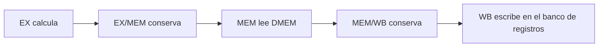
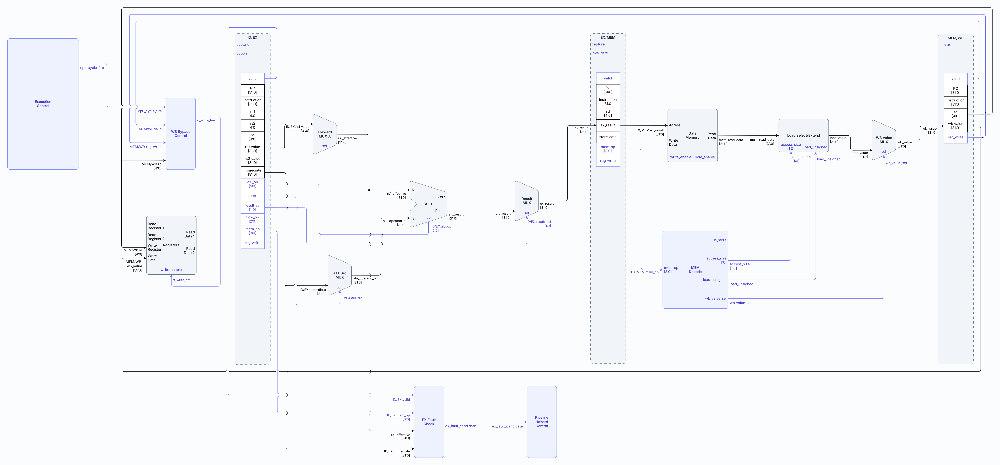
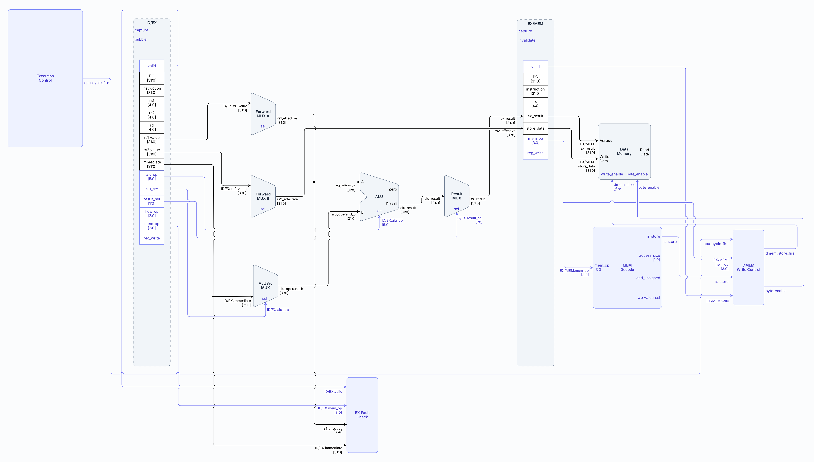
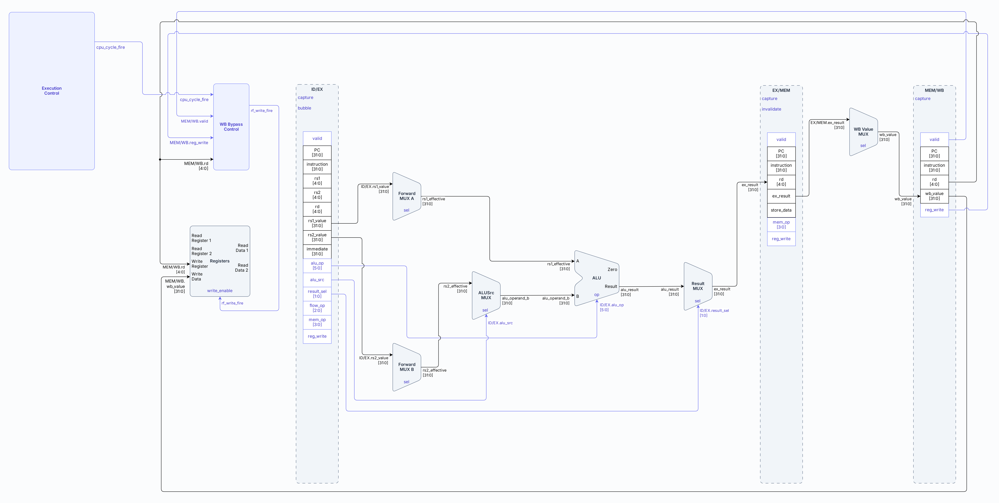
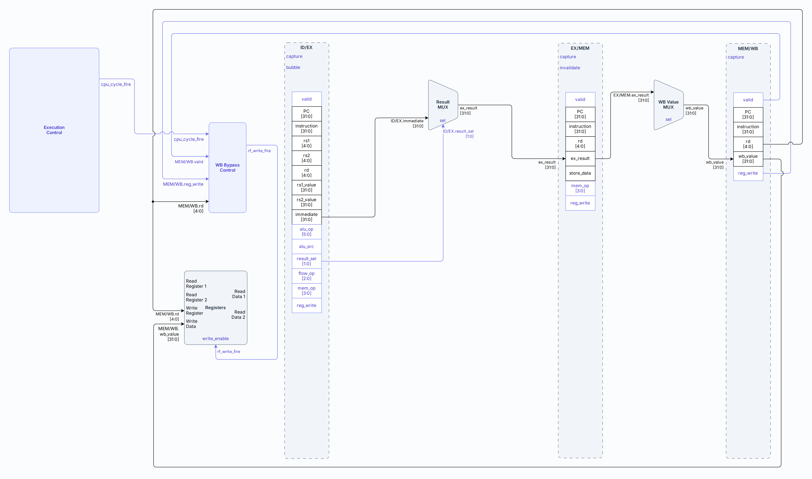
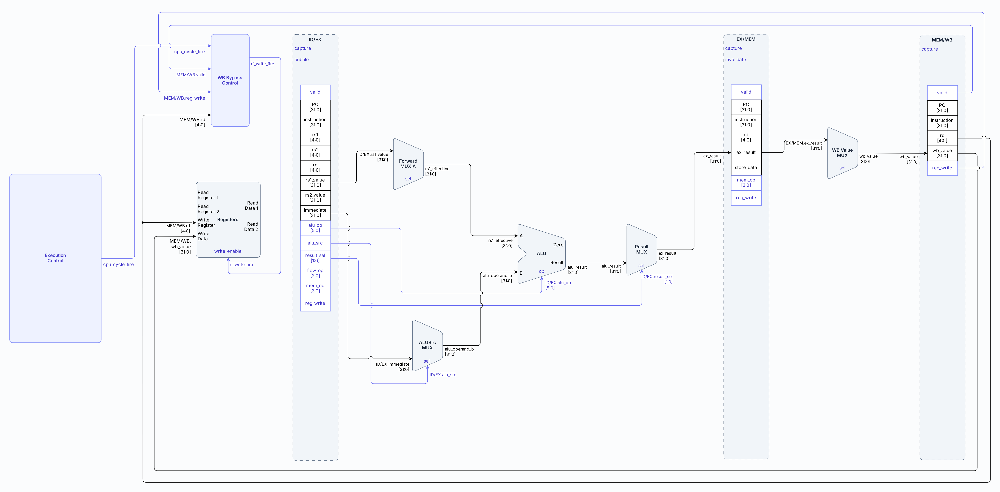
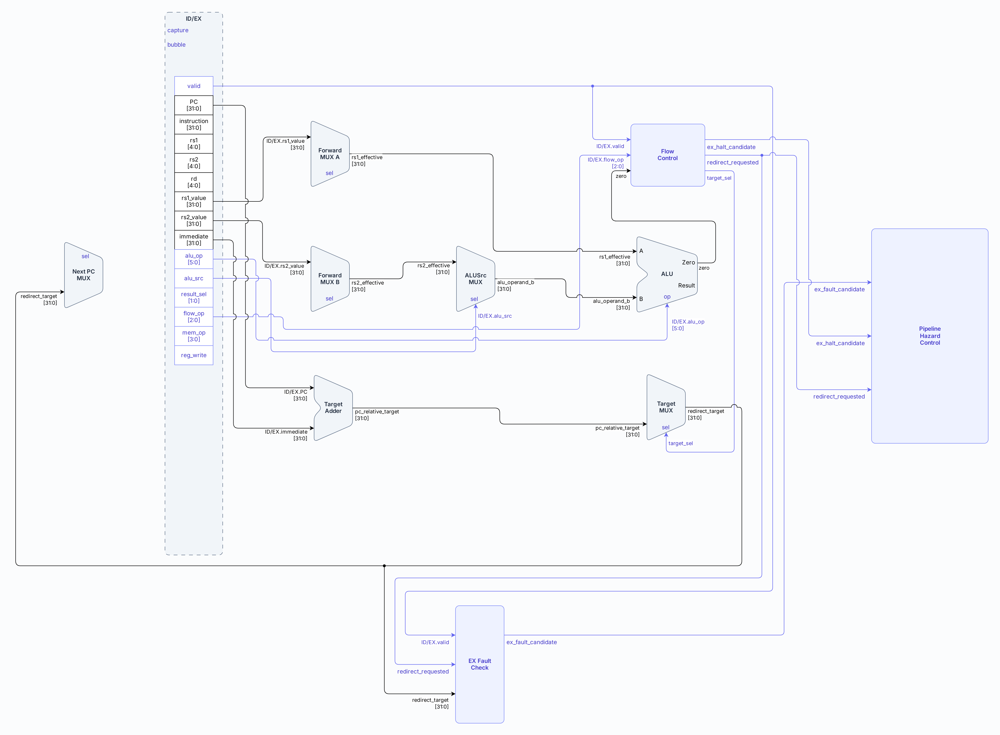
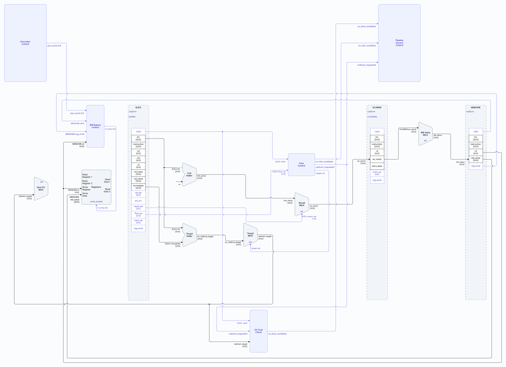
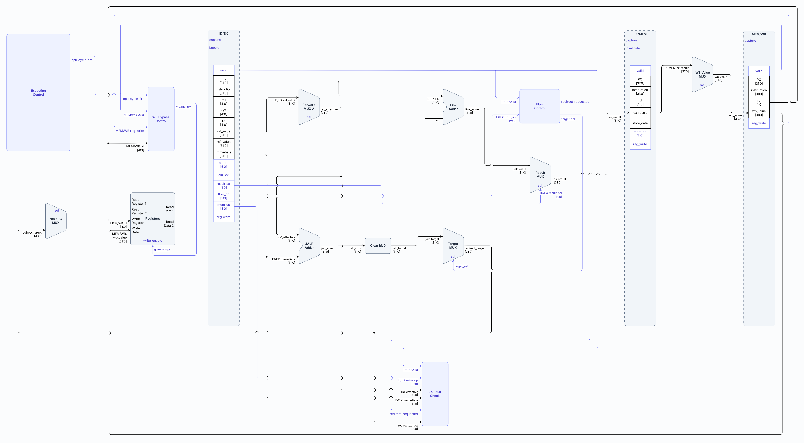

# Datapath

- **Tipo:** arquitectura. 
- **Estado documental:** especificación vigente.

## Índice

- [Propósito y alcance](#propósito-y-alcance)
- [Vista general del recorrido de datos](#vista-general-del-recorrido-de-datos)
- [Estado persistente del datapath](#estado-persistente-del-datapath)
- [Fetch: de PC a IF/ID](#fetch-de-pc-a-ifid)
- [De una instrucción almacenada a sus operandos](#de-una-instrucción-almacenada-a-sus-operandos)
- [Bypass en ID](#bypass-en-id)
- [Qué guarda ID/EX](#qué-guarda-idex)
- [Forwarding hacia EX](#forwarding-hacia-ex)
- [Selección de operandos para la ALU](#selección-de-operandos-para-la-alu)
- [ALU](#alu)
- [Caminos auxiliares de EX](#caminos-auxiliares-de-ex)
- [El valor ex_result](#el-valor-ex_result)
- [El camino separado de store_data](#el-camino-separado-de-store_data)
- [Qué guarda EX/MEM](#qué-guarda-exmem)
- [Loads](#loads)
- [Stores](#stores)
- [Instrucciones aritméticas](#instrucciones-aritméticas)
- [LUI](#lui)
- [Branches](#branches)
- [JAL y JALR](#jal-y-jalr)
- [De EX a WB](#de-ex-a-wb)
- [Qué guarda MEM/WB](#qué-guarda-memwb)
- [Writeback](#writeback)
- [Caminos fundamentales resumidos por clase de instrucción](#caminos-fundamentales-resumidos-por-clase-de-instrucción)
- [Inventario funcional de bloques de datos](#inventario-funcional-de-bloques-de-datos)
- [Referencias y trazabilidad](#referencias-y-trazabilidad)

<a id="qué-describe-este-documento"></a>

## Propósito y alcance

Este documento define los caminos de datos del procesador: los elementos que almacenan, transportan y transforman los valores utilizados por las instrucciones desde su búsqueda hasta la producción de sus resultados.

El alcance comprende:

- el PC y el recorrido de búsqueda hacia `IF/ID`;
- el banco de registros y la generación de inmediatos;
- los registros interetapa;
- la selección de operandos y los caminos de forwarding;
- la ALU, los sumadores y la generación de destinos;
- la formación de direcciones efectivas y el transporte de datos de `load` y `store`;
- la selección de resultados y el recorrido hacia writeback.

Las distintas clases de instrucciones reutilizan estos caminos. Lo que cambia entre ellas es qué operandos se seleccionan, qué unidades funcionales intervienen y qué resultado continúa hacia la siguiente etapa.

Este documento describe los valores y caminos por los que circulan los datos. No define cuándo avanza el pipeline, cuándo se insertan bubbles, cuándo se hace flush ni cómo se generan las señales de control; esos aspectos pertenecen a [Pipeline CPU](cpu_pipeline.md) y [Control y hazards](control_and_hazards.md).

---

## Vista general del recorrido de datos

El siguiente diagrama resume el flujo de datos del procesador:


Los selectores de los multiplexores y las señales de control locales indican qué valores debe utilizar cada camino del datapath. `access_size` y `load_unsigned` se generan en MEM a partir de la operación de memoria; no son campos adicionales de `EX/MEM`. Su generación se describe en [Etapa MEM](stage_mem.md#mem-decode).

El recorrido de los datos depende del tipo de instrucción.

### Instrucciones que producen un resultado

En una operación aritmética, lógica, de desplazamiento, `LUI`, `JAL` o `JALR`, el recorrido es el siguiente:

| Etapa | Qué ocurre |
|---|---|
| `EX` | Utiliza los operandos efectivos y ejecuta la operación. |
| `EX/MEM` | Guarda el resultado producido por EX en `ex_result`. |
| `MEM` | Transporta ese resultado sin acceder a DMEM. |
| `MEM/WB` | Guarda el valor que utilizará la etapa WB. |
| `WB` | Escribe el resultado en el banco de registros si `reg_write` está activo. |

En forma resumida:


En este recorrido, `ex_result` es el resultado producido por EX. Para un `load`, el recorrido es diferente: `ex_result` contiene la dirección efectiva y MEM debe leer DMEM antes de producir `load_value`.

En `JAL` y `JALR`, el resultado producido por EX es `PC + 4`, que se escribe en el registro de enlace.

### Instrucciones `load`

En un `load`, EX no produce todavía el valor que se escribirá en el banco de registros. Produce la dirección efectiva y la conserva en `EX/MEM.ex_result`. MEM utiliza esa dirección para leer DMEM. El valor leído se convierte en `load_value` y continúa hacia WB:

| Etapa | Qué ocurre |
|---|---|
| `EX` | Calcula la dirección efectiva sumando el operando base y el inmediato. |
| `EX/MEM` | Guarda la dirección efectiva en `ex_result`. |
| `MEM` | Lee DMEM usando `ex_result` y produce `load_value`. |
| `MEM/WB` | Guarda el valor leído para la etapa WB. |
| `WB` | Escribe `wb_value` en el banco de registros si `reg_write` está activo. |

En forma resumida:



### Instrucciones `store`

En un `store`, EX calcula la dirección efectiva y conserva además el dato que debe escribirse. Ambos valores viajan por campos separados de `EX/MEM`:

| Etapa | Qué ocurre |
|---|---|
| `EX` | Calcula la dirección efectiva y prepara el dato que debe escribirse. |
| `EX/MEM` | Guarda la dirección efectiva en `ex_result` y el dato en `store_data`. |
| `MEM` | Escribe `store_data` en DMEM usando `ex_result` como dirección. |
| `MEM/WB` | Conserva `reg_write=0`; el campo `wb_value` no habilita una escritura. |
| `WB` | No escribe ningún valor en el banco de registros. |

En forma resumida:


MEM utiliza la dirección efectiva para seleccionar la posición de DMEM y `store_data` para realizar la escritura. El campo `wb_value` puede conservar el dato seleccionado en MEM, pero el store no habilita una escritura en el Register File porque transporta `reg_write=0`.

---

## Estado persistente del datapath

El **estado persistente** es la información que el datapath conserva entre un ciclo de reloj y el siguiente. A diferencia de las señales combinacionales, no desaparece al cambiar las entradas: queda almacenada en elementos de memoria y puede utilizarse en ciclos posteriores. El datapath contiene este estado en cuatro lugares:

- el **PC**;
- el **`Register File`**;
- los **registros interetapa**;
- y, como almacenamiento visible para el programa, **IMEM** y **DMEM**.

### PC

El PC conserva la dirección desde la cual IF intenta obtener la próxima instrucción. Es un registro de 32 bits.

Desde el punto de vista del datapath, el PC no es una historia de ejecución ni un contador general; es el valor de dirección que alimenta la etapa de fetch.

### Register File

El `Register File` contiene treinta y dos registros de 32 bits:

```text
x0 ... x31
```

Tiene dos puertos de lectura combinacional y un puerto de escritura síncrona.

La arquitectura fija que:

```text
x0 = 0
```

por lo que leer `x0` produce siempre cero y escribir sobre `rd=0` no altera su valor observable.

### Registros interetapa

Los cuatro registros interetapa almacenan el estado de cada instrucción mientras cruza el pipeline:

- `IF/ID`
- `ID/EX`
- `EX/MEM`
- `MEM/WB`

Cada registro guarda solo la información que la instrucción necesita para continuar hacia las etapas siguientes. Por eso sus campos son diferentes: cada etapa conserva los datos que todavía deben utilizarse más adelante.

### IMEM y DMEM

IMEM almacena la imagen de instrucciones. DMEM almacena datos observables por loads y stores. Desde el punto de vista del datapath, ambas memorias forman parte del espacio donde el programa obtiene o deposita información.

La organización y semántica completa de memoria se desarrollan en [Arquitectura de memoria](../memory/memory_architecture.md). En este documento, IMEM y DMEM son los extremos del recorrido de instrucciones y datos.

---

## Fetch: de PC a IF/ID

El primer recorrido de datos lleva la instrucción desde el PC hasta el registro interetapa `IF/ID`.

El PC actual selecciona una posición de IMEM, que entrega la palabra de instrucción de 32 bits almacenada en esa dirección. En el flanco correspondiente, la palabra y su PC propio se capturan en `IF/ID`. Desde ese momento, la instrucción continúa por el pipeline acompañada por la información necesaria para las etapas siguientes.

Además del valor leído desde IMEM, IF también calcula:

```text
pc_plus_4 = PC + 4
```

que representa la continuación secuencial natural del flujo de instrucciones.

Aunque más adelante puedan existir redirecciones, el datapath siempre dispone de este camino secuencial.

---

## De una instrucción almacenada a sus operandos

Una vez que la instrucción se encuentra en `IF/ID`, el datapath extrae de su codificación tres grupos de datos:

1. Índices de registros fuente y destino.
2. Fragmentos que eventualmente formarán un inmediato.
3. La propia palabra de instrucción, que sigue siendo útil como identidad y contenido observable.

### Índices de registros

Los campos utilizados son:

- `rs1 = instruction[19:15]`
- `rs2 = instruction[24:20]`
- `rd  = instruction[11:7]`

Estos índices alimentan el `Register File` y también forman parte de la identidad transportada más adelante, porque el destino `rd` sigue siendo necesario hasta WB.

### Inmediato

El `Immediate Generator` reconstruye un valor de 32 bits a partir de los campos fragmentados de la instrucción. Todos los offsets se interpretan en bytes.

Las reconstrucciones son:

| Formato | Inmediato de 32 bits |
|---|---|
| I | `sext_12(instruction[31:20])` |
| S | `sext_12({instruction[31:25], instruction[11:7]})` |
| B | `sext_13({instruction[31], instruction[7], instruction[30:25], instruction[11:8], 1'b0})` |
| U | `{instruction[31:12], 12'b0}` |
| J | `sext_21({instruction[31], instruction[19:12], instruction[20], instruction[30:21], 1'b0})` |

Este valor inmediato es un dato más del datapath. Más adelante puede convertirse en operando de la ALU, en desplazamiento de un target o incluso en el resultado que se escribirá en `rd`, según la clase de instrucción.

### Lectura del Register File

Con `rs1` y `rs2`, el `Register File` produce dos valores base:

- `rf_rs1_value`
- `rf_rs2_value`

Estos valores son la primera versión disponible de los operandos, pero todavía no son necesariamente los operandos finales que utiliza EX.

---

## Bypass en ID

Existe un caso particular: una instrucción en WB puede estar escribiendo en un registro que, durante ese mismo ciclo, la instrucción en ID necesita leer.

Para que el dato utilizado en ID refleje el valor más reciente, el datapath incluye un camino de bypass desde `MEM/WB` hacia ID. Así se obtienen dos valores después del bypass:

- `rs1_value`
- `rs2_value`

Conceptualmente:

- `rs1_value = bypass_rs1 ? MEM/WB.wb_value : rf_rs1_value`
- `rs2_value = bypass_rs2 ? MEM/WB.wb_value : rf_rs2_value`

Los operandos que se registran en `ID/EX` ya incorporan el bypass; no se capturan directamente las salidas del `Register File`.

EX parte de operandos base que ya incorporan la posible coincidencia con el writeback del mismo ciclo.

---

## Qué guarda ID/EX

`ID/EX` constituye el punto donde el datapath deja de ver la instrucción como una palabra recién capturada y pasa a verla como un conjunto estructurado de valores listos para usarse en ejecución.

Desde el punto de vista de los datos, `ID/EX` conserva al menos:

- el PC de la instrucción;
- la palabra de instrucción;
- `rd`;
- `rs1_value`;
- `rs2_value`;
- el inmediato reconstruido;
- las señales de control que la etapa EX todavía necesita;
- y la validez de la entrada.

`ID/EX` reúne, en un mismo lugar, los datos desde los cuales EX puede producir tanto resultados aritméticos como direcciones, targets o enlaces.

---

## Forwarding hacia EX

`ID/EX` conserva los valores que `ID` obtuvo al leer el banco de registros. Si una instrucción anterior escribe en `WB` durante ese mismo ciclo, el [bypass `WB → ID`](control_and_hazards.md#bypass-wb--id) permite que `ID` capture directamente el valor actualizado.

Sin embargo, una instrucción anterior puede estar más cerca del consumidor y todavía no haber llegado a `WB`. Por ejemplo, una instrucción puede producir un resultado en `EX` mientras la siguiente ya fue decodificada y conserva en `ID/EX` el valor anterior de ese registro. En ese caso, el banco de registros todavía no contiene el resultado nuevo y `ID/EX` tampoco puede actualizarse retroactivamente.

Por eso, antes de utilizar los operandos en `EX`, cada fuente pasa por un [multiplexor de forwarding](stage_ex.md#forward-mux-a). Este multiplexor puede seleccionar el valor almacenado originalmente en `ID/EX`, el resultado más reciente disponible en `EX/MEM.ex_result` o el valor que está por escribirse desde `MEM/WB.wb_value`.

Las [señales de control del forwarding](stage_ex.md#forwarding-unit) comparan los registros fuente de la instrucción actual con el registro destino de las instrucciones anteriores y seleccionan la versión más reciente disponible. Si el productor es un [load-use](control_and_hazards.md#dependencia-load-use) cuyo dato todavía no está disponible, el forwarding no alcanza y el control de hazards debe insertar un [stall](control_and_hazards.md#efecto-del-stall).

### Operandos efectivos

Despues de atravesar el multiplexor de forwarding, los operandos que EX utiliza son:

- `rs1_effective`
- `rs2_effective`

Cada uno de estos valores puede provenir de tres lugares:

| Selector | Fuente |
|---|---|
| `00` | valor base almacenado en `ID/EX` |
| `01` | `EX/MEM.ex_result` |
| `10` | `MEM/WB.wb_value` |

De esta manera, EX no opera directamente sobre los valores almacenados en `ID/EX`, sino sobre una versión potencialmente actualizada de ellos.

Las señales de control del forwarding determinan cuándo se selecciona cada fuente. El datapath proporciona el camino de datos cuya salida son los operandos efectivos finales.

---

## Selección de operandos para la ALU

La ALU utiliza dos entradas.

La entrada A toma siempre:

- `alu_operand_a = rs1_effective`

La entrada B puede tomar uno de dos valores:

- `rs2_effective`
- el inmediato almacenado en `ID/EX` (`ID/EX.immediate`)

El `ALU Source MUX` produce entonces:

- `alu_operand_b`

De este modo, el datapath puede reutilizar la misma ALU para operaciones muy distintas.

Las clases de instrucción reutilizan la ALU de esta manera:

| Clase | Operandos y significado del resultado |
|---|---|
| Registro-registro | Dos operandos provenientes, en última instancia, del `Register File`. |
| Inmediatas | El inmediato sustituye al segundo operando. |
| Loads y stores | También utilizan el inmediato; el resultado de la ALU representa una dirección efectiva, en lugar de un valor aritmético final. |

---

## ALU

La ALU es la unidad funcional principal de EX. Produce un resultado de 32 bits y el indicador:

- `zero`

Las operaciones implementadas son:

| Operación | Resultado |
|---|---|
| ADD | `A+B` módulo `2^32` |
| SUB | `A-B` módulo `2^32` |
| SLL | shift lógico izquierdo por `B[4:0]` |
| SRL | shift lógico derecho por `B[4:0]` |
| SRA | shift aritmético derecho por `B[4:0]` |
| AND | `A AND B` |
| OR | `A OR B` |
| XOR | `A XOR B` |
| SLT | `1` si `A signed < B signed`, en otro caso `0` |
| SLTU | `1` si `A unsigned < B unsigned`, en otro caso `0` |

La ALU reutiliza el mismo hardware tanto para resultados aritméticos como para comparaciones y cálculo de direcciones.

Los shifts consumen solo cinco bits de la cantidad, por lo que cantidades con los mismos cinco bits bajos producen el mismo desplazamiento efectivo.

---

## Caminos auxiliares de EX

Además de la ALU, EX contiene otros recorridos de datos que producen valores necesarios para ciertas clases de instrucciones.

<a id="target-pc-relative"></a>

### Destino relativo al PC

Una instrucción puede necesitar sumar su PC con un offset inmediato para formar una dirección de destino. Para eso existe un sumador dedicado que produce:

- `pc_relative_target = ID/EX.pc + ID/EX.immediate`

Este valor se usa en branches y JAL.

### Target indirecto de JALR

JALR necesita un target basado en un registro:

- `jalr_sum = rs1_effective + ID/EX.immediate`

y luego limpia el bit menos significativo:

- `jalr_target = jalr_sum & 32'hFFFFFFFE`

Este valor no sustituye al resultado de la ALU de manera implícita: forma parte de un camino separado destinado a seleccionar el próximo PC.

### Link

JAL y JALR también necesitan producir una dirección de retorno:


- `link_value = ID/EX.pc + 4`

Este valor sí pertenece al camino principal de resultado, porque termina escribiéndose en `rd`.

---

## El valor `ex_result`

No toda instrucción interpreta la salida relevante de EX de la misma manera. Algunas necesitan el resultado de la ALU; otras necesitan el inmediato; otras necesitan `PC+4`.

Para unificar estos casos, el datapath define un valor explícito:

- `ex_result`

`ex_result` es el resultado que sale de EX y continúa hacia MEM a través de `EX/MEM`. Las fuentes posibles son:

- El resultado de la ALU.
- El inmediato.
- El link `PC+4`.

Así, EX produce un único valor principal transportado por el pipeline, aun cuando ese valor haya sido originado por unidades diferentes.

EX ya seleccionó el origen de `ex_result`; MEM no repite esa selección entre ALU, inmediato y enlace. Para las instrucciones que escriben un registro sin acceder a DMEM, `ex_result` contiene el resultado arquitectónico; para loads y stores, contiene la dirección efectiva.

MEM interpreta `EX/MEM.mem_op`, realiza el acceso a DMEM cuando corresponde y selecciona `wb_value` entre `EX/MEM.ex_result` y `load_value`. WB recibe el valor final registrado en `MEM/WB.wb_value` y lo escribe cuando la entrada es elegible.

---

## El camino separado de `store_data`

Los stores ilustran por qué `ex_result` no puede representar toda la información de una instrucción.

Un store necesita dos datos distintos al mismo tiempo:

1. La dirección efectiva del acceso.
2. El contenido que se escribirá en memoria.

La dirección efectiva proviene de la ALU y viaja como:

- `ex_result`

El dato a escribir, en cambio, es:

- `store_data = rs2_effective`

y sigue un camino paralelo hasta `EX/MEM`.

Un store no reemplaza el camino principal de resultado por el dato de escritura, sino que conserva ambos valores simultáneamente:

- `ex_result  = dirección`
- `store_data = dato`

Los dos caminos permiten que MEM disponga, en el mismo ciclo, tanto de la dirección como del contenido del acceso.

---

## Qué guarda EX/MEM

Desde el punto de vista de los datos, `EX/MEM` conserva el estado necesario para que MEM pueda actuar sin reconstruir información.

Incluye, al menos:

- el PC de la instrucción;
- la palabra de instrucción;
- `rd`;
- `ex_result`;
- `store_data` cuando corresponde;
- información de acceso a memoria cuando corresponde;
- la intención de writeback cuando corresponde;
- y la validez.

A partir de aquí, el datapath ya separó dos familias de instrucciones:

- las que continuarán usando `ex_result` como futuro valor de writeback;
- y las que lo utilizarán como dirección de memoria.

---

## Loads

Un load emplea la ALU para formar:

- `effective_address = rs1_effective + immediate`

Ese valor entra a `EX/MEM` como `ex_result`. Cuando la instrucción llega a MEM, dicho valor se interpreta como dirección de acceso a DMEM.

DMEM produce una lectura lógica. El bloque `Load Select / Extend` combina esa lectura con los bits bajos de la dirección, el tamaño del acceso y la selección signed/unsigned para identificar y ensamblar los bytes correctos y obtener:

- `load_value`

con el ancho y la extensión apropiados para `LB`, `LH`, `LW`, `LBU` o `LHU`.

El recorrido completo es:



La dirección y el dato cargado son dos valores diferentes en momentos distintos del recorrido.

---

## Stores

Un store comparte con el load el cálculo de dirección:

- `effective_address = rs1_effective + immediate`

pero utiliza además el camino paralelo de `store_data`.

En MEM, DMEM recibe simultáneamente:

- La dirección desde `EX/MEM.ex_result`.
- El contenido desde `EX/MEM.store_data`.

El recorrido puede verse así:



Un store no escribe `rd`; su escritura en DMEM ocurre en MEM cuando el commit es elegible. `WB Value MUX` puede presentar `EX/MEM.ex_result` como `wb_value`, pero ese valor no produce escritura en el banco de registros ni forwarding porque el store tiene `reg_write=0`.

---

## Instrucciones aritméticas

Las instrucciones aritméticas incluyen las operaciones registro-registro y las inmediatas.

En ambos casos el resultado visible proviene de la ALU y no se transforma en MEM. El camino completo es:



La diferencia entre una instrucción registro-registro y una inmediata no cambia este recorrido global. Solo cambia el origen del segundo operando que recibe la ALU.

---

## LUI

LUI utiliza el inmediato U-type como valor final. El resultado que atraviesa EX no siempre nace en la ALU.

El inmediato reconstruido llega a EX ya completo y se selecciona como:

- `ex_result = immediate`

A partir de allí continúa exactamente por el mismo camino de writeback que cualquier otro productor de registros:



---

## Branches

Los branches utilizan la ALU y el sumador de target, pero no generan un valor destinado a writeback.

Los operandos efectivos permiten formar una comparación. Paralelamente, el datapath produce:

- `pc_relative_target = ID/EX.pc + immediate`

que representa el destino potencial del salto.

EX dispone al mismo tiempo de:

- El resultado de la comparación.
- El destino relativo al PC.

La decisión de si ese target efectivamente se convierte en el próximo PC pertenece al plano de control. El datapath solo garantiza que el valor existe y que está correctamente calculado.

---

## JAL y JALR

Estas instrucciones combinan dos caminos de datos distintos en una misma instrucción.

Por un lado producen un target de salto:

- `pc_relative_target` para JAL.
- `jalr_target` para JALR.

Por otro lado producen un valor de enlace:

- `link_value = ID/EX.pc + 4`

Ese valor de enlace entra al camino principal de resultado y termina escribiéndose en `rd`.

Por lo tanto, en una misma instrucción de salto con enlace, el datapath produce dos salidas conceptualmente distintas:

- Un valor que alimenta la actualización del PC.
- Un valor que viaja por `ex_result → wb_value → rd`.

Esto explica por qué JAL y JALR no necesitan un mecanismo especial de writeback: su enlace reutiliza el mismo camino principal que usa el resto de las instrucciones que escriben un registro.

---

## De EX a WB

Una vez que el valor principal de EX entró a `EX/MEM`, MEM decide cuál será el valor final de writeback.

El valor final de writeback es:

- `wb_value`

`wb_value` es el dato definitivo que entra a `MEM/WB` y que, si corresponde, podrá escribirse en el `Register File`.

Sus fuentes son dos:

- `EX/MEM.ex_result`;
- `load_value`.

Para todas las instrucciones que no son load:

- `wb_value = EX/MEM.ex_result`

Para un load:

- `wb_value = load_value`

Este es el último punto donde el camino principal de resultados cambia de significado. Después de este mux, WB no necesita distinguir si el valor provino de una operación aritmética, de un inmediato, de un enlace o de una carga desde memoria.

---

## Qué guarda MEM/WB

`MEM/WB` contiene el resultado ya finalizado desde el punto de vista del datapath.

Sus campos relevantes son, al menos:

- El PC de la instrucción.
- La palabra de instrucción.
- `rd`.
- `wb_value`.
- La información necesaria para determinar si existe writeback.
- La validez.

A partir de este punto ya no hay nuevas transformaciones de datos. Solo resta hacer commit del valor final en el `Register File`.

---

## Writeback

WB constituye el final del camino principal de resultados.

Cuando la entrada en `MEM/WB` corresponde a una instrucción que escribe un registro y el destino no es `x0`, `wb_value` se aplica al puerto de escritura del `Register File`.

Desde el punto de vista del datapath, este es el punto en el que un valor producido por la instrucción vuelve a incorporarse al estado arquitectónico del procesador.

Muchas clases de instrucciones distintas convergen aquí:

- aritméticas;
- inmediatas;
- LUI;
- loads;
- JAL;
- JALR.

La unificación es posible porque todas ellas hicieron coincidir previamente su recorrido en el par:

- `ex_result`
- `wb_value`

---

## Caminos fundamentales resumidos por clase de instrucción

### Aritméticas registro-registro


### Aritméticas inmediatas



### LUI


### Loads


### Stores


### Branches



### JAL



### JALR



---

## Inventario funcional de bloques de datos

La siguiente tabla resume únicamente los bloques que pertenecen al datapath o al almacenamiento funcional de la CPU.

| Bloque | Naturaleza | Función de datos |
|---|---|---|
| PC | registro de 32 bits | conserva la dirección actual de fetch |
| IMEM | memoria | entrega la palabra de instrucción almacenada |
| `IF/ID` | registro interetapa | conserva instrucción, PC y contexto de fetch |
| `Register File` | 32×32, 2R1W | entrega registros fuente y recibe writeback |
| `Immediate Generator` | combinacional | reconstruye inmediatos I/S/B/U/J |
| WB→ID Bypass path | camino combinacional | sustituye lecturas del RF por `wb_value` cuando coincide el destino |
| `ID/EX` | registro interetapa | conserva operandos base, inmediato, identidad y contexto |
| `Forward MUX A` | mux 3:1 | produce `rs1_effective` |
| `Forward MUX B` | mux 3:1 | produce `rs2_effective` |
| `ALU Source MUX` | mux 2:1 | selecciona `rs2_effective` o inmediato como operando B |
| ALU | unidad funcional | realiza operación aritmética, lógica, comparación o dirección |
| `Target Adder` | combinacional | calcula `pc_relative_target` |
| JALR path | combinacional | calcula `jalr_target` con bit 0 limpio |
| `Link Adder` | combinacional | calcula `PC+4` para JAL/JALR |
| Result path / `Result MUX` | camino combinacional | produce `ex_result` a partir de ALU, inmediato o link |
| `EX/MEM` | registro interetapa | conserva `ex_result`, `store_data` e identidad |
| DMEM | memoria | recibe dirección y dato de store; produce dato de load |
| Load Select / Extend | combinacional | selecciona bytes por dirección y tamaño, ensambla y extiende la lectura lógica para producir `load_value` |
| `WB Value MUX` | mux 2:1 | produce `wb_value` a partir de `ex_result` o `load_value` |
| `MEM/WB` | registro interetapa | conserva `wb_value` e identidad hasta WB |

No se incluyen en esta tabla bloques cuyo rol principal sea decidir acciones, detectar hazards, arbitrar comandos o confirmar faults, porque pertenecen al plano de control.

---

<a id="referencias-a-los-documentos-de-control-y-de-etapa"></a>

## Referencias y trazabilidad

Los caminos de datos descritos aquí se complementan con los siguientes documentos:

- [Etapa IF](stage_if.md): realización local de fetch y captura en `IF/ID`.
- [Etapa ID](stage_id.md): estructura local de lecturas, inmediatos y datos que entran a `ID/EX`.
- [Etapa EX](stage_ex.md): realización local de operandos efectivos, ALU, targets, link y `ex_result`.
- [Etapa MEM](stage_mem.md): realización local de `load_value`, stores y selección de `wb_value`.
- [Etapa WB](stage_wb.md): commit final de `wb_value` en el `Register File`.
- [Control del pipeline y hazards](control_and_hazards.md): forwarding, stalls, bubbles, flushes y acciones del pipeline.
- [Faults, redirects y terminación](../session/faults_and_termination.md): redirects, confirmación de `halt` o fault y drain.
- [Control de ejecución y sesión](../session/execution_control.md): autorización de ciclos de la CPU.
- [Arquitectura de memoria](../memory/memory_architecture.md): semántica completa de IMEM y DMEM.
