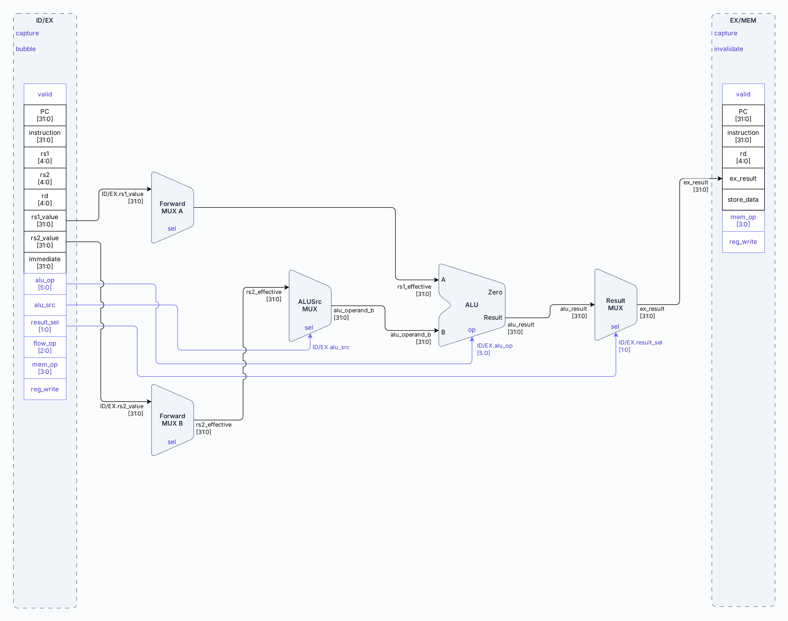
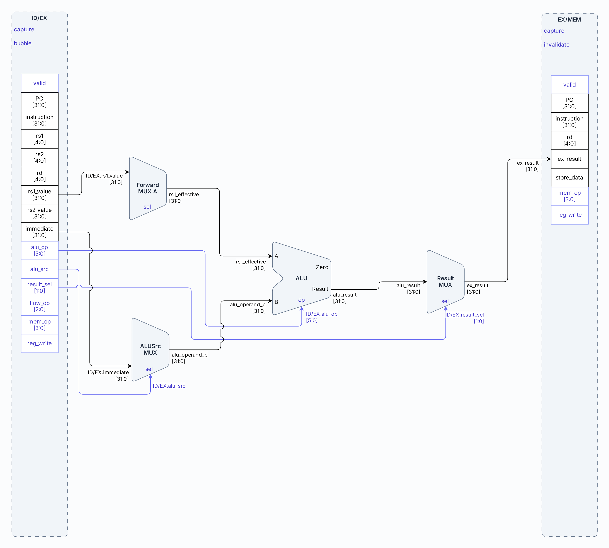
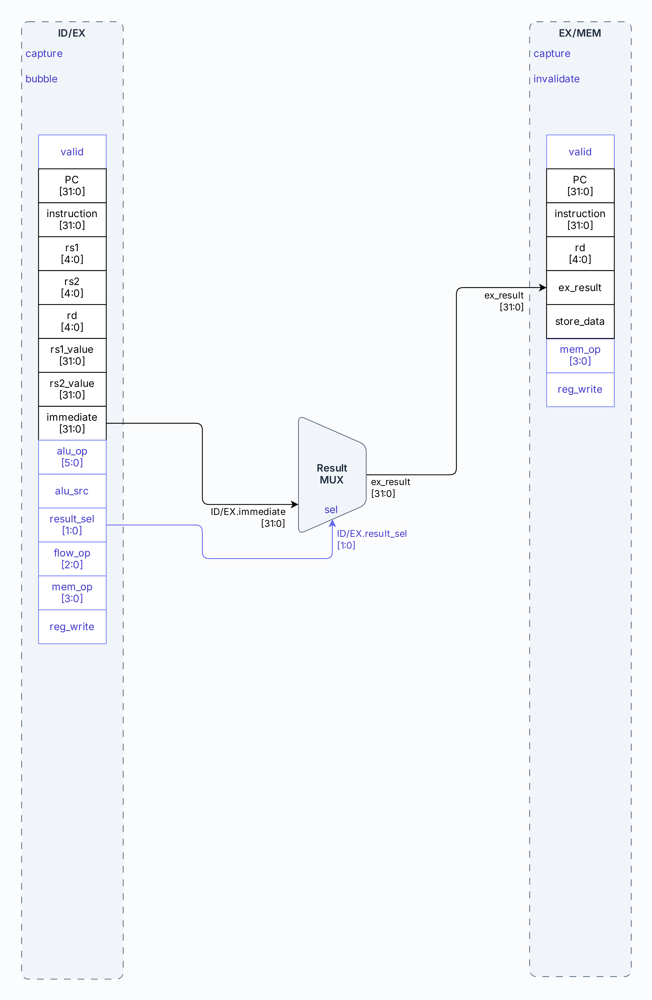
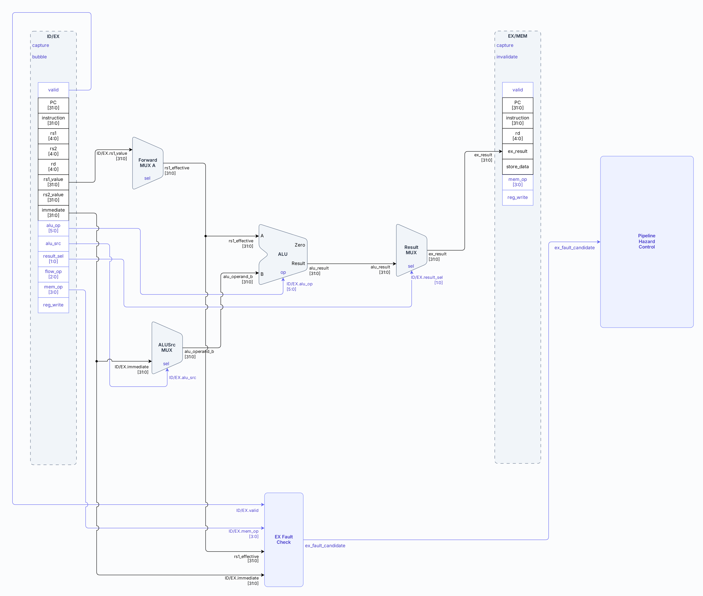
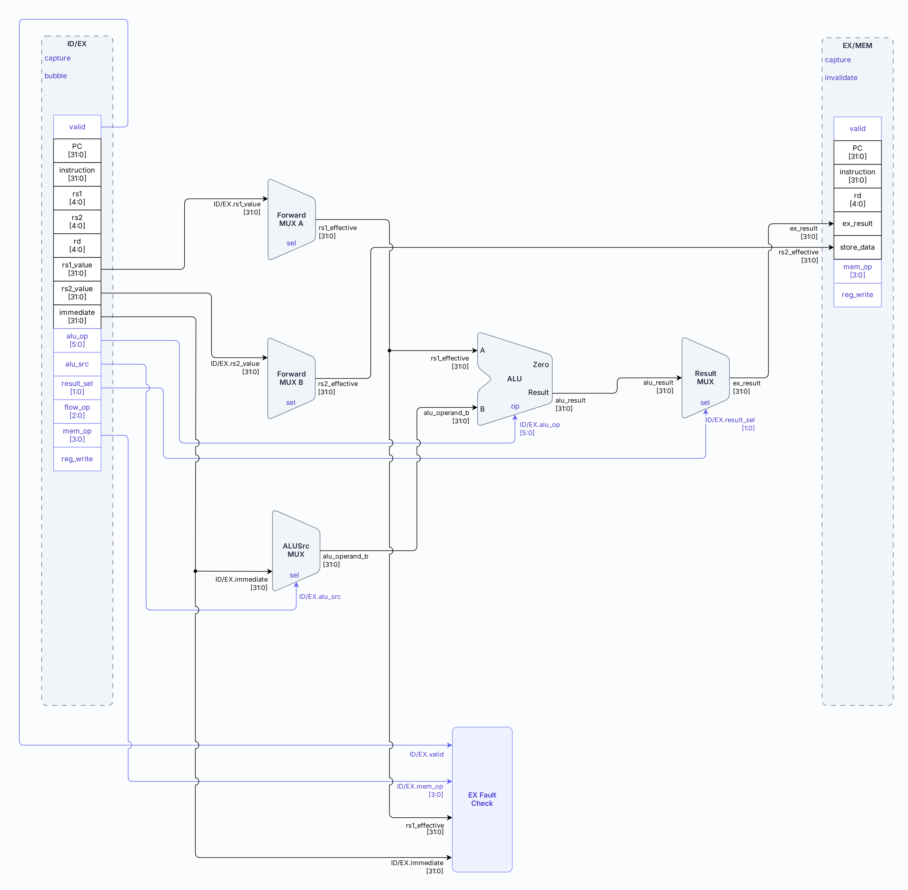
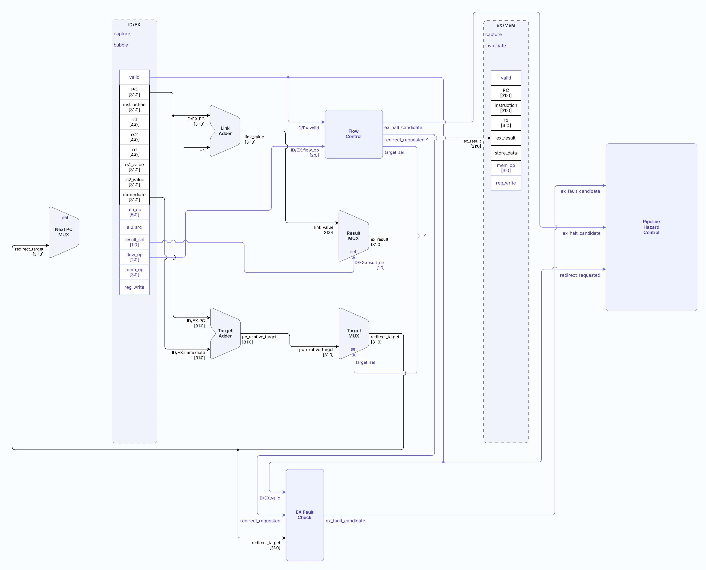
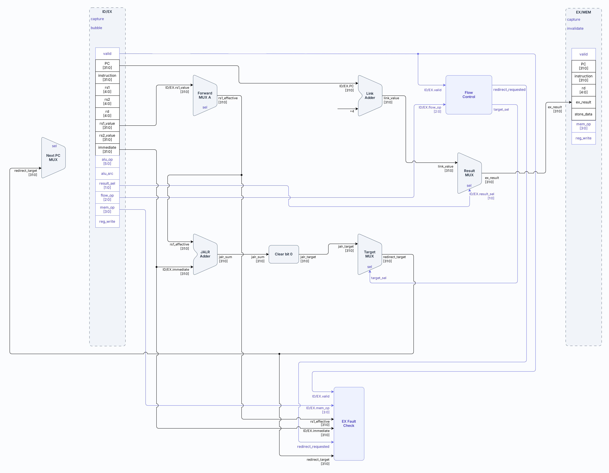
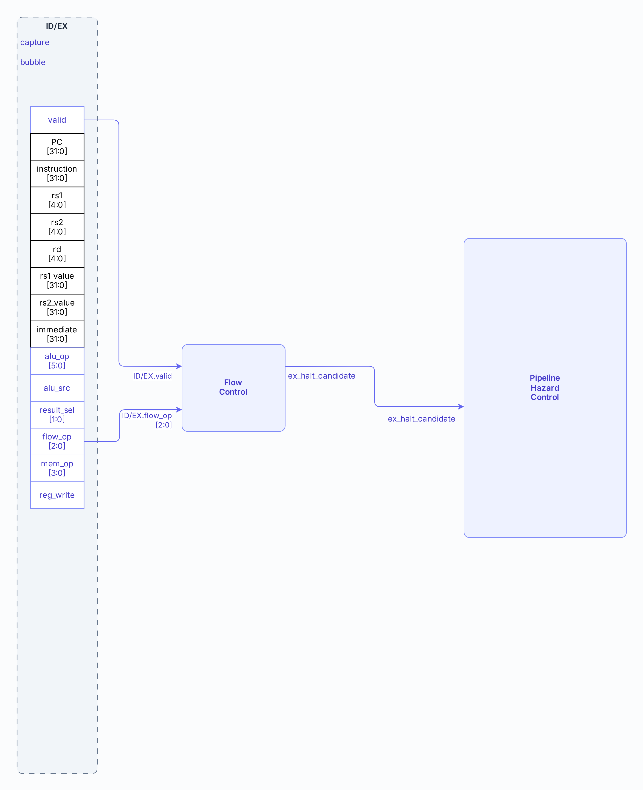

# Etapa EX — Execute

- **Tipo:** arquitectura. 
- **Estado documental:** especificación vigente.

<a id="función-de-la-etapa"></a>

## Propósito y alcance

Este documento define la etapa `EX` del pipeline. EX recibe desde `ID/EX` una instrucción decodificada junto con los datos y controles necesarios para ejecutarla, resuelve los operandos que la instrucción consume y produce los resultados, direcciones y eventos asociados a su ejecución.

El alcance comprende:

- La resolución de operandos mediante forwarding y la selección de las fuentes que realmente utiliza la instrucción.
- El cálculo de resultados de ALU, valores inmediatos y enlaces.
- La formación de direcciones efectivas para loads y stores.
- La formación y validación de targets de branches y jumps.
- La detección de condiciones de fault que solo pueden comprobarse durante EX.
- La producción de candidatos de `halt` y fault, y de solicitudes de redirect.
- El transporte hacia `MEM` de los datos que siguen teniendo significado a través de `EX/MEM`.

Las salidas de EX se dividen en dos grupos:

- **Datos para `MEM`:** resultado de una operación, dirección efectiva, enlace o dato de un store.
- **Eventos para el control del pipeline:** solicitud de redirect, candidato de `halt` o candidato de fault propio de EX.

EX es una etapa combinacional entre `ID/EX` y `EX/MEM`. Sus caminos se evalúan en paralelo durante el mismo ciclo; no representan una secuencia de subciclos internos. La instrucción registrada en `ID/EX` determina qué caminos tienen significado y qué resultado se selecciona.

El documento describe la lógica y los datos propios de la ejecución. La selección de acciones como avance normal, redirect, flush, `HOLD` o terminación pertenece al [Control del pipeline y hazards](control_and_hazards.md); EX produce candidatos y solicitudes, pero la confirmación de `halt` y faults se desarrolla en [Faults, redirects y terminación](../session/faults_and_termination.md).

## Organización

### Organización general

La etapa esta compuesta por los siguientes bloques:

| Elemento                | Naturaleza                 | Pertenece a     |
|-------------------------|----------------------------|-----------------|
| `forwarding_unit`       | Submódulo                  | `ex_stage`      |
| `alu`                   | Submódulo                  | `ex_stage`      |
| `flow_control`          | Submódulo                  | `ex_stage`      |
| `ex_flow_check`         | Submódulo                  | `ex_stage`      |
| `Forward Mux A/B`       | Lógica local               | `ex_stage`      |
| `ALU Src Mux`           | Lógica local               | `ex_stage`      |
| `Link Adder`            | Lógica local               | `ex_stage`      |
| `Result Mux`            | Lógica local               | `ex_stage`      |
| `Target Adder`          | Lógica local               | `ex_stage`      |
| `JALR Adder`            | Lógica local               | `ex_stage`      |
| `Clear bit 0`           | Lógica local               | `ex_stage`      |
| `Target Mux`            | Lógica local               | `ex_stage`      |
| `EX/MEM Update Control` | Control local del registro | `processor_top` |
| `ex_mem_register`       | Registro interetapa        | `processor_top` |

Véase el [inventario aprobado](../module_inventory.md).

La etapa puede entenderse como cuatro caminos que operan simultáneamente:

1. **Resolución de operandos**, donde el forwarding forma `rs1_effective` y `rs2_effective`.
2. **Camino de resultado**, donde la ALU, el inmediato o el `Link Adder` producen `ex_result`.
3. **Camino de control de flujo**, donde se forman los targets y se decide si existe una solicitud de redirect o un candidato de `halt`.
4. **Validación de EX**, donde se comprueban direcciones de datos y targets utilizados por la instrucción.

`EX/MEM` no es una copia completa de los datos que recibió EX. Cuando se captura, conserva únicamente el contexto que todavía necesitan MEM, WB y la observación Debug:

- la identidad y validez de la instrucción: `valid`, `pc`, `instruction` y `rd`;
- los controles que continúan hacia las etapas siguientes: `reg_write` y `mem_op`;
- el resultado ya seleccionado por EX: `ex_result`;
- el dato que un `store` debe escribir en memoria: `store_data`.

Los operandos base, los resultados intermedios de la ALU, el enlace y los targets alternativos no se almacenan por separado. EX ya los consumió o los consolidó en `ex_result` y `store_data`, según el tipo de instrucción.


La separación anterior no implica bloques aislados. Un mismo valor puede alimentar varios caminos en paralelo. `rs1_effective`, por ejemplo, participa en la ALU, en el cálculo de `JALR` y en la validación de accesos de datos.

### Bloques que implementan la etapa

#### Resolución de operandos

##### `Forwarding Unit`

Los valores registrados en `ID/EX` representan el estado conocido cuando la instrucción pasó por ID. Una instrucción anterior puede haber producido desde entonces una versión más reciente de `rs1` o `rs2`. La `Forwarding Unit` identifica esa instrucción productora pendiente y selecciona la fuente correcta para cada operando.

La unidad observa:

| Origen   | Información                          |
|----------|--------------------------------------|
| `ID/EX`  | `valid`, `instruction`, `rs1`, `rs2` |
| `EX/MEM` | `valid`, `rd`, `reg_write`, `mem_op` |
| `MEM/WB` | `valid`, `rd`, `reg_write`           |

La [identificación de productores](control_and_hazards.md#identificación-del-productor-correcto) y la [selección por prioridad](control_and_hazards.md#prioridad-según-el-orden-de-los-productores) definen las ecuaciones de la unidad. 

Para cada fuente, se selecciona primero un resultado válido de `EX/MEM`; si no hay coincidencia allí, se considera el contenido de`MEM/WB`; si tampoco hay coincidencia, se conserva el valor base de `ID/EX`. Esta prioridad refleja que `EX/MEM` contiene el productor más reciente.

Si `EX/MEM` contiene un `load` cuyo `rd` coincide con una fuente de la instrucción en EX, `EX/MEM.ex_result` todavía contiene la dirección efectiva, no el dato leído de memoria, por lo que ese valor no puede reenviarse. La coincidencia igualmente bloquea el forwarding desde `MEM/WB`, porque allí podría haber una versión más antigua del mismo registro y utilizarla produciría un resultado incorrecto. El detector `load-use` ya retuvo al consumidor antes de que llegara a EX; por eso EX no necesita agregar otro stall.

Las salidas son:

| Señal                | Destino         | Tipo    |
|----------------------|-----------------|---------|
| `forward_a_sel[1:0]` | `Forward MUX A` | Control |
| `forward_b_sel[1:0]` | `Forward MUX B` | Control |

La [codificación de los selectores de forwarding](control_and_hazards.md#selectores) distingue base `ID/EX`, resultado `EX/MEM` y valor `MEM/WB`. Cada mux aplica su propio selector.

##### `Forward MUX A`

`Forward MUX A` produce `rs1_effective`.

| Entrada            | Origen             | Tipo    |
|--------------------|--------------------|---------|
| valor base         | `ID/EX.rs1_value`  | Data    |
| productor reciente | `EX/MEM.ex_result` | Data    |
| productor en WB    | `MEM/WB.wb_value`  | Data    |
| selección          | `forward_a_sel`    | Control |

Su salida alimenta:

- `ALU.A`.
- `JALR Adder`.
- `EX Fault Check`.

De esta forma, una dependencia sobre `rs1` se resuelve de la misma manera tanto si el registro participa en una operación aritmética como si forma una dirección de memoria o un target de `JALR`.

##### `Forward MUX B`

`Forward MUX B` produce `rs2_effective`.

| Entrada            | Origen             | Tipo    |
|--------------------|--------------------|---------|
| valor base         | `ID/EX.rs2_value`  | Data    |
| productor reciente | `EX/MEM.ex_result` | Data    |
| productor en WB    | `MEM/WB.wb_value`  | Data    |
| selección          | `forward_b_sel`    | Control |

Su salida alimenta:

- `ALU Source MUX`.
- `EX/MEM.store_data`.

El dato de store queda así resuelto en EX antes de registrarse para MEM.

#### Camino principal de resultado

##### `ALU Source MUX`

`ALU Source MUX` selecciona el segundo operando que utilizará la ALU:

```text
alu_operand_b =
    ID/EX.alu_src
        ? ID/EX.immediate
        : rs2_effective
```

Las operaciones R-type y los branches utilizan `rs2_effective`. Las operaciones I-type y los accesos de memoria utilizan el inmediato.

##### `ALU`

Las entradas de la ALU son:

| Entrada  | Fuente          | Tipo    |
|----------|-----------------|---------|
| `A`      | `rs1_effective` | Data    |
| `B`      | `alu_operand_b` | Data    |
| `alu_op` | `ID/EX.alu_op`  | Control |

`ID/EX.alu_op` indica la operación que la ALU debe realizar sobre los operandos.

Las salidas de la ALU son:

| Señal              | Destino                         | Tipo    |
|--------------------|---------------------------------|---------|
| `alu_result[31:0]` | `Result MUX`                    | Data    |
| `zero`             | `Flow Control` para `BEQ`/`BNE` | Control |

El significado de `alu_result` depende de la instrucción:

- En loads y stores, representa la dirección efectiva.
- En branches, la resta entre operandos permite obtener la condición de igualdad mediante `zero`.

Los códigos de `alu_op` se detallan en [los controles generados en ID](stage_id.md#codificación-de-los-controles); la operación sobre los datos se describe en [Datapath](datapath.md#alu).

##### `Link Adder`

El `Link Adder` calcula el valor que `JAL` y `JALR` escriben posteriormente en `rd`:

```text
link_value =
    (ID/EX.pc + 4) mod 2^32
```

Las entradas del `Link Adder` son:

| Entrada   | Fuente     | Tipo |
|-----------|------------|------|
| `pc`      | `ID/EX.pc` | Data |
| constante | `32'd4`    | Data |

La salida del `Link Adder` es:

| Señal              | Destino      | Tipo |
|--------------------|--------------|------|
| `link_value[31:0]` | `Result MUX` | Data |

##### `Result MUX`

EX puede producir varios valores candidatos en paralelo. El `Result MUX` selecciona cuál de esos valores corresponde a la instrucción actual mediante `result_sel` y lo normaliza en un único campo de salida, `ex_result`.

| `result_sel` | Fuente            |
|--------------|-------------------|
| `00`         | `alu_result`      |
| `01`         | `ID/EX.immediate` |
| `10`         | `link_value`      |
| `11`         | reservado         |

El `Result MUX` permite representar con un solo campo (`ex_result`) resultados conceptualmente diferentes:

- resultado ALU;
- valor de `LUI`;
- enlace de `JAL`/`JALR`;
- dirección efectiva de load/store.

Las entradas del mux son:

| Entrada                 | Origen       | Tipo    |
|-------------------------|--------------|---------|
| `alu_result[31:0]`      | `ALU`        | Data    |
| `ID/EX.immediate[31:0]` | `ID/EX`      | Data    |
| `link_value[31:0]`      | `Link Adder` | Data    |
| `result_sel[1:0]`       | `ID/EX`      | Control |

La salida única del mux es:

| Señal             | Destino            | Tipo |
|-------------------|--------------------|------|
| `ex_result[31:0]` | `EX/MEM.ex_result` | Data |

Cuando `result_sel` es `2'b11`, la codificación está reservada y no representa un resultado arquitectónico válido. Para las instrucciones activas, ID debe generar únicamente una de las tres selecciones definidas.

#### Camino de control de flujo

##### `Target Adder`

El `Target Adder` forma el destino relativo al PC utilizado por `BEQ`, `BNE` y `JAL`.

Las entradas del `Target Adder` son:

| Señal                   | Origen  | Tipo |
|-------------------------|---------|------|
| `ID/EX.pc[31:0]`        | `ID/EX` | Data |
| `ID/EX.immediate[31:0]` | `ID/EX` | Data |

Las salidas del `Target Adder` son:

| Señal                      | Destino      | Tipo |
|----------------------------|--------------|------|
| `pc_relative_target[31:0]` | `Target MUX` | Data |

El cálculo es:

```text
pc_relative_target =
    (ID/EX.pc + ID/EX.immediate) mod 2^32
```

El target se calcula durante el ciclo incluso si un branch finalmente no se toma. Solo adquiere significado arquitectónico cuando `Flow Control` genera una solicitud de redirect.

##### `JALR Adder`

`JALR Adder` suma la base obtenida de `rs1` con el inmediato de la instrucción.

Las entradas del `JALR Adder` son:

| Señal                   | Origen          | Tipo |
|-------------------------|-----------------|------|
| `rs1_effective[31:0]`   | `Forward MUX A` | Data |
| `ID/EX.immediate[31:0]` | `ID/EX`         | Data |

Las salidas del `JALR Adder` son:

| Señal            | Destino       | Tipo |
|------------------|---------------|------|
| `jalr_sum[31:0]` | `Clear bit 0` | Data |

El cálculo es:

```text
jalr_sum =
    (rs1_effective + ID/EX.immediate) mod 2^32
```

`rs1_effective` es el valor de `rs1` después del forwarding. Esto permite que `JALR` utilice la versión más reciente del registro base cuando una instrucción anterior acaba de producirla.

##### `Clear bit 0`

El `Clear bit 0` ajusta el destino calculado por `JALR` antes de que llegue a `Target MUX`.

Las entradas de `Clear bit 0` son:

| Señal            | Origen       | Tipo |
|------------------|--------------|------|
| `jalr_sum[31:0]` | `JALR Adder` | Data |

Las salidas de `Clear bit 0` son:

| Señal               | Destino      | Tipo |
|---------------------|--------------|------|
| `jalr_target[31:0]` | `Target MUX` | Data |

El cálculo es:

```text
jalr_target =
    jalr_sum & 32'hFFFFFFFE
```

La operación conserva los bits `31:1` y fuerza el bit `0` a cero, garantizando un target alineado a 2 bytes para `JALR`.

##### `Target MUX`

El `Target MUX` selecciona el destino que puede presentarse como redirect.

Las entradas de `Target MUX` son:

| Señal                      | Origen         | Tipo    |
|----------------------------|----------------|---------|
| `pc_relative_target[31:0]` | `Target Adder` | Data    |
| `jalr_target[31:0]`        | `Clear bit 0`  | Data    |
| `target_sel`               | Lógica local   | Control |

Las salidas de `Target MUX` son:

| Señal                   | Destino                         | Tipo |
|-------------------------|---------------------------------|------|
| `redirect_target[31:0]` | `EX Fault Check`, `Next PC MUX` | Data |

La selección es:

```text
target_sel = 0  → pc_relative_target
target_sel = 1  → jalr_target
```

`target_sel` se deriva localmente de:

```text
target_sel =
    (ID/EX.flow_op == JALR)
```

Por lo tanto, `JALR` utiliza el target calculado desde `rs1`, mientras que branches y `JAL` utilizan el target relativo al PC.

##### `Flow Control`

El `Flow Control` utiliza `ID/EX.flow_op` para identificar la clase de control de flujo de la instrucción. `ALU.zero` solo interviene cuando la instrucción es un branch condicional.

Las entradas de `Flow Control` son:

| Señal           | Origen  | Tipo    |
|-----------------|---------|---------|
| `ID/EX.valid`   | `ID/EX` | Control |
| `ID/EX.flow_op` | `ID/EX` | Control |
| `ALU.zero`      | `ALU`   | Control |

Las reglas son:

- En `BEQ`, `ALU.zero=1` indica que los operandos son iguales y el branch se toma.
- En `BNE`, `ALU.zero=0` indica que los operandos son distintos y el branch se toma.
- `JAL` y `JALR` solicitan un redirect sin comparar operandos.
- `HALT` produce un candidato de terminación normal.

Todas estas decisiones quedan condicionadas por `ID/EX.valid`, de modo que una bubble no puede generar un evento.

Las clases locales son:

```text
is_beq  = (flow_op == BEQ)
is_bne  = (flow_op == BNE)
is_jal  = (flow_op == JAL)
is_jalr = (flow_op == JALR)
is_halt = (flow_op == HALT)
```

Para branches:

```text
branch_taken =
    (is_beq && ALU.zero)
    || (is_bne && !ALU.zero)
```

La solicitud de cambio de flujo es:

```text
redirect_requested =
    ID/EX.valid
    && (branch_taken || is_jal || is_jalr)
```

El candidato de terminación normal es:

```text
ex_halt_candidate =
    ID/EX.valid
    && is_halt
```

Las salidas del `Flow Control` son:

| Señal                | Destino                                     | Tipo    |
|----------------------|---------------------------------------------|---------|
| `target_sel`         | `Target MUX`                                | Control |
| `redirect_requested` | `EX Fault Check`, `Pipeline Hazard Control` | Control |
| `ex_halt_candidate`  | `Pipeline Hazard Control`                   | Control |

`redirect_requested` no cambia por sí sola el PC. El redirect se aplica únicamente cuando la acción seleccionada por el control del pipeline es `act_redirect`.

## Interfaces y contratos

### Qué recibe EX

`ID/EX` entrega a la etapa `EX` tres grupos de información:

- **Identidad:** `valid`, `pc`, `instruction`, `rs1`, `rs2` y `rd`.
- **Datos:** `rs1_value`, `rs2_value` e `immediate`.
- **Controles:** `alu_op`, `alu_src`, `result_sel`, `flow_op`, `mem_op` y `reg_write`.

`rs1_value` y `rs2_value` son valores base obtenidos en ID. Todavía pueden quedar obsoletos si una instrucción anterior produjo una versión más reciente del mismo registro. Por esa razón, EX forma primero los operandos efectivos mediante forwarding.

### Salida de la etapa

#### Observación Debug de EX/MEM

El [acuerdo conjunto de latches](../debug/response_serializer.md#observación-y-selección-de-bytes-de-los-cuatro-latches) conecta directamente los 8 campos actuales de `EX/MEM` a `response_serializer`, con sus anchos funcionales:

- `debug_exmem_valid`;
- `debug_exmem_pc`;
- `debug_exmem_instruction`;
- `debug_exmem_rd`;
- `debug_exmem_reg_write`;
- `debug_exmem_mem_op`;
- `debug_exmem_ex_result`;
- `debug_exmem_store_data`.

La exclusión Debug retiene esos valores y evita otra copia del registro interetapa.

Los bits actuales de `EX/MEM` se observan también con `valid` inactivo; su vigencia se interpreta según ese flag. La [regla común del serializador](../debug/response_serializer.md#regla-común-de-selección-y-avance) define la selección de bytes, su representación y los controles de captura y consumo.

## Comportamiento

### Recorridos por clase de instrucción

#### Operaciones R-type

Las operaciones R-type utilizan dos registros fuente y producen su resultado en la ALU. Este grupo incluye:

- `add`
- `sub`
- `sll`
- `slt`
- `sltu`
- `xor`
- `srl`
- `sra`
- `or`
- `and`

Ambas fuentes atraviesan la lógica de forwarding. `ALU Source MUX` selecciona `rs2_effective` como segundo operando y la ALU ejecuta la operación indicada por `alu_op`. `Result MUX` selecciona después `alu_result` como `ex_result`.

El siguiente diagrama muestra el camino funcional de las instrucciones R-type:



Para estas instrucciones:

```text
alu_operand_a = rs1_effective
alu_operand_b = rs2_effective
ex_result     = alu_result
```

El resultado puede reenviarse desde `EX/MEM` a una instrucción posterior porque `ex_result` ya contiene el valor arquitectónico destinado a `rd`.

#### Operaciones I-type aritméticas y shifts

Las operaciones I-type aritméticas y de desplazamiento utilizan `rs1` y un inmediato. Este grupo incluye:

- `addi`
- `slti`
- `sltiu`
- `xori`
- `ori`
- `andi`
- `slli`
- `srli`
- `srai`

`rs1` atraviesa forwarding de la misma forma que en las operaciones R-type. El segundo operando no procede de `rs2`: `ALU Source MUX` selecciona `ID/EX.immediate`.

El siguiente diagrama muestra el camino funcional de las instrucciones I-type aritméticas y shifts:



El camino funcional queda:

```text
alu_operand_a = rs1_effective
alu_operand_b = immediate
ex_result     = alu_result
```

En los shifts inmediatos, la cantidad de posiciones que se desplaza el operando ya está contenida en el inmediato generado a partir de la instrucción. Los bits fijos que distinguen `srli` de `srai` forman parte de la decodificación realizada en ID.

#### `LUI`

La operación `LUI` no obtiene su resultado arquitectónico de la ALU. El inmediato U generado en ID ya representa el valor que la instrucción escribe en `rd`.

En este caso, `Result MUX` selecciona directamente `ID/EX.immediate`:



Por lo tanto:

```text
ex_result = ID/EX.immediate
```

La ALU y los caminos de target pueden presentar valores combinacionales durante ese ciclo, pero esos valores no forman parte del efecto funcional de `LUI`.

#### Loads

Los loads `lb`, `lh`, `lw`, `lbu` y `lhu` calculan en EX la dirección efectiva que MEM utilizará para leer DMEM.

La base `rs1` atraviesa forwarding y el inmediato I se selecciona como segundo operando de la ALU:



La dirección efectiva es:

```text
effective_address =
    (rs1_effective + ID/EX.immediate) mod 2^32
```

Para un load:

```text
ex_result = effective_address
```

`EX Fault Check` evalúa esa misma dirección para comprobar la alineación y que el acceso completo quede dentro de DMEM.

El dato cargado todavía no existe en EX. Por esa razón, un load almacenado en `EX/MEM` no puede reenviar `EX/MEM.ex_result` como valor de `rd`: en ese momento `ex_result` es solamente la dirección efectiva. El dato arquitectónico aparece después de la lectura y extensión realizadas en MEM.

#### Stores

Los stores `sb`, `sh` y `sw` utilizan dos caminos de datos diferentes dentro de EX:

- `rs1_effective + immediate` forma la dirección efectiva;
- `rs2_effective` forma el dato que MEM escribirá.

El diagrama muestra el camino funcional de las instrucciones store:



La separación queda:

```text
EX/MEM.ex_result  = effective_address
EX/MEM.store_data = rs2_effective
```

La separación de dirección y dato permite que el forwarding resuelva tanto una dependencia sobre la base de la dirección como una dependencia sobre el dato que se almacenará.

La validación de alineación y rango ocurre en EX antes de que el store pueda llegar a producir una escritura en MEM.

#### `BEQ` y `BNE`

Los branches comparan dos registros y, en paralelo, forman el target relativo al PC propio de la instrucción.

Las dos fuentes atraviesan forwarding. La ALU realiza una resta y utiliza `zero` como indicador de igualdad:


La condición es:

```text
branch_taken =
    (is_beq && ALU.zero)
    || (is_bne && !ALU.zero)
```

Si el branch no se toma, no existe solicitud de redirect y el target calculado no produce ningún efecto.

Si el branch se toma, `Flow Control` genera `redirect_requested`. `Target MUX` presenta `pc_relative_target` como `redirect_target`, y `EX Fault Check` comprueba la alineación de ese destino antes de que el redirect pueda aplicarse.

#### `JAL`

`JAL` produce dos resultados funcionales en paralelo:

- Una nueva dirección de destino para el PC.
- El enlace `PC + 4` que posteriormente se escribe en `rd`.

El siguiente diagrama muestra el camino funcional de `JAL`:



Los dos valores son:

```text
redirect_target =
    (ID/EX.pc + ID/EX.immediate) mod 2^32

ex_result =
    (ID/EX.pc + 4) mod 2^32
```

Si el target es válido y el redirect se aplica, IF comienza a buscar desde `redirect_target`. Al mismo tiempo, la instrucción `JAL` continúa hacia `EX/MEM` con el enlace en `ex_result`, que más adelante llega a `rd`.

#### `JALR`

`JALR` también produce un redirect y un enlace, pero el destino se calcula a partir de `rs1_effective`.

El siguiente diagrama muestra el camino funcional de `JALR`:



El cálculo del target es:

```text
jalr_sum =
    (rs1_effective + ID/EX.immediate) mod 2^32

jalr_target =
    jalr_sum & 32'hFFFFFFFE
```

El forwarding de `rs1` participa directamente en este cálculo. Una versión obsoleta del registro base produciría un destino incorrecto.

La limpieza afecta únicamente al bit 0. Si el bit 1 del resultado permanece activo, el target continúa desalineado para este procesador de instrucciones de 32 bits y `EX Fault Check` genera el candidato correspondiente.

En paralelo:

```text
ex_result =
    (ID/EX.pc + 4) mod 2^32
```

Ese valor es el enlace que continúa hacia WB si la propia instrucción no termina en fault.

#### `halt`

`halt` no produce un resultado arquitectónico destinado a `EX/MEM`. Su función en EX es alcanzar el punto donde la terminación normal puede confirmarse respetando el orden de las instrucciones.

El candidato de terminación normal se forma en EX y se envía a `Pipeline Hazard Control`:



El candidato es:

```text
ex_halt_candidate =
    ID/EX.valid
    && (ID/EX.flow_op == HALT)
```

Cuando el control selecciona `act_halt`, la instrucción se consume en EX y no entra válidamente en `EX/MEM`. Las instrucciones anteriores pueden terminar su ejecución durante el drenado.

### Validación propia de EX

#### `EX Fault Check`

`EX Fault Check` detecta las condiciones inválidas que dependen de resultados disponibles en EX.

Las entradas de `EX Fault Check` son:

| Señal                   | Origen              | Tipo      |
|-------------------------|---------------------|-----------|
| `ID/EX.valid`           | `ID/EX`             | Control   |
| `ID/EX.mem_op`          | `ID/EX`             | Control   |
| `rs1_effective[31:0]`   | `Forward MUX A`     | Data      |
| `ID/EX.immediate[31:0]` | `ID/EX`             | Data      |
| `redirect_requested`    | `Flow Control`      | Control   |
| `redirect_target[31:0]` | `Target MUX`        | Data      |
| `DMEM_CAPACITY_BYTES`   | Configuración común | Parámetro |

#### Accesos a DMEM

La dirección efectiva utilizada para validar un load o store es:

```text
effective_address =
    (rs1_effective + ID/EX.immediate) mod 2^32
```

El carry de esa suma no constituye un fault.

El tamaño se deriva de `mem_op`:

| Operaciones       | Bytes |
|-------------------|------:|
| `LB`, `LBU`, `SB` |     1 |
| `LH`, `LHU`, `SH` |     2 |
| `LW`, `SW`        |     4 |

La región se valida calculando su extremo con una suma sin signo de 33 bits y comprobando la alineación natural según el tamaño del acceso, como se describe en [Arquitectura de memoria](../memory/memory_architecture.md#formación-y-validación-de-direcciones) y [sus reglas de alineación](../memory/memory_architecture.md#alineación). Esta comprobación no confunde el extremo del acceso con el carry permitido de la suma que forma la dirección efectiva.

`EX Fault Check` genera estos candidatos a partir de las condiciones de alineación y rango:

| Candidato                    | Explicación                                                                                    |
|------------------------------|------------------------------------------------------------------------------------------------|
| `load_misaligned_candidate`  | La dirección de un `load` no cumple la alineación natural requerida por el tamaño del acceso.  |
| `load_access_candidate`      | Un `load` queda fuera del rango válido de DMEM o el acceso completo no cabe en la memoria.     |
| `store_misaligned_candidate` | La dirección de un `store` no cumple la alineación natural requerida por el tamaño del acceso. |
| `store_access_candidate`     | Un `store` queda fuera del rango válido de DMEM o el acceso completo no cabe en la memoria.    |

Dentro de un mismo acceso, la desalineación prevalece sobre el fault de rango.

#### Targets de control

Un target se valida únicamente cuando la instrucción solicita realmente un redirect:

```text
target_misaligned_candidate =
    redirect_requested
    && (redirect_target[1:0] != 2'b00)
```

Por lo tanto, un branch no tomado no genera un fault por un target que no utiliza.

Un target alineado que apunta fuera de la imagen no genera aquí un access fault de instrucción. Si el redirect se aplica, IF detecta el eventual `instruction-access-fault` cuando intente realizar el fetch correspondiente.

#### Causa producida por EX

```text
ex_fault_candidate =
    target_misaligned_candidate
    || load_misaligned_candidate
    || load_access_candidate
    || store_misaligned_candidate
    || store_access_candidate
```

| Causa                            | Código |
|----------------------------------|--------|
| `instruction-address-misaligned` | `000`  |
| `load-address-misaligned`        | `100`  |
| `load-access-fault`              | `101`  |
| `store-address-misaligned`       | `110`  |
| `store-access-fault`             | `111`  |

Las salidas de `EX Fault Check` son:

| Señal                 | Destino                   | Tipo    |
|-----------------------|---------------------------|---------|
| `ex_fault_candidate`  | `Pipeline Hazard Control` | Control |
| `ex_fault_cause[2:0]` | `Fault Metadata Control`  | Data    |

La confirmación y captura de metadatos se desarrollan en [Faults, redirects y terminación](../session/faults_and_termination.md). Las propiedades de DMEM se detallan en [Arquitectura de memoria](../memory/memory_architecture.md).

<a id="selección-de-la-frontera-de-ex"></a>

### Prioridad entre fault, `halt` y redirect en EX

Los caminos combinacionales pueden producir al mismo tiempo una solicitud de redirect y una condición que invalida ese efecto. La arquitectura resuelve la instrucción actual con la siguiente prioridad local:

```text
fault propio de EX
    ↓
halt
    ↓
redirect
    ↓
avance normal
```

Un fault propio suprime los efectos normales de la instrucción. `halt` se confirma únicamente si no existe un fault propio. Un redirect puede aplicarse únicamente cuando no existe ni fault propio ni `halt`.

La selección completa de las acciones del pipeline se desarrolla en [Control del pipeline y hazards](control_and_hazards.md).

### Resumen de recorridos

| Clase               | Operando A      | Operando B      | `ex_result`            | Camino de flujo                  | Validación propia de EX    |
|---------------------|-----------------|-----------------|------------------------|----------------------------------|----------------------------|
| R-type              | `rs1_effective` | `rs2_effective` | ALU                    | —                                | —                          |
| I-type aritm./shift | `rs1_effective` | inmediato       | ALU                    | —                                | —                          |
| `LUI`               | —               | —               | inmediato              | —                                | —                          |
| Load                | `rs1_effective` | inmediato       | dirección efectiva     | —                                | alineación y rango DMEM    |
| Store               | `rs1_effective` | inmediato       | dirección efectiva     | —                                | alineación y rango DMEM    |
| `BEQ`/`BNE`         | `rs1_effective` | `rs2_effective` | sin efecto de registro | destino relativo al PC           | alineación solo si se toma |
| `JAL`               | —               | —               | `PC + 4`               | destino relativo al PC           | alineación del target      |
| `JALR`              | `rs1_effective` | inmediato       | `PC + 4`               | target `rs1 + imm`, bit 0 limpio | alineación del target      |
| `halt`              | —               | —               | sin efecto             | terminación normal               | —                          |

La tabla muestra qué resultados tienen significado funcional para cada clase. Los demás bloques combinacionales pueden seguir evaluándose físicamente, pero sus salidas no se consumen como parte de esa instrucción.

### Comportamiento resumido de EX

| Situación                  | Efecto de la instrucción actual                  | `EX/MEM` |
|----------------------------|--------------------------------------------------|----------|
| R/I/`LUI`                  | Produce resultado para `rd`                      | Captura  |
| Load                       | Produce dirección efectiva                       | Captura  |
| Store                      | Produce dirección y `store_data`                 | Captura  |
| Branch no tomado           | No solicita redirect                             | Captura  |
| Branch tomado              | Solicita redirect válido                         | Captura  |
| `JAL`/`JALR`               | Solicita redirect y conserva enlace              | Captura  |
| Fault propio de EX         | Suprime efectos de la causante                   | Invalida |
| `halt` confirmado          | Consume `halt` en EX                             | Invalida |
| Fault en ID                | La instrucción anterior de EX conserva su efecto | Captura  |
| `load-use` detectado en ID | La instrucción ya presente en EX continúa        | Captura  |
| `HOLD` sin ciclo efectivo  | No cambia el estado registrado                   | Retiene  |

## Estado y temporización

### `EX/MEM Update Control`

El `EX/MEM Update Control` convierte la acción seleccionada por `Pipeline Hazard Control` en una operación local sobre el registro `EX/MEM`.

Recibe las ocho acciones de `Pipeline Hazard Control` y produce `capture` e `invalidate` para `EX/MEM`. Su derivación está en [los controles locales de EX/MEM](control_and_hazards.md#exmem).

La actualización distingue estos casos:

| Situación                                           | Efecto sobre la instrucción de EX                  |
|-----------------------------------------------------|----------------------------------------------------|
| Redirect                                            | Continúa para conservar el enlace de `JAL`/`JALR`. |
| Fault ID                                            | Continúa porque es anterior a la causante.         |
| `halt` o fault propio                               | Se consume en EX y no ingresa válidamente a MEM.   |
| Sin acción de pipeline ni prioridad global superior | El registro retiene su estado.                     |

### Registro `EX/MEM`

El [contrato de EX/MEM](cpu_pipeline.md#registro-exmem) define sus ocho campos y anchos. El resultado y el dato de store siguen caminos distintos y las entradas locales proceden de:

| Campo         | Origen          |
|---------------|-----------------|
| `valid`       | `ID/EX`         |
| `pc`          | `ID/EX`         |
| `instruction` | `ID/EX`         |
| `rd`          | `ID/EX`         |
| `reg_write`   | `ID/EX`         |
| `mem_op`      | `ID/EX`         |
| `ex_result`   | `Result MUX`    |
| `store_data`  | `rs2_effective` |

Cuando `capture=1`, el registro conserva el contexto producido por la instrucción que estaba en EX antes del flanco.

Cuando `invalidate=1`, `valid` pasa a cero. Los demás bits pueden conservar valores residuales sin representar una instrucción activa.

`EX/MEM` no conserva `rs1`, `rs2`, los operandos base, el inmediato, `alu_result` ni `link_value` por separado. Esos valores ya fueron consumidos o consolidados dentro de `ex_result` y `store_data`.

El uso de estos campos continúa en [Etapa MEM](stage_mem.md).

<a id="trazabilidad"></a>

## Referencias y trazabilidad

- [Pipeline CPU](cpu_pipeline.md): posición de EX dentro del pipeline y contrato general de `EX/MEM`.
- [Etapa ID](stage_id.md): formación de `ID/EX` y significado de los controles que recibe EX.
- [Datapath](datapath.md): ALU, targets, enlace y caminos de resultado.
- [Control del pipeline y hazards](control_and_hazards.md): forwarding, `load-use`, prioridades y acciones.
- [Arquitectura de memoria](../memory/memory_architecture.md): capacidad, rango, alineación y semántica de DMEM.
- [Faults, redirects y terminación](../session/faults_and_termination.md): confirmación de faults, redirect, `halt` y precisión.
- [Control de ejecución y sesión](../session/execution_control.md): ciclos efectivos, `HOLD` y drenado.
- [Etapa MEM](stage_mem.md): consumo de `EX/MEM.ex_result`, `store_data` y `mem_op`.
