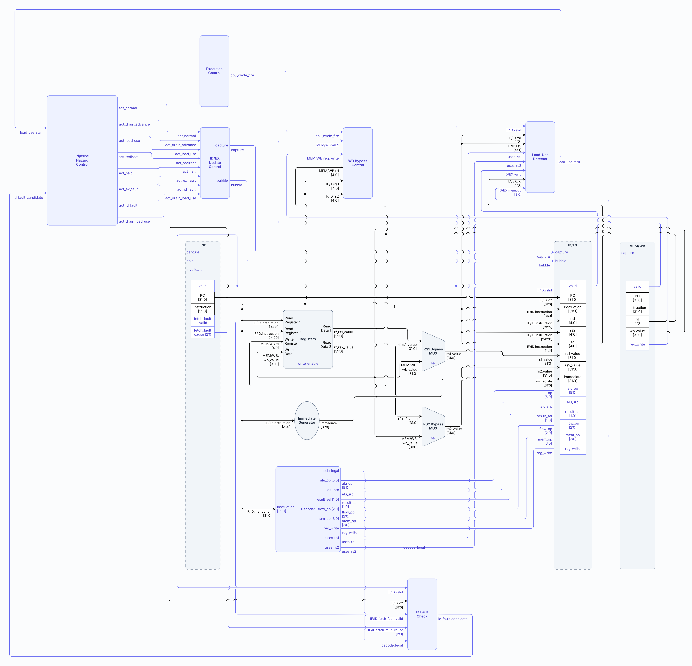
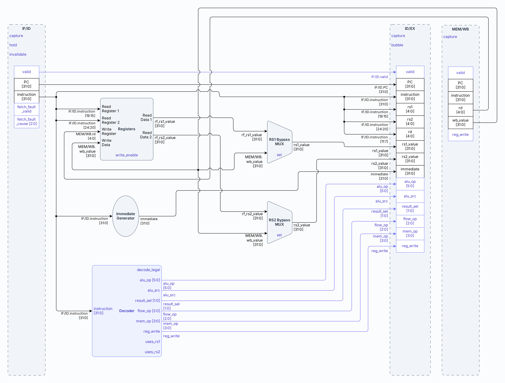

# Etapa ID — Instruction Decode

- **Tipo:** arquitectura. 
- **Estado documental:** especificación vigente.

<a id="función-de-la-etapa"></a>

## Propósito y alcance

Este documento define la etapa `ID` del pipeline. ID recibe desde `IF/ID` la instrucción obtenida por IF, la decodifica, prepara los operandos y controles necesarios, y entrega a EX el contexto que necesita para ejecutarla.

El alcance comprende:

- La decodificación de la instrucción y la validación de su pertenencia al subconjunto implementado.
- La identificación y lectura de los registros fuente y destino.
- La generación del inmediato correspondiente al formato de la instrucción.
- La resolución de las lecturas que coinciden con un writeback del mismo ciclo mediante bypass WB→ID.
- La detección de dependencias `load-use` y la producción de la solicitud de espera correspondiente.
- La producción de candidatos de fault por una instrucción ilegal o por un fault de fetch transportado desde `IF/ID`.
- La actualización, retención o conversión en bubble de `ID/EX` según la acción seleccionada por el control del pipeline.

El documento describe la lógica y los datos propios de la decodificación. La selección de acciones como avance normal, `stall`, redirect, flush o `HOLD` pertenece al [Control del pipeline y hazards](control_and_hazards.md); la confirmación y terminación por faults se desarrolla en [Faults, redirects y terminación](../session/faults_and_termination.md). La organización interna de los bloques de ID y sus interfaces se especifica en las secciones siguientes.

## Organización

### Organización interna

La etapa está compuesta por los siguientes bloques y registros:

| Módulo                 | Tipo      | Pertenece a     |
|------------------------|-----------|-----------------|
| `Decoder`              | Submódulo | `id_stage`      |
| `Register File`        | Estado    | `id_stage`      |
| `Immediate Generator`  | Submódulo | `id_stage`      |
| `RS1 Bypass MUX`       | Lógica    | `id_stage`      |
| `RS2 Bypass MUX`       | Lógica    | `id_stage`      |
| `WB Bypass Control`    | Lógica    | `wb_stage`      |
| `ID Fault Check`       | Submódulo | `id_stage`      |
| `Load-Use Detector`    | Submódulo | `id_stage`      |
| `ID/EX Update Control` | Lógica    | `processor_top` |
| Registro `ID/EX`       | Estado    | `processor_top` |

El siguiente diagrama muestra la organización de ID y sus conexiones con el pipeline. Los bloques locales se desarrollan en [Comportamiento](#comportamiento) y [Estado y temporización](#estado-y-temporización).



El camino principal de ID forma en paralelo la decodificación, el inmediato y los operandos. Los bloques de fault y `load-use` observan esa misma información para determinar si la instrucción puede avanzar normalmente.

### `Decoder`

`Decoder` interpreta la palabra de instrucción almacenada en `IF/ID` y produce dos clases de información: 

- La **legalidad de la codificación**.
- Los **controles funcionales** que describen cómo continuará la instrucción.

#### Entrada

| Señal               | Origen  | Tipo |
|---------------------|---------|------|
| `instruction[31:0]` | `IF/ID` | Data |

#### Campos observados

La decodificación utiliza los campos fijos definidos por RISC-V:

```text
opcode = instruction[6:0]
funct3 = instruction[14:12]
funct7 = instruction[31:25]
```

En los shifts inmediatos, los bits superiores de la instrucción también forman parte de la validación de la codificación.

La codificación solo es legal si coincide exactamente con una instrucción del subconjunto de instrucciones implementado. Por lo tanto, compartir el `opcode` con una instrucción válida no es suficiente ya que también deben coincidir todos sus campos fijos.

La palabra exacta `0x0000000B` se reconoce como `halt`.

#### Salidas

| Señal             | Destino             | Tipo    | Función                                                           |
|-------------------|---------------------|---------|-------------------------------------------------------------------|
| `decode_legal`    | `ID Fault Check`    | Control | Indica que la codificación pertenece al subconjunto implementado. |
| `alu_op[5:0]`     | `ID/EX.alu_op`      | Control | Selecciona la operación de ALU.                                   |
| `alu_src`         | `ID/EX.alu_src`     | Control | Selecciona el origen del segundo operando de ALU.                 |
| `result_sel[1:0]` | `ID/EX.result_sel`  | Control | Selecciona la clase de resultado producida por EX.                |
| `flow_op[2:0]`    | `ID/EX.flow_op`     | Control | Clasifica branches, jumps, `halt` o flujo ordinario.              |
| `mem_op[3:0]`     | `ID/EX.mem_op`      | Control | Clasifica loads, stores o ausencia de acceso a memoria.           |
| `reg_write`       | `ID/EX.reg_write`   | Control | Indica intención de escritura en el banco de registros.           |
| `uses_rs1`        | `Load-Use Detector` | Control | Indica que la instrucción consume realmente `rs1`.                |
| `uses_rs2`        | `Load-Use Detector` | Control | Indica que la instrucción consume realmente `rs2`.                |

`uses_rs1` y `uses_rs2` son resultados combinacionales de ID. No se almacenan como campos adicionales en `IF/ID` ni en `ID/EX`.

La clasificación de uso de registros fuente queda resumida así:

| Clase de instrucción                        | `uses_rs1` | `uses_rs2` |
|---------------------------------------------|-----------:|-----------:|
| R-type, `BEQ`/`BNE`, stores                 |          1 |          1 |
| Aritmética/shifts inmediatos, loads, `JALR` |          1 |          0 |
| `JAL`, `LUI`, `halt`                        |          0 |          0 |
| Codificación ilegal                         |          0 |          0 |

Una codificación no reconocida produce `decode_legal=0` y controles funcionalmente neutros. Estos valores solo mantienen determinista la lógica combinacional: la entrada no se interpreta como otra instrucción ni produce efectos arquitectónicos normales.

#### Codificaciones legales

La siguiente whitelist contiene las 32 instrucciones RV32I implementadas y la palabra que codifica la instrucción personalizada `halt`. Los campos que no se indican como fijos no tienen restricciones adicionales: índices de registros, inmediatos y los cinco bits de `shamt`.

| Instrucción | `opcode`       | `funct3` | Campo fijo adicional         | Operación ALU                |
|-------------|----------------|----------|------------------------------|------------------------------|
| `ADD`       | `0110011`      | `000`    | `funct7=0000000`             | `ADD`                        |
| `SUB`       | `0110011`      | `000`    | `funct7=0100000`             | `SUB`                        |
| `SLL`       | `0110011`      | `001`    | `funct7=0000000`             | `SLL`                        |
| `SLT`       | `0110011`      | `010`    | `funct7=0000000`             | `SLT`                        |
| `SLTU`      | `0110011`      | `011`    | `funct7=0000000`             | `SLTU`                       |
| `XOR`       | `0110011`      | `100`    | `funct7=0000000`             | `XOR`                        |
| `SRL`       | `0110011`      | `101`    | `funct7=0000000`             | `SRL`                        |
| `SRA`       | `0110011`      | `101`    | `funct7=0100000`             | `SRA`                        |
| `OR`        | `0110011`      | `110`    | `funct7=0000000`             | `OR`                         |
| `AND`       | `0110011`      | `111`    | `funct7=0000000`             | `AND`                        |
| `ADDI`      | `0010011`      | `000`    | —                            | `ADD`                        |
| `SLTI`      | `0010011`      | `010`    | —                            | `SLT`                        |
| `SLTIU`     | `0010011`      | `011`    | —                            | `SLTU`                       |
| `XORI`      | `0010011`      | `100`    | —                            | `XOR`                        |
| `ORI`       | `0010011`      | `110`    | —                            | `OR`                         |
| `ANDI`      | `0010011`      | `111`    | —                            | `AND`                        |
| `SLLI`      | `0010011`      | `001`    | `instruction[31:25]=0000000` | `SLL`                        |
| `SRLI`      | `0010011`      | `101`    | `instruction[31:25]=0000000` | `SRL`                        |
| `SRAI`      | `0010011`      | `101`    | `instruction[31:25]=0100000` | `SRA`                        |
| `LB`        | `0000011`      | `000`    | —                            | `ADD`                        |
| `LH`        | `0000011`      | `001`    | —                            | `ADD`                        |
| `LW`        | `0000011`      | `010`    | —                            | `ADD`                        |
| `LBU`       | `0000011`      | `100`    | —                            | `ADD`                        |
| `LHU`       | `0000011`      | `101`    | —                            | `ADD`                        |
| `SB`        | `0100011`      | `000`    | —                            | `ADD`                        |
| `SH`        | `0100011`      | `001`    | —                            | `ADD`                        |
| `SW`        | `0100011`      | `010`    | —                            | `ADD`                        |
| `BEQ`       | `1100011`      | `000`    | —                            | `SUB`                        |
| `BNE`       | `1100011`      | `001`    | —                            | `SUB`                        |
| `JAL`       | `1101111`      | —        | —                            | `ADD`, sin consumo funcional |
| `JALR`      | `1100111`      | `000`    | —                            | `ADD`                        |
| `LUI`       | `0110111`      | —        | —                            | `ADD`, sin consumo funcional |
| `halt`      | palabra exacta | —        | `instruction=0x0000000B`     | `ADD`, sin consumo funcional |

Una codificación es legal únicamente si coincide con alguna fila de esta tabla en todos los campos fijos indicados. Compartir un `opcode` no basta para admitir otros branches, operaciones o instrucciones personalizadas.

Los campos que la tabla no fija son variables dentro del formato correspondiente:

- En las instrucciones aritméticas de formato I, `instruction[31:20]` forma un inmediato de 12 bits sin restricciones adicionales.
- En `SLLI`, `SRLI` y `SRAI`, `instruction[31:25]` debe coincidir con el patrón indicado, mientras que `instruction[24:20]` se utiliza como cantidad de desplazamiento (`shamt`).

#### Codificación de los controles

Los códigos transportados describen las operaciones que ejecutarán las etapas siguientes:

- **EX:** consume `alu_op`, `alu_src`, `result_sel` y `flow_op`.
- **EX/MEM:** conserva `mem_op` para las etapas posteriores.
- **MEM/WB:** transporta `reg_write` hasta WB.

| `alu_op[5:0]` | Operación |
|---------------|-----------|
| `000000`      | `SLL`     |
| `000010`      | `SRL`     |
| `000011`      | `SRA`     |
| `101010`      | `SLT`     |
| `101011`      | `SLTU`    |
| `100000`      | `ADD`     |
| `100010`      | `SUB`     |
| `100100`      | `AND`     |
| `100101`      | `OR`      |
| `100110`      | `XOR`     |

El código `100111` queda reservado para compatibilidad con una implementación heredada de la ALU que asociaba ese valor con `NOR`. Sin embargo, el `Decoder` del TP3 no asigna `100111` a ninguna instrucción de la whitelist: ninguna codificación válida produce una operación `NOR` ni genera ese código. Por tanto, `100111` no forma parte del contrato observable de la CPU y no debe interpretarse como una instrucción adicional. Si la ALU anterior conserva la operación `NOR` para ese código, dicha lógica queda fuera del camino arquitectónico y su adaptación o eliminación pertenece a la implementación, no a esta especificación.

| Control           | Código        | Significado                                                |
|-------------------|---------------|------------------------------------------------------------|
| `alu_src`         | `0`           | `RS2`                                                      |
| `alu_src`         | `1`           | `IMMEDIATE`                                                |
| `result_sel[1:0]` | `00`          | `ALU`                                                      |
| `result_sel[1:0]` | `01`          | `IMMEDIATE`                                                |
| `result_sel[1:0]` | `10`          | `LINK`                                                     |
| `result_sel[1:0]` | `11`          | Reservado                                                  |
| `flow_op[2:0]`    | `000`         | `NONE`                                                     |
| `flow_op[2:0]`    | `001`         | `BEQ`                                                      |
| `flow_op[2:0]`    | `010`         | `BNE`                                                      |
| `flow_op[2:0]`    | `011`         | `JAL`                                                      |
| `flow_op[2:0]`    | `100`         | `JALR`                                                     |
| `flow_op[2:0]`    | `101`         | `HALT`                                                     |
| `flow_op[2:0]`    | `110`–`111`   | Reservado                                                  |
| `mem_op[3:0]`     | `0000`        | `NONE`                                                     |
| `mem_op[3:0]`     | `0001`        | `LB`                                                       |
| `mem_op[3:0]`     | `0010`        | `LH`                                                       |
| `mem_op[3:0]`     | `0011`        | `LW`                                                       |
| `mem_op[3:0]`     | `0100`        | `LBU`                                                      |
| `mem_op[3:0]`     | `0101`        | `LHU`                                                      |
| `mem_op[3:0]`     | `0110`        | `SB`                                                       |
| `mem_op[3:0]`     | `0111`        | `SH`                                                       |
| `mem_op[3:0]`     | `1000`        | `SW`                                                       |
| `mem_op[3:0]`     | `1001`–`1111` | Reservado                                                  |
| `reg_write`       | `0`           | Sin intención de escritura                                 |
| `reg_write`       | `1`           | Resultado destinado al RF, sujeto a validez y commit de WB |

#### Controles por clase de instrucción

La operación ALU de cada instrucción está definida en la whitelist. La siguiente tabla resume los códigos que `Decoder` emite para cada clase; el significado de cada código está definido en la tabla anterior.

| Clase               | `alu_src` | `result_sel` | `flow_op`   | `mem_op`      | `reg_write` |
|---------------------|-----------|--------------|-------------|---------------|-------------|
| R-type              | `0`       | `00`         | `000`       | `0000`        | `1`         |
| I aritmética/shifts | `1`       | `00`         | `000`       | `0000`        | `1`         |
| Loads               | `1`       | `00`         | `000`       | `0001`–`0101` | `1`         |
| Stores              | `1`       | `00`         | `000`       | `0110`–`1000` | `0`         |
| `BEQ`/`BNE`         | `0`       | `00`         | `001`/`010` | `0000`        | `0`         |
| `JAL`               | `1`       | `10`         | `011`       | `0000`        | `1`         |
| `JALR`              | `1`       | `10`         | `100`       | `0000`        | `1`         |
| `LUI`               | `1`       | `01`         | `000`       | `0000`        | `1`         |
| `halt`              | `0`       | `00`         | `101`       | `0000`        | `0`         |

En estas instrucciones, algunos controles se fijan aunque el resultado de la ALU no sea el resultado arquitectónico utilizado:

- `JAL` emite `alu_op=100000` (`ADD`) y `alu_src=1`, pero `result_sel=10` (`LINK`) selecciona el valor de enlace. El resultado de la ALU no se utiliza.
- `LUI` emite `alu_op=100000` (`ADD`) y `alu_src=1`, pero `result_sel=01` (`IMMEDIATE`) selecciona directamente el inmediato. El resultado de la ALU no se utiliza.
- `halt` emite `alu_op=100000` (`ADD`) y `alu_src=0`, pero `flow_op=101` (`HALT`) impide que la instrucción produzca un resultado arquitectónico.
- `JALR` calcula el target mediante el camino dedicado de EX y utiliza `result_sel=10` (`LINK`) para seleccionar el valor de enlace que se escribe en `rd`.

#### Codificación ilegal

Una codificación no reconocida produce `decode_legal=0` y controles funcionalmente neutros. Los valores por defecto son:

| Señal          | Código por defecto | Interpretación         |
|----------------|--------------------|------------------------|
| `decode_legal` | `0`                | Codificación ilegal    |
| `alu_op`       | `100000`           | `ADD`                  |
| `alu_src`      | `0`                | `RS2`                  |
| `result_sel`   | `00`               | `ALU`                  |
| `flow_op`      | `000`              | `NONE`                 |
| `mem_op`       | `0000`             | `NONE`                 |
| `reg_write`    | `0`                | Sin escritura en el RF |
| `uses_rs1`     | `0`                | No consume `rs1`       |
| `uses_rs2`     | `0`                | No consume `rs2`       |

Estos valores solo mantienen determinista la lógica combinacional; no convierten la palabra ilegal en una instrucción ejecutable. `ID Fault Check` genera el candidato de fault a partir de `decode_legal=0`, y la confirmación del fault impide que la entrada se capture como válida en `ID/EX`. Los selectores de forwarding pertenecen a [Control del pipeline y hazards](control_and_hazards.md); los selectores de target y writeback se derivan localmente en EX y MEM.

### `Register File`

`Register File` es el banco arquitectónico de 32 registros de 32 bits.

Su interfaz funcional comprende:

- Dos puertos de lectura combinacionales utilizados por ID.
- Un puerto de escritura síncrona utilizado por WB.

#### Entradas

| Señal                       | Origen                                                           | Tipo    |
| --------------------------- | ---------------------------------------------------------------- | ------- |
| `Read Register 1[4:0]`      | `IF/ID.instruction[19:15]`                                       | Data    |
| `Read Register 2[4:0]`      | `IF/ID.instruction[24:20]`                                       | Data    |
| `debug_rf_addr[4:0]`        | `response_serializer`, registro observado durante Debug          | Data    |
| `debug_read_select` (1 bit) | `protocol_controller`, selección CPU/Debug de la primera lectura | Data    |
| `Write Register[4:0]`       | `MEM/WB.rd`                                                      | Data    |
| `Write Data[31:0]`          | `MEM/WB.wb_value`                                                | Data    |
| `write_enable`              | `WB Bypass Control.rf_write_fire`                                | Control |
| inicialización de sesión    | `Session Preparation`                                            | Estado  |

#### Salidas

| Señal                 | Destino                                                            | Tipo |
|-----------------------|--------------------------------------------------------------------|------|
| `rf_rs1_value[31:0]`  | `RS1 Bypass MUX`                                                   | Data |
| `rf_rs2_value[31:0]`  | `RS2 Bypass MUX`                                                   | Data |
| `debug_rf_data[31:0]` | `response_serializer`, primera lectura base con Debug seleccionado | Data |

#### Invariante de `x0`

`x0` es el registro constante de la arquitectura. Siempre representa el valor cero y no puede modificarse mediante una escritura del procesador.

| Situación            | Comportamiento                                      |
|----------------------|-----------------------------------------------------|
| Lectura de `x0`      | Devuelve siempre `0`.                               |
| Escritura a `x0`     | Se ignora y no modifica ningún estado.              |
| Writeback con `rd=0` | No escribe en el RF ni habilita el bypass hacia ID. |

Esta regla se aplica tanto a las escrituras normales de WB como a las lecturas de operandos en ID. `x0` no depende de la inicialización de sesión ni del reset para conservar su valor.

#### Inicialización local y reset

Según la [preparación aprobada](../session/session_preparation.md#rf-reutilización-de-inicialización-local), `x1`–`x31` se implementan como registros de flip-flops. Todos se inicializan de forma simultánea durante un único flanco de reloj.

Esta inicialización puede ser activada por dos mecanismos:

- el reset funcional;
- `prepare_init`, durante la preparación de una sesión.

La inicialización local reutiliza el mecanismo de puesta a cero del `Register File`, conserva el puerto normal de escritura de WB y no reinicia UART ni la FSM global.

#### Lecturas de CPU y bypass de WB

La salida del `Register File` no se captura directamente en `ID/EX`. Cada uno de los dos puertos de lectura de CPU pasa primero por su propio bypass MUX. De esta forma, una lectura puede recibir el valor que WB escribe en el mismo ciclo cuando ambas direcciones coinciden.

La habilitación efectiva del writeback y las condiciones de esa escritura se relacionan con [Etapa WB](stage_wb.md). El bypass solo modifica el valor que observa ID; no agrega un puerto de lectura ni cambia el estado almacenado en el banco.

#### Observación del `Register File` durante Debug

La observación del banco completo se desarrolla en [Arquitectura de Debug](../debug/debug_architecture.md). La [primera lectura RF compartida con Debug](../debug/response_serializer.md#lectura-rf-compartida-con-debug) utiliza un multiplexor interno de dirección de cinco bits:

| `debug_read_select` | Dirección seleccionada                       |
| ------------------- | -------------------------------------------- |
| `0`                 | `rs1` de la CPU (`IF/ID.instruction[19:15]`) |
| `1`                 | `debug_rf_addr` del `response_serializer`    |

Con `debug_read_select=0`, la primera lectura conserva la dirección de `rs1` de la CPU. Con `debug_read_select=1`, esa misma lectura se dirige al registro solicitado por el serializador.

La salida base de esa lectura se conecta también como `debug_rf_data`, antes del bypass de CPU. Por lo tanto, el banco conserva dos lecturas combinacionales: la primera puede compartirse con Debug y la segunda permanece conectada a la CPU.

Durante Debug, la CPU está retenida y no consume la primera lectura como operando de un ciclo. El valor que devuelve la observación sigue la regla de `x0` correspondiente a la dirección seleccionada.

#### Derivación del registro y byte observado

La [derivación de dirección y byte Debug](../debug/response_serializer.md#derivación-de-registro-y-byte-rf) desde `fixed_byte_index` está aprobada. El índice determina combinacionalmente el registro y el byte que deben observarse durante la respuesta.

`Protocol Controller` genera la señal común [debug_read_select](../debug/protocol_controller.md#terminal-run-y-exclusión-debug), que selecciona las lecturas Debug de RF y DMEM durante la retención y desde la detección del terminal `RUN` pendiente. Durante reset vale cero. La captura del byte se habilita mediante las acciones de `response_serializer`, según la [composición aprobada](../system_composition.md).

### `Immediate Generator`

`Immediate Generator` reconstruye el inmediato definido por el formato de la instrucción y lo extiende a 32 bits.

#### Entrada

| Señal               | Origen  | Tipo |
|---------------------|---------|------|
| `instruction[31:0]` | `IF/ID` | Data |

#### Salida

| Señal             | Destino           | Tipo |
|-------------------|-------------------|------|
| `immediate[31:0]` | `ID/EX.immediate` | Data |

Los formatos de inmediato se reconstruyen así:

- **I, S, B, U y J:** según [las expresiones del `Immediate Generator`](datapath.md#inmediato).
- **R-type y `halt`:** no consumen un inmediato.
- **Shifts inmediatos (`SLLI`, `SRLI` y `SRAI`):** la cantidad efectiva de desplazamiento se obtiene de `instruction[24:20]` (`shamt`); los bits superiores se utilizan únicamente para validar la codificación.

La relación entre estos inmediatos y los caminos de ALU, memoria y control de flujo se desarrolla en [Datapath](datapath.md).

### `WB Bypass Control`

Una instrucción en ID puede leer un registro en el mismo ciclo en que WB escribe ese mismo registro. `WB Bypass Control` resuelve esta coincidencia sin depender del comportamiento interno del almacenamiento del `Register File`.

#### Entradas

| Señal                      | Origen              | Tipo    |
|----------------------------|---------------------|---------|
| `cpu_cycle_fire`           | `Execution Control` | Control |
| `MEM/WB.valid`             | `MEM/WB`            | Control |
| `MEM/WB.reg_write`         | `MEM/WB`            | Control |
| `MEM/WB.rd[4:0]`           | `MEM/WB`            | Data    |
| `IF/ID.instruction[19:15]` | `IF/ID`             | Data    |
| `IF/ID.instruction[24:20]` | `IF/ID`             | Data    |

#### ¿Cuándo escribe WB?

`rf_write_fire` indica si la instrucción que está actualmente en `MEM/WB` puede escribir en el `Register File` durante este ciclo. La decisión utiliza los valores de `MEM/WB` y de la autorización del ciclo tal como existen antes del flanco de reloj:

```text
rf_write_fire =
    cpu_cycle_fire
    && MEM/WB.valid
    && MEM/WB.reg_write
    && (MEM/WB.rd != 0)
```

Cuando `rf_write_fire=1`, WB escribe `MEM/WB.wb_value` en `MEM/WB.rd`. Si alguna de esas condiciones no se cumple, no hay escritura arquitectónica.

#### ¿Cómo se usa esa decisión para el bypass?

El mismo `rf_write_fire` habilita la comparación entre el destino de WB y cada registro que ID está leyendo. Las dos comparaciones son independientes:

- si `MEM/WB.rd` coincide con `rs1`, `bypass_rs1` selecciona `MEM/WB.wb_value` para la primera lectura;
- si `MEM/WB.rd` coincide con `rs2`, `bypass_rs2` selecciona `MEM/WB.wb_value` para la segunda lectura.

De esta manera, la instrucción en ID puede observar el valor nuevo en el mismo ciclo en que WB lo escribe. Las [ecuaciones completas del bypass WB→ID](control_and_hazards.md#bypass-wb--id) pertenecen al control del pipeline; esta sección describe cómo se aplican a las lecturas del `Register File`.

#### Salidas

| Señal           | Destino                      | Tipo    |
|-----------------|------------------------------|---------|
| `rf_write_fire` | `Register File.write_enable` | Control |
| `bypass_rs1`    | `RS1 Bypass MUX.sel`         | Control |
| `bypass_rs2`    | `RS2 Bypass MUX.sel`         | Control |

El bypass actúa únicamente sobre las lecturas de ID. No sustituye al forwarding de EX ni elimina la espera `load-use`.

La coordinación completa entre bypass, forwarding y stalls se desarrolla en [Control del pipeline y hazards](control_and_hazards.md).

### `RS1 Bypass MUX`

El primer bypass MUX selecciona el valor base que `ID/EX` conservará para `rs1`.

#### Entradas

| Señal                   | Origen              | Tipo    |
|-------------------------|---------------------|---------|
| `rf_rs1_value[31:0]`    | `Register File`     | Data    |
| `MEM/WB.wb_value[31:0]` | `MEM/WB`            | Data    |
| `bypass_rs1`            | `WB Bypass Control` | Control |

#### Salida

| Señal             | Destino           | Tipo |
|-------------------|-------------------|------|
| `rs1_value[31:0]` | `ID/EX.rs1_value` | Data |

La selección es:

```text
rs1_value =
    bypass_rs1 ? MEM/WB.wb_value : rf_rs1_value
```

El valor resultante es la base con la que la instrucción entra en EX. Si posteriormente existe un productor más reciente en `EX/MEM` o `MEM/WB`, el forwarding de EX puede sustituir esta base.

### `RS2 Bypass MUX`

El segundo bypass MUX aplica la misma política al segundo operando.

#### Entradas

| Señal                   | Origen              | Tipo    |
|-------------------------|---------------------|---------|
| `rf_rs2_value[31:0]`    | `Register File`     | Data    |
| `MEM/WB.wb_value[31:0]` | `MEM/WB`            | Data    |
| `bypass_rs2`            | `WB Bypass Control` | Control |

#### Salida

| Señal             | Destino           | Tipo |
|-------------------|-------------------|------|
| `rs2_value[31:0]` | `ID/EX.rs2_value` | Data |

La selección es:

```text
rs2_value =
    bypass_rs2 ? MEM/WB.wb_value : rf_rs2_value
```

`rs2_value` no representa necesariamente el segundo operando que utilizará la ALU. La señal `alu_src`, que se transporta hasta EX, decide si el segundo operando de la ALU proviene de `rs2_value` o del inmediato:

- en las instrucciones R-type y en `BEQ`/`BNE`, `rs2_value` se utiliza como segundo operando de la ALU;
- en las instrucciones aritméticas inmediatas y en los accesos a memoria, la ALU utiliza el inmediato, por lo que `rs2_value` no participa de ese cálculo;
- en un `store`, la dirección se calcula con el inmediato, pero `rs2_value` transporta el dato que se escribirá en memoria.

Por eso ID conserva este valor en `ID/EX` aunque la instrucción no lo utilice como segundo operando de la ALU: EX puede necesitarlo para otra función del datapath, especialmente para el dato de un `store`.

### `ID Fault Check`

`ID Fault Check` detecta las dos clases de problemas que pueden presentarse en ID:

- Una instrucción válida cuya codificación no pertenece al subconjunto de instrucciones implementado.
- Un candidato de fault de fetch transportado desde IF.

Estas dos situaciones son mutuamente excluyentes por la representación de `IF/ID`.

#### Entradas

| Señal                          | Origen    | Tipo    |
|--------------------------------|-----------|---------|
| `IF/ID.valid`                  | `IF/ID`   | Control |
| `IF/ID.pc[31:0]`               | `IF/ID`   | Data    |
| `IF/ID.fetch_fault_valid`      | `IF/ID`   | Control |
| `IF/ID.fetch_fault_cause[2:0]` | `IF/ID`   | Control |
| `decode_legal`                 | `Decoder` | Control |

<a id="candidaturas"></a>

#### Candidatos de fault

`ID Fault Check` puede recibir dos situaciones distintas desde `IF/ID`. Las condiciones que las convierten en candidatos son:

| Candidato                  | Condición                                 | Significado                                                                                           |
|----------------------------|-------------------------------------------|-------------------------------------------------------------------------------------------------------|
| `illegal_candidate`        | `IF/ID.valid && !decode_legal`            | La entrada es válida, pero su codificación no pertenece al subconjunto de instrucciones implementado. |
| `id_fetch_fault_candidate` | `!IF/ID.valid && IF/ID.fetch_fault_valid` | `IF` transportó un fault de fetch en una entrada que no representa una instrucción ejecutable.        |

Los dos candidatos son mutuamente excluyentes: el primero requiere `IF/ID.valid=1` y el segundo requiere `IF/ID.valid=0`. Por eso, ID puede reunirlos en una única señal:

```text
id_fault_candidate =
    illegal_candidate
    || id_fetch_fault_candidate
```

#### Causa y PC del candidato

Cuando existe un candidato, `ID Fault Check` también entrega la causa y el PC de la entrada que lo originó:

| Candidato activo           | `id_fault_cause`          | `id_fault_pc` |
|----------------------------|---------------------------|---------------|
| `illegal_candidate`        | `3'b010`                  | `IF/ID.pc`    |
| `id_fetch_fault_candidate` | `IF/ID.fetch_fault_cause` | `IF/ID.pc`    |

La selección se expresa conceptualmente así:

```text
if (illegal_candidate):
    usar la causa de instrucción ilegal

else if (id_fetch_fault_candidate):
    usar la causa transportada por IF
```

Si `IF/ID.valid=0` y `IF/ID.fetch_fault_valid=0`, la entrada es simplemente una posición inactiva. Los bits residuales de `instruction` no se interpretan y, por lo tanto, no pueden generar un fault de instrucción ilegal.

#### Salidas

| Señal                 | Destino                   | Tipo    |
|-----------------------|---------------------------|---------|
| `id_fault_candidate`  | `Pipeline Hazard Control` | Control |
| `id_fault_cause[2:0]` | `Execution Control`       | Control |
| `id_fault_pc[31:0]`   | `Execution Control`       | Control |

`ID Fault Check` genera el candidato. Para confirmarlo se necesita un ciclo de la CPU y que en EX no se confirme un fault o `halt` ni se aplique un redirect de la instrucción anterior.

La prioridad según el orden del programa, la captura de metadatos y las causas de fault se desarrollan en [Faults, redirects y terminación](../session/faults_and_termination.md).

### `Load-Use Detector`

Una instrucción consumidora de un registro situada inmediatamente después de un `load` de ese mismo registro no puede usar en EX el dato cargado, porque el resultado aún no está disponible. `Load-Use Detector` compara el `load` de `ID/EX` con los registros fuente que realmente utiliza la instrucción de `IF/ID`.

#### Entradas desde IF/ID y Decoder

| Señal         | Origen                     | Tipo    |
|---------------|----------------------------|---------|
| `IF/ID.valid` | `IF/ID`                    | Control |
| `rs1[4:0]`    | `IF/ID.instruction[19:15]` | Data    |
| `rs2[4:0]`    | `IF/ID.instruction[24:20]` | Data    |
| `uses_rs1`    | `Decoder`                  | Control |
| `uses_rs2`    | `Decoder`                  | Control |

#### Entradas desde ID/EX

| Señal               | Origen  | Tipo    |
|---------------------|---------|---------|
| `ID/EX.valid`       | `ID/EX` | Control |
| `ID/EX.rd[4:0]`     | `ID/EX` | Data    |
| `ID/EX.mem_op[3:0]` | `ID/EX` | Control |

#### Condición

La [ecuación de detección de load-use](control_and_hazards.md#detección) compara el load válido de `ID/EX` con las fuentes realmente utilizadas por la instrucción válida de `IF/ID`. `rd=0`, campos no consumidos y candidatos de fetch no generan dependencias.

#### Salida

| Señal            | Destino                   | Tipo    |
|------------------|---------------------------|---------|
| `load_use_stall` | `Pipeline Hazard Control` | Control |

Cuando `load_use_stall` resulta aplicable, el control selecciona la acción `act_load_use`. Esta acción no congela todo el pipeline: retiene al consumidor, deja avanzar al `load` e inserta exactamente una bubble para separar ambas instrucciones.

| Elemento          | Acción durante el stall | Propósito                                                                                 |
|:------------------|:------------------------|:------------------------------------------------------------------------------------------|
| `PC`              | Se retiene              | Evitar la búsqueda de una instrucción nueva.                                              |
| `IF/ID`           | Se retiene              | Mantener al consumidor en ID hasta que pueda avanzar de forma segura.                     |
| `ID/EX`           | Se convierte en bubble  | Impedir que el consumidor entre en EX mientras el dato del `load` aún no está disponible. |
| `load` en `ID/EX` | Avanza a `EX/MEM`       | Permitir que continúe hacia MEM y complete la obtención del dato.                         |

El recorrido temporal es:

1. **Detección:** el `load` está en `ID/EX` y el consumidor está en `IF/ID`. El detector identifica que el consumidor necesita el registro que el `load` va a producir.
2. **Ciclo de espera:** el consumidor permanece en `IF/ID`, mientras el `load` avanza hacia `EX/MEM`; `ID/EX` recibe una bubble.
3. **Avance posterior:** el resultado del `load` se captura en `MEM/WB` y el consumidor pasa a `ID/EX`.
4. **Ejecución del consumidor:** en el ciclo siguiente, EX obtiene el dato desde `MEM/WB` mediante forwarding. No existe un camino directo `DMEM→EX`, por eso la bubble es necesaria.

La espera también cubre dependencias cuyo consumidor sea un `store`: en ese caso, el dato que debe llegar correctamente es `store_data`.

La prioridad de `load-use` y su interacción con las demás acciones se desarrolla en [Control del pipeline y hazards](control_and_hazards.md).

## Interfaces y contratos

Las entradas, salidas, anchos y conexiones de esta etapa se consultan en [Interfaces](../../interfaces.md). Los campos y la temporización de `ID/EX` se definen en [Pipeline de la CPU](cpu_pipeline.md); los bloques locales se desarrollan en [Organización](#organización) y [Estado y temporización](#estado-y-temporización).

## Comportamiento

### Flujo normal de decodificación

Con una instrucción válida en `IF/ID` y sin una acción anterior que la descarte:

1. `Decoder` reconoce la codificación y genera los controles.
2. `Register File` lee los operandos indicados por `rs1` y `rs2`.
3. `Immediate Generator` forma el inmediato de 32 bits cuando la instrucción lo utiliza.
4. `WB Bypass Control` determina si alguno de los operandos coincide con una escritura efectiva de WB.
5. Los dos bypass MUX seleccionan, para cada fuente, el valor del `Register File` o `MEM/WB.wb_value`.
6. `Load-Use Detector` comprueba si el productor inmediatamente anterior es un load cuyo resultado todavía no está disponible.
7. `ID Fault Check` comprueba si la entrada representa una instrucción ilegal o un candidato de fetch.
8. Si el control selecciona avance normal, `ID/EX` captura la identidad, los operandos después del bypass, el inmediato y los controles de la instrucción.



Los cálculos combinacionales de ID utilizan la entrada actual de `IF/ID`. La captura de `ID/EX` ocurre en el flanco y conserva el contexto que EX utilizará durante el ciclo siguiente.

### Comportamiento ante una instrucción ilegal

Una palabra obtenida correctamente puede no pertenecer al subconjunto de instrucciones implementado. En ese caso:

- `IF/ID.valid=1`;
- `Decoder` produce `decode_legal=0`;
- `ID Fault Check` genera `id_fault_candidate` con causa `010`;
- `id_fault_pc` toma el PC almacenado en `IF/ID`.

Si ese candidato se confirma, `ID/EX` recibe una bubble y la instrucción ilegal no ingresa válidamente a EX.

Una codificación ilegal no se transforma en una operación neutra que continúe ejecutándose. Los controles neutros del decoder únicamente mantienen determinista la lógica combinacional mientras la validez y el control de fault impiden sus efectos.

### Comportamiento ante un candidato de fetch

Un candidato detectado en IF llega a ID con:

```text
IF/ID.valid = 0
IF/ID.fetch_fault_valid = 1
```

ID no intenta decodificar esa entrada como una instrucción. `ID Fault Check` copia la causa y el PC transportados por `IF/ID` y presenta el candidato al control del pipeline.

Un fault, `halt` o redirect de la instrucción anterior en EX puede descartar ese candidato antes de su confirmación. De esta forma, un fetch perteneciente a un camino posteriormente abandonado no produce un fault arquitectónico.

La secuencia completa `IF`→`IF/ID`→`ID` se desarrolla en [Faults, redirects y terminación](../session/faults_and_termination.md).

### Comportamiento ante `load-use`

Cuando `Load-Use Detector` identifica la dependencia y en EX no se confirma un fault o `halt` ni se aplica un redirect:

- `IF/ID` conserva a la instrucción consumidora;
- `ID/EX` recibe una bubble;
- el load que ya se encuentra en EX continúa hacia MEM;
- las instrucciones anteriores siguen avanzando.

En el siguiente ciclo efectivo, la consumidora puede ingresar a `ID/EX`. Cuando alcance EX, el resultado del load ya se encuentra disponible por el camino de forwarding correspondiente.

El stall constituye un ciclo efectivo de la CPU; no equivale a un `HOLD` global. Esa diferencia se desarrolla en [Control del pipeline y hazards](control_and_hazards.md) y en [Control de ejecución y sesión](../session/execution_control.md).

### Resumen de comportamiento

| Situación                  | Trabajo en ID                                           | `ID/EX` |
|----------------------------|---------------------------------------------------------|---------|
| Avance normal              | ID decodifica la instrucción activa                     | Captura |
| `load-use` seleccionado    | La consumidora permanece en `IF/ID`                     | Bubble  |
| Redirect anterior          | La instrucción de ID, posterior a la de EX, se descarta | Bubble  |
| Halt anterior confirmado   | La instrucción de ID, posterior a la de EX, se descarta | Bubble  |
| Fault EX confirmado        | La instrucción de ID, posterior a la de EX, se descarta | Bubble  |
| Fault ID confirmado        | La causante queda fuera de EX                           | Bubble  |
| `HOLD` sin ciclo de la CPU | El estado no avanza                                     | Retiene |

La tabla resume el efecto visible sobre ID. La prioridad que determina cuál de estas situaciones se aplica pertenece a [Control del pipeline y hazards](control_and_hazards.md).

## Estado y temporización

### `ID/EX Update Control`

`ID/EX Update Control` recibe la acción seleccionada por `Pipeline Hazard Control` y determina cómo se actualiza el registro `ID/EX` en el flanco de reloj. La lógica local distingue entre:

- **Captura:** `ID/EX` toma el contexto combinacional de la instrucción presente en `IF/ID`.
- **Bubble:** `ID/EX` se actualiza con `valid=0`, impidiendo que la entrada correspondiente avance a EX.

Cuando no se solicita ninguna de estas operaciones por una acción válida del pipeline, `ID/EX` retiene su estado.

#### Entradas

Todas las entradas provienen de `Pipeline Hazard Control`:

| Señal                | Origen                    | Tipo    |
|----------------------|---------------------------|---------|
| `act_ex_fault`       | `Pipeline Hazard Control` | Control |
| `act_halt`           | `Pipeline Hazard Control` | Control |
| `act_redirect`       | `Pipeline Hazard Control` | Control |
| `act_id_fault`       | `Pipeline Hazard Control` | Control |
| `act_load_use`       | `Pipeline Hazard Control` | Control |
| `act_normal`         | `Pipeline Hazard Control` | Control |
| `act_drain_load_use` | `Pipeline Hazard Control` | Control |
| `act_drain_advance`  | `Pipeline Hazard Control` | Control |

#### Salidas

| Señal     | Destino         | Tipo    |
|-----------|-----------------|---------|
| `capture` | `ID/EX.capture` | Control |
| `bubble`  | `ID/EX.bubble`  | Control |

La captura y la bubble se derivan de las ocho acciones según [los controles locales de ID/EX](control_and_hazards.md#idex). Sin acción de pipeline ni prioridad global superior, el registro retiene su estado.

Durante load-use, la instrucción consumidora permanece en `IF/ID` y la bubble permite que el load anterior continúe. Redirect, `halt` y fault impiden la entrada válida de las instrucciones descartadas. Durante `act_drain_advance`, la captura conserva la validez cero que ya tiene `IF/ID` después de confirmar `halt` o fault; no introduce instrucciones nuevas durante drain.

### Registro `ID/EX`

`ID/EX` es el registro que conecta decodificación y ejecución. Conserva el contexto completo que la etapa EX utiliza para procesar una instrucción.

#### Campos

El [contrato de ID/EX](cpu_pipeline.md#registro-idex) define la identidad, los operandos base, el inmediato y los seis controles transportados con sus anchos. Las siguientes tablas indican cómo ID forma esas entradas.

#### Entradas de identidad

| Campo         | Origen                     | Tipo    |
|---------------|----------------------------|---------|
| `valid`       | `IF/ID.valid`              | Control |
| `pc`          | `IF/ID.pc`                 | Data    |
| `instruction` | `IF/ID.instruction`        | Data    |
| `rs1`         | `IF/ID.instruction[19:15]` | Data    |
| `rs2`         | `IF/ID.instruction[24:20]` | Data    |
| `rd`          | `IF/ID.instruction[11:7]`  | Data    |

#### Entradas de datos

| Campo       | Origen                | Tipo |
|-------------|-----------------------|------|
| `rs1_value` | `RS1 Bypass MUX`      | Data |
| `rs2_value` | `RS2 Bypass MUX`      | Data |
| `immediate` | `Immediate Generator` | Data |

#### Entradas de control funcional

| Campo        | Origen    | Tipo    |
|--------------|-----------|---------|
| `alu_op`     | `Decoder` | Control |
| `alu_src`    | `Decoder` | Control |
| `result_sel` | `Decoder` | Control |
| `flow_op`    | `Decoder` | Control |
| `mem_op`     | `Decoder` | Control |
| `reg_write`  | `Decoder` | Control |

#### Entradas de actualización

| Señal / acción  | Origen                 | Tipo    |
|-----------------|------------------------|---------|
| `capture`       | `ID/EX Update Control` | Control |
| `bubble`        | `ID/EX Update Control` | Control |
| clear de sesión | `Session Preparation`  | Estado  |

Cuando `capture=1`, `ID/EX` toma el contexto de la instrucción que se encontraba en `IF/ID` antes del flanco. Cuando `bubble=1`, `valid` pasa a cero; los demás campos pueden conservar valores residuales sin representar una instrucción activa.

`uses_rs1` y `uses_rs2` no forman parte del registro. Son propiedades combinacionales utilizadas en ID para la detección `load-use`.

La distribución de estos campos dentro de EX se desarrolla en [Etapa EX](stage_ex.md).

#### Observación Debug de ID/EX

El [acuerdo conjunto de latches](../debug/response_serializer.md#observación-y-selección-de-bytes-de-los-cuatro-latches) conecta directamente los 15 campos actuales de `ID/EX` a `response_serializer`, con sus anchos funcionales. Las conexiones se agrupan por contenido:

| Contenido observado | Conexiones                                                                                                                            |
|---------------------|---------------------------------------------------------------------------------------------------------------------------------------|
| Identidad e índices | `debug_idex_valid`, `debug_idex_pc`, `debug_idex_instruction`, `debug_idex_rs1`, `debug_idex_rs2`, `debug_idex_rd`                    |
| Datos               | `debug_idex_rs1_value`, `debug_idex_rs2_value`, `debug_idex_immediate`                                                                |
| Controles           | `debug_idex_alu_op`, `debug_idex_alu_src`, `debug_idex_result_sel`, `debug_idex_flow_op`, `debug_idex_mem_op`, `debug_idex_reg_write` |

La exclusión Debug retiene esos valores y evita otra copia del registro interetapa.

Los bits actuales de `ID/EX` se observan también con `valid` inactivo; su vigencia se interpreta según ese flag. La [regla común del serializador](../debug/response_serializer.md#regla-común-de-selección-y-avance) define la selección de bytes, su representación y los controles de captura y consumo.

<a id="trazabilidad"></a>

## Referencias y trazabilidad

- [Pipeline CPU](cpu_pipeline.md): función general de ID y contrato del registro `ID/EX`.
- [Etapa IF](stage_if.md): formación de `IF/ID` y transporte de candidatos de fetch.
- [Datapath](datapath.md): formatos de inmediato y caminos de operandos y resultados.
- [Decisiones aprobadas](../../decisions/DEC-ARCH-003.md#acuerdo-parcial-aprobado--ecuaciones-rtl-del-decoder-de-id): whitelist y controles consolidados en Decoder.
- [Control del pipeline y hazards](control_and_hazards.md): bypass WB→ID, `load-use`, prioridades y acciones.
- [Faults, redirects y terminación](../session/faults_and_termination.md): instrucción ilegal, candidato de fetch y confirmación de faults en ID.
- [Control de ejecución y sesión](../session/execution_control.md): autorización de ciclos, `HOLD` y preparación de sesión.
- [Etapa EX](stage_ex.md): consumo de los campos registrados en `ID/EX`.
