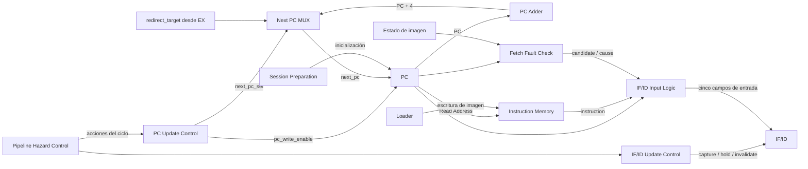
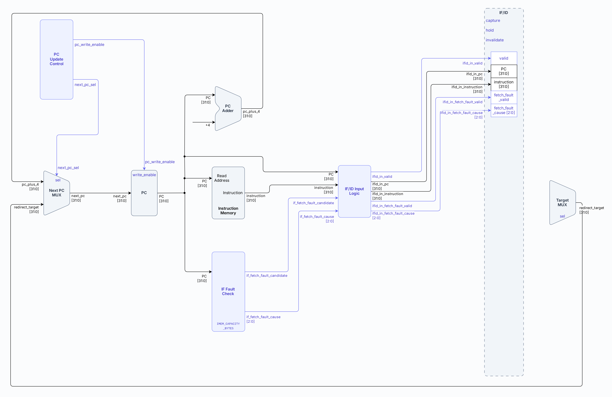

# Etapa IF — Instruction Fetch

- **Tipo:** arquitectura. 
- **Estado documental:** especificación vigente.

<a id="función-de-la-etapa"></a>

## Propósito y alcance

Este documento define la etapa `IF` del pipeline. IF mantiene el PC de búsqueda, obtiene desde IMEM la instrucción correspondiente y entrega a `ID` la palabra obtenida junto con su PC propio.

El alcance comprende:

- La selección de la próxima dirección de búsqueda.
- La lectura de instrucciones desde IMEM.
- El cálculo de la continuación secuencial `PC + 4`.
- La detección de problemas de alineación, capacidad o pertenencia a la imagen cargada.
- La producción y el transporte de candidatos de fault de fetch hacia `ID`.
- La actualización, retención o invalidación de PC e `IF/ID` según la acción del control del pipeline.

El documento describe la lógica y los datos propios de la búsqueda. La selección de acciones como avance normal, stall, redirect, flush o `HOLD` pertenece al [Control del pipeline y hazards](control_and_hazards.md); la confirmación y terminación por faults se desarrolla en [Faults, redirects y terminación](../session/faults_and_termination.md).

## Organización

### Organización interna

La etapa está compuesta por los siguientes bloques:

| Módulo | Tipo | Pertenece a |
|---|---|---|
| `PC Update Control` | Lógica | `if_stage` |
| `Next PC MUX` | Lógica | `if_stage` |
| `PC` | Estado | `if_stage` |
| `PC Adder` | Lógica | `if_stage` |
| `Instruction Memory` | Submódulo | `if_stage` |
| `Fetch Fault Check` | Submódulo | `if_stage` |
| `IF/ID Input Logic` | Lógica | `if_stage` |
| `IF/ID Update Control` | Lógica | `processor_top` |
| Registro `IF/ID` | Estado | `processor_top` |

El siguiente diagrama muestra la organización de IF y sus conexiones con el pipeline. Los bloques locales se desarrollan en [Comportamiento](#comportamiento) y [Estado y temporización](#estado-y-temporización).



El diagrama muestra los dos recorridos principales de IF. El camino del PC selecciona la próxima dirección de búsqueda y el camino de entrada a `IF/ID` combina la palabra leída desde IMEM con el resultado de la validación de fetch. La captura, retención o invalidación del registro `IF/ID` depende de la acción seleccionada por el control del pipeline.

## Bloques de `IF`

### `Next PC MUX`

`Next PC MUX` selecciona la única dirección que puede escribirse en el PC durante un ciclo de ejecución.

<a id="entradas-1"></a>

#### Entradas de `Next PC MUX`

| Señal | Origen | Tipo |
|---|---|---|
| `pc_plus_4[31:0]` | `PC Adder` | Data |
| `redirect_target[31:0]` | resolución de flujo en EX | Data |
| `next_pc_sel` | `PC Update Control` | Control |

<a id="salida"></a>

#### Salida de `Next PC MUX`

| Señal | Destino | Tipo |
|---|---|---|
| `next_pc[31:0]` | `PC` | Data |

La selección es:

```text
next_pc_sel = 0  →  pc_plus_4
next_pc_sel = 1  →  redirect_target
```

El target de redirect se calcula en EX. IF únicamente lo recibe como una alternativa para el próximo PC; la formación y validación de ese destino pertenecen a [Etapa EX](stage_ex.md) y a [Faults, redirects y terminación](../session/faults_and_termination.md).

### `PC Adder`

`PC Adder` forma la dirección secuencial siguiente.

#### Entrada

| Señal | Origen | Tipo |
|---|---|---|
| `PC[31:0]` | `PC` | Data |

<a id="salida-1"></a>

#### Salida de `PC Adder`

| Señal | Destino | Tipo |
|---|---|---|
| `pc_plus_4[31:0]` | `Next PC MUX` | Data |

La operación utiliza aritmética de 32 bits:

```text
pc_plus_4 = (PC + 4) mod 2^32
```

El resultado representa únicamente el siguiente PC secuencial. La validez de la búsqueda asociada a esa dirección se evalúa cuando ese valor pasa a ser el PC actual.

### `Instruction Memory`

IMEM almacena la imagen de instrucciones cargada por el Loader. IF utiliza el PC como dirección de byte para consultar esa memoria y obtiene una palabra de 32 bits; la validación determina si esa búsqueda pertenece a la imagen ejecutable.

<a id="entradas-3"></a>

#### Entradas de `Instruction Memory`

| Señal / interfaz | Origen | Tipo |
|---|---|---|
| `Read Address[31:0]` | `PC` | Data |
| interfaz de escritura de imagen | `Loader` | Control |

<a id="salida-2"></a>

#### Salida de `Instruction Memory`

| Señal | Destino | Tipo |
|---|---|---|
| `instruction[31:0]` | `IF/ID Input Logic` | Data |

Durante la ejecución, IF realiza una lectura combinacional de IMEM utilizando el PC como dirección de byte y recibe una palabra de 32 bits. Durante la carga de un programa, el Loader puede escribir la imagen en IMEM. La carga y la ejecución son fases mutuamente excluyentes: no se producen escrituras del Loader concurrentemente con búsquedas de instrucciones por parte de IF.

La presencia física de una palabra en IMEM no la convierte por sí sola en parte del programa ejecutable. La búsqueda también se valida contra la imagen confirmada, lo que impide interpretar como instrucciones los residuos de una carga anterior.

La organización, capacidad, direccionamiento y ownership de IMEM se detallan en [Arquitectura de memoria](../memory/memory_architecture.md).

### `Fetch Fault Check`

`Fetch Fault Check` determina si la búsqueda asociada al PC actual puede ingresar al pipeline como una instrucción activa.

<a id="entradas-4"></a>

#### Entradas de `Fetch Fault Check`

| Señal | Origen | Tipo |
|---|---|---|
| `PC[31:0]` | `PC` | Data |
| `image_valid` | derivado de `loaded_image_size_bytes != 0` | Estado |
| `loaded_image_size_bytes` | estado global de la imagen | Estado |
| `IMEM_CAPACITY_BYTES` | configuración de IMEM | Config |

#### Condiciones de búsqueda

El chequeo comprueba:

- La alineación a cuatro bytes.
- Que toda la región de búsqueda quede dentro de la capacidad física.
- Que toda la región de búsqueda pertenezca a la imagen confirmada.
- El cálculo del extremo de la región utilizando 33 bits.
- El rechazo de direcciones inválidas sin admitir truncamiento.

Las condiciones completas están en [Arquitectura de memoria](../memory/memory_architecture.md#validación-de-fetch).

Si fallan alineación y rango en la misma búsqueda, la causa seleccionada es desalineación. La formación del candidato y sus causas se especifican en [Faults, redirects y terminación](../session/faults_and_termination.md#detección-en-if).

<a id="salidas-2"></a>

#### Salidas de `Fetch Fault Check`

| Señal | Destino | Tipo |
|---|---|---|
| `if_fetch_fault_candidate` | `IF/ID Input Logic` | Control | 
| `if_fetch_fault_cause[2:0]` | `IF/ID Input Logic` | Control |

Las causas utilizadas por IF en `if_fetch_fault_cause[2:0]` son:

| Código | Condición | Explicación |
|---|---|---|
| `000` | `instruction-address-misaligned` | La dirección del PC no está alineada a cuatro bytes, por lo que no puede iniciarse una búsqueda válida. |
| `001` | `instruction-access-fault` | La región de cuatro bytes solicitada queda fuera de la capacidad física de IMEM o de la imagen ejecutable cargada. |

`Fetch Fault Check` no tiene un camino directo hacia `Pipeline Hazard Control`. IF detecta el candidato y lo transporta mediante `IF/ID`. La decisión de confirmarlo ocurre posteriormente en ID.

La semántica completa de detección, descarte y confirmación se desarrolla en [Faults, redirects y terminación](../session/faults_and_termination.md).

### `IF/ID Input Logic`

`IF/ID Input Logic` construye los cinco campos que podrían capturarse en `IF/ID` durante un avance normal.

<a id="entradas-5"></a>

#### Entradas de `IF/ID Input Logic`

| Señal | Origen | Tipo |
|---|---|---|
| `PC[31:0]` | `PC` | Data |
| `instruction[31:0]` | `Instruction Memory` | Data |
| `if_fetch_fault_candidate` | `Fetch Fault Check` | Control |
| `if_fetch_fault_cause[2:0]` | `Fetch Fault Check` | Control |

#### Fetch válido

Cuando no existe un candidato de fault los valores de salida de `IF/ID Input Logic` son:

```text
ifid_in_valid             = 1
ifid_in_pc                = PC
ifid_in_instruction       = instruction
ifid_in_fetch_fault_valid = 0
ifid_in_fetch_fault_cause = 3'b000
```

El valor cero de `fetch_fault_cause` es determinista, pero carece de significado de fault cuando `fetch_fault_valid=0`.

#### Fetch candidato

Cuando `Fetch Fault Check` detecta un problema:

```text
ifid_in_valid             = 0
ifid_in_pc                = PC
ifid_in_instruction       = 32'b0
ifid_in_fetch_fault_valid = 1
ifid_in_fetch_fault_cause = if_fetch_fault_cause
```

La palabra cero no representa una instrucción. El candidato queda identificado exclusivamente por `fetch_fault_valid`, `fetch_fault_cause` y el PC asociado.

<a id="salidas-3"></a>

#### Salidas de `IF/ID Input Logic`

| Señal | Destino | Tipo |
|---|---|---|
| `ifid_in_valid` | `IF/ID.valid` | Control |
| `ifid_in_pc[31:0]` | `IF/ID.pc` | Data |
| `ifid_in_instruction[31:0]` | `IF/ID.instruction` | Data |
| `ifid_in_fetch_fault_valid` | `IF/ID.fetch_fault_valid` | Control |
| `ifid_in_fetch_fault_cause[2:0]` | `IF/ID.fetch_fault_cause` | Control |

Esta lógica construye los valores de entrada de `IF/ID` para el ciclo actual. La actualización efectiva del registro —captura, retención o invalidación— la determina `IF/ID Update Control`.

## Interfaces y contratos

Las entradas, salidas, anchos y conexiones de esta etapa se consultan en [Interfaces](../../interfaces.md). Los campos y la temporización de `IF/ID` se definen en [Pipeline de la CPU](cpu_pipeline.md); los bloques locales se desarrollan en [Organización](#organización) y [Estado y temporización](#estado-y-temporización).

## Comportamiento

### Flujo normal de una búsqueda

Durante un avance normal, el PC actual alimenta simultáneamente al sumador `PC + 4`, a IMEM, al chequeo de fetch y a la lógica de entrada de `IF/ID`.

Si la búsqueda es válida:

1. IMEM presenta la palabra de 32 bits correspondiente al PC.
2. `Fetch Fault Check` no genera un candidato de fault.
3. `IF/ID Input Logic` forma una entrada con una instrucción activa.
4. `IF/ID Update Control` ordena la captura.
5. El PC adopta `PC + 4`.

Después del flanco, ID observa la instrucción que pertenecía al PC anterior, mientras IF comienza la búsqueda correspondiente al nuevo valor del PC.



Los valores utilizados para la captura corresponden al estado previo al flanco. Por lo tanto, el incremento del PC y la captura de `IF/ID` ocurren en el mismo flanco sin que `IF/ID` pierda la dirección de origen de la instrucción.

### Retención durante `load-use`

Ante una dependencia `load-use`, el control del pipeline retiene `IF/ID` para conservar la instrucción consumidora y evitar que la nueva búsqueda de IF la reemplace antes de que el dato cargado esté disponible.

Durante `act_load_use`:

- El PC permanece retenido.
- `IF/ID` conserva íntegramente sus cinco campos.
- `ID/EX` recibe una bubble.
- Las instrucciones anteriores continúan avanzando.

Si el PC retenido produce simultáneamente un candidato de fault en fetch, ese candidato no se captura en ese ciclo. Como el PC tampoco cambia, `Fetch Fault Check` vuelve a detectar la misma condición cuando la ejecución pueda avanzar.

Este comportamiento mantiene la instrucción consumidora en `IF/ID` y evita introducir un camino especial de confirmación de fault desde IF.

La detección de `load-use` y su prioridad respecto de otras acciones se detalla en [Control del pipeline y hazards](control_and_hazards.md). La secuencia específica de un candidato de fetch retenido se desarrolla en [Faults, redirects y terminación](../session/faults_and_termination.md).

<a id="redirects-y-descarte-del-trabajo-joven"></a>

### Redirects y descarte de instrucciones posteriores

Cuando EX resuelve un cambio de flujo válido, `act_redirect` provoca dos efectos simultáneos sobre IF:

- El PC captura `redirect_target`.
- `IF/ID` se invalida.

La palabra presentada por IMEM para el PC anterior y cualquier candidato de fetch asociado a ese camino se descartan. En el ciclo siguiente, IF comienza la búsqueda desde el nuevo PC.

Esta es justamente la razón por la que los candidatos de fault de fetch no se confirman en IF: una búsqueda posterior puede ser especulativa y quedar descartada si una instrucción anterior redirige el flujo antes de que el candidato alcance `ID`.

### Halt, faults y drenado

La confirmación de `halt`, de un fault en EX o de un fault en ID detiene la admisión de nuevo trabajo desde IF. En esos casos el PC permanece retenido e `IF/ID` se invalida.

Durante un drenado legal tampoco se incorporan nuevas instrucciones. El pipeline completa únicamente el trabajo anterior que todavía permanece en etapas posteriores.

IF no confirma nuevos faults ni `halt` durante el drenado. La lógica de terminación y drenado se desarrolla en [Faults, redirects y terminación](../session/faults_and_termination.md) y en [Control de ejecución y sesión](../session/execution_control.md).

### Resumen de comportamiento

| Situación | PC | `IF/ID` |
|---|---|---|
| Avance normal | `PC + 4` | Captura instrucción o candidato de fetch |
| Redirect | `redirect_target` | Invalida |
| Load-use | Retiene | Retiene |
| Halt confirmado | Retiene | Invalida |
| Fault EX confirmado | Retiene | Invalida |
| Fault ID confirmado | Retiene | Invalida |
| Drenado | Retiene | Invalida en el avance alcanzable |
| `HOLD` sin ciclo de la CPU | Retiene | Retiene |

La tabla resume únicamente el comportamiento visible de IF. La selección exacta entre las ocho acciones del pipeline pertenece a [Control del pipeline y hazards](control_and_hazards.md).

## Estado y temporización

### `PC Update Control`

`PC Update Control` transforma la acción seleccionada por `Pipeline Hazard Control` en los controles locales del PC.

<a id="entradas"></a>

#### Entradas de `PC Update Control`

| Señal | Origen | Tipo |
|---|---|---|
| `act_normal` | `Pipeline Hazard Control` | Control |
| `act_redirect` | `Pipeline Hazard Control` | Control | 

<a id="salidas"></a>

#### Salidas de `PC Update Control`

| Señal | Destino | Tipo | Significado |
|---|---|---|---|
| `pc_write_enable` | `PC.write_enable` | Control | Autoriza la actualización del PC. |
| `next_pc_sel` | `Next PC MUX.sel` | Control | Selecciona entre avance secuencial y redirect. |

Durante avance normal, el PC recibe `PC + 4`; durante redirect, recibe `redirect_target`. Las otras acciones lo retienen. Las ecuaciones de `pc_write_enable` y `next_pc_sel` están en [los controles locales del PC](control_and_hazards.md#pc).

No existe una tercera fuente especial para `halt` o fault: esas situaciones conservan el PC al no habilitar su escritura.

### `PC`

El PC es un registro de 32 bits que representa la dirección del frente actual de búsqueda.

<a id="entradas-2"></a>

#### Entradas de `PC`

| Señal / acción | Origen | Tipo |
|---|---|---|
| `next_pc[31:0]` | `Next PC MUX` | Data |
| `write_enable` | `PC Update Control.pc_write_enable` | Control |
| inicialización de sesión | `Session Preparation` | Estado |
| `reset` | control global | Estado |

<a id="salidas-1"></a>

#### Salidas de `PC`

| Señal | Destino | Tipo |
|---|---|---|
| `PC[31:0]` | `PC Adder` | Data |
| `PC[31:0]` | `Instruction Memory` | Data |
| `PC[31:0]` | `Fetch Fault Check` | Data |
| `PC[31:0]` | `IF/ID Input Logic` | Data |
| `PC[31:0]` | Debug, cuando forma parte del snapshot | Data |

#### Características de `PC`

- Al preparar una nueva sesión, el PC se inicializa en `0x00000000`.
- Durante la ejecución secuencial avanza de cuatro en cuatro bytes.
- Un redirect sustituye ese recorrido por el destino resuelto en EX.

La preparación de sesión, el reset y la autorización de ciclos se desarrollan en [Control de ejecución y sesión](../session/execution_control.md).

### `IF/ID Update Control`

`IF/ID Update Control` convierte la acción global del pipeline emitidas por `Pipeline Hazard Control` en una de tres operaciones locales sobre el registro `IF/ID`: 

- **capturar:** Actualiza el registro con los datos de entrada del ciclo.
- **retener:** Conserva sin cambios el contenido actual del registro.
- **invalidar:** Marca el registro como inactivo, descartando su contenido lógico.

<a id="entradas-6"></a>

#### Entradas de `IF/ID Update Control`

Todas las entradas provienen de `Pipeline Hazard Control`:

| Señal | Origen | Tipo |
|---|---|---|
| `act_ex_fault` | `Pipeline Hazard Control` | Control |
| `act_halt` | `Pipeline Hazard Control` | Control |
| `act_redirect` | `Pipeline Hazard Control` | Control |
| `act_id_fault` | `Pipeline Hazard Control` | Control |
| `act_load_use` | `Pipeline Hazard Control` | Control |
| `act_normal` | `Pipeline Hazard Control` | Control |
| `act_drain_load_use` | `Pipeline Hazard Control` | Control |
| `act_drain_advance` | `Pipeline Hazard Control` | Control |

<a id="salidas-4"></a>

#### Salidas de `IF/ID Update Control`

| Señal | Destino | Tipo |
|---|---|---|
| `capture` | `IF/ID.capture` | Control |
| `hold` | `IF/ID.hold` | Control |
| `invalidate` | `IF/ID.invalidate` | Control |

La captura, retención e invalidación se derivan de las ocho acciones según [los controles locales de IF/ID](control_and_hazards.md#ifid). En ausencia de una acción de pipeline y de una prioridad global superior, el registro conserva su estado.

`act_drain_load_use` permanece en ese contrato combinacional, aunque no sea alcanzable desde una sesión legal. La distinción entre esta rama artificial y el drain legal se explica en [Control del pipeline y hazards](control_and_hazards.md#act_drain_load_use).

### Registro `IF/ID`

`IF/ID` es el registro que conecta la etapa de `IF` con la etapa de `ID`. Conserva una instrucción obtenida correctamente o un candidato de fault de fetch, pero nunca ambas cosas simultáneamente en un estado legal.

#### Campos

El [contrato de IF/ID](cpu_pipeline.md#registro-ifid) define sus cinco campos y anchos, incluida la validez independiente del candidato de fetch. Las conexiones locales de esos campos son las siguientes.

#### Entradas de datos

| Campo | Origen | Tipo |
|---|---|---|
| `valid` | `IF/ID Input Logic.ifid_in_valid` | Control |
| `pc` | `IF/ID Input Logic.ifid_in_pc` | Data |
| `instruction` | `IF/ID Input Logic.ifid_in_instruction` | Data |
| `fetch_fault_valid` | `IF/ID Input Logic.ifid_in_fetch_fault_valid` | Control |
| `fetch_fault_cause` | `IF/ID Input Logic.ifid_in_fetch_fault_cause` | Control |

#### Entradas de control

| Señal / acción | Origen | Tipo |
|---|---|---|
| `capture` | `IF/ID Update Control` | Control |
| `hold` | `IF/ID Update Control` | Control |
| `invalidate` | `IF/ID Update Control` | Control |
| clear de sesión | `Session Preparation` | Control |

#### Salidas hacia ID

`IF/ID` entrega a la etapa siguiente:

- `valid`
- `pc[31:0]`
- `instruction[31:0]`
- `fetch_fault_valid`
- `fetch_fault_cause[2:0]`

Los slices `instruction[19:15]`, `instruction[24:20]` e `instruction[11:7]` se utilizan directamente en ID cuando corresponden a los campos `rs1`, `rs2` y `rd`; no constituyen registros adicionales dentro de `IF/ID`.

#### Salidas hacia el serializador Debug

Las [entradas de observación IF/ID](../debug/response_serializer.md#entradas-de-observación-de-ifid) están aprobadas. Los cinco campos actuales se conectan hacia `response_serializer` como:

- `debug_ifid_valid`;
- `debug_ifid_pc[31:0]`;
- `debug_ifid_instruction[31:0]`;
- `debug_ifid_fetch_fault_valid`;
- `debug_ifid_fetch_fault_cause[2:0]`.

Son conexiones de las salidas registradas existentes, sin copiar el registro interetapa. La exclusión Debug retiene los campos durante conteo y envío.

Se transmiten también bits con flags inactivos y se interpretan según `valid` y `fetch_fault_valid`.

El [acuerdo conjunto de latches](../debug/response_serializer.md#observación-y-selección-de-bytes-de-los-cuatro-latches) fija la selección de los 11 bytes `IF/ID` desde `fixed_byte_index` en posiciones 149 a 159, con padding superior y little-endian conforme al protocolo, sin otro contador. Los controles de captura y consumo están definidos en la tabla de señales de acción del serializador.

El detalle de cómo ID interpreta esta información se desarrolla en [Etapa ID](stage_id.md).

## Invariantes y condiciones de borde

Las condiciones de admisión de una búsqueda están en [Condiciones de búsqueda](#condiciones-de-búsqueda); la retención y el descarte se describen en [Comportamiento](#comportamiento). Las propiedades transversales se consultan en [Invariantes arquitectónicas](../architectural_invariants.md).

<a id="trazabilidad"></a>

## Referencias y trazabilidad

- [Pipeline CPU](cpu_pipeline.md): organización general de IF y contrato del registro `IF/ID`.
- [Datapath](datapath.md): bloques combinacionales y caminos de datos relacionados.
- [Control del pipeline y hazards](control_and_hazards.md): acciones, retenciones, invalidaciones y `load-use`.
- [Arquitectura de memoria](../memory/memory_architecture.md): IMEM, imagen confirmada, direccionamiento y validación de región.
- [Faults, redirects y terminación](../session/faults_and_termination.md): detección y confirmación de fetch faults, redirects y terminación por `halt` o fault.
- [Control de ejecución y sesión](../session/execution_control.md): autorización de ciclos, preparación, reset y drenado.
