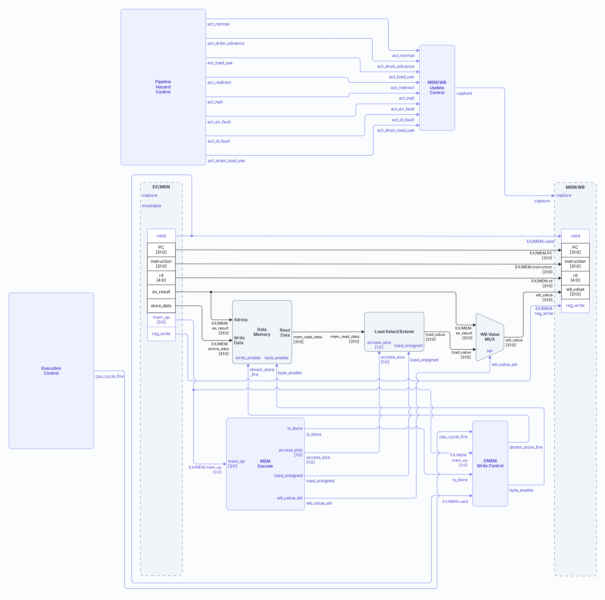
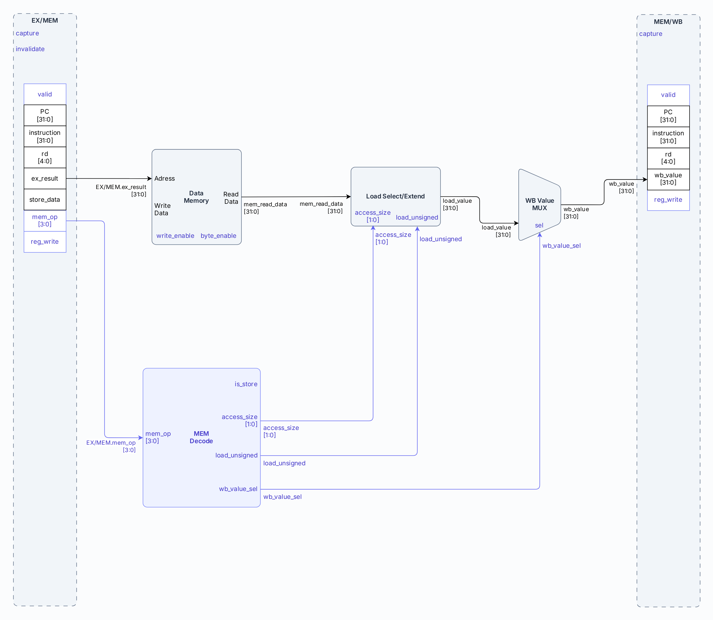
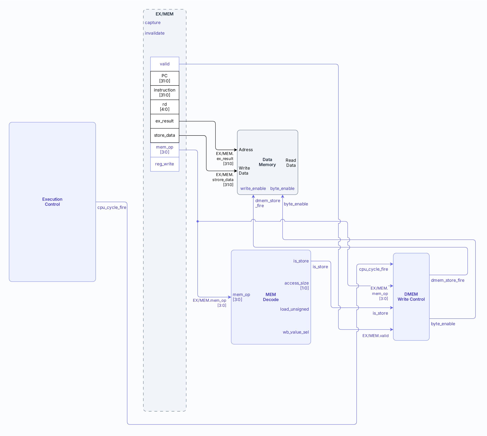
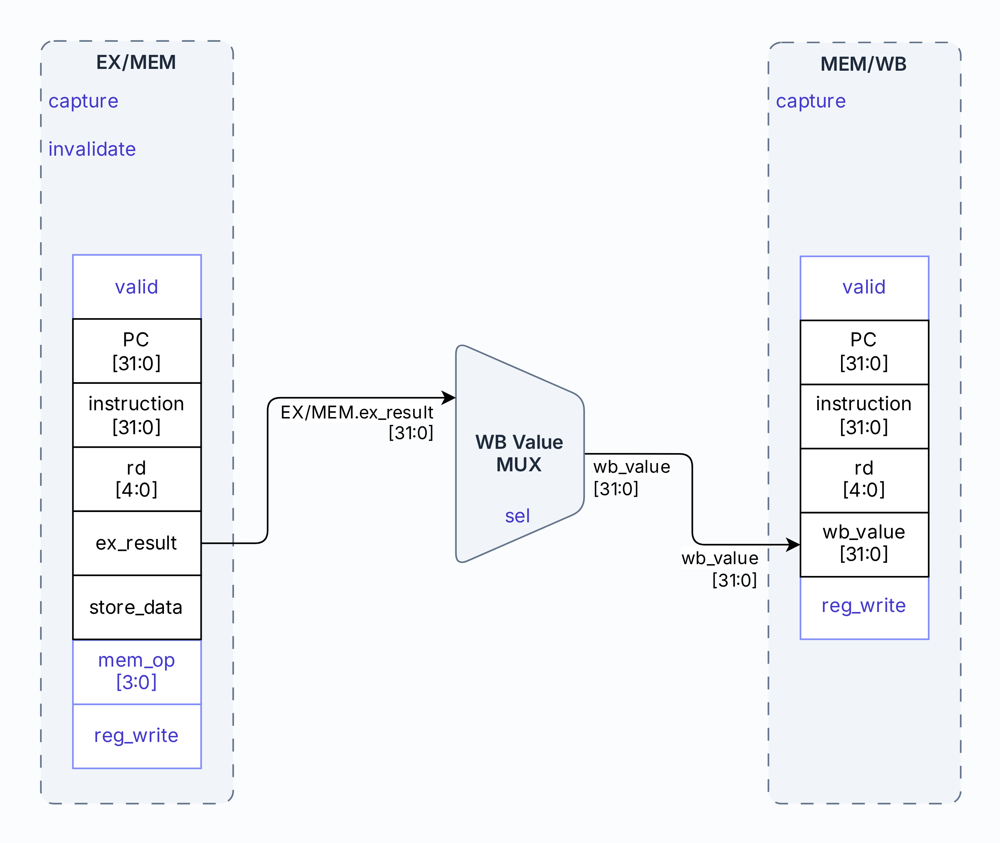

# Etapa MEM — Memory

- **Tipo:** arquitectura. 
- **Estado documental:** especificación vigente.

<a id="función-de-la-etapa"></a>

## Propósito y alcance

Este documento define la etapa `MEM` del pipeline. MEM recibe desde `EX/MEM` una instrucción que ya completó su ejecución en EX, realiza los efectos que correspondan sobre `Data Memory` y prepara el valor que puede continuar hacia WB.

El alcance comprende:

- La interpretación de `EX/MEM.mem_op` para determinar el tipo y tamaño del acceso.
- La lectura de DMEM y la extensión del dato para un `load`.
- La escritura de DMEM para un `store`, utilizando la dirección y el dato calculados en EX.
- El transporte de resultados que ya fueron producidos en EX.
- La selección del valor único `wb_value` que se captura en `MEM/WB`.
- La conservación de la identidad y las señales de control necesarias para que la instrucción continúe hacia WB.

La función de MEM depende de la clase de instrucción:

- Un **load** utiliza `EX/MEM.ex_result` como dirección, lee DMEM y produce el dato cargado.
- Un **store** utiliza `EX/MEM.ex_result` como dirección y `EX/MEM.store_data` como dato para modificar DMEM.
- Una instrucción que ya produjo su resultado en EX lo transporta hacia `MEM/WB`.
- Una instrucción sin escritura de registro puede atravesar MEM sin producir un nuevo valor para el banco de registros.

Los chequeos de alineación y rango de loads y stores se realizan en EX. Por eso, una operación de memoria que llega a MEM como entrada válida representa un acceso arquitectónicamente admitido. MEM no vuelve a validar la dirección: realiza el acceso correspondiente y forma el valor que continúa por el pipeline.

El documento describe la lógica y los datos propios del acceso a memoria y de la selección hacia WB. La selección de acciones como captura, retención o invalidación de `MEM/WB` pertenece al control del pipeline; la escritura efectiva del banco de registros y el commit del resultado pertenecen a [Etapa WB](stage_wb.md).

Al igual que EX, MEM es combinacional entre `EX/MEM` y `MEM/WB`: sus caminos se evalúan en paralelo durante el ciclo. `EX/MEM.mem_op` determina qué caminos tienen significado funcional y qué valor selecciona finalmente `WB Value MUX`.

## Organización

### Organización general

La etapa está compuesta por los siguientes bloques y registros:

| Módulo                    | Tipo       | Pertenece a     |
|---------------------------|------------|-----------------|
| `MEM Decode`              | Submódulo  | `mem_stage`     |
| `Data Memory`             | Submódulo  | `mem_stage`     |
| `Load Select / Extend`    | Submódulo  | `mem_stage`     |
| `DMEM Write Control`      | Submódulo  | `mem_stage`     |
| `WB Value Mux`            | Lógica     | `mem_stage`     |
| `MEM/WB Update Control`   | Lógica     | `processor_top` |
| Registro `MEM/WB`         | Estado     | `processor_top` |

Véase el [inventario aprobado](../module_inventory.md).

La etapa puede entenderse mediante tres caminos principales:

1. **Decodificación local de memoria**, que deriva de `mem_op` el tipo y tamaño de acceso.
2. **Camino de DMEM**, que realiza la lectura de un load o la escritura de un store.
3. **Camino de writeback**, que selecciona entre el valor leído de DMEM y el resultado previamente producido en EX.

El registro `MEM/WB` consolida la salida de la etapa en un único campo `wb_value`.

El siguiente diagrama muestra los bloques y caminos principales de MEM:



Los caminos anteriores no representan subetapas temporales. `MEM Decode`, la lectura combinacional de DMEM, la extensión de loads y la selección de `wb_value` se resuelven dentro del mismo ciclo de MEM. Un store, en cambio, hace commit de su escritura en el flanco correspondiente al ciclo efectivo.

### Bloques que implementan la etapa

#### Decodificación local de memoria

##### `MEM Decode`

El `MEM Decode` interpreta `EX/MEM.mem_op` y genera las señales de control locales que utiliza MEM.

##### Entrada

| Señal                | Origen   | Tipo    |
|----------------------|----------|---------|
| `EX/MEM.mem_op[3:0]` | `EX/MEM` | Control |

La codificación recibida está fijada en [las señales de control generadas en ID](stage_id.md#codificación-de-los-controles). MEM la interpreta sin modificarla ni registrar campos derivados.

`MEM Decode` deriva localmente estas clasificaciones a partir de la codificación recibida:

```text
is_load =
    mem_op ∈ {LB, LH, LW, LBU, LHU}

is_store =
    mem_op ∈ {SB, SH, SW}
```

El tamaño queda:

```text
access_size = 00 (BYTE)     → LB, LBU, SB
access_size = 01 (HALFWORD) → LH, LHU, SH
access_size = 10 (WORD)     → LW, SW
access_size = 11            → reservado
```

y:

```text
load_unsigned =
    (mem_op == LBU)
    || (mem_op == LHU)
```

El selector del valor de writeback se obtiene directamente de la clase de memoria:

```text
wb_value_sel =
    is_load(EX/MEM.mem_op)
```

##### Salidas

| Señal              | Destino                | Tipo    |
|--------------------|------------------------|---------|
| `is_store`         | `DMEM Write Control`   | Control |
| `access_size[1:0]` | `Load Select / Extend` | Control |
| `load_unsigned`    | `Load Select / Extend` | Control |
| `wb_value_sel`     | `WB Value MUX`         | Control |

`is_load` puede mantenerse como señal interna para formar `wb_value_sel`; no necesita exponerse como un puerto adicional si ningún otro bloque lo consume.

Las mismas funciones de clasificación se utilizan en otros puntos de la CPU a partir del `mem_op` registrado en cada etapa, sin transportarlas como nuevos campos de pipeline.

#### Camino de Data Memory

##### `Data Memory`

DMEM es una memoria byte-addressed organizada lógicamente para soportar accesos de uno, dos y cuatro bytes.

##### Entradas desde la CPU

| Señal                | Origen                                          | Tipo    |
|----------------------|-------------------------------------------------|---------|
| `Address[31:0]`      | `EX/MEM.ex_result`                              | Data    |
| `Write Data[31:0]`   | `EX/MEM.store_data`                             | Data    |
| `write_enable`       | `DMEM Write Control.dmem_store_fire`            | Control |
| `byte_enable[3:0]`   | `DMEM Write Control`, máscara relativa aprobada | Control |

##### Entrada de mantenimiento

| Señal / acción                             | Origen                                                | Tipo    |
|--------------------------------------------|-------------------------------------------------------|---------|
| `prepare_dmem_clear` (un bit)              | `Session Preparation`, habilita limpieza de una marca | Control |
| `prepare_dmem_addr` (`BYTE_ADDRESS_WIDTH`) | `Session Preparation`, dirección de byte a limpiar    | Control |

##### Salida

| Señal                  | Destino                | Tipo    |
|------------------------|------------------------|---------|
| `mem_read_data[31:0]`  | `Load Select / Extend` | Data    |

La lectura es combinacional. La escritura de un store ocurre síncronamente cuando `dmem_store_fire=1`.

Arquitectónicamente, cada byte que no fue escrito durante la sesión actual se observa como cero. La organización de referencia conserva una validez independiente por byte:

```text
logical_byte[a] =
    valid[a] ? data[a] : 8'h00
```

Un store actualiza de manera coherente tanto el dato como la validez de cada byte seleccionado. Un byte no seleccionado conserva ambos.

Esta semántica impide que una sesión nueva observe como datos propios residuos de una ejecución anterior.

La organización completa de DMEM, sus capacidades y la preparación del cero lógico se desarrollan en [Arquitectura de memoria](../memory/memory_architecture.md).

##### `Load Select / Extend`

El `Load Select / Extend` convierte la lectura de DMEM en el valor arquitectónico de 32 bits correspondiente al load.

##### Entradas

| Señal                   | Origen                  | Tipo    |
|-------------------------|-------------------------|---------|
| `mem_read_data[31:0]`   | `Data Memory`           | Data    |
| `address_low_bits[1:0]` | `EX/MEM.ex_result[1:0]` | Data    |
| `access_size[1:0]`      | `MEM Decode`            | Control |
| `load_unsigned`         | `MEM Decode`            | Control |

##### Salida

| Señal              | Destino        | Tipo |
|--------------------|----------------|------|
| `load_value[31:0]` | `WB Value MUX` | Data |

La selección antecede a la extensión. Para una dirección `A`, el byte seleccionado es `logical_byte[A]`, el halfword es `{logical_byte[A+1], logical_byte[A]}` y la word reúne los cuatro bytes en orden little-endian. En una lectura presentada por lanes de word, `address_low_bits` selecciona el lane de byte o el par de lanes del halfword; una word válida utiliza los cuatro lanes.

El comportamiento de extensión sobre esos valores ya seleccionados es:

```text
BYTE + signed:
    sign_extend(selected_byte)

BYTE + unsigned:
    zero_extend(selected_byte)

HALFWORD + signed:
    sign_extend(selected_halfword)

HALFWORD + unsigned:
    zero_extend(selected_halfword)

WORD:
    assembled_word[31:0]
```

El [acuerdo de lectura](../../decisions/DEC-ARCH-006.md#acuerdo-de-concreción-de-dec-arch-006--lectura-dmem-alineada-y-selección-en-mem) fija `mem_read_data` como la palabra alineada de cuatro bytes lógicos. DMEM no preselecciona ni desplaza el dato CPU.

`Load Select/Extend`, fuera de DMEM y dentro de MEM, usa `address_low_bits` y `access_size` para seleccionar antes de extender. Todo el camino es combinacional, sin otro ciclo/registro.

Escritura/metadatos y mantenimiento están concretados en [acceso DMEM](../memory/dmem_access.md). `prepare_dmem_clear` selecciona la dirección de metadatos CPU/preparación. La prioridad es:

```text
reset > clear > store
```

#### Escritura de stores

##### `DMEM Write Control`

El `DMEM Write Control` determina si la instrucción que ocupa MEM hace commit de una escritura y qué tamaño de store realiza.

##### Entradas

| Señal                | Origen              | Tipo    |
|----------------------|---------------------|---------|
| `cpu_cycle_fire`     | `Execution Control` | Control |
| `EX/MEM.valid`       | `EX/MEM`            | Control |
| `is_store`           | `MEM Decode`        | Control |
| `EX/MEM.mem_op[3:0]` | `EX/MEM`            | Control |

La habilitación efectiva es:

```text
dmem_store_fire =
    cpu_cycle_fire
    && EX/MEM.valid
    && is_store
```

##### Salidas

| Señal                              | Destino                        | Tipo    |
|------------------------------------|--------------------------------|---------|
| `dmem_store_fire` / `write_enable` | `Data Memory.write_enable`     | Control |
| `byte_enable[3:0]`                 | `Data Memory.byte_enable[3:0]` | Control |

La [máscara aprobada](../../decisions/DEC-ARCH-006.md#acuerdo-de-concreción-de-dec-arch-006--máscara-y-alineación-de-escritura-dmem) indica cuántos bytes del dato debe escribir el store. `DMEM Write Control` genera esta máscara en una posición relativa al dato:

| Operación       | Bytes escritos | Máscara relativa |
|-----------------|----------------|------------------|
| `SB`            | 1              | `0001`           |
| `SH`            | 2              | `0011`           |
| `SW`            | 4              | `1111`           |
| Otro `mem_op`   | 0              | `0000`           |

La máscara todavía no representa necesariamente los lanes físicos finales de DMEM. `Data Memory`, que recibe `Address`, desplaza combinacionalmente la máscara y `Write Data` según `Address[1:0]` antes de habilitar los lanes.

Por ejemplo, un `SB` parte de la máscara `0001`: si `Address[1:0]=01`, DMEM la desplaza a `0010` y escribe el byte en el lane correspondiente. Un `SH` parte de `0011` y, cuando la dirección está alineada en un offset `10`, se transforma en `1100`. Un `SW` usa `1111` y solo puede llegar con una dirección alineada, por lo que no necesita desplazamiento.

Por eso `DMEM Write Control` no necesita recibir la dirección: solo decide si existe un store y cuál es su tamaño. El desplazamiento final depende de `Address[1:0]` y se realiza dentro de `Data Memory`.

El mismo `dmem_store_fire` gobierna la actualización de los metadatos lógicos asociados a esos bytes. El dato y su validez cambian como un único efecto del store.

MEM no repite los chequeos de alineación o rango. El gating por `EX/MEM.valid` expresa el resultado de la validación realizada en EX.

<a id="store-anterior-frente-a-una-frontera-joven"></a>

##### Store anterior a la instrucción que provoca `halt` o fault

Un store válido que ya se encuentra en MEM es anterior a cualquier instrucción situada ese mismo ciclo en EX, ID o IF.

Por eso, confirmar el fault o `halt` de una instrucción posterior no cancela ese store. Es posible que, en el mismo ciclo:

```text
dmem_store_fire = 1
```

y simultáneamente se confirme `halt` o el fault de una instrucción posterior.

El store anterior conserva su efecto porque forma parte de las instrucciones válidas que ya estaban antes en el programa.

Durante `HOLD`, en cambio, `cpu_cycle_fire=0`, por lo que una instrucción retenida en `EX/MEM` no repite su escritura.

La relación entre el orden de las instrucciones y los efectos que se conservan se desarrolla en [Faults, redirects y terminación](../session/faults_and_termination.md).

#### Formación del valor de writeback

##### `WB Value MUX`

Todas las instrucciones que eventualmente escriben el `Register File` convergen en MEM sobre un único dato de 32 bits: `wb_value`.

##### Entradas

| Señal                    | Origen                 | Tipo    |
|--------------------------|------------------------|---------|
| `EX/MEM.ex_result[31:0]` | `EX/MEM`               | Data    |
| `load_value[31:0]`       | `Load Select / Extend` | Data    |
| `wb_value_sel`           | `MEM Decode`           | Control |

##### Salida

| Señal              | Destino           | Tipo |
|--------------------|-------------------|------|
| `wb_value[31:0]`   | `MEM/WB.wb_value` | Data |

La selección es:

```text
wb_value_sel = 0  → EX/MEM.ex_result
wb_value_sel = 1  → load_value
```

Como:

```text
wb_value_sel = is_load(EX/MEM.mem_op)
```

se obtiene:

```text
load
    → wb_value = load_value

resto
    → wb_value = EX/MEM.ex_result
```

Para stores, branches o entradas inválidas, el dato seleccionado puede existir combinacionalmente pero no produce escritura porque `reg_write` o `valid` no habilitan WB.

Por esta convergencia, `MEM/WB` no necesita recordar de dónde provino el resultado. WB y el forwarding posterior utilizan siempre el mismo campo `wb_value`.

## Interfaces y contratos

### Qué recibe MEM

`EX/MEM` entrega ocho campos:

- `valid`
- `pc[31:0]`
- `instruction[31:0]`
- `rd[4:0]`
- `reg_write`
- `mem_op[3:0]`
- `ex_result[31:0]`
- `store_data[31:0]`

El significado de `ex_result` ya quedó determinado en [Etapa EX](stage_ex.md#salida-de-la-etapa). Para una instrucción aritmética, `LUI` o un salto con enlace contiene el resultado arquitectónico. Para un load o store contiene la dirección efectiva.

`store_data` solamente adquiere significado funcional para stores. Para las demás clases de instrucción puede conservar un valor residual sin producir efectos.

### Salida de la etapa

#### Campos

El [contrato de MEM/WB](cpu_pipeline.md#registro-memwb) define sus seis campos y anchos. MEM aporta un único valor final de writeback, sin registrar sus fuentes por separado.

#### Entradas

| Campo         | Origen               | Tipo    |
|---------------|----------------------|---------|
| `valid`       | `EX/MEM.valid`       | Control |
| `pc`          | `EX/MEM.pc`          | Data    |
| `instruction` | `EX/MEM.instruction` | Data    |
| `rd`          | `EX/MEM.rd`          | Data    |
| `reg_write`   | `EX/MEM.reg_write`   | Control |
| `wb_value`    | `WB Value MUX`       | Data    |

#### Señales de control

| Señal / acción  | Origen                  | Tipo    |
|-----------------|-------------------------|---------|
| `capture`       | `MEM/WB Update Control` | Control |
| clear de sesión | `Session Preparation`   | Estado  |

`MEM/WB` ya no conserva `mem_op`, `store_data`, `ex_result` ni `load_value` por separado. Todos los posibles datos destinados a un registro convergieron previamente en `wb_value`.

El mismo `wb_value` se utiliza después para:

- escritura del `Register File`;
- bypass WB→ID;
- forwarding `MEM/WB`→EX.

El consumo de estos campos se desarrolla en [Etapa WB](stage_wb.md).

#### Observación Debug de MEM/WB

El [acuerdo conjunto de latches](../debug/response_serializer.md#observación-y-selección-de-bytes-de-los-cuatro-latches) conecta directamente los 6 campos actuales de `MEM/WB` a `response_serializer`, con sus anchos funcionales:

- `debug_memwb_valid`;
- `debug_memwb_pc`;
- `debug_memwb_instruction`;
- `debug_memwb_rd`;
- `debug_memwb_reg_write`;
- `debug_memwb_wb_value`.

La exclusión Debug retiene esos valores y evita otra copia del registro interetapa.

Los bits actuales de `MEM/WB` se observan también con `valid` inactivo; su vigencia se interpreta según ese flag. La [regla común del serializador](../debug/response_serializer.md#regla-común-de-selección-y-avance) define la selección de bytes, su representación y las señales de control de captura y consumo.

## Comportamiento

### Recorridos por clase de instrucción

#### Loads

Los loads son las instrucciones para las que MEM produce un nuevo valor arquitectónico. EX ya calculó y validó la dirección; MEM utiliza esa dirección para leer DMEM y convertir los bytes obtenidos en un valor de 32 bits.

El camino es:



Para todos los loads:

```text
address = EX/MEM.ex_result
```

`MEM Decode` distingue el tamaño del acceso y la política de extensión:

| Instrucción | Bytes | Extensión  |
|-------------|------:|------------|
| `lb`        |     1 | signo      |
| `lh`        |     2 | signo      |
| `lw`        |     4 | sin cambio |
| `lbu`       |     1 | cero       |
| `lhu`       |     2 | cero       |

La lectura de DMEM presenta datos lógicos y `Load Select / Extend` identifica los bytes de la dirección solicitada, los ensambla y aplica la extensión para producir `load_value[31:0]`. En la vista por lanes, los bits bajos de la dirección identifican la posición del byte o halfword dentro de la word.

Para un load:

```text
wb_value = load_value
```

El dato cargado queda disponible para forwarding normal recién después de ser capturado en `MEM/WB`. No existe un bypass directo `DMEM → EX`.

#### `LB` y `LBU`

Ambas instrucciones leen un byte. La diferencia aparece únicamente en la extensión aplicada al resultado.

Conceptualmente:

```text
LB:
load_value = sign_extend(byte, 32)

LBU:
load_value = zero_extend(byte, 32)
```

Si el byte leído tiene el bit más significativo en uno, `LB` completa los bits superiores con unos, mientras `LBU` los completa con ceros.

#### `LH` y `LHU`

Estas instrucciones leen dos bytes consecutivos ya validados y los interpretan en orden little-endian.

Conceptualmente:

```text
halfword = {byte_address_plus_1, byte_address}

LH:
load_value = sign_extend(halfword, 32)

LHU:
load_value = zero_extend(halfword, 32)
```

La dirección menor contiene los bits menos significativos del halfword.

#### `LW`

`LW` utiliza los cuatro bytes del acceso para formar directamente el valor de 32 bits:

```text
load_value = {
    byte_address_plus_3,
    byte_address_plus_2,
    byte_address_plus_1,
    byte_address
}
```

No existe una extensión posterior porque el tamaño leído ya coincide con el ancho del `Register File`.

La organización exacta de los byte lanes, el cero lógico y la semántica little-endian se desarrollan en [Arquitectura de memoria](../memory/memory_architecture.md).

#### Stores

Los stores no producen un valor para el `Register File`. Su efecto arquitectónico ocurre en MEM mediante una escritura síncrona sobre DMEM.

EX ya dejó preparados dos valores separados:

```text
EX/MEM.ex_result = dirección efectiva
EX/MEM.store_data = dato del store
```

El recorrido es:



La escritura utiliza el [predicado de commit de DMEM Write Control](#dmem-write-control): solo un store válido de `EX/MEM` participa de un ciclo efectivo de la CPU.

Cuando se cumple:

```text
address = EX/MEM.ex_result
data    = EX/MEM.store_data
```

`mem_op` determina cuántos bytes participan:

| Instrucción | Efecto                                              |
|-------------|-----------------------------------------------------|
| `sb`        | escribe el byte menos significativo de `store_data` |
| `sh`        | escribe los 16 bits menos significativos            |
| `sw`        | escribe los 32 bits                                 |

Los bytes no seleccionados conservan su contenido y su estado lógico.

#### `SB`

`SB` actualiza un único byte:

```text
store_byte = EX/MEM.store_data[7:0]
```

La dirección efectiva identifica el byte arquitectónico que recibe ese valor.

#### `SH`

`SH` actualiza dos bytes consecutivos:

```text
byte menor     ← store_data[7:0]
byte siguiente ← store_data[15:8]
```

El orden respeta la representación little-endian.

#### `SW`

`SW` actualiza cuatro bytes:

```text
address + 0 ← store_data[7:0]
address + 1 ← store_data[15:8]
address + 2 ← store_data[23:16]
address + 3 ← store_data[31:24]
```

La validez de rango y alineación de estos accesos ya fue resuelta en EX. Un store que produjo un fault propio nunca llega a MEM con `EX/MEM.valid=1`.

#### Instrucciones con resultado producido en EX

Las operaciones R-type, las operaciones I-type aritméticas y de shift, `LUI`, `JAL` y `JALR` llegan a MEM con su resultado arquitectónico ya contenido en `EX/MEM.ex_result`.

No necesitan transformar ese dato:



Para estas instrucciones:

```text
wb_value = EX/MEM.ex_result
```

Según la clase de instrucción, ese valor ya representa:

- Un resultado de ALU.
- El inmediato de `LUI`.
- `PC + 4` para `JAL` o `JALR`.

MEM actúa como etapa de paso para ese resultado y lo consolida en el formato único que WB consumirá.

#### Branches

`BEQ` y `BNE` ya resolvieron su condición y su eventual redirect en EX. Cuando llegan válidamente a MEM, no realizan un acceso a DMEM ni escriben un registro.

`MEM Decode` interpreta `mem_op=NONE`, por lo que:

```text
is_load  = 0
is_store = 0
```

`WB Value MUX` puede presentar combinacionalmente `EX/MEM.ex_result`, pero ese valor no produce un efecto arquitectónico porque `reg_write=0`.

La instrucción continúa por el pipeline únicamente para conservar el modelo temporal y la observabilidad de la instrucción activa.

#### `halt` y faults propios de EX

`halt` y una instrucción cuyo fault se confirma en EX no ingresan válidamente a `EX/MEM`.

Por lo tanto, MEM no recibe esas instrucciones como operaciones activas y no necesita un camino especial para neutralizar sus efectos. La invalidez establecida al salir de EX impide tanto escrituras en DMEM como futuros writebacks.

El tratamiento de esas instrucciones y de las anteriores se desarrolla en [Faults, redirects y terminación](../session/faults_and_termination.md).

### Resumen de recorridos

| Clase               | Acceso DMEM      | Valor hacia `MEM/WB` | Efecto arquitectónico en MEM |
|---------------------|------------------|----------------------|------------------------------|
| `LB/LH/LW/LBU/LHU`  | lectura          | `load_value`         | forma dato de load           |
| `SB/SH/SW`          | escritura        | irrelevante para RF  | modifica DMEM                |
| R-type              | ninguno          | `EX/MEM.ex_result`   | ninguno adicional            |
| I-type aritm./shift | ninguno          | `EX/MEM.ex_result`   | ninguno adicional            |
| `LUI`               | ninguno          | `EX/MEM.ex_result`   | ninguno adicional            |
| `JAL/JALR`          | ninguno          | `EX/MEM.ex_result`   | ninguno adicional            |
| `BEQ/BNE`           | ninguno          | irrelevante          | ninguno                      |
| entrada inválida    | ninguno efectivo | irrelevante          | ninguno                      |

La tabla muestra qué camino tiene significado para cada clase. DMEM y los muxes pueden presentar valores combinacionales para otras entradas, pero `valid`, `mem_op` y `reg_write` determinan cuáles pueden producir efectos.

### Efectos simultáneos dentro de MEM

En un ciclo efectivo, la etapa puede realizar simultáneamente dos acciones sobre la instrucción que ocupa `EX/MEM`:

- Hacer commit de un store en DMEM, si corresponde.
- Capturar en `MEM/WB` el contexto que continuará hacia WB.

Para un store, la segunda acción transporta una instrucción con `reg_write=0`, por lo que su paso posterior por WB no genera escritura.

Para un load, la lectura combinacional y la formación de `load_value` alimentan la captura de `wb_value` en el mismo flanco. La escritura del `Register File` ocurre recién cuando esa entrada de `MEM/WB` alcance WB en un ciclo posterior.

Esta separación distingue el punto de commit de cada tipo de efecto:

```text
store → efecto arquitectónico en MEM
load  → dato consolidado en MEM, efecto sobre RF en WB
```

### Comportamiento resumido de MEM

| Situación                 | DMEM               | `wb_value`                           | `MEM/WB`                  |
|---------------------------|--------------------|--------------------------------------|---------------------------|
| Load válido               | lectura            | `load_value`                         | captura                   |
| Store válido              | escritura síncrona | irrelevante para RF                  | captura con `reg_write=0` |
| R/I/`LUI`                 | sin acceso         | `EX/MEM.ex_result`                   | captura                   |
| `JAL`/`JALR`              | sin acceso         | enlace en `EX/MEM.ex_result`         | captura                   |
| `BEQ`/`BNE`               | sin acceso         | irrelevante                          | captura con `reg_write=0` |
| Entrada `EX/MEM` inválida | sin efecto         | irrelevante                          | propaga `valid=0`         |
| `HOLD` sin ciclo efectivo | sin store          | conserva combinacionalmente lecturas | retiene                   |

## Estado y temporización

### `MEM/WB Update Control`

`MEM/WB Update Control` convierte la acción seleccionada por `Pipeline Hazard Control` en una operación local sobre el registro `MEM/WB`. Determina si el registro captura el estado producido por MEM o conserva su estado anterior.

#### Entradas

Las ocho acciones provienen de `Pipeline Hazard Control`:

| Señal                 | Origen                    | Tipo    |
|-----------------------|---------------------------|---------|
| `act_ex_fault`        | `Pipeline Hazard Control` | Control |
| `act_halt`            | `Pipeline Hazard Control` | Control |
| `act_redirect`        | `Pipeline Hazard Control` | Control |
| `act_id_fault`        | `Pipeline Hazard Control` | Control |
| `act_load_use`        | `Pipeline Hazard Control` | Control |
| `act_normal`          | `Pipeline Hazard Control` | Control |
| `act_drain_load_use`  | `Pipeline Hazard Control` | Control |
| `act_drain_advance`   | `Pipeline Hazard Control` | Control |

#### Salidas

| Señal     | Destino          | Tipo    |
|-----------|------------------|---------|
| `capture` | `MEM/WB.capture` | Control |

La [ecuación local de MEM/WB](control_and_hazards.md#memwb) habilita `capture` para cualquiera de las acciones seleccionadas en un ciclo efectivo. Durante `HOLD`, ninguna acción habilita la captura y `MEM/WB` conserva su estado.

`MEM/WB` no necesita una operación especial de invalidación. Si `EX/MEM` contiene una entrada inválida, la captura transporta `valid=0` hacia `MEM/WB`. Si contiene una instrucción anterior válida, esa instrucción continúa incluso cuando se acaba de confirmar el fault o `halt` de una instrucción posterior.

La tabla global de actualización se desarrolla en [Control del pipeline y hazards](control_and_hazards.md).

### Registro `MEM/WB`

`MEM/WB` es el último registro interetapa antes de Write Back. Cuando captura una instrucción, conserva su identidad, su intención de escritura y el único valor arquitectónico que WB puede utilizar.

#### Campos y entradas de datos

| Campo               | Origen               | Tipo    |
|---------------------|----------------------|---------|
| `valid`             | `EX/MEM.valid`       | Control |
| `pc[31:0]`          | `EX/MEM.pc`          | Data    |
| `instruction[31:0]` | `EX/MEM.instruction` | Data    |
| `rd[4:0]`           | `EX/MEM.rd`          | Data    |
| `reg_write`         | `EX/MEM.reg_write`   | Control |
| `wb_value[31:0]`    | `WB Value MUX`       | Data    |

`wb_value` ya contiene el resultado final seleccionado en MEM. Por eso `MEM/WB` no conserva `mem_op`, `store_data`, `ex_result` ni `load_value` por separado.

#### Entradas de actualización

| Señal / acción  | Origen                  | Tipo    |
|-----------------|-------------------------|---------|
| `capture`       | `MEM/WB Update Control` | Control |
| clear de sesión | `Session Preparation`   | Estado  |
| `reset`         | Reset global            | Estado  |

Cuando `capture=1`, el registro conserva los campos producidos por MEM antes del flanco. Cuando no se captura, conserva su estado anterior. Si captura una entrada inválida, `valid=0`; los demás bits pueden conservar valores residuales sin representar una instrucción activa.

#### Salidas

| Campo / señal       | Destino                                                                | Uso                                                      |
|---------------------|------------------------------------------------------------------------|----------------------------------------------------------|
| `valid`             | `Forwarding Unit`, `WB Bypass Control`, `Pipeline Empty Logic`         | Indica si la entrada representa una instrucción activa.  |
| `rd[4:0]`           | `Forwarding Unit`, `WB Bypass Control`, `Register File.Write Register` | Identifica el registro destino.                          |
| `reg_write`         | `Forwarding Unit`, `WB Bypass Control`                                 | Indica intención de escritura.                           |
| `wb_value[31:0]`    | `Forward MUX A/B`, `RS1/RS2 Bypass MUX`, `Register File.Write Data`    | Transporta el valor para forwarding, bypass y writeback. |
| `pc[31:0]`          | `response_serializer`                                                  | Observación Debug.                                       |
| `instruction[31:0]` | `response_serializer`                                                  | Observación Debug.                                       |

El mismo `wb_value` se utiliza después para la escritura del `Register File`, el bypass WB→ID y el forwarding `MEM/WB`→EX. El consumo de estos campos se desarrolla en [Etapa WB](stage_wb.md).

<a id="trazabilidad"></a>

## Referencias y trazabilidad

- [Pipeline CPU](cpu_pipeline.md): función general de MEM y contrato del registro `MEM/WB`.
- [Etapa EX](stage_ex.md): formación de `EX/MEM.ex_result`, `store_data` y `mem_op`.
- [Datapath](datapath.md): dirección, dato de store, selección de load y valor de writeback.
- [Etapa ID](stage_id.md#codificación-de-los-controles): codificación de `mem_op` que MEM interpreta localmente.
- [Arquitectura de memoria](../memory/memory_architecture.md): byte addressing, little-endian, cero lógico, validez por byte y capacidades.
- [Control del pipeline y hazards](control_and_hazards.md): acciones de pipeline y actualización de `MEM/WB`.
- [Faults, redirects y terminación](../session/faults_and_termination.md): conservación de los efectos de las instrucciones anteriores a `halt` o fault.
- [Control de ejecución y sesión](../session/execution_control.md): `cpu_cycle_fire`, `HOLD` y preparación de sesión.
- [Etapa WB](stage_wb.md): escritura del `Register File` y uso de `MEM/WB.wb_value`.
