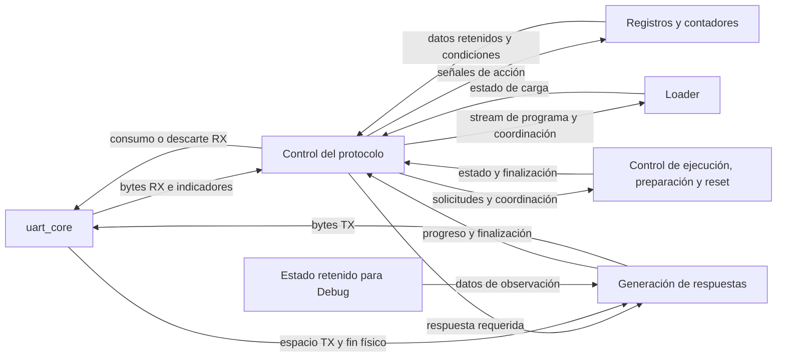

# Control del protocolo

- **Tipo:** arquitectura.
- **Estado documental:** especificación vigente.

<a id="función-dentro-del-sistema"></a>

## Propósito y alcance

El control del protocolo interpreta los bytes entregados por [uart_core](../uart/uart_core.md) y coordina las operaciones `LOAD`, `RUN`, `STEP`, `RESET` y `CHECK_READY` dentro de la FPGA. Produce las respuestas definidas en [protocol.md](../../protocol.md) y sigue su finalización física mediante `tx_done_tick`.

La [separación de responsabilidades](../../decisions/DEC-SYS-007.md#acuerdo-parcial-de-dec-sys-007--organización-funcional-del-control-del-protocolo), la [agrupación en módulos](../../decisions/DEC-SYS-007.md#acuerdo-parcial-de-dec-sys-007--módulos-del-control-del-protocolo-y-respuestas) y la comunicación de solicitud y finalización de respuestas están aprobadas. `protocol_controller` contiene interpretación y coordinación, y `response_serializer` contiene generación y seguimiento de respuestas. Las FSM privadas, recursos y servicios UART se concretan en las secciones aprobadas de este documento y en el cierre UART. Las fronteras FPGA están concretadas en [Interfaces](../../interfaces.md#152-estado-de-los-detalles-de-realización-por-módulo); el plan de verificación, los criterios de comparación y la correspondencia integral del diseño FPGA están cerrados documentalmente.

## Organización

### Organización funcional

Se distinguen tres responsabilidades:

| Parte funcional | Responsabilidad |
|---|---|
| Control del protocolo | Interpretar solicitudes, determinar cuándo consumir o descartar RX y coordinar los servicios y sus respuestas. |
| Registros y contadores | Conservar código, tamaño, progreso y tiempos de espera; actualizarse mediante las señales de acción del control. |
| Generación de respuestas | Formar cabeceras, serializar Debug, conservar el byte pendiente cuando TX está llena y seguir el fin físico del envío. |



El diagrama representa responsabilidades e intercambios funcionales. Las flechas no fijan puertos físicos. Los controles de ejecución, preparación y reset conservan sus responsabilidades respectivas aunque se presenten juntos en el diagrama.

### Agrupación en módulos

Se utilizan dos módulos, cada uno con sus recursos internos:

| Módulo | Responsabilidad y recursos |
|---|---|
| `protocol_controller` | Interpreta solicitudes, consume o descarta RX y coordina las operaciones con `Loader` y control de ejecución. Contiene su FSM, registros y contadores. |
| `response_serializer` | Forma cabeceras, recorre Debug, entrega bytes a TX y sigue la finalización física de la respuesta. Contiene sus controles, registros y contadores. |

`protocol_controller` solicita una respuesta a [response_serializer](response_serializer.md). El serializador comunica cuándo termina el último byte, incluido Stop. Mientras el serializador espera espacio en TX, el controlador conserva la atención RX que corresponda a la fase.

El [contrato de comunicación](response_serializer.md#comunicación-con-el-controlador) utiliza `response_start` con el serializador libre y los campos `response_opcode`, `response_result` y `response_with_debug` estables en el flanco de aceptación. El serializador captura esos campos, mantiene `response_busy` hasta terminar físicamente el mensaje y comunica esa finalización mediante `response_done_tick`. El controlador conserva la coordinación y las respuestas pendientes hasta poder solicitarlas.

El controlador utiliza `r_data`, `rx_empty` e indicadores RX de `uart_core` y genera `rd_uart`. El serializador recibe `tx_full` y `tx_done_tick` y produce `w_data` y `wr_uart`. Así se distingue el consumo de RX de la producción de TX; los controles aprobados retiran o descartan RX con independencia de TX, según la FSM y las acciones de este documento.

El [selector de lectura DMEM](../memory/memory_architecture.md#selector-de-dirección-de-lectura-cpudebug) recibe `dmem_debug_select` de un bit desde `protocol_controller`. Vale uno durante la ventana exclusiva Debug posterior al ciclo observado y hasta el Stop final, incluida la espera por una respuesta anterior; vale cero durante reset y fuera de esa ventana. Selecciona la dirección del serializador frente a Address CPU. La generación concreta está definida en [señales y conexiones](#señales-y-conexiones-aprobadas); la señal no exige un registro nuevo ni autoriza escrituras de mantenimiento.

El [mux de primera lectura RF](response_serializer.md#lectura-rf-compartida-con-debug) recibe `rf_debug_select` de un bit desde este controlador. Sigue la misma ventana exclusiva, con cero durante reset, y selecciona el número de registro del serializador frente a rs1 CPU. Ambas señales de selección corresponden a esa misma fase de observación; su generación concreta está aprobada en [señales y conexiones](#señales-y-conexiones-aprobadas) y no exige estado registrado adicional.

Cada FSM emite señales de acción y los recursos correspondientes realizan sus actualizaciones. La separación funcional entre control y acciones se mantiene dentro de ambos módulos. `Loader`, la FSM global CPU y preparación conservan sus responsabilidades existentes.

## Interfaces y contratos

### Relación con los demás bloques

El `Loader` reconstruye palabras little-endian y escribe IMEM con ownership. El control del protocolo coordina la recepción y las respuestas de `LOAD` y no sustituye esas acciones.

La FSM global CPU y la autorización de ciclos mantienen la ejecución. `Session Preparation` establece el estado inicial y publica la nueva imagen mediante el commit aprobado. La coordinación de `RESET` debe esperar el fin físico de `ACCEPTED` antes de solicitar el reset global; el botón físico conserva su comportamiento directo.

Todas estas funciones utilizan el dominio funcional común. `HOLD` de CPU no detiene UART, recursos privados del protocolo o serialización.

### Señales y conexiones aprobadas

**Estado:** Aprobado el 2026-10-05. Véase el [acuerdo](../../decisions/DEC-SYS-007.md#acuerdo-parcial-de-dec-sys-007--señales-y-conexiones-del-controlador). La realización de servicios y el presupuesto quedaron cerrados documentalmente en [DEC-SYS-007](../../decisions/DEC-SYS-007.md#dec-sys-007--servicios-y-parámetros-generales-de-uart).

Las señales concretan los recorridos aprobados. Se revisan juntas por función; los nombres de las órdenes internas no requieren decisiones separadas.

| Conexión | Contrato vigente y condición de uso |
|---|---|
| UART → controlador | Retirar un byte cuando RX no está vacía. Interpretarlo solo en la fase correspondiente y sin error; descartarlo durante las demás esperas. La espera TX no suspende este consumo. |
| Controlador → `Loader` | Entregar cada byte válido de contenido `LOAD` con una señal de entrega; indicar último byte y aborto. `Loader` confirma la escritura final. La capacidad de aceptar cada entrega está contrastada documentalmente en [Loader](../session/loader.md#presupuesto-de-load). |
| Controlador ↔ control CPU | Solicitar `LOAD`/`RUN`/`STEP`; recibir aceptación, ciclo efectivamente realizado y fin de preparación. Usar estado global y validez de imagen existentes. |
| Controlador ↔ serializador / lectura Debug | Entregar el descriptor pendiente cuando el serializador está libre y usar su fin físico. La misma exclusión ya definida selecciona RF y DMEM para Debug. |
| Controlador → reset global | Registrar la solicitud al completar físicamente `RESET`/`ACCEPTED` y aplicar reset en el siguiente flanco funcional. No detener anticipadamente la CPU. |

Las órdenes internas habilitan captura, avance, limpieza o conservación de los recursos existentes. La FSM decide cuándo; la lógica de cada recurso realiza la operación. Se mantiene la separación aprobada, sin nuevos registros por esas órdenes.

Para `RESET`, el flanco que completa el último Stop registra `uart_reset_request`; el siguiente flanco aplica el reset global y limpia la solicitud. Registrar esa frontera evita que la finalización dependa combinacionalmente del reset que ella misma solicita. El registro de un bit está incluido en los recursos aprobados; su conexión y uso temporal quedan aprobados en este bloque. El [acondicionamiento de reset](../platform/reset_integration.md) está aprobado: fuentes combinadas antes del `reset_sync` TP2 de dos etapas y salida funcional común.

### Puertos del controlador aprobados

El [Loader aprobado](../session/loader.md#progreso-mantenido-por-el-controlador) agrega `load_byte_offset` como conexión combinacional, derivada del tamaño menos faltantes antes de cada entrega. `BYTE_ADDRESS_WIDTH` = max(1, ceil(log2(`IMEM_CAPACITY_BYTES`))); diez bits en ambos perfiles actuales. La extensión se aprobó expresamente con el `Loader`, sin agregar almacenamiento.

Todos usan el clock funcional común. W representa `IMAGE_SIZE_WIDTH`. Las señales de un bit son controles o condiciones; los datos se muestrean en el flanco habilitado. Las conexiones de servicios están concretadas en la [composición aprobada](../system_composition.md).

| Dirección | Señales | Contrato |
|---|---|---|
| Entrada | clk, reset | Clock y reset global de un bit. |
| Entrada desde UART | `r_data[7:0]`, `rx_empty`, `rx_error_tick`, `rx_activity`, `rx_receiving` | Interfaces RX ya aprobadas. |
| Salida a UART | `rd_uart` | !reset y !`rx_empty`; procesamiento o descarte según fase. |
| Entrada desde serializador | `response_busy`, `response_done_tick` | Ocupación y fin físico aprobados; eventos consumidos en el mismo flanco, sin salida nueva de clase/Debug. |
| Salida a serializador | `response_start`, `response_opcode[7:0]`, `response_result[7:0]`, `response_with_debug` | Solo descriptor pendiente válido con serializador libre; campos registrados. |
| Entrada de estado | `global_state_code[7:0]`, `image_valid` | Código UART global ya definido y validez derivada del tamaño comprometido; sin duplicar estado. Codificador combinacional compartido con Debug, desde estado CPU one-hot de catorce bits aprobado. |
| Salida a árbitro | `load_request`, `run_request`, `step_request` | Pulsos por estado `CHECK_SIZE`, `EXEC_RUN` o `EXEC_STEP` con elegibilidad de transporte; solicitud no depende combinacionalmente de su aceptación. |
| Entrada desde árbitro | `load_accept`, `run_accept`, `step_accept` | Aceptación combinacional basada en solicitud y estado actual. |
| Entrada de ejecución/preparación | `cpu_cycle_fire`, `prepare_done` | Identificar ciclo `STEP` realizado y fin de preparación. |
| Salida a `Loader` | `load_size_bytes[W-1:0]`, `load_byte_valid`, `load_byte_data[7:0]`, `load_byte_offset[BYTE_ADDRESS_WIDTH-1:0]`, `load_last_byte`, `load_abort` | Tamaño validado estable en `load_accept`; un byte por flanco `LOAD_DATA`; último con restantes previos iguales a uno; aborto por error/timeout. |
| Entrada desde `Loader` | `load_ok` | Certifica última palabra escrita; se distribuye también a FSM global. `Loader` genera `load_fail` por `load_abort`. |
| Salida a integración reset | `uart_reset_request` | Pulso registrado posterior al último Stop de aceptación `RESET`. |
| Salida a RF/DMEM | `rf_debug_select`, `dmem_debug_select` | Ambos iguales a `debug_exclusive`, cero durante reset. |

`load_request` se activa solo si los cuarenta bits son válidos; el árbitro decide aceptación. `run_request` y `step_request` no requieren imagen válida para ser presentados: el rechazo se informa según estado e `image_valid`. `load_byte_valid` exige `LOAD_DATA`, !`rx_empty`, !`rx_error_tick` y !reset. `load_abort` es un pulso de error o T vencido durante contenido; el `Loader` procesa aborto con prioridad sobre recepción. No hay backpressure en esta frontera: el diseño aprobado del `Loader` acepta una entrega por clock, incluida escritura con el cuarto byte. Su modelo abstracto verifica reconstrucción y posición; el [presupuesto conjunto RX/LOAD](../uart/uart_core.md#presupuesto-de-integración) está comprobado documentalmente y el timing físico se comprobará después de implementar.

## Comportamiento

### Interpretación y coordinación

El control interpreta el código y los campos de cada solicitud conforme a su formato. Durante `LOAD` distingue la recepción del tamaño de la recepción del contenido; los bytes del programa se entregan al `Loader` y no se interpretan como nuevos comandos.

La fase de transporte determina si RX se procesa o se descarta. Durante recuperación por silencio y exclusión Debug, el control continúa retirando RX sin guardar comandos para después. Los errores y vencimientos mantienen las prioridades aprobadas en el protocolo.

Las solicitudes hacia el [control global de sesión](../../interfaces.md#bloque-8-1) se coordinan con su aceptación y elegibilidad. La FSM global CPU conserva el control de la ejecución; la fase del transporte y los pendientes de respuesta pertenecen al control del protocolo. `RUN` puede continuar mientras se atienden `CHECK_READY` o `RESET` en las condiciones aprobadas.

### Generación de respuestas

Las cabeceras y el cuerpo Debug se producen en el orden del protocolo. Si TX está llena, se conserva el byte pendiente hasta poder encolarlo. Esa espera permite que RX siga siendo consumido o descartado según la fase.

El seguimiento distingue la incorporación de un byte a la FIFO de su finalización física. Una respuesta termina al consumir `tx_done_tick` del último byte, incluido su Stop. Los [recursos, estados y señales del serializador](response_serializer.md#señales-de-acción-de-la-fsm) están aprobados. Este controlador consume `response_done_tick` mediante la coordinación aprobada desde estado y marcas existentes; `Loader`, preparación, reset y representación global están concretados y comprobados en el [cierre UART](../uart/uart_core.md#presupuesto-de-integración).

Las respuestas completas no se intercalan. Si `RUN` alcanza terminal durante una respuesta breve, se conserva el resultado pendiente y se termina primero la respuesta que ya estaba en curso. La misma regla mantiene `ACCEPTED` antes del resultado de un `RUN` muy rápido.

Debug se obtiene mediante lectura directa del estado retenido, conforme a la [arquitectura de Debug](debug_architecture.md) y al [envío coherente](../../protocol.md#enviar-una-observación-coherente). La exclusión comienza en el instante observado y termina con el último Stop, incluida la espera previa por TX.

<a id="propuesta-conjunta-del-controlador-completo"></a>

### Diseño conjunto vigente del controlador completo

El contrato siguiente integra el cierre DEC-SYS-007, incluidos coordinación, dimensionamiento, señales y conexiones.

**Estado:** Diseño aprobado y comprobado documentalmente, 2026-10-05; véase [cierre UART](../uart/uart_core.md#presupuesto-de-integración). Están aprobados el recorrido común de respuestas y los cinco comandos `LOAD`, `RUN`, `STEP`, `RESET` y `CHECK_READY` y recuperación RX con sus recursos funcionales, detallados a continuación. Estados, anchos, codificación y coordinación derivada están aprobados. Señales y conexiones funcionales también están aprobadas; la realización interna de servicios está definida en `Loader` y preparación, y el presupuesto está revisado en el cierre UART. La revisión se organiza por comandos, explicando primero su comportamiento y agrupando estados y recursos relacionados.

#### Recorrido LOAD aprobado

**Estado:** Estados y recursos del recorrido `LOAD` aprobados el 2026-10-05, dentro de la única FSM `protocol_controller`; la FSM del serializador es independiente. Véase el [acuerdo parcial](../../decisions/DEC-SYS-007.md#acuerdo-parcial-de-dec-sys-007--estados-y-recursos-del-recorrido-load).

| Estado | Función aprobada | Condición de avance normal |
|---|---|---|
| `IDLE`, compartido | Esperar un comando UART. | `LOAD` recibido inicia recepción de tamaño. |
| `READ_SIZE` | Recibir y guardar los cinco bytes del tamaño. | Tamaño completo. |
| `CHECK_SIZE` | Validar tamaño y disponibilidad para cargar. | Aceptación solicita `ACCEPTED`; rechazo solicita el resultado correspondiente según protocolo. |
| `WAIT_LOAD_ACCEPT` | Esperar envío físico de `LOAD`/`ACCEPTED`. | Fin del último Stop de esa respuesta. |
| `LOAD_DATA` | Entregar cada byte al `Loader` y descontar los faltantes. | Todo el contenido esperado entregado. |
| `WAIT_LOAD_RESULT` | Esperar confirmación de que las instrucciones quedaron escritas. | Confirmación `Loader`. |
| `WAIT_LOAD_PREP` | Esperar preparación del estado inicial CPU. | Preparación terminada; solicitar `LOAD`/`DONE`. |
| `WAIT_LOAD_DONE` | Esperar envío físico de `LOAD`/`DONE`. | Fin del último Stop; volver a `IDLE`. |

Se aprueban cuatro recursos funcionales: registro del tamaño original, índice de sus cinco bytes, contador de bytes faltantes inicializado con el tamaño y contador de tiempo para detectar recepción interrumpida. El contador de faltantes disminuye por byte entregado al `Loader`; el tamaño original se conserva aparte. Las acciones sobre los recursos siguen el criterio de separación FSM/recursos ya aprobado. El ensamblado y escritura de instrucciones pertenecen al `Loader`.

`LOAD` deja la imagen cargada y la CPU preparada, sin iniciar ejecución; esta requiere `RUN` o `STEP`. Estos son estados de una FSM del controlador que también atiende los demás comandos, no una FSM independiente por comando. La FSM del serializador conserva sus diez estados y codificación one-hot ya aprobados.

#### Recorrido RUN aprobado

**Estado:** Recorrido `RUN` aprobado el 2026-10-05, con función, condición de avance y destino de cada estado. Véase el [acuerdo parcial](../../decisions/DEC-SYS-007.md#acuerdo-parcial-de-dec-sys-007--estados-y-marcas-del-recorrido-run).

| Estado | Función aprobada | Condición y destino de avance |
|---|---|---|
| `EXEC_RUN` | Solicitar iniciar o continuar `RUN`; si se acepta, solicitar `ACCEPTED`. | Aceptación→`WAIT_RUN_ACCEPT`. Rechazo: solicitar el resultado previsto y pasar a `WAIT_BRIEF`. |
| `WAIT_RUN_ACCEPT` | Esperar envío físico de `ACCEPTED`, sin pausar ejecución CPU por esa espera. | Último Stop de `ACCEPTED`→`IDLE` si `RUN` continúa; →`WAIT_DEBUG` si ya terminó. |
| `IDLE`, compartido | Durante ejecución `RUN`, atender solicitudes permitidas como `CHECK_READY` o `RESET`. | Terminal normal/fault del `RUN` debido→`WAIT_DEBUG`. Un comando permitido sigue su recorrido correspondiente. |
| `WAIT_DEBUG`, compartido | Coordinar respuesta terminal y Debug, conservando el estado observado. | Último Stop de respuesta terminal con todo Debug→`IDLE`. |

Sin la condición de avance, se conserva el estado. `WAIT_BRIEF` se utiliza para esperar la transmisión física del rechazo; su coordinación con otras respuestas y un `RUN` previo se completa en la revisión común. La CPU conserva su propio control de ejecución y preparación, según los contratos ya aprobados.

Se aprueban dos marcas funcionales: «`RUN` debe una respuesta final», representada por `run_terminal_owed`, desde aceptación hasta guardar la descripción terminal; y «estado retenido para Debug», representada por `debug_hold`, desde el instante observado hasta fin físico del envío. El descriptor pendiente y el serializador conservan sus acuerdos existentes.

Si `RUN` termina durante `WAIT_RUN_ACCEPT`, se recuerda el terminal y se retiene el estado CPU. Se completa `ACCEPTED` antes de pasar a `WAIT_DEBUG` y enviar resultado terminal con Debug. Una aceptación rápida no elimina esa respuesta final. Al consumir la obligación mediante captura del descriptor terminal, la marca de retención sigue activa hasta el último Stop Debug.

#### Recorrido STEP aprobado

**Estado:** Aprobado el 2026-10-05. Véase el [acuerdo parcial](../../decisions/DEC-SYS-007.md#acuerdo-parcial-de-dec-sys-007--estados-y-retención-del-recorrido-step).

Desde `IDLE`, un comando `STEP` admitido lleva a `EXEC_STEP`.

| Estado | Función aprobada | Condición y destino de avance |
|---|---|---|
| `EXEC_STEP` | Solicitar realizar `STEP`. | Aceptación y ciclo realizado→`WAIT_DEBUG`. Aceptación que requiere preparar nueva sesión→`WAIT_STEP_PREP`. Rechazo→`WAIT_BRIEF` para transmitir su resultado. |
| `WAIT_STEP_PREP` | Esperar preparación de nueva sesión sobre el programa cargado. | Preparación terminada y primer/único ciclo realizado→`WAIT_DEBUG`. |
| `WAIT_DEBUG`, compartido | Esperar `DONE` y todo Debug, manteniendo el estado postciclo observado. | Último Stop del mensaje completo→`IDLE`. |

La preparación previa corresponde a una sesión anterior ya terminada normalmente o por fault, según el contrato global aprobado. `STEP` realiza exactamente un ciclo CPU, incluidos stall/drain, no una instrucción completa. La observación corresponde al estado posterior a ese ciclo.

Se aprueba reutilizar `debug_hold`, la marca funcional «estado retenido para Debug» aprobada con `RUN`: se activa al realizar el ciclo `STEP` y se limpia después del último Stop de `DONE` con Debug. La FSM global conserva ejecución/preparación y el serializador conserva el envío. Sin condición de avance, se conserva estado.

#### Recorrido RESET aprobado

**Estado:** Aprobado el 2026-10-05. Véase el [acuerdo parcial](../../decisions/DEC-SYS-007.md#acuerdo-parcial-de-dec-sys-007--recorrido-reset-y-cancelación-del-terminal-run).

| Estado | Función aprobada | Condición y destino de avance |
|---|---|---|
| `IDLE`, compartido | Reconocer `RESET` recibido por UART y solicitar `ACCEPTED`. | `RESET` reconocido→`WAIT_RESET_ACCEPT`. |
| `WAIT_RESET_ACCEPT` | Esperar que `ACCEPTED` termine de salir físicamente. | Último Stop de `ACCEPTED`: solicitar reset global. Ese reset devuelve el controlador a `IDLE` y la CPU a `NO_IMAGE`. |

Se aprueba una marca funcional «solicitar reset», representada por `uart_reset_request` en el diseño, que se activa solo después del envío completo de `ACCEPTED`. El registro y conexión concretos de ese recurso están definidos en [señales y conexiones aprobadas](#señales-y-conexiones-aprobadas); se conserva el pulso registrado para evitar la realimentación combinacional desde `response_done_tick` a reset.

Al reconocer `RESET` se cancela la obligación terminal de un `RUN` pendiente, mediante `run_terminal_owed`. La CPU puede seguir ejecutando mientras sale `ACCEPTED`; no se pausa anticipadamente y el reset efectivo es posterior al envío completo. El reset global invalida la imagen y deja `NO_IMAGE` conforme al protocolo vigente.

Este recorrido pertenece a `RESET` UART admitido en `IDLE`. El botón físico conserva su contrato directo y `RESET` UART durante exclusión Debug o recuperación se descarta según el protocolo; el acuerdo no agrega recepción en esas fases.

#### Recorrido CHECK_READY aprobado

**Estado:** Aprobado el 2026-10-05. Véase el [acuerdo parcial](../../decisions/DEC-SYS-007.md#acuerdo-parcial-de-dec-sys-007--recorrido-check_ready-con-estados-compartidos).

| Estado | Función aprobada | Condición y destino de avance |
|---|---|---|
| `IDLE`, compartido | Recibir `CHECK_READY` y solicitar `READY` o `BUSY` según disponibilidad actual para `LOAD`. | Respuesta preparada→`WAIT_BRIEF`. |
| `WAIT_BRIEF`, compartido | Esperar transmisión física de `READY`/`BUSY`. | Último Stop→`IDLE`. Si `RUN` terminó durante la espera→`WAIT_DEBUG` para atender su terminal. |

Se reutiliza el descriptor pendiente aprobado; el comando no necesita un recurso registrado específico nuevo. `CHECK_READY` no modifica ni pausa CPU. `READY` expresa disponibilidad para iniciar `LOAD`, independientemente de que exista imagen cargada; `BUSY` corresponde, entre otros casos, a `RUN` o drain automático. Se conserva validación independiente de `LOAD`, sin reserva por consulta ni obligación de registrar consulta previa.

Si `RUN` termina mientras se envía `CHECK_READY`, su estado se retiene y se completa primero la respuesta breve; después se atiende terminal con Debug, conforme al recorrido común. El comando solo se interpreta cuando la fase admite comandos. Durante Debug o recuperación se descarta según el protocolo vigente.

#### Recuperación RX aprobada

**Estado:** Aprobado el 2026-10-05. Véase el [acuerdo parcial](../../decisions/DEC-SYS-007.md#acuerdo-parcial-de-dec-sys-007--estado-recover-y-contador-de-tiempo-compartido).

| Situación | Función aprobada | Condición y destino de avance |
|---|---|---|
| Error UART al interpretar un comando o recibir tamaño/contenido `LOAD`, o vencimiento T de recepción `LOAD` | Abandonar la recepción afectada; en `LOAD` solicitar el error previsto por el protocolo. | Entrar en `RECOVER`. |
| Actividad RX durante `RECOVER` | Descartar bytes y reiniciar cuenta de silencio. | Conservar `RECOVER`. |
| Silencio continuo R cumplido | Comprobar RX vacía, ningún byte en curso y respuestas pendientes terminadas, incluido Debug si correspondía. | Volver a `IDLE`; si falta alguna condición, conservar `RECOVER`. |

Se aprueba reutilizar el contador de tiempo de `LOAD` para recuperación: fases excluyentes de temporización, con R = 100 ms de silencio continuo ya aprobado en el protocolo. Toda actividad RX reinicia R, incluso sin byte válido; la línea en reposo y ausencia de trama se comprueban mediante indicadores UART ya definidos. No se agrega un segundo contador. Ancho y señales concretas se revisan en el cierre común.

TX conserva funcionamiento y puede completar respuestas mientras el controlador descarta RX. `RUN` puede continuar según su FSM global. No se guardan comandos recibidos durante recuperación ni se aplica reset global para recuperar RX. El error antes de aceptar `LOAD` conserva imagen/sesión; tras aceptación, abortar mantiene imagen inválida, conforme al protocolo vigente. Error de opcode sin `LOAD` interpretada no produce eco ni respuesta.

Si `RUN` termina durante recuperación, se conserva su terminal y exclusión, se completa la respuesta previa si existe y se atiende Debug; `RECOVER` conserva su fase y cuenta y no admite comandos antes de reunir las condiciones de salida. La prioridad concreta y seguimiento de la respuesta en curso se completan en coordinación común.

#### Coordinación derivada del estado y marcas existentes

**Estado:** Aprobado el 2026-10-05. Véase el [acuerdo parcial](../../decisions/DEC-SYS-007.md#acuerdo-parcial-de-dec-sys-007--finalización-derivada-del-estado-y-marcas-existentes). Sustituye tanto `active_response_kind` como la posterior propuesta de salida `response_debug_active` del serializador. No cambia los recorridos aprobados y no agrega registro, estado ni puerto.

En `WAIT_LOAD_ACCEPT`, `WAIT_LOAD_DONE` y `WAIT_RESET_ACCEPT`, el estado identifica la respuesta que debe completarse. `WAIT_RUN_ACCEPT` identifica aceptación `RUN`. En `WAIT_BRIEF`, los mensajes breves comparten cierre y el estado actual junto con obligación/retención determina el siguiente recorrido. Que un estado sea compartido no exige automáticamente un registro de clases.

`RECOVER` puede mantenerse durante respuesta de error y durante Debug terminal `RUN`. El estado FSM solo no distingue cuál terminó. Sin embargo, las tres marcas existentes permiten identificar fin Debug:

- `debug_hold` activa: hay una observación retenida.
- `run_terminal_owed` inactiva: la obligación terminal ya se convirtió en descriptor; `STEP` no utiliza esa obligación.
- `pending_response_valid` inactiva: el descriptor Debug ya fue entregado al serializador.

Se aprueba la condición combinacional, usando valores previos al flanco:

```text
debug_done = response_done_tick
             y debug_hold
             y no run_terminal_owed
             y no pending_response_valid
```

No es un registro nuevo. `response_done_tick` ya identifica el último Stop físico; `debug_done` solo califica ese evento para limpiar la retención. Las demás finalizaciones se atienden desde el estado actual.

**Por qué distingue la respuesta previa:** si una respuesta breve todavía se transmite cuando `RUN` termina, `run_terminal_owed` permanece activa hasta guardar el descriptor terminal. Después de esa captura queda inactiva, pero `pending_response_valid` permanece activa hasta entregarlo. Esa entrega exige serializador libre; no puede ocurrir antes del fin de la breve. Por tanto, en el flanco final de la breve al menos una de esas dos marcas impide confundirla con Debug. Durante envío Debug, la obligación está consumida, el pendiente libre y la retención activa.

En `STEP`, activar retención coincide con guardar `DONE` con Debug. El pendiente conserva disponibilidad hasta entrega; durante el envío se cumplen las mismas condiciones. Durante Debug no se reciben ni guardan nuevos comandos. Al terminar, `debug_done` limpia retención en ese mismo flanco, también si la fase es `RECOVER`.

| Estado controlador al terminar respuesta | Información suficiente | Acción |
|---|---|---|
| `WAIT_LOAD_ACCEPT` | Estado y `response_done_tick`. | Iniciar recepción de contenido y su T. |
| `WAIT_LOAD_DONE` | Estado y `response_done_tick`. | Volver a `IDLE`. |
| `WAIT_RESET_ACCEPT` | Estado y `response_done_tick`. | Solicitar reset global. |
| `WAIT_RUN_ACCEPT` / `WAIT_BRIEF` | Estado, `response_done_tick` y condición terminal/exclusión. | `IDLE` o `WAIT_DEBUG` según el recorrido aprobado. |
| `WAIT_DEBUG` | Estado y `debug_done`. | Limpiar retención y volver a `IDLE`. |
| `RECOVER` | `response_done_tick` y `debug_done` derivados de recursos existentes. | Si terminó Debug, limpiar retención; conservar `RECOVER` y su contador hasta todas las condiciones de salida. |

**Condiciones de validez:** la derivación conserva estos contratos ya aprobados:

- Un descriptor ocupado no se sobrescribe.
- Entrega y nueva carga se separan.
- El serializador acepta solo estando libre.
- La obligación `RUN` se consume al guardar su descriptor terminal.
- `STEP` activa retención junto con su descriptor.
- No se guardan nuevos comandos durante exclusión.
- Reset aborta sin `response_done_tick` normal.

Una ampliación que cambie esas condiciones necesitará revisar la derivación.

**Comprobación de diseño:** modelo abstracto de coordinación con 34 estados alcanzables y 117 transiciones, incluyendo terminal `RUN` coincidente con aceptación/almacenamiento/fin de respuesta breve, `STEP`, errores, recuperación y reset. Se verificó que retención activa, obligación `RUN` consumida y pendiente vacío identifican Debug activo bajo esos contratos; `RECOVER` por sí solo admite ambas clases de respuesta. Es comprobación del modelo de coordinación, no RTL ni temporización UART.

Se adopta esta derivación sin almacenamiento ni conexión nuevos. Anchos/codificación, señales, puertos e integración se aprobaron después, y DEC-SYS-007 se consolidó con el cierre UART. No se acredita RTL.

#### Comportamiento general

El controlador retira como máximo un byte RX por clock, siempre que la FIFO no esté vacía. En `IDLE` interpreta comandos; durante tamaño y contenido `LOAD` procesa el campo correspondiente; en las demás fases descarta. Esperar al serializador nunca detiene ese consumo. Ante error UART no utiliza como válido el byte retirado en ese flanco.

La FSM privada conserva la fase del intercambio UART. La FSM global sigue conservando la ejecución CPU. Un `RUN` aceptado puede avanzar mientras salen `ACCEPTED` o respuestas breves; el controlador no emite una pausa por esperar esas respuestas.

Todos los resultados pasan por el descriptor pendiente aprobado. La FSM produce una solicitud de captura con sus campos; el recurso los guarda si estaba libre antes del flanco. La entrega al serializador es independiente de la fase de recepción y consume disponibilidad. No se carga otro descriptor en ese mismo flanco.

#### Terminal RUN y exclusión Debug

`terminal_due` = `run_terminal_owed` y estado global `FINISHED` o `FAULT`. No se usa solo el estado terminal: un terminal previo sin `RUN` debido no genera una respuesta nueva.

`debug_exclusive` = !reset y (`debug_hold` o `terminal_due`). `rf_debug_select` y `dmem_debug_select` reciben esa misma condición. Así, después del flanco terminal de `RUN` la selección y exclusión ya están activas, aunque `debug_hold` se registre en el siguiente flanco. En `STEP` se activa `debug_hold` en el propio flanco del ciclo observado. Se conservan los datos postciclo y se bloquean nuevas solicitudes `LOAD`/`RUN`/`STEP` y preparación de otra sesión.

Cuando `terminal_due` está activo, se activa `debug_hold`. Si el descriptor estaba libre y no hay una respuesta normal que deba capturarse, se guarda `RUN`/`FINISHED` o `RUN`/`FAULT` con Debug y se consume `run_terminal_owed`. Si estaba ocupado, se entrega ese descriptor primero y se guarda el terminal en un flanco posterior. `debug_hold` mantiene la exclusión después de consumir la obligación, durante la espera y el envío; solo el fin físico DEBUG lo limpia. Esto evita duplicar terminales.

Una respuesta breve ya guardada o en transmisión conserva prioridad y se completa. `WAIT_RUN_ACCEPT` y `WAIT_BRIEF` esperan su propio fin físico, identificado por la fase actual y las marcas existentes según el acuerdo de coordinación, y luego pasan a `WAIT_DEBUG`. Desde `IDLE`, `EXEC_RUN`, `EXEC_STEP`, `READ_SIZE` o `CHECK_SIZE`, una exclusión terminal ya activa lleva a `WAIT_DEBUG` sin interpretar nuevos bytes. `RECOVER` conserva su fase y contador durante Debug: fin físico DEBUG limpia la exclusión, pero no omite la recuperación.

**Prioridad aprobada el 2026-10-05:** un terminal `RUN` observado tiene prioridad sobre una cabecera `LOAD` que sigue en `READ_SIZE`/`CHECK_SIZE` sin aceptación o rechazo resuelto. En ese caso:

- Comienza la exclusión y se abandona la cabecera.
- Se descartan los bytes restantes y se envía el terminal con Debug.
- El intento `LOAD` no se acepta, no se responde, no se conserva para después y no modifica la imagen.
- Termina T de tamaño, sin `INCOMPLETE_REQUEST` posterior.

Si ya se había formado una respuesta breve, esa respuesta conserva prioridad y se completa antes de Debug; no se cancela.

Véanse el [protocolo actualizado](../../protocol.md#terminal-run-durante-cabecera-load) y el [acuerdo](../../decisions/DEC-SYS-007.md#acuerdo-parcial-de-dec-sys-007--prioridad-del-terminal-run-sobre-cabecera-load-sin-resolver). No agrega estado ni recurso.

`RESET` UART reconocido en `IDLE` cancela `run_terminal_owed` en el mismo flanco y guarda `ACCEPTED`. Si la CPU llega a terminal en ese flanco, no se crea Debug del `RUN` abandonado; la CPU queda naturalmente en su terminal hasta reset. Si la exclusión ya estaba activa antes del flanco, `RESET` se descarta y no se reconoce. No se anticipa reset ni se pausa la CPU por esperar aceptación.

#### Señales de acción y separación de lógica

| Orden combinacional | Recurso o servicio | Evento que la activa |
|---|---|---|
| `size_init` | Tamaño e índice | Opcode `LOAD` admitido. |
| `size_byte_capture` | Tamaño | Byte válido en `READ_SIZE`; índice selecciona su byte. |
| `size_index_inc` | Índice | Byte válido de tamaño con índice menor que cuatro. |
| `remaining_load` | Restantes | `load_accept`; captura tamaño validado. |
| `remaining_dec` | Restantes | `load_byte_valid`; decremento por entrega efectiva. |
| `timer_clear` | Contador T/R | Inicio de fase o evento de reinicio de la tabla. |
| `timer_inc` | Contador T/R | Fase temporizada activa, sin reinicio ni cierre, valor menor que 4.999.999. |
| `pending_store` | Descriptor y disponibilidad | Resultado de operación o terminal debido, con espacio previamente libre. |
| `pending_consume` | Disponibilidad | `response_start` aceptado; excluyente con `pending_store`. |
| `run_owed_set` | Obligación `RUN` | `run_accept`. |
| `run_owed_clear` | Obligación `RUN` | Guardar terminal `RUN` o reconocer `RESET`. |
| `debug_hold_set` | Exclusión | Ciclo `STEP` realizado o `terminal_due`. |
| `debug_hold_clear` | Exclusión | `debug_done` derivado de marcas existentes. |
| `reset_request_set` | Pulso de reset UART | `response_done_tick` en `WAIT_RESET_ACCEPT`. |

La FSM calcula estado siguiente y controles mediante `casez` y comodines `?`, con salidas por defecto inactivas. Las acciones de incremento, decremento, captura y comparación pertenecen a la lógica diferenciada del recurso. El estado actual se registra; separar esa lógica no agrega ciclos por sí solo. La entrega, los callbacks y la obligación terminal se atienden también durante las esperas de la fase principal.

Reset global limpia fase, disponibilidad, obligación, exclusión, contador y pulso UART. Inicialización/limpieza tiene prioridad sobre avance del mismo recurso. `timer_clear` precede a `timer_inc`; `pending_consume` y `pending_store` no coinciden por disponibilidad preflanco. Los campos no vigentes pueden retener bits residuales. Sin orden, se retiene el recurso.

`uart_reset_request` se registra al consumir el fin físico y se combina con la fuente física de reset en integración. Se hace efectivo en el siguiente flanco funcional, después del último Stop. Así no existe un lazo combinacional `response_done_tick`→reset→supresión de `response_done_tick`. No modifica la prioridad del reset físico ni introduce una pausa CPU antes de completar la aceptación.

## Estado y temporización

### Registros y contadores

La FSM determina las acciones y los recursos realizan sus actualizaciones al flanco del clock funcional, conforme al [criterio de diseño del TP2](../../decisions/DEC-SYS-007.md#acuerdo-parcial-de-dec-sys-007--correcciones-de-diseño-de-fsm-del-tp2). Deben distinguirse captura, carga, incremento, limpieza y conservación según las acciones de la FSM.

El descriptor de respuesta pendiente de 17 bits y su disponibilidad de uno se definen a continuación. Los restantes registros y contadores, sus anchos y las conexiones funcionales están aprobados en el bloque completo de este documento; la integración UART/servicios está comprobada documentalmente en el [cierre UART](../uart/uart_core.md#presupuesto-de-integración); la integración de tops/DMEM/plataforma está definida en la [composición aprobada](../system_composition.md). Los recursos de interpretación y coordinación pertenecen a `protocol_controller` y los de recorrido y transmisión a `response_serializer`. Esta separación no exige un módulo por registro ni introduce por sí misma un ciclo adicional.

El tamaño recibido y el tamaño validado pendiente del `Loader` se relacionan por reutilización del registro original, según el [Loader aprobado](../session/loader.md#progreso-mantenido-por-el-controlador). El registro de reconstrucción de instrucciones y las escrituras IMEM pertenecen al [Loader](../../interfaces.md#bloque-9-1).

### Registro de respuesta pendiente

El [acuerdo de respuesta pendiente](../../decisions/DEC-SYS-007.md#acuerdo-parcial-de-dec-sys-007--registro-de-respuesta-pendiente-en-el-controlador) fija un espacio dentro de `protocol_controller` para conservar la descripción de una respuesta hasta que `response_serializer` pueda aceptarla.

| Recurso / campo | Ancho en bits | Función |
|---|---:|---|
| `pending_response_opcode` | 8 | Código de operación que encabezará la respuesta. |
| `pending_response_result` | 8 | Resultado que acompañará al código. |
| `pending_response_with_debug` | 1 | Indicar si esa respuesta incluye el cuerpo Debug. |
| `pending_response_valid` | 1 | Indicar que hay una descripción pendiente de entrega. |

Los tres primeros campos forman un descriptor registrado de 17 bits; el indicador de disponibilidad agrega un bit, para 18 bits en total. Pertenecen al controlador y se actualizan por sus señales de acción. El serializador conserva su propio descriptor ya aprobado, capturado al aceptar la solicitud.

#### Conservación y entrega

Cuando se guarda una respuesta, se capturan los tres campos y se activa `pending_response_valid`. Durante espera se mantienen estables, aun si `response_busy` permanece activo por una respuesta anterior. Una descripción pendiente de entrega no se sobrescribe mientras espera; la coordinación de eventos debe respetar ese espacio.

Al atender el pendiente con `response_busy` en cero, el controlador presenta los campos registrados como `response_opcode`, `response_result` y `response_with_debug` y solicita `response_start`. La aceptación ocurre con esos valores estables antes del flanco, fuera de reset, conforme al contrato existente.

En ese mismo flanco el serializador captura los 17 bits y el controlador desactiva `pending_response_valid`: el espacio queda libre después de la entrega, sin esperar el fin físico de la nueva respuesta. El serializador conserva su descriptor durante todo el envío. Los bits de la descripción en el controlador pueden retenerse cuando valid está inactivo; no solicitan otra respuesta por sí solos.

Reset deja `pending_response_valid` en cero y suprime la entrega; no hace falta interpretar los bits residuales del descriptor. La prioridad y generación de carga/consumo y la coordinación de eventos están definidas en las secciones aprobadas de FSM y señales siguientes.

#### RUN terminal durante una respuesta previa

Si `RUN` termina mientras se transmite una respuesta breve, su descripción terminal puede quedar en este espacio hasta que termine físicamente la respuesta previa y el serializador quede libre. Se conserva el orden externo aprobado, incluida `ACCEPTED` antes de un terminal rápido.

La exclusión Debug comienza desde el estado posterior al ciclo terminal, aunque la entrega espere, y continúa hasta el último Stop del Debug. Los valores observados permanecen retenidos en sus recursos CPU. El descriptor pendiente conserva qué respuesta enviar; el cuerpo se produce desde el estado retenido según el diseño aprobado.

Se dispone de un único espacio de descripción pendiente, separado de la respuesta en curso dentro del serializador. La coordinación debe conservar elegibilidad, descarte RX y atención de terminales según el protocolo. El acuerdo posterior de recorrido común establece que todas las respuestas pasan por este espacio, incluso con el serializador libre. Las prioridades concretas se revisan junto con la FSM del controlador.

#### Un espacio y recorrido común

**Estado:** Aprobado el 2026-10-05. El acuerdo aprueba el recorrido común y la conservación de la obligación terminal de `RUN`.

El [diseño conjunto vigente del controlador completo](#propuesta-conjunta-del-controlador-completo) concreta su representación y las prioridades.

1. Todas las respuestas se guardan primero en el espacio pendiente, incluido el caso con serializador libre. Los campos se capturan en un flanco y pueden entregarse desde el siguiente. Solo este espacio alimenta las solicitudes al serializador.
2. El descriptor se entrega con disponibilidad activa y serializador libre. La aceptación consume disponibilidad en ese flanco. Una descripción ocupada se conserva y no se sobrescribe. Para la base de control se separan entrega y nueva carga en flancos sucesivos, usando los valores preflanco, sin reemplazo simultáneo del descriptor.
3. El controlador conserva que un `RUN` aceptado debe producir una respuesta terminal. Si el espacio está ocupado cuando la CPU alcanza `FINISHED` o `FAULT`, se entrega primero esa descripción y después se forma `RUN` terminal desde el estado retenido. Se garantiza una única respuesta terminal por `RUN`, conservando `ACCEPTED` antes de terminal. La representación de esa obligación se concreta junto con los restantes recursos/FSM del controlador.
4. La exclusión Debug comienza en el instante terminal observado, aunque aún no se haya guardado su descriptor, y termina en el último Stop del Debug. El estado retenido mantiene la información durante la espera.
5. Se conserva la política de una operación normal por vez y elegibilidad por fase del transporte. `RUN` puede completar asincrónicamente respecto de una respuesta breve. Reset físico aborta según el contrato; `RESET` UART conserva el intercambio aprobado y la obligación terminal del `RUN` anterior se cancela al reconocer `RESET`, conforme al recorrido aprobado después.

##### Motivo de capacidad

Con el recorrido aprobado, la coincidencia posible es que se guarde una respuesta breve justo en el flanco del último ciclo de `RUN`. El espacio contiene esa respuesta; `FINISHED` o `FAULT` queda retenido y la obligación terminal permanece en el control. Al entregarse la descripción breve se libera el espacio para formar la terminal. El serializador conserva independientemente la descripción que está transmitiendo.

Por tanto, este acuerdo utiliza un único espacio de descriptor pendiente y conserva la obligación de `RUN` en el control. No exige un segundo descriptor completo. El cierre del controlador debe verificar prioridades y atención exactamente una vez de esa obligación; aún no se acredita implementación RTL.

Este punto pertenece al cierre de la coordinación de respuestas. La revisión posterior continúa con el bloque completo de recursos, FSM, puertos y prioridades del controlador, agrupando reglas equivalentes.

### Codificación y dimensionamiento aprobados

**Estado:** Aprobado el 2026-10-05. Véase el [acuerdo parcial](../../decisions/DEC-SYS-007.md#acuerdo-parcial-de-dec-sys-007--codificación-y-anchos-del-controlador). Se concreta representación de estados y recursos funcionales existentes, sin agregar recursos.

`protocol_state` utiliza one-hot de dieciséis bits, un bit activo por estado en el orden de la tabla general. `IDLE` ocupa bit cero; reset deja solo ese bit activo. Se conserva el criterio ya aprobado para FSM UART y serializador, con estado registrado y decisiones/acciones combinacionales `casez` y `?`.

El resto de los anchos se deriva del formato y de los rangos existentes:

| Recurso | Rango o formato | Ancho |
|---|---|---|
| Tamaño recibido | Cinco bytes | 40 bits |
| Índice | Cero a cuatro | 3 bits |
| Faltantes | Cero a capacidad IMEM | `IMAGE_SIZE_WIDTH` |
| Temporizador | Cero a 4.999.999 | 23 bits |
| Marcas booleanas | Booleano | Un bit cada una |

El descriptor pendiente mantiene sus 18 bits ya aprobados.

`REFERENCE` tiene capacidad IMEM 1024 y faltantes de 11 bits; `ALT_1000`, capacidad 1000 y faltantes de diez bits. Se debe representar capacidad inclusive y cero, porque el recurso cuenta bytes faltantes. El tamaño recibido se valida en cuarenta bits antes de reducir ancho. El temporizador es único para T y R y conserva saturación/reinicios definidos.

Comprobación aritmética documental: índice y temporizador usan el mínimo ancho para sus rangos; faltantes usa max(1, ceil(log2(C + 1))). La codificación aprobada fija dieciséis bits de estado y tres marcas de un bit, resultando en 114 bits de estos recursos del controlador para `REFERENCE` y 113 para `ALT_1000`; no incluye memorias, recursos `Loader`, serializador ni fuentes globales externas. No se acredita síntesis ni RTL.

### Recursos registrados

| Recurso | Ancho | Inicialización y actualización |
|---|---:|---|
| `protocol_state` | 16 | FSM one-hot; `IDLE` activa bit cero. Orden de bits según la tabla de estados. |
| `load_size_received` | 40 | Cero al recibir `LOAD`; captura cada uno de los cinco bytes en su posición little-endian. Se valida completo antes de reducir ancho. |
| `size_byte_index` | 3 | Cero al recibir `LOAD`; posiciones cero a cuatro, incremento por byte válido salvo el último. |
| `load_bytes_remaining` | `IMAGE_SIZE_WIDTH` | Tamaño validado al aceptar `LOAD`; disminuye por byte entregado al `Loader`. Cero al completar contenido. `REFERENCE`: 11 bits; `ALT_1000`: 10. |
| `inactivity_count` | 23 | Un único contador compartido entre tamaño, contenido y recuperación; cuenta cero a 4.999.999 y satura. |
| `run_terminal_owed` | 1 | Se activa por `run_accept`; se consume al guardar `RUN` terminal; se cancela al reconocer `RESET` UART o por reset global. |
| `debug_hold` | 1 | Se activa al realizar `STEP` o detectar terminal `RUN` debido; se consume solo por fin físico de la respuesta Debug. |
| `uart_reset_request` | 1 | Pulso registrado tras fin físico de `RESET`/`ACCEPTED`; reset global lo vuelve a cero. |
| Descriptor pendiente y disponibilidad | 18 | Recursos ya aprobados; captura, conservación y entrega según el recorrido común. |

`IMAGE_SIZE_WIDTH` = max(1, ceil(log2(`IMEM_CAPACITY_BYTES` + 1))), conforme al [tamaño de imagen](../memory/memory_architecture.md#estado-persistente-de-la-imagen). Los cuarenta bits recibidos se comparan contra cero y capacidad y sus dos bits inferiores deben ser cero. Solo después se usan los `IMAGE_SIZE_WIDTH` bits inferiores.

No se agrega un registro de opcode: los estados específicos recuerdan `RUN`/`STEP`/`LOAD`/`RESET` y `UNKNOWN_COMMAND` captura el byte recibido directamente en el descriptor. Tampoco se copia el cuerpo Debug ni se agrega un buffer de programa. El ensamblado de instrucciones sigue en `Loader`.

La propuesta inicial de `active_response_kind` y la posterior salida `response_debug_active` se sustituyen por la [coordinación derivada del estado y marcas existentes](#coordinación-derivada-del-estado-y-marcas-existentes), aprobada el 2026-10-05. No se agrega ese registro, su señal `active_kind_load` ni la salida nueva del serializador.

### Estados y transiciones

Los bits one-hot cero a quince siguen este orden. Cada fila define trabajo y salida; sin evento se conserva el estado. Reset global tiene prioridad y vuelve a `IDLE`, suprimiendo solicitudes y acciones normales.

| Bit / estado | Trabajo | Salida y acciones |
|---|---|---|
| 0 — `IDLE` | Admitir un opcode válido si el transporte está disponible. | `LOAD`: inicializar tamaño/índice/T→`READ_SIZE`. `RUN`→`EXEC_RUN`. `STEP`→`EXEC_STEP`. `RESET`: guardar `ACCEPTED`, cancelar obligación `RUN`→`WAIT_RESET_ACCEPT`. `CHECK_READY`: guardar `READY` o `BUSY`→`WAIT_BRIEF`. Otro código: guardar eco/`UNKNOWN_COMMAND`→`WAIT_BRIEF`. Error UART: sin respuesta→`RECOVER`. |
| 1 — `READ_SIZE` | Recibir cinco bytes de tamaño, con T activo. | Cada byte válido se captura y reinicia T mientras falten bytes. Quinto byte→`CHECK_SIZE`. Error: guardar `UART_ERROR`→`RECOVER`. T vencido: guardar `INCOMPLETE_REQUEST`→`RECOVER`. |
| 2 — `CHECK_SIZE` | Validar todos los cuarenta bits y consultar aceptación `LOAD`. | Tamaño inválido: guardar `INVALID_SIZE`→`WAIT_BRIEF`. Tamaño válido rechazado: guardar `BUSY`→`WAIT_BRIEF`. `load_accept`: cargar restantes, guardar `ACCEPTED`→`WAIT_LOAD_ACCEPT`. |
| 3 — `EXEC_RUN` | Solicitar `RUN` al árbitro; no esperar TX para ejecutar. | `run_accept`: activar obligación y guardar `ACCEPTED`→`WAIT_RUN_ACCEPT`. Rechazo: guardar `NO_IMAGE` o `BUSY`→`WAIT_BRIEF`. |
| 4 — `EXEC_STEP` | Solicitar `STEP` al árbitro. | `step_accept` con `cpu_cycle_fire`: activar exclusión y guardar `DONE` con Debug→`WAIT_DEBUG`. Aceptación desde terminal, sin ciclo aún→`WAIT_STEP_PREP`. Rechazo: guardar `NO_IMAGE` o `BUSY`→`WAIT_BRIEF`. |
| 5 — `WAIT_RUN_ACCEPT` | Descartar RX mientras sale aceptación `RUN`; CPU sigue según su FSM. | Fin físico de esa aceptación→`IDLE`; si ya comenzó exclusión, →`WAIT_DEBUG`. |
| 6 — `WAIT_STEP_PREP` | Esperar preparación de nueva sesión `STEP`; descartar RX. | `prepare_done` con `cpu_cycle_fire`: activar exclusión y guardar `DONE` con Debug→`WAIT_DEBUG`. |
| 7 — `WAIT_LOAD_ACCEPT` | Descartar RX prematuro y esperar fin físico `LOAD`/`ACCEPTED`. | Fin físico en este estado: iniciar T de contenido en cero→`LOAD_DATA`. |
| 8 — `LOAD_DATA` | Entregar bytes válidos al `Loader`, disminuir restantes y reiniciar T mientras falten bytes. | Último byte termina T→`WAIT_LOAD_RESULT`, o →`WAIT_LOAD_PREP` si `load_ok` certifica ya su escritura en ese flanco. Error UART: abortar `Loader` y guardar `UART_ERROR`→`RECOVER`. T vencido: abortar y guardar `INCOMPLETE_DATA`→`RECOVER`. |
| 9 — `WAIT_LOAD_RESULT` | Esperar certificación de la última escritura IMEM; descartar RX. | `load_ok`→`WAIT_LOAD_PREP`. El contrato de integración debe garantizar la escritura final y `load_ok`, sin reabrir recepción ni iniciar preparación antes. |
| 10 — `WAIT_LOAD_PREP` | Esperar preparación y commit de imagen; descartar RX. | `prepare_done`: guardar `LOAD`/`DONE`→`WAIT_LOAD_DONE`. El commit ocurre por el contrato global en ese mismo flanco. |
| 11 — `WAIT_LOAD_DONE` | Descartar RX hasta fin físico `LOAD`/`DONE`. | Fin físico en este estado→`IDLE`, sin recuperación por silencio. |
| 12 — `WAIT_BRIEF` | Esperar respuesta breve; descartar RX; no frenar `RUN`. | Fin físico en este estado→`IDLE`, o →`WAIT_DEBUG` si existe exclusión terminal. |
| 13 — `WAIT_RESET_ACCEPT` | Esperar `RESET`/`ACCEPTED`; descartar RX; no frenar CPU. | Fin físico en este estado: registrar `uart_reset_request`. El reset global resultante reinicia el sistema. |
| 14 — `WAIT_DEBUG` | Descartar RX durante espera y envío Debug; mantener exclusión. | `debug_done`: limpiar `debug_hold`→`IDLE`. |
| 15 — `RECOVER` | Descartar RX y contar R de silencio continuo; conservar TX y ejecución global. | Solo salir cuando R cumplido, sin actividad/recepción, FIFO vacía, sin descriptor pendiente, serializador libre y sin exclusión Debug. →`IDLE`. |

`IDLE` solo admite comandos con descriptor libre, serializador libre, sin exclusión y sin preparación global activa. Durante `PREPARING_RUN`, aunque haya terminado `ACCEPTED`, continúa el descarte; al terminar la preparación se admite nuevamente transporte si `RUN` no terminó. `NO_IMAGE` para `RUN`/`STEP` se determina por imagen inválida; `BUSY` por ejecución continua o fase no elegible. El árbitro conserva autoridad sobre aceptación y prioridad arquitectónica.

`LOAD` antes de aceptación preserva la imagen y sesión ante error/rechazo. `load_accept` invalida la imagen anterior en ese flanco. Error de contenido aborta la carga mediante `Loader.load_fail`, dejando `NO_IMAGE`; nunca restaura la imagen vieja. No se valida ISA en `LOAD`. No se utiliza `load_fail` como un error espontáneo sin significado UART: en esta frontera certifica el aborto solicitado por el controlador. Una interfaz posterior que agregue errores internos necesitará definir su resultado antes de incorporarlos.

### Tiempos y prioridades

T y R son 5.000.000 clocks funcionales. Se reutiliza un contador de 23 bits porque las fases de tamaño, contenido y recuperación son excluyentes. Al iniciar una fase queda en cero. Si pasan 5.000.000 intervalos sin el evento que lo reinicia, vence al flanco que ve 4.999.999 previamente; no se suma una espera fija al completar correctamente la fase.

| Fase | Inicio | Reinicio | Fin |
|---|---|---|---|
| Tamaño `LOAD` | Flanco que consume opcode `LOAD`. | Byte válido recibido mientras faltan bytes. | Quinto byte válido, error, vencimiento o exclusión terminal que interrumpe cabecera. |
| Contenido `LOAD` | Flanco del último Stop de `LOAD`/`ACCEPTED`. | Byte válido entregado mientras faltan bytes. | Último byte entregado, error o vencimiento. |
| Recuperación | Flanco que declara error/vencimiento. | `rx_activity` o `rx_receiving`; el bajo continuo de línea cuenta como actividad según `uart_core`. | R cumplido y condiciones de salida de `RECOVER`. |

En tamaño y contenido, la prioridad es:

```text
error UART > byte válido > vencimiento T
```

Un byte válido en el límite completa la fase o reinicia T. En recuperación manda la actividad sobre el vencimiento; el contador satura mientras falten otras condiciones de salida. No se aplica reset UART para recuperar y TX continúa.

La coordinación sigue este orden de prioridad:

1. Reset global.
2. Exclusión ya activa, con las excepciones de completar respuesta previa y recuperación.
3. Acciones de la operación admitida.
4. Captura terminal `RUN` cuando el espacio esté libre.

El evento UART de un flanco se decide con estado CPU y flags previos al flanco. Por eso, `CHECK_READY` capturado junto al último ciclo `RUN` puede generar `BUSY` y luego terminal, conforme al recorrido común aprobado.

## Invariantes y condiciones de borde

La conservación del descriptor está en [Registro de respuesta pendiente](#registro-de-respuesta-pendiente). La coordinación entre terminal y observación se especifica en [Terminal RUN y exclusión Debug](#terminal-run-y-exclusión-debug).

## Verificación y evidencia

### Ejemplos para revisar el bloque

| Caso | Secuencia observable y conservación |
|---|---|
| `RUN` normal | Admitir→guardar `ACCEPTED` y ejecutar→entregar y completar aceptación→seguir CPU→terminal retenido→guardar/enviar terminal con Debug→liberar exclusión al último Stop. |
| `CHECK_READY` coincide con último ciclo `RUN` | Guardar `CHECK_READY`/`BUSY`→retener terminal y obligación→entregar breve→guardar terminal en otro flanco→completar breve→enviar Debug. |
| `STEP` desde `READY` | Aceptar y ejecutar un ciclo→retener estado postciclo y guardar `DONE` con Debug→enviar→liberar exclusión. |
| `STEP` desde `FINISHED` | Aceptar→preparar sesión→primer y único ciclo al `prepare_done`→guardar `DONE` con Debug y retener→enviar. |
| `LOAD` correcto | Opcode+tamaño→validar/aceptar e invalidar imagen vieja→`ACCEPTED` físico→contenido y palabras IMEM→preparación/commit→`DONE` físico→admitir siguiente comando. |
| `LOAD` interrumpido en contenido | Error/timeout→abortar e imagen inválida→guardar error→descartar hasta silencio R, sin bloquear respuesta ni TX. |
| `RESET` durante `RUN` | Reconocer y cancelar terminal debido→CPU continúa→`ACCEPTED` completo→pulso registrado→reset global `NO_IMAGE`. |

### Alcance de la revisión

Controlador y servicios tienen aprobados recorridos, estados, recursos, anchos, señales/conexiones, prioridades, representación global, `Loader`, preparación y reset. La [comprobación conjunta](../uart/uart_core.md#presupuesto-de-integración) demuestra presupuesto RX/`LOAD` y continuidad durante espera TX bajo esos contratos. DEC-SYS-007 queda consolidada como aprobada; no se acredita RTL/síntesis/timing ni se cierra el diseño global del TP3.

### Alcance del siguiente paso

El diseño UART y servicios asociados queda cerrado según la [comprobación](../uart/uart_core.md#presupuesto-de-integración) y [DEC-SYS-007](../../decisions/DEC-SYS-007.md#dec-sys-007--servicios-y-parámetros-generales-de-uart). La ruta continúa con las [decisiones pendientes de assembler y aplicación PC](../../decisions/pending_decisions.md#7-software-de-pc). La verificación RTL y de placa se realizará después de completar el diseño global y autorizar implementación.

## Referencias y trazabilidad

- [Mapa de autoridad documental](../system_overview.md#autoridad-documental-por-tema): contratos vigentes y origen de las decisiones.
- [Requisitos](../../requirements.md): obligaciones y criterios de aceptación.
- [Decisiones pendientes](../../decisions/pending_decisions.md): decisiones de diseño abiertas y condiciones de cierre.
