# Control del protocolo

- **Tipo:** arquitectura.
- **Estado documental:** especificación vigente.

## Propósito y alcance

`protocol_controller` interpreta los bytes RX de [uart_core](../uart/uart_core.md), coordina `LOAD`, `RUN`, `STEP`, `RESET` y `CHECK_READY`, y determina qué respuesta debe transmitir [response_serializer](response_serializer.md). Su FSM tiene 11 estados y salidas Mealy.

El [protocolo UART](../../protocol.md) define formatos, códigos, admisión y recuperación desde PC. Este documento define las señales, los recursos y las decisiones por ciclo que implementan ese comportamiento en la FPGA.

## Organización funcional

### Agrupación en módulos

`protocol_controller` contiene la FSM, los registros y los contadores que interpretan RX, mantienen el progreso de `LOAD` y coordinan operaciones y respuestas. Su relación con los demás bloques es:

| Bloque                                                                                                                                            | Relación con el Controller                                                                                               |
| ------------------------------------------------------------------------------------------------------------------------------------------------- | ------------------------------------------------------------------------------------------------------------------------ |
| [UART](../uart/uart_core.md)                                                                                                                      | Entrega los bytes e indicadores RX y recibe las órdenes de retiro de bytes.                                              |
| [Response Serializer](response_serializer.md)                                                                                                     | Captura la respuesta seleccionada por el Controller e informa su ocupación y finalización física.                        |
| [Loader](../session/loader.md)                                                                                                                    | Recibe el tamaño validado, los bytes del programa y las órdenes de aborto.                                               |
| [Execution Control](../session/execution_control.md)                                                                                              | Su Global FSM acepta o rechaza solicitudes y comunica el estado de ejecución y preparación y los ciclos CPU autorizados. |
| [Session Preparation](../session/session_preparation.md)                                                                                          | Realiza la preparación coordinada por Execution Control; el Controller observa su actividad mediante este último.        |
| [Acondicionamiento de reset](../platform/reset_integration.md)                                                                                    | Recibe la solicitud de reset UART y distribuye el reset funcional al Controller y los demás bloques.                     |
| [RF](response_serializer.md#lectura-rf-compartida-con-debug) y [DMEM](../memory/memory_architecture.md#selector-de-dirección-de-lectura-cpudebug) | Sus selectores de lectura reciben la selección común de Debug del Controller.                                            |

Todos los bloques utilizan el clock funcional común de 50 MHz. La FSM del protocolo y UART siguen funcionando cuando la CPU está detenida.

## Parámetros y códigos

`IMEM_CAPACITY_BYTES` es la capacidad en bytes de la memoria de instrucciones, definida en la [configuración común](../common_configuration.md). A partir de ella se calculan los anchos:

```text
IMAGE_SIZE_WIDTH = max(1, ceil(log2(IMEM_CAPACITY_BYTES + 1)))
BYTE_ADDRESS_WIDTH = max(1, ceil(log2(IMEM_CAPACITY_BYTES)))
```

Los opcodes se representan mediante las siguientes constantes:

| Constante        | Valor  |
| ---------------- | ------ |
| `OP_LOAD`        | `0x01` |
| `OP_RUN`         | `0x02` |
| `OP_STEP`        | `0x03` |
| `OP_RESET`       | `0x04` |
| `OP_CHECK_READY` | `0x05` |

Los nombres `ACCEPTED`, `DONE`, `READY`, `BUSY`, `NO_IMAGE`, `INVALID_SIZE`, `INCOMPLETE_REQUEST`, `INCOMPLETE_DATA`, `UART_ERROR`, `FINISHED`, `FAULT` y `UNKNOWN_COMMAND` utilizan los valores de la [tabla de resultados](../../protocol.md#cabecera-común-de-respuesta).

<a id="diseño-conjunto-vigente-del-controlador-completo"></a>

## Estados de control

Cada estado representa una situación que requiere entradas, acciones o continuaciones diferentes. El registro de estado utiliza codificación one-hot de 11 bits: cada valor tiene un único bit activo. Los registros auxiliares conservan datos de recepción y condiciones de control que pueden durar varias fases.

| Codificación one-hot | State                    | Qué representa                                                                                                                          |
| -------------------: | ------------------------ | --------------------------------------------------------------------------------------------------------------------------------------- |
| `11'b00000000001`    | `WAIT_COMMAND`           | Esperar el opcode de una nueva solicitud, con el serializador libre.                                                                    |
| `11'b00000000010`    | `RECEIVE_LOAD_SIZE`      | Recibir los cinco bytes del tamaño y decidir aceptación o rechazo al llegar el último.                                                  |
| `11'b00000000100`    | `WAIT_LOAD_ACCEPT_SENT`  | Esperar que termine físicamente `LOAD/ACCEPTED` antes de recibir el programa.                                                           |
| `11'b00000001000`    | `RECEIVE_LOAD_DATA`      | Recibir los bytes del programa y entregarlos al Loader.                                                                                 |
| `11'b00000010000`    | `WAIT_PREP_DONE`         | Esperar la preparación y publicación de la imagen cargada antes de responder `LOAD/DONE`.                                               |
| `11'b00000100000`    | `WAIT_STEP_END`          | Esperar el ciclo solicitado por `STEP` cuando requiere preparación previa.                                                              |
| `11'b00001000000`    | `WAIT_RUN_ACCEPT_SENT`   | Esperar el fin físico de `RUN/ACCEPTED` mientras la CPU puede avanzar o terminar.                                                       |
| `11'b00010000000`    | `WAIT_RUN_END`           | Esperar `FINISHED` o `FAULT` y admitir `RESET` cuando la preparación esté inactiva.                                                     |
| `11'b00100000000`    | `WAIT_RESPONSE_SENT`     | Esperar el fin físico de una respuesta corta o con Debug. También abarca la entrega del resultado `RUN` después de terminar `ACCEPTED`. |
| `11'b01000000000`    | `WAIT_RESET_ACCEPT_SENT` | Esperar el fin físico de `RESET/ACCEPTED` para solicitar reset global.                                                                  |
| `11'b10000000000`    | `RECOVER_RX`             | Descartar bytes hasta recuperar silencio RX y completar las respuestas y Debug pendientes.                                              |

Reset selecciona `WAIT_COMMAND`, con el valor `11'b00000000001`.

## Interfaces y contratos

Las señales sin ancho indicado son de un bit.

### Entradas desde otros módulos

| Entrada              | Origen                             | Significado                                                                                                                 |
| -------------------- | ---------------------------------- | --------------------------------------------------------------------------------------------------------------------------- |
| `clk`                | Clock funcional                    | Flanco positivo común para la FSM y sus recursos.                                                                           |
| `reset`              | Acondicionamiento del reset global | Reinicia la fase y los recursos; tiene prioridad sobre las acciones normales.                                               |
| `rx_empty`           | UART, FIFO RX                      | Indica que no hay un byte disponible para retirar.                                                                          |
| `r_data[7:0]`        | UART, FIFO RX                      | Byte disponible en la cabecera de la FIFO; válido cuando `rx_empty == 0`.                                                   |
| `rx_error_tick`      | UART, receptor RX                  | Error de recepción; impide interpretar o entregar un byte del mismo ciclo.                                                  |
| `rx_activity`        | UART, detección de actividad RX    | Indica cambio de nivel, línea baja o trama en curso; reinicia el silencio de recuperación.                                  |
| `response_busy`      | Response Serializer                | Indica que hay una respuesta en curso y no puede capturarse otra.                                                           |
| `response_done_tick` | Response Serializer                | Fin físico de la respuesta completa, incluido el último Stop y Debug si corresponde.                                        |
| `load_available`     | Execution Control, Global FSM      | Disponibilidad para aceptar `LOAD`; determina `READY` o `BUSY` para `CHECK_READY`.                                          |
| `prepare_active`     | Execution Control, Global FSM      | Preparación de sesión activa; se observa en `WAIT_PREP_DONE` y para la admisión de `RESET` en `WAIT_RUN_END`.               |
| `program_finished`   | Execution Control, Global FSM      | CPU en `FINISHED`, con pipeline vacío.                                                                                      |
| `fault_terminal`     | Execution Control, Global FSM      | CPU en `FAULT`, con pipeline vacío.                                                                                         |
| `image_valid`        | Execution Control                  | Indica si existe una imagen cargada válida; distingue `NO_IMAGE` de `BUSY` ante rechazo `RUN`/`STEP`.                       |
| `command_accepted`   | Execution Control, Global FSM      | Aceptación combinacional de la solicitud presentada; ambas FSM la consumen en el mismo flanco.                              |
| `cpu_cycle_fire`     | Execution Control, Global FSM      | Habilitación de un ciclo CPU efectivo; permite reconocer el ciclo solicitado por `STEP`.                                    |

### Salidas hacia otros módulos

| Salida                                     | Destino                                                     | Significado                                                                                                                  |
| ------------------------------------------ | ----------------------------------------------------------- | ---------------------------------------------------------------------------------------------------------------------------- |
| `rd_uart`                                  | UART, FIFO RX                                               | Retira el byte disponible, para interpretación o descarte según la fase.                                                     |
| `response_start`                           | Response Serializer                                         | Habilita la captura de los campos de respuesta con el serializador libre.                                                    |
| `response_opcode[7:0]`                     | Response Serializer                                         | Código de operación de la respuesta, seleccionado combinacionalmente.                                                        |
| `response_result[7:0]`                     | Response Serializer                                         | Código de resultado de la respuesta, seleccionado combinacionalmente.                                                        |
| `response_with_debug`                      | Response Serializer                                         | Formato decidido por el Controller: uno incluye Debug; cero selecciona una respuesta corta. Se captura con `response_start`. |
| `load_request`                             | Execution Control, Global FSM                               | Solicita `LOAD` al recibir el quinto byte de un tamaño válido.                                                               |
| `run_request`                              | Execution Control, Global FSM                               | Solicita `RUN` al reconocer su opcode en `WAIT_COMMAND`.                                                                     |
| `step_request`                             | Execution Control, Global FSM                               | Solicita `STEP` al reconocer su opcode en `WAIT_COMMAND`.                                                                    |
| `load_size_bytes[IMAGE_SIZE_WIDTH-1:0]`    | Loader y, mediante este, Execution Control                  | Tamaño validado; incluye el quinto byte actual en el flanco de aceptación y permanece disponible hasta publicar la imagen.   |
| `load_byte_valid`                          | Loader                                                      | Entrega un byte válido del programa en el flanco.                                                                            |
| `load_byte_data[7:0]`                      | Loader                                                      | Dato del byte entregado; presenta `r_data`.                                                                                  |
| `load_byte_offset[BYTE_ADDRESS_WIDTH-1:0]` | Loader                                                      | Desplazamiento del byte entregado dentro del programa, desde cero.                                                           |
| `load_last_byte`                           | Loader                                                      | Marca la última entrega válida, con un byte pendiente antes del flanco.                                                      |
| `load_abort`                               | Loader                                                      | Aborta recepción de contenido por error UART o timeout.                                                                      |
| `uart_reset_request`                       | Acondicionamiento del reset global                          | Solicitud registrada después del último Stop de `RESET/ACCEPTED`; el reset distribuido posterior la limpia.                  |
| `debug_read_select`                        | Mux de dirección de lectura RF y selector CPU/Debug de DMEM | Selecciona las direcciones del serializador en ambos módulos durante la observación Debug.                                   |

`debug_read_select` llega al mux del primer puerto de lectura RF y al selector de dirección CPU/Debug de DMEM. Cada uno utiliza sus propias direcciones; la señal común selecciona la fuente de lectura y no habilita escrituras.

## Recursos internos

### Entradas desde recursos internos

Estas conexiones internas entregan a la lógica de control el valor de sus registros antes del flanco; no agregan puertos al módulo.

| Entrada                                      | Origen                                | Significado                                                                               |
| -------------------------------------------- | ------------------------------------- | ----------------------------------------------------------------------------------------- |
| `protocol_state[10:0]`                       | Registro de estado                    | Fase actual del protocolo.                                                                |
| `load_size_received[39:0]`                   | Registro de tamaño                    | Bytes de tamaño recibidos, en posiciones little-endian.                                   |
| `size_byte_index[2:0]`                       | Registro de índice                    | Posición del byte de tamaño que debe recibirse: cero a cuatro.                            |
| `load_bytes_remaining[IMAGE_SIZE_WIDTH-1:0]` | Contador de bytes pendientes          | Bytes de programa aún no entregados; permite identificar la última entrega y su posición. |
| `inactivity_count[22:0]`                     | Contador de inactividad               | Cuenta de cero a 4999999, compartida entre timeout `LOAD` y silencio de recuperación.     |
| `run_result_required`                        | Registro de resultado `RUN` pendiente | Un `RUN` aceptado todavía debe entregar su resultado final al serializador.               |
| `debug_hold`                                 | Registro de retención Debug           | La observación debe permanecer retenida hasta completar físicamente Debug.                |

### Salidas hacia recursos internos

| Salida                      | Destino                                  | Significado                                                                                   |
| --------------------------- | ---------------------------------------- | --------------------------------------------------------------------------------------------- |
| `next_state[10:0]`          | Registro `protocol_state`                | Estado que se registra en el próximo flanco.                                                  |
| `size_init`                 | `load_size_received` y `size_byte_index` | Pone tamaño e índice en cero al reconocer `LOAD`.                                             |
| `size_byte_capture`         | `load_size_received`                     | Captura `r_data` en la posición seleccionada por `size_byte_index`.                           |
| `size_index_inc`            | `size_byte_index`                        | Avanza al siguiente byte del tamaño.                                                          |
| `remaining_load`            | `load_bytes_remaining`                   | Carga el tamaño validado al aceptar `LOAD`.                                                   |
| `timer_clear`               | `inactivity_count`                       | Pone en cero el contador de inactividad.                                                      |
| `timer_inc`                 | `inactivity_count`                       | Incrementa la cuenta sin superar 4999999.                                                     |
| `run_result_required_set`   | `run_result_required`                    | Marca que un `RUN` aceptado debe entregar su resultado final.                                 |
| `run_result_required_clear` | `run_result_required`                    | Limpia la marca al capturar el resultado final en el serializador o reconocer `RESET`.        |
| `debug_hold_set`            | `debug_hold`                             | Retiene la observación tras el ciclo `STEP` o al detectar el resultado final `RUN` pendiente. |
| `debug_hold_clear`          | `debug_hold`                             | Libera la observación al terminar físicamente Debug.                                          |
| `reset_request_set`         | `uart_reset_request`                     | Registra la solicitud de reset global después de `RESET/ACCEPTED` completo.                   |

Los controles habilitan la actualización de cada recurso en el flanco. Sin una orden, el recurso conserva su valor; reset tiene prioridad sobre las actualizaciones normales. `timer_clear` tiene prioridad sobre `timer_inc`. La salida `load_byte_valid` también habilita el decremento de `load_bytes_remaining`.

### Codificación y dimensionamiento

`protocol_state` utiliza los valores de la tabla de estados. `next_state` y los controles se calculan combinacionalmente; el estado y los recursos se registran en el flanco positivo. La selección de condiciones puede expresarse con `casez` y comodines `?`.

| Recurso registrado     | Ancho              | Valor de reset    |
| ---------------------- | -----------------: | ----------------- |
| `protocol_state`       | 11 bits            | `11'b00000000001` |
| `load_size_received`   | 40 bits            | 0                 |
| `size_byte_index`      | 3 bits             | 0                 |
| `load_bytes_remaining` | `IMAGE_SIZE_WIDTH` | 0                 |
| `inactivity_count`     | 23 bits            | 0                 |
| `run_result_required`  | 1 bit              | 0                 |
| `debug_hold`           | 1 bit              | 0                 |
| `uart_reset_request`   | 1 bit              | 0                 |

| Perfil      | `IMEM_CAPACITY_BYTES` | `IMAGE_SIZE_WIDTH` | `BYTE_ADDRESS_WIDTH` | Total registrado del Controller |
| ----------- | --------------------: | -----------------: | -------------------: | ------------------------------: |
| `REFERENCE` | 1024                  | 11                 | 10                   | 91 bits                         |
| `ALT_1000`  | 1000                  | 10                 | 10                   | 90 bits                         |

El total es `11 + 40 + 3 + IMAGE_SIZE_WIDTH + 23 + 1 + 1 + 1`. Los buses combinacionales y los registros propios de Loader y serializador se cuentan en sus módulos.

## Lógica de control

### Alias de las condiciones

Los alias representan lógica combinacional, sin registros ni ciclos propios. El dato `load_size_candidate` tiene 40 bits unsigned:

```systemverilog
load_size_candidate = {r_data, load_size_received[31:0]};
```

| Alias booleano        | Definición completa                                                                                      | Significado                                                                                                          |
| --------------------- | -------------------------------------------------------------------------------------------------------- | -------------------------------------------------------------------------------------------------------------------- |
| `rx_byte_valid`       | `!rx_empty && !rx_error_tick`                                                                            | Hay un byte disponible que puede interpretarse o entregarse según la fase.                                           |
| `run_ended`           | `program_finished \|\| fault_terminal`                                                                   | La CPU alcanzó un terminal normal o por fault. Por sí solo no indica que se deba una respuesta `RUN`.                |
| `last_size_byte`      | `size_byte_index == 4`                                                                                   | El byte actual ocupa la quinta y última posición del campo tamaño, cuando hay un byte válido en `RECEIVE_LOAD_SIZE`. |
| `load_size_valid`     | `load_size_candidate > 0 && load_size_candidate <= IMEM_CAPACITY_BYTES && load_size_candidate[1:0] == 0` | El tamaño completo es no nulo, cabe en IMEM y es múltiplo de cuatro. Se utiliza al recibir el quinto byte válido.    |
| `timer_limit_reached` | `inactivity_count == 4999999`                                                                            | El contador de inactividad `inactivity_count` alcanzó su límite.                                                     |

`!response_busy` indica que el serializador está libre. Para detectar timeout, `rx_empty && !rx_error_tick` distingue la ausencia de bytes de un error UART; negar `rx_byte_valid` también puede indicar un error.

### Entrega y finalización de respuestas

Los campos `response_opcode`, `response_result` y `response_with_debug` forman la descripción de la respuesta o descriptor. El Controller decide esos campos y activa `response_start`; el serializador los captura en sus registros de 17 bits con `response_busy` en cero antes del flanco.

Con los campos capturados, el serializador produce y transmite los bytes. Una vez capturados los campos, el Controller puede cambiar esos buses sin alterar el mensaje en curso. El cierre se reconoce mediante `response_done_tick`, después del último Stop. Los estados de espera distinguen la continuación de cada aceptación y el regreso a `WAIT_COMMAND` al terminar una respuesta final.

| Fase productora de respuesta | Disponibilidad del serializador                                           |
| ---------------------------- | ------------------------------------------------------------------------- |
| `WAIT_COMMAND`               | El intercambio previo terminó o RX se recuperó sin respuestas pendientes. |
| `RECEIVE_LOAD_SIZE`          | Recibir el opcode y el tamaño no produjo una respuesta anterior.          |
| `RECEIVE_LOAD_DATA`          | `LOAD/ACCEPTED` terminó antes de recibir el programa.                     |
| `WAIT_PREP_DONE`             | Se completan carga y preparación antes de responder `DONE`.               |
| `WAIT_STEP_END`              | `STEP` tiene una sola respuesta, después de su ciclo.                     |
| `WAIT_RUN_END`, para `RESET` | `RUN/ACCEPTED` terminó y el resultado final todavía no comenzó.           |

`WAIT_RESPONSE_SENT` recibe respuestas cortas o con Debug. Con `debug_hold` activo limpia la retención al consumir `response_done_tick`; sin él vuelve a `WAIT_COMMAND` sin esa acción. En `RECOVER_RX`, ese evento también puede completar Debug mientras `inactivity_count` sigue midiendo el silencio RX. En esta fase, la aceptación de `RUN` ya terminó y `LOAD` no se superpone con `RUN`; por eso `response_done_tick && debug_hold` identifica el cierre de Debug.

### Consumo de RX

```systemverilog
rd_uart = !reset && !rx_empty;
```

Solo se interpreta o entrega un byte con `rx_byte_valid` activo. En `WAIT_COMMAND` se interpreta como opcode; en `RECEIVE_LOAD_SIZE`, como parte del tamaño; y en `RECEIVE_LOAD_DATA`, como contenido para el Loader. `WAIT_RUN_END` admite `RESET` cuando la preparación está inactiva y no se indicó un terminal. En las demás situaciones se descarta el byte. La espera de transmisión no suspende este consumo.

### Generación de solicitudes

Las solicitudes se generan independientemente de `command_accepted`. La aceptación corresponde a la única solicitud activa en ese ciclo; sin solicitud, `command_accepted` no constituye un evento.

```systemverilog
run_request =
    !reset
    && protocol_state == WAIT_COMMAND
    && rx_byte_valid
    && r_data == OP_RUN;

step_request =
    !reset
    && protocol_state == WAIT_COMMAND
    && rx_byte_valid
    && r_data == OP_STEP;

load_request =
    !reset
    && protocol_state == RECEIVE_LOAD_SIZE
    && rx_byte_valid
    && last_size_byte
    && load_size_valid;
```

`RUN` y `STEP` presentan su solicitud también cuando no hay imagen válida. Un rechazo selecciona `NO_IMAGE` con `image_valid` en cero y `BUSY` con `image_valid` en uno. `LOAD` se presenta solo si los cuarenta bits del tamaño son válidos.

### Temporización de interfaces

El camino RX → solicitud → aceptación o autorización CPU → captura de respuesta se resuelve antes del flanco. Para evitar lazos, las solicitudes no dependen de `command_accepted`; [Execution Control](../session/execution_control.md#autorización-de-un-ciclo-cpu) calcula `cpu_cycle_fire` sin utilizar el resultado del ciclo, y [Response Serializer](response_serializer.md#comunicación-con-el-controlador) deriva `response_busy` de su estado registrado, sin depender de `response_start`. El cumplimiento del período de 20 ns se comprobará al implementar RTL.

`cpu_cycle_fire` habilita los recursos CPU. El registro de estado y los recursos del Controller se actualizan con el clock funcional, independientemente de esa habilitación.

### Tamaño y contenido LOAD

Antes de aceptar `LOAD`, los errores o rechazos conservan la imagen y sesión anteriores. La aceptación por Execution Control invalida la imagen anterior; un aborto posterior deja la sesión sin imagen válida.

`size_byte_capture` escribe `r_data` en el byte de `load_size_received` seleccionado por `size_byte_index`. El índice avanza entre cero y cuatro; el quinto byte completa el tamaño.

En ese ciclo, `load_size_candidate` combina los cuatro bytes registrados con `r_data`. El Controller valida los cuarenta bits antes de reducirlos a `IMAGE_SIZE_WIDTH`. Si `LOAD` se acepta, `remaining_load` carga ese tamaño completo y `load_size_bytes` lo presenta al Loader en el mismo flanco. Después, el tamaño se obtiene de `load_size_received`, que permanece estable durante la carga y preparación.

Cada `load_byte_valid` entrega `r_data`, decrementa `load_bytes_remaining` y presenta:

```systemverilog
load_byte_offset = load_size_bytes - load_bytes_remaining;
load_last_byte = load_byte_valid && (load_bytes_remaining == 1);
```

La resta utiliza `IMAGE_SIZE_WIDTH` y el número de bytes pendientes anterior al flanco. Su resultado válido se presenta con `BYTE_ADDRESS_WIDTH`. El contrato con el Loader garantiza que acepta cada entrega sin backpressure, hasta una por clock, y completa la última escritura IMEM en el flanco de la última entrega. `load_abort` tiene prioridad sobre la entrega de un byte.

En el flanco de la última entrega, el Controller entra en `WAIT_PREP_DONE` y `prepare_active` queda activo. Execution Control mantiene esa señal activa hasta completar la preparación y publicar la imagen. Cuando baja, el Controller captura `LOAD/DONE` en el siguiente flanco, un período de 20 ns después.

### Ciclo STEP

`STEP` puede ejecutar su ciclo al aceptarse la solicitud o necesitar preparación previa. En el primer caso, `command_accepted` y `cpu_cycle_fire` están activos en `WAIT_COMMAND`; en el segundo, se entra en `WAIT_STEP_END`.

`cpu_cycle_fire` marca el flanco en que se realiza el único ciclo solicitado. En ese flanco, el serializador captura `STEP/DONE` con Debug y el Controller activa `debug_hold`. Si el ciclo completa la preparación, `prepare_active` todavía puede valer uno antes del flanco; la transición se decide por `cpu_cycle_fire`.

### Terminal RUN y exclusión Debug

`run_result_required` se activa al aceptar `RUN` y se conserva hasta entregar `FINISHED` o `FAULT` al serializador. Execution Control mantiene estable el terminal y los datos observados mientras se espera esa entrega.

Si `RUN` termina durante `RUN/ACCEPTED`, se activa `debug_hold` y se conserva `run_result_required`. Al terminar el último Stop de `ACCEPTED`, `response_busy` todavía vale uno antes de ese flanco. La captura del resultado ocurre en el flanco siguiente, cuando el serializador está libre; `WAIT_RESPONSE_SENT` cubre ese intervalo y la transmisión posterior.

La entrega del resultado limpia `run_result_required` en el mismo flanco. `debug_hold` continúa activo hasta el fin físico de Debug. El resultado se entrega una sola vez, también si `RUN` termina durante `RECOVER_RX`.

La selección de lectura se calcula así:

```systemverilog
debug_read_select =
    !reset
    && (debug_hold || (run_result_required && run_ended));
```

La condición incluye la detección del terminal antes de registrar `debug_hold`. En `STEP`, `debug_hold` se registra en el propio flanco del ciclo; la selección abarca la observación posterior.

### RESET UART

Un terminal `RUN` ya indicado por `program_finished` o `fault_terminal` tiene prioridad sobre un nuevo `RESET` en `WAIT_RUN_END`. Si esos indicadores todavía están en cero y se reconoce `RESET`, se limpia `run_result_required` y se captura `RESET/ACCEPTED`. Si la CPU termina en ese mismo flanco, el resultado `RUN` queda cancelado.

En `WAIT_RESET_ACCEPT_SENT`, `response_done_tick` activa `reset_request_set`. El Controller registra `uart_reset_request` en ese flanco; el acondicionador afirma reset después de terminar la respuesta y los consumidores lo muestrean en el siguiente flanco funcional. El reset reinicia también al Controller y limpia `uart_reset_request`. La CPU puede continuar según su estado hasta que se aplique el reset global. El botón físico solicita reset directamente y puede abortar una respuesta en curso.

### Tiempos y prioridades

El único contador `inactivity_count` se reutiliza según la fase. Su rango es 0 a 4999999 y satura; el plazo completo es de 5.000.000 clocks, 100 ms a 50 MHz. Desde una cuenta inicial de cero, vence en el flanco que observa el valor previo 4999999, si no ocurre un evento con mayor prioridad.

| Uso                         | Fases               | Inicio de cuenta                                            | Reinicio                                  | Cierre                                                          |
| --------------------------- | ------------------- | ----------------------------------------------------------- | ----------------------------------------- | --------------------------------------------------------------- |
| Timeout de tamaño `LOAD`    | `RECEIVE_LOAD_SIZE` | Opcode `LOAD` reconocido                                    | Cada byte válido mientras falten bytes    | Quinto byte, error o timeout                                    |
| Timeout de contenido `LOAD` | `RECEIVE_LOAD_DATA` | Último Stop de `LOAD/ACCEPTED`                              | Cada entrega válida mientras falten bytes | Última entrega, error o timeout                                 |
| Silencio RX                 | `RECOVER_RX`        | Entrada por error, timeout o byte no admitido durante `RUN` | `rx_activity`                             | Plazo completo, FIFO vacía, serializador libre y Debug liberado |

`rx_activity` incluye cambios de nivel, línea baja y trama en curso. Esa actividad reinicia el silencio de recuperación; el timeout `LOAD` depende de bytes válidos. En `LOAD`, la prioridad es error UART > byte válido > timeout. En recuperación, actividad tiene prioridad sobre el vencimiento e `inactivity_count` permanece saturado mientras falten las otras condiciones de salida.

Los estados y entradas anteriores al flanco determinan las acciones de ese ciclo. Reset global tiene prioridad absoluta. La observación terminal `RUN` domina nuevos bytes en `WAIT_RUN_END`; `RESET` reconocido antes de esa observación sigue su aceptación hasta el reset global.

## Convenciones de las tablas

- El estado y las entradas se evalúan antes del flanco positivo. Por defecto, `next_state` conserva `protocol_state` y cada recurso conserva su valor si no recibe una orden.
- `reset` lleva a `WAIT_COMMAND`, reinicia los recursos y suprime las acciones normales, incluidas las comunes. Las demás filas se aplican solo con reset en cero; se omite !reset en sus condiciones.
- `Mealy Control Outputs` enumera solo controles que valen uno. Los omitidos valen cero, salvo acciones comunes aplicables.
- `Mealy Data Outputs` presenta los datos que se consumen con la habilitación de la fila. `=` indica un valor combinacional. Los datos son significativos cuando se habilita su uso.
- Las acciones comunes se acumulan con las de la tabla principal. `—` indica que la fila no agrega salidas de esa clase.
- `ANY` representa todos los estados y `NEXT_STATE` el destino determinado por la tabla principal; no son estados adicionales.

## Tabla principal de transiciones y salidas Mealy

| Source state             | Destination state        | Boolean condition                                                                                                       | Mealy Control Outputs                                               | Mealy Data Outputs                                                                                                   |
| ------------------------ | ------------------------ | ----------------------------------------------------------------------------------------------------------------------- | ------------------------------------------------------------------- | -------------------------------------------------------------------------------------------------------------------- |
| `ANY`                    | `WAIT_COMMAND`           | `reset`                                                                                                                 | —                                                                   | —                                                                                                                    |
| `WAIT_COMMAND`           | `RECOVER_RX`             | `rx_error_tick`                                                                                                         | `timer_clear`                                                       | —                                                                                                                    |
| `WAIT_COMMAND`           | `RECEIVE_LOAD_SIZE`      | `rx_byte_valid && r_data == OP_LOAD`                                                                                    | `size_init; timer_clear`                                            | —                                                                                                                    |
| `WAIT_COMMAND`           | `WAIT_RUN_ACCEPT_SENT`   | `rx_byte_valid && r_data == OP_RUN && command_accepted`                                                                 | `run_request; run_result_required_set; response_start`              | `response_opcode = OP_RUN; response_result = ACCEPTED`                                                               |
| `WAIT_COMMAND`           | `WAIT_RESPONSE_SENT`     | `rx_byte_valid && r_data == OP_RUN && !command_accepted`                                                                | `run_request; response_start`                                       | `response_opcode = OP_RUN; response_result = image_valid ? BUSY : NO_IMAGE`                                          |
| `WAIT_COMMAND`           | `WAIT_RESPONSE_SENT`     | `rx_byte_valid && r_data == OP_STEP && command_accepted && cpu_cycle_fire`                                              | `step_request; debug_hold_set; response_start; response_with_debug` | `response_opcode = OP_STEP; response_result = DONE`                                                                  |
| `WAIT_COMMAND`           | `WAIT_STEP_END`          | `rx_byte_valid && r_data == OP_STEP && command_accepted && !cpu_cycle_fire`                                             | `step_request`                                                      | —                                                                                                                    |
| `WAIT_COMMAND`           | `WAIT_RESPONSE_SENT`     | `rx_byte_valid && r_data == OP_STEP && !command_accepted`                                                               | `step_request; response_start`                                      | `response_opcode = OP_STEP; response_result = image_valid ? BUSY : NO_IMAGE`                                         |
| `WAIT_COMMAND`           | `WAIT_RESET_ACCEPT_SENT` | `rx_byte_valid && r_data == OP_RESET`                                                                                   | `run_result_required_clear; response_start`                         | `response_opcode = OP_RESET; response_result = ACCEPTED`                                                             |
| `WAIT_COMMAND`           | `WAIT_RESPONSE_SENT`     | `rx_byte_valid && r_data == OP_CHECK_READY`                                                                             | `response_start`                                                    | `response_opcode = OP_CHECK_READY; response_result = load_available ? READY : BUSY`                                  |
| `WAIT_COMMAND`           | `WAIT_RESPONSE_SENT`     | `rx_byte_valid && !(r_data >= OP_LOAD && r_data <= OP_CHECK_READY)`                                                     | `response_start`                                                    | `response_opcode = r_data; response_result = UNKNOWN_COMMAND`                                                        |
| `RECEIVE_LOAD_SIZE`      | `RECOVER_RX`             | `rx_error_tick`                                                                                                         | `timer_clear; response_start`                                       | `response_opcode = OP_LOAD; response_result = UART_ERROR`                                                            |
| `RECEIVE_LOAD_SIZE`      | `RECEIVE_LOAD_SIZE`      | `rx_byte_valid && size_byte_index < 4`                                                                                  | `size_byte_capture; size_index_inc; timer_clear`                    | —                                                                                                                    |
| `RECEIVE_LOAD_SIZE`      | `WAIT_RESPONSE_SENT`     | `rx_byte_valid && last_size_byte && !load_size_valid`                                                                   | `size_byte_capture; response_start`                                 | `response_opcode = OP_LOAD; response_result = INVALID_SIZE`                                                          |
| `RECEIVE_LOAD_SIZE`      | `WAIT_LOAD_ACCEPT_SENT`  | `rx_byte_valid && last_size_byte && load_size_valid && command_accepted`                                                | `size_byte_capture; load_request; remaining_load; response_start`   | `response_opcode = OP_LOAD; response_result = ACCEPTED; load_size_bytes = load_size_candidate[IMAGE_SIZE_WIDTH-1:0]` |
| `RECEIVE_LOAD_SIZE`      | `WAIT_RESPONSE_SENT`     | `rx_byte_valid && last_size_byte && load_size_valid && !command_accepted`                                               | `size_byte_capture; load_request; response_start`                   | `response_opcode = OP_LOAD; response_result = BUSY; load_size_bytes = load_size_candidate[IMAGE_SIZE_WIDTH-1:0]`     |
| `RECEIVE_LOAD_SIZE`      | `RECOVER_RX`             | `rx_empty && !rx_error_tick && timer_limit_reached`                                                                     | `timer_clear; response_start`                                       | `response_opcode = OP_LOAD; response_result = INCOMPLETE_REQUEST`                                                    |
| `RECEIVE_LOAD_SIZE`      | `RECEIVE_LOAD_SIZE`      | `rx_empty && !rx_error_tick && !timer_limit_reached`                                                                    | `timer_inc`                                                         | —                                                                                                                    |
| `WAIT_LOAD_ACCEPT_SENT`  | `RECEIVE_LOAD_DATA`      | `response_done_tick`                                                                                                    | `timer_clear`                                                       | —                                                                                                                    |
| `RECEIVE_LOAD_DATA`      | `RECOVER_RX`             | `rx_error_tick`                                                                                                         | `load_abort; timer_clear; response_start`                           | `response_opcode = OP_LOAD; response_result = UART_ERROR`                                                            |
| `RECEIVE_LOAD_DATA`      | `RECEIVE_LOAD_DATA`      | `rx_byte_valid && load_bytes_remaining > 1`                                                                             | `load_byte_valid; timer_clear`                                      | `load_byte_data = r_data; load_byte_offset = load_size_bytes - load_bytes_remaining`                                 |
| `RECEIVE_LOAD_DATA`      | `WAIT_PREP_DONE`         | `rx_byte_valid && load_bytes_remaining == 1`                                                                            | `load_byte_valid; load_last_byte`                                   | `load_byte_data = r_data; load_byte_offset = load_size_bytes - load_bytes_remaining`                                 |
| `RECEIVE_LOAD_DATA`      | `RECOVER_RX`             | `rx_empty && !rx_error_tick && timer_limit_reached`                                                                     | `load_abort; timer_clear; response_start`                           | `response_opcode = OP_LOAD; response_result = INCOMPLETE_DATA`                                                       |
| `RECEIVE_LOAD_DATA`      | `RECEIVE_LOAD_DATA`      | `rx_empty && !rx_error_tick && !timer_limit_reached`                                                                    | `timer_inc`                                                         | —                                                                                                                    |
| `WAIT_PREP_DONE`         | `WAIT_RESPONSE_SENT`     | `!prepare_active`                                                                                                       | `response_start`                                                    | `response_opcode = OP_LOAD; response_result = DONE`                                                                  |
| `WAIT_STEP_END`          | `WAIT_RESPONSE_SENT`     | `cpu_cycle_fire`                                                                                                        | `debug_hold_set; response_start; response_with_debug`               | `response_opcode = OP_STEP; response_result = DONE`                                                                  |
| `WAIT_RUN_ACCEPT_SENT`   | `WAIT_RUN_END`           | `response_done_tick && !run_ended`                                                                                      | —                                                                   | —                                                                                                                    |
| `WAIT_RUN_ACCEPT_SENT`   | `WAIT_RESPONSE_SENT`     | `response_done_tick && run_ended`                                                                                       | —                                                                   | —                                                                                                                    |
| `WAIT_RUN_END`           | `WAIT_RESPONSE_SENT`     | `run_ended`                                                                                                             | —                                                                   | —                                                                                                                    |
| `WAIT_RUN_END`           | `WAIT_RESET_ACCEPT_SENT` | `!run_ended && !prepare_active && rx_byte_valid && r_data == OP_RESET`                                                  | `run_result_required_clear; response_start`                         | `response_opcode = OP_RESET; response_result = ACCEPTED`                                                             |
| `WAIT_RUN_END`           | `RECOVER_RX`             | `!run_ended && !prepare_active && (rx_error_tick \|\| (rx_byte_valid && r_data != OP_RESET))`                           | `timer_clear`                                                       | —                                                                                                                    |
| `WAIT_RESPONSE_SENT`     | `WAIT_COMMAND`           | `response_done_tick && debug_hold`                                                                                      | `debug_hold_clear`                                                  | —                                                                                                                    |
| `WAIT_RESPONSE_SENT`     | `WAIT_COMMAND`           | `response_done_tick && !debug_hold`                                                                                     | —                                                                   | —                                                                                                                    |
| `WAIT_RESET_ACCEPT_SENT` | `WAIT_RESET_ACCEPT_SENT` | `response_done_tick`                                                                                                    | `reset_request_set`                                                 | —                                                                                                                    |
| `RECOVER_RX`             | `RECOVER_RX`             | `rx_activity`                                                                                                           | `timer_clear`                                                       | —                                                                                                                    |
| `RECOVER_RX`             | `RECOVER_RX`             | `!rx_activity && !timer_limit_reached`                                                                                  | `timer_inc`                                                         | —                                                                                                                    |
| `RECOVER_RX`             | `WAIT_RUN_END`           | `!rx_activity && timer_limit_reached && rx_empty && !response_busy && !debug_hold && run_result_required && !run_ended` | —                                                                   | —                                                                                                                    |
| `RECOVER_RX`             | `WAIT_COMMAND`           | `!rx_activity && timer_limit_reached && rx_empty && !response_busy && !debug_hold && !run_result_required`              | —                                                                   | —                                                                                                                    |

## Acciones comunes

Estas acciones se evalúan en paralelo con la tabla principal, bajo las mismas reglas de reset y de muestreo de entradas.

| Source state | Destination state | Boolean condition                                      | Mealy Control Outputs                                            | Mealy Data Outputs                                                                |
| ------------ | ----------------- | ------------------------------------------------------ | ---------------------------------------------------------------- | --------------------------------------------------------------------------------- |
| `ANY`        | `NEXT_STATE`      | `!rx_empty`                                            | `rd_uart`                                                        | —                                                                                 |
| `ANY`        | `NEXT_STATE`      | `run_result_required && run_ended`                     | `debug_hold_set`                                                 | —                                                                                 |
| `ANY`        | `NEXT_STATE`      | `run_result_required && run_ended && !response_busy`   | `response_start; response_with_debug; run_result_required_clear` | `response_opcode = OP_RUN; response_result = program_finished ? FINISHED : FAULT` |
| `RECOVER_RX` | `NEXT_STATE`      | `response_done_tick && debug_hold`                     | `debug_hold_clear`                                               | —                                                                                 |
| `ANY`        | `NEXT_STATE`      | `(debug_hold \|\| (run_result_required && run_ended))` | `debug_read_select`                                              | —                                                                                 |

## Salidas Moore y salidas registradas

La lógica de control es Mealy: sus salidas dependen de `protocol_state`, las entradas y los recursos registrados. No hay salidas Moore de control que dependan exclusivamente de `protocol_state`.

| State      | Moore outputs |
| ---------- | ------------- |
| All states | —             |

`uart_reset_request` es una salida registrada del Controller. El serializador conserva los campos de respuesta que capturó al aceptar `response_start`.

## Diagrama de estados

El diagrama resume los 11 estados y sus recorridos con etiquetas breves. Las condiciones exactas, prioridades y salidas Mealy corresponden a la [tabla principal](#tabla-principal-de-transiciones-y-salidas-mealy) y a las [acciones comunes](#acciones-comunes).

[](../../diagrams/generated/fsm_protocol_controller.drawio.svg)

«Enviado» incluye el último Stop. «RX recuperada» exige silencio cumplido, FIFO RX vacía, serializador libre y Debug liberado. Sin transición aplicable se conserva el estado.

[Abrir la versión SVG](../../diagrams/generated/fsm_protocol_controller.drawio.svg) · [Fuente editable de draw.io](../../diagrams/generated/fsm_protocol_controller.drawio.xml).

## Invariantes y condiciones de borde

- `WAIT_COMMAND` implica serializador libre, sin preparación activa, resultado `RUN` pendiente ni observación Debug retenida.
- `RECEIVE_LOAD_SIZE`, `RECEIVE_LOAD_DATA`, `WAIT_PREP_DONE` y `WAIT_STEP_END` mantienen el serializador libre hasta producir su respuesta; no hay un resultado `RUN` concurrente.
- `WAIT_RUN_END` implica `ACCEPTED` completo y serializador libre; la preparación `RUN` todavía puede estar activa.
- Todo `response_start` ocurre con `response_busy` en cero antes del flanco y un único productor. Las fases que producen respuestas normales no compiten con la entrega del resultado final `RUN`.
- `run_result_required` solo se limpia al capturar el resultado final o reconocer `RESET`, además del reset global. Detectar `FINISHED`/`FAULT` por sí solo no limpia la marca.
- `debug_hold` cubre la espera previa a la captura y toda la transmisión Debug; se limpia únicamente al fin físico.
- `RECOVER_RX` puede transmitir el resultado final `RUN` y completar Debug sin interrumpir la cuenta de silencio de `inactivity_count`. Si `RUN` continúa al recuperar RX, vuelve a `WAIT_RUN_END`; de lo contrario, tras completar las respuestas, vuelve a `WAIT_COMMAND`.

## Referencias y trazabilidad

- [Protocolo UART](../../protocol.md): representación externa, orden de intercambios y [recuperación desde PC](../../protocol.md#esperas-y-recuperación-desde-pc).
- [Response Serializer](response_serializer.md): captura de respuestas y transmisión física.
- [Execution Control](../session/execution_control.md): Global FSM, aceptación y ciclos CPU.
- [Loader](../session/loader.md): ensamblado de palabras y escritura IMEM.
- [Session Preparation](../session/session_preparation.md): preparación y publicación de imagen.
- [Reset integrado](../platform/reset_integration.md): generación y distribución del reset funcional.
- [UART](../uart/uart_core.md): recepción, actividad, FIFO y transmisión por byte.
- [Interfaces](../../interfaces.md) y [composición del sistema](../system_composition.md): conexiones entre módulos.
