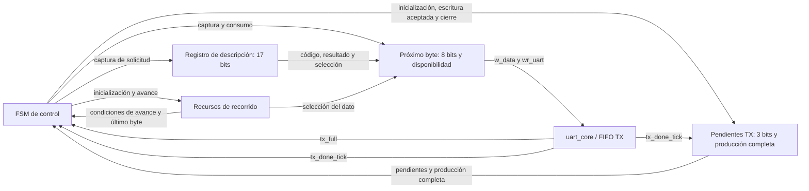
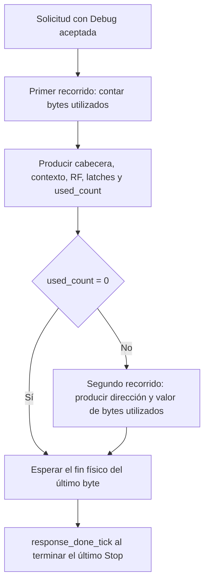
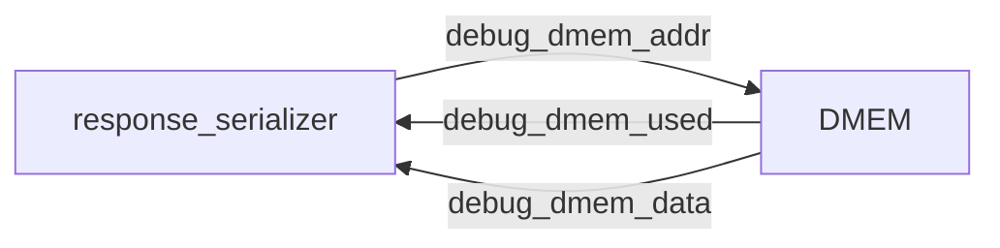
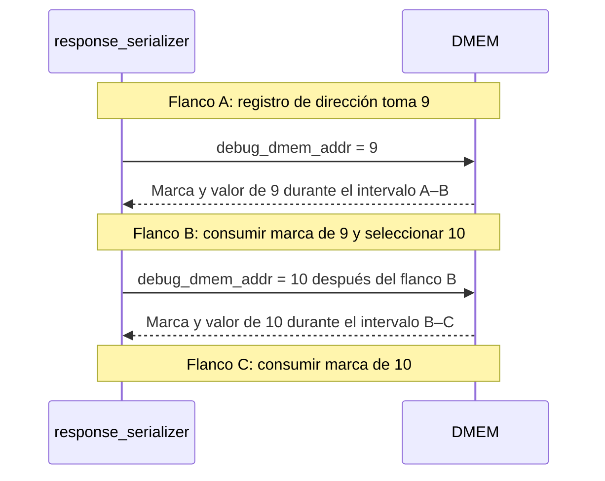
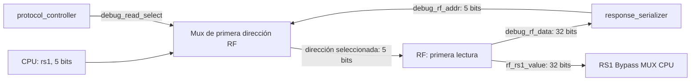
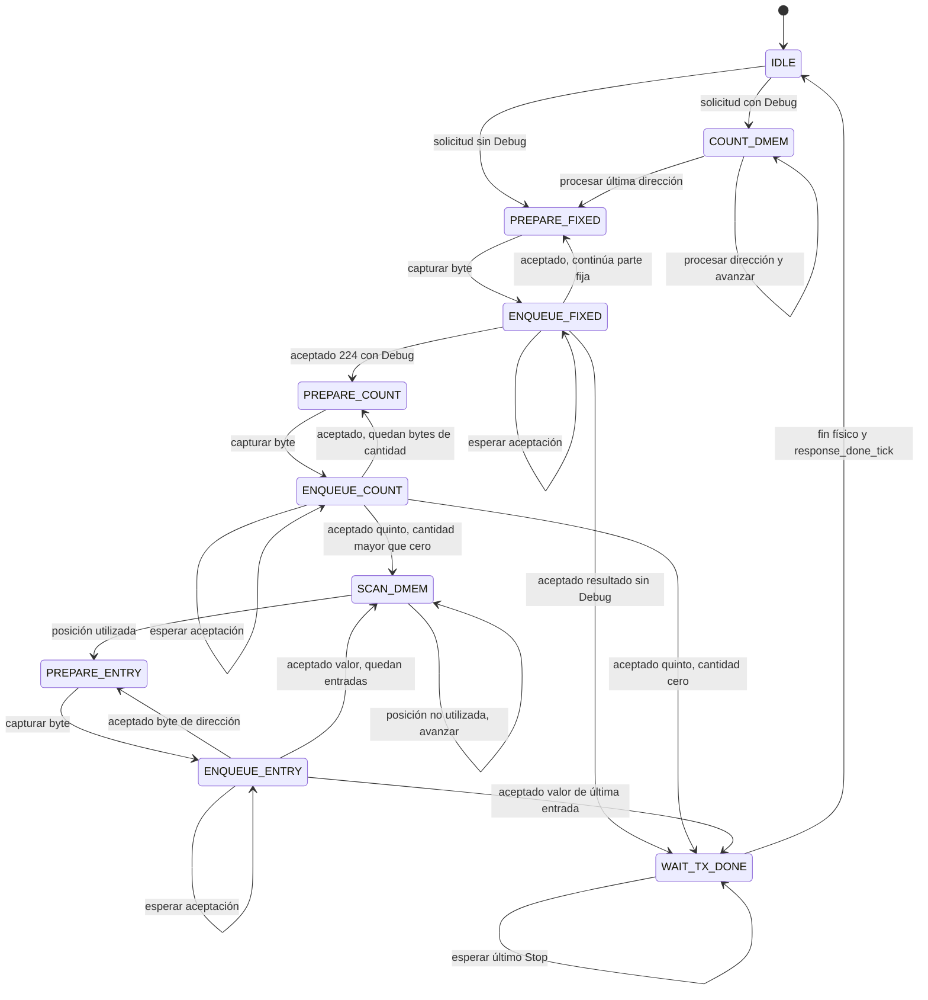

# Serialización de respuestas

- **Tipo:** arquitectura.
- **Estado documental:** especificación vigente.

<a id="función-del-módulo"></a>

## Propósito y alcance

`response_serializer` recibe la descripción de una respuesta desde [protocol_controller](protocol_controller.md), forma sus bytes según el [protocolo UART](../../protocol.md) y los entrega a [uart_core](../uart/uart_core.md). La descripción o descriptor contiene opcode, resultado e indicación de cuerpo Debug.

El Controller decide qué respuesta corresponde y si incluye Debug. El serializador conserva esa descripción durante el envío, produce la cabecera y el cuerpo solicitado y comunica el fin físico del mensaje completo. Para Debug, lee directamente el estado retenido por la coordinación del Controller.

## Organización

### Organización interna

Los siguientes grupos pertenecen al mismo módulo:

| Grupo                      | Responsabilidad                                                                                             |
| -------------------------- | ----------------------------------------------------------------------------------------------------------- |
| FSM de control             | Distinguir las fases de producción y transmisión y emitir las órdenes sobre los recursos.                   |
| Registro de descripción    | Conservar opcode, resultado y formato de la respuesta aceptada.                                             |
| Registro del próximo byte  | Retener el byte producido y su disponibilidad mientras espera espacio en TX.                                |
| Recursos de recorrido      | Seleccionar las posiciones de la parte fija y de DMEM; conservar cantidad utilizada y progreso de la lista. |
| Seguimiento de transmisión | Contar bytes encolados cuyo Stop no terminó y recordar que se produjo el último byte.                       |

La FSM decide las acciones y cada recurso calcula y registra su actualización al flanco del clock funcional. UART y el Controller conservan el consumo de RX mientras el serializador produce o espera TX.

## Parámetros

El módulo usa el clock funcional común de 50 MHz. Sea `C = DMEM_CAPACITY_BYTES`, con la capacidad de la [configuración común](../common_configuration.md). Los anchos de recorrido son:

| Magnitud                                | Rango           | Ancho en bits             |
| --------------------------------------- | --------------- | ------------------------- |
| Dirección DMEM                          | 0 a C − 1       | max(1, ceil(log2(C)))     |
| Cantidad utilizada y entradas completas | 0 a C inclusive | max(1, ceil(log2(C + 1))) |

Las direcciones UART se representan en cuatro bytes y la cantidad en cinco, little-endian. Los bits superiores del campo se completan con ceros cuando exceden el ancho del recurso interno.

## Estados de control

### Estados de la FSM del serializador

Cada estado distingue una fase con una fuente de datos, una acción o una continuación diferente. El estado se registra con codificación one-hot de diez bits:

| Codificación one-hot | Estado          | Qué representa                                                     |
| -------------------- | --------------- | ------------------------------------------------------------------ |
| `10'b0000000001`     | `IDLE`          | Esperar y aceptar la descripción de una respuesta.                 |
| `10'b0000000010`     | `COUNT_DMEM`    | Recorrer las marcas DMEM y contar los bytes utilizados.            |
| `10'b0000000100`     | `PREPARE_FIXED` | Capturar el próximo byte de cabecera, contexto, RF o pipeline.     |
| `10'b0000001000`     | `ENQUEUE_FIXED` | Esperar espacio y encolar el byte de la parte fija.                |
| `10'b0000010000`     | `PREPARE_COUNT` | Capturar el próximo byte de la cantidad utilizada.                 |
| `10'b0000100000`     | `ENQUEUE_COUNT` | Esperar espacio y encolar el byte de cantidad.                     |
| `10'b0001000000`     | `SCAN_DMEM`     | Buscar la siguiente posición utilizada para producir su entrada.   |
| `10'b0010000000`     | `PREPARE_ENTRY` | Capturar el próximo byte de dirección o valor de una entrada DMEM. |
| `10'b0100000000`     | `ENQUEUE_ENTRY` | Esperar espacio y encolar el byte de la entrada DMEM.              |
| `10'b1000000000`     | `WAIT_TX_DONE`  | Esperar el último Stop después de completar la producción.         |

#### Codificación one-hot de los estados

Reset establece `IDLE`, con código `10'b0000000001`. En operación legal se conserva exactamente un bit activo. La lógica de próximo estado y acciones es combinacional y puede expresarse con `casez` y comodines `?`.

Esta codificación describe la fase privada de serialización. El código global CPU que se incluye en Debug es un dato de observación independiente.

## Interfaces y contratos

### Relación con UART y el controlador

| Dirección respecto del serializador | Señal          | Ancho | Origen o destino                   | Significado                                                        |
| ----------------------------------- | -------------- | ----- | ---------------------------------- | ------------------------------------------------------------------ |
| Entrada                             | `clk`          | 1     | Clock funcional común              | Flanco positivo de actualización de FSM y recursos.                |
| Entrada                             | `reset`        | 1     | Acondicionamiento del reset global | Aborta la respuesta y tiene prioridad sobre las acciones normales. |
| Entrada                             | `tx_full`      | 1     | UART, FIFO TX                      | Indica que no puede aceptarse una escritura en ese flanco.         |
| Entrada                             | `tx_done_tick` | 1     | UART, transmisor TX                | Fin físico de un byte, incluido su Stop.                           |
| Salida                              | `w_data`       | 8     | UART, FIFO TX                      | Byte registrado que se presenta para encolar.                      |
| Salida                              | `wr_uart`      | 1     | UART, FIFO TX                      | Solicita escritura con byte disponible y espacio previo al flanco. |

Solo el serializador escribe las respuestas en TX. Su ocupación no autoriza ni detiene ciclos CPU: RUN puede avanzar mientras sale RUN/ACCEPTED. El Controller conserva una obligación terminal hasta entregarla con el serializador libre y retiene la observación Debug desde el instante observado hasta el último Stop.

La captura directa y la disponibilidad por fase están definidas en [Protocol Controller](protocol_controller.md#entrega-y-finalización-de-respuestas). Las direcciones RF y DMEM y los datos de observación se detallan junto con sus recorridos de bytes.

### Comunicación con el controlador

El Controller presenta los tres campos del descriptor directamente junto con su habilitación de captura. Estas señales son puertos entre ambos módulos:

| Dirección respecto del serializador   | Señal                   | Ancho   | Significado                                                                                  |
| ------------------------------------- | ----------------------- | ------- | -------------------------------------------------------------------------------------------- |
| Entrada                               | `response_start`        | 1       | Habilita la captura de la respuesta con el serializador libre antes del flanco.              |
| Entrada                               | `response_opcode`       | 8       | Primer byte de la respuesta; reproduce el código recibido, incluido un código desconocido.   |
| Entrada                               | `response_result`       | 8       | Segundo byte, según la tabla de resultados del protocolo.                                    |
| Entrada                               | `response_with_debug`   | 1       | Agrega el cuerpo Debug después de la cabecera.                                               |
| Salida                                | `response_busy`         | 1       | Respuesta en curso desde su aceptación hasta el fin físico del último byte.                  |
| Salida                                | `response_done_tick`    | 1       | Evento de un clock que comunica el fin físico de la respuesta completa.                      |

Fuera de reset, `response_start` se acepta al flanco con `response_busy=0` antes de ese flanco. Se capturan `response_opcode`, `response_result` y `response_with_debug` en los registros de 17 bits del serializador. Después, el Controller puede cambiar esos buses sin alterar el mensaje en curso.

`response_busy` depende únicamente del estado actual del serializador y de reset, no de `response_start`. Fuera de reset, vale uno en todos los estados distintos de `IDLE`, incluida producción, espera por espacio y salida física de los bytes encolados.

`response_done_tick` comunica una única finalización por respuesta, en el mismo flanco de consumo que el evento UART del último Stop, incluido Debug si corresponde. Antes de ese flanco el serializador sigue ocupado; después queda libre y puede aceptar otra respuesta desde el siguiente flanco. El evento es combinacional y no se registra para desplazar ese hito.

El Controller decide `response_with_debug`: vale uno para STEP realizado y resultado terminal RUN; las aceptaciones y rechazos usan una respuesta corta de dos bytes. La indicación de formato se captura con el descriptor y no agrega un byte al enlace.

Reset suprime captura y finalización, deja ocupación inactiva y aborta el envío. Un reset físico durante una transmisión no produce una finalización normal. La solicitud de reset UART después de su aceptación completa corresponde al [Controller](protocol_controller.md#reset-uart).

```mermaid
sequenceDiagram
    participant CTRL as protocol_controller
    participant SER as response_serializer
    participant UART as uart_core
    SER-->>CTRL: response_busy = 0
    CTRL->>SER: response_start y campos estables
    Note over CTRL,SER: Flanco de aceptación; capturar campos
    SER-->>CTRL: response_busy = 1
    loop Bytes de cabecera y cuerpo, si corresponde
        SER->>UART: w_data y wr_uart cuando hay espacio
        UART-->>SER: tx_done_tick al terminar cada Stop
        Note over CTRL,UART: CTRL continúa consumiendo o descartando RX según la fase
    end
    Note over SER,UART: Flanco de fin físico del último byte
    SER-->>CTRL: response_done_tick
    SER-->>CTRL: response_busy = 0 después del flanco
```

El diagrama muestra la captura de la respuesta y su cierre. Los bytes pueden encolarse usando el espacio disponible mientras UART transmite los anteriores; no se espera el Stop de cada byte para producir el siguiente.

## Recursos registrados

Los puertos anteriores conectan módulos. Los siguientes recursos son internos al serializador y se actualizan mediante las órdenes de su FSM:

| Recurso                        | Ancho en bits             | Función                                                          |
| ------------------------------ | ------------------------- | ---------------------------------------------------------------- |
| Estado FSM                     | 10                        | Fase one-hot de la tabla de estados.                             |
| Descriptor                     | 17                        | Opcode de ocho bits, resultado de ocho e indicador Debug de uno. |
| Próximo byte y disponibilidad  | 8 + 1                     | Dato producido que espera su escritura en TX.                    |
| Dirección DMEM                 | max(1, ceil(log2(C)))     | Posición consultada en ambos recorridos.                         |
| `used_count`                   | max(1, ceil(log2(C + 1))) | Total de bytes utilizados calculado en el primer recorrido.      |
| Índice compartido de byte      | 3                         | Posición cero a cuatro de la cantidad o entrada DMEM.            |
| Contador de entradas encoladas | max(1, ceil(log2(C + 1))) | Entradas dirección/valor completas incorporadas a TX.            |
| `fixed_byte_index`             | 8                         | Posición cero a 224 de cabecera, contexto, RF y pipeline.        |
| Pendientes TX                  | 3                         | Bytes encolados cuyo Stop no terminó; rango cero a cuatro.       |
| Producción completa            | 1                         | Indica que el último byte de la respuesta fue encolado.          |



La selección combinacional del dato utiliza descriptor, índices y observación. El registro del próximo byte conserva ese dato durante espera TX. La captura del descriptor y el seguimiento de bytes físicos pertenecen a recursos distintos.

## Comportamiento

### Preparación y encolado comunes de cada byte

Todos los bytes de una respuesta utilizan dos pasos sucesivos: preparar el byte y encolarlo. Ambos emplean el registro de próximo byte y su indicador de disponibilidad.

| Paso                                              | Acción al flanco                                                                                         | Recorrido y seguimiento                                                                                                |
| ------------------------------------------------- | -------------------------------------------------------------------------------------------------------- | ---------------------------------------------------------------------------------------------------------------------- |
| Preparar                                          | Capturar el byte seleccionado para la posición actual y activar disponibilidad. No escribir TX.          | No avanzar índices ni dirección, no incrementar pendientes TX ni cerrar producción.                                    |
| Encolar con `tx_full` activo                      | Conservar byte y disponibilidad, sin escritura TX ni nueva captura.                                      | Conservar posición y dirección de la entrada. El seguimiento físico sigue atendiendo `tx_done_tick`.                   |
| Encolar con byte disponible y `tx_full` en cero   | Presentar el byte registrado como `w_data` y solicitar `wr_uart`; al aceptar, consumir disponibilidad.   | Aplicar el avance o cierre correspondiente al byte aceptado y actualizar pendientes TX conforme a la regla.            |

Las condiciones se evalúan con valores previos al flanco. El paso de preparación consume la selección combinacional de la posición actual; el registro entrega ese dato durante el paso de encolado posterior. Se mantienen separados en flancos distintos. La preparación puede realizarse aun con FIFO llena, ya que el recurso conserva el byte mientras espera. No se prepara el siguiente byte hasta consumir el actual.

La escritura se solicita durante el paso de encolado, fuera de reset, con disponibilidad activa y `tx_full` en cero. La aceptación es `wr_uart` && !`tx_full` con las señales preflanco, conforme al contrato FIFO. Si `tx_full` está activo y termina físicamente otro byte en el mismo flanco, no se adelanta esa escritura: el lugar liberado se utiliza en un flanco posterior.

Una escritura aceptada desactiva disponibilidad. Los bits del byte pueden conservarse, pero no autorizan otra escritura hasta una nueva preparación. Reset y la aceptación de una nueva respuesta dejan disponibilidad inactiva; reset también aborta la operación según el contrato global, sin finalización normal.

Después de consumir el byte se vuelve a preparar la siguiente posición cuando corresponde, o se pasa al recorrido/consulta o espera final correspondiente. El primer conteo DMEM y el salto de posiciones no utilizadas son acciones de recorrido y no generan bytes. Los límites de secciones, cierre de `used_count` y fin de lista conservan sus reglas; este mecanismo no cambia esas condiciones.

Mientras se prepara o espera espacio, `tx_done_tick` sigue actualizando el contador de pendientes físicos. Solo la aceptación del último byte activa producción completa. Después se espera su último Stop, manteniendo `response_busy`; preparar o encolar un byte no equivale a terminar físicamente su transmisión. `protocol_controller` conserva su atención o descarte RX, independientemente de esta espera TX.

### Seguimiento de transmisión

El contador de pendientes sigue los bytes encolados cuyo Stop aún no terminó:

| Eventos en el mismo flanco                                                | Efecto sobre pendientes   |
| ------------------------------------------------------------------------- | ------------------------- |
| Escritura aceptada en FIFO TX, con `wr_uart` activo y `tx_full` en cero   | Aumenta en uno            |
| `tx_done_tick`                                                            | Disminuye en uno          |
| Ambos eventos                                                             | Conserva su valor         |

Las condiciones utilizan las señales previas al flanco, como la [FIFO](../uart/uart_fifo.md#solicitudes-y-operaciones-aceptadas). La cuenta se inicializa en cero al reset y al aceptar una nueva respuesta.

La cota de cuatro incluye el byte en transmisión: `uart_core` conserva el primer elemento de FIFO hasta el flanco final de Stop. El registro del próximo byte no forma parte de esa cuenta mientras todavía no se haya incorporado a la FIFO. Solo `response_serializer` escribe TX, y la siguiente respuesta se acepta después del fin físico de la anterior; por eso comienza sin bytes TX de otro mensaje pendientes.

El indicador de producción completa se inicializa en cero para cada respuesta y se activa cuando su último byte se incorpora a TX. Obtener ese byte en el registro de producción todavía no cierra el mensaje. La cuenta puede llegar a cero entre bytes mientras la producción continúa, y esa condición no informa por sí sola el fin de respuesta.

Fuera de reset, el último Stop se reconoce cuando coinciden estas condiciones:

- respuesta en curso;
- producción completa;
- un único byte pendiente previo al flanco;
- `tx_done_tick` activo.

Ese flanco consume `response_done_tick`, lleva la cuenta a cero y deja libre el serializador.

### Recorrido de DMEM y orden de producción

Las respuestas con Debug siguen esta secuencia:

1. Recorrer todas las direcciones de byte de DMEM y contar las utilizadas según sus metadatos de escritura en la sesión. Los bytes escritos con valor cero también incrementan `used_count`; una dirección sobrescrita aporta una sola entrada.
2. Producir la cabecera y la parte fija del cuerpo: contexto, RF, registros interetapa y `used_count` calculado, en el orden del protocolo. La cantidad se transmite en cinco bytes little-endian.
3. Volver a recorrer DMEM desde la dirección cero en orden creciente. Por cada byte utilizado, producir su dirección de cuatro bytes little-endian y su valor actual de un byte; omitir las posiciones no utilizadas.

Si `used_count` es cero, sus cinco bytes son cero y no se produce una lista ni se requiere el segundo recorrido. Las respuestas sin Debug conservan únicamente los dos bytes de cabecera y no recorren DMEM.



El diagrama presenta fases de producción, no estados ni codificación de FSM. Los bytes producidos se incorporan a TX según el espacio disponible; el segundo recorrido no exige que toda la parte fija haya terminado físicamente antes de comenzar a producir la lista.

La secuencia responde a que `used_count` precede a las entradas en el protocolo. El serializador obtiene la cantidad antes de producir el mensaje y luego lee los valores directamente, sin conservar una copia completa de la lista. Los metadatos y los datos observados permanecen estables desde el instante posterior al ciclo CPU hasta el último Stop, bajo la exclusión Debug. UART y la atención o descarte RX continúan activos durante el conteo y el envío.

#### Señales de consulta de DMEM

El serializador se conecta con DMEM mediante estas tres señales:

| Señal               | Dirección respecto del serializador   | Ancho                   | Función                                                                                               |
| ------------------- | ------------------------------------- | ----------------------- | ----------------------------------------------------------------------------------------------------- |
| `debug_dmem_addr`   | Salida hacia DMEM                     | max(1, ceil(log2(C)))   | Dirección de byte seleccionada por el registro de recorrido, para capacidad C de DMEM.                |
| `debug_dmem_data`   | Entrada desde DMEM                    | 8                       | Valor del byte en la dirección seleccionada.                                                          |
| `debug_dmem_used`   | Entrada desde DMEM                    | 1                       | Uno si el byte fue escrito por un store comprometido en la sesión actual; cero si no fue utilizado.   |

La dirección tiene 11 bits en `REFERENCE` y diez en `ALT_1000`. Datos y metadatos corresponden a la misma posición. El indicador proviene de los metadatos de DMEM ya existentes y conserva el criterio de utilización, incluidos los valores cero escritos por el programa.

En el primer recorrido, el serializador utiliza únicamente `debug_dmem_used` para contar. En el segundo, si ese indicador vale cero, salta la posición e ignora su valor; si vale uno, produce la entrada dirección/valor y utiliza `debug_dmem_data` para su quinto byte. La conexión de datos permite producir las posiciones utilizadas y no obliga a consumir datos de las restantes.



La consulta utiliza el estado retenido, con CPU y mantenimiento excluidos. El [selector CPU/Debug de DMEM](../memory/memory_architecture.md#selector-de-dirección-de-lectura-cpudebug) recibe `debug_read_select` desde el Controller, igual que el selector RF. La señal común selecciona la fuente de lectura; DMEM conserva su propia dirección de recorrido. El serializador consume los retornos con Debug seleccionado.

El cableado del backend se define en [acceso DMEM](../memory/dmem_access.md) y [Composición](../system_composition.md).

#### Lectura de DMEM entre flancos

`debug_dmem_data` y `debug_dmem_used` son salidas combinacionales de la dirección seleccionada y el estado retenido de DMEM. El registro de recorrido mantiene esa dirección entre flancos; la memoria presenta durante ese intervalo la información de la posición seleccionada.

Cuando la FSM consume una consulta al flanco siguiente, utiliza la información correspondiente a la dirección previa al flanco. Si ese mismo flanco actualiza el registro a otra dirección, las salidas pasan después a reflejar la nueva posición. La información de esa nueva dirección no se utiliza para el procesamiento del flanco que la seleccionó.

Durante el primer recorrido, una vez inicializada la dirección en cero y activa la fase de conteo, se procesa una posición por ciclo: se incrementa `used_count` si la marca previa al flanco vale uno y se selecciona la siguiente posición, o se cierra al procesar C − 1. El resultado incluye la última marca, incluida la última marca.



Las flechas representan propagación de señales internas, sin transacciones UART ni handshake de lectura. En el listado se utiliza la misma consulta combinacional: una posición no utilizada se omite al consumir su marca; una utilizada conserva la dirección durante la producción de sus cinco bytes y las esperas TX. El valor se consume al preparar el quinto byte de la entrada.

El próximo byte conserva el dato producido durante espera TX. La consulta de DMEM es combinacional y debe cumplir el intervalo de lectura de 20 ns entre flancos.

#### Cierre del primer recorrido

La última dirección del primer recorrido es C − 1. El recorrido comienza en cero y procesa cada posición una vez, en orden creciente.

Al procesar una dirección, se consultan sus metadatos y se incrementa `used_count` si está utilizada. Si la dirección es menor que C − 1, se avanza a la siguiente; si es igual a C − 1, se termina el conteo sin incrementar la dirección. La última posición participa del conteo con la misma regla que las anteriores.

El incremento correspondiente a la última posición y el cierre pueden consumirse en el mismo flanco: la parte fija posterior utiliza el total registrado después de incluirla. Por ejemplo, al procesar una última posición utilizada con cuenta previa de diez, el resultado del recorrido es once.

`REFERENCE` termina después de revisar la dirección 2047 y `ALT_1000` después de revisar la 999. El cierre se obtiene por comparación explícita con C − 1 y no depende del desbordamiento del registro de dirección. Este criterio conserva capacidades no potencia de dos y no requiere representar C dentro de dicho registro.

Durante conteo se procesa una posición por ciclo activo, utilizando su marca previa al flanco.

#### Recursos de dirección y cantidad

El recorrido de DMEM utiliza estos recursos internos:

| Recurso                         | Función y uso                                                                                                                                                                   |
| ------------------------------- | ------------------------------------------------------------------------------------------------------------------------------------------------------------------------------- |
| Registro de dirección de DMEM   | Conserva la dirección del byte que se examina. Se utiliza en ambos recorridos, comenzando en cero y volviendo a cero antes del segundo.                                         |
| Contador `used_count`           | Comienza en cero y aumenta por cada byte utilizado durante el primer recorrido. Conserva el resultado después del conteo, durante la producción de la cantidad y de la lista.   |

La reutilización del registro de dirección permite realizar ambos recorridos sucesivos con un mismo recurso. El contador conserva la cantidad mientras el registro de dirección vuelve a recorrer DMEM; ambos valores cumplen funciones distintas y se almacenan por separado.

Los recursos se actualizan con las [órdenes de la FSM](#señales-de-acción-de-la-fsm).

#### Anchos de dirección y cantidad

La dirección y la cantidad se dimensionan según la capacidad C en bytes de DMEM:

| Recurso                  | Rango requerido   | Ancho en bits               |
| ------------------------ | ----------------- | --------------------------- |
| Dirección de recorrido   | 0 a C − 1         | max(1, ceil(log2(C)))       |
| Contador `used_count`    | 0 a C inclusive   | max(1, ceil(log2(C + 1)))   |

En los [perfiles definidos](../memory/memory_architecture.md#perfiles-definidos), esos anchos son:

| Perfil        | Capacidad DMEM   | Dirección   | `used_count`   |
| ------------- | ---------------: | ----------: | -------------: |
| `REFERENCE`   | 2048 bytes       | 11 bits     | 12 bits        |
| `ALT_1000`    | 1000 bytes       | 10 bits     | 10 bits        |

Los valores de `ALT_1000` se derivan de la misma regla de dimensionamiento. El contador debe representar todos los bytes utilizados, mientras que la dirección solo representa la última posición, C − 1. El dominio de capacidad y el mínimo de un bit conservan la parametrización de memoria.

La dirección representa la última posición, C − 1; la cantidad debe representar C inclusive. La representación UART utiliza los campos y la extensión con ceros definidos en Parámetros.

#### Índice de byte de cantidad y entradas DMEM

El índice compartido de tres bits identifica posiciones cero a cuatro. Se utiliza para los cinco bytes de `used_count` y para los cinco bytes de cada entrada dirección/valor. Al comenzar la cantidad o una nueva entrada, vuelve a cero.

| Índice   | Durante `used_count`, extendido a 40 bits   | Durante una entrada, con dirección extendida a 32 bits   |
| -------: | ------------------------------------------- | -------------------------------------------------------- |
| 0        | Cantidad [7:0]                              | Dirección [7:0]                                          |
| 1        | Cantidad [15:8]                             | Dirección [15:8]                                         |
| 2        | Cantidad [23:16]                            | Dirección [23:16]                                        |
| 3        | Cantidad [31:24]                            | Dirección [31:24]                                        |
| 4        | Cantidad [39:32]                            | Valor actual del byte de DMEM                            |

La fase de producción determina cómo interpretar el índice. La dirección de recorrido identifica la posición de DMEM; el índice de byte identifica la parte del campo o entrada que toca producir. Ambos se conservan en recursos distintos, dentro del grupo de recorrido.

La cantidad y las entradas se producen sucesivamente y comparten el índice de tres bits. La dirección de DMEM se conserva en un recurso distinto.

#### Avance durante producción y espera TX

El evento de avance es la incorporación del byte a FIFO TX. La escritura se acepta al flanco con `wr_uart` activo y `tx_full` en cero, según los flags previos al flanco.

| Situación                                                       | Acción sobre byte e índice                                     | Acción sobre dirección de DMEM                                                                                       |
| --------------------------------------------------------------- | -------------------------------------------------------------- | -------------------------------------------------------------------------------------------------------------------- |
| Byte preparado sin escritura TX aceptada, incluida FIFO llena   | Conservar byte, disponibilidad e índice                        | Conservar la dirección de la entrada en producción                                                                   |
| Escritura aceptada de posición cero a tres                      | Consumir el byte preparado y avanzar al siguiente índice       | Conservar la dirección durante la entrada                                                                            |
| Escritura aceptada de posición cuatro de `used_count`           | Consumir el byte y completar la cantidad                       | Continuar según lista vacía o segundo recorrido                                                                      |
| Escritura aceptada de posición cuatro de una entrada            | Consumir el valor y completar el encolado de la entrada        | Habilitar el avance a la siguiente dirección si el recorrido continúa; la próxima entrada comienza con índice cero   |
| Posición de DMEM no utilizada durante búsqueda                  | No producir bytes ni solicitar escritura TX por esa posición   | Saltarla y continuar el recorrido según su condición de cierre                                                       |

Obtener o capturar el próximo byte todavía no adelanta el índice. Una entrada mantiene la misma dirección durante sus cuatro bytes de dirección y el byte de valor. El contador `used_count` conserva el total calculado durante este proceso.

El avance por encolado utiliza la FIFO mientras UART transmite en paralelo. El seguimiento TX conserva el fin físico por `tx_done_tick` y la respuesta permanece ocupada hasta el Stop final. La atención o descarte RX sigue activa durante espera TX, bajo la coordinación del controlador.

#### Entradas completas encoladas y último byte de la lista

El contador de entradas conserva la cantidad acumulada de entradas completas incorporadas a FIFO TX durante la lista y comienza en cero al iniciarla.

El contador aumenta únicamente al aceptar el valor de una entrada, en posición cuatro del índice de byte, con `wr_uart` activo y `tx_full` en cero previos al flanco. Los cuatro bytes de dirección, la cabecera, las otras secciones y los bytes de `used_count` no incrementan esa cuenta. La espera TX y los eventos `tx_done_tick` tampoco la modifican.

`used_count` conserva el total esperado. Cuando la aceptación del valor de una entrada lleva la cuenta a ese total, esa entrada es la última: el mismo flanco activa producción completa y termina el segundo recorrido. Para identificarla se utiliza la cuenta previa al flanco y la aceptación que la incrementará, sin esperar otro flanco para reconocer el resultado registrado. La dirección deja de avanzar y no se requieren consultas posteriores a esa última entrada.

Si `used_count` vale cero, la lista se omite y producción completa se activa al aceptar el quinto byte de la cantidad. En ambos casos `response_busy` permanece activo hasta el fin físico, con producción completa, un único byte TX pendiente y `tx_done_tick` del último Stop.

El contador de entradas es acumulativo durante la lista, con rango de cero a `used_count` inclusive. El contador de pendientes TX conserva su función de contar bytes que aún no terminaron físicamente, aumentando por escritura aceptada y disminuyendo por `tx_done_tick`. Los dos recursos pertenecen a grupos y funciones distintos.

El contador de entradas usa el mismo ancho que `used_count`: max(1, ceil(log2(C + 1))). En `REFERENCE` tiene 12 bits y en `ALT_1000`, diez. Ambos contadores pueden alcanzar C; uno conserva el total esperado y otro el progreso de la lista. La cuenta de entradas no agrega un campo al protocolo.

### Recorrido de cabecera, contexto, RF y latches

`fixed_byte_index` identifica las posiciones cero a 224 de los 225 bytes anteriores a `used_count` en una respuesta con Debug:

| Parte                 | Posiciones de `fixed_byte_index`   | Bytes   |
| --------------------- | ---------------------------------- | ------: |
| Código de operación   | 0                                  | 1       |
| Resultado             | 1                                  | 1       |
| Contexto              | 2 a 20                             | 19      |
| RF `x0`–x31           | 21 a 148                           | 128     |
| `IF/ID`               | 149 a 159                          | 11      |
| `ID/EX`               | 160 a 189                          | 30      |
| `EX/MEM`              | 190 a 209                          | 20      |
| `MEM/WB`              | 210 a 224                          | 15      |

El índice comienza en cero para cada respuesta. Con Debug, se mantiene en cero durante el conteo previo de DMEM y después recorre la tabla. El opcode y resultado provienen del descriptor capturado; contexto, RF y registros interetapa se leen del estado retenido.

El índice avanza cuando el byte de la posición actual se incorpora a FIFO TX, con `wr_uart` activo y `tx_full` en cero previos al flanco. Mientras no se acepta, se conservan índice y byte preparado. Preparar o capturar el byte no adelanta la posición.

| Tipo de respuesta   | Última posición de este recorrido   | Acción al aceptar ese byte                                                                                                       |
| ------------------- | ----------------------------------: | -------------------------------------------------------------------------------------------------------------------------------- |
| Sin Debug           | 1                                   | Marcar producción completa; esperar el fin físico del último Stop.                                                               |
| Con Debug           | 224                                 | Completar este recorrido y pasar a `used_count` con el índice compartido de tres bits en cero. La producción todavía continúa.   |

La última posición se conserva al cerrar su recorrido, sin incrementar `fixed_byte_index` fuera de su rango. Durante `used_count` y la lista DMEM, este índice permanece retenido; esas fases utilizan sus recursos. Ocho bits representan todas las posiciones hasta 224 y sirven también para las cabeceras cortas de dos bytes.

#### Entradas de observación del contexto

Estas seis entradas conectan el valor conservado o derivado por su bloque propietario, bajo la exclusión Debug:

| Entrada del serializador   | Ancho en bits   | Fuente lógica                                     | Posiciones de `fixed_byte_index`   | Bytes UART   |
| -------------------------- | --------------: | ------------------------------------------------- | ---------------------------------- | -----------: |
| `debug_state_code`         | 8               | `global_state_code[7:0]` de `Execution Control`   | 2                                  | 1            |
| `debug_image_valid`        | 1               | `loaded_image_size_bytes` != 0                    | 3                                  | 1            |
| `debug_pc`                 | 32              | Registro PC global                                | 4 a 7                              | 4            |
| `debug_cycle_count`        | 64              | `Cycle Counter`                                   | 8 a 15                             | 8            |
| `debug_fault_cause`        | 3               | Registro global `fault_cause`                     | 16                                 | 1            |
| `debug_fault_pc`           | 32              | Registro global `fault_pc`                        | 17 a 20                            | 4            |

El contexto ocupa 19 bytes: 1 + 1 + 4 + 8 + 1 + 4. Las posiciones dos a 20 son inclusivas; las dos posiciones anteriores corresponden a la cabecera y RF comienza en 21. `image_valid` y `fault_cause` completan sus respectivos bytes UART con ceros superiores; los campos de varios bytes conservan little-endian, según el protocolo.

Las conexiones observan el estado retenido directamente, sin agregar una copia completa del contexto. La CPU y la preparación permanecen excluidas desde el instante observado hasta el último Stop. El serializador utiliza estas entradas únicamente al producir contexto de una respuesta con Debug.

Los registros globales de fault se conectan con sus bits actuales incluso cuando no representan un fault vigente; el estado global determina su interpretación, conforme al protocolo. `debug_image_valid` es un predicado combinacional del tamaño de imagen, sin registro adicional.

`Global FSM`, dentro de `Execution Control`, genera `global_state_code[7:0]` combinacionalmente desde el estado one-hot registrado, según la [representación global](../session/global_state_encoding.md). El serializador recibe ese código externo mediante `debug_state_code[7:0]` y lo utiliza para producir el byte de estado del contexto. El byte de estado se consume como cualquier otra entrada de contexto.

#### Selección de bytes del contexto

`fixed_byte_index` selecciona combinacionalmente el campo y el byte del contexto:

| `fixed_byte_index`   | Byte seleccionado, de ocho bits                                 |
| -------------------- | --------------------------------------------------------------- |
| 2                    | `debug_state_code[7:0]`                                         |
| 3                    | Siete ceros superiores y `debug_image_valid`                    |
| 4 a 7                | Byte j de `debug_pc`, con j = `fixed_byte_index` − 4            |
| 8 a 15               | Byte j de `debug_cycle_count`, con j = `fixed_byte_index` − 8   |
| 16                   | Cinco ceros superiores y `debug_fault_cause[2:0]`               |
| 17 a 20              | Byte j de `debug_fault_pc`, con j = `fixed_byte_index` − 17     |

Para cada campo de varios bytes, el byte j corresponde a los bits [8*j + 7 : 8*j]. Así, PC y PC de fault recorren [7:0], [15:8], [23:16] y [31:24]; `cycle_count` recorre ocho slices de ocho bits hasta [63:56]. Las posiciones de byte se derivan combinacionalmente del índice existente y mantienen little-endian. Por ejemplo, PC = 0x12345678 produce 78, 56, 34 y 12 en posiciones cuatro a siete.

Esta selección se consume únicamente durante producción de contexto de una respuesta con Debug. La FSM controla la captura del resultado en el próximo byte; el dato y la posición usados son los previos al flanco. Preparar el byte no adelanta `fixed_byte_index`. Mientras TX no acepta la escritura, se conservan el índice y el próximo byte preparado, conforme a la política.

Aceptar posición 20 completa el contexto y lleva el recorrido a 21, primer byte de RF. La respuesta continúa con RF y las demás secciones.

#### Lectura RF compartida con Debug

La consulta Debug utiliza la primera lectura combinacional RF mediante un multiplexor de números de registro de cinco bits dentro de `Registers`.

| Señal             | Dirección respecto del serializador   | Ancho   | Función                                                       |
| ----------------- | ------------------------------------- | ------: | ------------------------------------------------------------- |
| `debug_rf_addr`   | Salida hacia RF                       | 5       | Selecciona `x0`–x31 para producir su contenido.               |
| `debug_rf_data`   | Entrada desde RF                      | 32      | Valor base del registro seleccionado, antes del bypass CPU.   |

El mux recibe `Read Register 1` CPU y `debug_rf_addr`. `debug_read_select` de un bit, generado por `protocol_controller`, selecciona CPU con cero y Debug con uno. La segunda dirección y lectura RF conservan su conexión CPU.



`debug_rf_data` es otra conexión del mismo valor base de la primera lectura y no un tercer puerto de lectura del almacenamiento. El valor se presenta combinacionalmente; el serializador produce sus cuatro bytes little-endian, conforme al protocolo. La dirección seleccionada determina la regla de `x0`: leer el registro cero devuelve cero, independientemente del número CPU que permanezca en la otra entrada del mux.

`debug_read_select` conserva la misma ventana exclusiva para Debug: desde el estado posterior al ciclo observado hasta el último Stop, incluida espera por una respuesta previa, y cero durante reset. El ciclo que produce la observación utiliza la dirección CPU antes de cambiar el selector. CPU permanece retenida y RF no recibe escrituras CPU ni preparación durante la observación. El Controller conecta esa misma señal al selector DMEM, cuyo recorrido de direcciones es independiente.

El serializador consume este retorno con Debug seleccionado al producir posiciones RF, 21 a 148 de `fixed_byte_index`. RF utiliza `debug_rf_addr`, independiente de la dirección DMEM, aunque ambos selectores reciben la misma señal del Controller. La generación de `debug_read_select` corresponde al [Controller](protocol_controller.md#terminal-run-y-exclusión-debug).

#### Derivación de registro y byte RF

`fixed_byte_index` determina combinacionalmente el número de registro y el byte durante las posiciones RF, de 21 a 148 inclusive.

Se resta 21 para obtener la posición dentro del bloque de 128 bytes. Su división entera por cuatro identifica el registro de cero a 31; el resto de esa división identifica el byte de cero a tres. Para una posición relativa de siete bits, los bits [6:2] forman `debug_rf_addr[4:0]` y los bits [1:0] forman `rf_byte_select[1:0]`. Estas selecciones son conexiones combinacionales, sin contadores RF adicionales.

| `fixed_byte_index`   | Posición dentro de RF   | `debug_rf_addr`   | `rf_byte_select`   |
| -------------------: | ----------------------: | ----------------: | -----------------: |
| 21                   | 0                       | 0 (`x0`)          | 0                  |
| 22                   | 1                       | 0 (`x0`)          | 1                  |
| 23                   | 2                       | 0 (`x0`)          | 2                  |
| 24                   | 3                       | 0 (`x0`)          | 3                  |
| 25                   | 4                       | 1 (x1)            | 0                  |
| 26                   | 5                       | 1 (x1)            | 1                  |
| 148                  | 127                     | 31 (x31)          | 3                  |

El número alimenta la primera dirección RF compartida. `rf_byte_select` controla una selección combinacional de cuatro bytes, cada uno de ocho bits, a partir de `debug_rf_data`:

| `rf_byte_select`   | Byte seleccionado        |
| -----------------: | ------------------------ |
| 0                  | `debug_rf_data[7:0]`     |
| 1                  | `debug_rf_data[15:8]`    |
| 2                  | `debug_rf_data[23:16]`   |
| 3                  | `debug_rf_data[31:24]`   |

Cada grupo de cuatro posiciones mantiene el mismo registro RF y recorre sus bytes little-endian. El índice avanza por escritura TX aceptada, como en el recorrido; durante espera se mantienen el registro seleccionado, la selección de byte y el próximo byte preparado.

La derivación se utiliza durante producción de la sección RF. Fuera de esa sección, el serializador no consume `debug_rf_data` y las selecciones combinacionales se presentan en cero como valores neutros. La captura del próximo byte usa los valores de la posición previa al flanco habilitado por la FSM; seleccionar otra posición después del flanco cambia los datos para una captura posterior. Los controles de captura y consumo se definen en la tabla de señales de acción.

#### Entradas de observación de IF/ID

Las siguientes entradas conectan las salidas registradas actuales de `IF/ID`:

| Entrada del serializador         | Ancho en bits   | Fuente                      |
| -------------------------------- | --------------: | --------------------------- |
| `debug_ifid_valid`               | 1               | `IF/ID.valid`               |
| `debug_ifid_pc`                  | 32              | `IF/ID.pc`                  |
| `debug_ifid_instruction`         | 32              | `IF/ID.instruction`         |
| `debug_ifid_fetch_fault_valid`   | 1               | `IF/ID.fetch_fault_valid`   |
| `debug_ifid_fetch_fault_cause`   | 3               | `IF/ID.fetch_fault_cause`   |

Las conexiones llevan los 69 bits funcionales existentes, sin agregar una copia del registro interetapa. Se observa el estado registrado actual, no las entradas de captura ni `next.valid`. La exclusión Debug mantiene esos campos estables desde el instante observado hasta el último Stop, incluida espera por una respuesta previa.

El serializador utiliza las entradas al producir la sección `IF/ID` de una respuesta con Debug, posiciones 149 a 159 de `fixed_byte_index`. Sus cinco campos ocupan 11 bytes UART con el orden y padding en el protocolo. Se transmiten los bits actuales aun con flags inactivos; valid identifica la instrucción activa y `fetch_fault_valid` habilita el candidato de búsqueda, distinto del fault global confirmado.

Las posiciones de cada campo se definen en [Observación de los cuatro latches](#observación-y-selección-de-bytes-de-los-cuatro-latches).

#### Observación y selección de bytes de los cuatro latches

Las entradas de observación conectan los campos registrados actuales de `IF/ID`, `ID/EX`, `EX/MEM` y `MEM/WB`. `fixed_byte_index` selecciona combinacionalmente campo y byte, sin copias de los registros interetapa ni contadores de recorrido adicionales.

Todas las señales de las tablas son entradas del serializador. Cada `debug_<latch>_<campo>` conecta la salida actual del campo correspondiente de ese registro interetapa, con el ancho funcional indicado. Se observan los valores registrados, incluidos operandos base de `ID/EX` y resultados consolidados de `EX/MEM` y `MEM/WB`, sin sustituirlos por resultados combinacionales posteriores ni entradas de captura.

##### IF/ID

| Entrada del serializador         | Ancho en bits   | Posiciones de `fixed_byte_index`   |
| -------------------------------- | --------------: | ---------------------------------- |
| `debug_ifid_valid`               | 1               | 149                                |
| `debug_ifid_pc`                  | 32              | 150 a 153                          |
| `debug_ifid_instruction`         | 32              | 154 a 157                          |
| `debug_ifid_fetch_fault_valid`   | 1               | 158                                |
| `debug_ifid_fetch_fault_cause`   | 3               | 159                                |

5 campos, 69 bits funcionales y 11 bytes UART.

##### ID/EX

| Entrada del serializador   | Ancho en bits   | Posiciones de `fixed_byte_index`   |
| -------------------------- | --------------: | ---------------------------------- |
| `debug_idex_valid`         | 1               | 160                                |
| `debug_idex_pc`            | 32              | 161 a 164                          |
| `debug_idex_instruction`   | 32              | 165 a 168                          |
| `debug_idex_rs1`           | 5               | 169                                |
| `debug_idex_rs2`           | 5               | 170                                |
| `debug_idex_rd`            | 5               | 171                                |
| `debug_idex_rs1_value`     | 32              | 172 a 175                          |
| `debug_idex_rs2_value`     | 32              | 176 a 179                          |
| `debug_idex_immediate`     | 32              | 180 a 183                          |
| `debug_idex_alu_op`        | 6               | 184                                |
| `debug_idex_alu_src`       | 1               | 185                                |
| `debug_idex_result_sel`    | 2               | 186                                |
| `debug_idex_flow_op`       | 3               | 187                                |
| `debug_idex_mem_op`        | 4               | 188                                |
| `debug_idex_reg_write`     | 1               | 189                                |

15 campos, 193 bits funcionales y 30 bytes UART.

##### EX/MEM

| Entrada del serializador    | Ancho en bits   | Posiciones de `fixed_byte_index`   |
| --------------------------- | --------------: | ---------------------------------- |
| `debug_exmem_valid`         | 1               | 190                                |
| `debug_exmem_pc`            | 32              | 191 a 194                          |
| `debug_exmem_instruction`   | 32              | 195 a 198                          |
| `debug_exmem_rd`            | 5               | 199                                |
| `debug_exmem_reg_write`     | 1               | 200                                |
| `debug_exmem_mem_op`        | 4               | 201                                |
| `debug_exmem_ex_result`     | 32              | 202 a 205                          |
| `debug_exmem_store_data`    | 32              | 206 a 209                          |

8 campos, 139 bits funcionales y 20 bytes UART.

##### MEM/WB

| Entrada del serializador    | Ancho en bits   | Posiciones de `fixed_byte_index`   |
| --------------------------- | --------------: | ---------------------------------- |
| `debug_memwb_valid`         | 1               | 210                                |
| `debug_memwb_pc`            | 32              | 211 a 214                          |
| `debug_memwb_instruction`   | 32              | 215 a 218                          |
| `debug_memwb_rd`            | 5               | 219                                |
| `debug_memwb_reg_write`     | 1               | 220                                |
| `debug_memwb_wb_value`      | 32              | 221 a 224                          |

6 campos, 103 bits funcionales y 15 bytes UART.

##### Regla común de selección y avance

Los campos de hasta ocho bits ocupan un byte con ceros superiores hasta completar ocho bits; sus códigos registrados conservan la representación del protocolo. Para un campo de 32 bits que empieza en posición s, j = `fixed_byte_index` − s selecciona los bits [8*j + 7 : 8*j], con j de cero a tres. Esta derivación es combinacional y produce los bytes little-endian [7:0], [15:8], [23:16] y [31:24]. Las tablas fijan el inicio de cada campo, sin bytes adicionales de identificación de registro interetapa o campo.

La selección se consume únicamente durante producción de la sección correspondiente de una respuesta con Debug. La exclusión mantiene todos los campos retenidos hasta el último Stop, incluida espera por una respuesta previa. Se transmiten también los bits actuales de campos inactivos: valid determina la interpretación de la instrucción y `fetch_fault_valid` determina por separado la del candidato de búsqueda `IF/ID`. No se reemplazan esos bits residuales por ceros; el padding superior de los campos pequeños sí es cero.

El resultado se captura en el recurso de próximo byte bajo control de la FSM, utilizando índice y datos previos al flanco. Capturar o preparar no adelanta el recorrido. El índice avanza únicamente por escritura TX aceptada y conserva la posición junto con el byte preparado durante espera. Los controles de captura y consumo se definen en la tabla de señales de acción.

| Última posición de sección   | Acción al aceptar ese byte                                                                                         |
| ---------------------------: | ------------------------------------------------------------------------------------------------------------------ |
| 159, `IF/ID`                 | Pasar a 160, inicio de `ID/EX`.                                                                                    |
| 189, `ID/EX`                 | Pasar a 190, inicio de `EX/MEM`.                                                                                   |
| 209, `EX/MEM`                | Pasar a 210, inicio de `MEM/WB`.                                                                                   |
| 224, `MEM/WB`                | Retener `fixed_byte_index` y pasar a `used_count` con su índice compartido en cero, conforme al cierre.            |

Estas transiciones no marcan producción completa: aún falta `used_count` y, si la cantidad es mayor que cero, la lista DMEM.

## Lógica de control

### Señales de acción de la FSM

Las órdenes combinacionales de la FSM habilitan la captura, avance y conservación de los recursos de producción y seguimiento.

Todas las órdenes de la primera tabla son señales combinacionales de un bit. Se evalúan antes del flanco y habilitan la actualización síncrona del recurso correspondiente. Fuera de sus condiciones valen cero; reset las suprime y tiene prioridad en los recursos. La FSM conserva estado registrado one-hot y decisiones con `casez` y comodines `?` conforme al criterio.

#### Órdenes sobre los recursos

| Señal                       | Recurso y acción al flanco                                                                                                                                              | Condición de activación                                                                                                      |
| --------------------------- | ----------------------------------------------------------------------------------------------------------------------------------------------------------------------- | ---------------------------------------------------------------------------------------------------------------------------- |
| `response_init`             | Capturar el descriptor de 17 bits; inicializar índices, dirección y contadores de recorrido y pendientes TX en cero, disponibilidad inactiva y producción incompleta.   | Solicitud `response_start` aceptada en `IDLE`.                                                                               |
| `byte_load`                 | Capturar el byte seleccionado en el registro de próximo byte y activar disponibilidad.                                                                                  | `PREPARE_FIXED`, `PREPARE_COUNT` o `PREPARE_ENTRY`.                                                                          |
| `byte_consume`              | Desactivar disponibilidad del próximo byte. Sus bits pueden conservarse.                                                                                                | Escritura TX aceptada en cualquier `ENQUEUE`.                                                                                |
| `fixed_index_inc`           | Incrementar `fixed_byte_index`.                                                                                                                                         | Byte fijo aceptado que no sea ninguno de los dos cierres: resultado sin Debug en posición uno o posición 224 con Debug.      |
| `shared_index_clear`        | Poner en cero el índice compartido de byte.                                                                                                                             | Posición 224 aceptada con Debug, o valor de entrada aceptado cuando quedan más entradas.                                     |
| `shared_index_inc`          | Incrementar el índice compartido de byte.                                                                                                                               | Byte aceptado en `ENQUEUE_COUNT` o `ENQUEUE_ENTRY` con índice menor que cuatro.                                              |
| `dmem_addr_inc`             | Incrementar la dirección registrada de consulta DMEM.                                                                                                                   | `COUNT_DMEM` antes de C − 1; `SCAN_DMEM` en posición no utilizada; o valor de entrada aceptado cuando quedan más entradas.   |
| `used_count_inc`            | Incrementar `used_count`.                                                                                                                                               | `COUNT_DMEM` con `debug_dmem_used` activo, incluida la última dirección.                                                     |
| `list_init`                 | Poner dirección DMEM, índice compartido y contador de entradas en cero. Conservar `used_count`.                                                                         | Quinto byte de `used_count` aceptado con cantidad mayor que cero.                                                            |
| `entry_count_inc`           | Incrementar el contador acumulativo de entradas completas encoladas.                                                                                                    | Valor de entrada aceptado en `ENQUEUE_ENTRY`, índice cuatro, incluida la última entrada.                                     |
| `production_complete_set`   | Activar el indicador de producción completa.                                                                                                                            | Resultado sin Debug aceptado; quinto byte de cantidad cero aceptado; o valor de última entrada aceptado.                     |
| `tx_pending_inc`            | Sumar un byte al seguimiento de pendientes físicos.                                                                                                                     | Escritura TX aceptada.                                                                                                       |
| `tx_pending_dec`            | Restar un byte del seguimiento de pendientes físicos.                                                                                                                   | `response_busy` activo y `tx_done_tick`.                                                                                     |

`response_init` comparte una habilitación entre los recursos que comienzan juntos. `list_init` comparte la habilitación de los tres recursos que comienzan la lista. No son nuevos registros ni nuevas solicitudes externas. La inicialización no necesita poner en cero los bits del próximo byte: basta dejar disponibilidad inactiva; la siguiente preparación los sobrescribe.

Si `tx_pending_inc` y `tx_pending_dec` coinciden, la cuenta de pendientes conserva su valor; no se elige una orden por prioridad. El contador de entradas es independiente: solo `entry_count_inc` lo incrementa y `tx_done_tick` no lo reduce.

#### Escritura UART, selección y condiciones auxiliares

| Señal / condición      | Generación                                                                                                                                                |
| ---------------------- | --------------------------------------------------------------------------------------------------------------------------------------------------------- |
| `w_data`               | Los ocho bits del registro de próximo byte.                                                                                                               |
| `wr_uart`              | Fuera de reset, un estado `ENQUEUE` activo, byte disponible y `tx_full` en cero.                                                                          |
| Escritura aceptada     | `wr_uart` && !`tx_full` con valores preflanco. Es una condición combinacional, no otro registro.                                                          |
| Cierre fijo            | Sin Debug en posición uno, o con Debug en posición 224.                                                                                                   |
| Última entrada         | `ENQUEUE_ENTRY` en índice cuatro y cuenta previa de entradas + 1 = `used_count`; se utiliza junto con escritura aceptada.                                 |
| `response_busy`        | Fuera de reset, estado distinto de `IDLE`, según el contrato.                                                                                             |
| `response_done_tick`   | En `WAIT_TX_DONE`, fuera de reset, producción completa, un pendiente y `tx_done_tick`. Se consume en ese mismo flanco y no se registra para retrasarlo.   |

La selección de la fuente es combinacional a partir del estado y los índices existentes, sin un registro de clase de byte:

| Estado            | Fuente del byte                                                           |
| ----------------- | ------------------------------------------------------------------------- |
| `PREPARE_FIXED`   | Descriptor, contexto, RF o registro interetapa según `fixed_byte_index`   |
| `PREPARE_COUNT`   | Byte de `used_count`                                                      |
| `PREPARE_ENTRY`   | Dirección en posiciones cero a tres; valor DMEM en cuatro                 |

#### Generación por estado y condición

En esta tabla se enumeran únicamente las órdenes de recurso activadas por la operación del estado. `tx_pending_inc` se agrega a toda escritura aceptada y `tx_pending_dec` puede ocurrir en cualquier estado ocupado, incluso preparación o espera. Las transiciones se definen en la tabla de FSM; una transición sin orden de recurso puede modificar únicamente el estado.

| Estado y condición                                                | Órdenes de recurso activas                                                      |
| ----------------------------------------------------------------- | ------------------------------------------------------------------------------- |
| `IDLE`, solicitud aceptada                                        | `response_init`                                                                 |
| `IDLE`, sin solicitud                                             | Ninguna.                                                                        |
| `COUNT_DMEM`, utilizada y dirección menor que C − 1               | `used_count_inc`, `dmem_addr_inc`                                               |
| `COUNT_DMEM`, no utilizada y dirección menor que C − 1            | `dmem_addr_inc`                                                                 |
| `COUNT_DMEM`, última dirección utilizada                          | `used_count_inc`                                                                |
| `COUNT_DMEM`, última dirección no utilizada                       | Ninguna.                                                                        |
| Cualquier `PREPARE`                                               | `byte_load`                                                                     |
| Cualquier `ENQUEUE`, sin escritura aceptada                       | Ninguna.                                                                        |
| `ENQUEUE_FIXED`, aceptado y continúa parte fija                   | `byte_consume`, `fixed_index_inc`                                               |
| `ENQUEUE_FIXED`, resultado sin Debug aceptado                     | `byte_consume`, `production_complete_set`                                       |
| `ENQUEUE_FIXED`, posición 224 con Debug aceptada                  | `byte_consume`, `shared_index_clear`                                            |
| `ENQUEUE_COUNT`, aceptado con índice menor que cuatro             | `byte_consume`, `shared_index_inc`                                              |
| `ENQUEUE_COUNT`, quinto aceptado y cantidad cero                  | `byte_consume`, `production_complete_set`                                       |
| `ENQUEUE_COUNT`, quinto aceptado y cantidad mayor que cero        | `byte_consume`, `list_init`                                                     |
| `SCAN_DMEM`, posición no utilizada                                | `dmem_addr_inc`                                                                 |
| `SCAN_DMEM`, posición utilizada                                   | Ninguna.                                                                        |
| `ENQUEUE_ENTRY`, dirección aceptada con índice menor que cuatro   | `byte_consume`, `shared_index_inc`                                              |
| `ENQUEUE_ENTRY`, valor aceptado y quedan entradas                 | `byte_consume`, `entry_count_inc`, `dmem_addr_inc`, `shared_index_clear`        |
| `ENQUEUE_ENTRY`, valor de última entrada aceptado                 | `byte_consume`, `entry_count_inc`, `production_complete_set`                    |
| `WAIT_TX_DONE`, sin fin físico                                    | Ninguna.                                                                        |
| `WAIT_TX_DONE`, fin físico                                        | `tx_pending_dec` por seguimiento; `response_done_tick` comunica finalización.   |

#### Prioridades y conservación

Reset tiene prioridad sobre todas las órdenes: estado `IDLE`, disponibilidad y producción completa inactivas, cuentas de seguimiento en cero y `wr_uart`/`response_done_tick` suprimidos. Durante operación normal, `response_init` inicializa una respuesta antes de producir bytes; `list_init` solo reinicia los recursos del segundo recorrido.

Para cada recurso, la orden de inicialización correspondiente precede a su actualización; las condiciones de la tabla evitan coincidir inicialización e incremento del mismo recurso. `byte_load` y `byte_consume` pertenecen a estados diferentes y no coinciden. `shared_index_clear` y `shared_index_inc` tampoco coinciden. Ante ausencia de orden, se conserva el recurso.

El seguimiento físico constituye la excepción de actualización conjunta explícita: incremento y decremento de pendientes pueden coincidir y se compensan. Producción completa se conserva una vez activada hasta nueva respuesta o reset. Descriptor y `used_count` se conservan durante envío, excepto el incremento de `used_count` durante el primer conteo.

La FSM decide el siguiente estado y las señales de acción mediante `casez` y patrones con `?` para condiciones irrelevantes. Cada recurso calcula y registra su actualización en lógica diferenciada: por ejemplo, `fixed_index_inc` habilita el incremento, pero el cálculo del nuevo valor pertenece al recurso, no al bloque de decisiones de la FSM. Las comparaciones forman condiciones de entrada al control. Sin orden activa se conserva el valor.

Separar control y recursos no exige un ciclo adicional. La captura y el encolado en flancos distintos corresponden a la secuencia del próximo byte, no a una obligación de esa separación. El estado actual permanece registrado y las órdenes combinacionales se consumen en el flanco correspondiente. La separación funcional no requiere un módulo por contador.

### Condiciones y acciones de transición

Todas las condiciones usan los valores previos al flanco. Una escritura aceptada es `wr_uart` && !`tx_full`, fuera de reset, durante un estado `ENQUEUE` con próximo byte disponible. Cada `PREPARE` captura una única vez y activa disponibilidad, sin escribir TX ni adelantar índices; después pasa a su `ENQUEUE` correspondiente. Una escritura aceptada consume disponibilidad.

| Estado actual     | Condición                                                                        | Acción al flanco y estado siguiente                                                                                                                                                                                    |
| ----------------- | -------------------------------------------------------------------------------- | ---------------------------------------------------------------------------------------------------------------------------------------------------------------------------------------------------------------------- |
| `IDLE`            | Sin `response_start`                                                             | Conservar `IDLE`; no escribir TX ni producir finalización.                                                                                                                                                             |
| `IDLE`            | `response_start` aceptado con `response_with_debug` en uno                       | Capturar descriptor; inicializar `fixed_byte_index`, dirección DMEM, `used_count`, índices/cuentas de recorrido y seguimiento en cero, con próximo byte no disponible y producción incompleta; pasar a `COUNT_DMEM`.   |
| `IDLE`            | `response_start` aceptado con `response_with_debug` en cero                      | Capturar descriptor e inicializar recursos como en la fila anterior; pasar a `PREPARE_FIXED`. No recorrer DMEM.                                                                                                        |
| `COUNT_DMEM`      | Dirección menor que C − 1                                                        | Incrementar `used_count` si `debug_dmem_used` está activo; avanzar dirección y conservar `COUNT_DMEM`.                                                                                                                 |
| `COUNT_DMEM`      | Dirección igual a C − 1                                                          | Incluir también esa marca en `used_count` si corresponde, retener dirección y pasar a `PREPARE_FIXED`. `fixed_byte_index` continúa en cero.                                                                            |
| `PREPARE_FIXED`   | Paso de preparación                                                              | Capturar selección fija actual y activar disponibilidad; pasar a `ENQUEUE_FIXED`.                                                                                                                                      |
| `ENQUEUE_FIXED`   | Sin escritura aceptada                                                           | Conservar estado, byte, disponibilidad e índice.                                                                                                                                                                       |
| `ENQUEUE_FIXED`   | Escritura aceptada, respuesta sin Debug y `fixed_byte_index` = 1                 | Consumir disponibilidad, activar producción completa y retener índice; pasar a `WAIT_TX_DONE`.                                                                                                                         |
| `ENQUEUE_FIXED`   | Escritura aceptada, respuesta con Debug y `fixed_byte_index` = 224               | Consumir disponibilidad, retener `fixed_byte_index` e inicializar índice compartido en cero; pasar a `PREPARE_COUNT`.                                                                                                  |
| `ENQUEUE_FIXED`   | Cualquier otra escritura aceptada                                                | Consumir disponibilidad e incrementar `fixed_byte_index`; volver a `PREPARE_FIXED`.                                                                                                                                    |
| `PREPARE_COUNT`   | Paso de preparación                                                              | Capturar byte actual de `used_count` y activar disponibilidad; pasar a `ENQUEUE_COUNT`.                                                                                                                                |
| `ENQUEUE_COUNT`   | Sin escritura aceptada                                                           | Conservar estado, byte, disponibilidad e índice.                                                                                                                                                                       |
| `ENQUEUE_COUNT`   | Escritura aceptada e índice compartido menor que cuatro                          | Consumir disponibilidad e incrementar índice; volver a `PREPARE_COUNT`.                                                                                                                                                |
| `ENQUEUE_COUNT`   | Escritura aceptada, índice compartido = 4 y `used_count` = 0                     | Consumir disponibilidad, activar producción completa y pasar a `WAIT_TX_DONE`. No iniciar segundo recorrido.                                                                                                           |
| `ENQUEUE_COUNT`   | Escritura aceptada, índice compartido = 4 y `used_count` > 0                     | Consumir disponibilidad; iniciar segundo recorrido con dirección, índice compartido y contador de entradas en cero; pasar a `SCAN_DMEM`.                                                                               |
| `SCAN_DMEM`       | `debug_dmem_used` en cero                                                        | Avanzar dirección, sin producir bytes ni aumentar contador de entradas; conservar `SCAN_DMEM`.                                                                                                                         |
| `SCAN_DMEM`       | `debug_dmem_used` en uno                                                         | Retener dirección e índice compartido en cero; pasar a `PREPARE_ENTRY`.                                                                                                                                                |
| `PREPARE_ENTRY`   | Paso de preparación                                                              | Capturar byte de dirección para índice cero a tres o valor DMEM para cuatro, y activar disponibilidad; pasar a `ENQUEUE_ENTRY`.                                                                                        |
| `ENQUEUE_ENTRY`   | Sin escritura aceptada                                                           | Conservar estado, byte, disponibilidad, índice y dirección.                                                                                                                                                            |
| `ENQUEUE_ENTRY`   | Escritura aceptada e índice compartido menor que cuatro                          | Consumir disponibilidad e incrementar índice; volver a `PREPARE_ENTRY`. Mantener dirección.                                                                                                                            |
| `ENQUEUE_ENTRY`   | Valor aceptado en índice cuatro y cuenta previa de entradas + 1 = `used_count`   | Consumir disponibilidad e incrementar cuenta de entradas; activar producción completa y retener dirección; pasar a `WAIT_TX_DONE`.                                                                                     |
| `ENQUEUE_ENTRY`   | Valor aceptado en índice cuatro y cuenta previa de entradas + 1 < `used_count`   | Consumir disponibilidad e incrementar cuenta de entradas; avanzar dirección e inicializar índice compartido en cero; volver a `SCAN_DMEM`.                                                                             |
| `WAIT_TX_DONE`    | Todavía no ocurre el fin físico                                                  | Conservar `WAIT_TX_DONE` sin preparar ni escribir otros bytes.                                                                                                                                                         |
| `WAIT_TX_DONE`    | Producción completa, un pendiente TX y `tx_done_tick`                            | Comunicar `response_done_tick` para ese mismo flanco, consumir el último pendiente y pasar a `IDLE`.                                                                                                                   |

Los tres pares `PREPARE`/`ENQUEUE` identifican en el propio estado la fuente y la política de avance de parte fija, cantidad o entrada DMEM. No se necesita otro registro para recordar cuál de esas tres clases de byte se está produciendo. `COUNT_DMEM` y `SCAN_DMEM` consultan metadatos y no forman bytes.

El segundo recorrido conserva el total `used_count` del primero. Con metadatos retenidos, cada búsqueda encuentra la próxima entrada pendiente dentro de cero a C − 1. La aceptación de la última entrada termina la lista, sin buscar direcciones posteriores ni avanzar fuera de la memoria; no se utiliza wrap para terminar.

#### Seguimiento físico, ocupación y reset

`response_busy` está activo durante todos los estados distintos de `IDLE`, fuera de reset. No se aceptan otras solicitudes durante producción, espera de espacio ni `WAIT_TX_DONE`. Después de volver a `IDLE` puede aceptarse otra solicitud en un flanco posterior.

El seguimiento de pendientes TX se actualiza durante todos los estados activos: suma por escritura aceptada y resta por `tx_done_tick`, conservando la cuenta si coinciden. La preparación no suma pendientes. Producción completa se activa únicamente en las tres filas que aceptan el último byte: resultado sin Debug, quinto byte de cantidad cero o valor de última entrada. El último Stop conserva el hito de finalización, sin un estado DONE ni un registro de pulso que lo desplace.

Reset tiene prioridad sobre cualquier condición de la tabla: vuelve a `IDLE`, deja ocupación y disponibilidad inactivas y limpia seguimiento, sin escritura ni finalización normal. La FSM privada no autoriza ciclos CPU ni sustituye la exclusión Debug coordinada por `protocol_controller`.



El diagrama omite las transiciones globales de reset, que tienen prioridad sobre las transiciones normales.

## Invariantes y condiciones de borde

- Cada solicitud aceptada captura un descriptor de 17 bits y produce una única respuesta completa.
- El descriptor se conserva durante producción y transmisión; los cambios de sus entradas no alteran una respuesta aceptada.
- Preparar un byte no escribe TX ni adelanta el recorrido; una escritura aceptada consume disponibilidad y aplica su avance una vez.
- La cuenta TX sigue escrituras aceptadas y Stops terminados en todos los estados ocupados; ambos eventos coincidentes se compensan.
- Producción completa solo indica último byte encolado. La finalización exige además un único pendiente y su `tx_done_tick`.
- RF, contexto, pipeline y DMEM observan el mismo estado retenido; la selección común RF/DMEM no unifica sus direcciones ni sus etapas de recorrido.
- El conteo incluye C − 1 y la lista termina al encolar el valor de la última entrada, sin desbordar la dirección.
- Reset aborta la respuesta, suprime escritura y finalización normal y deja la FSM en `IDLE`.

## Presupuesto de transmisión y Debug

Las cotas de producción y transmisión utilizan 50 MHz, divisor 163, sobremuestreo 16 y los perfiles de configuración. Los [plazos del protocolo](../../protocol.md) definen las ventanas de la aplicación PC.

Una trama TX consume 160 ticks; desde Start aceptado al último Stop requiere como máximo 160×163=26.080 clocks, 521,6 µs. Se agrega un clock de inicio/separación por byte como cota conservadora de integración. Producción cuesta dos clocks `PREPARE`/`ENQUEUE` por byte, más recorridos de metadatos y una reserva de 16 clocks para coordinación.

Sea L el número de bytes completos de respuesta, C la capacidad DMEM y K su cantidad utilizada. Con Debug, L=230+5K: dos bytes de cabecera, 228 fijos de cuerpo incluido `used_count` y cinco por entrada. Sin Debug, L=2. Sumando producción y transmisión en vez de descontar su solapamiento se obtienen cotas conservadoras:

```text
Respuesta corta:        2×26.083 + 16 clocks
Fija con cabecera:      230×26.083 + C + 16 clocks
Lista K>0:             (5K+1)×26.083 + C + 16 clocks
Respuesta Debug total: (230+5K)×26.083 + 2C + 16 clocks
```

26.083 agrega un clock de separación y dos de producción a los 26.080 de trama. Lista agrega un byte completo de reserva por inicio de su ventana; esto cubre que PC reconozca `used_count` antes del fin físico Stop del último byte. Recorridos vacíos o terminados antes de C solo reducen las cotas; K=0 omite lista.

| Comprobación                                        | `REFERENCE`      | `ALT_1000`       | Plazo existente                                     |
| --------------------------------------------------- | ---------------: | ---------------: | --------------------------------------------------- |
| Respuesta corta, sin espera por operación           | ≤1,04364 ms      | ≤1,04364 ms      | Cabeceras/aceptación: 200 ms                        |
| Parte fija, incluyendo cabecera conservadoramente   | ≤120,02308 ms    | ≤120,00212 ms    | Parte fija desde cabecera: 319 ms                   |
| Lista con K=C                                       | ≤5342,36134 ms   | ≤2608,84198 ms   | 5534 / 2805 ms                                      |
| Debug completo con K=C                              | ≤5461,86244 ms   | ≤2728,32212 ms   | Ventana de recuperación `W_debug`: 6100 / 3400 ms   |

Los cálculos incluyen baud efectivo, no solo nominal. Para K de uno a C, frente a ceil(5K×10×1000/19200+200) ms, el margen mínimo de lista es mayor que 191 ms en `REFERENCE` y 195 ms en `ALT_1000`. Las aceptaciones/cabeceras agregan solo solicitud corta, coordinación y, en `STEP` desde terminal, preparación/conteo; también quedan ampliamente dentro de 200 ms bajo el flujo válido del host. `RUN` no tiene límite de ejecución antes del primer byte terminal.

`W_debug` es una ventana de recuperación PC, no un timeout de ejecución `RUN`. La comparación del Debug total verifica que incluso una respuesta terminal iniciada cabe; no convierte un `RUN` sin terminar en respuesta obligatoria. Los márgenes de host/USB siguen siendo los supuestos de laboratorio ya documentados en `protocol.md`, no una garantía de planificación de procesos PC.

Las cotas presuponen que la implementación cumple las transiciones, habilitaciones y restricciones de 50 MHz. El timing físico y la integración con procesos y USB de la PC requieren pruebas de implementación. El [presupuesto de integración UART](../uart/uart_core.md#presupuesto-de-integración) reúne las condiciones de continuidad RX y transmisión.

## Referencias y trazabilidad

- [Protocolo UART](../../protocol.md): formatos, layout y plazos del enlace.
- [Protocol Controller](protocol_controller.md): selección de respuesta, captura directa y retención Debug.
- [Interfaces](../../interfaces.md): productores, consumidores y flancos de integración.
- [UART](../uart/uart_core.md) y [FIFO](../uart/uart_fifo.md): espacio TX y fin físico por byte.
- [Memoria](../memory/memory_architecture.md): consulta DMEM y ownership.
- [Codificación global](../session/global_state_encoding.md): código CPU de ocho bits para el contexto.
- [Configuración común](../common_configuration.md): capacidades y anchos por perfil.
