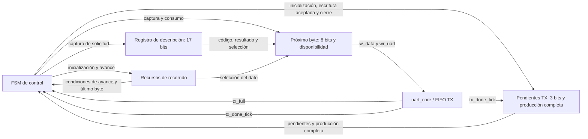
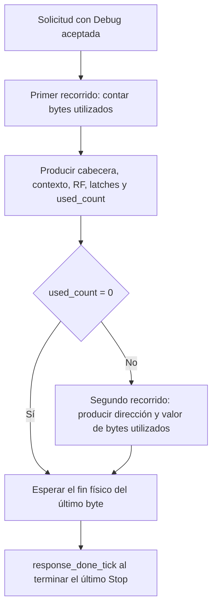
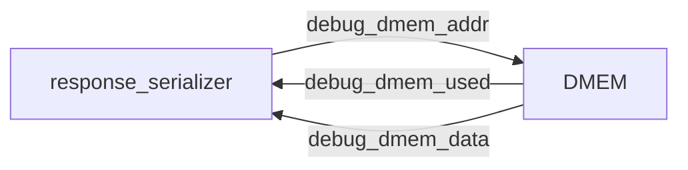
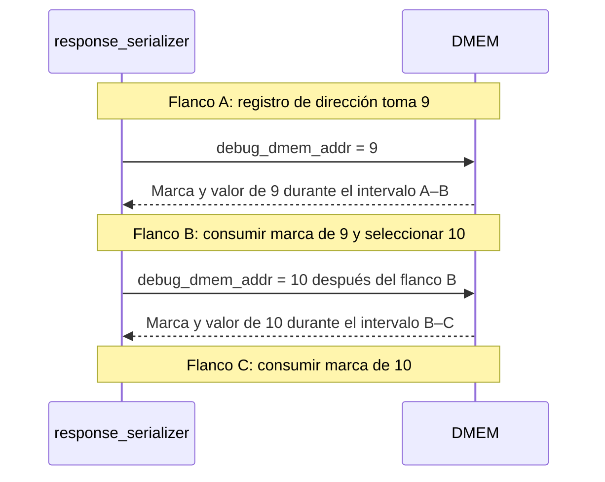
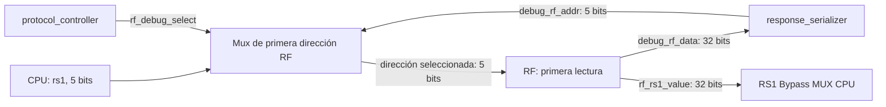
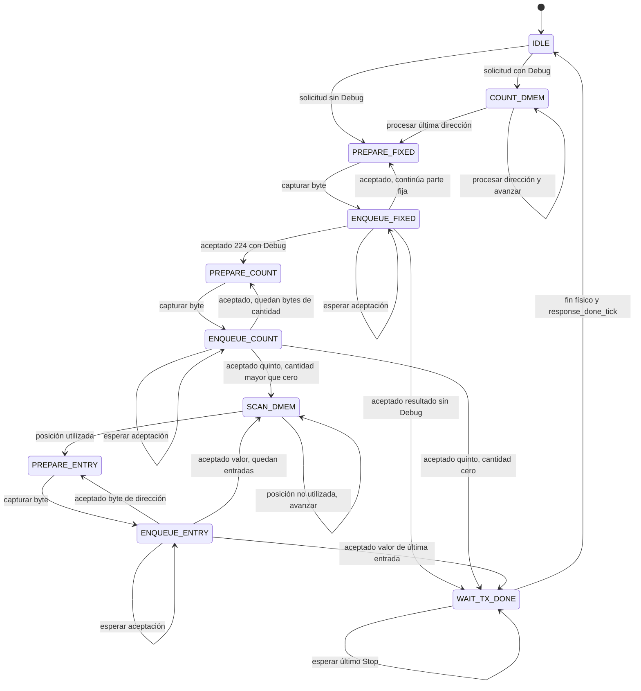

# Serialización de respuestas

- **Tipo:** arquitectura.
- **Estado documental:** especificación vigente.

<a id="función-del-módulo"></a>

## Propósito y alcance

`response_serializer` forma las respuestas del [protocolo](../../protocol.md) y las entrega byte a byte a [uart_core](../uart/uart_core.md). Serializa las cabeceras y, cuando corresponde, el cuerpo Debug a partir del estado retenido.

La [agrupación en módulos](../../decisions/DEC-SYS-007.md#acuerdo-parcial-de-dec-sys-007--módulos-del-control-del-protocolo-y-respuestas) está aprobada. El serializador contiene sus controles, registros y contadores de recorrido y seguimiento. [protocol_controller](protocol_controller.md) conserva la interpretación de solicitudes y la coordinación de operaciones y RX.

Los contratos aprobados se distribuyen por función:

| Función | Contrato aprobado y desarrollo |
|---|---|
| Puertos e intercambio con el controlador | [Acuerdo de solicitud y finalización](../../decisions/DEC-SYS-007.md#acuerdo-parcial-de-dec-sys-007--solicitud-y-finalización-de-respuestas) |
| Organización de control y recursos | El [acuerdo de organización interna](../../decisions/DEC-SYS-007.md#acuerdo-parcial-de-dec-sys-007--organización-interna-del-serializador) fija cinco grupos |
| Conteo y envío de DMEM | El [acuerdo de dos recorridos de DMEM](../../decisions/DEC-SYS-007.md#acuerdo-parcial-de-dec-sys-007--dos-recorridos-de-dmem-para-debug) fija su secuencia |
| Observación y producción | Las conexiones de observación, índices, anchos y selección de bytes de contexto, RF y los cuatro registros interetapa se concretan más abajo |
| Control privado | Los diez estados privados, sus acciones de transición y la generación de señales de acción se concretan en sus tablas aprobadas más abajo |
| Representación global | La [adaptación física global](../session/global_state_encoding.md) utiliza one-hot interno de catorce bits y código combinacional de ocho para Debug |

## Organización

### Organización interna

Los cinco grupos permanecen dentro de `response_serializer`:

| Grupo | Recurso o función |
|---|---|
| FSM de control | Emite las órdenes de captura, avance y envío; conserva el estado registrado. Sus diez estados y transiciones y codificación one-hot están aprobados; la tabla de señales de acción está aprobada más abajo. |
| Registro de descripción | Conserva `response_opcode` de ocho bits, `response_result` de ocho bits y `response_with_debug` de uno: 17 bits capturados al aceptar la solicitud. |
| Registro del próximo byte | Conserva un byte de ocho bits y un indicador de disponibilidad de un bit mientras espera su incorporación a TX. |
| Recursos de recorrido | Incluyen dirección DMEM, `used_count`, índice de byte compartido, contador de entradas completas encoladas e índice de ocho bits para cabecera, contexto, RF y registros interetapa, con sus anchos aprobados. Las conexiones y selección de bytes de contexto, RF y los cuatro registros interetapa están aprobadas; sus controles de captura y consumo están definidos en la tabla de señales de acción. |
| Seguimiento de transmisión | Cuenta bytes encolados cuyo Stop aún no terminó y conserva un indicador de producción completa. El contador recorre cero a cuatro y tiene tres bits; el indicador tiene uno. |



El diagrama presenta la organización de los recursos; las flechas de acción no fijan todavía nombres de enables ni una tabla de controles. La lógica de selección del dato utiliza el descriptor, la posición y la observación Debug. El registro del próximo byte captura el resultado y lo conserva durante espera TX. Los pasos comunes de preparación y encolado se definen a continuación; los diez estados, su codificación y señales de acción se definen más abajo.

La FSM determina qué acción corresponde y la lógica de cada recurso actualiza sus valores al flanco del clock funcional, conforme al [criterio de diseño del TP2](../../decisions/DEC-SYS-007.md#acuerdo-parcial-de-dec-sys-007--correcciones-de-diseño-de-fsm-del-tp2). La organización no exige un módulo por registro o contador ni introduce una copia completa del snapshot.

## Interfaces y contratos

### Relación con UART y el controlador

`protocol_controller` indica qué respuesta enviar. `response_serializer` forma sus bytes, conserva el byte pendiente mientras `tx_full` está activo y lo incorpora mediante `w_data` y `wr_uart` cuando existe espacio. Solo el serializador produce las escrituras TX de las respuestas.

`tx_done_tick` informa el fin físico de cada byte. El serializador sigue esos eventos en orden y comunica al controlador el final de la respuesta completa. La finalización no se acredita al encolar su último byte.

La ocupación del serializador no autoriza ni detiene ciclos CPU por sí misma. Las respuestas breves durante `RUN` respetan su ejecución continua; la exclusión Debug corresponde a la coordinación del controlador y comienza desde el instante observado, incluso si todavía se espera a que termine una respuesta anterior.

### Comunicación con el controlador

Se utiliza una solicitud de una respuesta completa, con código, resultado y selección de cuerpo Debug, y dos indicadores de retorno:

| Dirección respecto del serializador | Señal | Ancho | Significado |
|---|---|---|---|
| Entrada | `response_start` | 1 | Pulso de un clock para solicitar una respuesta cuando el serializador está libre. |
| Entrada | `response_opcode` | 8 | Primer byte de la respuesta; reproduce el código recibido, incluido un código desconocido. |
| Entrada | `response_result` | 8 | Segundo byte, según la tabla de resultados del protocolo. |
| Entrada | `response_with_debug` | 1 | Agrega el cuerpo Debug después de la cabecera. |
| Salida | `response_busy` | 1 | Respuesta en curso desde su aceptación hasta el fin físico del último byte. |
| Salida | `response_done_tick` | 1 | Evento de un clock que comunica el fin físico de la respuesta completa. |

Fuera de reset, `response_start` se acepta al flanco con `response_busy` en cero. Los tres campos deben estar estables para ese flanco y se capturan en registros internos; posteriormente pueden cambiar en el controlador sin alterar el mensaje en curso. Durante reset no se acepta una solicitud.

`response_with_debug` vale uno para `STEP` realizado y `RUN` terminal. Las demás respuestas utilizan solo los dos bytes de cabecera, incluidos `STEP` y `RUN` rechazados y `RUN` / `ACCEPTED`. La selección describe los formatos existentes y no agrega un byte al enlace UART.

`response_busy` permanece activo durante la producción, las esperas por espacio y la salida física de los bytes ya encolados. `response_done_tick` se consume al flanco que completa el Stop del último byte, manteniendo la referencia temporal aprobada para `LOAD`, `RESET` y la liberación Debug. Después de ese flanco `response_busy` vuelve a cero. Una nueva solicitud se acepta en un flanco posterior con el serializador libre.

El contador de pendientes y el indicador de producción completa identifican ese último byte, conforme al seguimiento descrito más abajo. La tabla de transiciones define sus estados y acciones; la tabla de señales de acción define la generación funcional de los controles.

`response_done_tick` comunica una única finalización por respuesta. El evento se presenta para el mismo flanco de consumo que `tx_done_tick` del último byte, sin un registro adicional que desplace ese hito. Durante reset se suprimen aceptación y finalización y `response_busy` queda inactivo. Un reset físico que aborta el envío no produce una finalización normal. La generación de reset global después de la aceptación UART está definida en el [controlador](protocol_controller.md) y el [acondicionamiento de reset](../platform/reset_integration.md).

El controlador solicita otra respuesta cuando el serializador está libre. El [registro de respuesta pendiente del controlador](protocol_controller.md#registro-de-respuesta-pendiente) conserva un descriptor de 17 bits y disponibilidad de uno hasta entregarlo; consume disponibilidad en el mismo flanco en que el serializador captura la solicitud. Las prioridades y órdenes del [controlador](protocol_controller.md) están aprobadas y comprobadas en el cierre UART. El serializador atiende una respuesta por vez y no necesita una cola de respuestas para este intercambio.

```mermaid
sequenceDiagram
    participant CTRL as protocol_controller
    participant SER as response_serializer
    participant UART as uart_core
    SER-->>CTRL: response_busy = 0
    CTRL->>SER: response_start y campos estables
    Note over CTRL,SER: Flanco de aceptación; capturar campos
    SER-->>CTRL: response_busy = 1
    loop Bytes de cabecera y cuerpo, si corresponde
        SER->>UART: w_data y wr_uart cuando hay espacio
        UART-->>SER: tx_done_tick al terminar cada Stop
        Note over CTRL,UART: CTRL continúa consumiendo o descartando RX según la fase
    end
    Note over SER,UART: Flanco de fin físico del último byte
    SER-->>CTRL: response_done_tick
    SER-->>CTRL: response_busy = 0 después del flanco
```

El diagrama resume producción y finalización; no exige esperar el fin de cada byte antes de encolar el siguiente. Los bytes se pueden producir usando los lugares disponibles de la FIFO TX mientras el transmisor avanza.

#### Coordinación desde recursos existentes

El [acuerdo de coordinación](protocol_controller.md#coordinación-derivada-del-estado-y-marcas-existentes), aprobado el 2026-10-05, elimina el registro de clases propuesto en el controlador y la posterior propuesta de salida `response_debug_active`. Los estados y marcas existentes del controlador permiten distinguir finalización breve y Debug, también en `RECOVER`. Se conservan `response_busy` y `response_done_tick` ya aprobados, sin otro puerto ni registro. El descriptor, diez estados, codificación y señales del serializador mantienen sus acuerdos existentes.

## Comportamiento

### Preparación y encolado comunes de cada byte

El [acuerdo de preparación y encolado](../../decisions/DEC-SYS-007.md#acuerdo-parcial-de-dec-sys-007--preparación-y-encolado-comunes-de-cada-byte) fija dos pasos sucesivos de control para todos los bytes de una respuesta: cabecera, contexto, RF, registros interetapa, `used_count` y entradas DMEM. Utilizan el recurso de próximo byte de ocho bits y su indicador de disponibilidad ya aprobados.

| Paso | Acción al flanco | Recorrido y seguimiento |
|---|---|---|
| Preparar | Capturar el byte seleccionado para la posición actual y activar disponibilidad. No escribir TX. | No avanzar índices ni dirección, no incrementar pendientes TX ni cerrar producción. |
| Encolar con `tx_full` activo | Conservar byte y disponibilidad, sin escritura TX ni nueva captura. | Conservar posición y dirección de la entrada. El seguimiento físico sigue atendiendo `tx_done_tick`. |
| Encolar con byte disponible y `tx_full` en cero | Presentar el byte registrado como `w_data` y solicitar `wr_uart`; al aceptar, consumir disponibilidad. | Aplicar el avance o cierre correspondiente al byte aceptado y actualizar pendientes TX conforme a la regla aprobada. |

Las condiciones se evalúan con valores previos al flanco. El paso de preparación consume la selección combinacional de la posición actual; el registro entrega ese dato durante el paso de encolado posterior. Se mantienen separados en flancos distintos. La preparación puede realizarse aun con FIFO llena, ya que el recurso conserva el byte mientras espera. No se prepara el siguiente byte hasta consumir el actual.

La escritura se solicita durante el paso de encolado, fuera de reset, con disponibilidad activa y `tx_full` en cero. La aceptación es `wr_uart` && !`tx_full` con las señales preflanco, conforme al contrato FIFO. Si `tx_full` está activo y termina físicamente otro byte en el mismo flanco, no se adelanta esa escritura: el lugar liberado se utiliza en un flanco posterior.

Una escritura aceptada desactiva disponibilidad. Los bits del byte pueden conservarse, pero no autorizan otra escritura hasta una nueva preparación. Reset y la aceptación de una nueva respuesta dejan disponibilidad inactiva; reset también aborta la operación según el contrato global, sin finalización normal.

Después de consumir el byte se vuelve a preparar la siguiente posición cuando corresponde, o se pasa al recorrido/consulta o espera final correspondiente. El primer conteo DMEM y el salto de posiciones no utilizadas son acciones de recorrido y no generan bytes. Los límites de secciones, cierre de `used_count` y fin de lista conservan sus reglas aprobadas; este mecanismo no cambia esas condiciones.

Mientras se prepara o espera espacio, `tx_done_tick` sigue actualizando el contador de pendientes físicos. Solo la aceptación del último byte activa producción completa. Después se espera su último Stop, manteniendo `response_busy`; preparar o encolar un byte no equivale a terminar físicamente su transmisión. `protocol_controller` conserva su atención o descarte RX, independientemente de esta espera TX.

Los dos pasos quedan aprobados como mecanismo común. Su distribución entre los diez estados privados se define más abajo; los nombres y tabla de señales de acción se definen más abajo. Este acuerdo no acredita implementación ni medición de latencias RTL.

### Seguimiento de transmisión

El contador de pendientes sigue los bytes encolados cuyo Stop aún no terminó:

| Eventos en el mismo flanco | Efecto sobre pendientes |
|---|---|
| Escritura aceptada en FIFO TX, con `wr_uart` activo y `tx_full` en cero | Aumenta en uno |
| `tx_done_tick` | Disminuye en uno |
| Ambos eventos | Conserva su valor |

Las condiciones utilizan las señales previas al flanco, como la [FIFO](../uart/uart_fifo.md#solicitudes-y-operaciones-aceptadas). La cuenta se inicializa en cero al reset y al aceptar una nueva respuesta.

La cota de cuatro incluye el byte en transmisión: `uart_core` conserva el primer elemento de FIFO hasta el flanco final de Stop. El registro del próximo byte no forma parte de esa cuenta mientras todavía no se haya incorporado a la FIFO. Solo `response_serializer` escribe TX, y la siguiente respuesta se acepta después del fin físico de la anterior; por eso comienza sin bytes TX de otro mensaje pendientes.

El indicador de producción completa se inicializa en cero para cada respuesta y se activa cuando su último byte se incorpora a TX. Obtener ese byte en el registro de producción todavía no cierra el mensaje. La cuenta puede llegar a cero entre bytes mientras la producción continúa, y esa condición no informa por sí sola el fin de respuesta.

Fuera de reset, el último Stop se reconoce cuando coinciden estas condiciones:

- respuesta en curso;
- producción completa;
- un único byte pendiente previo al flanco;
- `tx_done_tick` activo.

Ese flanco consume `response_done_tick`, lleva la cuenta a cero y deja libre el serializador. La tabla de transiciones define la actualización del contador, el indicador y el estado; la generación funcional de sus señales está definida más abajo.

### Recorrido de DMEM y orden de producción

El [acuerdo de dos recorridos](../../decisions/DEC-SYS-007.md#acuerdo-parcial-de-dec-sys-007--dos-recorridos-de-dmem-para-debug) establece la siguiente secuencia para las respuestas con Debug:

1. Recorrer todas las direcciones de byte de DMEM y contar las utilizadas según sus metadatos de escritura en la sesión. Los bytes escritos con valor cero también incrementan `used_count`; una dirección sobrescrita aporta una sola entrada.
2. Producir la cabecera y la parte fija del cuerpo: contexto, RF, registros interetapa y `used_count` calculado, en el orden del protocolo. La cantidad se transmite en cinco bytes little-endian.
3. Volver a recorrer DMEM desde la dirección cero en orden creciente. Por cada byte utilizado, producir su dirección de cuatro bytes little-endian y su valor actual de un byte; omitir las posiciones no utilizadas.

Si `used_count` es cero, sus cinco bytes son cero y no se produce una lista ni se requiere el segundo recorrido. Las respuestas sin Debug conservan únicamente los dos bytes de cabecera y no recorren DMEM.



El diagrama presenta fases de producción, no estados ni codificación de FSM. Los bytes producidos se incorporan a TX según el espacio disponible; el segundo recorrido no exige que toda la parte fija haya terminado físicamente antes de comenzar a producir la lista.

La secuencia responde a que `used_count` precede a las entradas en el protocolo. El serializador obtiene la cantidad antes de producir el mensaje y luego lee los valores directamente, sin conservar una copia completa de la lista. Los metadatos y los datos observados permanecen estables desde el instante posterior al ciclo CPU hasta el último Stop, bajo la exclusión Debug ya aprobada. UART y la atención o descarte RX continúan activos durante el conteo y el envío.

Las señales de consulta de metadatos y datos y su lectura combinacional entre flancos se describen a continuación. Los controles concretos de avance y captura están definidos en la tabla de señales de acción de este documento. La organización y los anchos de los recursos de DMEM se describen en las secciones siguientes. El contrato temporal de diseño no acredita timing físico ni valida los plazos del serializador mediante RTL.

#### Señales de consulta de DMEM

El [acuerdo de consulta](../../decisions/DEC-SYS-007.md#acuerdo-parcial-de-dec-sys-007--señales-de-consulta-debug-de-dmem) fija tres señales entre `response_serializer` y DMEM:

| Señal | Dirección respecto del serializador | Ancho | Función |
|---|---|---|---|
| `debug_dmem_addr` | Salida hacia DMEM | max(1, ceil(log2(C))) | Dirección de byte seleccionada por el registro de recorrido, para capacidad C de DMEM. |
| `debug_dmem_data` | Entrada desde DMEM | 8 | Valor del byte en la dirección seleccionada. |
| `debug_dmem_used` | Entrada desde DMEM | 1 | Uno si el byte fue escrito por un store comprometido en la sesión actual; cero si no fue utilizado. |

La dirección tiene 11 bits en `REFERENCE` y diez en `ALT_1000`. Datos y metadatos corresponden a la misma posición. El indicador proviene de los metadatos de DMEM ya existentes y conserva el criterio de utilización aprobado, incluidos los valores cero escritos por el programa.

En el primer recorrido, el serializador utiliza únicamente `debug_dmem_used` para contar. En el segundo, si ese indicador vale cero, salta la posición e ignora su valor; si vale uno, produce la entrada dirección/valor y utiliza `debug_dmem_data` para su quinto byte. La conexión de datos permite producir las posiciones utilizadas y no obliga a consumir datos de las restantes.



Las señales operan bajo la lectura directa del estado retenido y la exclusión de CPU y mantenimiento ya aprobadas. El [selector de lectura CPU/Debug](../memory/memory_architecture.md#selector-de-dirección-de-lectura-cpudebug) está aprobado dentro de DMEM: `protocol_controller` presenta `dmem_debug_select`, seleccionando la dirección de recorrido durante la ventana exclusiva. El serializador consume sus retornos solo con acceso Debug seleccionado.

Los controles de consulta del serializador están definidos más abajo. La generación del selector está aprobada en el controlador y las órdenes de mantenimiento en preparación. El cableado del backend está definido en [acceso DMEM](../memory/dmem_access.md) y [Composición](../system_composition.md).

La lectura temporal se define a continuación. RF, contexto y registros interetapa tienen sus contratos vigentes en [Recorrido de cabecera, contexto, RF y latches](#recorrido-de-cabecera-contexto-rf-y-latches).

#### Lectura de DMEM entre flancos

El [acuerdo de lectura temporal](../../decisions/DEC-SYS-007.md#acuerdo-parcial-de-dec-sys-007--lectura-debug-de-dmem-entre-flancos) establece `debug_dmem_data` y `debug_dmem_used` como salidas combinacionales de la dirección seleccionada y del estado retenido de DMEM. El registro de recorrido mantiene esa dirección entre flancos del clock funcional común; la memoria presenta durante ese intervalo la información de la posición seleccionada.

Cuando la FSM consume una consulta al flanco siguiente, utiliza la información correspondiente a la dirección previa al flanco. Si ese mismo flanco actualiza el registro a otra dirección, las salidas pasan después a reflejar la nueva posición. La información de esa nueva dirección no se utiliza para el procesamiento del flanco que la seleccionó.

Durante el primer recorrido, una vez inicializada la dirección en cero y activa la fase de conteo, se procesa una posición por ciclo: se incrementa `used_count` si la marca previa al flanco vale uno y se selecciona la siguiente posición, o se cierra al procesar C − 1. El resultado incluye la última marca, como en el cierre aprobado.



Las flechas representan propagación de señales internas, sin transacciones UART ni handshake de lectura. En el listado se utiliza la misma consulta combinacional: una posición no utilizada se omite al consumir su marca; una utilizada conserva la dirección durante la producción de sus cinco bytes y las esperas TX aprobadas. El valor se consume al preparar el quinto byte de la entrada.

La consulta no agrega un registro de respuesta de DMEM. El próximo byte del serializador conserva su función de captura y espera TX. Los estados y acciones de consumo, captura y avance se definen en la FSM más abajo; los nombres y generación de enables se definen en la tabla de señales de acción. Cumplir el intervalo de lectura al clock objetivo requiere verificación posterior de implementación y timing; este acuerdo es documental.

#### Cierre del primer recorrido

El [acuerdo de cierre del conteo](../../decisions/DEC-SYS-007.md#acuerdo-parcial-de-dec-sys-007--cierre-del-primer-recorrido-dmem) fija la última dirección como C − 1, para capacidad C en bytes. El primer recorrido comienza en cero y procesa cada posición una vez, en orden creciente.

Al procesar una dirección, se consultan sus metadatos y se incrementa `used_count` si está utilizada. Si la dirección es menor que C − 1, se avanza a la siguiente; si es igual a C − 1, se termina el conteo sin incrementar la dirección. La última posición participa del conteo con la misma regla que las anteriores.

El incremento correspondiente a la última posición y el cierre pueden consumirse en el mismo flanco: la parte fija posterior utiliza el total registrado después de incluirla. Por ejemplo, al procesar una última posición utilizada con cuenta previa de diez, el resultado del recorrido es once.

`REFERENCE` termina después de revisar la dirección 2047 y `ALT_1000` después de revisar la 999. El cierre se obtiene por comparación explícita con C − 1 y no depende del desbordamiento del registro de dirección. Este criterio conserva capacidades no potencia de dos y no requiere representar C dentro de dicho registro.

Las señales y su lectura entre flancos están definidas más arriba. Durante conteo se procesa una posición por ciclo activo, utilizando su marca previa al flanco; los estados, acciones y señales de control se definen más abajo. La secuencia temporal no acredita timing de implementación.

#### Recursos de dirección y cantidad

El [acuerdo de recursos](../../decisions/DEC-SYS-007.md#acuerdo-parcial-de-dec-sys-007--registros-de-dirección-y-cantidad-del-recorrido-dmem) fija dos recursos internos del serializador:

| Recurso | Función y uso |
|---|---|
| Registro de dirección de DMEM | Conserva la dirección del byte que se examina. Se utiliza en ambos recorridos, comenzando en cero y volviendo a cero antes del segundo. |
| Contador `used_count` | Comienza en cero y aumenta por cada byte utilizado durante el primer recorrido. Conserva el resultado después del conteo, durante la producción de la cantidad y de la lista. |

La reutilización del registro de dirección permite realizar ambos recorridos sucesivos con un mismo recurso. El contador conserva la cantidad mientras el registro de dirección vuelve a recorrer DMEM; ambos valores cumplen funciones distintas y se almacenan por separado.

Los recursos pertenecen al grupo de recorrido ya aprobado y se actualizan por acciones de la FSM. Sus controles concretos están definidos en [señales de acción](#señales-de-acción-de-la-fsm); la nomenclatura/agrupación HDL final pertenece a la composición de tops. El índice compartido de cantidad y entradas dirección/valor está definido en [Índice de byte](#índice-de-byte-de-cantidad-y-entradas-dmem).

#### Anchos de dirección y cantidad

El [acuerdo de anchos](../../decisions/DEC-SYS-007.md#acuerdo-parcial-de-dec-sys-007--anchos-de-dirección-y-cantidad-del-recorrido-dmem) dimensiona ambos recursos según la capacidad en bytes de DMEM, denominada C en esta sección:

| Recurso | Rango requerido | Ancho en bits |
|---|---|---|
| Dirección de recorrido | 0 a C − 1 | max(1, ceil(log2(C))) |
| Contador `used_count` | 0 a C inclusive | max(1, ceil(log2(C + 1))) |

En los [perfiles definidos](../memory/memory_architecture.md#perfiles-definidos), esos anchos son:

| Perfil | Capacidad DMEM | Dirección | `used_count` |
|---|---:|---:|---:|
| `REFERENCE` | 2048 bytes | 11 bits | 12 bits |
| `ALT_1000` | 1000 bytes | 10 bits | 10 bits |

Los valores de `ALT_1000` se derivan de la misma regla de dimensionamiento. El contador debe representar todos los bytes utilizados, mientras que la dirección solo representa la última posición, C − 1. El dominio de capacidad y el mínimo de un bit conservan la parametrización de memoria aprobada.

Estos anchos internos no cambian el protocolo: las direcciones se representan en cuatro bytes y `used_count` en cinco, little-endian. Cuando el recurso interno tiene menos bits que el campo externo, se completa su parte superior con ceros. El índice de byte se describe a continuación; los controles para producir esos campos se definen en la tabla de señales de acción.

#### Índice de byte de cantidad y entradas DMEM

El [acuerdo de índice compartido](../../decisions/DEC-SYS-007.md#acuerdo-parcial-de-dec-sys-007--índice-de-byte-compartido-para-cantidad-y-entradas-dmem) fija un recurso de tres bits que identifica posiciones de cero a cuatro. Se reutiliza para producir los cinco bytes de `used_count` y los cinco bytes de cada entrada dirección/valor. Al comenzar la cantidad o una nueva entrada, el índice vuelve a cero.

| Índice | Durante `used_count`, extendido a 40 bits | Durante una entrada, con dirección extendida a 32 bits |
|---:|---|---|
| 0 | Cantidad [7:0] | Dirección [7:0] |
| 1 | Cantidad [15:8] | Dirección [15:8] |
| 2 | Cantidad [23:16] | Dirección [23:16] |
| 3 | Cantidad [31:24] | Dirección [31:24] |
| 4 | Cantidad [39:32] | Valor actual del byte de DMEM |

La fase de producción determina cómo interpretar el índice. La dirección de recorrido identifica la posición de DMEM; el índice de byte identifica la parte del campo o entrada que toca producir. Ambos se conservan en recursos distintos, dentro del grupo de recorrido.

Tres bits permiten representar las cinco posiciones necesarias; dos solo representan cero a tres. La cantidad y las entradas se producen sucesivamente, por lo que comparten este recurso. La política de avance se describe a continuación; las señales de acción se definen más abajo y el nombre HDL final se concreta junto con la agrupación RTL, sin una nueva decisión funcional. El índice de las demás secciones y los estados privados se definen más abajo.

#### Avance durante producción y espera TX

El [acuerdo de avance](../../decisions/DEC-SYS-007.md#acuerdo-parcial-de-dec-sys-007--avance-del-recorrido-dmem-por-escritura-tx-aceptada) fija la incorporación del byte a la FIFO TX como evento de avance. La escritura se acepta al flanco con `wr_uart` activo y `tx_full` en cero, según los flags previos al flanco.

| Situación | Acción sobre byte e índice | Acción sobre dirección de DMEM |
|---|---|---|
| Byte preparado sin escritura TX aceptada, incluida FIFO llena | Conservar byte, disponibilidad e índice | Conservar la dirección de la entrada en producción |
| Escritura aceptada de posición cero a tres | Consumir el byte preparado y avanzar al siguiente índice | Conservar la dirección durante la entrada |
| Escritura aceptada de posición cuatro de `used_count` | Consumir el byte y completar la cantidad | Continuar según lista vacía o segundo recorrido ya aprobados |
| Escritura aceptada de posición cuatro de una entrada | Consumir el valor y completar el encolado de la entrada | Habilitar el avance a la siguiente dirección si el recorrido continúa; la próxima entrada comienza con índice cero |
| Posición de DMEM no utilizada durante búsqueda | No producir bytes ni solicitar escritura TX por esa posición | Saltarla y continuar el recorrido según su condición de cierre |

Obtener o capturar el próximo byte todavía no adelanta el índice. Una entrada mantiene la misma dirección durante sus cuatro bytes de dirección y el byte de valor. El contador `used_count` conserva el total calculado durante este proceso.

El avance por encolado utiliza la FIFO mientras UART transmite en paralelo. El seguimiento TX conserva el fin físico por `tx_done_tick` y la respuesta permanece ocupada hasta el Stop final. La atención o descarte RX sigue activa durante espera TX, bajo la coordinación del controlador.

El cierre de la lista y el reconocimiento de su último byte se concretan a continuación. El cierre del primer recorrido está definido más arriba; los estados y acciones de captura, consumo y avance se definen más abajo. Preparar y encolar ocupan flancos distintos según el mecanismo común; su tabla de generación de señales está aprobada más abajo y no se acredita validación RTL.

#### Entradas completas encoladas y último byte de la lista

El [acuerdo de contador de entradas](../../decisions/DEC-SYS-007.md#acuerdo-parcial-de-dec-sys-007--contador-de-entradas-dmem-encoladas-y-cierre-de-lista) agrega un recurso al grupo de recorrido. Conserva la cantidad acumulada de entradas completas incorporadas a FIFO TX durante la lista y comienza en cero al iniciarla.

El contador aumenta únicamente al aceptar el valor de una entrada, en posición cuatro del índice de byte, con `wr_uart` activo y `tx_full` en cero previos al flanco. Los cuatro bytes de dirección, la cabecera, las otras secciones y los bytes de `used_count` no incrementan esa cuenta. La espera TX y los eventos `tx_done_tick` tampoco la modifican.

`used_count` conserva el total esperado. Cuando la aceptación del valor de una entrada lleva la cuenta a ese total, esa entrada es la última: el mismo flanco activa producción completa y termina el segundo recorrido. Para identificarla se utiliza la cuenta previa al flanco y la aceptación que la incrementará, sin esperar otro flanco para reconocer el resultado registrado. La dirección deja de avanzar y no se requieren consultas posteriores a esa última entrada.

Si `used_count` vale cero, la lista se omite y producción completa se activa al aceptar el quinto byte de la cantidad. En ambos casos `response_busy` permanece activo hasta el fin físico aprobado, con producción completa, un único byte TX pendiente y `tx_done_tick` del último Stop.

El contador de entradas es acumulativo durante la lista, con rango de cero a `used_count` inclusive. El contador de pendientes TX conserva su función de contar bytes que aún no terminaron físicamente, aumentando por escritura aceptada y disminuyendo por `tx_done_tick`. Los dos recursos pertenecen a grupos y funciones distintos.

El [acuerdo de ancho del contador de entradas](../../decisions/DEC-SYS-007.md#acuerdo-parcial-de-dec-sys-007--ancho-del-contador-de-entradas-dmem-encoladas) fija el mismo dimensionamiento que `used_count`: max(1, ceil(log2(C + 1))) bits para capacidad C de DMEM. En `REFERENCE` tiene 12 bits para representar cero a 2048; en `ALT_1000` tiene diez para representar cero a 1000. Ambos contadores pueden alcanzar el total de posiciones utilizadas, aunque conservan total esperado y progreso en recursos separados. El contador de entradas no agrega un campo al protocolo.

Los controles concretos están definidos en [señales de acción](#señales-de-acción-de-la-fsm); su nombre HDL final corresponde a la agrupación RTL. El cierre del primer recorrido por direcciones está definido en el acuerdo de conteo.

### Recorrido de cabecera, contexto, RF y latches

El [acuerdo de índice de recorrido](../../decisions/DEC-SYS-007.md#acuerdo-parcial-de-dec-sys-007--índice-de-recorrido-de-cabecera-contexto-rf-y-latches) fija `fixed_byte_index` de ocho bits, con posiciones cero a 224, dentro del grupo de recursos de recorrido. Identifica los 225 bytes anteriores a `used_count` en una respuesta con Debug, conforme al layout del protocolo.

| Parte | Posiciones de `fixed_byte_index` | Bytes |
|---|---|---:|
| Código de operación | 0 | 1 |
| Resultado | 1 | 1 |
| Contexto | 2 a 20 | 19 |
| RF `x0`–x31 | 21 a 148 | 128 |
| `IF/ID` | 149 a 159 | 11 |
| `ID/EX` | 160 a 189 | 30 |
| `EX/MEM` | 190 a 209 | 20 |
| `MEM/WB` | 210 a 224 | 15 |

El índice comienza en cero para cada respuesta. Si esta tiene Debug, se mantiene en cero durante el conteo previo de DMEM y después recorre la tabla. El código y resultado provienen del descriptor capturado; contexto, RF y registros interetapa conservan el orden y la representación aprobados. Las entradas de contexto, la lectura RF y las entradas y selección de bytes de los cuatro registros interetapa están definidas a continuación. Los controles de captura y consumo se definen en la tabla de señales de acción.

El índice avanza cuando el byte de la posición actual se incorpora a FIFO TX, con `wr_uart` activo y `tx_full` en cero previos al flanco. Mientras no se acepta, se conservan índice y byte preparado. Preparar o capturar el byte no adelanta la posición.

| Tipo de respuesta | Última posición de este recorrido | Acción al aceptar ese byte |
|---|---:|---|
| Sin Debug | 1 | Marcar producción completa; esperar el fin físico aprobado del último Stop. |
| Con Debug | 224 | Completar este recorrido y pasar a `used_count` con el índice compartido de tres bits en cero. La producción todavía continúa. |

La última posición se conserva al cerrar su recorrido, sin incrementar `fixed_byte_index` fuera de su rango. Durante `used_count` y la lista DMEM, este índice permanece retenido; esas fases utilizan sus recursos ya aprobados. Ocho bits representan todas las posiciones hasta 224 y sirven también para las cabeceras breves de dos bytes.

Las acciones de inicialización, avance y cierre y los estados de FSM se definen más abajo; nombres y generación de señales se definen en la tabla aprobada. Las entradas de contexto y registros interetapa y la lectura RF se definen a continuación. El índice es un recurso de posición, no un almacenamiento adicional del cuerpo completo.

#### Entradas de observación del contexto

El [acuerdo de entradas de contexto](../../decisions/DEC-SYS-007.md#acuerdo-parcial-de-dec-sys-007--entradas-de-observación-del-contexto) fija seis entradas hacia `response_serializer`. Cada una conecta el valor conservado o derivado por su bloque propietario, bajo la exclusión Debug ya aprobada.

| Entrada del serializador | Ancho en bits | Fuente lógica | Posiciones de `fixed_byte_index` | Bytes UART |
|---|---:|---|---|---:|
| `debug_state_code` | 8 | `global_state_code[7:0]` de `Execution Control` | 2 | 1 |
| `debug_image_valid` | 1 | `loaded_image_size_bytes` != 0 | 3 | 1 |
| `debug_pc` | 32 | Registro PC global | 4 a 7 | 4 |
| `debug_cycle_count` | 64 | `Cycle Counter` | 8 a 15 | 8 |
| `debug_fault_cause` | 3 | Registro global `fault_cause` | 16 | 1 |
| `debug_fault_pc` | 32 | Registro global `fault_pc` | 17 a 20 | 4 |

El contexto ocupa 19 bytes: 1 + 1 + 4 + 8 + 1 + 4. Las posiciones dos a 20 son inclusivas; las dos posiciones anteriores corresponden a la cabecera y RF comienza en 21. `image_valid` y `fault_cause` completan sus respectivos bytes UART con ceros superiores; los campos de varios bytes conservan little-endian, según el protocolo aprobado.

Las conexiones observan el estado retenido directamente, sin agregar una copia completa del contexto. La CPU y la preparación permanecen excluidas desde el instante observado hasta el último Stop. El serializador utiliza estas entradas únicamente al producir contexto de una respuesta con Debug.

Los registros globales de fault se conectan con sus bits actuales incluso cuando no representan un fault vigente; el estado global determina su interpretación, conforme al protocolo. `debug_image_valid` es un predicado combinacional del tamaño de imagen, sin registro adicional.

`Global FSM`, dentro de `Execution Control`, genera `global_state_code[7:0]` combinacionalmente desde el estado one-hot registrado, según la [representación global aprobada](../session/global_state_encoding.md). El serializador recibe ese código externo mediante `debug_state_code[7:0]` y lo utiliza para producir el byte de estado del contexto. La selección de bytes por `fixed_byte_index` se define a continuación; los controles de captura se definen más abajo.

#### Selección de bytes del contexto

El [acuerdo de selección del contexto](../../decisions/DEC-SYS-007.md#acuerdo-parcial-de-dec-sys-007--selección-de-bytes-del-contexto-desde-el-índice-de-recorrido) utiliza `fixed_byte_index` para seleccionar combinacionalmente el campo y el byte, sin agregar un contador de contexto ni un índice interno de byte registrado.

| `fixed_byte_index` | Byte seleccionado, de ocho bits |
|---|---|
| 2 | `debug_state_code[7:0]` |
| 3 | Siete ceros superiores y `debug_image_valid` |
| 4 a 7 | Byte j de `debug_pc`, con j = `fixed_byte_index` − 4 |
| 8 a 15 | Byte j de `debug_cycle_count`, con j = `fixed_byte_index` − 8 |
| 16 | Cinco ceros superiores y `debug_fault_cause[2:0]` |
| 17 a 20 | Byte j de `debug_fault_pc`, con j = `fixed_byte_index` − 17 |

Para cada campo de varios bytes, el byte j corresponde a los bits [8*j + 7 : 8*j]. Así, PC y PC de fault recorren [7:0], [15:8], [23:16] y [31:24]; `cycle_count` recorre ocho slices de ocho bits hasta [63:56]. Las posiciones de byte se derivan combinacionalmente del índice existente y mantienen little-endian. Por ejemplo, PC = 0x12345678 produce 78, 56, 34 y 12 en posiciones cuatro a siete.

Esta selección se consume únicamente durante producción de contexto de una respuesta con Debug. La FSM controla la captura del resultado en el próximo byte; el dato y la posición usados son los previos al flanco. Preparar el byte no adelanta `fixed_byte_index`. Mientras TX no acepta la escritura, se conservan el índice y el próximo byte preparado, conforme a la política aprobada.

Aceptar posición 20 completa el contexto y lleva el recorrido a 21, primer byte de RF. No termina la producción de la respuesta. Los controles de captura y consumo están definidos más abajo; la [adaptación física del código UART](../session/global_state_encoding.md) está aprobada.

#### Lectura RF compartida con Debug

El [acuerdo de mux de primera lectura RF](../../decisions/DEC-SYS-007.md#acuerdo-parcial-de-dec-sys-007--mux-cpudebug-de-la-primera-lectura-rf) reutiliza un puerto combinacional del banco, mediante un multiplexor de números de registro de cinco bits dentro de `Registers`.

| Señal | Dirección respecto del serializador | Ancho | Función |
|---|---|---:|---|
| `debug_rf_addr` | Salida hacia RF | 5 | Selecciona `x0`–x31 para producir su contenido. |
| `debug_rf_data` | Entrada desde RF | 32 | Valor base del registro seleccionado, antes del bypass CPU. |

El mux recibe `Read Register 1` CPU y `debug_rf_addr`. `rf_debug_select` de un bit, generado por `protocol_controller`, selecciona CPU con cero y Debug con uno. La segunda dirección y lectura RF conservan su conexión CPU.



`debug_rf_data` es otra conexión del mismo valor base de la primera lectura y no un tercer puerto de lectura del almacenamiento. El valor se presenta combinacionalmente; el serializador produce sus cuatro bytes little-endian, conforme al protocolo. La dirección seleccionada determina la regla de `x0`: leer el registro cero devuelve cero, independientemente del número CPU que permanezca en la otra entrada del mux.

`rf_debug_select` conserva la misma ventana exclusiva aprobada para Debug: desde el estado posterior al ciclo observado hasta el último Stop, incluida espera por una respuesta previa, y cero durante reset. El ciclo que produce la observación utiliza la dirección CPU antes de cambiar el selector. CPU permanece retenida y RF no recibe escrituras CPU ni preparación durante la observación.

El serializador consume este retorno únicamente con Debug seleccionado y al producir posiciones RF, 21 a 148 de `fixed_byte_index`. La derivación de número de registro y byte se define a continuación. La captura del próximo byte está definida por las acciones de la FSM; el selector se activa desde `debug_hold` del controlador, según la composición aprobada.

#### Derivación de registro y byte RF

El [acuerdo de derivación RF](../../decisions/DEC-SYS-007.md#acuerdo-parcial-de-dec-sys-007--derivación-de-registro-y-byte-rf-desde-el-índice-de-recorrido) utiliza `fixed_byte_index` para obtener combinacionalmente el número de registro y el byte correspondiente durante las posiciones RF, de 21 a 148 inclusive.

Se resta 21 para obtener la posición dentro del bloque de 128 bytes. Su división entera por cuatro identifica el registro de cero a 31; el resto de esa división identifica el byte de cero a tres. Para una posición relativa de siete bits, los bits [6:2] forman `debug_rf_addr[4:0]` y los bits [1:0] forman `rf_byte_select[1:0]`. Estas selecciones son conexiones combinacionales, sin contadores RF adicionales.

| `fixed_byte_index` | Posición dentro de RF | `debug_rf_addr` | `rf_byte_select` |
|---:|---:|---:|---:|
| 21 | 0 | 0 (`x0`) | 0 |
| 22 | 1 | 0 (`x0`) | 1 |
| 23 | 2 | 0 (`x0`) | 2 |
| 24 | 3 | 0 (`x0`) | 3 |
| 25 | 4 | 1 (x1) | 0 |
| 26 | 5 | 1 (x1) | 1 |
| 148 | 127 | 31 (x31) | 3 |

El número alimenta la primera dirección RF compartida. `rf_byte_select` controla una selección combinacional de cuatro bytes, cada uno de ocho bits, a partir de `debug_rf_data`:

| `rf_byte_select` | Byte seleccionado |
|---:|---|
| 0 | `debug_rf_data[7:0]` |
| 1 | `debug_rf_data[15:8]` |
| 2 | `debug_rf_data[23:16]` |
| 3 | `debug_rf_data[31:24]` |

Cada grupo de cuatro posiciones mantiene el mismo registro RF y recorre sus bytes little-endian. El índice avanza por escritura TX aceptada, como en el recorrido aprobado; durante espera se mantienen el registro seleccionado, la selección de byte y el próximo byte preparado.

La derivación se utiliza durante producción de la sección RF. Fuera de esa sección, el serializador no consume `debug_rf_data` y las selecciones combinacionales se presentan en cero como valores neutros. La captura del próximo byte usa los valores de la posición previa al flanco habilitado por la FSM; seleccionar otra posición después del flanco cambia los datos para una captura posterior. Los controles de captura y consumo se definen en la tabla de señales de acción.

#### Entradas de observación de IF/ID

El [acuerdo de entradas IF/ID](../../decisions/DEC-SYS-007.md#acuerdo-parcial-de-dec-sys-007--entradas-de-observación-de-ifid) fija cinco entradas de `response_serializer`, conectadas a las salidas actuales del registro `IF/ID`.

| Entrada del serializador | Ancho en bits | Fuente |
|---|---:|---|
| `debug_ifid_valid` | 1 | `IF/ID.valid` |
| `debug_ifid_pc` | 32 | `IF/ID.pc` |
| `debug_ifid_instruction` | 32 | `IF/ID.instruction` |
| `debug_ifid_fetch_fault_valid` | 1 | `IF/ID.fetch_fault_valid` |
| `debug_ifid_fetch_fault_cause` | 3 | `IF/ID.fetch_fault_cause` |

Las conexiones llevan los 69 bits funcionales existentes, sin agregar una copia del registro interetapa. Se observa el estado registrado actual, no las entradas de captura ni `next.valid`. La exclusión Debug mantiene esos campos estables desde el instante observado hasta el último Stop, incluida espera por una respuesta previa.

El serializador utiliza las entradas al producir la sección `IF/ID` de una respuesta con Debug, posiciones 149 a 159 de `fixed_byte_index`. Sus cinco campos ocupan 11 bytes UART con el orden y padding ya aprobados en el protocolo. Se transmiten los bits actuales aun con flags inactivos; valid identifica la instrucción activa y `fetch_fault_valid` habilita el candidato de búsqueda, distinto del fault global confirmado.

Este acuerdo fija las conexiones y su contrato de observación. La selección de sus 11 bytes y las conexiones y selección de los otros tres registros interetapa están definidas en [Observación de los cuatro latches](#observación-y-selección-de-bytes-de-los-cuatro-latches); los controles de captura y consumo se definen más abajo.

#### Observación y selección de bytes de los cuatro latches

El [acuerdo conjunto de latches](../../decisions/DEC-SYS-007.md#acuerdo-parcial-de-dec-sys-007--observación-y-selección-de-bytes-de-los-cuatro-latches) aplica a `IF/ID`, `ID/EX`, `EX/MEM` y `MEM/WB` el mismo criterio aprobado para contexto: entradas directas desde sus campos registrados actuales y selección combinacional de campo y byte mediante `fixed_byte_index`. No se agregan copias de los registros interetapa ni contadores de recorrido por registro interetapa.

Todas las señales de las tablas son entradas del serializador. Cada `debug_<latch>_<campo>` conecta la salida actual del campo correspondiente de ese registro interetapa, con el ancho funcional indicado. Se observan los valores registrados, incluidos operandos base de `ID/EX` y resultados consolidados de `EX/MEM` y `MEM/WB`, sin sustituirlos por resultados combinacionales posteriores ni entradas de captura.

##### IF/ID

| Entrada del serializador | Ancho en bits | Posiciones de `fixed_byte_index` |
|---|---:|---|
| `debug_ifid_valid` | 1 | 149 |
| `debug_ifid_pc` | 32 | 150 a 153 |
| `debug_ifid_instruction` | 32 | 154 a 157 |
| `debug_ifid_fetch_fault_valid` | 1 | 158 |
| `debug_ifid_fetch_fault_cause` | 3 | 159 |

5 campos, 69 bits funcionales y 11 bytes UART.

##### ID/EX

| Entrada del serializador | Ancho en bits | Posiciones de `fixed_byte_index` |
|---|---:|---|
| `debug_idex_valid` | 1 | 160 |
| `debug_idex_pc` | 32 | 161 a 164 |
| `debug_idex_instruction` | 32 | 165 a 168 |
| `debug_idex_rs1` | 5 | 169 |
| `debug_idex_rs2` | 5 | 170 |
| `debug_idex_rd` | 5 | 171 |
| `debug_idex_rs1_value` | 32 | 172 a 175 |
| `debug_idex_rs2_value` | 32 | 176 a 179 |
| `debug_idex_immediate` | 32 | 180 a 183 |
| `debug_idex_alu_op` | 6 | 184 |
| `debug_idex_alu_src` | 1 | 185 |
| `debug_idex_result_sel` | 2 | 186 |
| `debug_idex_flow_op` | 3 | 187 |
| `debug_idex_mem_op` | 4 | 188 |
| `debug_idex_reg_write` | 1 | 189 |

15 campos, 193 bits funcionales y 30 bytes UART.

##### EX/MEM

| Entrada del serializador | Ancho en bits | Posiciones de `fixed_byte_index` |
|---|---:|---|
| `debug_exmem_valid` | 1 | 190 |
| `debug_exmem_pc` | 32 | 191 a 194 |
| `debug_exmem_instruction` | 32 | 195 a 198 |
| `debug_exmem_rd` | 5 | 199 |
| `debug_exmem_reg_write` | 1 | 200 |
| `debug_exmem_mem_op` | 4 | 201 |
| `debug_exmem_ex_result` | 32 | 202 a 205 |
| `debug_exmem_store_data` | 32 | 206 a 209 |

8 campos, 139 bits funcionales y 20 bytes UART.

##### MEM/WB

| Entrada del serializador | Ancho en bits | Posiciones de `fixed_byte_index` |
|---|---:|---|
| `debug_memwb_valid` | 1 | 210 |
| `debug_memwb_pc` | 32 | 211 a 214 |
| `debug_memwb_instruction` | 32 | 215 a 218 |
| `debug_memwb_rd` | 5 | 219 |
| `debug_memwb_reg_write` | 1 | 220 |
| `debug_memwb_wb_value` | 32 | 221 a 224 |

6 campos, 103 bits funcionales y 15 bytes UART.

##### Regla común de selección y avance

Los campos de hasta ocho bits ocupan un byte con ceros superiores hasta completar ocho bits; sus códigos registrados conservan la representación del protocolo. Para un campo de 32 bits que empieza en posición s, j = `fixed_byte_index` − s selecciona los bits [8*j + 7 : 8*j], con j de cero a tres. Esta derivación es combinacional y produce los bytes little-endian [7:0], [15:8], [23:16] y [31:24]. Las tablas fijan el inicio de cada campo, sin bytes adicionales de identificación de registro interetapa o campo.

La selección se consume únicamente durante producción de la sección correspondiente de una respuesta con Debug. La exclusión mantiene todos los campos retenidos hasta el último Stop, incluida espera por una respuesta previa. Se transmiten también los bits actuales de campos inactivos: valid determina la interpretación de la instrucción y `fetch_fault_valid` determina por separado la del candidato de búsqueda `IF/ID`. No se reemplazan esos bits residuales por ceros; el padding superior de los campos pequeños sí es cero.

El resultado se captura en el recurso de próximo byte bajo control de la FSM, utilizando índice y datos previos al flanco. Capturar o preparar no adelanta el recorrido. El índice avanza únicamente por escritura TX aceptada y conserva la posición junto con el byte preparado durante espera. Los controles de captura y consumo se definen en la tabla de señales de acción.

| Última posición de sección | Acción al aceptar ese byte |
|---:|---|
| 159, `IF/ID` | Pasar a 160, inicio de `ID/EX`. |
| 189, `ID/EX` | Pasar a 190, inicio de `EX/MEM`. |
| 209, `EX/MEM` | Pasar a 210, inicio de `MEM/WB`. |
| 224, `MEM/WB` | Retener `fixed_byte_index` y pasar a `used_count` con su índice compartido en cero, conforme al cierre aprobado. |

Estas transiciones no marcan producción completa: aún falta `used_count` y, si la cantidad es mayor que cero, la lista DMEM. Los estados y acciones de transición se definen a continuación; su codificación y tabla de señales de acción están aprobadas en las secciones siguientes.

### Señales de acción de la FSM

El [acuerdo de señales de acción](../../decisions/DEC-SYS-007.md#acuerdo-parcial-de-dec-sys-007--señales-de-acción-de-la-fsm-del-serializador) aprueba el 2026-10-03 los nombres y generación de controles para las acciones y transiciones de la FSM, después de revisar su conformidad con los lineamientos docentes. Se utilizan los recursos existentes sin cambiar el protocolo.

Todas las órdenes de la primera tabla son señales combinacionales de un bit. Se evalúan antes del flanco y habilitan la actualización síncrona del recurso correspondiente. Fuera de sus condiciones valen cero; reset las suprime y tiene prioridad en los recursos. La FSM conserva estado registrado one-hot y decisiones con `casez` y comodines `?` conforme al criterio aprobado.

#### Órdenes sobre los recursos

| Señal | Recurso y acción al flanco | Condición de activación |
|---|---|---|
| `response_init` | Capturar el descriptor de 17 bits; inicializar índices, dirección y contadores de recorrido y pendientes TX en cero, disponibilidad inactiva y producción incompleta. | Solicitud `response_start` aceptada en `IDLE`. |
| `byte_load` | Capturar el byte seleccionado en el registro de próximo byte y activar disponibilidad. | `PREPARE_FIXED`, `PREPARE_COUNT` o `PREPARE_ENTRY`. |
| `byte_consume` | Desactivar disponibilidad del próximo byte. Sus bits pueden conservarse. | Escritura TX aceptada en cualquier `ENQUEUE`. |
| `fixed_index_inc` | Incrementar `fixed_byte_index`. | Byte fijo aceptado que no sea ninguno de los dos cierres: resultado sin Debug en posición uno o posición 224 con Debug. |
| `shared_index_clear` | Poner en cero el índice compartido de byte. | Posición 224 aceptada con Debug, o valor de entrada aceptado cuando quedan más entradas. |
| `shared_index_inc` | Incrementar el índice compartido de byte. | Byte aceptado en `ENQUEUE_COUNT` o `ENQUEUE_ENTRY` con índice menor que cuatro. |
| `dmem_addr_inc` | Incrementar la dirección registrada de consulta DMEM. | `COUNT_DMEM` antes de C − 1; `SCAN_DMEM` en posición no utilizada; o valor de entrada aceptado cuando quedan más entradas. |
| `used_count_inc` | Incrementar `used_count`. | `COUNT_DMEM` con `debug_dmem_used` activo, incluida la última dirección. |
| `list_init` | Poner dirección DMEM, índice compartido y contador de entradas en cero. Conservar `used_count`. | Quinto byte de `used_count` aceptado con cantidad mayor que cero. |
| `entry_count_inc` | Incrementar el contador acumulativo de entradas completas encoladas. | Valor de entrada aceptado en `ENQUEUE_ENTRY`, índice cuatro, incluida la última entrada. |
| `production_complete_set` | Activar el indicador de producción completa. | Resultado sin Debug aceptado; quinto byte de cantidad cero aceptado; o valor de última entrada aceptado. |
| `tx_pending_inc` | Sumar un byte al seguimiento de pendientes físicos. | Escritura TX aceptada. |
| `tx_pending_dec` | Restar un byte del seguimiento de pendientes físicos. | `response_busy` activo y `tx_done_tick`. |

`response_init` comparte una habilitación entre los recursos que comienzan juntos. `list_init` comparte la habilitación de los tres recursos que comienzan la lista. No son nuevos registros ni nuevas solicitudes externas. La inicialización no necesita poner en cero los bits del próximo byte: basta dejar disponibilidad inactiva; la siguiente preparación los sobrescribe.

Si `tx_pending_inc` y `tx_pending_dec` coinciden, la cuenta de pendientes conserva su valor; no se elige una orden por prioridad. El contador de entradas es independiente: solo `entry_count_inc` lo incrementa y `tx_done_tick` no lo reduce.

#### Escritura UART, selección y condiciones auxiliares

| Señal / condición | Generación |
|---|---|
| `w_data` | Los ocho bits del registro de próximo byte. |
| `wr_uart` | Fuera de reset, un estado `ENQUEUE` activo, byte disponible y `tx_full` en cero. |
| Escritura aceptada | `wr_uart` && !`tx_full` con valores preflanco. Es una condición combinacional, no otro registro. |
| Cierre fijo | Sin Debug en posición uno, o con Debug en posición 224. |
| Última entrada | `ENQUEUE_ENTRY` en índice cuatro y cuenta previa de entradas + 1 = `used_count`; se utiliza junto con escritura aceptada. |
| `response_busy` | Fuera de reset, estado distinto de `IDLE`, conforme al acuerdo aprobado. |
| `response_done_tick` | En `WAIT_TX_DONE`, fuera de reset, producción completa, un pendiente y `tx_done_tick`. Se consume en ese mismo flanco y no se registra para retrasarlo. |

La selección de la fuente es combinacional a partir del estado y los índices existentes, sin un registro de clase de byte:

| Estado | Fuente del byte |
|---|---|
| `PREPARE_FIXED` | Descriptor, contexto, RF o registro interetapa según `fixed_byte_index` |
| `PREPARE_COUNT` | Byte de `used_count` |
| `PREPARE_ENTRY` | Dirección en posiciones cero a tres; valor DMEM en cuatro |

#### Generación por estado y condición

En esta tabla se enumeran únicamente las órdenes de recurso activadas por la operación del estado. `tx_pending_inc` se agrega a toda escritura aceptada y `tx_pending_dec` puede ocurrir en cualquier estado ocupado, incluso preparación o espera. Las transiciones conservan la tabla aprobada de FSM; una transición sin orden de recurso puede modificar únicamente el estado.

| Estado y condición | Órdenes de recurso activas |
|---|---|
| `IDLE`, solicitud aceptada | `response_init` |
| `IDLE`, sin solicitud | Ninguna. |
| `COUNT_DMEM`, utilizada y dirección menor que C − 1 | `used_count_inc`, `dmem_addr_inc` |
| `COUNT_DMEM`, no utilizada y dirección menor que C − 1 | `dmem_addr_inc` |
| `COUNT_DMEM`, última dirección utilizada | `used_count_inc` |
| `COUNT_DMEM`, última dirección no utilizada | Ninguna. |
| Cualquier `PREPARE` | `byte_load` |
| Cualquier `ENQUEUE`, sin escritura aceptada | Ninguna. |
| `ENQUEUE_FIXED`, aceptado y continúa parte fija | `byte_consume`, `fixed_index_inc` |
| `ENQUEUE_FIXED`, resultado sin Debug aceptado | `byte_consume`, `production_complete_set` |
| `ENQUEUE_FIXED`, posición 224 con Debug aceptada | `byte_consume`, `shared_index_clear` |
| `ENQUEUE_COUNT`, aceptado con índice menor que cuatro | `byte_consume`, `shared_index_inc` |
| `ENQUEUE_COUNT`, quinto aceptado y cantidad cero | `byte_consume`, `production_complete_set` |
| `ENQUEUE_COUNT`, quinto aceptado y cantidad mayor que cero | `byte_consume`, `list_init` |
| `SCAN_DMEM`, posición no utilizada | `dmem_addr_inc` |
| `SCAN_DMEM`, posición utilizada | Ninguna. |
| `ENQUEUE_ENTRY`, dirección aceptada con índice menor que cuatro | `byte_consume`, `shared_index_inc` |
| `ENQUEUE_ENTRY`, valor aceptado y quedan entradas | `byte_consume`, `entry_count_inc`, `dmem_addr_inc`, `shared_index_clear` |
| `ENQUEUE_ENTRY`, valor de última entrada aceptado | `byte_consume`, `entry_count_inc`, `production_complete_set` |
| `WAIT_TX_DONE`, sin fin físico | Ninguna. |
| `WAIT_TX_DONE`, fin físico | `tx_pending_dec` por seguimiento; `response_done_tick` comunica finalización. |

#### Prioridades y conservación

Reset tiene prioridad sobre todas las órdenes: estado `IDLE`, disponibilidad y producción completa inactivas, cuentas de seguimiento en cero y `wr_uart`/`response_done_tick` suprimidos. Durante operación normal, `response_init` inicializa una respuesta antes de producir bytes; `list_init` solo reinicia los recursos del segundo recorrido.

Para cada recurso, la orden de inicialización correspondiente precede a su actualización; las condiciones de la tabla evitan coincidir inicialización e incremento del mismo recurso. `byte_load` y `byte_consume` pertenecen a estados diferentes y no coinciden. `shared_index_clear` y `shared_index_inc` tampoco coinciden. Ante ausencia de orden, se conserva el recurso.

El seguimiento físico constituye la excepción de actualización conjunta explícita: incremento y decremento de pendientes pueden coincidir y se compensan. Producción completa se conserva una vez activada hasta nueva respuesta o reset. Descriptor y `used_count` se conservan durante envío, excepto el incremento de `used_count` durante el primer conteo.

La FSM decide el siguiente estado y las señales de acción mediante `casez` y patrones con `?` para condiciones irrelevantes. Cada recurso calcula y registra su actualización en lógica diferenciada: por ejemplo, `fixed_index_inc` habilita el incremento, pero el cálculo del nuevo valor pertenece al recurso, no al bloque de decisiones de la FSM. Las comparaciones forman condiciones de entrada al control. Sin orden activa se conserva el valor.

Separar control y recursos no exige un ciclo adicional. La captura y el encolado en flancos distintos corresponden a la secuencia del próximo byte aprobada, no a una obligación de esa separación. El estado actual permanece registrado y las órdenes combinacionales se consumen en el flanco correspondiente. La separación funcional no requiere un módulo por contador.

Nombres, condiciones y generación funcional quedan aprobados. La futura realización debe aplicar los patrones `casez` y actualizaciones diferenciadas documentados. Las comprobaciones son documentales y no acreditan ejecución de RTL ni timing del controlador.

## Estado y temporización

### Estados de la FSM del serializador

El [acuerdo de diez estados](../../decisions/DEC-SYS-007.md#acuerdo-parcial-de-dec-sys-007--diez-estados-de-la-fsm-del-serializador) concreta la secuencia privada de `response_serializer`. La FSM conserva el estado registrado y emite acciones sobre los recursos existentes. Los nombres y codificación one-hot siguientes están aprobados como base de diseño; los nombres y generación de señales de acción se definen más abajo.

| Estado | Operación |
|---|---|
| `IDLE` | Esperar una solicitud y capturar su descriptor al aceptarla. |
| `COUNT_DMEM` | Consultar una dirección por ciclo y contar su marca de utilización. |
| `PREPARE_FIXED` | Capturar el byte de cabecera, contexto, RF o registro interetapa seleccionado por `fixed_byte_index`. |
| `ENQUEUE_FIXED` | Esperar espacio y escribir el byte preparado de la parte fija. |
| `PREPARE_COUNT` | Capturar el byte de `used_count` seleccionado por el índice compartido. |
| `ENQUEUE_COUNT` | Esperar espacio y escribir el byte preparado de `used_count`. |
| `SCAN_DMEM` | Consultar direcciones crecientes del segundo recorrido hasta encontrar la próxima utilizada. |
| `PREPARE_ENTRY` | Capturar el byte seleccionado de dirección o valor de la entrada DMEM actual. |
| `ENQUEUE_ENTRY` | Esperar espacio y escribir el byte preparado de la entrada DMEM. |
| `WAIT_TX_DONE` | Esperar el último Stop después de completar la producción. |

#### Codificación one-hot de los estados

El [acuerdo de codificación](../../decisions/DEC-SYS-007.md#acuerdo-parcial-de-dec-sys-007--codificación-one-hot-de-la-fsm-del-serializador) fija un registro de estado de diez bits, uno por estado, con exactamente un bit activo durante operación legal. Se utiliza el mismo criterio one-hot aprobado para RX y TX.

| Estado | Bit activo | Código de diez bits |
|---|---:|---|
| `IDLE` | 0 | 0000000001 |
| `COUNT_DMEM` | 1 | 0000000010 |
| `PREPARE_FIXED` | 2 | 0000000100 |
| `ENQUEUE_FIXED` | 3 | 0000001000 |
| `PREPARE_COUNT` | 4 | 0000010000 |
| `ENQUEUE_COUNT` | 5 | 0000100000 |
| `SCAN_DMEM` | 6 | 0001000000 |
| `PREPARE_ENTRY` | 7 | 0010000000 |
| `ENQUEUE_ENTRY` | 8 | 0100000000 |
| `WAIT_TX_DONE` | 9 | 1000000000 |

Reset establece `IDLE`, código 0000000001, no un vector de diez ceros. Las transiciones cargan el código del estado siguiente definido por la tabla, manteniendo un único bit activo. La codificación representa la fase privada del serializador y no agrega un registro de fase separado.

Las decisiones de estado siguiente y generación de controles conservan el criterio aprobado de `casez` y comodines `?`, con estado registrado y recursos actualizados por señales de acción. La tabla de generación y nombres de las señales está aprobada en [señales de acción](#señales-de-acción-de-la-fsm).

Estos diez bits son internos al serializador. No corresponden a `debug_state_code` ni cambian los códigos UART de la FSM global CPU incluidos en el contexto.

#### Condiciones y acciones de transición

Todas las condiciones usan los valores previos al flanco. Una escritura aceptada es `wr_uart` && !`tx_full`, fuera de reset, durante un estado `ENQUEUE` con próximo byte disponible. Cada `PREPARE` captura una única vez y activa disponibilidad, sin escribir TX ni adelantar índices; después pasa a su `ENQUEUE` correspondiente. Una escritura aceptada consume disponibilidad.

| Estado actual | Condición | Acción al flanco y estado siguiente |
|---|---|---|
| `IDLE` | Sin `response_start` | Conservar `IDLE`; no escribir TX ni producir finalización. |
| `IDLE` | `response_start` aceptado con `response_with_debug` en uno | Capturar descriptor; inicializar `fixed_byte_index`, dirección DMEM, `used_count`, índices/cuentas de recorrido y seguimiento en cero, con próximo byte no disponible y producción incompleta; pasar a `COUNT_DMEM`. |
| `IDLE` | `response_start` aceptado con `response_with_debug` en cero | Capturar descriptor e inicializar recursos como en la fila anterior; pasar a `PREPARE_FIXED`. No recorrer DMEM. |
| `COUNT_DMEM` | Dirección menor que C − 1 | Incrementar `used_count` si `debug_dmem_used` está activo; avanzar dirección y conservar `COUNT_DMEM`. |
| `COUNT_DMEM` | Dirección igual a C − 1 | Incluir también esa marca en `used_count` si corresponde, retener dirección y pasar a `PREPARE_FIXED`. `fixed_byte_index` continúa en cero. |
| `PREPARE_FIXED` | Paso de preparación | Capturar selección fija actual y activar disponibilidad; pasar a `ENQUEUE_FIXED`. |
| `ENQUEUE_FIXED` | Sin escritura aceptada | Conservar estado, byte, disponibilidad e índice. |
| `ENQUEUE_FIXED` | Escritura aceptada, respuesta sin Debug y `fixed_byte_index` = 1 | Consumir disponibilidad, activar producción completa y retener índice; pasar a `WAIT_TX_DONE`. |
| `ENQUEUE_FIXED` | Escritura aceptada, respuesta con Debug y `fixed_byte_index` = 224 | Consumir disponibilidad, retener `fixed_byte_index` e inicializar índice compartido en cero; pasar a `PREPARE_COUNT`. |
| `ENQUEUE_FIXED` | Cualquier otra escritura aceptada | Consumir disponibilidad e incrementar `fixed_byte_index`; volver a `PREPARE_FIXED`. |
| `PREPARE_COUNT` | Paso de preparación | Capturar byte actual de `used_count` y activar disponibilidad; pasar a `ENQUEUE_COUNT`. |
| `ENQUEUE_COUNT` | Sin escritura aceptada | Conservar estado, byte, disponibilidad e índice. |
| `ENQUEUE_COUNT` | Escritura aceptada e índice compartido menor que cuatro | Consumir disponibilidad e incrementar índice; volver a `PREPARE_COUNT`. |
| `ENQUEUE_COUNT` | Escritura aceptada, índice compartido = 4 y `used_count` = 0 | Consumir disponibilidad, activar producción completa y pasar a `WAIT_TX_DONE`. No iniciar segundo recorrido. |
| `ENQUEUE_COUNT` | Escritura aceptada, índice compartido = 4 y `used_count` > 0 | Consumir disponibilidad; iniciar segundo recorrido con dirección, índice compartido y contador de entradas en cero; pasar a `SCAN_DMEM`. |
| `SCAN_DMEM` | `debug_dmem_used` en cero | Avanzar dirección, sin producir bytes ni aumentar contador de entradas; conservar `SCAN_DMEM`. |
| `SCAN_DMEM` | `debug_dmem_used` en uno | Retener dirección e índice compartido en cero; pasar a `PREPARE_ENTRY`. |
| `PREPARE_ENTRY` | Paso de preparación | Capturar byte de dirección para índice cero a tres o valor DMEM para cuatro, y activar disponibilidad; pasar a `ENQUEUE_ENTRY`. |
| `ENQUEUE_ENTRY` | Sin escritura aceptada | Conservar estado, byte, disponibilidad, índice y dirección. |
| `ENQUEUE_ENTRY` | Escritura aceptada e índice compartido menor que cuatro | Consumir disponibilidad e incrementar índice; volver a `PREPARE_ENTRY`. Mantener dirección. |
| `ENQUEUE_ENTRY` | Valor aceptado en índice cuatro y cuenta previa de entradas + 1 = `used_count` | Consumir disponibilidad e incrementar cuenta de entradas; activar producción completa y retener dirección; pasar a `WAIT_TX_DONE`. |
| `ENQUEUE_ENTRY` | Valor aceptado en índice cuatro y cuenta previa de entradas + 1 < `used_count` | Consumir disponibilidad e incrementar cuenta de entradas; avanzar dirección e inicializar índice compartido en cero; volver a `SCAN_DMEM`. |
| `WAIT_TX_DONE` | Todavía no ocurre el fin físico aprobado | Conservar `WAIT_TX_DONE` sin preparar ni escribir otros bytes. |
| `WAIT_TX_DONE` | Producción completa, un pendiente TX y `tx_done_tick` | Comunicar `response_done_tick` para ese mismo flanco, consumir el último pendiente y pasar a `IDLE`. |

Los tres pares `PREPARE`/`ENQUEUE` identifican en el propio estado la fuente y la política de avance de parte fija, cantidad o entrada DMEM. No se necesita otro registro para recordar cuál de esas tres clases de byte se está produciendo. `COUNT_DMEM` y `SCAN_DMEM` consultan metadatos y no forman bytes.

El segundo recorrido conserva el total `used_count` del primero. Con metadatos retenidos, cada búsqueda encuentra la próxima entrada pendiente dentro de cero a C − 1. La aceptación de la última entrada termina la lista, sin buscar direcciones posteriores ni avanzar fuera de la memoria; no se utiliza wrap para terminar.

#### Seguimiento físico, ocupación y reset

`response_busy` está activo durante todos los estados distintos de `IDLE`, fuera de reset. No se aceptan otras solicitudes durante producción, espera de espacio ni `WAIT_TX_DONE`. Después de volver a `IDLE` puede aceptarse otra solicitud en un flanco posterior.

El seguimiento de pendientes TX se actualiza durante todos los estados activos: suma por escritura aceptada y resta por `tx_done_tick`, conservando la cuenta si coinciden. La preparación no suma pendientes. Producción completa se activa únicamente en las tres filas que aceptan el último byte: resultado sin Debug, quinto byte de cantidad cero o valor de última entrada. El último Stop conserva el hito aprobado de finalización, sin un estado DONE ni un registro de pulso que lo desplace.

Reset tiene prioridad sobre cualquier condición de la tabla: vuelve a `IDLE`, deja ocupación y disponibilidad inactivas y limpia seguimiento, sin escritura ni finalización normal. La FSM privada no autoriza ciclos CPU ni sustituye la exclusión Debug coordinada por `protocol_controller`.



El diagrama omite las transiciones globales de reset, definidas arriba. Los diez estados utilizan la codificación one-hot aprobada. Los nombres de señales de acción y su tabla de generación se definen a continuación. Se trata de diseño documental, sin implementación ni validación RTL.

## Invariantes y condiciones de borde

Las condiciones de selección y avance se precisan en [Regla común de selección y avance](#regla-común-de-selección-y-avance); la distinción entre encolado y fin físico, en [Seguimiento de transmisión](#seguimiento-de-transmisión).

## Verificación y evidencia

### Presupuesto de transmisión y Debug

Este cálculo integra el fundamento aprobado del cierre UART del 2026-10-05. Usa 50 MHz, divisor 163, sobremuestreo 16 y los perfiles vigentes; los [plazos del protocolo](../../protocol.md) conservan autoridad sobre las ventanas del host.

Una trama TX consume 160 ticks; desde Start aceptado al último Stop requiere como máximo 160×163=26.080 clocks, 521,6 µs. Se agrega un clock de inicio/separación por byte como cota conservadora de integración. Producción cuesta dos clocks `PREPARE`/`ENQUEUE` por byte, más recorridos de metadatos y una reserva de 16 clocks para coordinación.

Sea L el número de bytes completos de respuesta, C la capacidad DMEM y K su cantidad utilizada. Con Debug, L=230+5K: dos bytes de cabecera, 228 fijos de cuerpo incluido `used_count` y cinco por entrada. Sin Debug, L=2. Sumando producción y transmisión en vez de descontar su solapamiento se obtienen cotas conservadoras:

```text
Respuesta breve:        2×26.083 + 16 clocks
Fija con cabecera:      230×26.083 + C + 16 clocks
Lista K>0:             (5K+1)×26.083 + C + 16 clocks
Respuesta Debug total: (230+5K)×26.083 + 2C + 16 clocks
```

26.083 agrega un clock de separación y dos de producción a los 26.080 de trama. Lista agrega un byte completo de reserva por inicio de su ventana; esto cubre que PC reconozca `used_count` antes del fin físico Stop del último byte. Recorridos vacíos o terminados antes de C solo reducen las cotas; K=0 omite lista.

| Comprobación | `REFERENCE` | `ALT_1000` | Plazo existente |
|---|---:|---:|---|
| Respuesta breve, sin espera por operación | ≤1,04364 ms | ≤1,04364 ms | Cabeceras/aceptación: 200 ms |
| Parte fija, incluyendo cabecera conservadoramente | ≤120,02308 ms | ≤120,00212 ms | Parte fija desde cabecera: 319 ms |
| Lista con K=C | ≤5342,36134 ms | ≤2608,84198 ms | 5534 / 2805 ms |
| Debug completo con K=C | ≤5461,86244 ms | ≤2728,32212 ms | Ventana de recuperación `W_debug`: 6100 / 3400 ms |

Los cálculos incluyen baud efectivo, no solo nominal. Se comprobaron todos los K de uno a C contra ceil(5K×10×1000/19200+200) ms: margen mínimo de lista >191 ms `REFERENCE` y >195 ms `ALT_1000`. Las aceptaciones/cabeceras agregan solo solicitud corta, coordinación y, en `STEP` desde terminal, preparación/conteo; también quedan ampliamente dentro de 200 ms bajo el flujo válido del host. `RUN` no tiene límite de ejecución antes del primer byte terminal.

`W_debug` es una ventana de recuperación PC, no un timeout de ejecución `RUN`. La comparación del Debug total verifica que incluso una respuesta terminal iniciada cabe; no convierte un `RUN` sin terminar en respuesta obligatoria. Los márgenes de host/USB siguen siendo los supuestos de laboratorio ya documentados en `protocol.md`, no una garantía de planificación de procesos PC.

Los conteos presuponen que el RTL cumple las transiciones, enables y restricciones de 50 MHz. Esta cota documental no demuestra timing físico ni comportamiento de procesos/USB en la PC. El [presupuesto de integración UART](../uart/uart_core.md#presupuesto-de-integración) reúne continuidad RX, dependencias y evidencia de la revisión.

### Alcance del siguiente paso

El diseño aprobado abarca:

- la responsabilidad, el módulo `response_serializer`, los seis puertos de coordinación y los cinco grupos internos;
- el recorrido y consulta DMEM y el índice de ocho bits de cabecera, contexto, RF y registros interetapa;
- las seis entradas de observación del contexto y su selección de bytes;
- la primera lectura RF compartida con Debug y la derivación de registro y byte RF;
- las entradas y selección de bytes de los cuatro registros interetapa;
- el mecanismo común de preparación y encolado, los diez estados y transiciones de la FSM, su codificación one-hot y la tabla de generación de señales de acción;
- el registro de respuesta pendiente del controlador, su uso común, prioridades y coordinación en `protocol_controller`.

La [adaptación física global](../session/global_state_encoding.md) y la [coordinación de respuestas pendientes](protocol_controller.md#coordinación-derivada-del-estado-y-marcas-existentes) están aprobadas. La [comprobación conjunta](../uart/uart_core.md#presupuesto-de-integración) completa diseño y presupuesto RX/`LOAD`. El seguimiento tiene definidos contador, indicador, acciones y controles funcionales; su realización y verificación RTL corresponden a una etapa posterior. DEC-SYS-007 queda consolidada como aprobada; el sistema continúa en diseño global, sin RTL todavía.

## Referencias y trazabilidad

- [Mapa de autoridad documental](../system_overview.md#autoridad-documental-por-tema): contratos vigentes y origen de las decisiones.
- [Requisitos](../../requirements.md): obligaciones y criterios de aceptación.
- [Decisiones pendientes](../../decisions/pending_decisions.md): decisiones de diseño abiertas y condiciones de cierre.
