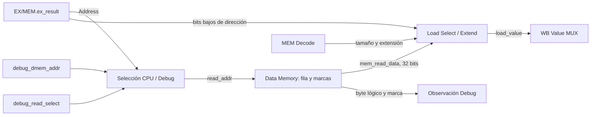

# Acceso y mantenimiento DMEM

- **Tipo:** arquitectura.
- **Estado documental:** especificación vigente.

**Índice**

- [Propósito y alcance](#propósito-y-alcance)
- [Organización de Data Memory](#organización-de-data-memory)
- [Representación de los bytes y cero lógico](#representación-de-los-bytes-y-cero-lógico)
- [Lectura de CPU](#lectura-de-cpu)
- [Lectura de Debug](#lectura-de-debug)
- [Escritura de stores](#escritura-de-stores)
- [Preparación de una nueva sesión](#preparación-de-una-nueva-sesión)
- [Prioridades y temporización](#prioridades-y-temporización)
- [Interfaces y dimensionamiento](#interfaces-y-dimensionamiento)
- [Ejemplos de funcionamiento](#ejemplos-de-funcionamiento)
- [Invariantes y condiciones de borde](#invariantes-y-condiciones-de-borde)
- [Verificación del modelo funcional](#verificación-del-modelo-funcional)
- [Referencias y trazabilidad](#referencias-y-trazabilidad)

## Propósito y alcance

Este documento define cómo se organiza, se lee, se escribe y se mantiene `Data Memory` (DMEM). DMEM es la memoria de datos utilizada por la etapa `MEM` del pipeline y permite acceder a direcciones de byte mediante los loads `LB`, `LBU`, `LH`, `LHU` y `LW` y los stores `SB`, `SH` y `SW`.

El alcance comprende:

- La distribución de los bytes en filas de cuatro posiciones (*lanes*).
- La representación del contenido lógico mediante datos físicos y una marca de validez por byte.
- La lectura combinacional de una palabra alineada de 32 bits para la CPU.
- La selección y extensión posterior de bytes y halfwords en `Load Select / Extend`.
- La escritura síncrona y little-endian de uno, dos o cuatro bytes, con actualización de sus marcas.
- La consulta de bytes y marcas desde Debug utilizando el mismo almacenamiento.
- La limpieza secuencial de las marcas al preparar una nueva sesión, sin borrar los datos físicos.
- La protección de los índices internos, la prioridad de las actualizaciones y su relación con los ciclos efectivos de CPU.

El comportamiento de DMEM está dividido en dos caminos temporales:

- **Lectura combinacional:** el dato presentado depende de la dirección y del contenido actual de memoria, sin esperar un flanco adicional.
- **Escritura síncrona:** los datos y las marcas seleccionados cambian en el flanco de reloj autorizado para el store o la limpieza de preparación.

La lectura y escritura de DMEM **no incorporan una nueva etapa del pipeline**. Los loads se leen y se preparan en MEM; sus resultados continúan hacia WB mediante `MEM/WB`. Los stores producen su efecto arquitectónico en MEM. Los chequeos de alineación y rango de las instrucciones se realizan antes, en EX: DMEM no determina por sí misma si una instrucción debe provocar un fault.

## Organización de Data Memory

### Direcciones de byte, filas y lanes

DMEM es *byte-addressed*: una dirección identifica un byte, no una palabra completa. Internamente, los bytes se organizan en filas lógicas de cuatro posiciones. Cada posición se denomina **lane** y contiene ocho bits.

Sea `C = DMEM_CAPACITY_BYTES` la capacidad en bytes. Para una dirección de byte `A`:

```text
ROW_COUNT = C / 4

row       = A >> 2
lane      = A[1:0]
row_base  = 4 * row
```

- `row` identifica la fila alineada de cuatro bytes que contiene la dirección.
- `lane` identifica cuál de sus cuatro posiciones corresponde al byte solicitado.
- `row_base` es la dirección del primer byte de esa fila.

La correspondencia dentro de cada fila es:

| Lane | Dirección de byte | Posición en la palabra de 32 bits |
|------|-------------------|-----------------------------------|
| 0    | `row_base + 0`    | bits `[7:0]`                      |
| 1    | `row_base + 1`    | bits `[15:8]`                     |
| 2    | `row_base + 2`    | bits `[23:16]`                    |
| 3    | `row_base + 3`    | bits `[31:24]`                    |

Por ejemplo, las direcciones 4, 5, 6 y 7 pertenecen a la fila 1. Sus lanes son, respectivamente, 0, 1, 2 y 3. Consultar cualquiera de esas direcciones selecciona la misma fila, pero identifica una posición diferente dentro de ella.

### Bancos de datos y marcas

La representación consta de cuatro bancos lógicos de datos y cuatro grupos correspondientes de marcas:

| Estructura         | Contenido por fila        | Función                                                          |
|--------------------|---------------------------|------------------------------------------------------------------|
| `data_lane[0]`     | un byte                   | Dato físico de `row_base + 0`.                                   |
| `data_lane[1]`     | un byte                   | Dato físico de `row_base + 1`.                                   |
| `data_lane[2]`     | un byte                   | Dato físico de `row_base + 2`.                                   |
| `data_lane[3]`     | un byte                   | Dato físico de `row_base + 3`.                                   |
| `valid_lane[0..3]` | una marca por lane y fila | Indica cuáles de esos bytes fueron escritos en la sesión actual. |

Cada banco tiene `ROW_COUNT` filas. Los cuatro grupos `valid_lane` constituyen **un único bitmap lógico de validez**, distribuido de la misma manera que los datos. No existen cuatro copias del bitmap ni un segundo conjunto de marcas para Debug.

Esta distribución es una organización lógica del almacenamiento. La descripción RTL puede utilizar arreglos inferibles dimensionados por capacidad; no se exige que la síntesis produzca exactamente cuatro primitivas físicas RAM, ni se presupone un resultado particular de área o frecuencia.

### Little-endian

La memoria utiliza orden **little-endian**: el byte de la dirección menor contiene los bits menos significativos del valor almacenado.

Por ejemplo, si se almacena la palabra `0x12345678` comenzando en la dirección 4, la fila queda así:

| Dirección | Lane | Byte   |
|-----------|------|--------|
| 4         | 0    | `0x78` |
| 5         | 1    | `0x56` |
| 6         | 2    | `0x34` |
| 7         | 3    | `0x12` |

La reconstrucción de la palabra coloca el lane 3 a la izquierda y el lane 0 a la derecha:

```text
mem_read_data = {lane3, lane2, lane1, lane0}
              = 32'h12345678
```

El orden little-endian se aplica tanto al empaquetado de lecturas como a la distribución de los bytes de un store.

## Representación de los bytes y cero lógico

### Dato físico y dato observable

Cada dirección conserva dos elementos independientes: el byte físico de datos y su marca de validez. La marca determina si ese contenido pertenece lógicamente a la sesión actual.

Para cada fila y lane:

```text
logical_lane[i] =
    valid_lane[i][row]
        ? data_lane[i][row]
        : 8'h00
```

Esto implica:

| Marca | Dato físico almacenado | Byte lógico leído | Interpretación                     |
|-------|------------------------|-------------------|------------------------------------|
| `0`   | cualquier valor        | `0x00`            | Byte no utilizado en la sesión.    |
| `1`   | `0x00`                 | `0x00`            | Byte utilizado cuyo valor es cero. |
| `1`   | distinto de cero       | dato físico       | Byte utilizado con ese valor.      |

**Un dato igual a cero no equivale a una marca inactiva.** Un store puede escribir `0x00` y dejar `valid=1`. En ese caso, Debug debe informar el byte como utilizado, aunque su valor observado sea cero.

El cero lógico permite iniciar una sesión sin borrar físicamente todos los bytes de DMEM. Basta con limpiar las marcas: el contenido residual de una sesión anterior permanece almacenado, pero queda oculto para la CPU y para las consultas de datos de Debug.

### Qué modifica cada operación

- Un **store** actualiza el dato físico y activa la marca de cada byte seleccionado.
- La **preparación** limpia marcas, pero no altera los datos físicos.
- Un **load** y una **consulta Debug** observan datos y marcas sin modificarlos.
- El **reset funcional** no realiza un borrado masivo del contenido de DMEM; la preparación posterior restablece la vista lógica de una nueva sesión.

Las mismas marcas alimentan el cero lógico y el indicador `debug_dmem_used`. Por eso, ambos mecanismos siempre describen el mismo estado de utilización de cada byte.

## Lectura de CPU

### Recorrido del dato

Durante un load, `EX/MEM.ex_result` contiene la dirección efectiva que EX calculó y validó. El camino de lectura utiliza esa dirección para seleccionar una fila de DMEM.



El selector CPU/Debug produce `read_addr[31:0]`. En uso CPU, `read_addr` corresponde a la dirección efectiva del acceso. DMEM obtiene `row = read_addr >> 2`, consulta los cuatro lanes de esa fila y forma:

```text
mem_read_data = {
    logical_lane[3],
    logical_lane[2],
    logical_lane[1],
    logical_lane[0]
}
```

La salida contiene **siempre la palabra alineada completa** de la fila seleccionada. Por ejemplo, si `read_addr=5`, `mem_read_data` reúne los bytes de las direcciones 4, 5, 6 y 7. DMEM no desplaza la palabra para poner el byte de la dirección 5 en los bits bajos.

### Selección del tamaño de load

La selección del byte o conjunto de bytes solicitado se realiza **fuera de DMEM**, en `Load Select / Extend`, dentro de MEM. Este bloque recibe:

| Entrada                 | Origen                  | Uso                                           |
|-------------------------|-------------------------|-----------------------------------------------|
| `mem_read_data[31:0]`   | `Data Memory`           | Los cuatro bytes lógicos de la fila alineada. |
| `address_low_bits[1:0]` | `EX/MEM.ex_result[1:0]` | Posición del acceso dentro de la fila.        |
| `access_size[1:0]`      | `MEM Decode`            | Tamaño byte, halfword o word.                 |
| `load_unsigned`         | `MEM Decode`            | Selección de extensión con cero o con signo.  |

Los tamaños válidos se resuelven así:

| Load  | Offset legal | Bytes seleccionados | Resultado                               |
|-------|--------------|---------------------|-----------------------------------------|
| `LB`  | 0, 1, 2 o 3  | un lane             | Byte extendido con signo a 32 bits.     |
| `LBU` | 0, 1, 2 o 3  | un lane             | Byte extendido con ceros a 32 bits.     |
| `LH`  | 0 o 2        | lanes 0–1 o 2–3     | Halfword extendido con signo a 32 bits. |
| `LHU` | 0 o 2        | lanes 0–1 o 2–3     | Halfword extendido con ceros a 32 bits. |
| `LW`  | 0            | lanes 0–3           | Palabra completa de 32 bits.            |

Una forma combinacional de entender esta selección es:

```text
aligned_data = mem_read_data >> (8 * address_low_bits)

selected_byte     = aligned_data[7:0]
selected_halfword = aligned_data[15:0]
selected_word     = mem_read_data[31:0]
```

Para `LB` y `LH`, el bit más significativo del valor seleccionado se replica en los bits superiores. Para `LBU` y `LHU`, esos bits se completan con cero. `LW` no necesita extensión porque ya obtiene 32 bits.

El desplazamiento anterior describe la función, no exige un registro de desplazamiento ni una implementación determinada: un mux combinacional por lanes es equivalente. La salida de `Load Select / Extend` es `load_value[31:0]`, que `WB Value MUX` utiliza para formar `wb_value` de un load.

### Relación con la validación de EX

MEM recibe como operaciones válidas únicamente loads cuyas condiciones arquitectónicas de alineación y rango ya fueron comprobadas en EX. En particular:

```text
BYTE     → cualquier offset
HALFWORD → offset 0 o 2
WORD     → offset 0
```

Un load desalineado o fuera de capacidad no llega a MEM como una operación válida. DMEM, por lo tanto, **no corrige ni redondea direcciones**, ni divide un acceso inválido entre dos filas. El tratamiento de estos faults corresponde a EX y al control del pipeline.

### Protección interna de la lectura

Además de la validación arquitectónica de EX, el almacenamiento protege sus propios índices. Primero calcula el índice completo de fila y comprueba:

```text
row_in_range = (unsigned(read_addr >> 2) < ROW_COUNT)
```

Solo después de esa comprobación puede utilizar los bits de índice necesarios para direccionar un banco físico. Si la fila está fuera de rango, la salida de lectura es neutra:

```text
mem_read_data    = 32'h00000000
debug_dmem_data  = 8'h00
debug_dmem_used  = 1'b0
```

Esto evita que una dirección elevada, cuyo índice se truncaría al ancho físico, acceda por error a una fila diferente. Por ejemplo, con capacidad de 2048 bytes existen 512 filas: la dirección 2048 corresponde a la fila 512, que está fuera de rango. Reducir su índice a 9 bits sin comprobarlo produciría la fila 0; la verificación completa impide ese alias.

Esta comprobación es una protección del backend de memoria, **no una segunda detección de faults**. Un valor neutro no convierte en legal un load inválido: la instrucción causante ya fue excluida del camino arquitectónico antes de MEM.

## Lectura de Debug

### Selección de dirección

CPU y Debug utilizan el mismo camino de lectura. `debug_read_select`, generado por `protocol_controller`, controla qué dirección se presenta como `read_addr`:

| `debug_read_select` | Dirección consultada                        | Consumidor                 |
| ------------------- | ------------------------------------------- | -------------------------- |
| `0`                 | dirección CPU (`EX/MEM.ex_result`)          | Camino de load en MEM.     |
| `1`                 | `debug_dmem_addr` del `response_serializer` | Observación Debug de DMEM. |

La consulta de Debug también selecciona una fila completa, pero solo consume el byte y la marca correspondientes al lane indicado por los dos bits bajos de su dirección:

```text
row   = read_addr >> 2
lane  = read_addr[1:0]

debug_dmem_data = logical_lane[lane]
debug_dmem_used = valid_lane[lane][row]
```

Las expresiones anteriores corresponden a una fila dentro de rango; fuera de rango ambos retornos son cero.

### Significado de los retornos

- `debug_dmem_data[7:0]` contiene el **byte lógico**, no necesariamente el contenido físico. Si la marca está inactiva, devuelve `0x00`.
- `debug_dmem_used` contiene la marca de ese mismo byte. Permite diferenciar una posición no utilizada de otra que sí fue escrita con valor cero.

El serializador utiliza estos retornos para consultar posiciones y formar el conteo o la lista de bytes utilizados. No necesita un bitmap separado ni un segundo puerto de lectura para los datos.

Durante Debug, la CPU se encuentra excluida de la ejecución y no consume `mem_read_data` como resultado de un load. Cuando está seleccionado el camino CPU, los retornos destinados a Debug no se consumen. La selección de dirección no constituye una autorización para modificar memoria: **Debug solo lee**.

## Escritura de stores

### Dirección y datos que llegan desde EX

Un store utiliza dos valores conservados en `EX/MEM`:

```text
Address    = EX/MEM.ex_result   // dirección efectiva
Write Data = EX/MEM.store_data  // dato a almacenar
```

EX calculó la dirección y resolvió, mediante forwarding si correspondía, el valor de `store_data`. También comprobó alineación y rango. MEM recibe entonces la información necesaria para escribir uno, dos o cuatro bytes en la fila correspondiente.

La escritura no se produce simplemente porque las entradas contengan una dirección y un dato. `MEM Decode` reconoce los stores mediante `EX/MEM.mem_op`, y `DMEM Write Control` exige que exista un ciclo efectivo y una instrucción válida:

```text
is_store = EX/MEM.mem_op ∈ {SB, SH, SW}

dmem_store_fire =
    cpu_cycle_fire
    && EX/MEM.valid
    && is_store
```

`dmem_store_fire` llega a `Data Memory` como `write_enable`. Durante `HOLD`, `cpu_cycle_fire=0`, por lo que la instrucción retenida no vuelve a escribir la memoria en cada flanco.

### Máscara relativa al dato

`DMEM Write Control` genera `byte_enable[3:0]` en función del tipo de store. La máscara es **relativa a los bytes bajos de `Write Data`**, no a la posición final dentro de la fila:

| Store         | `byte_enable[3:0]` | Parte utilizada de `Write Data` |
|---------------|--------------------|---------------------------------|
| `SB`          | `0001`             | `[7:0]`                         |
| `SH`          | `0011`             | `[15:0]`                        |
| `SW`          | `1111`             | `[31:0]`                        |
| Otro `mem_op` | `0000`             | Ninguna.                        |

Así, el bloque de control decide **cuántos bytes** escribe la operación, pero no necesita conocer la dirección. La ubicación de esos bytes dentro de la fila se resuelve en `Data Memory`, que sí recibe `Address`.

### Desplazamiento a lanes físicos

DMEM utiliza `Address[1:0]` para desplazar tanto la máscara relativa como los bytes de escritura hasta su posición física:

```text
offset          = Address[1:0]
lane_mask       = (byte_enable << offset)       // resultado de 4 bits
lane_write_data = (Write Data << (8 * offset)) // resultado de 32 bits
```

`lane_mask[i]=1` identifica que el lane `i` debe escribirse. El byte capturado por ese lane proviene de `lane_write_data[8*i +: 8]`.

| Store / offset | Máscara relativa | `lane_mask` | Lanes escritos |
|----------------|------------------|-------------|----------------|
| `SB` / 0       | `0001`           | `0001`      | 0              |
| `SB` / 1       | `0001`           | `0010`      | 1              |
| `SB` / 2       | `0001`           | `0100`      | 2              |
| `SB` / 3       | `0001`           | `1000`      | 3              |
| `SH` / 0       | `0011`           | `0011`      | 0 y 1          |
| `SH` / 2       | `0011`           | `1100`      | 2 y 3          |
| `SW` / 0       | `1111`           | `1111`      | 0, 1, 2 y 3    |

Las combinaciones ausentes de la tabla no representan stores legales. Por ejemplo, un `SH` con offset 3 cruzaría el límite de la fila y un `SW` con offset distinto de cero estaría desalineado. EX impide que esas instrucciones lleguen como stores válidos a MEM. El truncamiento de una máscara a cuatro bits **no debe interpretarse como una escritura parcial correcta** de un acceso ilegal.

### Actualización simultánea de datos y marcas

En el flanco autorizado por `dmem_store_fire`, cada lane habilitado de la fila recibe su byte y activa su marca:

```text
para cada lane i con lane_mask[i] = 1:
    data_lane[i][row]  ← lane_write_data[8*i +: 8]
    valid_lane[i][row] ← 1

para cada lane no seleccionado:
    dato y marca se conservan
```

Todos los bytes seleccionados por un store se actualizan en el mismo flanco. No existe una secuencia de escrituras de un byte por ciclo para implementar `SH` o `SW`.

Un store de valor cero también activa las marcas de los bytes escritos. El hecho de que el contenido físico sea `0x00` no los excluye de la lista de direcciones utilizadas por Debug.

### Protección de escritura y atomicidad

Antes de obtener el índice físico, DMEM comprueba el índice completo de la fila de escritura contra `ROW_COUNT`. Si está fuera de rango, no modifica datos ni marcas y no permite alias con otra fila.

La responsabilidad de autorizar una operación válida sigue perteneciendo a EX y al control del pipeline. Un store con fault propio se invalida antes de MEM, por lo que `dmem_store_fire=0` para esa instrucción. Como consecuencia:

- No se actualiza ninguno de sus bytes, aunque alguna dirección individual hubiera estado dentro de capacidad.
- No se activa ninguna marca de esa operación.
- No se ejecuta una segunda escritura para continuar en otra fila.

El store válido produce un único efecto síncrono sobre todos sus lanes seleccionados.

## Preparación de una nueva sesión

### Por qué se limpian las marcas

Una sesión nueva debe observar DMEM como si sus bytes todavía no hubieran sido escritos, aunque los bancos físicos conserven información de la sesión anterior. Para conseguirlo, la preparación **limpia el bitmap de validez**, no los bytes de datos.

Mientras las marcas permanecen en cero, cada lectura lógica entrega `0x00`. Cuando un store escribe una posición durante la sesión, su marca pasa a uno y esa posición vuelve a ser observable como utilizada.

### Limpieza de una posición por flanco

`Session Preparation` proporciona:

| Señal                | Función                                           |
|----------------------|---------------------------------------------------|
| `prepare_dmem_addr`  | Dirección del byte cuya marca debe limpiarse.     |
| `prepare_dmem_clear` | Orden de limpieza de esa marca durante el flanco. |

DMEM descompone la dirección de preparación igual que cualquier otra dirección:

```text
prepare_row  = prepare_dmem_addr >> 2
prepare_lane = prepare_dmem_addr[1:0]
```

Si `prepare_dmem_clear=1` y la dirección es válida, en el flanco ocurre exclusivamente:

```text
valid_lane[prepare_lane][prepare_row] ← 0
```

No cambia ningún `data_lane`. Tampoco se limpian los otros tres lanes de la misma fila. El controlador de preparación avanza su índice para recorrer las posiciones de DMEM, **una marca por ciclo**, hasta completar la limpieza.

La limpieza secuencial permite reutilizar las marcas existentes sin agregar un mecanismo de borrado físico masivo de los datos. La FSM y el índice de recorrido pertenecen a `Session Preparation`; no se incorporan dentro de DMEM.

### Camino compartido de actualización de marcas

Las marcas pueden modificarse por dos operaciones diferentes:

1. **Preparación:** escribir cero en la marca de un único byte.
2. **Store de CPU:** escribir uno en las marcas de todos los lanes seleccionados por `lane_mask`.

Ambas operaciones utilizan los mismos grupos `valid_lane`. Para cada lane, la selección combinacional determina qué fila y qué valor de marca corresponde a la operación activa:

| `prepare_dmem_clear` | Dirección de marcas | Valor escrito | Habilitación                                                                  |
|----------------------|---------------------|---------------|-------------------------------------------------------------------------------|
| `1`                  | `prepare_dmem_addr` | `0`           | Solo el lane de preparación, si su fila está dentro de rango.                 |
| `0`                  | `Address` de CPU    | `1`           | Solo si `dmem_store_fire=1`, el lane está en `lane_mask` y la fila es válida. |

**Elegir el camino CPU no implica escribir.** Cuando no existe un store autorizado, todas las marcas conservan su contenido.

La fila de mantenimiento también se comprueba con el índice completo antes de reducir su ancho. Una dirección de preparación fuera de `C` no limpia otra fila por truncamiento.

### Final de preparación

La preparación y la ejecución de CPU son fases excluyentes. Una vez que el controlador indica `prepare_done`, `prepare_dmem_clear` permanece inactivo y el primer ciclo de CPU puede ejecutarse sin competir con una limpieza de marcas.

De la misma forma, Debug no interviene durante la limpieza y no modifica datos ni marcas. No hace falta mantener un registro adicional que indique quién es el propietario de DMEM: el control global excluye las fases y las señales de selección son combinacionales.

## Prioridades y temporización

### Prioridad de actualización

Si varias condiciones de control aparecen simultáneamente, DMEM utiliza la siguiente prioridad:

```text
reset funcional > prepare_dmem_clear > dmem_store_fire
```

El efecto sobre los bancos es:

| Situación              | Datos físicos                         | Marcas                                      | Resultado                                                                             |
|------------------------|---------------------------------------|---------------------------------------------|---------------------------------------------------------------------------------------|
| Reset funcional        | Se conservan; no se escriben.         | Se conservan; no hay clear masivo.          | Se aborta la sesión u observación activa; otra preparación restablece el cero lógico. |
| `prepare_dmem_clear=1` | Todos se conservan.                   | Se limpia únicamente la marca direccionada. | El cambio lógico se observa después del flanco.                                       |
| `dmem_store_fire=1`    | Se escriben los lanes de `lane_mask`. | Se activan esas mismas marcas.              | El dato escrito se observa después del flanco.                                        |
| Ninguna actualización  | Se conservan.                         | Se conservan.                               | La lectura combinacional puede consultar CPU o Debug.                                 |

Durante el funcionamiento legal, preparación y store no se autorizan al mismo tiempo. Si se fuerza artificialmente la coincidencia de `prepare_dmem_clear=1` con `dmem_store_fire=1`, la limpieza prevalece y **se suprime el store completo**, incluidos sus datos y marcas.

El reset funcional impide escrituras y aborta la actividad de la sesión, pero no sustituye el recorrido de limpieza de marcas que debe realizar la siguiente preparación.

### Valores anteriores y posteriores al flanco

El store utiliza los valores de `EX/MEM` **anteriores al flanco**. En ese mismo flanco, `EX/MEM` puede capturar una instrucción nueva proveniente de EX; esa nueva instrucción no es la que escribe DMEM todavía.

Conceptualmente:

```text
antes del flanco:
    EX/MEM = store A
    EX     = instrucción B

en el flanco:
    store A escribe los bytes y marcas seleccionados
    EX/MEM puede capturar B

después del flanco:
    la lectura combinacional observa el contenido actualizado
```

Este comportamiento conserva el avance de una etapa por ciclo. La escritura de un store anterior en MEM puede ocurrir en el mismo ciclo en que una instrucción posterior confirma `halt`, un fault o un redirect: el evento posterior no cancela los efectos válidos de instrucciones anteriores.

En cambio, durante `HOLD`, no existe ciclo efectivo (`cpu_cycle_fire=0`) y no se realiza una nueva escritura CPU, aunque `EX/MEM` conserve físicamente la misma instrucción.

## Interfaces y dimensionamiento

### Entradas y salidas

La interfaz funcional de DMEM es:

| Señal / elemento      | Ancho                | Origen o destino                     | Función                                             |
| --------------------- | -------------------- | ------------------------------------ | --------------------------------------------------- |
| `clk`                 | 1 bit                | Reloj común                          | Flanco de escritura de stores y marcas.             |
| Reset funcional       | 1 bit                | Control global                       | Inhibe actualizaciones y aborta la sesión activa.   |
| `Address`             | 32 bits              | `EX/MEM.ex_result`                   | Dirección CPU de lectura o de escritura.            |
| `Write Data`          | 32 bits              | `EX/MEM.store_data`                  | Valor que almacena un store.                        |
| `write_enable`        | 1 bit                | `DMEM Write Control.dmem_store_fire` | Autoriza el store síncrono.                         |
| `byte_enable`         | 4 bits               | `DMEM Write Control`                 | Máscara relativa a los bytes bajos de `Write Data`. |
| `debug_read_select`   | 1 bit                | `protocol_controller`                | Selecciona la dirección de lectura CPU o Debug.     |
| `debug_dmem_addr`     | `BYTE_ADDRESS_WIDTH` | `response_serializer`                | Dirección de byte consultada por Debug.             |
| `prepare_dmem_clear`  | 1 bit                | `Session Preparation`                | Habilita la limpieza de una marca.                  |
| `prepare_dmem_addr`   | `BYTE_ADDRESS_WIDTH` | `Session Preparation`                | Dirección de la marca que se limpia.                |
| `mem_read_data`       | 32 bits              | `Load Select / Extend`               | Cuatro bytes lógicos de una fila alineada.          |
| `debug_dmem_data`     | 8 bits               | `response_serializer`                | Byte lógico de la posición consultada.              |
| `debug_dmem_used`     | 1 bit                | `response_serializer`                | Marca de validez de esa misma posición.             |
| `DMEM_CAPACITY_BYTES` | parámetro            | Configuración común                  | Capacidad C, no bus dinámico.                       |

`read_addr[31:0]`, `row`, `lane`, `lane_mask` y `lane_write_data` son valores derivados dentro del camino de memoria. No representan una segunda copia de datos ni un estado adicional que deba capturarse en un registro.

### Anchos dependientes de la capacidad

El direccionamiento externo y el dimensionamiento interno se relacionan así:

```text
C                  = DMEM_CAPACITY_BYTES
ROW_COUNT          = C / 4
BYTE_ADDRESS_WIDTH = max(1, ceil(log2(C)))
ROW_INDEX_WIDTH    = max(1, ceil(log2(ROW_COUNT)))
```

Las configuraciones referenciadas tienen:

| Perfil      | `BYTE_ADDRESS_WIDTH` | `ROW_INDEX_WIDTH` |
|-------------|---------------------:|------------------:|
| `REFERENCE` |                   11 |                 9 |
| `ALT_1000`  |                   10 |                 8 |

Estos son los anchos correspondientes a esas configuraciones. Los valores de ancho se derivan de la capacidad; no se fijan por el nombre del perfil. La comparación de rango se efectúa sobre la dirección o fila **completa y sin signo**, antes de extraer el índice de ancho reducido. Esto resulta especialmente importante cuando `C` no es una potencia de dos.

## Ejemplos de funcionamiento

### `SB` y posterior lectura de un byte

Supongamos una sesión recién preparada, con todas las marcas inactivas. Se ejecuta:

```text
SB de 0xAA en la dirección 5
```

La dirección selecciona:

```text
row    = 5 >> 2 = 1
lane   = 5[1:0] = 1
offset = 1
```

`DMEM Write Control` genera `byte_enable=0001`. DMEM desplaza esa máscara una posición, obteniendo `lane_mask=0010`, y ubica `0xAA` en el lane 1. En el flanco autorizado se escribe ese byte y se activa su marca.

El estado lógico de la fila 1 queda:

| Dirección | Lane | Byte lógico | `used` |
|-----------|------|-------------|--------|
| 4         | 0    | `0x00`      | 0      |
| 5         | 1    | `0xAA`      | 1      |
| 6         | 2    | `0x00`      | 0      |
| 7         | 3    | `0x00`      | 0      |

La lectura de cualquiera de esas direcciones presenta la misma palabra alineada:

```text
mem_read_data = 32'h0000AA00
```

Al consultar la dirección 5, `Load Select / Extend` utiliza offset 1 y selecciona el byte `0xAA`:

```text
LBU → 32'h000000AA
LB  → 32'hFFFFFFAA
```

La diferencia se debe al bit de signo del byte: en `LB` se extiende con unos, mientras que en `LBU` se extiende con ceros.

Debug, al consultar la dirección 5, devuelve `debug_dmem_data=0xAA` y `debug_dmem_used=1`.

### Limpieza posterior de esa marca

Si la preparación limpia la marca de la dirección 5, el dato físico `0xAA` permanece almacenado. Sin embargo, la marca cambia a cero y la siguiente lectura lógica de esa posición entrega `0x00`.

La palabra que observa la CPU vuelve a ser `0x00000000` si los demás lanes de la fila continúan sin uso. Debug también devuelve dato cero y `used=0`: la dirección 5 deja de contarse como utilizada.

### `SH` con offset 2

Para un `SH` de `0xBEEF` en la dirección 6:

```text
row              = 1
offset           = 2
byte_enable      = 0011
lane_mask        = 1100
```

El lane 2 (dirección 6) recibe `0xEF`, y el lane 3 (dirección 7) recibe `0xBE`. Ambos quedan marcados como utilizados; los lanes 0 y 1 conservan su estado anterior.

### `SW` y reemplazos parciales

Para un `SW` de `0x12345678` en la dirección 4:

```text
row              = 1
offset           = 0
byte_enable      = 1111
lane_mask        = 1111
```

Se escriben los cuatro lanes en un mismo flanco:

```text
dirección 4 ← 0x78
dirección 5 ← 0x56
dirección 6 ← 0x34
dirección 7 ← 0x12
```

Una lectura `LW` desde 4 obtiene `0x12345678`. Si posteriormente se ejecuta `SB` de `0xAA` en la dirección 5, solo cambia el lane 1, y la palabra lógica resultante pasa a ser `0x1234AA78`.

Esto muestra que un store parcial no altera los bytes ni las marcas que no selecciona.

## Invariantes y condiciones de borde

Las propiedades que deben mantenerse son:

- **Una dirección, un byte:** `row=A>>2` y `lane=A[1:0]` identifican una posición única dentro de capacidad.
- **Cero lógico:** una marca en cero obliga a que el byte observado sea `0x00`, sin depender de los bits físicos residuales.
- **Validez única:** la marca que controla la lectura CPU es la misma que informa Debug.
- **Stores selectivos:** únicamente los lanes de `lane_mask` cambian de dato y pasan a `valid=1`.
- **Limpieza sin borrado de datos:** `prepare_dmem_clear` modifica una sola marca y conserva todos los bytes físicos.
- **Orden little-endian:** las direcciones menores contienen los bytes menos significativos.
- **Una fila por acceso legal:** los loads y stores admitidos por EX nunca requieren dividir una operación entre dos filas.
- **Sin escrituras repetidas en `HOLD`:** un store necesita `cpu_cycle_fire=1`, aunque su contenido permanezca registrado en `EX/MEM`.
- **Sin alias por truncamiento:** una dirección fuera de rango no lee ni modifica una fila válida como consecuencia de reducir el ancho de su índice.
- **Sin faults propios de DMEM:** el backend protege sus índices, pero no reemplaza los chequeos arquitectónicos de EX.
- **Exclusión de fases:** preparación, ejecución CPU y observación Debug no compiten por la misma operación de memoria.

Un byte escrito con valor `0x00` sigue siendo **utilizado**. Un byte que conserva físicamente `0xAA` pero tiene su marca en cero sigue siendo **lógicamente cero y no utilizado**. La distinción entre ambos casos es parte de la semántica observable de DMEM.

## Verificación del modelo funcional

La organización se contrastó mediante un modelo abstracto por bytes para las capacidades de 4, 28, 32, 36, 1000 y 2048 bytes. Las comprobaciones incluyeron 44.072 stores, 572.936 lecturas y extensiones, y 176.288 limpiezas locales. Se cubrieron ocho patrones por combinación legal de posición y tamaño, el desplazamiento de máscara y datos, la extensión con signo o cero, la validez por byte, el retorno Debug y las escrituras parciales sucesivas.

El camino compartido de marcas se contrastó además con 10.279 flancos abstractos, incluyendo limpieza y escritura dirigidas a direcciones diferentes, stores de cero, limpieza completa y las combinaciones de reset, clear y store.

También se comprobó la aritmética de índices y último acceso para `C=2^32` sin reservar físicamente una memoria de ese tamaño. Ese caso verifica las expresiones aritméticas, **no** establece que dicho perfil pueda implementarse físicamente.

Estas comprobaciones corresponden a modelos funcionales y no sustituyen una simulación del RTL, la verificación de inferencia física ni el análisis de timing.

## Referencias y trazabilidad

- [Etapa MEM](../cpu/stage_mem.md): `MEM Decode`, `DMEM Write Control`, `Load Select / Extend`, `WB Value MUX` y punto de commit del store.
- [Etapa EX](../cpu/stage_ex.md): cálculo de direcciones efectivas, forwarding del dato de store y validación previa del acceso.
- [Arquitectura de memoria](memory_architecture.md): capacidades, direccionamiento por bytes, validación de región y representación de cero lógico.
- [Faults, redirects y terminación](../session/faults_and_termination.md): tratamiento arquitectónico de accesos inválidos y conservación de stores anteriores.
- [Control del pipeline y hazards](../cpu/control_and_hazards.md): autorización de avances, `HOLD`, instrucciones anteriores y efectos simultáneos.
- [Preparación de sesión](../session/session_preparation.md): recorrido de limpieza y coordinación de la nueva sesión.
- [Arquitectura de Debug](../debug/debug_architecture.md): observación de bytes utilizados y comunicación de los retornos de DMEM.
- [Serializador de respuestas](../debug/response_serializer.md): direcciones de lectura Debug y consumo de `debug_dmem_data` / `debug_dmem_used`.
- [Requisitos](../../requirements.md): obligaciones funcionales del sistema.
