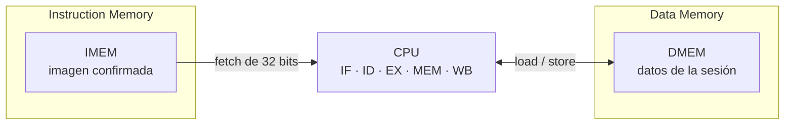
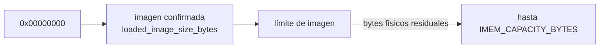
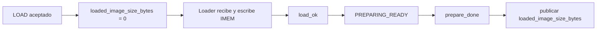
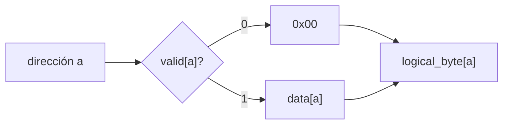
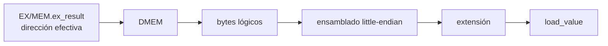

# Arquitectura de memoria

- **Tipo:** arquitectura.
- **Estado documental:** especificación vigente.

**Índice**

- [Propósito y alcance](#propósito-y-alcance)
- [Dos memorias con responsabilidades diferentes](#dos-memorias-con-responsabilidades-diferentes)
- [Instruction Memory](#instruction-memory)
- [Data Memory](#data-memory)
- [Recorridos de acceso a DMEM](#recorridos-de-acceso-a-dmem)
- [Formación y validación de direcciones](#formación-y-validación-de-direcciones)
- [Alineación](#alineación)
- [Temporización de las memorias](#temporización-de-las-memorias)
- [Ownership de las memorias](#ownership-de-las-memorias)
- [Commit de stores y loads](#commit-de-stores-y-loads)
- [Preparación de una nueva sesión](#preparación-de-una-nueva-sesión)
- [Capacidades y parametrización](#capacidades-y-parametrización)
- [Implementación de referencia y contrato arquitectónico](#implementación-de-referencia-y-contrato-arquitectónico)
- [Límite con Debug y protocolo](#límite-con-debug-y-protocolo)
- [Invariantes y condiciones de borde](#invariantes-y-condiciones-de-borde)
- [Referencias y trazabilidad](#referencias-y-trazabilidad)

<a id="función-de-las-memorias-dentro-del-procesador"></a>

## Propósito y alcance

Este documento define la organización y el uso de las dos memorias de la CPU. La arquitectura mantiene dos espacios lógicamente independientes:

- **IMEM** contiene la imagen confirmada de instrucciones que `IF` puede buscar.
- **DMEM** contiene los datos de la sesión sobre los que operan los `load` y `store`.

El alcance comprende:

- La separación de responsabilidades entre IMEM y DMEM.
- La diferencia entre una imagen de instrucciones confirmada y los datos observables de la sesión.
- El direccionamiento por bytes, la cantidad de bytes de cada acceso y las condiciones de alineación y rango.
- La posibilidad de acceder a IMEM desde `IF` y a DMEM desde `MEM` durante el mismo ciclo.
- La temporización de lecturas, escrituras, preparación de una sesión y commit de los `store`.

Aunque ambas memorias comienzan en la dirección `0x00000000`, no comparten el mismo espacio. Por ejemplo, la dirección numérica `0x00000010` identifica una posición de IMEM y otra posición distinta de DMEM. La dirección solo se interpreta dentro de la memoria a la que pertenece el acceso.

Esta separación permite que `IF` busque una instrucción mientras `MEM` accede a datos en el mismo ciclo de la CPU. No aparece un hazard estructural entre esas operaciones porque no compiten por una única memoria ni por un único espacio lógico.



Las dos memorias son **byte-addressed**, es decir, el PC y las direcciones efectivas siempre se expresan en bytes. Una instrucción de 32 bits ocupa cuatro bytes consecutivos en IMEM; un acceso `byte`, `halfword` o `word` utiliza, respectivamente, uno, dos o cuatro bytes consecutivos en DMEM. El tamaño y la posición inicial de esos bytes determinan cómo se valida y se realiza cada operación.

## Dos memorias con responsabilidades diferentes

Aunque IMEM y DMEM comparten el direccionamiento por bytes, su estado arquitectónico no se interpreta de la misma manera.

En IMEM importa distinguir qué parte del almacenamiento pertenece realmente al programa cargado. Por eso existe una **imagen confirmada** cuyo tamaño delimita los fetches ejecutables.

En DMEM importa distinguir qué bytes fueron escritos durante la sesión actual. Un byte que todavía no recibió una escritura se observa como cero, aunque el almacenamiento físico conserve residuos de una ejecución anterior.

Estas dos reglas evitan que el procesador confunda contenido físico residual con estado válido de la sesión:

```text
IMEM
contenido ejecutable
    = bytes pertenecientes a la imagen confirmada

DMEM
contenido observable
    = bytes escritos en la sesión actual
      + cero lógico para el resto
```

## Instruction Memory

### Imagen ejecutable

El contenido ejecutable de IMEM ocupa una única región inicial y continua que comienza en:

```text
0x00000000
```

La imagen confirmada presenta estas propiedades:

- No es vacía.
- Comienza en cero.
- No contiene huecos.
- Su tamaño es múltiplo de cuatro.
- No supera `IMEM_CAPACITY_BYTES`.

La arquitectura no utiliza un bitmap de instrucciones válidas ni varias regiones ejecutables separadas. Tampoco existe un entry point configurable: una sesión preparada comienza con:

```text
PC = 0x00000000
```



`loaded_image_size_bytes` define el límite lógico de la imagen vigente. Los bytes que quedan después de ese límite pueden seguir ocupando físicamente posiciones de IMEM —por ejemplo, restos de una carga anterior—, pero no pertenecen al programa actual.

Por lo tanto, el contenido físico de una dirección no alcanza para que una instrucción sea ejecutable. Si una imagen nueva es más corta que la anterior, los bytes residuales que quedan después de su límite se ignoran: aunque allí haya una codificación válida, un fetch en esa región no puede incorporarla al programa ni ejecutarla.

### Estado persistente de la imagen

La información persistente que describe la imagen es:

```text
loaded_image_size_bytes
```

De ella se derivan:

```text
image_valid =
    (loaded_image_size_bytes != 0)

loaded_instruction_count =
    loaded_image_size_bytes / 4
```

El ancho del registro permite representar también una imagen que ocupe exactamente toda la capacidad:

```text
IMAGE_SIZE_WIDTH =
    max(1, ceil(log2(IMEM_CAPACITY_BYTES + 1)))
```

Los estados persistentes legales son `0` o un tamaño no vacío, múltiplo de cuatro y no mayor que `IMEM_CAPACITY_BYTES`.

El valor cero representa la ausencia de una imagen ejecutable confirmada.

### Carga y publicación de una imagen

El `Loader` escribe IMEM mientras recibe una nueva imagen, pero el progreso de esa carga permanece separado del estado público `loaded_image_size_bytes`.

Una nueva imagen se vuelve ejecutable únicamente después de completarse la carga y la preparación correspondiente.



`load_ok` indica que la recepción y validación privada de la carga terminaron correctamente, pero no publica por sí solo la imagen.

El commit ocurre con:

```text
PREPARING_READY
&& prepare_done
```

En ese momento el tamaño validado se convierte en `loaded_image_size_bytes`. Ese flanco publica la nueva imagen, pero no inicia un ciclo de la CPU.

Una carga vacía, parcial, truncada, discontinua, sobredimensionada o fallida no publica una imagen nueva. Una solicitud de `LOAD` rechazada conserva la imagen y la sesión vigentes.

`RUN` o `STEP` iniciados desde un estado terminal pueden reutilizar la imagen confirmada sin volver a cargarla.

La secuencia global de `LOAD` y preparación se desarrolla en [Control de ejecución y sesión](../session/execution_control.md).

### Organización y fetch

IMEM se organiza conceptualmente como palabras de 32 bits.

Para un fetch válido:

```text
word_index = PC >> 2
```

El índice se utiliza únicamente después de establecer que el acceso pertenece a la región válida. El shift no redondea un PC inválido ni transforma una dirección fuera de rango en una posición aceptable.

Durante la carga, el [Loader aprobado](../session/loader.md) reconstruye cada palabra antes del flanco que habilita su escritura en IMEM. Conserva los tres primeros bytes en un registro de 24 bits y los combina con el cuarto byte actual.

Loader deriva posición y dirección del tamaño menos faltantes ya conservados por el controlador, sin contador ni FSM privados adicionales. `load_ok` certifica la escritura final en ese mismo flanco. La publicación sigue esperando preparación.

En ejecución, IF utiliza cuatro bytes consecutivos:

```text
PC
PC + 1
PC + 2
PC + 3
```

Como el subconjunto implementado contiene únicamente instrucciones de 32 bits y no utiliza instrucciones comprimidas, un fetch válido comienza en una dirección alineada a cuatro bytes.

### Pertenecer a la imagen no implica ser una instrucción legal

IMEM determina si los cuatro bytes pertenecen a la imagen confirmada.

Una palabra ubicada correctamente dentro de la imagen todavía puede contener una codificación no admitida por el procesador.

Las comprobaciones quedan separadas:

```text
IF
    → ¿pueden buscarse estos cuatro bytes?

ID
    → ¿la word corresponde a una instrucción implementada?
```

La primera puede producir un candidato de fetch fault. La segunda puede producir `illegal-instruction`.

La separación completa se desarrolla en [Faults, redirects y terminación](../session/faults_and_termination.md).

## Data Memory

### Estado de datos de una sesión

DMEM conserva los bytes escritos por el programa durante la sesión actual.

Al comenzar una sesión nueva, el procesador observa:

```text
0x00
```

en cualquier byte que todavía no haya sido escrito, independientemente de lo que permanezca físicamente almacenado.

Esta propiedad se denomina **cero lógico**.

No requiere que toda la memoria de datos se borre físicamente en un único flanco. Lo que importa arquitectónicamente es que una lectura no pueda distinguir un residuo viejo de un byte físicamente inicializado en cero.

### Validez por byte

La implementación de referencia asocia una validez independiente a cada byte:

```text
VALID_BIT_COUNT =
    DMEM_CAPACITY_BYTES

logical_byte[a] =
    valid[a]
        ? data[a]
        : 8'h00
```

Por lo tanto:

```text
valid[a] = 0
    → el byte se observa como 0x00

valid[a] = 1
    → el byte se observa con data[a]
```

La granularidad es por **byte**, no por palabra.

Esto resulta necesario porque un `SB` puede escribir una única posición sin convertir automáticamente en válidos los otros tres bytes de la palabra lógica.



La preparación de sesión establece la semántica de cero lógico antes de autorizar `RUN` o `STEP`.

La [realización aprobada](../session/session_preparation.md) limpia una marca por clock, usando `prepare_dmem_clear` y `prepare_dmem_addr`. Comparte el mismo bitmap con memoria utilizada para Debug, sin escribir ceros en el array de datos ni agregar otra lista de marcas.

`prepare_done` se activa después del flanco de la última limpieza, con mantenimiento ya inactivo.

### Organización little-endian

Los valores multibyte utilizan orden **little-endian**.

Para una palabra:

```text
0x12345678
```

almacenada desde una dirección `A`:

| Dirección | Byte   |
|-----------|-------:|
| `A + 0`   | `0x78` |
| `A + 1`   | `0x56` |
| `A + 2`   | `0x34` |
| `A + 3`   | `0x12` |

El byte situado en la dirección menor ocupa los bits menos significativos del valor.

DMEM puede verse conceptualmente como cuatro lanes de bytes:

```text
dirección creciente →

+0        +1        +2        +3
┌────────┬────────┬────────┬────────┐
│ byte 0 │ byte 1 │ byte 2 │ byte 3 │
└────────┴────────┴────────┴────────┘
 bits       bits       bits       bits
  7:0       15:8       23:16      31:24
```

Para cada byte de un acceso validado:

```text
bank_i =
    byte_address_i[1:0]

row_i =
    byte_address_i >> 2
```

Esta organización es conceptual. No implica que la implementación física utilice obligatoriamente cuatro bloques RAM independientes.

El [acuerdo de lectura DMEM](../../decisions/DEC-ARCH-006.md#acuerdo-de-concreción-de-dec-arch-006--lectura-dmem-alineada-y-selección-en-mem) concreta la interfaz: DMEM entrega los cuatro bytes lógicos de una palabra alineada en 32 bits; `Load Select/Extend` en MEM selecciona por los dos bits bajos y tamaño, y extiende. No agrega captura ni ciclo. La [escritura aprobada](dmem_access.md#escritura-de-stores) usa máscara relativa de cuatro bits y alineación combinacional dentro de DMEM; los caminos compartidos de metadatos/mantenimiento están aprobados en [acceso DMEM](dmem_access.md#camino-compartido-de-actualización-de-marcas).

IMEM conserva el mismo orden arquitectónico de bytes. Este endianness no determina el orden de serialización del protocolo UART.

## Recorridos de acceso a DMEM

### Loads

Un load llega a MEM después de que EX haya calculado y validado su dirección efectiva.

En MEM:



Según la operación:

| Instrucción | Bytes leídos | Resultado                        |
|-------------|-------------:|----------------------------------|
| `LB`        |            1 | extensión con signo              |
| `LBU`       |            1 | extensión con cero               |
| `LH`        |            2 | ensamblado + extensión con signo |
| `LHU`       |            2 | ensamblado + extensión con cero  |
| `LW`        |            4 | word completa                    |

Cada byte se filtra primero mediante su validez lógica y luego participa del ensamblado.

Por ejemplo, en una sesión inicialmente limpia, después de escribir únicamente `0xff` en la dirección 1:

```text
dirección 0 → 0x00
dirección 1 → 0xff
dirección 2 → 0x00
dirección 3 → 0x00
```

un `LW` desde la dirección 0 produce:

```text
0x0000ff00
```

El recorrido detallado de la etapa se encuentra en [Etapa MEM](../cpu/stage_mem.md).

### Stores

Un store llega a MEM con:

```text
EX/MEM.ex_result
    = dirección efectiva

EX/MEM.store_data
    = dato ya resuelto mediante forwarding
```

Según la instrucción:

```text
SB
    → usa store_data[7:0]

SH
    → usa store_data[15:0]

SW
    → usa store_data[31:0]
```

Un store válido actualiza solamente los bytes seleccionados.

Para cada uno de ellos se modifican conjuntamente:

```text
data[byte]
valid[byte]
```

Los bytes no seleccionados conservan tanto el dato como la validez que tenían antes del flanco.

La escritura es atómica respecto del acceso: o se actualizan todos los bytes que pertenecen al store válido, o ninguno.

## Formación y validación de direcciones

### Dirección efectiva de loads y stores

EX calcula la dirección efectiva mediante aritmética RV32 normal:

```text
effective_address =
    (rs1_effective + ID/EX.immediate)
    mod 2^32
```

`rs1_effective` ya incorpora el forwarding correspondiente.

La suma anterior puede producir carry y envolver el espacio de 32 bits. Ese carry no constituye por sí mismo un fault.

Por ejemplo:

```text
rs1_effective = 0xffffffff
immediate     = 1

effective_address = 0x00000000
```

La dirección resultante puede ser válida.

### Validación de toda la región

Después de formar la dirección efectiva se comprueba que **todo el acceso** pertenezca a DMEM.

El tamaño `N` es:

```text
N = 1  → byte
N = 2  → halfword
N = 4  → word
```

La condición utiliza aritmética ensanchada:

```text
dmem_range_valid =
    ({1'b0, effective_address} + N)
    <= DMEM_CAPACITY_BYTES
```

El cálculo del extremo de la región y la comparación utilizan aritmética sin signo de 33 bits.

Esta segunda operación no se reduce módulo `2^32`. De ese modo, una región que atraviesa el límite superior no reaparece artificialmente como una dirección baja.

```text
effective_address = 0xffffffff
N                 = 4

extremo = 2^32 + 3
```

Ese acceso no se interpreta como una región que continúa desde `0x00000000`.

### Validación de fetch

Un fetch ocupa siempre cuatro bytes y agrega una condición adicional: la región pertenece tanto a la capacidad configurada como a la imagen confirmada.

```text
if_fetch_range_valid =
    image_valid
    && ({1'b0, PC} + 33'd4 <= IMEM_CAPACITY_BYTES)
    && ({1'b0, PC} + 33'd4 <= loaded_image_size_bytes)
```

Por ejemplo, con una imagen confirmada de ocho bytes:

```text
PC = 0
    → fetch válido por región

PC = 4
    → fetch válido por región

PC = 8
    → fuera de imagen
```

aunque IMEM tenga una capacidad física mayor.

### Casos de borde

| Caso                                    | Resultado                                                                            |
|-----------------------------------------|--------------------------------------------------------------------------------------|
| Base `0xffffffff` + inmediato `1`, word | EA=`0`; el carry inicial no genera fault                                             |
| EA=`0xfffffffc`, N=`4`                  | extremo=`2^32`; válido por región solo si la capacidad arquitectónica alcanza `2^32` |
| EA=`0xffffffff`, N=`4`                  | extremo=`2^32+3`; nunca hace alias con direcciones bajas                             |
| `ALT_1000`, word desde `996`            | última word alineada dentro de rango                                                 |
| `ALT_1000`, word desde `1000`           | access fault                                                                         |
| imagen de 8 bytes, `PC=8`               | fetch fuera de imagen aunque IMEM tenga espacio                                      |

## Alineación

La validación de región no reemplaza la comprobación de alineación.

Las reglas son:

| Acceso            | Condición                 |
|-------------------|---------------------------|
| `LB`, `LBU`, `SB` | sin restricción adicional |
| `LH`, `LHU`, `SH` | `address[0] = 0`          |
| `LW`, `SW`        | `address[1:0] = 00`       |
| fetch             | `PC[1:0] = 00`            |

La arquitectura no reconstruye accesos multibyte desalineados mediante dos operaciones internas ni los redondea hacia una dirección alineada.

Si una misma operación incumple alineación y rango:

```text
misalignment
    >
access fault
```

Esa prioridad corresponde únicamente a las causas de la misma operación. Entre instrucciones distintas, tienen prioridad las que aparecen antes en el programa.

Loads y stores se validan en EX antes de ingresar a `EX/MEM` como entradas válidas. Una operación que falla no llega a producir un acceso parcial en MEM.

Los fetch faults siguen otro recorrido: IF detecta, `IF/ID` transporta y ID confirma.

La semántica completa de esas causas se desarrolla en [Faults, redirects y terminación](../session/faults_and_termination.md).

## Temporización de las memorias

### Lecturas combinacionales

IMEM y DMEM presentan lectura combinacional.

Esto permite que:

```text
IF
    → obtenga instruction
      durante su etapa

MEM
    → obtenga load_value
      durante su etapa
```

sin introducir una etapa adicional ni un handshake de memoria.

No existe latencia variable ni un stall específico originado por las memorias arquitectónicas.

### Escrituras síncronas

Los cambios de estado ocurren en el flanco funcional autorizado:

```text
Loader
    → escritura de IMEM

CPU store
    → escritura de DMEM
```

Los datos y controles consumidos para esos efectos corresponden al estado anterior al flanco.

### Acceso simultáneo de CPU

La independencia Harvard permite en un mismo ciclo:

```text
IF  → lectura de IMEM

MEM → lectura o escritura de DMEM
```

La CPU genera como máximo una solicitud por memoria y por ciclo.

No existe un structural hazard IF/MEM.

## Ownership de las memorias

Además de la CPU, otros bloques utilizan las memorias en momentos específicos.

| Memoria | Agentes conceptuales  | Relación                                                                                    |
|---------|-----------------------|---------------------------------------------------------------------------------------------|
| IMEM    | CPU / `Loader`        | `Loader` escribe durante carga; CPU busca durante ejecución                                 |
| DMEM    | CPU / Debug           | CPU accede durante ejecución; Debug puede leer directamente cuando la CPU no ejecuta ciclos |
| DMEM    | `Session Preparation` | establece el estado lógico inicial antes de ejecutar                                        |

Dentro de una misma memoria existe como máximo un agente autorizado para una operación incompatible en un momento dado.

El contrato arquitectónico fija esa exclusión. La selección de dirección de lectura CPU/Debug está definida en [Selector CPU/Debug](#selector-de-dirección-de-lectura-cpudebug); el mantenimiento está definido en [preparación](../session/session_preparation.md). Los caminos de lanes/metadatos están concretados en [acceso DMEM](dmem_access.md); el cableado de los tops está definido en la [composición aprobada](../system_composition.md); véase la [revisión local de composición](../system_composition.md#revisión-local-y-cierre-de-composición). No se exige un registro de owner ni un grant adicional.

### Selector de dirección de lectura CPU/Debug

El [acuerdo de selector de lectura](../../decisions/DEC-SYS-007.md#acuerdo-parcial-de-dec-sys-007--selector-de-dirección-de-lectura-cpudebug-de-dmem) agrega dentro de DMEM un multiplexor combinacional de dirección, controlado por `dmem_debug_select` de un bit desde `protocol_controller`.

| `dmem_debug_select` | Dirección de lectura seleccionada                                 |
|--------------------:|-------------------------------------------------------------------|
|                   0 | Address[31:0] de CPU, desde `EX/MEM.ex_result`                    |
|                   1 | `debug_dmem_addr` del serializador, extendida con ceros a 32 bits |

La dirección resultante es una conexión combinacional interna de 32 bits, sin registro adicional. Cuando Debug está seleccionado, `debug_dmem_data` y `debug_dmem_used` corresponden a esa posición y se consumen según la [lectura entre flancos](../debug/response_serializer.md#lectura-de-dmem-entre-flancos). Fuera de esa selección, el serializador no consume esos retornos como consulta válida de Debug.

`protocol_controller` mantiene `dmem_debug_select` activo durante la ventana exclusiva de observación aprobada: desde el estado posterior al ciclo CPU observado hasta el Stop del último byte, incluyendo la espera por una respuesta anterior. El ciclo que produce la observación conserva su acceso CPU; la selección Debug se activa después de ese flanco. Durante reset la selección queda en cero y se aborta la observación conforme al contrato global.

Durante la ventana Debug, CPU permanece retenida y preparación no modifica DMEM. El selector corresponde a lectura; stores CPU y escritura de mantenimiento conservan sus controles y responsabilidades. Preparación utiliza `prepare_dmem_clear`/addr aprobados; su conexión al backend y a los caminos de metadatos está definida junto con los lanes en [acceso DMEM](dmem_access.md). Con preparación efectiva, el serializador no consume una consulta Debug. Fuera de Debug, seleccionar la dirección CPU no autoriza por sí solo ciclos ni escrituras.

La generación de `dmem_debug_select` está aprobada en [controlador](../debug/protocol_controller.md#señales-y-conexiones-aprobadas), y las órdenes de mantenimiento en [preparación](../session/session_preparation.md). Empaquetado de lanes, adaptación de datos y camino de metadatos/mantenimiento están definidos en [acceso DMEM](dmem_access.md); la composición del top conserva su revisión propia. Este acuerdo no agrega un puerto de lectura simultánea CPU/Debug ni una validación de implementación.

Una colisión prohibida entre agentes representa una violación interna de la implementación, no un nuevo fault del programa ejecutado.

La captura y observación externa de memoria se desarrollan en [Arquitectura de Debug](../debug/debug_architecture.md).

<a id="compromiso-de-stores-y-loads"></a>

## Commit de stores y loads

### Store

Un store produce su efecto arquitectónico en MEM mediante [dmem_store_fire](../cpu/stage_mem.md#dmem-write-control), que exige ciclo efectivo, `EX/MEM` válido y operación store.

La actualización de los metadatos utiliza la misma condición:

```text
dmem_metadata_write_fire =
    dmem_store_fire
```

La dirección, el dato y el tipo de store son los valores anteriores al flanco de `EX/MEM`.

Un store anterior puede hacer commit en el mismo ciclo en que se confirma el fault o `halt` de una instrucción posterior.

Durante `HOLD`:

```text
cpu_cycle_fire = 0
```

y el store retenido no repite la escritura.

### Load

La lectura de DMEM es combinacional y no constituye por sí misma un commit arquitectónico.

El load produce `load_value` en MEM, lo captura posteriormente en `MEM/WB` y modifica el banco de registros únicamente cuando alcanza un writeback válido.

Por eso:

```text
leer DMEM
    ≠
escribir RF
```

y no existe un bypass directo:

```text
DMEM → EX
```

La interacción temporal entre load, `MEM/WB` y forwarding se desarrolla en [Control del pipeline y hazards](../cpu/control_and_hazards.md).

## Preparación de una nueva sesión

`RESET` o una nueva carga no dependen de borrar físicamente todos los bits de IMEM o DMEM en un único flanco.

En IMEM, la validez del programa se controla mediante `loaded_image_size_bytes`. Invalidar ese tamaño evita ejecutar contenido residual.

En DMEM, la preparación establece el cero lógico de la nueva sesión. La implementación de referencia puede limpiar los metadatos de validez durante varios ciclos.

```text
preparación de sesión
        ↓
IMEM
    imagen confirmada coherente

DMEM
    cero lógico coherente
        ↓
prepare_done
```

`prepare_done` representa que la sesión ya puede observar el estado inicial arquitectónico esperado.

La política arquitectónica permite mecanismos equivalentes; la [realización aprobada de referencia](../session/session_preparation.md) concreta RF simultáneo y limpieza de una marca DMEM por clock.

La FSM que coordina esta fase se desarrolla en [Control de ejecución y sesión](../session/execution_control.md).

## Capacidades y parametrización

La capacidad en bytes determina los límites de cada memoria:

```text
4 <= CAPACITY_BYTES <= 2^32

CAPACITY_BYTES % 4 == 0

WORD_COUNT =
    CAPACITY_BYTES / 4
```

No existe un requisito de potencia de dos.

Los anchos derivados conservan al menos un bit:

```text
index_width =
    max(1, ceil(log2(element_count)))
```

Esto evita generar vectores de ancho cero en una configuración mínima.

La parametrización conserva la semántica de rango explicada anteriormente: los bits bajos de una dirección nunca sustituyen una comparación completa contra la capacidad.

### Perfiles definidos

| Perfil      | IMEM       | DMEM       | Alcance                                                             |
|-------------|-----------:|-----------:|---------------------------------------------------------------------|
| `REFERENCE` | 1024 bytes | 2048 bytes | elaboración, simulación, síntesis, implementación y validación FPGA |
| `ALT_1000`  | 1000 bytes | 1000 bytes | elaboración, simulación y smoke tests de parametrización            |

`ALT_1000` verifica especialmente que el diseño no dependa de que las capacidades sean potencias de dos.

Esta tabla es la fuente común de capacidades de PC y FPGA. El [acuerdo de perfil compartido](../../decisions/DEC-PROTO-001.md#acuerdo-parcial-de-dec-proto-001--perfil-compartido-de-memoria-y-protocolo) fija `REFERENCE` por defecto y selección igual a priori en ambos extremos. Códigos/layout del protocolo se conservan entre perfiles, y límites/ventanas se derivan de sus capacidades; no se agrega negociación de perfil en UART. La [configuración común FPGA aprobada](../common_configuration.md) concreta cómo materializar y distribuir esas capacidades, sin elegir perfiles nuevos; FPGA-03 cerrado en diseño documental.

Una configuración fuera del dominio arquitectónico se rechaza antes de ejecutar. Una configuración perteneciente al dominio pero no soportada por una realización concreta se distingue mediante un error de configuración, sin convertirla en un fault producido por el programa.

## Implementación de referencia y contrato arquitectónico

La implementación inicial utiliza RTL sintetizable e inferible.

La arquitectura no depende de que la herramienta sintetice una tecnología particular de RAM ni de que los cuatro lanes conceptuales de DMEM aparezcan como cuatro bloques físicos separados.

Cualquier realización conserva funcionalmente:

- Lectura combinacional.
- Escritura síncrona.
- Byte addressing.
- Little-endian.
- Validación de región completa.
- Aislamiento lógico entre IMEM y DMEM.
- Cero lógico de DMEM.
- Granularidad observable por byte.
- Atomicidad de stores.
- Ownership compatible con carga, ejecución, preparación y Debug.

El bitmap de validez por byte es la realización de referencia del cero lógico. Otras representaciones internas pueden producir el mismo comportamiento observable.

## Límite con Debug y protocolo

La arquitectura de memoria determina qué valores existen y cuándo son válidos, pero no termina de definir cómo se representan externamente.

En particular, permanecen separados:

```text
validez interna por byte de DMEM
```

y:

```text
criterio externo de "memoria utilizada"
```

El [acuerdo de memoria utilizada](../../decisions/DEC-SYS-005.md#acuerdo-parcial-de-dec-sys-005--memoria-utilizada-como-bytes-escritos-en-la-sesión) selecciona explícitamente los bytes escritos por stores comprometidos del programa en la sesión actual, incluidos valores cero. Los presenta como una lista única ordenada de dirección/valor actual. Lecturas y preparación no incorporan entradas.

Los metadatos de validez de referencia pueden reutilizarse para ese criterio, sin exigir un segundo bitmap.

La representación binaria externa aprobada contiene:

- Cantidad unsigned de cinco bytes little-endian.
- Entradas de dirección de cuatro bytes little-endian y valor de uno.

Una cantidad cero no tiene entradas. Véase [DEC-SYS-005](../../decisions/DEC-SYS-005.md#dec-sys-005--criterio-de-memoria-de-datos-utilizada), cerrada.

D06 aprueba lectura directa del estado retenido y exclusión de solicitudes. La [secuencia del serializador](../debug/response_serializer.md#recorrido-de-dmem-y-orden-de-producción) utiliza un primer recorrido por metadatos para contar y un segundo para producir la lista creciente después de la parte fija y `used_count`; cantidad cero omite el segundo recorrido.

Los [recursos del serializador](../debug/response_serializer.md#recursos-de-dirección-y-cantidad) y sus anchos están aprobados, junto con las [señales de consulta](../debug/response_serializer.md#señales-de-consulta-de-dmem): dirección de byte, valor de ocho bits y marca de utilizado de uno. El conteo utiliza solo la marca y el listado consume el dato únicamente para posiciones utilizadas. La [lectura entre flancos](../debug/response_serializer.md#lectura-de-dmem-entre-flancos) utiliza salidas combinacionales y consume la dirección previa al flanco, con una posición por ciclo activo de conteo.

El [selector de dirección de lectura CPU/Debug](#selector-de-dirección-de-lectura-cpudebug) está aprobado. Su generación y controles de consumo están aprobados en controlador/serializador; la conexión de mantenimiento está definida en [acceso DMEM](dmem_access.md); el criterio no se deduce únicamente de la existencia de los metadatos.

Tampoco el orden little-endian arquitectónico determina automáticamente el orden de bytes del protocolo UART.

Esas decisiones se desarrollan en [Arquitectura de Debug](../debug/debug_architecture.md) y en [protocol.md](../../protocol.md), aprobado.

<a id="invariantes-principales"></a>

## Invariantes y condiciones de borde

La arquitectura de memoria conserva las siguientes propiedades:

- IMEM y DMEM representan espacios lógicos independientes.
- Todas las direcciones arquitectónicas están expresadas en bytes.
- La CPU puede buscar instrucciones y acceder a datos en el mismo ciclo.
- Únicamente la región inicial delimitada por `loaded_image_size_bytes` pertenece a la imagen ejecutable.
- Bytes residuales posteriores a una imagen corta no pueden ejecutarse.
- Todo byte de DMEM no escrito en la sesión actual se observa como cero.
- Stores parciales modifican únicamente sus bytes seleccionados.
- Los valores multibyte usan little-endian.
- El carry de la suma que forma una dirección efectiva no constituye un fault.
- El extremo completo de cada región se valida antes de indexar.
- Una dirección fuera de rango no hace alias mediante truncamiento.
- Los accesos multibyte utilizan alineación natural.
- Un acceso fallido no produce efectos parciales.
- Un store retenido durante `HOLD` no repite su escritura.
- Una lectura de DMEM no produce por sí sola un commit en el banco de registros.
- Una nueva sesión no observa residuos de la sesión anterior como datos válidos.

Las propiedades generales de seguridad se consolidan en [Invariantes arquitectónicos](../architectural_invariants.md).

<a id="trazabilidad"></a>

## Referencias y trazabilidad

- [Visión del sistema](../system_overview.md): posición de IMEM y DMEM dentro del sistema.
- [Etapa IF](../cpu/stage_if.md): uso de IMEM y detección de fetch faults.
- [Etapa EX](../cpu/stage_ex.md): formación y validación de direcciones efectivas.
- [Etapa MEM](../cpu/stage_mem.md): loads, stores, extensión y commit en DMEM.
- [Control del pipeline y hazards](../cpu/control_and_hazards.md): load-use, forwarding y efectos anteriores.
- [Faults, redirects y terminación](../session/faults_and_termination.md): alineación, access faults y precisión.
- [Control de ejecución y sesión](../session/execution_control.md): `Loader`, preparación y publicación de imagen.
- [Arquitectura de Debug](../debug/debug_architecture.md): observación de DMEM y snapshot.
- [Invariantes arquitectónicos](../architectural_invariants.md): propiedades de seguridad y parametrización.
