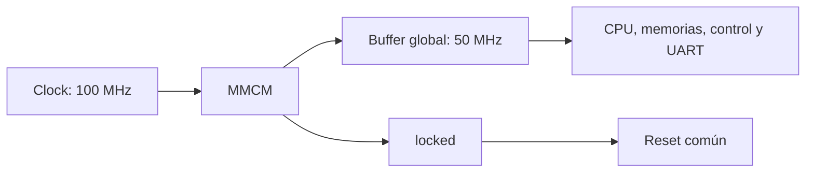

# Plataforma FPGA de referencia

- **Tipo:** arquitectura. 
- **Estado documental:** especificación vigente.
- **Estado:** Diseño aprobado el 2026-10-05.

## Propósito y alcance

Este documento define la plataforma FPGA de referencia del sistema, incluyendo:

- La generación y distribución del clock funcional.
- La relación entre `locked` y el reset común.
- Las fuentes y la conexión del reset.
- Los pines y constraints de la placa Basys 3.

La frecuencia de referencia del diseño es **50 MHz**, de acuerdo con la especificación docente. El diseño debe cumplir los requerimientos de timing a esa frecuencia. Alcanzar una frecuencia superior es una mejora opcional y no modifica el requisito mínimo. Operar por debajo de 50 MHz incumple el requisito de timing REQ-TIM-006.

El alcance incluye:

- La entrada de clock de 100 MHz.
- El Clocking Wizard con MMCM y BUFG.
- La salida funcional única de 50 MHz.
- El uso de `locked`.
- El reset asociado a la plataforma.
- Las restricciones de pines.

No define el comportamiento interno de la CPU, las memorias, la UART ni el protocolo; esos contratos pertenecen a sus documentos específicos.

## Generador del Clock 

Ya que la utilización del Clocking Wizard de Vivado es un requisito docente (`REQ-TIM-008`), el diseño aprobado es el siguiente:

### Diseño aprobado

El diseño emplea el Clocking Wizard de Vivado, configurado con una primitiva MMCM para Artix-7. El Wizard configura tanto el recurso dedicado como su red de distribución, y su única salida funcional es compartida por:

- CPU
- Pipeline
- Memorías
- Lógica de control
- UART

### Configuración aprobada

**Acuerdo:** Configuración aprobada el 2026-10-05. [Registro](../../decisions/DEC-ARCH-005.md#acuerdo-de-concreción-de-dec-arch-005--configuración-del-generador-de-clock).

| Parámetro | Configuración |
|---|---|
| Dispositivo | XC7A35T-1CPG236C, Basys 3 aprobada |
| Entrada primaria | 100 MHz, single-ended clock-capable pin |
| Primitiva | MMCM, síntesis de frecuencia |
| Salida única | 50 MHz, fase 0 grados, duty cycle 50 % |
| Distribución de salida | Buffer global BUFG |
| Feedback | Conexión automática del Wizard |
| Indicador de estabilidad | `locked` habilitado |
| Reconfiguración dinámica / fase dinámica / spread spectrum | deshabilitados |
| Reset del generador | Puerto activo alto; fuente aprobada: botón normalizado; duración aprobada en [especificación de placa](#condiciones-de-reset-en-la-placa) |

El siguiente diagrama resume la relación entre el generador, su indicador de estabilidad y el reset funcional común:

`locked` indica que el MMCM alcanzó una salida estable. Mientras `locked` permanezca inactivo, el sistema mantiene activo el reset funcional y no permite que la CPU ni los periféricos operen normalmente.

El reset funcional combinado no debe conectarse al puerto de reset del MMCM. Si la ausencia de `locked` mantuviera al propio MMCM permanentemente en reset, el generador no podría alcanzar la estabilidad necesaria para activar `locked`. Por eso, el reset del MMCM utiliza únicamente la fuente aprobada para la plataforma, mientras que `!locked` actúa sobre el reset funcional del sistema.

La conexión concreta del botón y de la solicitud de reset por UART está definida en la sección siguiente y debe conservar la secuencia aprobada en [Integración de reset](reset_integration.md).

## Conexión de reset aprobada

**Estado:** Aprobada el 2026-10-05. [Acuerdo](../../decisions/DEC-ARCH-005.md#acuerdo-de-concreción-de-dec-arch-005--conexión-del-reset-de-plataforma). Concreta las fuentes sin cambiar el acondicionador global aprobado.

La plataforma distingue entre el reset del generador de clock y el reset funcional del sistema. No son la misma señal ni tienen el mismo destino.

El **reset del generador** actúa sobre el puerto de reset del Clocking Wizard/MMCM y solo recibe `physical_reset_request`, generado por el botón de placa. El **reset funcional** actúa sobre la CPU, las memorias, el control, la UART y los demás consumidores del sistema. Se obtiene mediante el único `reset_sync` y combina `physical_reset_request`, `uart_reset_request` y `!locked`.

El clock y los dos caminos de reset se conectan de la siguiente manera:

### Clock

| Origen | Señal | Destino | Función |
|---|---|---|---|
| Clocking Wizard | salida de 50 MHz | BUFG | Distribuye el clock funcional. |
| BUFG | `clk` | `reset_sync` y consumidores funcionales | Proporciona el único clock del sistema. |

### Reset

| Origen | Señal | Destino | Función |
|---|---|---|---|
| Botón de placa | `physical_reset_request` | Reset del generador | Reinicia el MMCM cuando se solicita un reset físico. |
| Botón de placa | `physical_reset_request` | `reset_sync.async_reset_request` | Mantiene activo el reset funcional. |
| Controlador UART | `uart_reset_request` | `reset_sync.async_reset_request` | Solicita un reset funcional después de completar la secuencia `RESET`. |
| Clocking Wizard | `!locked` | `reset_sync.async_reset_request` | Mantiene el sistema en reset mientras el clock no sea estable. No reinicia el MMCM. |
| `reset_sync` | `reset` | CPU, memorias, control, UART y periféricos | Distribuye el reset funcional común, con aserción asíncrona y liberación sincronizada. |

El botón alimenta ambos caminos. Mientras está pulsado, el MMCM permanece en reset y el acondicionador mantiene el reset funcional asertado, incluso si no hay flancos. Después de soltarlo, el sistema espera a que `locked` indique estabilidad; solo entonces comienza la liberación mediante las dos etapas aprobadas. Los registros funcionales aplican sus efectos de reset al observarlo en un flanco válido.

`uart_reset_request` y `!locked` solo afectan al reset funcional. La solicitud `RESET` recibida por UART no reinicia el Clocking Wizard ni detiene el clock: después de transmitir el último Stop de la respuesta `ACCEPTED`, el controlador registra `uart_reset_request`, que entra a `reset_sync` según la secuencia temporal detallada en [Integración de reset](reset_integration.md).

Cuando el generador deja de indicar estabilidad, `!locked` mantiene el sistema en reset funcional, pero no se conecta al puerto de reset del MMCM. El generador debe continuar funcionando para intentar recuperar `locked`; el MMCM solo se reinicia mediante `physical_reset_request`. Esta separación evita que la falta de estabilidad lo mantenga permanentemente reseteado.

El arranque y la pérdida de estabilidad tienen estas respuestas:

| Situación | Respuesta |
|---|---|
| Arranque | `locked` mantiene el sistema en reset hasta estabilizar el generador; `reset_sync` conserva su inicialización aprobada. |
| Pérdida de estabilidad | Abortar la sesión al consumir reset, sin reanudar la ejecución previa. |

Si se pierde el clock de entrada y el MMCM necesita reset para recuperarse, el botón proporciona ese reset. No se promete recuperación automática ni se agrega un supervisor o FSM. Esta condición de uso sigue la recomendación de [AMD PG065 sobre resets](https://docs.amd.com/r/en-US/pg065-clk-wiz/Resets).

## Pines y restricciones aprobados

**Estado:** Aprobados el 2026-10-05. [Acuerdo](../../decisions/DEC-ARCH-005.md#acuerdo-de-concreción-de-dec-arch-005--pines-y-restricciones-de-basys-3). Concreta la conexión y las restricciones previstas sin añadir funciones ni alterar UART/reset aprobados.

### Interfaz física de la placa

La siguiente tabla resume los puertos físicos expuestos por el wrapper de la plataforma, su dirección, pin y conexión/polaridad: 

| Puerto del wrapper | Dirección | Pin | Conexión y polaridad |
|---|---|---|---|
| `clk_100mhz_i` | entrada | W5 | oscilador de placa de 100 MHz → entrada del Wizard |
| `reset_btn_i` | entrada | U18 | botón central BTNC; uno pulsado/cero libre → `physical_reset_request`, sin inversión |
| `uart_rx_i` | entrada | B18 | PC transmite → FPGA recibe; reposo uno → sincronizador RX de dos etapas existente |
| `uart_tx_o` | salida | A18 | FPGA transmite → PC recibe; salida registrada UART, reposo uno |

Los cuatro puertos utilizar el estándar eléctrico **LVCMOS33**, según el [Master XDC oficial de Digilent](https://github.com/Digilent/digilent-xdc/blob/master/Basys-3-Master.xdc).

- **Polaridad y dirección:** confirmadas con el manual de la placa.
- **Configuración eléctrica:** `CONFIG_VOLTAGE` = `3.3` y `CFGBVS` = `VCCO`.
- **UART:** no requiere un clock externo hacia la PC.

El wrapper integra los siguientes elementos y conexiones:

- Contiene el Clocking Wizard y el `reset_sync` común.
- Conecta el clock y el reset funcionales al sistema.
- Conecta la petición UART registrada a la combinación de fuentes de reset.
- Conserva el sincronizador RX en `uart_core`; no se duplica en el wrapper.

El perfil y los parámetros comunes, así como la composición interna final, están concretados en [Configuración](../common_configuration.md) y [Composición](../system_composition.md).

### Condiciones de reset en la placa

El botón central de la Basys 3 genera `physical_reset_request`. Al pulsarlo:

- se reinicia el generador de clock MMCM;
- se mantiene activo el reset funcional;
- la CPU y los periféricos permanecen detenidos.

Al soltar el botón, el MMCM vuelve a generar el clock de 50 MHz. El sistema espera a que el Clocking Wizard active `locked`, indicando que el clock es estable. Recién después `reset_sync` libera el reset funcional de forma sincronizada. La CPU y los periféricos comienzan a funcionar a partir de ese momento.

El botón se conecta directamente, sin filtro antirrebote. Por eso, un rebote puede repetir el reset. Como criterio de integración, se recomienda mantenerlo pulsado al menos **1 µs**.

La duración mínima exigida por el FPGA para los resets internos del MMCM y del acondicionador se comprobará durante la implementación. Esos valores son restricciones del dispositivo y no cambian el comportamiento funcional descrito arriba.

### Constraints de implementación previstos

Esta sección define las restricciones que deberán aplicarse durante la implementación del diseño FPGA. Las restricciones informan a Vivado sobre los pines físicos, los clocks, los caminos de datos y las señales asíncronas; no modifican el comportamiento del RTL.

Las restricciones se organizan en cuatro grupos:

1. conexión física de los puertos;
2. definición y relación de clocks;
3. timing de las interfaces UART;
4. tratamiento del reset y de los sincronizadores.

Los nombres exactos de los objetos jerárquicos y de los endpoints se confirmarán contra la netlist generada. Por eso, esta sección define los caminos y las condiciones que deben cumplirse, pero no constituye todavía un archivo XDC ejecutable.

| Camino o recurso | Restricción prevista / justificación |
|---|---|
| Puertos físicos | `PACKAGE_PIN` e `IOSTANDARD` según tabla; cuatro puertos, sin asignaciones de pines vacías |
| Reloj primario | `create_clock` sobre `clk_100mhz_i`: período 10 ns, waveform 0/5 ns, nombre `clk_board_100` |
| Reloj funcional | derivación de MMCM por Vivado/IP, relación exacta 100→50 y período 20 ns; comprobar con `report_clocks` |
| Duplicación de clocks | una definición primaria autoritativa en XDC de placa; revisar constraints del IP generado y evitar duplicar/redefinir clocks en los mismos puntos |
| Relación 100/50 MHz | clocks relacionados; no declararlos asíncronos entre sí ni introducir un clock de baud/STEP |
| RX de pin a D de la primera etapa | `set_max_delay` -`datapath_only` de 20 ns, desde `uart_rx_i` al único primer registro del sincronizador; cota de ruta sin asumir fase externa |
| Entre etapas RX y hacia receptor | timing síncrono normal de 20 ns; `ASYNC_REG` en ambas etapas y comprobación de reconocimiento/ubicación con `report_cdc` |
| Registro TX a puerto | `set_max_delay` -`datapath_only` de 20 ns desde Q del registro de salida TX hasta `uart_tx_o`; sin inventar un clock de captura del puente USB |
| Reset asíncrono de plataforma | excepciones limitadas a entradas asíncronas PRE/CLR de las dos etapas `reset_sync` y RST del MMCM; botón/`locked`/solicitud UART no tienen relación de fase de liberación exigible allí |
| Etapas `reset_sync` y reset funcional distribuido | `ASYNC_REG` conservado; timing normal entre etapas y desde salida acondicionada hasta consumidores síncronos. Ninguna excepción global sobre reset funcional |
| Datos/control CPU, memorias y transporte interno | setup/hold normales del dominio de 50 MHz; no multicycle ni `false_path` para evitar caminos lentos |

Las cotas de ruta UART de 20 ns son presupuestos conservadores de integración, independientes de la fase del enlace; los bits UART mantienen su timing definido por la lógica y el protocolo. No se superpone `false_path` a esos caminos, pues anularía sus cotas. Tampoco se inventan input/output delays síncronos de la PC. Las excepciones de reset se documentan como aserción/desaserción asíncrona en el acondicionador/recurso, nunca como permiso para liberar directamente registros funcionales.

Los objetos jerárquicos exactos de las consultas XDC se resolverán contra la netlist del RTL al implementar; endpoints lógicos y límites están fijados aquí. Cada consulta debe encontrar el número previsto de objetos: un primer registro RX, un registro TX, dos etapas `reset_sync` y un MMCM. No se admite un comodín que alcance todos los registros ni `CLOCK_DEDICATED_ROUTE`=FALSE para eludir una conexión incorrecta.

## Referencias y trazabilidad

- [Manual oficial Basys 3, Digilent](https://digilent.com/reference/_media/reference/programmable-logic/basys-3/basys3_rm.pdf): oscilador de 100 MHz y plataforma.
- [Clocking Wizard PG065: selección de funciones](https://docs.amd.com/r/en-US/pg065-clk-wiz/Selecting-Clocking-Features): configuración de recursos MMCM/PLL.
- [Clocking Wizard PG065: configuración de salidas](https://docs.amd.com/r/en-US/pg065-clk-wiz/Configuring-Output-Clocks): frecuencia, fase y duty cycle solicitados.
- [Clocking Wizard PG065: buffering y feedback](https://docs.amd.com/r/en-US/pg065-clk-wiz/Clock-Buffering-and-Feedback): construcción de la red de clock y feedback automático.

- [Master XDC Basys 3, Digilent](https://github.com/Digilent/digilent-xdc/blob/master/Basys-3-Master.xdc): pines y estándar eléctrico.
- [DS181 Artix-7, AMD, revisión 1.27.1](https://docs.amd.com/api/khub/documents/iAkxxTOk96ANLJqYf2hgrQ/content): tablas 26 y 37, mínimos de pulso SR/RST.
- [UG903: clocks derivados automáticamente](https://docs.amd.com/r/en-US/ug903-vivado-using-constraints/Automatically-Derived-Clocks): derivación desde el clock maestro del MMCM.
- [UG903: señales asíncronas](https://docs.amd.com/r/en-US/ug903-vivado-using-constraints/Constraining-Asynchronous-Signals): cotas `datapath_only` sin relación de fase.
- [UG903: sincronizadores y ASYNC_REG](https://docs.amd.com/r/en-US/ug903-vivado-using-constraints/CDC-Synchronizers-and-ASYNC_REG-Property): conservación y reconocimiento de las etapas.
