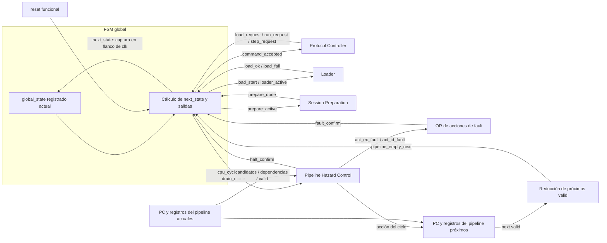
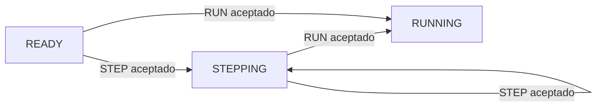
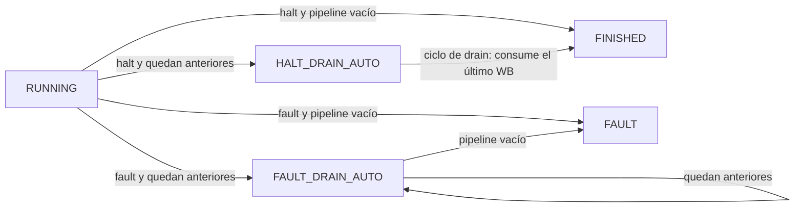
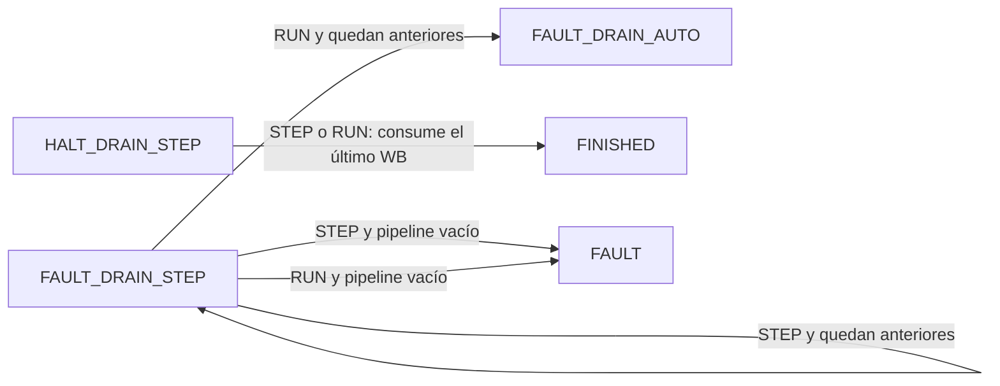
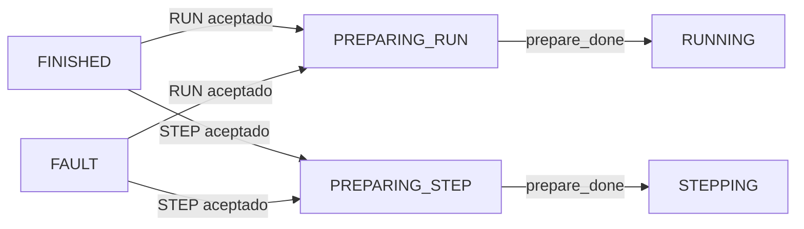

# Control de ejecución y sesión

- **Tipo:** arquitectura. 
- **Estado documental:** especificación vigente.

**Índice**

- [Propósito y alcance](#propósito-y-alcance)
- [Clock físico y ciclo de la CPU](#clock-físico-y-ciclo-de-la-cpu)
- [Por qué hace falta un control global](#por-qué-hace-falta-un-control-global)
- [Comenzar desde una imagen inexistente](#comenzar-desde-una-imagen-inexistente)
- [RUN: ejecución continua](#run-ejecución-continua)
- [STEP: ejecución de un solo ciclo](#step-ejecución-de-un-solo-ciclo)
- [Cuando se confirma halt o fault](#cuando-se-confirma-halt-o-fault)
- [Después de FINISHED o FAULT](#después-de-finished-o-fault)
- [LOAD durante una sesión existente](#load-durante-una-sesión-existente)
- [RESET](#reset)
- [FSM global](#fsm-global)
  - [Entradas de la FSM](#entradas-de-la-fsm)
  - [Salidas de la FSM](#salidas-de-la-fsm)
  - [Diagrama completo de estados](#diagrama-completo-de-estados)
- [Estado global asociado a la sesión](#estado-global-asociado-a-la-sesión)
- [Aceptación de LOAD, RUN y STEP](#aceptación-de-load-run-y-step)
- [Autorización de un ciclo de la CPU](#autorización-de-un-ciclo-de-la-cpu)
- [Origen del ciclo](#origen-del-ciclo)
- [Resultado de un ciclo](#resultado-de-un-ciclo)
- [Alcanzabilidad de las transiciones](#alcanzabilidad-de-las-transiciones)
- [Pipeline vacío](#pipeline-vacío)
- [HOLD](#hold)
- [Preparación y prioridad global](#preparación-y-prioridad-global)
- [Contador lógico de ciclos](#contador-lógico-de-ciclos)
- [Señales derivadas de global_state](#señales-derivadas-de-global_state)
- [Tabla de transiciones](#tabla-de-transiciones)
- [Invariantes y condiciones de borde](#invariantes-y-condiciones-de-borde)
- [Referencias y trazabilidad](#referencias-y-trazabilidad)

<a id="imagen-sesión-y-ejecución"></a>

## Propósito y alcance

Este documento define el control global que administra las sesiones de ejecución del procesador. Su función es coordinar el programa cargado, la preparación del estado inicial, la aceptación de comandos y la autorización de los ciclos efectivos de la CPU.

El alcance comprende:

- La distinción entre la **imagen** almacenada en IMEM y una **sesión** concreta que ejecuta esa imagen.
- La inicialización del estado de una sesión: `PC=0`, banco de registros en cero, pipeline vacío, DMEM lógicamente en cero y `cycle_count=0`.
- La diferencia entre el clock físico del sistema y un ciclo efectivo indicado por `cpu_cycle_fire`.
- La aceptación y el significado de `LOAD`, `RUN` y `STEP` según el estado global de la sesión.
- La autorización de ciclos normales, ciclos de `STEP`, stalls, redirects, drenados y terminaciones por `halt` o fault.
- Las transiciones de la FSM global, el contador lógico de ciclos y el comportamiento posterior a `FINISHED` o `FAULT`.

La **imagen** es el contenido de IMEM que fue cargado y confirmado; no cambia simplemente porque una sesión avance o termine. Una **sesión** es una ejecución de esa imagen desde un estado inicial limpio hasta una terminación normal o por fault. Por eso la misma imagen puede ejecutarse varias veces: al preparar una nueva sesión se reinicializa el estado de ejecución, aunque las instrucciones permanezcan cargadas en IMEM.

Cargar y ejecutar son operaciones distintas. `LOAD` establece qué instrucciones forman la imagen; la preparación establece desde qué estado comienza la sesión; `RUN` habilita el avance continuo y `STEP` autoriza ciclos individuales. El clock físico puede seguir funcionando durante cualquiera de estas actividades, pero el procesador solo avanza cuando el control global autoriza un ciclo efectivo.

<a id="clock-físico-y-ciclo-cpu"></a>

## Clock físico y ciclo de la CPU

El clock físico es el reloj común del sistema y continúa generando flancos aunque la CPU no esté ejecutando instrucciones. Durante una carga, la preparación de una sesión, la espera de un comando o una transferencia de Debug pueden seguir avanzando otros bloques de control, mientras el PC y los registros del pipeline permanecen retenidos. Por eso, que ocurra un flanco físico no implica necesariamente que una instrucción haya avanzado.

La arquitectura distingue entonces entre un flanco físico y un **ciclo efectivo de la CPU**.

```text
cpu_cycle_fire = 1
```

indica que en ese flanco se ejecuta un ciclo del procesador. Durante ese ciclo pueden avanzar instrucciones, producirse un stall `load-use`, resolverse un redirect, confirmarse `halt` o un fault, o avanzar las instrucciones anteriores durante drain.

Cuando:

```text
cpu_cycle_fire = 0
```

el pipeline no ejecuta un ciclo. El sistema puede seguir activo en otros subsistemas, pero el estado de la CPU permanece retenido salvo que una operación global, como `RESET`, `LOAD` aceptado o preparación de sesión, esté modificándolo.

Esta separación permite utilizar el mismo clock físico para todo el sistema sin confundir actividad general con avance del procesador.

## Por qué hace falta un control global

El control interno del pipeline responde qué ocurre **dentro de un ciclo de la CPU ya autorizado**. Si aparece una dependencia, decide qué registros retener; si una instrucción redirige el flujo, descarta las posteriores; si se confirma `halt` o un fault, deja de admitir trabajo nuevo y determina qué instrucciones pueden terminar.

Antes de autorizar cualquier ciclo, el sistema necesita conocer:

- Si hay una imagen cargada.
- Si la sesión ya fue preparada.
- Si se ejecuta en modo continuo o paso a paso.
- Si quedan instrucciones por drenar después de confirmar `halt` o fault.
- Si la sesión ya terminó.

Una misma orden externa puede significar cosas diferentes según el contexto. Para `STEP`, los casos son:

| Contexto                        | Efecto de `STEP`                           |
| ------------------------------ | ------------------------------------------ |
| Sesión lista                   | Ejecuta el primer ciclo.                   |
| `STEPPING`                     | Ejecuta un ciclo adicional.                |
| Drain `STEP`                   | Avanza únicamente trabajo anterior.        |
| Después de `FINISHED` o `FAULT` | Inicia la preparación de una sesión nueva. |

Para conservar ese contexto, la arquitectura mantiene una fase global en `global_state`. Ese estado indica, entre otras cosas, si todavía no hay imagen, si la sesión está lista, si se está ejecutando o si debe drenarse o finalizarse el pipeline.

La [representación física](global_state_encoding.md) utiliza catorce bits one-hot: `NO_IMAGE` ocupa el bit cero y los demás estados ocupan un bit cada uno. Además, existe una conversión combinacional desde esa representación al código de ocho bits que se transmite en Debug.

La FSM global no reemplaza al control del pipeline. Su responsabilidad es conservar el contexto de la sesión y, a partir de ese contexto, determinar qué operaciones externas son posibles y cuándo puede generarse `cpu_cycle_fire`.

El esquema siguiente muestra la aceptación de comandos y la autorización de ciclos integradas en la FSM global, junto con los resultados del pipeline que determinan el estado siguiente.



La FSM conserva la fase de la sesión, acepta las solicitudes permitidas y genera `cpu_cycle_fire`. `Pipeline Hazard Control` recibe esa autorización junto con `drain_mode` y determina cómo se utiliza el ciclo. La captura de `global_state` es registrada; `next_state` no autoriza ni modifica el ciclo que lo produce.

---

## Comenzar desde una imagen inexistente

Después de reset no existe una imagen ejecutable confirmada. El sistema se encuentra en `NO_IMAGE`, con:

```text
loaded_image_size_bytes = 0
```

En esa situación `RUN` y `STEP` no pueden iniciar una ejecución porque todavía no hay programa válido.

Una carga aceptada lleva al sistema a `LOADING`. Durante esta fase el `Loader` recibe y escribe la nueva imagen en IMEM. El progreso de esa carga pertenece al `Loader` y todavía no forma parte del estado ejecutable de la CPU.

Si la carga falla, el sistema vuelve a `NO_IMAGE`. Si termina correctamente, aparece `load_ok` y comienza una fase distinta: la imagen ya fue recibida, pero todavía falta preparar el estado inicial de la primera sesión.

Ese estado es `PREPARING_READY`.


Durante `PREPARING_READY`, `Session Preparation` establece el estado inicial de ejecución:

- `PC` vuelve a cero.
- El banco de registros queda lógicamente en cero.
- Los registros interetapa quedan inválidos.
- DMEM presenta el cero lógico de una sesión nueva.
- `cycle_count` vuelve a cero.

La preparación puede ocupar varios clocks físicos. Mientras no termina, no existe un ciclo de la CPU.

`prepare_done` certifica que ese trabajo ya terminó antes del flanco actual. En `PREPARING_READY`, la FSM activa `image_publish`: el registro de tamaño captura la imagen confirmada en el mismo flanco que lleva a `READY`.

`READY` representa una imagen válida y una sesión preparada que todavía espera una orden.

---

## RUN: ejecución continua

`RUN` inicia o reanuda una ejecución continua.

Cuando `RUN` se acepta en `READY`, el mismo flanco ya constituye el primer ciclo de la CPU y el estado siguiente es `RUNNING`. El pipeline parte vacío: ese ciclo realiza el primer fetch, sin una instrucción en ID o EX que pueda confirmar `halt` o fault.

En `RUNNING`, cada flanco habilitado solicita automáticamente otro ciclo de la CPU. El procesador continúa de esta manera hasta que se produce una condición que inicia la terminación de la ejecución.

La ejecución continua no implica que todos los ciclos sean iguales. Dentro de `RUNNING`, el control del pipeline puede seleccionar avance normal, stall `load-use`, redirect o confirmación de `halt` o fault. Todos ellos siguen siendo ciclos de la CPU porque `cpu_cycle_fire=1`.


Un stall no detiene el modo continuo; solamente altera cómo avanza el pipeline durante ese ciclo. Un redirect tampoco abandona `RUNNING`; cambia el PC y descarta trabajo posterior, pero la sesión continúa.

---

## STEP: ejecución de un solo ciclo

`STEP` utiliza el mismo datapath que `RUN`, pero cambia la política temporal.

Con `RUN`, después de un ciclo se solicita otro automáticamente. Con `STEP`, se ejecuta exactamente un ciclo y después se vuelve a esperar.

Si `STEP` se acepta en `READY`, ese flanco ejecuta el primer fetch de la sesión y el estado siguiente es `STEPPING`. Como el pipeline parte vacío, ese ciclo no puede confirmar `halt` o fault.

`STEPPING` representa una sesión activa detenida entre dos ciclos. Por sí solo no solicita `cpu_cycle_fire`; necesita una nueva orden `RUN` o `STEP`.



Las flechas que salen de `STEPPING` muestran el caso en que el ciclo ejecutado no confirma `halt` ni fault. Las que salen de `READY` siempre tienen ese resultado.

Un stall `load-use` consume el `STEP`. Aunque el consumidor permanezca retenido, el ciclo existió: el load y las instrucciones anteriores avanzaron. No se agrega un segundo ciclo automático para completar la dependencia.

---

<a id="cuando-una-sesión-encuentra-una-frontera-terminal"></a>

## Cuando se confirma `halt` o fault

Una sesión puede terminar normalmente mediante `halt` o excepcionalmente mediante un fault.

Confirmar `halt` o fault no implica necesariamente que todo el pipeline ya esté vacío. En ese momento pueden existir instrucciones anteriores en MEM o WB que todavía deben terminar su ejecución.

Esas instrucciones conservan sus efectos. Por eso la arquitectura no salta siempre directamente desde ejecución a `FINISHED` o `FAULT`.

Si todavía queda trabajo anterior, aparece una fase intermedia de **drain**.

Durante el drain no se admite trabajo nuevo. La instrucción que provoca un fault ya fue descartada, o `halt` ya se consumió en EX. Las instrucciones posteriores también se descartaron; únicamente continúan las instrucciones anteriores hasta abandonar el pipeline.

### Drain después de RUN

Si `halt` o fault se confirmó durante la ejecución continua, el drenado también continúa automáticamente.

Un `halt` conduce a `HALT_DRAIN_AUTO` cuando todavía queda trabajo. Un fault conduce a `FAULT_DRAIN_AUTO`.



En los estados `AUTO`, cada flanco elegible solicita un nuevo ciclo de drain hasta que desaparece la última instrucción anterior.

Al confirmar `halt` en EX, `EX/MEM.next.valid=0` y solo puede quedar trabajo en `MEM/WB`. Por eso `HALT_DRAIN_AUTO` requiere exactamente un ciclo efectivo para llegar a `FINISHED`; su bucle con trabajo restante no es alcanzable.

`FINISHED` representa una terminación normal con pipeline vacío. `FAULT` representa una terminación excepcional con pipeline vacío.

### Drain después de STEP

Si `halt` o fault se confirmó durante un ciclo originado por `STEP`, el drenado respeta la modalidad paso a paso.

`HALT_DRAIN_STEP` y `FAULT_DRAIN_STEP` no avanzan automáticamente. Cada `STEP` autoriza un único ciclo adicional de drain.

`RUN` también puede aceptarse en esos estados. Desde `HALT_DRAIN_STEP`, tanto `RUN` como `STEP` consumen el único WB pendiente y llevan directamente a `FINISHED`. Desde `FAULT_DRAIN_STEP`, el ciclo actual se ejecuta y, si todavía queda trabajo después del flanco, el resto del drenado pasa a modalidad `AUTO`.



Así, la modalidad de ejecución en la que se confirmó `halt` o fault sigue determinando cuándo se autoriza el trabajo anterior. `HALT_DRAIN_STEP` puede conservar su estado mientras espera una orden, pero no después de ejecutar un ciclo de drain.

---

## Después de `FINISHED` o `FAULT`

Llegar a un estado terminal termina la sesión, pero no elimina necesariamente la imagen confirmada.

La misma imagen puede ejecutarse otra vez. Sin embargo, `RUN` o `STEP` desde `FINISHED` o `FAULT` no reanudan la ejecución anterior. La sesión anterior ya terminó y su pipeline está vacío.

Antes de ejecutar nuevamente se reconstruye el estado inicial.

Si la nueva orden es `RUN`, la FSM entra en `PREPARING_RUN`. Si la orden es `STEP`, entra en `PREPARING_STEP`.



En ambos casos, mientras `prepare_done=0` no existe un ciclo de la CPU.

Cuando la preparación termina, la nueva sesión ya está limpia antes del flanco. Ese mismo flanco ejecuta el primer ciclo pendiente.

Ese ciclo realiza el primer fetch con el pipeline vacío: `PREPARING_RUN` pasa a `RUNNING` y `PREPARING_STEP` pasa a `STEPPING`. No puede confirmar `halt` o fault, incluso si la primera palabra de la imagen es `halt` o una instrucción ilegal; esas condiciones se confirman cuando alcanzan EX o ID, respectivamente.

`PREPARING_RUN` y `PREPARING_STEP` son estados distintos porque durante la preparación hay que conservar qué tipo de ejecución fue solicitada. No existe una cola adicional para recordar esa orden; el propio estado contiene ese contexto.

---

## LOAD durante una sesión existente

Una nueva carga abandona la sesión vigente y reemplaza la imagen.

`LOAD` puede aceptarse desde:

```text
NO_IMAGE
READY
STEPPING
HALT_DRAIN_STEP
FAULT_DRAIN_STEP
FINISHED
FAULT
```

Cuando se acepta, el sistema pasa a `LOADING` y:

```text
loaded_image_size_bytes = 0
```

El flanco no ejecuta un ciclo de la CPU de la sesión anterior.

La FSM indica ese inicio mediante `load_start=1` y comunica la aceptación del comando mediante `command_accepted=1`. `load_start` llega al `Loader` y al registro de tamaño confirmado; no se espera a entrar en `LOADING` para invalidar la imagen anterior.

`RUNNING`, los drains `AUTO`, `LOADING` y los estados de preparación no aceptan `LOAD`. Una solicitud no elegible se rechaza y no altera por sí sola la ejecución actual. En particular, un `LOAD` rechazado durante `RUNNING` no cancela el ciclo automático correspondiente.

---

## RESET

`RESET` tiene prioridad sobre cualquier otro efecto funcional.

El reset puede originarse en la orden UART `RESET` o en el botón físico, pero ambas fuentes terminan convergiendo en la misma solicitud global:

- **Orden UART:** sigue el [intercambio externo aprobado](../../decisions/DEC-PROTO-002.md#acuerdo-parcial-de-dec-proto-002--intercambio-reset-con-aceptación-antes-del-reset-global). El sistema primero transmite completa la respuesta `[RESET][ACCEPTED]` y recién después genera la solicitud global, cuando finaliza físicamente el segundo byte, incluido su bit de Stop.
- **Botón físico:** genera la solicitud directamente, sin esperar una respuesta UART.

La solicitud resultante conserva el acondicionamiento y la prioridad funcional definidos para el reset. Las fuentes se reúnen antes del `reset_sync` del TP2, que utiliza dos etapas y entrega una salida común para el consumo funcional síncrono. No se agrega un estado global de espera UART; la integración completa se describe en [Reset Integration](../platform/reset_integration.md).

Durante una respuesta automática de Debug, la capa de protocolo descarta los datos recibidos y no reconoce una orden UART `RESET`. La PC debe esperar a que termine la respuesta completa antes de enviar esa orden. El botón físico, en cambio, puede solicitar reset inmediatamente y abortar la transmisión en curso.

La exclusión de nuevas solicitudes UART comienza en el instante postciclo observado y se mantiene hasta que termina físicamente el último byte de la respuesta, incluido su bit de Stop. Esta exclusión no cambia la prioridad del reset funcional ni agrega estados a la FSM global. Véase el [acuerdo de envío exclusivo](../../decisions/DEC-PROTO-001.md#acuerdo-parcial-de-dec-proto-001--envío-exclusivo-de-debug-con-estado-retenido).

Desde cualquier estado lleva al sistema a:

```text
NO_IMAGE
```

y deja:

```text
PC = 0
Register File = 0 lógico
cycle_count = 0
IF/ID.valid = 0
ID/EX.valid = 0
EX/MEM.valid = 0
MEM/WB.valid = 0
IF/ID.fetch_fault_valid = 0
loaded_image_size_bytes = 0
```

En ese mismo flanco no se realizan stores, writebacks, operaciones del `Loader` ni operaciones de mantenimiento.

IMEM y DMEM no necesitan borrarse físicamente. El tamaño confirmado invalida la imagen anterior y la preparación de la próxima sesión restablece el cero lógico de DMEM.

---

## FSM global

Las situaciones anteriores se representan mediante `global_state`.

La FSM registra únicamente la fase de la sesión. No escribe directamente PC, banco de registros, memorias o registros interetapa, y tampoco selecciona las acciones internas del pipeline.

La lógica combinacional evalúa el estado actual y las entradas para calcular `next_state` y sus salidas. En cada flanco positivo de `clk`, el registro captura `global_state <- next_state`. Si ambos estados coinciden, el estado se conserva.

La FSM combina salidas Moore, que dependen del estado registrado, y salidas Mealy, que también dependen de las entradas actuales. Por ejemplo, `prepare_active` indica una fase y `load_start` ordena iniciar una carga seleccionada. Los recursos consumen esas señales y realizan sus actualizaciones en su propia lógica secuencial.

Sus estados son:

| Estado               | Significado                                                                                   |
| -------------------- | --------------------------------------------------------------------------------------------- |
| `NO_IMAGE`           | No existe una imagen ejecutable confirmada.                                                   |
| `LOADING`            | Se recibe y valida una imagen nueva.                                                          |
| `PREPARING_READY`    | Se prepara la primera sesión de una imagen recién cargada.                                    |
| `READY`              | Imagen y sesión preparadas, esperando `RUN` o `STEP`.                                         |
| `RUNNING`            | Ejecución continua.                                                                           |
| `STEPPING`           | Ejecución paso a paso, detenida entre órdenes.                                                |
| `HALT_DRAIN_AUTO`    | `halt` confirmado con trabajo anterior; drain automático.                                     |
| `HALT_DRAIN_STEP`    | `halt` confirmado con instrucciones anteriores pendientes; drenado mediante órdenes `STEP`.   |
| `FAULT_DRAIN_AUTO`   | fault confirmado con trabajo anterior; drain automático.                                      |
| `FAULT_DRAIN_STEP`   | fault confirmado con instrucciones anteriores pendientes; drenado mediante órdenes `STEP`.    |
| `FINISHED`           | Terminación normal con pipeline vacío.                                                        |
| `FAULT`              | Terminación excepcional con pipeline vacío.                                                   |
| `PREPARING_RUN`      | Preparación de una sesión nueva con `RUN` pendiente.                                          |
| `PREPARING_STEP`     | Preparación de una sesión nueva con `STEP` pendiente.                                         |

### Entradas de la FSM

Esta interfaz corresponde a `global_fsm`, no a todos los puertos de `execution_control`.

| Entrada               | Ancho | Origen                                      | Función                                                                    |
| --------------------- | ----: | ------------------------------------------- | -------------------------------------------------------------------------- |
| `clk`                 | 1     | Reloj funcional común                       | Capturar el estado en el flanco positivo.                                  |
| `reset`               | 1     | Reset funcional acondicionado               | Suprimir controles Mealy y volver a `NO_IMAGE`.                            |
| `load_request`        | 1     | `protocol_controller`                       | Solicitar una carga.                                                       |
| `run_request`         | 1     | `protocol_controller`                       | Solicitar ejecución continua.                                              |
| `step_request`        | 1     | `protocol_controller`                       | Solicitar un paso.                                                         |
| `load_ok`             | 1     | `Loader`                                    | Indicar carga completada.                                                  |
| `load_fail`           | 1     | `Loader`                                    | Indicar carga abortada.                                                    |
| `prepare_done`        | 1     | `Session Preparation`                       | Indicar mantenimiento completado antes del flanco.                         |
| `halt_confirm`        | 1     | `Pipeline Hazard Control`                   | Indicar confirmación de `halt`.                                            |
| `fault_confirm`       | 1     | OR local de `act_ex_fault` y `act_id_fault` | Indicar confirmación de fault ya seleccionada por el control del pipeline. |
| `pipeline_empty_next` | 1     | Lógica local sobre los cuatro `next.valid`  | Indicar si el ciclo deja el pipeline vacío.                                |

`load_ok` y `load_fail` son excluyentes. También lo son `halt_confirm` y `fault_confirm`, porque proceden de acciones mutuamente excluyentes. Las tablas de transiciones respetan estas restricciones de los productores.

### Salidas de la FSM

Las salidas Mealy se calculan antes del flanco y tienen valor cero por defecto. Las salidas Moore reflejan el estado registrado actual.

| Salida                   | Ancho | Tipo  | Consumidor y función                                                                                                                 |
| ------------------------ | ----: | ----- | ------------------------------------------------------------------------------------------------------------------------------------ |
| `command_accepted`       | 1     | Mealy | `protocol_controller`: indicar aceptación de la solicitud presentada.                                                                |
| `load_start`             | 1     | Mealy | `Loader` y registro de tamaño: iniciar la carga e invalidar la imagen anterior.                                                      |
| `cpu_cycle_fire`         | 1     | Mealy | `Pipeline Hazard Control`, `WB Bypass Control`, `DMEM Write Control`, contador y `protocol_controller`: autorizar un ciclo efectivo. |
| `image_publish`          | 1     | Mealy | Registro de tamaño: capturar el tamaño pendiente de la imagen preparada.                                                             |
| `loader_active`          | 1     | Moore | `Loader`: habilitar la fase `LOADING`.                                                                                               |
| `prepare_active`         | 1     | Moore | `Session Preparation` y `protocol_controller`: indicar preparación activa.                                                           |
| `drain_mode`             | 1     | Moore | `Pipeline Hazard Control`: identificar un ciclo de drenado junto con `cpu_cycle_fire`.                                               |
| `load_available`         | 1     | Moore | `protocol_controller`: informar disponibilidad de sesión para `LOAD`.                                                                |
| `program_finished`       | 1     | Moore | `protocol_controller`: indicar terminación normal con pipeline vacío.                                                                |
| `fault_terminal`         | 1     | Moore | `protocol_controller`: indicar terminación por fault con pipeline vacío.                                                             |
| `global_state_code[7:0]` | 8     | Moore | `response_serializer`: representar el estado en Debug.                                                                               |

### Diagrama completo de estados

El diagrama reúne los catorce estados y las transiciones alcanzables de carga, preparación, ejecución, drenado y reutilización de la imagen. Las condiciones corresponden a la [tabla de transiciones](#tabla-de-transiciones), al [resultado de un ciclo](#resultado-de-un-ciclo) y a las [restricciones de alcanzabilidad](#alcanzabilidad-de-las-transiciones).

[](../../diagrams/generated/fsm_global.drawio.svg)

Los círculos del recuadro de estados elegibles para `LOAD` son referencias a estados del diagrama. Las reglas globales se aplican con prioridad `reset > load_request > transiciones locales`.

[Abrir la versión SVG](../../diagrams/generated/fsm_global.drawio.svg) · [Fuente editable de draw.io](../../diagrams/generated/fsm_global.drawio.xml).

La representación externa de estos estados en Debug está aprobada: un byte con códigos 0x00–0x0D en el mismo orden de la tabla de estados de [FSM global](#fsm-global). No impone la codificación física de la FSM. Véase el [acuerdo de estados](../../decisions/DEC-PROTO-001.md#acuerdo-parcial-de-dec-proto-001--códigos-externos-de-global_state).

La modalidad `AUTO`/`STEP` del drain forma parte de `global_state`; no existe un registro `drain_auto`. El tipo terminal también está representado por el estado; no existe un flip-flop separado `terminal_kind`.

---

## Estado global asociado a la sesión

Además de `global_state`, el sistema conserva otros registros globales:

| Registro                    | Función                                                |
| --------------------------- | ------------------------------------------------------ |
| `fault_cause[2:0]`          | Causa del fault confirmado.                            |
| `fault_pc[31:0]`            | PC de la operación causante.                           |
| `loaded_image_size_bytes`   | Tamaño de la imagen confirmada.                        |
| `cycle_count[63:0]`         | Cantidad de ciclos efectivos de la CPU de la sesión.   |

PC, banco de registros, memorias y registros interetapa pertenecen al datapath.

`image_valid` deriva de `loaded_image_size_bytes != 0`. Las salidas Moore y la vigencia de los metadatos de fault se derivan del estado de sesión; no agregan registros persistentes.

Los registros de causa y PC se habilitan con `fault_confirm`, formado por `act_ex_fault || act_id_fault`. La selección local utiliza causa EX e `ID/EX.pc` para un fault de EX, o causa ID e `IF/ID.pc` para uno de ID. Sin confirmación conservan el contenido. La captura ocurre en el mismo flanco que actualiza la fase, antes de perder el contexto al invalidar el pipeline.

El registro de tamaño se actualiza por las órdenes de la FSM:

| Condición                 | Tamaño confirmado después del flanco                          |
| ------------------------- | ------------------------------------------------------------- |
| `reset`                   | Cero.                                                         |
| `load_start`              | Cero; la imagen anterior queda invalidada.                    |
| `image_publish`           | Tamaño pendiente validado de `Loader`.                        |
| Ninguna de las anteriores | Conservar, incluida la preparación de una imagen reutilizada. |

Estas actualizaciones pertenecen a los recursos locales de `execution_control`, con la prioridad indicada. `load_ok` no publica por sí solo una imagen.

---

## Aceptación de LOAD, RUN y STEP

`LOAD`, `RUN` y `STEP` son  operaciones conceptuales. Su codificación UART se define en el protocolo externo.

La FSM recibe `load_request`, `run_request` y `step_request`. Primero comprueba si cada operación es elegible en el estado actual y después aplica la prioridad:

```text
RESET > LOAD > STEP > RUN
```

Por eso un `LOAD` aceptado excluye `RUN` y `STEP`, mientras un `STEP` aceptado excluye `RUN`.

La elegibilidad es:

| Operación   | Estados elegibles                                                                             |
| ----------- | --------------------------------------------------------------------------------------------- |
| `LOAD`      | `NO_IMAGE`, `READY`, `STEPPING`, `HALT_DRAIN_STEP`, `FAULT_DRAIN_STEP`, `FINISHED`, `FAULT`   |
| `RUN`       | `READY`, `STEPPING`, `HALT_DRAIN_STEP`, `FAULT_DRAIN_STEP`, `FINISHED`, `FAULT`               |
| `STEP`      | `READY`, `STEPPING`, `HALT_DRAIN_STEP`, `FAULT_DRAIN_STEP`, `FINISHED`, `FAULT`               |

La selección se realiza en la lógica combinacional de la FSM teniendo en cuenta condiciones del estado actual. Las solicitudes que no interesan al estado se ignoran.

`protocol_controller` presenta una sola solicitud por ciclo y conoce el comando que está atendiendo. La FSM responde con `command_accepted=1` si la acepta. Con una solicitud presente, cero significa rechazo; sin solicitud, cero no constituye un evento.

---

<a id="autorización-de-un-ciclo-cpu"></a>

## Autorización de un ciclo de la CPU

La FSM determina si existe un ciclo efectivo de la CPU a partir del estado actual, las solicitudes y la finalización de preparación.

Hay tres fuentes.

La primera corresponde a estados que avanzan automáticamente:

```text
automatic_cycle_request =
    state en {
        RUNNING,
        HALT_DRAIN_AUTO,
        FAULT_DRAIN_AUTO
    }
```

La segunda corresponde a estados que esperan una orden:

```text
command_cycle_request =
    state en {
        READY,
        STEPPING,
        HALT_DRAIN_STEP,
        FAULT_DRAIN_STEP
    }
    && (run_request || step_request)
```

La tercera corresponde al primer ciclo de una sesión reutilizada:

```text
prepare_cycle_request =
    state en {
        PREPARING_RUN,
        PREPARING_STEP
    }
    && prepare_done
```

Las tres se combinan:

```text
cycle_request =
    automatic_cycle_request
    || command_cycle_request
    || prepare_cycle_request
```

La autorización efectiva incorpora las prioridades globales:

```text
cpu_cycle_fire =
    !reset
    && !load_start
    && cycle_request
```

Estas expresiones son términos internos de la FSM, no puertos adicionales. Utilizan siempre `global_state` actual. La selección de solicitudes y `load_start` se resuelven primero, a partir del estado, reset y solicitudes.

La autorización no depende de `halt_confirm`, `fault_confirm`, `pipeline_empty_next` ni `next_state`. El control del pipeline recibe `cpu_cycle_fire` y `drain_mode`, selecciona sus acciones y produce las confirmaciones y los valores `next.valid`. Recién entonces la FSM utiliza esos resultados para decidir el estado siguiente. Así se evita una dependencia combinacional circular.

---

## Origen del ciclo

Cuando un ciclo confirma `halt` o fault, el control necesita distinguir si las instrucciones anteriores continuarán automáticamente o por pasos.

El origen se determina dentro de la FSM, en la misma rama que autoriza el ciclo:

| Situación durante un ciclo autorizado                                                           | Origen    |
| ----------------------------------------------------------------------------------------------- | --------- |
| `RUNNING`, `HALT_DRAIN_AUTO` o `FAULT_DRAIN_AUTO`                                               | Continuo. |
| `READY`, `STEPPING`, `HALT_DRAIN_STEP` o `FAULT_DRAIN_STEP`, con `run_request && !step_request` | Continuo. |
| `READY`, `STEPPING`, `HALT_DRAIN_STEP` o `FAULT_DRAIN_STEP`, con `step_request`                 | `STEP`.   |
| `PREPARING_RUN`, con `prepare_done`                                                             | Continuo. |
| `PREPARING_STEP`, con `prepare_done`                                                            | `STEP`.   |

La prioridad de `STEP` sobre `RUN` también se aplica a esta clasificación.

No se registra el origen por separado; al confirmar `halt` o fault, el estado siguiente `*_AUTO` o `*_STEP` conserva la modalidad del trabajo pendiente.

---

## Resultado de un ciclo

Para un ciclo ejecutado desde `STEPPING` o `RUNNING`, el estado siguiente depende de si se confirmó `halt` o fault y del origen del ciclo. Desde `READY`, `PREPARING_RUN` o `PREPARING_STEP` solo es alcanzable la primera fila, porque se ejecuta el primer fetch con el pipeline inicialmente vacío.

| Resultado                             | Origen `STEP`        | Origen continuo      |
| ------------------------------------- | -------------------- | -------------------- |
| Sin confirmar `halt` o fault          | `STEPPING`           | `RUNNING`            |
| `halt_confirm` y pipeline vacío       | `FINISHED`           | `FINISHED`           |
| `halt_confirm` y quedan anteriores    | `HALT_DRAIN_STEP`    | `HALT_DRAIN_AUTO`    |
| `fault_confirm` y pipeline vacío      | `FAULT`              | `FAULT`              |
| `fault_confirm` y quedan anteriores   | `FAULT_DRAIN_STEP`   | `FAULT_DRAIN_AUTO`   |

Un redirect o un stall `load-use` no cambia esta clasificación.

Durante un drain ya se ha determinado si la terminación es por `halt` o fault, y no se confirma otra condición de terminación. El siguiente estado depende solamente de si quedan instrucciones pendientes y, en los drains `STEP`, de si la orden aceptada fue `STEP` o `RUN`.

| Estado               | Ciclo        | Quedan anteriores    | Pipeline vacío   |
| -------------------- | ------------ | -------------------- | ---------------- |
| `HALT_DRAIN_AUTO`    | automático   | inalcanzable         | `FINISHED`       |
| `HALT_DRAIN_STEP`    | `STEP`       | inalcanzable         | `FINISHED`       |
| `HALT_DRAIN_STEP`    | `RUN`        | inalcanzable         | `FINISHED`       |
| `FAULT_DRAIN_AUTO`   | automático   | `FAULT_DRAIN_AUTO`   | `FAULT`          |
| `FAULT_DRAIN_STEP`   | `STEP`       | `FAULT_DRAIN_STEP`   | `FAULT`          |
| `FAULT_DRAIN_STEP`   | `RUN`        | `FAULT_DRAIN_AUTO`   | `FAULT`          |

---

## Alcanzabilidad de las transiciones

La FSM recibe señales combinacionales, pero sus combinaciones están restringidas por el estado del pipeline que puede producir una sesión legal. El diagrama y la tabla de transiciones muestran esos recorridos alcanzables desde reset.

### Primer ciclo de una sesión

En `READY`, y al consumir `prepare_done` desde `PREPARING_RUN` o `PREPARING_STEP`, los cuatro registros interetapa están inválidos y `IF/ID.fetch_fault_valid=0`. Por eso `halt_confirm=fault_confirm=0`: no hay candidatos en ID o EX. IF puede capturar una instrucción o un candidato de fetch para un ciclo posterior, pero no confirma un fault en ese mismo flanco.

En consecuencia, ninguno de esos tres estados puede pasar directamente a un drain, `FINISHED` o `FAULT`. Sus únicos destinos al ejecutar CPU son `RUNNING` o `STEPPING`, según el origen del ciclo.

### Trabajo remanente después de confirmar

Las [acciones del pipeline](../cpu/control_and_hazards.md#efecto-de-cada-acción-sobre-el-pipeline) determinan cuántos ciclos efectivos de drain pueden quedar:

| Confirmación   | `EX/MEM.next.valid`  | `MEM/WB.next.valid`   | Máximo de ciclos de drain posteriores |
| -------------- | -------------------- | --------------------- | -------------------------------------- |
| `halt` en EX   | `0`                  | `EX/MEM.valid` actual | 1                                    |
| Fault en EX    | `0`                  | `EX/MEM.valid` actual | 1                                    |
| Fault en ID    | `ID/EX.valid` actual | `EX/MEM.valid` actual | 2                                    |

En los tres casos `IF/ID.next.valid=ID/EX.next.valid=0`, y el trabajo que estaba en WB termina en el propio ciclo de confirmación. Un drain legal no tiene `load_use_stall` ni admite instrucciones nuevas: cada ciclo desplaza `EX/MEM` a `MEM/WB` e invalida `EX/MEM`.

Así, `HALT_DRAIN_AUTO → HALT_DRAIN_AUTO`, `HALT_DRAIN_STEP → HALT_DRAIN_STEP` por un `STEP` ejecutado y `HALT_DRAIN_STEP → HALT_DRAIN_AUTO` por `RUN` son inalcanzables. El `HOLD` sin orden en `HALT_DRAIN_STEP` sí conserva el estado.

Los bucles de drain de fault y `FAULT_DRAIN_STEP → FAULT_DRAIN_AUTO` son alcanzables cuando un fault de ID conserva una instrucción válida de EX en `EX/MEM`. Después del primer ciclo de drain queda únicamente WB; el segundo lleva necesariamente a `FAULT`. Un fault de EX no puede producir esos recorridos con trabajo restante.

## Pipeline vacío

Para decidir el estado siguiente después del ciclo actual se utilizan los valores que quedarán después del flanco:

```text
pipeline_empty_next =
    !IF/ID.next.valid
    && !ID/EX.next.valid
    && !EX/MEM.next.valid
    && !MEM/WB.next.valid
```

Así, si el ciclo actual consume la última instrucción anterior, la FSM puede entrar directamente en `FINISHED` o `FAULT` sin agregar un ciclo de drain vacío.

Esta reducción se calcula localmente en `execution_control` sobre los valores próximos del pipeline, sin depender de `next_state`.

`IF/ID.fetch_fault_valid` no forma parte de esta expresión porque la confirmación de `halt` o fault ya invalida ese candidato.

---

## HOLD

`HOLD` no es un estado adicional.

Describe un flanco en el que no existe ciclo de la CPU y tampoco una operación global superior modificando el estado de ejecución.

Durante `HOLD` permanecen estables el PC, los registros interetapa, el banco de registros y `cycle_count`, y no se producen nuevos efectos de la CPU.

Esto ocurre, por ejemplo, mientras `STEPPING` espera otra orden o mientras un drain `STEP` espera el siguiente `STEP`.

`HOLD` y un stall `load-use` son situaciones diferentes:

| Situación          | `cpu_cycle_fire` | Efecto                      |
| ------------------ | ----------------: | --------------------------- |
| stall `load-use`   |                 1 | parte del pipeline avanza   |
| `HOLD`             |                 0 | no existe avance CPU        |

---

## Preparación y prioridad global

Las acciones globales siguen esta prioridad:

```text
RESET > LOAD aceptado / preparación efectiva > ciclo efectivo de la CPU > HOLD
```

`Session Preparation` recibe `prepare_active`, realiza la misma preparación en los tres estados `PREPARING_*` y devuelve `prepare_done`. Puede modificar PC, banco de registros, registros interetapa y metadatos de DMEM mientras la sesión todavía no está lista.

`prepare_done=1` certifica que esas modificaciones ya terminaron antes del flanco actual. Por eso `PREPARING_RUN` y `PREPARING_STEP` pueden utilizar ese mismo flanco como primer ciclo de la nueva sesión sin competir con una escritura de preparación.

La FSM decide qué hacer con esa finalización. En `PREPARING_READY` publica el tamaño pendiente y pasa a `READY`, sin ciclo CPU:

```text
image_publish =
    !reset
    && global_state == PREPARING_READY
    && prepare_done
```

En `PREPARING_RUN` o `PREPARING_STEP` conserva el tamaño confirmado y autoriza el primer ciclo. `prepare_active` todavía puede valer uno en ese flanco porque refleja el estado actual; las habilitaciones efectivas de inicialización y limpieza ya valen cero cuando `prepare_done=1`.

Para `LOAD` en los perfiles `REFERENCE` y `ALT_1000`, el [presupuesto aprobado de preparación](../../decisions/DEC-PROTO-003.md#acuerdo-parcial-de-dec-proto-003--presupuesto-máximo-de-preparación-de-sesión) es como máximo 1 ms (50.000 clocks de 50 MHz), desde la entrada a `PREPARING_READY` hasta su commit en `READY`. Un perfil futuro deberá revisar su presupuesto antes de utilizarse.

---

## Contador lógico de ciclos

`cycle_count` es un contador sin signo de 64 bits asociado a la sesión.

Se inicializa en cero durante la preparación y aumenta exactamente una vez por ciclo de la CPU:

Su actualización sigue esta prioridad:

| Condición                 | `cycle_count.next`            |
| ------------------------- | ----------------------------- |
| `reset`                   | Cero.                         |
| `prepare_init`            | Cero.                         |
| `cpu_cycle_fire`          | `(cycle_count + 1) mod 2^64`. |
| Ninguna de las anteriores | Conservar.                    |

La aceptación de `LOAD` no reinicia por sí sola el contador. La preparación posterior lo inicializa antes del primer ciclo; cuando `prepare_done` autoriza ese ciclo desde `PREPARING_RUN` o `PREPARING_STEP`, pasa de cero a uno.

Cuenta avance normal, stalls `load-use`, redirects, ciclos que confirman `halt` o fault y cada ciclo de drain.

No cuenta `HOLD`, clocks de carga, UART, Debug ni mantenimiento que no constituya un ciclo de la CPU.

El wrap de `0xffffffffffffffff` a cero no genera fault ni modifica el modo de ejecución.

---

## Señales derivadas de `global_state`

Las seis salidas Moore de control y el código de observación se decodifican del estado registrado actual:

| Estado actual      | `loader_active` | `prepare_active` | `drain_mode` | `load_available` | `program_finished` | `fault_terminal` | `global_state_code[7:0]` |
| ------------------ | --------------: | ---------------: | -----------: | ---------------: | -----------------: | ---------------: | ------------------------ |
| `NO_IMAGE`         | 0               | 0                | 0            | 1                | 0                  | 0                | `00000000`               |
| `LOADING`          | 1               | 0                | 0            | 0                | 0                  | 0                | `00000001`               |
| `PREPARING_READY`  | 0               | 1                | 0            | 0                | 0                  | 0                | `00000010`               |
| `READY`            | 0               | 0                | 0            | 1                | 0                  | 0                | `00000011`               |
| `RUNNING`          | 0               | 0                | 0            | 0                | 0                  | 0                | `00000100`               |
| `STEPPING`         | 0               | 0                | 0            | 1                | 0                  | 0                | `00000101`               |
| `HALT_DRAIN_AUTO`  | 0               | 0                | 1            | 0                | 0                  | 0                | `00000110`               |
| `HALT_DRAIN_STEP`  | 0               | 0                | 1            | 1                | 0                  | 0                | `00000111`               |
| `FAULT_DRAIN_AUTO` | 0               | 0                | 1            | 0                | 0                  | 0                | `00001000`               |
| `FAULT_DRAIN_STEP` | 0               | 0                | 1            | 1                | 0                  | 0                | `00001001`               |
| `FINISHED`         | 0               | 0                | 0            | 1                | 1                  | 0                | `00001010`               |
| `FAULT`            | 0               | 0                | 0            | 1                | 0                  | 1                | `00001011`               |
| `PREPARING_RUN`    | 0               | 1                | 0            | 0                | 0                  | 0                | `00001100`               |
| `PREPARING_STEP`   | 0               | 1                | 0            | 0                | 0                  | 0                | `00001101`               |

No constituyen nuevos estados persistentes.

---

## Tabla de transiciones

La tabla muestra los destinos alcanzables en una sesión legal.

`RESET` domina cualquier fila y lleva a `NO_IMAGE`. Después se resuelve LOAD, únicamente en `NO_IMAGE`, `READY`, `STEPPING`, `HALT_DRAIN_STEP`, `FAULT_DRAIN_STEP`, `FINISHED` y `FAULT`. Las filas locales omiten las negaciones de esas dos reglas globales. Un `load_request` no elegible se ignora y no bloquea una transición local ni un ciclo automático.

Las condiciones se escriben completas, salvo por la anterior prioridad global. `OR` representa el operador lógico `||`. Cuando RUN y STEP tienen el mismo destino y salidas, se agrupan; cuando difieren, la rama de RUN exige `!step_request`. Las confirmaciones de halt y fault son excluyentes, igual que `load_ok` y `load_fail`.

Las cuatro salidas Mealy valen cero por defecto. La última columna enumera únicamente las que valen uno; `—` significa que las cuatro valen cero. Las salidas Moore se consultan en la tabla anterior, según el estado actual.

La autorización de un ciclo se calcula antes de consultar sus resultados, como se define en [Autorización de un ciclo de la CPU](#autorización-de-un-ciclo-cpu). Las condiciones con confirmaciones o `pipeline_empty_next` seleccionan el destino del ciclo ya autorizado; no habilitan retrospectivamente su ejecución.

### Reglas globales

| Estado actual               | Condición      | Estado siguiente | Salidas Mealy en 1               |
| --------------------------- | -------------- | ---------------- | -------------------------------- |
| Cualquier estado            | `reset`        | `NO_IMAGE`       | —                                |
| Estados elegibles para LOAD | `load_request` | `LOADING`        | `command_accepted`, `load_start` |

### Carga y preparación

| Estado actual     | Condición                | Estado siguiente  | Salidas Mealy en 1 |
| ----------------- | ------------------------ | ----------------- | ------------------ |
| `NO_IMAGE`        | `1`                      | `NO_IMAGE`        | —                  |
| `LOADING`         | `load_ok`                | `PREPARING_READY` | —                  |
| `LOADING`         | `load_fail`              | `NO_IMAGE`        | —                  |
| `LOADING`         | `!load_ok && !load_fail` | `LOADING`         | —                  |
| `PREPARING_READY` | `prepare_done`           | `READY`           | `image_publish`    |
| `PREPARING_READY` | `!prepare_done`          | `PREPARING_READY` | —                  |
| `PREPARING_RUN`   | `prepare_done`           | `RUNNING`         | `cpu_cycle_fire`   |
| `PREPARING_RUN`   | `!prepare_done`          | `PREPARING_RUN`   | —                  |
| `PREPARING_STEP`  | `prepare_done`           | `STEPPING`        | `cpu_cycle_fire`   |
| `PREPARING_STEP`  | `!prepare_done`          | `PREPARING_STEP`  | —                  |

### Sesión preparada

| Estado actual | Condición                       | Estado siguiente | Salidas Mealy en 1                   |
| ------------- | ------------------------------- | ---------------- | ------------------------------------ |
| `READY`       | `run_request && !step_request`  | `RUNNING`        | `command_accepted`, `cpu_cycle_fire` |
| `READY`       | `step_request`                  | `STEPPING`       | `command_accepted`, `cpu_cycle_fire` |
| `READY`       | `!run_request && !step_request` | `READY`          | —                                    |

### Ejecución continua

| Estado actual | Condición                               | Estado siguiente   | Salidas Mealy en 1 |
| ------------- | --------------------------------------- | ------------------ | ------------------ |
| `RUNNING`     | `!halt_confirm && !fault_confirm`       | `RUNNING`          | `cpu_cycle_fire`   |
| `RUNNING`     | `halt_confirm && pipeline_empty_next`   | `FINISHED`         | `cpu_cycle_fire`   |
| `RUNNING`     | `halt_confirm && !pipeline_empty_next`  | `HALT_DRAIN_AUTO`  | `cpu_cycle_fire`   |
| `RUNNING`     | `fault_confirm && pipeline_empty_next`  | `FAULT`            | `cpu_cycle_fire`   |
| `RUNNING`     | `fault_confirm && !pipeline_empty_next` | `FAULT_DRAIN_AUTO` | `cpu_cycle_fire`   |

### Ejecución por pasos

| Estado actual | Condición                                                               | Estado siguiente   | Salidas Mealy en 1                   |
| ------------- | ----------------------------------------------------------------------- | ------------------ | ------------------------------------ |
| `STEPPING`    | `!run_request && !step_request`                                         | `STEPPING`         | —                                    |
| `STEPPING`    | `step_request && !halt_confirm && !fault_confirm`                       | `STEPPING`         | `command_accepted`, `cpu_cycle_fire` |
| `STEPPING`    | `run_request && !step_request && !halt_confirm && !fault_confirm`       | `RUNNING`          | `command_accepted`, `cpu_cycle_fire` |
| `STEPPING`    | `(run_request OR step_request) && halt_confirm && pipeline_empty_next`  | `FINISHED`         | `command_accepted`, `cpu_cycle_fire` |
| `STEPPING`    | `run_request && !step_request && halt_confirm && !pipeline_empty_next`  | `HALT_DRAIN_AUTO`  | `command_accepted`, `cpu_cycle_fire` |
| `STEPPING`    | `step_request && halt_confirm && !pipeline_empty_next`                  | `HALT_DRAIN_STEP`  | `command_accepted`, `cpu_cycle_fire` |
| `STEPPING`    | `(run_request OR step_request) && fault_confirm && pipeline_empty_next` | `FAULT`            | `command_accepted`, `cpu_cycle_fire` |
| `STEPPING`    | `run_request && !step_request && fault_confirm && !pipeline_empty_next` | `FAULT_DRAIN_AUTO` | `command_accepted`, `cpu_cycle_fire` |
| `STEPPING`    | `step_request && fault_confirm && !pipeline_empty_next`                 | `FAULT_DRAIN_STEP` | `command_accepted`, `cpu_cycle_fire` |

### Drenado por halt

| Estado actual     | Condición                       | Estado siguiente  | Salidas Mealy en 1                   |
| ----------------- | ------------------------------- | ----------------- | ------------------------------------ |
| `HALT_DRAIN_AUTO` | `1`                             | `FINISHED`        | `cpu_cycle_fire`                     |
| `HALT_DRAIN_STEP` | `!run_request && !step_request` | `HALT_DRAIN_STEP` | —                                    |
| `HALT_DRAIN_STEP` | `(run_request OR step_request)` | `FINISHED`        | `command_accepted`, `cpu_cycle_fire` |

### Drenado por fault

| Estado actual      | Condición                                              | Estado siguiente   | Salidas Mealy en 1                   |
| ------------------ | ------------------------------------------------------ | ------------------ | ------------------------------------ |
| `FAULT_DRAIN_AUTO` | `pipeline_empty_next`                                  | `FAULT`            | `cpu_cycle_fire`                     |
| `FAULT_DRAIN_AUTO` | `!pipeline_empty_next`                                 | `FAULT_DRAIN_AUTO` | `cpu_cycle_fire`                     |
| `FAULT_DRAIN_STEP` | `!run_request && !step_request`                        | `FAULT_DRAIN_STEP` | —                                    |
| `FAULT_DRAIN_STEP` | `(run_request OR step_request) && pipeline_empty_next` | `FAULT`            | `command_accepted`, `cpu_cycle_fire` |
| `FAULT_DRAIN_STEP` | `run_request && !step_request && !pipeline_empty_next` | `FAULT_DRAIN_AUTO` | `command_accepted`, `cpu_cycle_fire` |
| `FAULT_DRAIN_STEP` | `step_request && !pipeline_empty_next`                 | `FAULT_DRAIN_STEP` | `command_accepted`, `cpu_cycle_fire` |

### Sesión terminada

| Estado actual | Condición                       | Estado siguiente | Salidas Mealy en 1 |
| ------------- | ------------------------------- | ---------------- | ------------------ |
| `FINISHED`    | `run_request && !step_request`  | `PREPARING_RUN`  | `command_accepted` |
| `FINISHED`    | `step_request`                  | `PREPARING_STEP` | `command_accepted` |
| `FINISHED`    | `!run_request && !step_request` | `FINISHED`       | —                  |
| `FAULT`       | `run_request && !step_request`  | `PREPARING_RUN`  | `command_accepted` |
| `FAULT`       | `step_request`                  | `PREPARING_STEP` | `command_accepted` |
| `FAULT`       | `!run_request && !step_request` | `FAULT`          | —                  |

La condición `1` significa permanencia o avance incondicional cuando no interviene una regla global. En `NO_IMAGE`, las solicitudes RUN y STEP se ignoran.

En un drain de halt legal queda únicamente WB. Por eso `HALT_DRAIN_AUTO` termina en el siguiente ciclo efectivo y `HALT_DRAIN_STEP` termina cuando RUN o STEP autoriza ese ciclo. El único bucle alcanzable de `HALT_DRAIN_STEP` espera una orden, con `cpu_cycle_fire=0`.

Al salir de `PREPARING_READY`, `image_publish=1` y `cpu_cycle_fire=0`. Al salir por `prepare_done` de `PREPARING_RUN` o `PREPARING_STEP`, `cpu_cycle_fire=1` e `image_publish=0`. Aceptar RUN o STEP desde un terminal no ejecuta CPU en ese flanco: primero inicia la preparación.

---

<a id="invariantes-principales"></a>

## Invariantes y condiciones de borde

- `global_state` pertenece siempre al conjunto de estados definido por la FSM.
- El registro de estado utiliza `clk`.
- La selección de solicitudes y la autorización de ciclos forman parte de la FSM; las actualizaciones de recursos permanecen en sus consumidores.
- `cpu_cycle_fire` no depende de las confirmaciones, de `pipeline_empty_next` ni de `next_state`.
- No existe un ciclo de la CPU antes de que haya una sesión ejecutable.
- `PREPARING_READY` llega a `READY` sin ejecutar CPU.
- `PREPARING_RUN` y `PREPARING_STEP` utilizan `prepare_done` para ejecutar el primer ciclo de una sesión reutilizada.
- El primer ciclo desde `READY`, `PREPARING_RUN` o `PREPARING_STEP` no confirma `halt` ni fault.
- `RUN` mantiene ejecución continua; `STEP` autoriza un ciclo por aceptación.
- Un stall `load-use` consume el `STEP` que lo produjo.
- Los drains `AUTO` avanzan automáticamente.
- Los drains `STEP` permanecen retenidos hasta otra orden.
- Cada drain de `halt` termina en el primer ciclo efectivo; solo conserva su estado por `HOLD` en modalidad `STEP`.
- Un drain de fault requiere como máximo dos ciclos efectivos; solo un fault de ID puede dejar trabajo tras el primero.
- `RUN` desde `FAULT_DRAIN_STEP` convierte el trabajo restante a modalidad `AUTO`; desde `HALT_DRAIN_STEP` llega directamente a `FINISHED`.
- `FINISHED` representa `halt` con pipeline vacío.
- `FAULT` representa fault con pipeline vacío.
- `RUN` o `STEP` desde un terminal inician una sesión nueva sobre la imagen retenida.
- `RESET` prevalece sobre cualquier otro efecto.
- `LOAD` aceptado abandona la sesión vigente y suprime un ciclo de la CPU coincidente.
- `load_start` y `command_accepted` indican la carga seleccionada en el mismo flanco que invalida el tamaño confirmado.
- Un `LOAD` rechazado no cancela un ciclo automático.
- Solo `image_publish` publica el tamaño pendiente al completar `PREPARING_READY`; reutilizar la imagen conserva su tamaño.
- `pipeline_empty_next` evita agregar un ciclo vacío al final del drain.
- `cycle_count` incrementa exactamente una vez por `cpu_cycle_fire`.
- `HOLD` no constituye un estado adicional.

<a id="trazabilidad"></a>

## Referencias y trazabilidad

- [Visión del sistema](../system_overview.md): carga, sesión y ejecución.
- [Pipeline CPU](../cpu/cpu_pipeline.md): estructura del pipeline y ciclo efectivo.
- [Loader](loader.md): recepción de imagen y tamaño pendiente.
- [Session Preparation](session_preparation.md): inicialización y finalización del mantenimiento.
- [Codificación del estado global](global_state_encoding.md): representación interna y código externo de observación.
- [Control del pipeline y hazards](../cpu/control_and_hazards.md): acciones internas durante cada ciclo de la CPU.
- [Faults, redirects y terminación](faults_and_termination.md): confirmación de `halt` o fault y drain.
- [Arquitectura de memoria](../memory/memory_architecture.md): imagen confirmada y cero lógico de DMEM.
- [Arquitectura de Debug](../debug/debug_architecture.md): estado observable de la sesión.
- [Protocol Controller](../debug/protocol_controller.md): solicitudes, aceptación y respuestas UART.
- [Invariantes arquitectónicos](../architectural_invariants.md): propiedades globales de seguridad.
