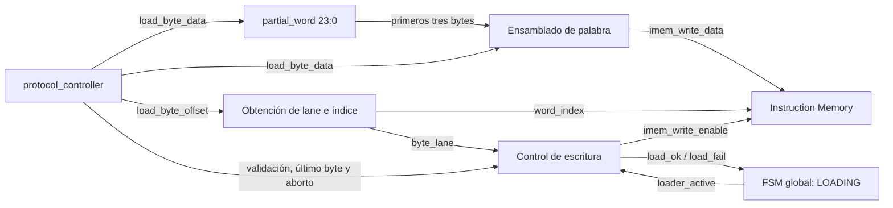

# Loader

- **Tipo:** arquitectura.
- **Estado documental:** especificación vigente.

**Índice**

- [Propósito y alcance](#propósito-y-alcance)
- [Organización](#organización)
- [Identificación de la posición de cada byte](#identificación-de-la-posición-de-cada-byte)
- [Reconstrucción de palabras little-endian](#reconstrucción-de-palabras-little-endian)
- [Interfaces y contratos](#interfaces-y-contratos)
- [Comportamiento durante una carga](#comportamiento-durante-una-carga)
- [Finalización y publicación de la imagen](#finalización-y-publicación-de-la-imagen)
- [Reset, aborto y condiciones de borde](#reset-aborto-y-condiciones-de-borde)
- [Estado y temporización](#estado-y-temporización)
- [Ejemplo completo de recepción](#ejemplo-completo-de-recepción)
- [Presupuesto de LOAD](#presupuesto-de-load)
- [Invariantes funcionales](#invariantes-funcionales)
- [Referencias y trazabilidad](#referencias-y-trazabilidad)

<a id="estado-y-función"></a>

## Propósito y alcance

Este documento describe la función de Loader, que forma parte del mecanismo de carga de imágenes ejecutables en el procesador. `Loader` transforma la secuencia de bytes recibida durante una operación `LOAD` en palabras de instrucción de 32 bits y las escribe en `Instruction Memory` (IMEM). Los bytes llegan desde `protocol_controller`, que ya comprobó el tamaño de la imagen y coordina su entrega. Loader los agrupa de cuatro en cuatro, respeta el orden *little-endian* y efectúa una escritura síncrona únicamente cuando dispone de los cuatro bytes de una palabra.

El alcance comprende:

- La identificación de la posición de cada byte dentro de la imagen.
- La obtención del índice de palabra de IMEM y de la posición del byte dentro de esa palabra (*lane*).
- La captura temporal de los primeros tres bytes de cada palabra en `partial_word[23:0]`.
- La formación combinacional de `imem_write_data[31:0]` al recibir el cuarto byte.
- La habilitación de una escritura de IMEM por cada cuatro bytes válidos recibidos.
- La indicación de finalización correcta mediante `load_ok`, o de aborto mediante `load_fail`.
- La entrega del tamaño pendiente de la imagen al mecanismo encargado de publicarla.
- Las prioridades de reset y aborto, y la relación entre la última escritura, la preparación de sesión y el inicio de la ejecución.

La responsabilidad de Loader es **escribir la representación binaria de la imagen**, no interpretar su contenido. No decodifica instrucciones ni determina si sus codificaciones pertenecen a la ISA implementada. Tampoco recibe direcciones arbitrarias desde el host: la dirección de escritura se obtiene de la posición secuencial del byte que `protocol_controller` entrega.

Una escritura en IMEM no equivale a publicar una imagen ejecutable. Mientras `LOADING` está activo, pueden existir palabras ya escritas en la memoria, pero la imagen solo adquiere validez para ejecución después de completar la carga y preparar la sesión. La publicación y la autorización para ejecutar pertenecen al control global. Véase [Arquitectura de memoria](../memory/memory_architecture.md#carga-y-publicación-de-una-imagen).

## Organización

### Bloques y estado involucrados

Loader utiliza un único registro propio para conservar bytes incompletos. El progreso de la transferencia y el tamaño de la imagen se mantienen en `protocol_controller`; no se duplican en Loader.

| Elemento | Naturaleza | Función |
|---|---|---|
| `protocol_controller` | Control externo | Valida el tamaño, entrega bytes, mantiene el progreso y señala el último byte. |
| `load_byte_offset` | Conexión combinacional | Indica la posición, comenzando en cero, del byte que se está entregando. |
| `partial_word[23:0]` | Registro de Loader | Conserva los primeros tres bytes de la palabra actual. |
| Lógica de índice y lane | Lógica combinacional de Loader | Obtiene `word_index` y `byte_lane` a partir de la posición. |
| Lógica de escritura | Lógica combinacional de Loader | Forma `imem_write_data`, `imem_write_index` y `imem_write_enable`. |
| `Instruction Memory` | Memoria externa a Loader | Captura la palabra completa durante el flanco de escritura. |
| FSM global | Control externo | Determina cuándo existe una carga activa y qué ocurre al completarla o abortarla. |

El recorrido funcional puede representarse así:



Los caminos de posición, formación de palabra y habilitación operan durante el mismo ciclo. No representan etapas secuenciales adicionales: **el cuarto byte puede completar la palabra y provocar su escritura en ese mismo flanco**.

### Separación de responsabilidades

Durante la operación `LOAD` intervienen mecanismos diferentes:

| Responsabilidad | Mecanismo |
|---|---|
| Recibir y validar el tamaño de imagen | `protocol_controller` |
| Controlar cuántos bytes faltan por entregar | `protocol_controller` |
| Entregar el byte actual con `load_byte_valid` | `protocol_controller` |
| Conservar temporalmente bytes de una palabra incompleta | `Loader.partial_word` |
| Empaquetar y escribir palabras de 32 bits | `Loader` e IMEM |
| Determinar si la imagen completa puede publicarse | Control global y preparación de sesión |
| Buscar y validar instrucciones durante ejecución | Etapa IF |

Esta distribución evita que Loader tenga un contador de bytes, un registro propio del tamaño de imagen o una FSM para cuatro posiciones. La posición determina qué hacer con cada entrega y el estado global determina cuándo ese trabajo está permitido.

## Identificación de la posición de cada byte

### Progreso mantenido por el controlador

Antes de iniciar el suministro de bytes, `protocol_controller` valida el tamaño total de la imagen y conserva dos valores:

- `load_size_received`: cantidad total de bytes de la imagen aceptada.
- `load_bytes_remaining`: cantidad de bytes que todavía falta entregar.

La posición del byte que está por entregarse se obtiene de la diferencia:

```text
byte_offset = load_size_received - load_bytes_remaining
```

Esta resta se realiza en el controlador utilizando `IMAGE_SIZE_WIDTH` bits; el resultado se ofrece a Loader mediante la conexión combinacional `load_byte_offset`. No existe un contador adicional dentro de Loader.

La resta utiliza el **número de bytes restantes anterior a la entrega actual**. Si una imagen contiene ocho bytes, antes de entregar el primero quedan ocho y su posición es `0`. Antes de entregar el segundo quedan siete y su posición es `1`. En el último byte quedan uno y su posición es `7`.

| Entrega | Bytes restantes antes de entregar | `byte_offset` |
|---|---:|---:|
| Primera | 8 | 0 |
| Segunda | 7 | 1 |
| Tercera | 6 | 2 |
| Cuarta | 5 | 3 |
| Quinta | 4 | 4 |
| Octava | 1 | 7 |

La dirección solo se consume como posición válida cuando `load_byte_valid=1`. Una vez entregados todos los bytes, el resultado aritmético puede representar el tamaño total `N`, pero **no habilita una lectura o escritura adicional**, porque no existe una nueva entrega válida.

### Obtención del lane y del índice de palabra

Cada palabra de IMEM reúne cuatro bytes. La posición del byte se separa en:

```text
byte_lane  = byte_offset[1:0]
word_index = byte_offset >> 2
```

Equivalente a:

```text
byte_lane  = byte_offset modulo 4
word_index = floor(byte_offset / 4)
```

`byte_lane` identifica la posición del byte dentro de su palabra. `word_index` identifica la palabra de IMEM a la que pertenece. Los offsets `0` a `3` pertenecen a la palabra `0`, los offsets `4` a `7` pertenecen a la palabra `1`, y así sucesivamente.

| `byte_offset` | `byte_lane` | `word_index` | Interpretación |
|---:|---:|---:|---|
| 0 | 0 | 0 | Primer byte de la palabra 0. |
| 1 | 1 | 0 | Segundo byte de la palabra 0. |
| 2 | 2 | 0 | Tercer byte de la palabra 0. |
| 3 | 3 | 0 | Cuarto byte de la palabra 0: se escribe. |
| 4 | 0 | 1 | Primer byte de la palabra 1. |
| 5 | 1 | 1 | Segundo byte de la palabra 1. |
| 6 | 2 | 1 | Tercer byte de la palabra 1. |
| 7 | 3 | 1 | Cuarto byte de la palabra 1: se escribe. |

### Anchos de las posiciones e índices

`load_byte_offset` llega a Loader con `BYTE_ADDRESS_WIDTH` bits, definidos por la capacidad configurada de IMEM:

```text
BYTE_ADDRESS_WIDTH =
    max(1, ceil(log2(IMEM_CAPACITY_BYTES)))

WORD_INDEX_WIDTH =
    max(1, ceil(log2(IMEM_CAPACITY_BYTES / 4)))
```

Para los perfiles `REFERENCE` y `ALT_1000`, `BYTE_ADDRESS_WIDTH` es de **10 bits** y `WORD_INDEX_WIDTH` es de **8 bits**.

La resta de tamaño se efectúa con `IMAGE_SIZE_WIDTH` antes de reducir el resultado al ancho de dirección. El controlador solo entrega una secuencia después de verificar que el tamaño total es no nulo, múltiplo de cuatro y no supera la capacidad de IMEM. Por ese contrato, los índices que efectivamente se utilizan para escribir se encuentran dentro de la región admitida.

Loader no corrige direcciones arbitrarias ni acepta una dirección proporcionada por el host en cada byte: el índice surge exclusivamente de la posición de la transferencia validada.

## Reconstrucción de palabras little-endian

### Distribución de los cuatro bytes

Una palabra de 32 bits se recibe como cuatro bytes consecutivos en orden *little-endian*. Esto significa que **el primer byte recibido ocupa los bits menos significativos** y el último ocupa los más significativos.

| Orden de llegada | `byte_lane` | Posición en la palabra |
|---|---:|---|
| Primer byte | 0 | bits `[7:0]` |
| Segundo byte | 1 | bits `[15:8]` |
| Tercer byte | 2 | bits `[23:16]` |
| Cuarto byte | 3 | bits `[31:24]` |

Si los bytes recibidos son `B0`, `B1`, `B2` y `B3`, la palabra resultante es:

```text
word = {B3, B2, B1, B0}
```

La llave de concatenación expresa el orden de bits de la palabra de 32 bits; no es un cambio en el orden de recepción.

### Almacenamiento temporal: `partial_word`

Loader conserva únicamente los primeros tres bytes de cada palabra en el registro:

```text
partial_word[23:0]
```

Las capturas son independientes según `byte_lane`:

| `byte_lane` | Efecto al recibir un byte válido |
|---:|---|
| 0 | `partial_word[7:0] ← load_byte_data` |
| 1 | `partial_word[15:8] ← load_byte_data` |
| 2 | `partial_word[23:16] ← load_byte_data` |
| 3 | No se captura otro byte en `partial_word`; se escribe la palabra completa en IMEM. |

En los tres primeros casos, las porciones restantes conservan su contenido hasta recibir su respectivo byte. Los valores antiguos de otras palabras no se interpretan como datos de la palabra actual, porque Loader no escribe IMEM hasta haber recibido los tres bytes nuevos.

### Formación del dato de escritura

El cuarto byte se utiliza directamente desde `load_byte_data`, sin pasar por un cuarto registro temporal:

```text
imem_write_data[31:0] = {
    load_byte_data[7:0],
    partial_word[23:16],
    partial_word[15:8],
    partial_word[7:0]
}
```

Equivalente a:

```text
imem_write_data = {load_byte_data, partial_word}
```

Cuando `byte_lane=3`, los primeros tres bytes ya quedaron capturados en flancos anteriores. Durante el ciclo del cuarto byte, la concatenación presenta combinacionalmente la palabra terminada y la escritura la captura en IMEM al flanco. **No hay un ciclo extra para guardar el cuarto byte ni para trasladar una palabra ensamblada.**

## Interfaces y contratos

### Entradas de Loader

| Entrada | Origen | Función |
|---|---|---|
| `clk` | Reloj común | Sincroniza las capturas parciales y las escrituras. |
| `reset` | Control funcional global | Impide que una recepción o escritura produzca efectos normales durante reset. |
| `loader_active` | Estado global `LOADING` | Autoriza el procesamiento de bytes de la carga en curso. |
| `load_accept` | `Command Arbiter`, dentro de `execution_control` | Indica el inicio de una operación de carga aceptada. |
| `load_size_bytes` | Tamaño validado mantenido por el controlador | Transporta el tamaño de la imagen pendiente de publicación. |
| `load_byte_valid` | `protocol_controller` | Indica que `load_byte_data` contiene un byte que se entrega en el ciclo actual. |
| `load_byte_data[7:0]` | `protocol_controller` | Byte recibido que corresponde a `load_byte_offset`. |
| `load_byte_offset` | `protocol_controller` | Posición de byte de la entrega actual; permite derivar lane e índice de palabra. |
| `load_last_byte` | `protocol_controller` | Identifica la última entrega de la imagen. |
| `load_abort` | `protocol_controller` | Solicita cancelar la carga actual. |

`load_accept` inicia la operación; no exige poner en cero `partial_word` para evitar residuos. Las posiciones `0`, `1` y `2` de cada nueva palabra se sobrescriben antes de habilitar cualquier escritura de IMEM.

La entrega de un byte requiere `load_byte_valid=1`. Los valores combinacionales que puedan existir en `load_byte_data`, `load_byte_offset` o sus derivados cuando ese flag está en cero no representan una transferencia y no provocan capturas.

### Salidas de Loader

| Salida | Destino | Función |
|---|---|---|
| `imem_write_enable` | Puerto de escritura de IMEM | Autoriza escribir una palabra completa. |
| `imem_write_index[WORD_INDEX_WIDTH-1:0]` | Puerto de escritura de IMEM | Selecciona la palabra a modificar. |
| `imem_write_data[31:0]` | Puerto de escritura de IMEM | Contiene la palabra little-endian ensamblada. |
| `load_ok` | Control global | Indica que la última palabra se escribe correctamente en el flanco actual. |
| `load_fail` | Control global | Informa que la operación activa fue abortada. |
| `pending_image_size_bytes` | Control de publicación | Presenta el tamaño validado de la imagen que se está cargando. |

`pending_image_size_bytes` reutiliza el tamaño recibido mediante `load_size_bytes`: Loader no conserva otra copia. No debe confundirse con `loaded_image_size_bytes`, que corresponde a la **imagen ya confirmada**.

### Señales de habilitación y resultado

Durante el funcionamiento normal, la escritura se habilita cuando coincide una carga activa, un byte válido y la recepción del cuarto byte de una palabra, sin una prioridad superior de reset o aborto:

```text
imem_write_enable =
    loader_active
    && load_byte_valid
    && (byte_lane == 3)
    && !reset
    && !load_abort
```

El índice de escritura es:

```text
imem_write_index = word_index
```

La indicación de carga completa utiliza la misma escritura final:

```text
load_ok =
    imem_write_enable
    && load_last_byte
```

El resultado de aborto es:

```text
load_fail =
    loader_active
    && load_abort
    && !reset
```

`load_ok` y `load_fail` no describen una verificación del contenido de la ISA. `load_ok` significa que se ha recibido el último byte de una imagen previamente validada y que su última palabra se escribe en el flanco correspondiente. `load_fail` informa la interrupción de la carga activa.

## Comportamiento durante una carga

### Inicio de la recepción

El controlador comprueba el tamaño de imagen antes de aceptar la operación. Los tamaños admitidos son:

- Mayores que cero.
- Múltiplos de cuatro bytes.
- No superiores a `IMEM_CAPACITY_BYTES`.

Estas condiciones garantizan que la imagen contiene un número entero de palabras de 32 bits y que todas sus escrituras caben en IMEM. Una vez aceptada, la FSM global entra en `LOADING`, y `loader_active` habilita el camino de recepción.

Loader no vuelve a validar esos requisitos en cada byte ni crea una segunda política de rechazo. Utiliza las entregas que ya cumplen el contrato del controlador.

### Recepción de una palabra

El procesamiento de una palabra sigue cuatro entregas sucesivas:

1. **Lane 0:** el primer byte válido se captura en `partial_word[7:0]`.
2. **Lane 1:** el segundo byte válido se captura en `partial_word[15:8]`.
3. **Lane 2:** el tercer byte válido se captura en `partial_word[23:16]`.
4. **Lane 3:** el cuarto byte forma `imem_write_data` junto con `partial_word`. Se habilita la escritura de IMEM en `word_index` y esa palabra queda almacenada al flanco.

El controlador reduce `load_bytes_remaining` una vez por cada entrega. Por lo tanto, la posición de la siguiente entrega avanza una unidad y el lane recorre `0, 1, 2, 3` para cada palabra.

Una vez escrito el lane 3, el siguiente byte corresponde al lane 0 de la siguiente palabra. No hace falta limpiar `partial_word` al cambiar de palabra: las tres primeras entregas nuevas reemplazan sus tres segmentos antes de la próxima escritura.

### Escritura de IMEM

La memoria recibe tres elementos coordinados:

```text
Write Enable = imem_write_enable
Write Index  = imem_write_index
Write Data   = imem_write_data
```

Cuando `imem_write_enable=1`, IMEM captura la palabra completa durante el flanco. En los tres bytes anteriores, Loader únicamente modifica `partial_word`; **IMEM no recibe una escritura parcial**.

Esta distinción permite construir palabras de 32 bits a partir de bytes entrantes sin exigir cuatro escrituras separadas por palabra ni un buffer de imagen completa en Loader.

### Relación entre recepción UART y clocks de procesamiento

Los bytes de la interfaz serial se reciben a la velocidad de UART, pero una vez presentados al controlador pueden procesarse mediante entregas de hasta **un byte por clock**. En una cuarta entrega, el mismo clock que consume el byte también permite escribir la palabra.

El ensamblado y la escritura no dependen de la transmisión UART de una respuesta (`TX`). No hay confirmaciones al host después de cada palabra. La finalización se informa únicamente al completar o abortar la carga.

El presupuesto conjunto de recepción, FIFO, controlador y Loader se desarrolla en [UART](../uart/uart_core.md#presupuesto-de-integración). Esta capacidad de procesamiento describe el comportamiento estructural del diseño, no una medición física de frecuencia máxima.

## Finalización y publicación de la imagen

### Identificación del último byte

El controlador marca `load_last_byte` cuando la entrega actual corresponde al último byte pendiente; en ese momento, el valor anterior de `load_bytes_remaining` es uno.

Como la imagen completa tiene un tamaño múltiplo de cuatro, el último byte corresponde necesariamente al lane 3 de la última palabra. Por lo tanto, su llegada permite escribir la palabra final y completar la recepción **en el mismo flanco**:

```text
load_byte_valid = 1
load_last_byte  = 1
byte_lane       = 3

    → imem_write_enable = 1
    → load_ok = 1
```

Estas condiciones presuponen `loader_active=1`, ausencia de reset y ausencia de aborto.

### Transición hacia preparación

En el flanco de la última entrega se producen simultáneamente los siguientes efectos, utilizando los valores anteriores al flanco:

1. IMEM captura la última palabra.
2. `load_bytes_remaining` pasa a cero.
3. `load_ok` informa al control global que la recepción terminó.
4. La FSM global pasa de `LOADING` a `PREPARING_READY`.
5. `protocol_controller` pasa a `WAIT_LOAD_PREP`.

La preparación comienza bajo el nuevo estado global después de ese flanco. No existe un ciclo intermedio dedicado a escribir la palabra completa: la última escritura ya ocurrió.

La FSM del controlador también contempla el estado `WAIT_LOAD_RESULT`, aunque el recorrido normal de esta implementación pasa directamente a `WAIT_LOAD_PREP` al entregarse el último byte.

### Diferencia entre cargar y publicar

La memoria puede contener todas las palabras recibidas inmediatamente después del último flanco de carga, pero eso todavía no significa que el procesador pueda ejecutarlas.

Durante la preparación se restablece el estado inicial de sesión y, al completarse, el control global publica la imagen y alcanza `READY`. `prepare_done` identifica esa finalización: la publicación se realiza sin un acceso de mantenimiento concurrente y **sin ejecutar un ciclo de CPU**.

Existen dos tamaños conceptualmente distintos:

| Valor | Significado | Uso |
|---|---|---|
| `pending_image_size_bytes` | Tamaño validado de la carga en curso. | Publicar la nueva imagen después de terminar su preparación. |
| `loaded_image_size_bytes` | Tamaño de la imagen ya confirmada. | Validar futuras búsquedas y reutilizar la imagen mediante `RUN` o `STEP`. |

Durante la preparación que sigue a un `LOAD`, el tamaño pendiente permanece disponible para el commit. En una preparación iniciada por `RUN` o `STEP`, se utiliza el tamaño de la imagen ya confirmada, no se vuelve a cargar su contenido y no se emplea el tamaño pendiente como sustituto.

## Reset, aborto y condiciones de borde

### Prioridad de reset y aborto

La prioridad de las operaciones sobre la captura y escritura es:

```text
reset > load_abort > entrega de byte
```

| Situación | Captura en `partial_word` | Escritura IMEM | `load_ok` | `load_fail` |
|---|---|---|---|---|
| Reset activo | No | No | 0 | 0 |
| Carga activa con aborto | No | No | 0 | 1 |
| Carga activa, byte válido, lane 0–2 | Sí, en su segmento | No | 0 | 0 |
| Carga activa, byte válido, lane 3 | No | Sí | 1 solo si es último byte | 0 |
| Sin byte válido o sin carga activa | No | No | 0 | 0 |

La tabla expresa las condiciones funcionales del ciclo. En la fila de aborto se supone ausencia de reset.

### Aborto durante una palabra incompleta

Si la carga se aborta después de recibir uno, dos o tres bytes de una palabra, `partial_word` puede conservar esos bytes. Ese contenido no provoca una escritura: solo el cuarto byte válido de una carga activa podría hacerlo.

Si más adelante se acepta otra imagen, sus tres primeras entregas reemplazan esos segmentos antes de que se escriba la primera palabra. Así, Loader no necesita limpiar físicamente `partial_word` para eliminar el contenido de la carga cancelada.

### Aborto durante el cuarto byte

`load_abort` prevalece incluso cuando coincide con `load_byte_valid=1` y `byte_lane=3`. En ese caso:

```text
imem_write_enable = 0
load_ok           = 0
load_fail         = 1
```

El cuarto byte no completa una escritura válida en IMEM. El controlador y la FSM global cancelan la operación, y la FSM vuelve a `NO_IMAGE`.

Las palabras que se hubieran escrito en ciclos anteriores pueden permanecer físicamente en IMEM. No se necesita revertirlas, porque esa imagen parcial **nunca fue publicada como ejecutable**. El nuevo estado global impide interpretarla como una imagen válida.

### Reset durante una carga

El reset funcional impide capturas, escrituras y emisión de resultados normales. Su prioridad es mayor que la de aborto: si coinciden reset y aborto, no se genera `load_fail`.

La cancelación de la sesión y la validez de la imagen se resuelven en el control global. Loader no recorre IMEM para borrar palabras escritas durante una carga anterior.

### Entregas inválidas y datos residuales

`load_byte_data` y `load_byte_offset` pueden presentar valores cuando `load_byte_valid=0`. Esos valores no constituyen una entrega. Del mismo modo, `imem_write_data` puede presentar una concatenación combinacional aun cuando `imem_write_enable=0`: **la presencia de datos en un bus no autoriza una escritura**.

El control de autorización es lo que distingue una palabra efectivamente escrita de un valor transitorio o residual.

### Índices y tamaño correcto de la imagen

Loader depende de las siguientes garantías del controlador:

- El tamaño se valida antes de `load_accept`.
- La entrega comienza en el offset cero y recorre la imagen de forma contigua.
- `load_bytes_remaining` disminuye exactamente una vez por byte entregado.
- `load_last_byte` coincide con una entrega cuyo restante anterior es uno.
- El tamaño total es múltiplo de cuatro, por lo que toda última entrega pertenece al lane 3.

Estas condiciones explican por qué Loader no necesita comprobar de nuevo el rango, pedir direcciones adicionales al host, rechazar bytes por ocupación ni implementar una escritura de palabra incompleta.

## Estado y temporización

### Registro parcial

`partial_word[23:0]` es el único estado privado necesario para el ensamblado. Sus tres segmentos se actualizan en el flanco que recibe el respectivo byte válido de lanes 0, 1 o 2. El lane 3 se consume directamente para la escritura de IMEM.

No se requiere un registro adicional para:

- Contar bytes o palabras recibidos.
- Mantener una copia del tamaño de imagen validado.
- Conservar el cuarto byte.
- Almacenar la palabra completa antes de escribirla.
- Recordar si Loader se encuentra en el primer, segundo, tercer o cuarto byte.

La posición proviene del controlador y el estado `LOADING` indica el período durante el cual Loader puede modificar IMEM.

### Captura de los primeros bytes y escritura de la palabra

Las capturas de `partial_word` y las escrituras de IMEM utilizan los valores que existen **antes del flanco**. Para una palabra recibida en cuatro entregas:

```text
Entrega del byte 0
    → al flanco: partial_word[7:0] se actualiza

Entrega del byte 1
    → al flanco: partial_word[15:8] se actualiza

Entrega del byte 2
    → al flanco: partial_word[23:16] se actualiza

Entrega del byte 3
    → antes del flanco: imem_write_data = {byte 3, partial_word}
    → al flanco: IMEM[word_index] captura la palabra
```

El cuarto flanco no espera una actualización simultánea de `partial_word`: los tres bytes inferiores ya se almacenaron en los flancos previos. Esta relación evita depender de un orden implícito entre dos registros actualizados en el mismo flanco.

### Relación con otras fases

`loader_active` corresponde al estado global `LOADING`. Al terminar la recepción, se deja de escribir IMEM desde Loader y comienza el procedimiento de preparación.

La preparación no comparte un flanco de actualización con una escritura posterior de Loader. De esta manera, la imagen queda completamente recibida antes de publicar un estado inicial de CPU listo para ejecución.

## Ejemplo completo de recepción

### Primera palabra

Supóngase una imagen cuyos primeros cuatro bytes son:

```text
13 05 A0 00
```

Se reciben en ese orden. El recorrido es:

| Entrega | `byte_offset` | `byte_lane` | Efecto | IMEM |
|---:|---:|---:|---|---|
| 1 | 0 | 0 | `partial_word[7:0] ← 0x13` | Sin escritura |
| 2 | 1 | 1 | `partial_word[15:8] ← 0x05` | Sin escritura |
| 3 | 2 | 2 | `partial_word[23:16] ← 0xA0` | Sin escritura |
| 4 | 3 | 3 | `imem_write_data = {0x00, 0xA00513}` | `IMEM[0] ← 0x00A00513` |

Después de la tercera entrega, el buffer contiene:

```text
partial_word = 24'hA00513
```

En la cuarta entrega:

```text
load_byte_data = 8'h00

imem_write_data = {8'h00, 24'hA00513}
                = 32'h00A00513
```

El orden de los bytes no se invierte durante la recepción; se colocan en distintas posiciones de la palabra de acuerdo con little-endian.

### Segunda palabra y final de una imagen de ocho bytes

Supóngase que la imagen completa tiene ocho bytes y que los cuatro siguientes son `93 05 10 00`. La segunda palabra se forma en los offsets `4`, `5`, `6` y `7` y se escribe en `IMEM[1]`:

```text
IMEM[0] = 32'h00A00513
IMEM[1] = 32'h00100593
```

Antes de la entrega final, el controlador informa un byte restante. Durante esa entrega:

```text
byte_offset    = 7
byte_lane      = 3
word_index     = 1
load_last_byte = 1
```

Si la carga sigue activa y no existe reset ni aborto:

```text
imem_write_enable = 1
load_ok           = 1
```

Al flanco se escribe `IMEM[1]` y termina la recepción. La sesión todavía necesita completar su preparación antes de que la nueva imagen quede publicada como ejecutable.

## Presupuesto de LOAD

### Preparación después de la recepción

Al finalizar un `LOAD`, la preparación de sesión realiza una limpieza secuencial de las marcas de DMEM y un flanco final para publicar el estado preparado. El RF se inicializa en paralelo durante el primer flanco de preparación. Durante esa fase no se ejecutan ciclos de CPU.

Según el perfil, el presupuesto es:

| Perfil | Clocks de limpieza DMEM | Clock de publicación | Total | Duración a 50 MHz |
|---|---:|---:|---:|---:|
| `REFERENCE` | 2048 | 1 | 2049 | 40,98 µs |
| `ALT_1000` | 1000 | 1 | 1001 | 20,02 µs |

En ambos casos se mantiene por debajo de **50.000 clocks**, equivalentes a 1 ms a 50 MHz. `prepare_done` no coincide con un flanco de mantenimiento; la finalización de la preparación permite publicar `READY` sin ejecutar una instrucción.

El último byte de `LOAD` ya produjo la escritura final en IMEM y condujo directamente a preparación, sin una espera adicional de 100 ms posterior a una recepción completa.

### Cota temporal de la operación

Para acotar conservadoramente el tiempo de respuesta se considera:

```text
recepción:       N × 521,6 µs
más:             preparación
más:             transmisión de respuesta breve
más:             16 clocks de coordinación
```

`N` es el número de bytes de la imagen validada. La referencia de plazo utilizada es:

```text
N × 10 × 1000 / 19200 + 201 ms
```

La expresión corresponde a la recepción serial de `N` bytes a 19200 baudios, considerando diez bits por byte y el margen adicional de procesamiento y respuesta. Para los **506 tamaños legales** de los dos perfiles, el presupuesto conservador se mantiene dentro de esa referencia con un margen mínimo superior a 199 ms.

El procesamiento interno acepta hasta un byte por clock, incluida la escritura de cada cuarta entrega. Este presupuesto no cuenta como tiempo de procesamiento interno una espera indefinida por bytes que el host todavía no envió, ni la duración de una ejecución posterior mediante `RUN`.

Las relaciones temporales con el núcleo UART y la respuesta se describen en [UART](../uart/uart_core.md#presupuesto-de-integración) y [Serializador de respuestas](../debug/response_serializer.md#presupuesto-de-transmisión-y-debug). Los valores son **cotas de diseño documental**, no resultados de una simulación RTL ni mediciones de timing o placa.

## Invariantes funcionales

Las siguientes propiedades resumen el comportamiento que debe conservar Loader:

- Toda escritura de IMEM reúne exactamente cuatro bytes consecutivos de la misma palabra.
- Cada byte ocupa el segmento de ocho bits que le corresponde según su posición little-endian.
- IMEM solo se escribe al recibir el lane 3 de una carga activa, con byte válido y sin reset ni aborto.
- El índice de la palabra proviene del offset de transferencia validado; no de una dirección independiente enviada por el host.
- El cuarto byte se utiliza directamente en el dato de escritura; los tres primeros se almacenan en `partial_word`.
- No se publica una imagen por haber escrito una palabra o por haber recibido una parte de la carga.
- `load_ok` solo se emite con la escritura del último byte de una imagen válida; un aborto impide tanto esa escritura como su confirmación.
- Reset y aborto impiden escrituras y capturas de la transferencia cancelada.
- Los datos residuales de IMEM o de `partial_word` no convierten una carga cancelada en una imagen ejecutable.
- Loader no necesita una FSM, un contador de posición ni una copia privada del tamaño total.
- La finalización de `LOAD` precede a la preparación; la ejecución de CPU solo se habilita después de la publicación de la imagen.

## Referencias y trazabilidad

- [Arquitectura de memoria](../memory/memory_architecture.md): almacenamiento de IMEM, validez y publicación de la imagen.
- [Etapa IF](../cpu/stage_if.md): lectura de instrucciones desde IMEM una vez iniciada la ejecución.
- [Preparación de sesión](session_preparation.md): inicialización, limpieza de DMEM y transición a `READY`.
- [UART](../uart/uart_core.md): entrega de bytes y presupuesto de integración.
- [Serializador de respuestas](../debug/response_serializer.md): respuesta al finalizar `LOAD` y presupuesto de transmisión.
- [Requisitos](../../requirements.md): restricciones funcionales y temporales del sistema.
