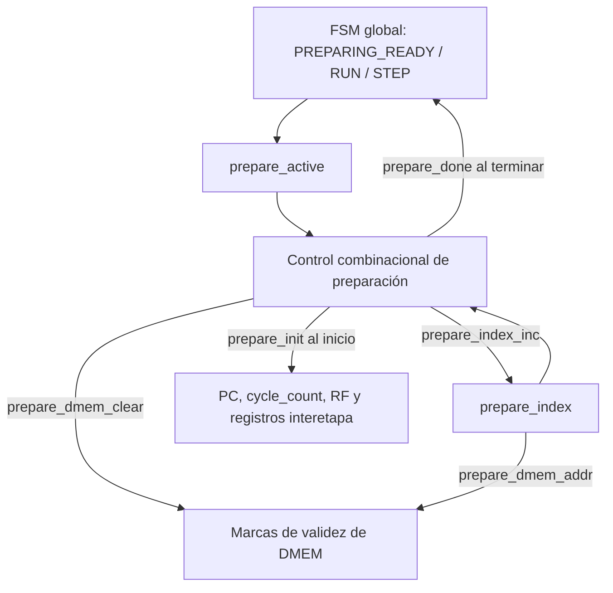

# Preparación de sesión

- **Tipo:** arquitectura.
- **Estado documental:** especificación vigente.

**Índice**

- [Propósito y alcance](#propósito-y-alcance)
- [Organización](#organización)
- [Inicialización del estado de la CPU](#inicialización-del-estado-de-la-cpu)
- [Limpieza lógica de DMEM](#limpieza-lógica-de-dmem)
- [Índice y recorrido de preparación](#índice-y-recorrido-de-preparación)
- [Interfaces y contratos](#interfaces-y-contratos)
- [Comportamiento de la preparación](#comportamiento-de-la-preparación)
- [Finalización según el origen de la sesión](#finalización-según-el-origen-de-la-sesión)
- [Prioridades y exclusión de operaciones](#prioridades-y-exclusión-de-operaciones)
- [Estado y temporización](#estado-y-temporización)
- [Ejemplo completo de preparación](#ejemplo-completo-de-preparación)
- [Invariantes y condiciones de borde](#invariantes-y-condiciones-de-borde)
- [Verificación del modelo funcional](#verificación-del-modelo-funcional)
- [Referencias y trazabilidad](#referencias-y-trazabilidad)

<a id="estado-y-propósito"></a>

## Propósito y alcance

Este documento describe la preparación de sesión de CPU, que consiste en restablecer el estado inicial antes de ejecutar instrucciones. La preparación se realiza después de cargar una imagen o antes de iniciar una ejecución continua o paso a paso. `Session Preparation` restablece el estado con el que una sesión de CPU debe comenzar antes de permitir la ejecución de instrucciones. Su tarea es separar una ejecución nueva de los efectos de la sesión anterior, sin exigir que se borren físicamente las memorias que pueden conservar información útil o residual.

La preparación se ocupa de:

- Establecer `PC=0` y `cycle_count=0`.
- Inicializar los registros arquitectónicos `x1`–`x31` en cero, manteniendo `x0` como constante cero.
- Invalidar los registros interetapa para que ninguna instrucción ni candidato de fault anterior continúe activo.
- Limpiar todas las marcas de validez de `Data Memory` (DMEM), una por flanco, para que sus bytes se observen inicialmente como cero lógico.
- Producir `prepare_done` cuando el estado inicial está completo y ya no quedan escrituras de mantenimiento.
- Entregar el control a la FSM global para publicar una imagen recién cargada o comenzar el primer ciclo de una sesión `RUN` o `STEP`.

**La inicialización de la CPU y la limpieza de DMEM se realizan de manera diferente.** PC, contador, registros arquitectónicos y flags del pipeline se inicializan en el primer flanco de preparación. Las marcas de DMEM, en cambio, se recorren secuencialmente porque representan un conjunto de posiciones de memoria.

Esta secuencia se utiliza en tres estados globales:

| Estado | Para qué se prepara | Qué decide la FSM global al finalizar |
|---|---|---|
| `PREPARING_READY` | Completar la preparación posterior a `LOAD`. | Publicar la imagen y quedar en `READY`, sin ejecutar instrucciones. |
| `PREPARING_RUN` | Iniciar una ejecución continua sobre la imagen ya confirmada. | Ejecutar el primer ciclo de la CPU. |
| `PREPARING_STEP` | Iniciar una ejecución paso a paso sobre la imagen ya confirmada. | Ejecutar el primer ciclo de la CPU. |

Los tres estados utilizan el **mismo mecanismo de inicialización**. `Session Preparation` recibe `prepare_active` y devuelve `prepare_done`, sin recibir el estado global ni una indicación de publicación. La FSM global conserva el destino de la operación y decide si activa `image_publish` o `cpu_cycle_fire` al finalizar.

La preparación no modifica el contenido de IMEM. La imagen de instrucciones permanece almacenada y puede ejecutarse nuevamente. Tampoco borra los arrays de datos de DMEM; invalida sus bytes lógicos mediante las marcas asociadas. La diferencia entre datos físicos y datos observables se desarrolla en [Acceso y mantenimiento DMEM](../memory/dmem_access.md).

## Organización

### Elementos que participan

`Session Preparation` combina un índice secuencial con señales de control combinacionales. No mantiene una copia de los datos de memoria, ni un bitmap adicional, ni un registro privado para recordar el modo de la sesión.

| Elemento | Naturaleza | Responsabilidad |
|---|---|---|
| `Global FSM` | Control externo | Selecciona `PREPARING_READY`, `PREPARING_RUN` o `PREPARING_STEP`, genera `prepare_active` y determina el destino al finalizar. |
| `prepare_active` | Decodificación combinacional | Indica que la FSM global está en cualquiera de los tres estados de preparación. |
| `prepare_index` | Registro de progreso | Identifica el byte de DMEM cuya marca corresponde limpiar en el flanco actual. |
| Lógica de preparación | Control combinacional | Produce `prepare_init`, `prepare_dmem_clear`, `prepare_index_inc` y `prepare_done`. |
| PC y `cycle_count` | Estado de la CPU | Se ponen en cero durante `prepare_init`. |
| `Register File` | Estado arquitectónico | Inicializa `x1`–`x31` en un solo flanco. |
| Registros interetapa | Estado del pipeline | Invalidan las entradas anteriores y los candidatos de fetch transportados. |
| Metadata de DMEM | Estado de memoria | Limpia la marca de validez del byte seleccionado. |

El recorrido funcional es:



`prepare_init` y la limpieza de la primera marca ocurren en el **mismo primer flanco**. Los flancos siguientes solo avanzan por las demás marcas. Cuando el índice alcanza el límite, el control presenta `prepare_done` en un ciclo sin ninguna escritura de mantenimiento.

### Separación entre recursos

El proceso no recorre todas las estructuras con el mismo índice:

- **PC y `cycle_count`:** un único flanco basta para restablecerlos.
- **Register File:** `x1`–`x31` se inicializan simultáneamente mediante su mecanismo local.
- **Registros interetapa:** se invalidan sus indicadores de actividad; no hace falta borrar cada campo de datos.
- **DMEM:** se limpia una marca por flanco hasta cubrir todas las direcciones de byte.
- **IMEM:** conserva su contenido, sin recibir escrituras desde la preparación.

Esta separación permite reutilizar la operación de reset local del `Register File` sin agregar un puerto de mantenimiento ni compartir con DMEM un recorrido innecesario de sus 31 registros.

## Inicialización del estado de la CPU

### Señal de inicio `prepare_init`

La inicialización de la CPU está concentrada en la condición:

```text
prepare_init =
    !reset
    && prepare_active
    && (prepare_index == 0)
```

En el primer flanco de preparación, esta orden afecta de manera simultánea a los elementos que deben comenzar en un estado definido. No se repite durante los flancos posteriores, porque `prepare_index` deja de ser cero al completarse la primera limpieza.

### PC y contador de ciclos

La inicialización establece:

```text
PC          ← 32'h00000000
cycle_count ← 0
```

El PC vuelve a apuntar al comienzo de la imagen de instrucciones. `cycle_count` queda en cero **antes de ejecutar cualquier ciclo de la nueva sesión**.

La preparación no efectúa un fetch ni incrementa el contador por el simple hecho de transcurrir varios clocks. El primer incremento de `cycle_count` corresponde al primer ciclo efectivo de CPU, cuando el control global lo autoriza.

### `Register File`

<a id="rf-reutilización-de-inicialización-local"></a>

El banco arquitectónico contiene 32 registros de 32 bits. Su estado inicial se establece así:

```text
RF[x0]       = 0   (constante arquitectónica)
RF[x1]–RF[x31] ← 0  (en el flanco de prepare_init)
```

`x0` no necesita ser borrado: su lectura siempre produce cero y las escrituras dirigidas a ese registro no tienen efecto.

Los 31 registros restantes se implementan como registros de flip-flops con inicialización síncrona local. `prepare_init` reutiliza la misma operación local que el banco emplea para cumplir su contrato de reset funcional, sin recurrir al puerto normal de escritura de WB.

Esto implica que:

- No existe `prepare_rf_addr`.
- No se genera una sucesión de escrituras `RF[x1]`, `RF[x2]`, ..., `RF[x31]`.
- No hace falta conectar un dato cero al puerto normal de WB durante la preparación.
- Una vez terminada la inicialización, el puerto de escritura del banco continúa controlado por WB.

La inicialización local tiene prioridad sobre una escritura normal hipotéticamente coincidente. En funcionamiento legal, la CPU permanece excluida durante esta fase y la coincidencia no ocurre.

`prepare_init` **no es un reset general del sistema**: no reinicia UART, Loader ni la FSM global. El reset funcional y la preparación pueden utilizar el mismo mecanismo de puesta a cero del banco sin representar el mismo evento.

### Registros interetapa y candidatos de fault

Una sesión nueva no debe heredar instrucciones activas de la sesión anterior. En el primer flanco se invalidan las entradas de los cuatro registros interetapa:

```text
IF/ID.valid       ← 0
ID/EX.valid       ← 0
EX/MEM.valid      ← 0
MEM/WB.valid      ← 0
```

`IF/ID` también transporta candidatos de fault de fetch mediante un indicador independiente de `valid`. Por eso se limpia expresamente:

```text
IF/ID.fetch_fault_valid ← 0
```

Invalidar las entradas basta para impedir que los bits residuales de `instruction`, `pc`, `rd`, resultados y controles se interpreten como trabajo activo. **No se necesita poner en cero todos los campos físicos de cada registro interetapa.**

La metadata global de un fault ya confirmado puede conservar bits residuales; su significado depende del estado global de terminación, no de que la preparación sobrescriba obligatoriamente `fault_cause` y `fault_pc`. El tratamiento de esos campos se desarrolla en [Faults, redirects y terminación](faults_and_termination.md).

## Limpieza lógica de DMEM

### Dato físico y marca de validez

DMEM mantiene, para cada dirección de byte `a`, dos contenidos relacionados:

- `data[a]`: el byte almacenado físicamente.
- `valid[a]`: una marca que indica si ese byte pertenece al estado observable de la sesión.

El dato que reciben la CPU y Debug se interpreta mediante:

```text
logical_byte[a] =
    valid[a] ? data[a] : 8'h00
```

Por ejemplo, si `data[5]=8'hAA` pero `valid[5]=0`, leer la dirección 5 devuelve `0x00`. El valor `0xAA` puede seguir físicamente almacenado, pero ya no tiene significado como dato de la sesión.

Una escritura efectiva de `SB`, `SH` o `SW` modifica los bytes seleccionados y pone sus marcas en uno. Esto ocurre incluso si el valor almacenado es cero. En consecuencia, **un byte utilizado que contiene cero no es lo mismo que un byte cuya marca está inactiva**:

| Dato físico | `valid[a]` | Lectura lógica | Byte considerado utilizado |
|---|---:|---|---|
| `0xAA` | 0 | `0x00` | No |
| `0xAA` | 1 | `0xAA` | Sí |
| `0x00` | 1 | `0x00` | Sí |
| `0x00` | 0 | `0x00` | No |

La misma marca sustenta tanto el cero lógico como el resultado `debug_dmem_used` y la lista de posiciones utilizadas. No existe otro bitmap independiente que deba ponerse en cero.

### Qué modifica un flanco de limpieza

Durante la preparación, `prepare_dmem_addr` identifica una dirección de byte `a` y `prepare_dmem_clear=1` habilita la siguiente actualización:

```text
valid[a] ← 0
```

Ningún dato se reescribe:

```text
data[a] → conservar
```

La limpieza de una marca tiene entonces dos efectos lógicos simultáneos:

1. Las lecturas posteriores de ese byte producen `0x00`.
2. La observación Debug deja de marcar esa dirección como utilizada.

Los bytes que todavía no fueron recorridos pueden mantener temporalmente las marcas anteriores. Esto no permite ejecutar con un estado parcialmente preparado: la CPU y Debug permanecen excluidos de la operación de limpieza hasta que se alcanza `prepare_done`.

### Relación con la organización por filas y lanes

DMEM organiza sus bytes en filas de cuatro posiciones. Para una dirección `a`:

```text
row  = a >> 2
lane = a[1:0]
```

`prepare_dmem_addr` selecciona exactamente una pareja `row`/`lane`. En ese flanco solo se pone en cero la marca del lane seleccionado; las marcas de los otros tres lanes de esa fila conservan su valor.

Por ejemplo, limpiar la dirección `6` implica:

```text
row  = 1
lane = 2
```

Se invalida el byte de dirección 6, pero no se modifican las marcas de las direcciones 4, 5 o 7.

El almacenamiento, el camino compartido de actualización de marcas y la protección de índices se detallan en [Acceso y mantenimiento DMEM](../memory/dmem_access.md).

## Índice y recorrido de preparación

### Límite y ancho del índice

`prepare_index` es el único registro secuencial que necesita el recorrido. Su valor representa la dirección del siguiente byte de DMEM cuya marca debe limpiarse.

```text
PREP_LIMIT = DMEM_CAPACITY_BYTES

PREP_INDEX_WIDTH =
    max(1, ceil(log2(PREP_LIMIT + 1)))
```

El `+1` en la fórmula es importante: el índice debe poder representar tanto las direcciones desde `0` hasta `PREP_LIMIT-1` como el valor final `PREP_LIMIT`, que significa **recorrido terminado**.

| Perfil | `DMEM_CAPACITY_BYTES` | Direcciones limpiadas | `PREP_INDEX_WIDTH` |
|---|---:|---|---:|
| `REFERENCE` | 2048 | 0 a 2047 | 12 bits |
| `ALT_1000` | 1000 | 0 a 999 | 10 bits |

En `REFERENCE`, once bits alcanzarían para direccionar las posiciones `0` a `2047`, pero no para representar `2048`; por eso el contador necesita doce bits.

### Dirección de mantenimiento

Mientras el índice es menor que la capacidad, la dirección de mantenimiento es su valor expresado con el ancho del bus de direcciones de byte de DMEM:

```text
prepare_dmem_addr = prepare_index
    (reducido a BYTE_ADDRESS_WIDTH)
```

`BYTE_ADDRESS_WIDTH` se define como:

```text
BYTE_ADDRESS_WIDTH =
    max(1, ceil(log2(DMEM_CAPACITY_BYTES)))
```

En los perfiles actuales vale 11 bits para `REFERENCE` y 10 bits para `ALT_1000`.

La reducción de ancho solamente se utiliza para una limpieza efectiva cuando `prepare_index < PREP_LIMIT`. Cuando el índice alcanza el valor final, `prepare_dmem_clear=0`, por lo que no se escribe una posición incorrecta ni se crea un alias debido al truncamiento.

### Inicio, incremento y conservación

Fuera de preparación, `prepare_index` se mantiene en cero. Reset también lo establece en cero. Durante preparación, el índice aumenta únicamente cuando todavía queda una marca por limpiar:

```text
prepare_index_inc =
    !reset
    && prepare_active
    && (prepare_index < PREP_LIMIT)
```

El avance registrado es:

```text
si reset o !prepare_active:
    prepare_index ← 0

si prepare_index_inc:
    prepare_index ← prepare_index + 1

si prepare_active y prepare_index == PREP_LIMIT:
    prepare_index → conservar
```

El registro de progreso no constituye una nueva FSM. Las fases `PREPARING_READY`, `PREPARING_RUN` y `PREPARING_STEP` ya están representadas en el estado global; `prepare_index` solo indica cuánto falta para terminar la limpieza.

## Interfaces y contratos

### Entradas y contexto de control

`Session Preparation` recibe o utiliza las siguientes condiciones:

| Señal o parámetro | Origen | Función |
|---|---|---|
| `clk` | Reloj común | Sincroniza inicialización, limpieza y avance de índice. |
| `reset` | Control funcional global | Tiene prioridad y suprime las operaciones normales de preparación. |
| `prepare_active` | `Global FSM`, mediante `Execution Control` | Activa el mismo trabajo de preparación en cualquiera de los tres estados. |
| `DMEM_CAPACITY_BYTES` | Configuración | Define el número de marcas que deben limpiarse. |

### Señales de salida

| Señal | Destino | Significado |
|---|---|---|
| `prepare_init` | PC, `Register File`, registros interetapa y contador local de `Execution Control` | Inicializa los recursos en el primer flanco. |
| `prepare_dmem_clear` | Metadata de DMEM | Autoriza limpiar una sola marca en el flanco actual. |
| `prepare_dmem_addr` | Metadata de DMEM | Dirección de byte de la marca seleccionada. |
| `prepare_done` | `Global FSM`, mediante `Execution Control` | Indica que terminó el mantenimiento, para decidir publicación o primer ciclo. |
| `prepare_done` | `Protocol Controller`, por `processor_top` y `system_top` | Permite reconocer la finalización de LOAD o, junto con `cpu_cycle_fire`, el primer ciclo de STEP tras preparación. |

Las señales de control tienen un bit; `prepare_dmem_addr` tiene `BYTE_ADDRESS_WIDTH` bits.

Las condiciones combinacionales completas son:

```text
prepare_init =
    !reset
    && prepare_active
    && (prepare_index == 0)

prepare_dmem_clear =
    !reset
    && prepare_active
    && (prepare_index < PREP_LIMIT)

prepare_index_inc =
    !reset
    && prepare_active
    && (prepare_index < PREP_LIMIT)

prepare_done =
    !reset
    && prepare_active
    && (prepare_index == PREP_LIMIT)
```

`prepare_dmem_clear` y `prepare_index_inc` comparten la condición de recorrido, pero son órdenes dirigidas a recursos diferentes: una modifica la metadata de DMEM y la otra actualiza el registro de progreso.

**`prepare_done` no se almacena en un registro adicional.** Se deriva del índice actual y solo aparece cuando ya se completó el último flanco de limpieza.

## Comportamiento de la preparación

### Entrada al estado `PREPARING_*`

La FSM global ingresa a uno de los tres estados de preparación desde una fase en la que `prepare_active=0`. Durante ese cambio de estado, `prepare_index` todavía está en cero.

Por lo tanto, el flanco que introduce el estado `PREPARING_*` no es todavía una limpieza. La primera limpieza y la inicialización local se realizan en el flanco siguiente, cuando el estado de preparación ya está activo antes del flanco.

### Primer flanco: inicialización y byte cero

Con `prepare_active=1` y `prepare_index=0`, se cumplen simultáneamente:

```text
prepare_init       = 1
prepare_dmem_clear = 1
prepare_index_inc  = 1
prepare_done       = 0
prepare_dmem_addr  = 0
```

Ese flanco:

1. Inicializa PC, contador de ciclos y banco de registros.
2. Invalida los registros interetapa y el candidato de fault de fetch.
3. Limpia la marca de validez del byte `0` de DMEM.
4. Incrementa `prepare_index` de `0` a `1`.

Los cuatro efectos utilizan los valores presentes antes del flanco y no requieren subciclos consecutivos.

### Flancos intermedios: limpieza de las demás marcas

Cuando el índice se encuentra entre `1` y `PREP_LIMIT-1`:

```text
prepare_init       = 0
prepare_dmem_clear = 1
prepare_index_inc  = 1
prepare_done       = 0
```

En cada flanco se limpia la marca indicada por `prepare_dmem_addr` y luego `prepare_index` avanza a la dirección siguiente. El estado inicial de la CPU, ya establecido en el primer flanco, no necesita reescribirse durante el recorrido.

En la última limpieza, el valor anterior al flanco es:

```text
prepare_index = PREP_LIMIT - 1
```

Después de ese flanco:

```text
prepare_index = PREP_LIMIT
```

La última marca ya quedó limpia, pero el control de finalización todavía no fue consumido por la FSM global.

### Ciclo de finalización sin mantenimiento

Con `prepare_index=PREP_LIMIT`:

```text
prepare_init       = 0
prepare_dmem_clear = 0
prepare_index_inc  = 0
prepare_done       = 1
```

No hay una marca adicional que limpiar ni una nueva inicialización del banco. La preparación puede finalizar sin competir con una escritura de CPU o con la publicación de la imagen.

Esta separación es fundamental: **la última escritura de limpieza y el flanco que consume `prepare_done` son flancos distintos**.

### Resumen del recorrido

| Condición anterior al flanco | Inicialización CPU | Marca DMEM | Índice posterior | `prepare_done` |
|---|---|---|---|---:|
| `prepare_active=0` | No | Ninguna | 0 | 0 |
| `prepare_index=0` | Sí | Dirección 0 | 1 | 0 |
| `0 < prepare_index < PREP_LIMIT` | No | Dirección `prepare_index` | `prepare_index+1` | 0 |
| `prepare_index=PREP_LIMIT` | No | Ninguna | Conserva límite hasta salir de preparación | 1 |

## Finalización según el origen de la sesión

### Después de `LOAD`: `PREPARING_READY`

Cuando una carga completa pasa de `LOADING` a `PREPARING_READY`, la imagen ya tiene palabras escritas en IMEM, pero su tamaño pendiente todavía no representa una imagen publicada.

La preparación restablece el estado de CPU y DMEM. Cuando `prepare_done=1`, la FSM global consume esa indicación y:

- Activa `image_publish`, para que el registro local de `Execution Control` capture el tamaño pendiente proveniente de Loader como `loaded_image_size_bytes`.
- Pasa al estado `READY`.
- No ejecuta un ciclo de CPU en ese flanco.
- Conserva `cycle_count=0`.

De esta manera, el programa solo queda disponible para iniciar una sesión después de que el estado inicial ya está completo. La diferencia entre escritura de IMEM y publicación de imagen se desarrolla en [Loader](loader.md) y en [Arquitectura de memoria](../memory/memory_architecture.md#carga-y-publicación-de-una-imagen).

### Después de `RUN`: `PREPARING_RUN`

Una solicitud `RUN` que requiere comenzar una sesión utiliza la imagen previamente confirmada. No se carga una nueva imagen ni se reemplaza su tamaño.

Cuando la preparación termina, la FSM global autoriza el **primer ciclo efectivo** de la CPU en el flanco que consume `prepare_done`. En ese momento:

```text
prepare_init       = 0
prepare_dmem_clear = 0
cycle_count antes  = 0
cycle_count después = 1
```

La FSM activa `cpu_cycle_fire=1` e `image_publish=0`, y captura `RUNNING`. La CPU comienza desde el PC inicial y con registros y DMEM lógicos ya preparados. La continuidad de los ciclos posteriores pertenece al control global del modo de ejecución.

### Después de `STEP`: `PREPARING_STEP`

La inicialización es exactamente la misma que en `PREPARING_RUN`. Al consumir `prepare_done`, la FSM activa `cpu_cycle_fire=1` e `image_publish=0`, y captura `STEPPING`. Se ejecuta el primer ciclo efectivo solicitado y `cycle_count` pasa de cero a uno.

El control global determina posteriormente el ritmo de ejecución paso a paso. **La limpieza de DMEM no consume órdenes `STEP` como si fueran ciclos de instrucciones**: los flancos de preparación no son ciclos efectivos de la CPU.

### Diferencia entre los tres destinos

| Estado de preparación | `image_publish` de la FSM | `cpu_cycle_fire` de la FSM | `cycle_count` después del flanco final |
|---|---|---|---:|
| `PREPARING_READY` | 1 | 0 | 0 |
| `PREPARING_RUN` | 0 | 1 | 1 |
| `PREPARING_STEP` | 0 | 1 | 1 |

Los valores de la tabla corresponden al flanco de finalización con `prepare_done=1` y sin reset. `prepare_done` solo declara que el mantenimiento terminó; la FSM global interpreta esa condición según su estado actual. Aunque `prepare_active` todavía vale uno antes de ese flanco, `prepare_init` y `prepare_dmem_clear` ya valen cero.

## Prioridades y exclusión de operaciones

### Reset funcional

Reset prevalece sobre inicializaciones de sesión, limpieza de marcas y ejecución. Durante reset se suprimen las órdenes de preparación, y `prepare_index` vuelve a cero.

No se realiza un barrido completo de DMEM durante reset. La memoria de datos puede conservar tanto bytes físicos como marcas residuales, pero el sistema no debe comenzar a ejecutar una imagen inválida. Al preparar una sesión posterior, todas las marcas vuelven a limpiarse antes de permitir su ejecución.

La inicialización local de RF durante reset sigue siendo una operación distinta de `prepare_init`. La relación con el reset global se desarrolla en [Integración de reset](../platform/reset_integration.md).

### CPU y writeback

Mientras la preparación realiza mantenimiento, no existe un ciclo efectivo de CPU que pueda producir escrituras arquitectónicas. Por eso:

```text
cpu_cycle_fire = 0
```

para los flancos de limpieza.

En particular, WB no puede escribir el `Register File` mientras se lo inicializa, y MEM no puede realizar un store mientras se limpian marcas de DMEM. Los valores residuales en `MEM/WB` o `EX/MEM` tampoco producen efectos, porque las escrituras requieren un ciclo efectivo y validez.

En el flanco final de `PREPARING_RUN` o `PREPARING_STEP` puede comenzar el primer ciclo de CPU porque, para entonces, `prepare_init` y `prepare_dmem_clear` ya son cero.

### Acceso de Debug

Debug observa el estado arquitectónico y, para DMEM, utiliza las mismas marcas que la preparación limpia. La FSM global indica la preparación mediante `prepare_active`; `Protocol Controller` utiliza ese indicador para mantener la exclusión durante mantenimiento, junto con sus reglas de transporte.

No hace falta un segundo bitmap ni un puerto especial para que Debug conozca qué posiciones se utilizaron. Cuando vuelve a estar permitida la observación, todas las marcas corresponden a la nueva sesión.

### Prioridad en el camino de marcas

La actualización de metadatos de DMEM respeta el orden:

```text
reset > prepare_dmem_clear > dmem_store_fire
```

En funcionamiento legal, las dos últimas condiciones no coinciden porque la autorización global las excluye. Si se forzara artificialmente la coincidencia, clear prevalece y no se realiza el store. Reset suprime ambas operaciones.

La prioridad corresponde a la actualización de las marcas y datos de DMEM; el detalle de las habilitaciones se describe en [Acceso y mantenimiento DMEM](../memory/dmem_access.md).

## Estado y temporización

### Cambios en los flancos

La preparación combina señales calculadas durante el ciclo con cambios de estado que ocurren en el flanco siguiente:

- `prepare_init`, `prepare_dmem_clear`, `prepare_index_inc` y `prepare_done` se calculan combinacionalmente a partir de `reset`, `prepare_active` y el índice actual.
- PC, contador, RF, flags del pipeline, marca seleccionada e índice cambian en los flancos habilitados correspondientes.
- El índice actualizado después de un flanco determina las órdenes combinacionales del ciclo siguiente.
- `prepare_done` se activa cuando el índice ya es igual al límite, no cuando todavía se está limpiando la última posición.

Por eso el circuito no necesita un registro adicional `preparation_finished`: el propio índice representa el estado de finalización.

### Duración y alcance de revisión

Para una DMEM de capacidad `C` bytes, se necesitan:

```text
C flancos de limpieza
+ 1 flanco de finalización
= C + 1 flancos
```

El primer flanco incluye la inicialización completa de CPU y la limpieza del byte cero. Los `C-1` flancos siguientes limpian los bytes restantes. El último flanco consume `prepare_done` y ya no modifica marcas.

Con un reloj de 50 MHz, cada flanco está separado por 20 ns:

| Perfil | Bytes de DMEM | Flancos de limpieza | Flancos hasta finalización | Duración |
|---|---:|---:|---:|---:|
| `REFERENCE` | 2048 | 2048 | 2049 | 40,98 µs |
| `ALT_1000` | 1000 | 1000 | 1001 | 20,02 µs |

Ambos recorridos están por debajo del límite de 50.000 clocks, equivalente a 1 ms, asignado a la preparación. No hay una espera fija agregada después del último clear.

Si se introduce una capacidad distinta, `PREP_INDEX_WIDTH` y el presupuesto temporal deben evaluarse con esa capacidad. En particular, el número de registros arquitectónicos no modifica la duración: los 31 registros de RF se inicializan en paralelo, incluso si DMEM tiene menos de 32 bytes.

Los cálculos representan el comportamiento temporal especificado a 50 MHz; no sustituyen una simulación RTL ni una verificación física de timing.

## Ejemplo completo de preparación

### Ejemplo con cuatro bytes de DMEM

Para visualizar la secuencia, consideremos una capacidad de cuatro bytes:

```text
DMEM_CAPACITY_BYTES = 4
PREP_LIMIT          = 4
PREP_INDEX_WIDTH    = 3
```

Supongamos que, antes de preparar una sesión nueva, DMEM contiene:

| Dirección | Dato físico | Marca anterior |
|---:|---|---:|
| 0 | `0x11` | 1 |
| 1 | `0x22` | 1 |
| 2 | `0x33` | 0 |
| 3 | `0x44` | 1 |

Después de que el estado global pasa a `PREPARING_*`, el recorrido es:

| Flanco de preparación | Índice previo | Operación | Índice posterior |
|---:|---:|---|---:|
| 1 | 0 | Inicializar CPU y limpiar `valid[0]`. | 1 |
| 2 | 1 | Limpiar `valid[1]`. | 2 |
| 3 | 2 | Limpiar `valid[2]`. | 3 |
| 4 | 3 | Limpiar `valid[3]`. | 4 |
| 5 | 4 | Consumir `prepare_done`; sin limpieza. | Sale de preparación. |

Al finalizar:

```text
valid[0..3]  = 0
logical_byte[0..3] = 0x00
PC           = 0
RF[x1..x31]  = 0
cycle_count  = 0 (antes de un eventual primer ciclo)
```

Los datos físicos `0x11`, `0x22`, `0x33` y `0x44` siguen almacenados. Todos se leen lógicamente como cero y ninguna posición aparece como utilizada en Debug.

Si el estado era `PREPARING_READY`, el quinto flanco deja la CPU en `READY` y `cycle_count=0`. Si era `PREPARING_RUN` o `PREPARING_STEP`, ese mismo flanco corresponde al primer ciclo de ejecución y el contador pasa a uno.

### Por qué no se puede finalizar en el cuarto flanco

Durante el cuarto flanco todavía se ejecuta:

```text
valid[3] ← 0
```

Si la CPU empezara a ejecutar antes de separar ese mantenimiento del flanco de finalización, el camino de marcas podría quedar sujeto a dos propietarios en el mismo flanco. El valor de `prepare_index=PREP_LIMIT` evita ese problema: el quinto flanco ya no produce ninguna escritura de preparación y, por lo tanto, puede utilizarse para la operación final correspondiente.

## Invariantes y condiciones de borde

El comportamiento de preparación debe conservar estas propiedades:

1. **Estado inicial único:** PC y `cycle_count` comienzan en cero, RF se inicializa y todos los registros interetapa quedan invalidados antes del primer ciclo efectivo de la nueva sesión.
2. **Primera limpieza simultánea:** `prepare_init` coincide con el clear del byte cero, no con una etapa adicional de barrido del RF.
3. **Cobertura completa:** cada dirección de byte de DMEM, desde `0` hasta `C-1`, recibe exactamente una limpieza por preparación completa.
4. **Datos conservados:** el clear de DMEM modifica validez, nunca el contenido físico de los bytes.
5. **Bitmap único:** cero lógico y posiciones utilizadas se derivan de las mismas marcas de validez.
6. **Índice inclusivo:** `prepare_index` representa `C` como condición de finalización sin utilizar una dirección fuera de rango para escribir.
7. **Sin mantenimiento en `prepare_done`:** el flanco final no coincide con una limpieza ni con `prepare_init`.
8. **Exclusión global:** durante el barrido no se ejecutan instrucciones ni se realizan stores, writebacks o lecturas Debug como operaciones de sesión concurrentes.
9. **IMEM intacta:** preparar una sesión no modifica las palabras de instrucciones almacenadas.
10. **Sin propagación de trabajo anterior:** las entradas inválidas del pipeline y los candidatos de fetch antiguos no producen efectos en la nueva sesión.
11. **Reset prioritario:** reset suprime las acciones de preparación sin exigir un clear masivo de DMEM.
12. **Sin control duplicado:** no se agrega una FSM privada ni un registro extra de modo o finalización.

## Verificación del modelo funcional

El comportamiento del recorrido se contrastó mediante un modelo abstracto para capacidades de **4, 28, 32, 36, 1000 y 2048 bytes**. La comprobación de la organización utilizada por esta especificación cubrió:

- Inicialización local de RF una sola vez al comenzar la preparación.
- Limpieza de cada marca de DMEM exactamente una vez.
- Representación correcta del límite inclusivo en `prepare_index`.
- Activación de `prepare_done` después de la última escritura, sin mantenimiento concurrente.
- Duración de `C+1` flancos, incluidos 2049 para `REFERENCE` y 1001 para `ALT_1000`.

Esta evidencia corresponde a un **modelo funcional abstracto**. No demuestra inferencia de recursos FPGA, simulación RTL, utilización de área ni cierre de timing. Las conexiones con recepción `LOAD`, control global y presupuestos UART se relacionan con [Loader](loader.md) y [Núcleo UART](../uart/uart_core.md#presupuesto-de-integración).

## Referencias y trazabilidad

- [Control de ejecución y sesión](execution_control.md): estados `PREPARING_*`, autorización de ciclos, transición a `READY` y modalidades `RUN`/`STEP`.
- [Arquitectura de memoria](../memory/memory_architecture.md): imagen confirmada, validez por byte y semántica de cero lógico.
- [Acceso y mantenimiento DMEM](../memory/dmem_access.md): limpieza de marcas, organización por filas y lanes, y prioridad frente a stores.
- [Loader](loader.md): carga de palabras en IMEM y entrega del tamaño pendiente de la imagen.
- [Etapa ID](../cpu/stage_id.md): inicialización local del `Register File` y comportamiento de `x0`.
- [Faults, redirects y terminación](faults_and_termination.md): validez de los candidatos de fault y metadata de terminación.
- [Integración de reset](../platform/reset_integration.md): relación entre el reset funcional y las prioridades globales.
- [Núcleo UART](../uart/uart_core.md#presupuesto-de-integración): presupuesto de integración del procesamiento de la carga.
