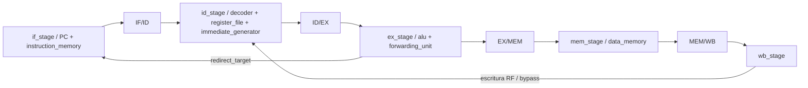
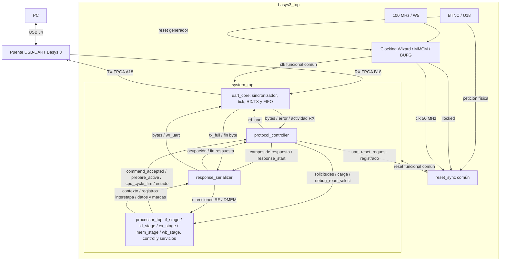

# Composición del sistema FPGA

- **Tipo:** arquitectura.
- **Estado documental:** especificación vigente.

## Propósito y alcance

Define la jerarquía del sistema FPGA, los puertos de sus tops y las conexiones entre componentes. Los contratos especializados conservan la autoridad sobre el comportamiento de cada bloque.

## Jerarquía aprobada

| Módulo principal | Responsabilidad y contenido                                                                                                          |
|------------------|--------------------------------------------------------------------------------------------------------------------------------------|
| `basys3_top`     | Cuatro puertos físicos de placa, selección única `MEMORY_PROFILE`, Clocking Wizard/MMCM/BUFG y `reset_sync` común                    |
| `system_top`     | Conecta `uart_core`, `protocol_controller`, `response_serializer` y `processor_top`; distribuye `clk`/`reset`, capacidades y señales |
| `processor_top`  | Contiene la CPU/pipeline, RF, IMEM/DMEM, hazards, `Execution Control`, `Loader` y `Session Preparation`                              |

`uart_core`, `protocol_controller` y `response_serializer` mantienen sus fronteras/FSM/recursos aprobados. Dentro de `processor_top`, los 51 bloques funcionales conservan las conexiones de `interfaces.md`; los grupos de la tabla de cobertura describen su ubicación.

La agrupación utiliza un módulo por etapa y submódulos seleccionados según responsabilidad y valor de verificación, según el [inventario completo y comparación](module_inventory.md). Los 51 bloques conservan ubicación/archivo explícitos: 23 tienen módulo específico y 28 son lógica/estado local.

El PC queda dentro de `if_stage`. Los cuatro registros interetapa son módulos en `processor_top` y sus controles son lógica local diferenciada. La separación entre FSM combinacional/estado registrado y acciones de recursos se conserva.

El paquete `system_pkg` comparte definiciones sin ser una instancia de hardware. No pertenece al recorrido de datos ni a la cadena de clock/`reset`.

## Catálogo completo de módulos aprobado

La jerarquía utiliza tres tops, cinco módulos de etapa y agrupación selectiva de los bloques CPU. UART, `protocol_controller`, `response_serializer` y `reset_sync` conservan sus fronteras. El catálogo fija nombres, contenedores y archivos sin modificar contratos ni añadir latencia.

El catálogo utiliza nombres en inglés, con minúsculas y guiones bajos; cada nombre identifica la función correspondiente y no incluye el prefijo del trabajo práctico. Cada módulo propio tendrá un archivo homónimo `.sv`. `clock_generator` será el nombre del componente IP generado por Clocking Wizard; sus MMCM/BUFG internos no son módulos propios adicionales.

| Contenedor          | Módulo hijo           | Función / agrupación                                                                              |
|---------------------|-----------------------|---------------------------------------------------------------------------------------------------|
| raíz                | `basys3_top`          | Conexión con Basys 3, perfil de memoria y distribución de clock/`reset`                           |
| `basys3_top`        | `clock_generator`     | IP Clocking Wizard aprobado: 100→50 MHz, MMCM/BUFG y locked                                       |
| `basys3_top`        | `reset_sync`          | Acondicionador común de `reset` ya acordado                                                       |
| `basys3_top`        | `system_top`          | Sistema funcional, independiente de los pines/IP de placa                                         |
| `system_top`        | `uart_core`           | Transporte UART RX/TX                                                                             |
| `system_top`        | `protocol_controller` | Interpretación de comandos y coordinación                                                         |
| `system_top`        | `response_serializer` | Producción de respuestas y seguimiento del último Stop                                            |
| `system_top`        | `processor_top`       | Pipeline, memoria y servicios de ejecución/carga/preparación                                      |
| `uart_core`         | `serial_input_sync`   | Sincronización de RX                                                                              |
| `uart_core`         | `baud_tick_gen`       | Tick compartido de RX/TX                                                                          |
| `uart_core`         | `uart_rx`             | Recepción y validación de tramas                                                                  |
| `uart_core`         | `uart_tx`             | Transmisión de tramas                                                                             |
| `uart_core`         | `fifo`                | Dos instancias del mismo módulo: RX y TX                                                          |
| `processor_top`     | `if_stage`            | PC, próximo PC, búsqueda y candidato de fault de fetch                                            |
| `processor_top`     | `id_stage`            | Decodificación, RF, operandos, inmediato, fault ID y detección load-use                           |
| `processor_top`     | `ex_stage`            | ALU, forwarding, saltos y comprobación EX                                                         |
| `processor_top`     | `mem_stage`           | Acceso DMEM, stores y formación del resultado para `MEM/WB`                                       |
| `processor_top`     | `wb_stage`            | Escritura efectiva a RF y habilitaciones de bypass WB→ID                                          |
| `processor_top`     | `execution_control`   | Contiene la FSM global y la lógica/estado local de metadatos, imagen, ciclos y vacío del pipeline |
| `execution_control` | `global_fsm`          | Selección de comandos, autorización de ciclos, fase de sesión y controles de los recursos         |

Los 51 bloques definidos se ubican en la [tabla de cobertura](#cobertura-de-los-bloques-cpu); el detalle de módulos, archivos y justificación corresponde a [module_inventory.md](module_inventory.md). Con los 19 tipos de integración/transporte/placa, el catálogo comprende 42 tipos, incluido el IP de clock, y dos instancias de `fifo`. Los módulos de etapa contienen lógica local y conectan sus submódulos; PC/registros interetapa y memorias siguen teniendo una sola instancia. No se añade latencia por separar archivos.

### Fronteras de las cinco etapas

| Módulo      | Entradas principales                                                                       | Salidas / recursos propios                                                                                                      |
|-------------|--------------------------------------------------------------------------------------------|---------------------------------------------------------------------------------------------------------------------------------|
| `if_stage`  | acciones de pipeline, `redirect_target`, tamaño confirmado, preparación y escritura Loader | PC registrado y `debug_pc`; instrucción/PC/candidato fetch para `IF/ID`; `instruction_memory`                                   |
| `id_stage`  | `IF/ID` actual, `ID/EX` para load-use, dato/control WB y lectura Debug RF                  | campos combinacionales para `ID/EX`; candidatos ID/halt/load-use; datos RF/Debug; decoder/`register_file`/`immediate_generator` |
| `ex_stage`  | `ID/EX`, `EX/MEM` y `MEM/WB` para forwarding                                               | campos combinacionales para `EX/MEM`; redirección/candidato EX/cause; alu/`forwarding_unit`                                     |
| `mem_stage` | `EX/MEM`, `cpu_cycle_fire`/`reset`, preparación y lectura Debug DMEM                       | campos combinacionales para `MEM/WB`; store efectivo; datos/marcas Debug; `data_memory`                                         |
| `wb_stage`  | `MEM/WB` actual, `cpu_cycle_fire` y rs1/rs2 de `IF/ID`                                     | dirección/dato/write-fire para `register_file` y `bypass_rs1`/`bypass_rs2` para `id_stage`                                      |

`WB Bypass Control` (bloque 2.6) se realiza íntegro como lógica local de `wb_stage`. Produce una única `rf_write_fire` con la ecuación aprobada y los dos controles de bypass.

`id_stage` conserva los muxes de bypass y recibe esos controles. `register_file` recibe la dirección, el dato y esa misma habilitación, con prioridad de `reset`/preparación.

El dato WB y las coincidencias de forwarding siguen tomando `MEM/WB` previo al flanco. `wb_stage` no tiene registro propio ni toma el dato combinacional futuro de `mem_stage`.

`processor_top` conecta los campos actuales de los registros interetapa a las etapas y a Debug. Cada etapa produce el payload del siguiente registro interetapa; sus controles de actualización locales diferenciados en el top aplican las acciones de pipeline ya aprobadas y producen `next.valid` para `execution_control`. Esta separación evita duplicar registros interetapa o su autorización.

`processor_top` distribuye explícitamente las capacidades por estas rutas:

| Parámetro             | Hijos de `processor_top`                        | Propagación interna                                                                                                                     |
|-----------------------|-------------------------------------------------|-----------------------------------------------------------------------------------------------------------------------------------------|
| `IMEM_CAPACITY_BYTES` | `if_stage`, `execution_control` y `loader`      | `if_stage` lo pasa a `instruction_memory` y `fetch_fault_check`. `execution_control` deriva localmente los anchos de tamaño confirmado. |
| `DMEM_CAPACITY_BYTES` | `ex_stage`, `mem_stage` y `session_preparation` | `ex_stage` lo pasa a `ex_flow_check` y `mem_stage` a `data_memory`.                                                                     |

`id_stage`/`wb_stage` no requieren capacidades de memoria. Los tamaños/índices se derivan de los parámetros según `system_pkg`, sin defaults o perfiles independientes.

Los cuatro nodos de registro son módulos *_register instanciados en `processor_top`; sus controles de actualización son lógica local diferenciada del top. Las flechas describen datos; las cinco etapas no crean otros dominios de clock. IF, RF y DMEM reciben el clock común por sus recursos; los bloques combinacionales, incluido `wb_stage`, no necesitan clock/`reset` propios si usan `cpu_cycle_fire` como control. Control global, preparación y Loader conservan su reloj funcional y sus acciones existentes.

`execution_control` contiene los siete bloques funcionales 6.1–6.3, 7.1, 8.1 y 9.3–9.4. `global_fsm.sv` es su submódulo de control: conserva los catorce estados, selecciona las solicitudes y genera las salidas Moore y Mealy.

`pipeline_empty_next` se calcula con lógica local desde `next.valid` de los registros interetapa recibidos desde `processor_top`. No se infiere desde el estado futuro de la FSM.

La selección de metadatos, sus registros de causa/PC, el tamaño confirmado, el contador de ciclos y la reducción de próximos `valid` se realizan como lógica o estado local en `execution_control.sv`. Los recursos reciben las señales de acción y realizan sus actualizaciones al flanco funcional.

`loader` y `session_preparation` son hijos de `processor_top`. Reciben de `execution_control` los controles de inicio, carga y preparación, y devuelven sus condiciones de finalización.

## Puertos y parámetros de los tops

### basys3_top

Parámetro `MEMORY_PROFILE`, identificador de perfil definido en `system_pkg`, default `REFERENCE`. Resuelve IMEM/DMEM y los pasa explícitamente a `system_top`.

| Puerto         | Dirección | Ancho | Conexión                                         |
|----------------|-----------|------:|--------------------------------------------------|
| `clk_100mhz_i` | entrada   |     1 | W5 → Wizard                                      |
| `reset_btn_i`  | entrada   |     1 | U18 → `reset` de Wizard y petición `reset` común |
| `uart_rx_i`    | entrada   |     1 | B18 → `system_top.serial_rx`                     |
| `uart_tx_o`    | salida    |     1 | `system_top.serial_tx` → A18                     |

El `Wizard.clk_out1` alimenta el `clk` funcional. `Wizard.locked` contribuye a `!locked` en la solicitud común. `system_top.uart_reset_request` se integra en esa misma combinación.

`reset_sync` entrega el único `reset` funcional a `system_top`. La fuente de 100 MHz se limita a la generación del clock. El `clk` funcional de la CPU y la UART es de 50 MHz. `reset_sync` también utiliza ese `clk`; sus consumidores reciben la salida de `reset` acondicionada.

[Plataforma](platform/platform_reference.md) especifica los pines, las polaridades, el `reset` y los constraints.

### system_top

Parámetros `IMEM_CAPACITY_BYTES` y `DMEM_CAPACITY_BYTES`, longint unsigned, explícitos desde wrapper. Derivación/validación de [configuración común](common_configuration.md), sin selección de perfil dentro de hijos.

| Puerto               | Dirección | Ancho | Conexión                                                             |
|----------------------|-----------|------:|----------------------------------------------------------------------|
| `clk`                | entrada   |     1 | clock funcional de plataforma o estímulo de simulación               |
| `reset`              | entrada   |     1 | `reset` funcional acondicionado o estímulo equivalente               |
| `serial_rx`          | entrada   |     1 | UART de placa → `uart_core.serial_rx`                                |
| `serial_tx`          | salida    |     1 | `uart_core.serial_tx` → placa                                        |
| `uart_reset_request` | salida    |     1 | petición registrada de `protocol_controller` → `reset` de plataforma |

Este top funcional permite probar el sistema integrado con `clk`/`reset`/seriales en simulación, sin generar IP de placa. `processor_top` recibe ambas capacidades; `protocol_controller` recibe IMEM; `response_serializer` recibe DMEM. `uart_core` recibe constantes clock/UART de `system_pkg`: 50 MHz, 19200 baud, oversampling 16 y FIFO de cuatro ya aprobados.

### processor_top: comandos, carga y consultas

Parámetros `IMEM_CAPACITY_BYTES` y `DMEM_CAPACITY_BYTES`. W=`IMAGE_SIZE_WIDTH`; Bi=`IMEM_BYTE_ADDRESS_WIDTH`; Bd=`DMEM_BYTE_ADDRESS_WIDTH`. Entradas/salidas escalares usan un bit. Todos los puertos siguientes se conectan dentro de `system_top`, no a pines físicos adicionales.

| Puerto(s)                                                                | Dirección | Ancho por señal | Productor / consumidor                                                                                                                                          |
| ------------------------------------------------------------------------ | --------- | --------------- | --------------------------------------------------------------------------------------------------------------------------------------------------------------- |
| `clk`, `reset`                                                           | entrada   | 1 cada uno      | sistema → todos los consumidores internos pertinentes                                                                                                           |
| `load_request`, `run_request`, `step_request`                            | entrada   | 1 cada uno      | `protocol_controller` → `execution_control`                                                                                                                     |
| `command_accepted`                                                       | salida    | 1               | `execution_control` → `protocol_controller`                                                                                                                     |
| `load_available`, `prepare_active`, `program_finished`, `fault_terminal` | salida    | 1 cada uno      | `execution_control` → `protocol_controller`; `prepare_active` también activa `session_preparation` internamente                                                 |
| `load_size_bytes`                                                        | entrada   | W               | Controller → Loader, alias `pending_image_size_bytes` → registro de tamaño en `execution_control`; tamaño completo en la aceptación y estable hasta publicación |
| `load_byte_valid`, `load_last_byte`, `load_abort`                        | entrada   | 1 cada uno      | controlador → Loader                                                                                                                                            |
| `load_byte_data`                                                         | entrada   | 8               | controlador → Loader                                                                                                                                            |
| `load_byte_offset`                                                       | entrada   | Bi              | controlador, posición derivada → Loader                                                                                                                         |
| `cpu_cycle_fire`                                                         | salida    | 1               | `execution_control` → controlador; consumidores CPU internos                                                                                                    |
| `debug_read_select`                                                      | entrada   | 1               | `protocol_controller` → primer mux de lectura RF en `id_stage` y selector CPU/Debug de DMEM en `mem_stage`                                                      |
| `debug_rf_addr`                                                          | entrada   | 5               | serializador → primera lectura RF                                                                                                                               |
| `debug_rf_data`                                                          | salida    | 32              | RF → serializador                                                                                                                                               |
| `debug_dmem_addr`                                                        | entrada   | Bd              | serializador → lectura DMEM                                                                                                                                     |
| `debug_dmem_data`, `debug_dmem_used`                                     | salida    | 8 / 1           | DMEM, mismo byte lógico/marca → serializador                                                                                                                    |

[Protocol Controller](debug/protocol_controller.md#generación-de-solicitudes) genera una sola solicitud por ciclo, independientemente de `command_accepted`. `Global FSM`, dentro de `execution_control`, decide su aceptación combinacionalmente y ambas FSM consumen solicitud y aceptación en el mismo flanco. El Controller asocia la aceptación al opcode recibido o a la solicitud LOAD del último byte de tamaño, según la fase; sin solicitud, `command_accepted` no constituye un evento.

Para `LOAD`, el Controller valida los cuarenta bits del tamaño con el quinto byte actual antes de reducir el ancho. Si el tamaño es válido, presenta `load_request` y `load_size_bytes` en ese ciclo. La aceptación activa `load_start` e invalida la imagen anterior en el mismo flanco; el tamaño permanece disponible mediante el alias del Loader hasta `image_publish`.

Las rutas de solicitud, aceptación y autorización del ciclo CPU son combinacionales y deben cumplir el período de 20 ns. La autorización `cpu_cycle_fire` llega también al Controller, que puede capturar la respuesta de STEP en el flanco de su único ciclo.

`load_ok`, `load_fail` y `prepare_done` permanecen dentro de `processor_top`. Loader entrega `load_ok` y `load_fail` a la Global FSM por `execution_control`; `session_preparation` entrega allí `prepare_done`. La última entrega válida escribe IMEM y activa `load_ok` en el mismo flanco. La Global FSM inicia la preparación y el Controller entra en `WAIT_PREP_DONE`, su espera de preparación LOAD, con `prepare_active` activo después del flanco.

Al consumir `prepare_done`, la Global FSM publica la imagen y desactiva `prepare_active`. El Controller observa esa salida y entrega `LOAD/DONE` al serializador en el siguiente flanco. Para STEP, reconoce el ciclo realizado mediante `cpu_cycle_fire`; no recibe las finalizaciones internas de los servicios.

`processor_top` distribuye `debug_read_select` hacia el primer puerto de lectura RF y el selector CPU/Debug de DMEM, sin registrarla. Las direcciones `debug_rf_addr` y `debug_dmem_addr` son independientes y provienen del serializador; compartir la selección no habilita escrituras.

`RESET` UART espera el último Stop de `RESET/ACCEPTED`. El Controller registra entonces `uart_reset_request`, que sale por `system_top` hacia el acondicionador del wrapper. Los consumidores muestrean el reset distribuido en el siguiente flanco funcional; ese reset limpia la solicitud. La integración detallada se define en [reset global](platform/reset_integration.md).

### processor_top: contexto y registros interetapa observables

| Puerto de salida    | Ancho | Fuente única y consumidor                                                                                   |
|---------------------|------:|-------------------------------------------------------------------------------------------------------------|
| `global_state_code` |     8 | `execution_control`, desde la salida combinacional de `Global FSM` → `response_serializer.debug_state_code` |
| `image_valid`       |     1 | `loaded_image_size_bytes`!=0 → controlador y `debug_image_valid` del serializador                           |
| `debug_pc`          |    32 | PC registrado actual → serializador                                                                         |
| `debug_cycle_count` |    64 | `Cycle Counter` actual → serializador                                                                       |
| `debug_fault_cause` |     3 | `fault_cause` registrado actual → serializador                                                              |
| `debug_fault_pc`    |    32 | `fault_pc` registrado actual → serializador                                                                 |

`global_state` permanece como registro one-hot de catorce bits interno de `Global FSM`. `program_finished` y `fault_terminal` son salidas de control hacia `protocol_controller`; la vigencia de los metadatos de fault se interpreta en Debug a partir del código externo. `debug_state_code` y `debug_image_valid` son los nombres de entrada de las conexiones de estado e imagen en el serializador.

Los 34 puertos siguientes son salidas directas desde los campos actuales de cuatro registros interetapa hacia las entradas homónimas del serializador. Puertos individuales; no se introduce una estructura empaquetada, padding interno ni snapshot nuevo. Sus tipos `logic`/anchos se toman de `system_pkg` y los campos aprobados.

| Puerto de salida `processor_top` / entrada `response_serializer` | Ancho | Fuente registrada         |
|------------------------------------------------------------------|------:|---------------------------|
| `debug_ifid_valid`                                               |     1 | `IF/ID.valid`             |
| `debug_ifid_pc`                                                  |    32 | `IF/ID.pc`                |
| `debug_ifid_instruction`                                         |    32 | `IF/ID.instruction`       |
| `debug_ifid_fetch_fault_valid`                                   |     1 | `IF/ID.fetch_fault_valid` |
| `debug_ifid_fetch_fault_cause`                                   |     3 | `IF/ID.fetch_fault_cause` |
| `debug_idex_valid`                                               |     1 | `ID/EX.valid`             |
| `debug_idex_pc`                                                  |    32 | `ID/EX.pc`                |
| `debug_idex_instruction`                                         |    32 | `ID/EX.instruction`       |
| `debug_idex_rs1`                                                 |     5 | `ID/EX.rs1`               |
| `debug_idex_rs2`                                                 |     5 | `ID/EX.rs2`               |
| `debug_idex_rd`                                                  |     5 | `ID/EX.rd`                |
| `debug_idex_rs1_value`                                           |    32 | `ID/EX.rs1_value`         |
| `debug_idex_rs2_value`                                           |    32 | `ID/EX.rs2_value`         |
| `debug_idex_immediate`                                           |    32 | `ID/EX.immediate`         |
| `debug_idex_alu_op`                                              |     6 | `ID/EX.alu_op`            |
| `debug_idex_alu_src`                                             |     1 | `ID/EX.alu_src`           |
| `debug_idex_result_sel`                                          |     2 | `ID/EX.result_sel`        |
| `debug_idex_flow_op`                                             |     3 | `ID/EX.flow_op`           |
| `debug_idex_mem_op`                                              |     4 | `ID/EX.mem_op`            |
| `debug_idex_reg_write`                                           |     1 | `ID/EX.reg_write`         |
| `debug_exmem_valid`                                              |     1 | `EX/MEM.valid`            |
| `debug_exmem_pc`                                                 |    32 | `EX/MEM.pc`               |
| `debug_exmem_instruction`                                        |    32 | `EX/MEM.instruction`      |
| `debug_exmem_rd`                                                 |     5 | `EX/MEM.rd`               |
| `debug_exmem_reg_write`                                          |     1 | `EX/MEM.reg_write`        |
| `debug_exmem_mem_op`                                             |     4 | `EX/MEM.mem_op`           |
| `debug_exmem_ex_result`                                          |    32 | `EX/MEM.ex_result`        |
| `debug_exmem_store_data`                                         |    32 | `EX/MEM.store_data`       |
| `debug_memwb_valid`                                              |     1 | `MEM/WB.valid`            |
| `debug_memwb_pc`                                                 |    32 | `MEM/WB.pc`               |
| `debug_memwb_instruction`                                        |    32 | `MEM/WB.instruction`      |
| `debug_memwb_rd`                                                 |     5 | `MEM/WB.rd`               |
| `debug_memwb_reg_write`                                          |     1 | `MEM/WB.reg_write`        |
| `debug_memwb_wb_value`                                           |    32 | `MEM/WB.wb_value`         |

Totales funcionales 69/193/139/103 bits, 504 en conjunto. Campos y esquema UART continúan en [observación del serializador](debug/response_serializer.md#observación-y-selección-de-bytes-de-los-cuatro-latches); se conservan bits residuales de entradas inválidas y los paddings se forman solo al serializar. Contexto y registros interetapa son cables de observación, no realimentaciones al control.

## Conexiones entre componentes del sistema

Todos los recursos registrados reciben `clk`/`reset` funcionales comunes. Las interfaces privadas de los tres módulos existentes conservan sus nombres y anchos aprobados.

| Productor → consumidor                            | Señales y anchos                                                                        | Contrato que se conserva                                                                                                                 |
| ------------------------------------------------- | --------------------------------------------------------------------------------------- | ---------------------------------------------------------------------------------------------------------------------------------------- |
| `uart_core` → `protocol_controller`               | `r_data[7:0]`, `rx_empty`, `rx_error_tick`, `rx_activity`                               | dato preflanco disponible; `rx_activity` incluye cambios de nivel, línea baja y trama en curso                                           |
| `protocol_controller` → `uart_core`               | `rd_uart`                                                                               | !`reset` && !`rx_empty`, interpretar o descartar según fase                                                                              |
| `protocol_controller` → `response_serializer`     | `response_start`, `response_opcode[7:0]`, `response_result[7:0]`, `response_with_debug` | campos combinacionales; captura de 17 bits con `response_busy` en cero antes del flanco                                                  |
| `response_serializer` → `protocol_controller`     | `response_busy`, `response_done_tick`                                                   | ocupación desde el estado del serializador y fin físico del último Stop; la siguiente captura espera un flanco con el serializador libre |
| `response_serializer` → `uart_core`               | `w_data[7:0]`, `wr_uart`                                                                | único productor de bytes TX; conservar byte ante FIFO llena                                                                              |
| `uart_core` → `response_serializer`               | `tx_full`, `tx_done_tick`                                                               | aceptación de FIFO según flag preflanco; fin físico de cada byte                                                                         |
| `protocol_controller` ↔ `processor_top`           | puertos de comandos/carga/estado y selectores de tablas anteriores                      | solicitud y aceptación combinacionales, carga/preparación/STEP según recorrido aprobado                                                  |
| `response_serializer` ↔ `processor_top`           | direcciones RF/DMEM, retornos y contexto/registros interetapa anteriores                | lectura del mismo estado retenido hasta fin físico                                                                                       |
| `protocol_controller` → wrapper, vía `system_top` | `uart_reset_request`                                                                    | petición registrada después del último Stop de `ACCEPTED`                                                                                |

`protocol_controller` selecciona los campos de respuesta y `response_serializer` los captura en sus registros y produce todos los bytes TX. En textos/figuras de `uart_core`, «control del protocolo» abarca estos dos módulos; `w_data`/`wr_uart` físicamente provienen del serializador y `rd_uart` del controlador. `tx_done_tick` llega solo al serializador; el controlador usa `response_done_tick`. `uart_core` conserva su salida `rx_receiving`, incluida en `rx_activity`; no se conecta como entrada separada del Controller.

## Aliases y conexiones internas sensibles

| Conexión                               | Productor / consumidores concretos                                                                                                                 |
| -------------------------------------- | -------------------------------------------------------------------------------------------------------------------------------------------------- |
| `clk` funcional                        | única salida BUFG → sistema completo, incluidos UART y preparación en HOLD CPU                                                                     |
| `debug_read_select`                    | `protocol_controller` → `processor_top` → `id_stage`/primer mux RF y `mem_stage`/selector DMEM; señal combinacional común, sin registro intermedio |
| `loaded_image_size_bytes`              | registro local de `execution_control`; clear por `reset`/`load_start`, captura del tamaño pendiente por `image_publish`                            |
| `pending_image_size_bytes`             | alias combinacional de `load_size_bytes` mediante Loader; incluye el quinto byte actual al aceptar LOAD y permanece estable hasta `image_publish`  |
| `load_start`                           | `Global FSM` → Loader y registro de tamaño confirmado; inicio e invalidación en el flanco de aceptación de `LOAD`                                  |
| `loader_active`                        | `Global FSM` → Loader; habilitación de fase de carga                                                                                               |
| `image_publish`                        | `Global FSM` → registro de tamaño confirmado; publicación al completar preparación de `LOAD`                                                       |
| `prepare_active`                       | `Global FSM` → `Session Preparation` y `protocol_controller`                                                                                       |
| `prepare_done`                         | `Session Preparation` → `Global FSM`, por `execution_control`, interno de `processor_top`; preparación completa antes del flanco                   |
| `prepare_init`                         | `Session Preparation` → PC, RF, cuatro registros interetapa y contador local de `execution_control`; limpieza local en primer flanco               |
| `prepare_dmem_clear`/addr              | `Session Preparation` → única DMEM, mismo bitmap que cero lógico/used                                                                              |
| `dmem_store_fire` / `write_enable`     | `DMEM Write Control` → dato y metadatos de DMEM en el mismo flanco                                                                                 |
| `dmem_metadata_write_fire`             | alias del commit de store para poner marcas; limpieza de preparación conserva su camino aprobado                                                   |
| `id_fault_cause`/`id_fault_pc`         | `ID Fault Check` → selección local de metadatos en `execution_control`, incluidas causas de fetch transportadas                                    |
| `ex_fault_cause` / `ID/EX.pc`          | `EX Fault Check` / registro interetapa → selección local de metadatos en `execution_control`                                                       |
| `act_ex_fault`/`act_id_fault`          | `Pipeline Hazard Control` → `execution_control`; OR local para `fault_confirm` y `fault_capture_fire`                                              |
| `fault_capture_fire` / `fault_confirm` | mismo evento local de `execution_control` → registros de causa/PC y `Global FSM`, respectivamente                                                  |
| `halt_confirm`                         | alias de `act_halt` de `Pipeline Hazard Control` → `Global FSM`, por `execution_control`                                                           |
| `pipeline_empty_next`                  | reducción local de los cuatro `next.valid` en `execution_control` → `Global FSM`                                                                   |
| `next.valid`/capture/hold/invalidate   | controles de cada registro interetapa → registro interetapa y lógica de pipeline vacío; Debug observa solo campos registrados actuales             |
| `cpu_cycle_fire`                       | `Global FSM` → `Pipeline Hazard Control`, `WB Bypass Control`, `DMEM Write Control`, contador y `protocol_controller`, por `execution_control`     |
| `drain_mode`                           | `Global FSM` → `Pipeline Hazard Control`, por `execution_control`; identifica el contexto de drenado junto con `cpu_cycle_fire`                    |
| `s_tick` / `sample_tick`               | salida única de `baud_tick_gen` → RX/TX como enable; nunca clock                                                                                   |
| `load_ok`                              | Loader → `Global FSM`, por `execution_control`, interno de `processor_top`; última escritura IMEM en el flanco de la última entrega válida         |
| `load_fail`                            | Loader, desde `load_abort` → `Global FSM`, por `execution_control`, interno de `processor_top`; aborto de carga                                    |

Reset > LOAD/preparación efectiva > ciclo CPU > HOLD sigue vigente. La selección de Debug no concede writes; controlador excluye solicitudes/recargas/preparación, y el estado global tras STEP/terminal no autoriza ciclos nuevos. La retención utiliza el estado CPU y los recursos de coordinación del Controller, sin puerto adicional de hold, copia de memoria ni FSM privada de Loader o preparación.

## Representación integrada vigente

Este Mermaid y la tabla de cobertura constituyen la representación integrada de tops. Las interfaces y los diagramas de etapas/memoria conservan el detalle de cada conexión interna.

### Cobertura de los bloques CPU

Los 51 IDs de `interfaces.md` aparecen una sola vez en la tabla, con su ubicación dentro de `processor_top` y su jerarquía. Cada bloque conserva sus fuentes, destinos y temporalidad.

| ID / enlace a contrato               | Bloque funcional                          | Grupo funcional                    | Módulo / ubicación                        |
|--------------------------------------|-------------------------------------------|------------------------------------|-------------------------------------------|
| [1.1](../interfaces.md#bloque-1-1)   | `PC Update Control`                       | IF / PC / IMEM / IF-ID             | `if_stage` (lógica/estado local)          |
| [1.2](../interfaces.md#bloque-1-2)   | `Next PC MUX`                             | IF / PC / IMEM / IF-ID             | `if_stage` (lógica/estado local)          |
| [1.3](../interfaces.md#bloque-1-3)   | `PC`                                      | IF / PC / IMEM / IF-ID             | `if_stage` (lógica/estado local)          |
| [1.4](../interfaces.md#bloque-1-4)   | `PC Adder`                                | IF / PC / IMEM / IF-ID             | `if_stage` (lógica/estado local)          |
| [1.5](../interfaces.md#bloque-1-5)   | `Instruction Memory`                      | IF / PC / IMEM / IF-ID             | `if_stage.instruction_memory`             |
| [1.6](../interfaces.md#bloque-1-6)   | `Fetch Fault Check`                       | IF / PC / IMEM / IF-ID             | `if_stage.fetch_fault_check`              |
| [1.7](../interfaces.md#bloque-1-7)   | `IF/ID Input Logic`                       | IF / PC / IMEM / IF-ID             | `if_stage` (lógica/estado local)          |
| [1.8](../interfaces.md#bloque-1-8)   | `IF/ID Update Control`                    | IF / PC / IMEM / IF-ID             | `processor_top` (lógica/estado local)     |
| [1.9](../interfaces.md#bloque-1-9)   | Registro `IF/ID`                          | IF / PC / IMEM / IF-ID             | `processor_top.if_id_register`            |
| [2.1](../interfaces.md#bloque-2-1)   | `Decoder`                                 | ID / RF / ID-EX                    | `id_stage.decoder`                        |
| [2.2](../interfaces.md#bloque-2-2)   | `Registers`                               | ID / RF / ID-EX                    | `id_stage.register_file`                  |
| [2.3](../interfaces.md#bloque-2-3)   | `Immediate Generator`                     | ID / RF / ID-EX                    | `id_stage.immediate_generator`            |
| [2.4](../interfaces.md#bloque-2-4)   | `RS1 Bypass MUX`                          | ID / RF / ID-EX                    | `id_stage` (lógica/estado local)          |
| [2.5](../interfaces.md#bloque-2-5)   | `RS2 Bypass MUX`                          | ID / RF / ID-EX                    | `id_stage` (lógica/estado local)          |
| [2.6](../interfaces.md#bloque-2-6)   | `WB Bypass Control`                       | ID / RF / ID-EX                    | `wb_stage` (lógica/estado local)          |
| [2.7](../interfaces.md#bloque-2-7)   | `ID Fault Check`                          | ID / RF / ID-EX                    | `id_stage.id_fault_check`                 |
| [2.8](../interfaces.md#bloque-2-8)   | `Load-Use Detector`                       | ID / RF / ID-EX                    | `id_stage.load_use_detector`              |
| [2.9](../interfaces.md#bloque-2-9)   | `ID/EX Update Control`                    | ID / RF / ID-EX                    | `processor_top` (lógica/estado local)     |
| [2.10](../interfaces.md#bloque-2-10) | Registro `ID/EX`                          | ID / RF / ID-EX                    | `processor_top.id_ex_register`            |
| [3.1](../interfaces.md#bloque-3-1)   | `Forwarding Unit`                         | EX / forwarding / EX-MEM           | `ex_stage.forwarding_unit`                |
| [3.2](../interfaces.md#bloque-3-2)   | `Forward MUX A`                           | EX / forwarding / EX-MEM           | `ex_stage` (lógica/estado local)          |
| [3.3](../interfaces.md#bloque-3-3)   | `Forward MUX B`                           | EX / forwarding / EX-MEM           | `ex_stage` (lógica/estado local)          |
| [3.4](../interfaces.md#bloque-3-4)   | `ALUSrc MUX`                              | EX / forwarding / EX-MEM           | `ex_stage` (lógica/estado local)          |
| [3.5](../interfaces.md#bloque-3-5)   | `ALU`                                     | EX / forwarding / EX-MEM           | `ex_stage.alu`                            |
| [3.6](../interfaces.md#bloque-3-6)   | `Link Adder`                              | EX / forwarding / EX-MEM           | `ex_stage` (lógica/estado local)          |
| [3.7](../interfaces.md#bloque-3-7)   | `Result MUX`                              | EX / forwarding / EX-MEM           | `ex_stage` (lógica/estado local)          |
| [3.8](../interfaces.md#bloque-3-8)   | `Target Adder`                            | EX / forwarding / EX-MEM           | `ex_stage` (lógica/estado local)          |
| [3.9](../interfaces.md#bloque-3-9)   | `JALR Adder`                              | EX / forwarding / EX-MEM           | `ex_stage` (lógica/estado local)          |
| [3.10](../interfaces.md#bloque-3-10) | `Clear bit 0`                             | EX / forwarding / EX-MEM           | `ex_stage` (lógica/estado local)          |
| [3.11](../interfaces.md#bloque-3-11) | `Target MUX`                              | EX / forwarding / EX-MEM           | `ex_stage` (lógica/estado local)          |
| [3.12](../interfaces.md#bloque-3-12) | `Flow Control`                            | EX / forwarding / EX-MEM           | `ex_stage.flow_control`                   |
| [3.13](../interfaces.md#bloque-3-13) | `EX Fault Check`                          | EX / forwarding / EX-MEM           | `ex_stage.ex_flow_check`                  |
| [3.14](../interfaces.md#bloque-3-14) | `EX/MEM Update Control`                   | EX / forwarding / EX-MEM           | `processor_top` (lógica/estado local)     |
| [3.15](../interfaces.md#bloque-3-15) | Registro `EX/MEM`                         | EX / forwarding / EX-MEM           | `processor_top.ex_mem_register`           |
| [4.1](../interfaces.md#bloque-4-1)   | `MEM Decode`                              | MEM / DMEM / MEM-WB                | `mem_stage.mem_decode`                    |
| [4.2](../interfaces.md#bloque-4-2)   | `Data Memory`                             | MEM / DMEM / MEM-WB                | `mem_stage.data_memory`                   |
| [4.3](../interfaces.md#bloque-4-3)   | `Load Select/Extend`                      | MEM / DMEM / MEM-WB                | `mem_stage.load_select_extend`            |
| [4.4](../interfaces.md#bloque-4-4)   | `WB Value MUX`                            | MEM / DMEM / MEM-WB                | `mem_stage` (lógica/estado local)         |
| [4.5](../interfaces.md#bloque-4-5)   | `DMEM Write Control`                      | MEM / DMEM / MEM-WB                | `mem_stage.dmem_write_control`            |
| [4.6](../interfaces.md#bloque-4-6)   | `MEM/WB Update Control`                   | MEM / DMEM / MEM-WB                | `processor_top` (lógica/estado local)     |
| [4.7](../interfaces.md#bloque-4-7)   | Registro `MEM/WB`                         | MEM / DMEM / MEM-WB                | `processor_top.mem_wb_register`           |
| [5.1](../interfaces.md#bloque-5-1)   | `Pipeline Hazard Control`                 | Arbitraje de pipeline              | `processor_top.pipeline_hazard_control`   |
| [6.1](../interfaces.md#bloque-6-1)   | `Fault Metadata Control`                  | Metadatos de fault                 | `execution_control` (lógica local)        |
| [6.2](../interfaces.md#bloque-6-2)   | Registro global `fault_cause`             | Metadatos de fault                 | `execution_control` (lógica/estado local) |
| [6.3](../interfaces.md#bloque-6-3)   | Registro global `fault_pc`                | Metadatos de fault                 | `execution_control` (lógica/estado local) |
| [7.1](../interfaces.md#bloque-7-1)   | `Pipeline Empty Logic`                    | Terminación y predicados de estado | `execution_control` (lógica/estado local) |
| [8.1](../interfaces.md#bloque-8-1)   | `Global FSM`                              | Control global de sesión           | `execution_control.global_fsm`            |
| [9.1](../interfaces.md#bloque-9-1)   | `Loader`                                  | Loader                             | `processor_top.loader`                    |
| [9.2](../interfaces.md#bloque-9-2)   | `Session Preparation`                     | `Session Preparation`              | `processor_top.session_preparation`       |
| [9.3](../interfaces.md#bloque-9-3)   | Registro global `loaded_image_size_bytes` | Servicios/estado global            | `execution_control` (lógica/estado local) |
| [9.4](../interfaces.md#bloque-9-4)   | `Cycle Counter`                           | Servicios/estado global            | `execution_control` (lógica/estado local) |

`wb_stage` hace commit hacia `register_file` dentro de `id_stage` con `MEM/WB` previo al flanco; realiza `WB Bypass Control` como lógica local, sin duplicar su habilitación. `WB Value MUX` sigue en `mem_stage`, donde se forma el valor antes de registrarlo en `MEM/WB`. La jerarquía concreta las cinco etapas como módulos y ubica los 51 bloques funcionales.

## Condiciones de integración

| Área                       | Condición de integración                                                                                                                                                                                                                                                                                                                                    |
| -------------------------- | ----------------------------------------------------------------------------------------------------------------------------------------------------------------------------------------------------------------------------------------------------------------------------------------------------------------------------------------------------------- |
| Inventario y jerarquía     | 51 IDs vigentes una vez; 23 módulos específicos y 28 bloques locales; 42 tipos totales incluido IP, padres únicos y jerarquía sin ciclos. La cobertura coincide con `interfaces.md`.                                                                                                                                                                        |
| Etapas y WB                | PC en IF; cuatro registros interetapa en `processor_top`; `WB Bypass Control` local en `wb_stage`, escritura/bypass únicos desde `MEM/WB` actual; `WB Value MUX` en MEM. Índices de fuentes ID hacia WB provienen de `IF/ID`, sin dependencia de su resultado.                                                                                              |
| Control del ciclo          | Cuatro `next.valid` hacia la reducción local de vacío; `pipeline_empty_next` selecciona el próximo estado. `Global FSM` autoriza `cpu_cycle_fire` desde estado actual, solicitudes y `prepare_done`, antes de consultar confirmaciones y vacío futuro. Hazards recibe `cpu_cycle_fire`/`drain_mode`.                                                        |
| Carga y publicación        | Solicitudes y aceptación combinacionales en el mismo flanco. El tamaño incluye el quinto byte actual al aceptar LOAD y se conserva hasta publicación. Loader escribe la cuarta entrega y produce `load_ok` simultáneamente. `load_ok`, `load_fail` y `prepare_done` llegan solo a la Global FSM; el Controller observa `prepare_active` y `cpu_cycle_fire`. |
| Preparación y DMEM         | `prepare_active` activa el servicio; `prepare_init` llega a PC/RF/registros interetapa/contador y clear al bitmap único DMEM. `prepare_done` preflanco permite a la FSM publicar o autorizar el primer ciclo RUN/STEP. Store/fire y metadatos mantienen atomicidad/ownership aprobados.                                                                     |
| Debug y faults             | Código global hacia el serializador; indicadores de sesión hacia el controlador. Selector RF/DMEM común del controlador; direcciones del serializador; contexto y 34 campos de registros interetapa/504 bits son observación directa. Selección y captura de causa/PC locales en `execution_control`.                                                       |
| Transporte                 | RX consumidor único `protocol_controller`; TX productor único `response_serializer`. Campos de respuesta combinacionales con `response_start`, descriptor registrado de 17 bits solo en el serializador y captura con `response_busy=0`. `tx_done_tick` llega al serializador; `response_done_tick` al Controller. RX sigue independiente de TX/CPU.        |
| Plataforma y configuración | Cuatro pines, clock/`reset` y origen de petición UART coinciden con plataforma; capacidades se seleccionan una vez y se distribuyen a consumidores; señales de un bit y anchos fijos/derivados se conservan.                                                                                                                                                |
| Representación             | Tabla de cobertura de los 51 contratos y mapa de módulos/archivos de la organización integrada.                                                                                                                                                                                                                                                             |

La implementación debe conservar estas conexiones, anchos, productores y consumidores. Los identificadores locales y los selectores de netlist/XDC se concretan al implementar. La elaboración RTL, simulación, síntesis, timing, CDC físico y pruebas de placa corresponden al [plan de verificación](../verification/verification_plan.md).

## Referencias y trazabilidad

- [Mapa de autoridad documental](system_overview.md#autoridad-documental-por-tema): contratos vigentes y origen de las decisiones.
- [Requisitos](../requirements.md): obligaciones y criterios de aceptación.
- [Decisiones pendientes](../decisions/pending_decisions.md): decisiones de diseño abiertas y condiciones de cierre.
