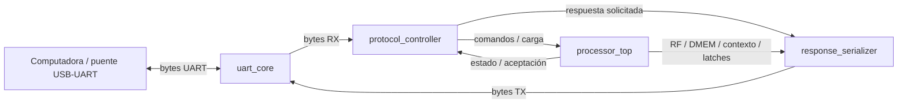

# Diseño FPGA consolidado

- **Tipo:** arquitectura.
- **Estado documental:** especificación vigente.

**Índice**

- [Propósito y alcance](#propósito-y-alcance)
- [El sistema](#el-sistema)
- [Plataforma, clock, reset y configuración](#plataforma-clock-reset-y-configuración)
- [El procesador RISC-V](#el-procesador-risc-v)
- [El pipeline de cinco etapas](#el-pipeline-de-cinco-etapas)
- [Organización de memoria](#organización-de-memoria)
- [Carga de un programa](#carga-de-un-programa)
- [Control de la ejecución](#control-de-la-ejecución)
- [Finalización de la ejecución](#finalización-de-la-ejecución)
- [Debug y observación](#debug-y-observación)
- [UART y comandos](#uart-y-comandos)
- [Software de PC](#software-de-pc)
- [Autoridad documental por tema](#autoridad-documental-por-tema)
- [Fuentes de detalle y trabajo que sigue](#fuentes-de-detalle-y-trabajo-que-sigue)
- [Referencias y trazabilidad](#referencias-y-trazabilidad)

## Propósito y alcance

Presenta el diseño FPGA consolidado y orienta la lectura hacia el contrato vigente de cada tema. Los acuerdos y auditorías conservan la historia; esta vista reúne el funcionamiento y sus fuentes actuales.

## El sistema

La FPGA contiene un procesador RISC-V de 32 bits con pipeline de cinco etapas. Recibe un programa por UART, lo carga, ejecuta ciclos en `RUN` o `STEP` y responde con el estado observado cuando corresponde. UART y control de transporte siguen funcionando aunque la CPU esté detenida.

| Módulo principal | Responsabilidad y contenido                                                                                   |
|------------------|---------------------------------------------------------------------------------------------------------------|
| `basys3_top`     | Pines Basys 3, selección única de perfil, `clock_generator` (IP Clocking Wizard), `reset_sync` y `system_top` |
| `system_top`     | Conecta `uart_core`, `protocol_controller`, `response_serializer` y `processor_top`                           |
| `processor_top`  | Conecta cinco etapas, cuatro registros interetapa, hazards, `execution_control`, Loader y preparación         |

La jerarquía, los puertos físicos/de tops y los aliases están en [Composición del sistema](system_composition.md). Los 51 bloques vigentes se distribuyen en 23 módulos específicos y 28 bloques de lógica/estado local; el detalle de archivos y ubicaciones corresponde al [Inventario de módulos](module_inventory.md). El catálogo contiene 42 tipos, incluido el IP de clock; `fifo` se instancia dos veces. Esta separación organiza el código sin agregar estado ni latencia.

## Plataforma, clock, reset y configuración

- La placa Basys 3 utiliza una entrada de 100 MHz, Clocking Wizard/MMCM/BUFG y un único dominio funcional de **50 MHz**, mínimo docente requerido. Frecuencias mayores son opcionales.
- La comunicación utiliza el puente USB-UART de la placa y el conector micro-USB J4. UART nominal **19200 baud, 8N1**, sobremuestreo 16 y FIFO RX/TX de cuatro bytes. `s_tick` es un enable; no es otro clock.
- La plataforma asigna W5 al `clock`, U18 al botón central, B18 a la señal `RX` de la FPGA y A18 a la señal `TX` de la FPGA. Todas utilizan el estándar LVCMOS33.
- El reset común combina el botón, una petición UART registrada y la falta de locked. `reset_sync` tiene aserción asíncrona y liberación sincronizada; los recursos funcionales consumen reset al flanco. Solo el botón resetea el IP de Clocking Wizard. `RESET` UART espera el último Stop de su ACCEPTED antes de pedir reset.
- `system_pkg.sv` centraliza definiciones compartidas; cada módulo mantiene sus constantes privadas. El top selecciona el perfil una vez y distribuye capacidades explícitas.

| Perfil                   | IMEM bytes | DMEM bytes | Alcance                                                 |
|--------------------------|-----------:|-----------:|---------------------------------------------------------|
| `REFERENCE`, por defecto |       1024 |       2048 | Simulación e implementación física de referencia        |
| `ALT_1000`               |       1000 |       1000 | Elaboración/simulación; sin obligación física adicional |

Fuentes de detalle: [Plataforma](platform/platform_reference.md), [Reset](platform/reset_integration.md) y [Configuración común](common_configuration.md). Capacidad legal de cada memoria: múltiplo de cuatro entre 4 y 2^32 bytes; el build distingue capacidad ilegal y capacidad legal no soportada. Esto no obliga a implementar arrays de todos esos tamaños.

## El procesador RISC-V

### Arquitectura de instrucciones

Se implementan **32 instrucciones RV32I y `halt` exacto 0x0000000B**, todas de 32 bits. La [whitelist y sus campos legales](cpu/stage_id.md#codificaciones-legales) son autoridad del `decoder`; otras codificaciones producen instrucción ilegal.

| Familia            | Instrucciones                                                          |
|--------------------|------------------------------------------------------------------------|
| Registros          | `ADD`, `SUB`, `SLL`, `SLT`, `SLTU`, `XOR`, `SRL`, `SRA`, `OR`, `AND`   |
| Inmediatos         | `ADDI`, `SLTI`, `SLTIU`, `XORI`, `ORI`, `ANDI`, `SLLI`, `SRLI`, `SRAI` |
| Loads              | `LB`, `LH`, `LW`, `LBU`, `LHU`                                         |
| Stores             | `SB`, `SH`, `SW`                                                       |
| Flujo              | `BEQ`, `BNE`, `JAL`, `JALR`                                            |
| Inmediato superior | `LUI`                                                                  |

### Estado de ejecución

El PC, los datos, las instrucciones y las direcciones arquitectónicas tienen 32 bits; los índices de RF tienen cinco bits. `x0` siempre es cero. RF tiene dos lecturas combinacionales y una escritura síncrona; la realización de referencia usa flip-flops para inicialización simultánea. El banco de registros comparte la primera lectura con Debug antes del bypass, sin tercer puerto.

El estado global persistente incluye `global_state` (14 bits one-hot, interno de `Global FSM`), `fault_cause`, `fault_pc`, `loaded_image_size_bytes` y `cycle_count` (64 bits). `image_valid` y vigencia de fault se derivan de tamaño/estado; no son registros duplicados. El código externo de estado tiene ocho bits, se calcula combinacionalmente y llega a `Response Serializer` para Debug.

## El pipeline de cinco etapas

### División de la ejecución

| Etapa / archivo | Unidades con módulo propio                                                               | Bloques locales explícitos                                                                                             |
|-----------------|------------------------------------------------------------------------------------------|------------------------------------------------------------------------------------------------------------------------|
| `if_stage.sv`   | `instruction_memory`, `fetch_fault_check`                                                | `PC Update Control`, `Next PC MUX`, PC, `PC Adder`, `IF/ID` Input Logic                                                |
| `id_stage.sv`   | `decoder`, `register_file`, `immediate_generator`, `id_fault_check`, `load_use_detector` | `RS1 Bypass MUX`, `RS2 Bypass MUX`                                                                                     |
| `ex_stage.sv`   | `forwarding_unit`, `alu`, `flow_control`, `ex_flow_check`                                | `Forward MUX A`/B, `ALUSrc MUX`, `Link Adder`, `Result MUX`, `Target Adder`, `JALR` Adder, `Clear bit 0`, `Target MUX` |
| `mem_stage.sv`  | `mem_decode`, `data_memory`, `load_select_extend`, `dmem_write_control`                  | `WB Value MUX`                                                                                                         |
| `wb_stage.sv`   | La responsabilidad se realiza en el propio archivo                                       | **`WB Bypass Control`**, incluida escritura RF y controles de bypass WB→ID                                             |

WB toma `MEM/WB` actual y escribe solo con `cpu_cycle_fire`, `valid`, `reg_write` y `rd` distinto de `x0`. El dato final se forma en MEM; WB no vuelve a seleccionarlo. Los muxes que aplican el bypass permanecen en ID.

### Registros intermedios

`processor_top` contiene los registros interetapa `if_id_register`, `id_ex_register`, `ex_mem_register` y `mem_wb_register`. Sus controles `IF/ID`, `ID/EX`, `EX/MEM` y `MEM/WB` Update Control son lógica local diferenciada del top.

| Registro interetapa | Campos | Bits funcionales |
|---------------------|-------:|-----------------:|
| `IF/ID`             |      5 |               69 |
| `ID/EX`             |     15 |              193 |
| `EX/MEM`            |      8 |              139 |
| `MEM/WB`            |      6 |              103 |

Los 34 campos suman 504 bits y se observan directamente en Debug. `valid` decide si la entrada puede producir efectos; invalidar no exige borrar cada payload residual. La actualización utiliza estado/datos previos al flanco. [Pipeline CPU](cpu/cpu_pipeline.md) fija los campos y [Interfaces](../interfaces.md) sus conexiones.

### Situaciones contempladas por el pipeline

- Forwarding resuelve cada fuente; `EX/MEM` tiene prioridad sobre `MEM/WB`. Un load productor más reciente bloquea la utilización de un valor anterior.
- Load-use conserva PC e `IF/ID`, introduce bubble en `ID/EX` y permite avanzar al productor. Solo cuenta fuentes realmente utilizadas y destinos distintos de `x0`.
- EX resuelve branches/jumps; un redirect descarta trabajo joven y conserva los efectos de la instrucción de control.
- `Pipeline Hazard Control` recibe `cpu_cycle_fire` y `drain_mode` desde `Execution Control` y selecciona ocho acciones exclusivas según los candidatos del pipeline. Reset, carga/preparación efectiva y `HOLD` conservan la prioridad global aprobada.
- Los bloques combinacionales pueden variar durante `HOLD`; los registros/memorias no repiten efectos sin su habilitación.

[Control y hazards](cpu/control_and_hazards.md) fija las ecuaciones. `act_drain_load_use` conserva un contrato combinacional para inyección artificial; no se considera alcanzable en un drenado legal bajo la política vigente.

## Organización de memoria

IMEM y DMEM tienen espacios independientes con base cero, direcciones en bytes y orden little-endian. IMEM recibe palabras completas del Loader; ambas memorias conservan lectura combinacional y escritura síncrona, sin añadir stalls de memoria.

Fetch requiere alineación y región completa dentro de IMEM y de la imagen confirmada. EA se forma módulo 2^32; el extremo EA+N se comprueba en 33 bits antes de indexar. Para un mismo acceso, desalineación prevalece sobre rango.

DMEM entrega la palabra alineada de 32 bits; `Load Select/Extend` en MEM elige lanes y extensión. Stores usan máscara relativa de cuatro bits; DMEM alinea máscara/dato por offset y actualiza dato/marcas en el mismo flanco. No se permiten efectos parciales del acceso.

Cada byte tiene una marca de utilizado: no escrito se lee como cero lógico; escribir cero también lo marca utilizado. Preparación limpia ese mismo bitmap un byte por clock y conserva los datos físicos. CPU, Debug y preparación comparten los recursos aprobados, sin bitmap/puerto de lectura adicional.

Detalle: [Arquitectura de memoria](memory/memory_architecture.md) para semántica y [Acceso DMEM](memory/dmem_access.md) para lanes, marcas, prioridades y guardas contra alias.

## Carga de un programa

### Del assembler al código máquina

La imagen aceptada es no vacía, contigua desde cero, múltiplo de cuatro y dentro de IMEM, con instrucciones little-endian. El [assembler de PC](../software/assembler_interface.md) está diseñado y aprobado en [DEC-SYS-009](../decisions/DEC-SYS-009.md); traduce sin comprobar capacidad de IMEM. `LOAD` no valida que las instrucciones sean legales: lo hace el `decoder` al ejecutarlas.

### Transferencia hacia la FPGA

`LOAD` lleva un tamaño original de cinco bytes, validado completo antes de reducir anchos. El controlador conserva tamaño/progreso. El Loader deriva posición, guarda los primeros tres bytes y escribe la palabra al recibir el cuarto. No tiene otra FSM ni otro contador de carga.

El resultado de la carga distingue estos casos:

| Evento           | Consecuencia                                                                  |
|------------------|-------------------------------------------------------------------------------|
| `LOAD` rechazada | Conserva la sesión previa.                                                    |
| `LOAD` aceptada  | La FSM emite `load_start` para iniciar Loader e invalidar la imagen anterior. |
| Aborto           | Deja `NO_IMAGE` y no restaura la imagen anterior.                             |
| `load_ok`        | Certifica la última palabra escrita y lleva a la FSM a `PREPARING_READY`.     |

Detalle: [Loader](session/loader.md), [Preparación](session/session_preparation.md) y [Protocolo](../protocol.md).

## Control de la ejecución

`Execution Control` contiene `Global FSM` como submódulo en `global_fsm.sv`. La selección de metadatos, los registros de causa/PC de fault, el tamaño confirmado, el contador de ciclos y la reducción de los cuatro `next.valid` se realizan localmente en `execution_control.sv`. `Pipeline Hazard Control`, `Loader` y `Session Preparation` se conectan en `processor_top`.

La FSM selecciona las solicitudes `LOAD`/`RUN`/`STEP`, informa su aceptación mediante `command_accepted` y autoriza ciclos mediante `cpu_cycle_fire`. El registro de estado captura `next_state` en cada flanco positivo de `clk`; los recursos consumen los controles de la FSM para realizar sus acciones.

La FSM global tiene 14 estados, agrupados aquí por fase para facilitar su consulta:

| Fase                 | Estados                                                                      |
|----------------------|------------------------------------------------------------------------------|
| Imagen y preparación | `NO_IMAGE`, `LOADING`, `PREPARING_READY`, `PREPARING_RUN`, `PREPARING_STEP`  |
| Espera y ejecución   | `READY`, `RUNNING`, `STEPPING`                                               |
| Drenado              | `HALT_DRAIN_AUTO`, `HALT_DRAIN_STEP`, `FAULT_DRAIN_AUTO`, `FAULT_DRAIN_STEP` |
| Terminación          | `FINISHED`, `FAULT`                                                          |

La [tabla de estados/transiciones](session/execution_control.md#tabla-de-transiciones) y la [codificación](session/global_state_encoding.md) son referencias de detalle.

### RUN

`RUN` autoriza ciclos continuos hasta `halt`/fault y drenado. Desde un terminal prepara una sesión nueva con la imagen confirmada. `cycle_count` incrementa una vez por `cpu_cycle_fire`, incluidos stalls y drain, módulo 2^64 sin flags de overflow.

### STEP

Cada `STEP` aceptado realiza exactamente un ciclo CPU, no una instrucción completa. En `READY`/`STEPPING`/drain `STEP` puede realizarse en el flanco de aceptación; desde terminal se prepara primero. Durante espera se retiene el estado CPU, mientras UART sigue activa.

`Session Preparation` se activa con `prepare_active` e inicializa el PC, el RF, los registros interetapa y el contador en su primer flanco. También limpia las marcas de DMEM a razón de un byte por clock. `prepare_done` se activa después de completar esas escrituras. En su flanco de consumo, la FSM publica la imagen mediante `image_publish` y entra en `READY` sin ciclo CPU para `LOAD`, o autoriza el primer ciclo `RUN`/`STEP`. La preparación dura 2049 clocks en `REFERENCE` y 1001 en `ALT_1000`, dentro del presupuesto de 1 ms a 50 MHz.

## Finalización de la ejecución

### Terminación normal

`halt` se confirma en EX, deja de admitir instrucciones posteriores y permite completar las anteriores. `FINISHED` se alcanza cuando no queda trabajo válido.

### Terminación por fault

IF detecta candidatos de fetch, `IF/ID` los transporta e ID los confirma. EX tiene prioridad por edad sobre ID. La causante y el trabajo joven no producen efectos; las instrucciones anteriores pueden terminar. `fault_cause`/`fault_pc` conservan la causa y el PC de la causante.

Existen siete causas legales: fetch desalineado/fuera de rango, instrucción ilegal, load desalineado/fuera de rango y store desalineado/fuera de rango; 011 está reservado. `next.valid` permite detectar el vacío posterior al flanco sin añadir un ciclo final. [Faults y terminación](session/faults_and_termination.md) fija los casos y prioridades.

## Debug y observación

### Función de Debug

Debug observa directamente el estado posterior al `STEP` o al último ciclo `RUN`. Desde ese instante hasta el Stop del último byte no hay otro ciclo CPU, `LOAD` ni preparación; UART/serialización siguen activas y RX se descarta. No se crea una copia completa del estado.

### Información observable

La respuesta incluye estado, validez de imagen, PC, ciclo, metadatos de fault, RF, los 34 campos de registros interetapa y la lista creciente de bytes DMEM utilizados. Conserva payload residual de registros interetapa inválidos; la validez indica su significado.

La producción sigue este orden:

1. Contar metadatos DMEM.
2. Emitir la parte fija.
3. Recorrer DMEM de nuevo para producir la lista.

`used_count` cero evita la lista y el segundo recorrido.

La respuesta completa ocupa 230 + 5*K bytes para K bytes utilizados. [Protocolo](../protocol.md) fija códigos/orden/padding/plazos; [Arquitectura de Debug](debug/debug_architecture.md) fija el significado; [Serializador](debug/response_serializer.md) fija lectura, captura, encolado y finalización física.

## UART y comandos

`uart_core` contiene `serial_input_sync`, `baud_tick_gen`, `uart_rx`, `uart_tx` y dos `fifo`. `protocol_controller` es consumidor RX y coordina comandos; `response_serializer` es productor TX. Fin físico de cada byte llega al serializador; fin físico de respuesta llega al controlador.

Comandos: `LOAD` (0x01), `RUN` (0x02), `STEP` (0x03), `RESET` (0x04) y `CHECK_READY` (0x05). El controlador tiene 16 estados one-hot; el serializador 10; UART RX cinco y TX cuatro. Los estados/recursos/acciones privados permanecen dentro de sus módulos.

`Protocol Controller` utiliza `load_available` para responder `CHECK_READY`, `prepare_active` para coordinar la admisión y `program_finished`/`fault_terminal` para detectar el terminal de `RUN`.

Controlador conserva un descriptor pendiente de respuesta; serializador conserva el activo. Timeouts de cabecera/contenido y silencio de recuperación son 100 ms; recuperación consume RX, conserva TX y no finaliza mientras hay actividad/recepción o respuesta incompleta. La exclusión Debug y prioridades `RUN`/`LOAD`/`RESET` mantienen el contrato de [Protocolo](../protocol.md).

Detalle: [UART](uart/uart_core.md), [Controlador](debug/protocol_controller.md) y [Serializador](debug/response_serializer.md).

## Software de PC

El contrato UART y los plazos compartidos ya están definidos. [DEC-SYS-009](../decisions/DEC-SYS-009.md) aprueba el diseño completo de un assembler propio en Python, acotado al lenguaje del TP3. Permanece pendiente el diseño de la aplicación PC de DEC-SYS-008. Esta elección no modifica los contratos FPGA.

## Autoridad documental por tema

El **contrato vigente de consulta** es la especificación consolidada que se usa para implementar y verificar. La **fuente de aprobación/origen** conserva la obligación, la elección, sus motivos y sus revisiones. No es necesario reconstruir una secuencia de acuerdos para conocer el diseño actual.

Las etapas `stage_*` desarrollan los bloques de su etapa. Las reglas compartidas se consultan en los contratos transversales de esta tabla.

Una discrepancia se registra y se reconcilia contra la revisión aprobada aplicable antes de implementar. La discrepancia no habilita a elegir una versión histórica sustituida ni a modificar la política aprobada.

El plan organiza actividades y las auditorías son evidencia fechada. Ninguno reemplaza los contratos vigentes.

| Tema                                                     | Contrato vigente de consulta                                                                                                                                             | Aprobación / origen                                                                                                                                                                                                                                                                                                                                                                                  |
|----------------------------------------------------------|--------------------------------------------------------------------------------------------------------------------------------------------------------------------------|------------------------------------------------------------------------------------------------------------------------------------------------------------------------------------------------------------------------------------------------------------------------------------------------------------------------------------------------------------------------------------------------------|
| Obligaciones y aceptación                                | [Consigna](../consigna.md), [Requisitos](../requirements.md)                                                                                                             | [Consigna](../consigna.md) y ADR vinculados en cada requisito                                                                                                                                                                                                                                                                                                                                        |
| ISA, whitelist y controles ID                            | [stage_id](cpu/stage_id.md#decoder)                                                                                                                                      | [DEC-SYS-010](../decisions/DEC-SYS-010.md#dec-sys-010--versión-del-isa), [DEC-ARCH-004](../decisions/DEC-ARCH-004.md#dec-arch-004--instrucciones-inválidas-y-accesos-desalineados), [DEC-ARCH-003](../decisions/DEC-ARCH-003.md#dec-arch-003--política-de-hazards)                                                                                                                                   |
| Campos y temporización de registros interetapa           | [cpu_pipeline](cpu/cpu_pipeline.md)                                                                                                                                      | [DEC-ARCH-003](../decisions/DEC-ARCH-003.md#dec-arch-003--política-de-hazards), [DEC-ARCH-009](../decisions/DEC-ARCH-009.md#dec-arch-009--campos-de-pipeline-expuestos-por-debug)                                                                                                                                                                                                                    |
| Caminos de datos, ALU, enlace e inmediatos               | [datapath](cpu/datapath.md)                                                                                                                                              | [DEC-ARCH-002](../decisions/DEC-ARCH-002.md#dec-arch-002--etapa-de-resolución-de-branches-y-jumps), [DEC-ARCH-003](../decisions/DEC-ARCH-003.md#dec-arch-003--política-de-hazards), [DEC-ARCH-007](../decisions/DEC-ARCH-007.md#dec-arch-007--temporización-del-banco-de-registros)                                                                                                                  |
| Forwarding, load-use y ocho acciones                     | [control_and_hazards](cpu/control_and_hazards.md)                                                                                                                        | [DEC-ARCH-003](../decisions/DEC-ARCH-003.md#dec-arch-003--política-de-hazards)                                                                                                                                                                                                                                                                                                                       |
| Faults precisos, confirmación y terminación              | [faults_and_termination](session/faults_and_termination.md)                                                                                                              | [DEC-ARCH-004](../decisions/DEC-ARCH-004.md#dec-arch-004--instrucciones-inválidas-y-accesos-desalineados), [DEC-ARCH-003](../decisions/DEC-ARCH-003.md#dec-arch-003--política-de-hazards), [DEC-SYS-001](../decisions/DEC-SYS-001.md), [DEC-SYS-002](../decisions/DEC-SYS-002.md#dec-sys-002--comportamiento-ante-ausencia-de-stophalt)                                                              |
| Sesión, FSM, `RUN`/`STEP`/`HOLD` y ciclo lógico          | [execution_control](session/execution_control.md)                                                                                                                        | [DEC-ARCH-008](../decisions/DEC-ARCH-008.md#dec-arch-008--reset-y-enables), [DEC-ARCH-003](../decisions/DEC-ARCH-003.md#dec-arch-003--política-de-hazards), [DEC-SYS-003](../decisions/DEC-SYS-003.md#dec-sys-003--política-general-de-reprogramación)                                                                                                                                               |
| Memoria: semántica, ownership, capacidades y perfiles    | [memory_architecture](memory/memory_architecture.md)                                                                                                                     | [DEC-ARCH-001](../decisions/DEC-ARCH-001.md#dec-arch-001--organización-y-comportamiento-de-las-memorias), [DEC-ARCH-006](../decisions/DEC-ARCH-006.md#dec-arch-006--implementación-física-de-las-memorias), [DEC-SYS-004](../decisions/DEC-SYS-004.md#dec-sys-004--capacidades-iniciales-de-memoria), [DEC-SYS-005](../decisions/DEC-SYS-005.md#dec-sys-005--criterio-de-memoria-de-datos-utilizada) |
| DMEM: lanes, máscaras y metadatos                        | [dmem_access](memory/dmem_access.md)                                                                                                                                     | [DEC-ARCH-006](../decisions/DEC-ARCH-006.md#dec-arch-006--implementación-física-de-las-memorias)                                                                                                                                                                                                                                                                                                     |
| Loader: reconstrucción y escritura IMEM                  | [loader](session/loader.md)                                                                                                                                              | [DEC-SYS-007](../decisions/DEC-SYS-007.md#dec-sys-007--servicios-y-parámetros-generales-de-uart), [DEC-ARCH-001](../decisions/DEC-ARCH-001.md#dec-arch-001--organización-y-comportamiento-de-las-memorias)                                                                                                                                                                                           |
| Preparación: inicialización, clear y done                | [session_preparation](session/session_preparation.md)                                                                                                                    | [DEC-SYS-007](../decisions/DEC-SYS-007.md#dec-sys-007--servicios-y-parámetros-generales-de-uart), [DEC-ARCH-008](../decisions/DEC-ARCH-008.md#dec-arch-008--reset-y-enables)                                                                                                                                                                                                                         |
| Estado global: one-hot y conversión externa              | [global_state_encoding](session/global_state_encoding.md), [códigos UART](../protocol.md#global_state)                                                                   | [DEC-SYS-007](../decisions/DEC-SYS-007.md#dec-sys-007--servicios-y-parámetros-generales-de-uart), [DEC-ARCH-003](../decisions/DEC-ARCH-003.md#dec-arch-003--política-de-hazards), [DEC-PROTO-001](../decisions/DEC-PROTO-001.md#dec-proto-001--formato-detallado-del-protocolo)                                                                                                                      |
| Reset: acondicionamiento funcional común                 | [reset_integration](platform/reset_integration.md)                                                                                                                       | [DEC-SYS-007](../decisions/DEC-SYS-007.md#dec-sys-007--servicios-y-parámetros-generales-de-uart), [DEC-ARCH-008](../decisions/DEC-ARCH-008.md#dec-arch-008--reset-y-enables), [DEC-ARCH-005](../decisions/DEC-ARCH-005.md#dec-arch-005--frecuencia-objetivo-y-distribución-de-clock)                                                                                                                 |
| Plataforma: clock, pines y constraints previstos         | [platform_reference](platform/platform_reference.md)                                                                                                                     | [DEC-ARCH-005](../decisions/DEC-ARCH-005.md#dec-arch-005--frecuencia-objetivo-y-distribución-de-clock) y REQ-TIM-008                                                                                                                                                                                                                                                                                 |
| Configuración: paquete, tipos, propagación y validadores | [common_configuration](common_configuration.md)                                                                                                                          | [DEC-ARCH-006](../decisions/DEC-ARCH-006.md#dec-arch-006--implementación-física-de-las-memorias); perfiles de [DEC-SYS-004](../decisions/DEC-SYS-004.md#dec-sys-004--capacidades-iniciales-de-memoria)                                                                                                                                                                                               |
| Debug: significado y momento observado                   | [debug_architecture](debug/debug_architecture.md)                                                                                                                        | [DEC-SYS-006](../decisions/DEC-SYS-006.md#dec-sys-006--información-observable-mediante-debug), [DEC-SYS-005](../decisions/DEC-SYS-005.md#dec-sys-005--criterio-de-memoria-de-datos-utilizada), [DEC-ARCH-009](../decisions/DEC-ARCH-009.md#dec-arch-009--campos-de-pipeline-expuestos-por-debug)                                                                                                     |
| Protocolo: bytes, códigos, layout, plazos y recuperación | [Protocolo](../protocol.md)                                                                                                                                              | [DEC-PROTO-001](../decisions/DEC-PROTO-001.md#dec-proto-001--formato-detallado-del-protocolo), [DEC-PROTO-002](../decisions/DEC-PROTO-002.md#dec-proto-002--comandos-adicionales), [DEC-PROTO-003](../decisions/DEC-PROTO-003.md#dec-proto-003--timeouts-y-recuperación)                                                                                                                             |
| Controlador: coordinación privada de transporte          | [protocol_controller](debug/protocol_controller.md)                                                                                                                      | [DEC-SYS-007](../decisions/DEC-SYS-007.md#dec-sys-007--servicios-y-parámetros-generales-de-uart)                                                                                                                                                                                                                                                                                                     |
| Serializador: recorrido y producción de bytes            | [response_serializer](debug/response_serializer.md)                                                                                                                      | [DEC-SYS-007](../decisions/DEC-SYS-007.md#dec-sys-007--servicios-y-parámetros-generales-de-uart); representación de [DEC-PROTO-001](../decisions/DEC-PROTO-001.md#dec-proto-001--formato-detallado-del-protocolo)                                                                                                                                                                                    |
| UART: integración y unidades                             | [uart_core](uart/uart_core.md); [uart_rx](uart/uart_rx.md), [uart_tx](uart/uart_tx.md), [uart_fifo](uart/uart_fifo.md), [uart_baud_tick_gen](uart/uart_baud_tick_gen.md) | [DEC-SYS-007](../decisions/DEC-SYS-007.md#dec-sys-007--servicios-y-parámetros-generales-de-uart)                                                                                                                                                                                                                                                                                                     |
| Bloques: entradas, salidas, anchos y conexiones          | [Interfaces](../interfaces.md)                                                                                                                                           | ADR enlazados por bloque; concreción [DEC-ARCH-006](../decisions/DEC-ARCH-006.md#dec-arch-006--implementación-física-de-las-memorias)                                                                                                                                                                                                                                                                |
| Bloque → módulo/archivo y agrupación                     | [module_inventory](module_inventory.md)                                                                                                                                  | [DEC-ARCH-006](../decisions/DEC-ARCH-006.md#dec-arch-006--implementación-física-de-las-memorias), acuerdo de jerarquía por etapas del 2026-10-06                                                                                                                                                                                                                                                     |
| Topología, tops y aliases de integración                 | [system_composition](system_composition.md)                                                                                                                              | [DEC-ARCH-006](../decisions/DEC-ARCH-006.md#dec-arch-006--implementación-física-de-las-memorias), acuerdo de jerarquía por etapas del 2026-10-06                                                                                                                                                                                                                                                     |
| Invariantes derivados I01–I25                            | [architectural_invariants](architectural_invariants.md)                                                                                                                  | Requisitos y ADR citados en cada invariante                                                                                                                                                                                                                                                                                                                                                          |

## Fuentes de detalle y trabajo que sigue

| Consulta                                          | Fuente vigente                                                |
|---------------------------------------------------|---------------------------------------------------------------|
| Nombres/archivos y ubicación de todos los bloques | [Inventario](module_inventory.md)                             |
| Puertos de tops, aliases y diagrama integrado     | [Composición](system_composition.md)                          |
| Entradas/salidas/anchos de cada bloque            | [Interfaces](../interfaces.md)                                |
| Bytes, respuestas, errores y plazos de UART       | [Protocolo](../protocol.md)                                   |
| Qué exige el trabajo práctico                     | [Consigna](../consigna.md) y [Requisitos](../requirements.md) |
| Decisiones de diseño pendientes                   | [Decisiones pendientes](../decisions/pending_decisions.md)    |

Los documentos de etapas desarrollan cada bloque; los de control/memoria/sesión fijan sus reglas transversales. El contenido actual se lee allí; `decisions.md` registra por qué/cuándo se acordó y qué revisión sustituyó a otra. `pending_decisions.md` registra las decisiones de diseño todavía abiertas. Los fundamentos de tiempos/consumo UART están integrados en `uart_core`, `loader`, `session_preparation` y `response_serializer`.

La arquitectura FPGA, su plan de verificación, los criterios de comparación y su correspondencia integral están cerrados documentalmente en FPGA-01–09. El diseño del assembler está aprobado en [DEC-SYS-009](../decisions/DEC-SYS-009.md). Siguen pendientes el diseño de la aplicación PC y el cierre conjunto del sistema antes de D0/M6. Esta especificación no acredita funcionamiento RTL, inferencia, timing o placa.

## Referencias y trazabilidad

- [Mapa de autoridad documental](#autoridad-documental-por-tema): contratos vigentes y origen de las decisiones.
- [Requisitos](../requirements.md): obligaciones y criterios de aceptación.
- [Decisiones pendientes](../decisions/pending_decisions.md): decisiones de diseño abiertas y condiciones de cierre.
