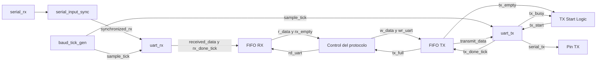

# Integración UART

- **Tipo:** arquitectura.
- **Estado documental:** especificación vigente.

<a id="función-de-uart_core"></a>

## Propósito y alcance

`uart_core` reúne los bloques físicos de recepción y transmisión y presenta sus bytes, solicitudes y estados al control del protocolo dentro de la FPGA. Se conserva el módulo [uart_core del TP2](../../../../tp2/rtl/uart_core.sv) como referencia, conforme al [acuerdo de conexiones](../../decisions/DEC-SYS-007.md#acuerdo-parcial-de-dec-sys-007--conexiones-internas-de-uart_core).

El módulo conecta el sincronizador, el generador compartido, el receptor, el transmisor y las dos FIFO. La interpretación de `LOAD`, `RUN`, `STEP`, `RESET` y `CHECK_READY` y la coordinación de sus respuestas corresponden al control del protocolo. `uart_core` recibe y transmite bytes mientras ese control procesa las operaciones o descarta los datos que correspondan a una fase de recuperación o exclusión.

La [agrupación aprobada](../debug/protocol_controller.md#agrupación-en-módulos) utiliza `protocol_controller` para RX y coordinación de operaciones y `response_serializer` para producir TX y seguir su fin físico. Las referencias al control del protocolo en el diagrama representan esa capa completa; no reúnen ambos módulos dentro de `uart_core`.

Las conexiones internas, la frontera ampliada hacia el control del protocolo y la composición del reporte de errores están aprobadas. La frontera y el reporte se fijan en el [acuerdo de puertos y errores](../../decisions/DEC-SYS-007.md#acuerdo-parcial-de-dec-sys-007--puertos-y-reporte-de-errores-de-uart_core).

## Organización

### Organización interna

`uart_core` conecta los siguientes módulos:

- `serial_input_sync`, para sincronizar `serial_rx`.
- [baud_tick_gen](uart_baud_tick_gen.md), compartido por RX y TX.
- [uart_rx](uart_rx.md), para recibir y validar cada trama.
- [uart_tx](uart_tx.md), para transmitir cada byte.
- Dos instancias de [fifo](uart_fifo.md), una por sentido.



`TX Start Logic` es la condición combinacional que solicita el envío cuando existe un byte en TX y el transmisor está libre. Forma parte de `uart_core` y conserva la coordinación del TP2. Los registros y contadores permanecen dentro de los módulos correspondientes.

El diagrama presenta los caminos de datos y solicitudes ya acordados. La exposición de los indicadores RX, del fin físico TX y del error de recepción se describe en la frontera posterior.

## Interfaces y contratos

### Frontera de uart_core

Se conservan los puertos del TP2 y se agregan tres salidas: `rx_activity`, `rx_receiving` y `tx_done_tick`. Los nombres internos `rx_done_tick`, `rx_full`, `tx_empty` y `tx_busy` siguen participando en la coordinación de módulos dentro de `uart_core`.

| Dirección | Señal | Ancho | Origen o destino |
|---|---|---|---|
| Entrada | `clk` | 1 | Clock funcional común. |
| Entrada | `reset` | 1 | Reset funcional común, activo alto. |
| Entrada | `serial_rx` | 1 | Pin serie hacia el sincronizador. |
| Salida | `serial_tx` | 1 | Salida registrada de `uart_tx` hacia el pin serie. |
| Salida | `r_data` | 8 | Primer byte de FIFO RX hacia el control del protocolo. |
| Entrada | `rd_uart` | 1 | Solicitud de retiro RX desde el control del protocolo. |
| Salida | `rx_empty` | 1 | FIFO RX vacía, hacia el control del protocolo. |
| Entrada | `w_data` | 8 | Byte de respuesta desde el control del protocolo. |
| Entrada | `wr_uart` | 1 | Solicitud de escritura TX desde el control del protocolo. |
| Salida | `tx_full` | 1 | FIFO TX llena, hacia el control del protocolo. |
| Salida | `rx_error_tick` | 1 | Evento de error RX hacia el control del protocolo. |
| Salida | `rx_activity` | 1 | Actividad desde `uart_rx` hacia el control del protocolo. |
| Salida | `rx_receiving` | 1 | Trama en curso desde `uart_rx` hacia el control del protocolo. |
| Salida | `tx_done_tick` | 1 | Fin físico de cada byte desde `uart_tx` hacia el control del protocolo. |

Los dos indicadores RX y el evento TX se llevan directamente desde sus productores, sin una etapa de registro adicional en `uart_core`. Sus condiciones y flancos de consumo mantienen los contratos de [recepción](uart_rx.md#indicadores-para-el-control-del-protocolo) y [transmisión](uart_tx.md#stop-completo-y-evento-de-finalización).

`response_serializer` asocia los eventos de fin TX, en orden, con los bytes de la respuesta que está enviando y comunica su finalización completa a `protocol_controller`. De ese modo se identifica el final del segundo byte de aceptación `LOAD` o `RESET` y el último byte de Debug. La secuencia de producción, seguimiento y exclusión está definida en ambos módulos y revisada en el [cierre UART](#presupuesto-de-integración), respetando el [protocolo aprobado](../../protocol.md).

## Comportamiento

### Camino de recepción

`serial_rx` alimenta exclusivamente al sincronizador. Su salida `synchronized_rx` llega a la entrada `rx` del receptor. `uart_rx` entrega `received_data` de ocho bits y activa `rx_done_tick` cuando ha completado y validado el byte.

Las conexiones de la FIFO RX son:

| Puerto de FIFO RX | Conexión |
|---|---|
| `wr` | `rx_done_tick` desde `uart_rx`. |
| `write_data` | `received_data` desde `uart_rx.data_out`. |
| `rd` | `rd_uart` desde el control del protocolo. |
| `read_data` | `r_data` hacia el control del protocolo. |
| `empty` | `rx_empty` hacia el control del protocolo. |
| `full` | `rx_full` interno, utilizado para el reporte de desbordamiento. |

El receptor y la FIFO consumen las señales en el flanco que valida el Stop. Si hay espacio, la FIFO guarda el byte y actualiza su ocupación. Después de ese flanco, el control del protocolo puede observar el primer dato válido mediante `r_data` y `rx_empty`.

El control del protocolo toma el byte de `r_data` previo al flanco y activa `rd_uart` cuando corresponde retirarlo. Solo lo considera disponible con `rx_empty` en cero. Durante recuperación o exclusión Debug utiliza el mismo retiro para descartar datos, sin interpretar solicitudes. El [controlador aprobado](../debug/protocol_controller.md) retira o descarta mediante `rd_uart` en todas las fases, según su contrato.

No se supedita el registro de bytes válidos al avance de la CPU o a la disponibilidad TX. La continuidad de consumo o descarte queda demostrada documentalmente en el [cierre UART](#presupuesto-de-integración), con retiro independiente de espera TX.

### Camino de transmisión

El control del protocolo entrega `w_data` y solicita su incorporación mediante `wr_uart` cuando TX tiene espacio. Si `tx_full` está activo, conserva el byte pendiente hasta poder escribirlo, mientras sigue atendiendo RX.

Las conexiones de la FIFO TX son:

| Puerto de FIFO TX | Conexión |
|---|---|
| `wr` | `wr_uart` desde el control del protocolo. |
| `write_data` | `w_data` desde el control del protocolo. |
| `rd` | `tx_done_tick` desde `uart_tx`. |
| `read_data` | `transmit_data` hacia `uart_tx.data_in`. |
| `empty` | `tx_empty` interno, utilizado para solicitar el comienzo. |
| `full` | `tx_full` hacia el control del protocolo. |

Fuera de reset, `tx_start` está activo si `tx_empty` y `tx_busy` valen cero. Durante reset se mantiene en cero. En el flanco de aceptación, `uart_tx` captura `transmit_data` en su registro interno y comienza el Start. La FIFO conserva ese byte como su primer elemento durante toda la transmisión.

Al flanco indicado por `tx_done_tick` termina el Stop completo, la FIFO acepta el retiro del byte transmitido y `uart_tx` vuelve a IDLE. El retiro y la finalización se producen en el mismo flanco. Después de él se presentan el nuevo primer byte y los nuevos flags; si existe otro byte pendiente, se solicita su transmisión para el siguiente flanco.

El control del protocolo puede producir mensajes de cualquier longitud compatible con los formatos aprobados usando el espacio disponible. La FIFO almacena solo los bytes pendientes inmediatos y el registro del transmisor conserva el byte en curso.

### Reporte de errores

Se conserva el reporte combinado del TP2. `rx_error_tick` se activa en estos casos:

| Condición | Significado |
|---|---|
| `frame_error_tick` | Error de trama; no se entrega un byte válido. |
| `rx_done_tick` coincide con `rx_full` | Desbordamiento; el byte válido recibido no pudo guardarse. |

La FIFO utiliza el flag full previo al flanco, incluso si se solicita un retiro en ese mismo flanco, según su contrato.

El evento se consume en el flanco correspondiente, no se repite por el solo hecho de conservar RX llena y permanece en cero durante reset.

El control del protocolo reacciona conforme a la fase y las prioridades ya aprobadas, sin exigir un código externo diferente para trama y desbordamiento. En tamaño y contenido `LOAD`, la FSM aprobada del controlador aplica esta prioridad:

```text
error > byte válido > timeout
```

`RECOVER` descarta RX hasta completar el silencio exigido.

## Estado y temporización

### Clock, reset y parámetros compartidos

Todos los módulos reciben el clock funcional común, con objetivo de 50 MHz, y el reset funcional acondicionado, activo alto y consumido al flanco. Se conserva el sincronizador de dos registros del TP2; ambos se inicializan en uno, y solo la segunda etapa alimenta al receptor.

Los parámetros comunes de `uart_core` toman estos valores:

| Parámetro | Valor |
|---|---:|
| `CLK_FREQ_HZ` | 50.000.000 |
| `BAUD_RATE` | 19.200 |
| `OVERSAMPLE` | 16 |
| `FIFO_ADDR_WIDTH` | 2 |

RX y TX utilizan ocho bits de datos y un Stop con factor de ticks 16. Ambas FIFO utilizan `DATA_WIDTH`=8 y `ADDR_WIDTH`=2.

El generador conecta `s_tick` a la señal interna `sample_tick`, que alimenta ambos bloques. Son nombres de la misma referencia síncrona, con un pulso registrado de un clock cada 163 clocks. Se mantiene la cuenta entre tramas y durante `HOLD` de CPU.

El reset global inicializa los módulos y vacía ambas FIFO. La recuperación de recepción del protocolo conserva TX y consume o descarta RX mediante su interfaz; no aplica ese reset global para realizar el descarte.

## Invariantes y condiciones de borde

Las prioridades de recepción y la combinación de errores están en [Reporte de errores](#reporte-de-errores). Los parámetros y el dominio compartido se conservan en [Clock, reset y parámetros compartidos](#clock-reset-y-parámetros-compartidos).

## Verificación y evidencia

### Estado del diseño

Quedan definidas las conexiones de sincronización, referencia temporal y caminos de bytes y solicitudes de RX y TX, la frontera ampliada y el reporte combinado de errores. La [organización del control del protocolo](../debug/protocol_controller.md#agrupación-en-módulos) distingue `protocol_controller` y `response_serializer`, cada uno con sus controles y recursos, y mantiene las responsabilidades de Loader y ejecución. La [comunicación entre ambos](../debug/response_serializer.md#comunicación-con-el-controlador) y los [grupos internos del serializador](../debug/response_serializer.md#organización-interna) están definidos; los recorridos y controles de acción también están aprobados en sus respectivos documentos.

El diseño del controlador/serializador y la comprobación de latencia/continuidad RX quedaron completados en el [cierre UART](#presupuesto-de-integración). El trabajo continúa únicamente en diseño global; implementación y validación RTL siguen pendientes.

### Cierre documental de integración UART

El presupuesto de integración de este documento reúne las conexiones con controlador/serializador, continuidad RX, conservación TX, Loader/preparación y fin físico. DEC-SYS-007 está consolidada como aprobada; implementación, timing y validación del enlace siguen pendientes para la etapa posterior al diseño global.

### Presupuesto de integración

Este fundamento consolida la revisión documental aprobada del 2026-10-05: dominio común de 50 MHz, UART nominal 19200 8N1, divisor 163, sobremuestreo 16, perfiles compartidos y host que respeta fases/longitudes. No cambia profundidad FIFO, formato, recuperación ni plazos. Los cálculos presuponen que la implementación cumple sus contratos y cierra las rutas en 20 ns; no acreditan RTL, timing físico ni comportamiento del driver USB.

#### Conexiones y dependencias de control

| Frontera | Productor → consumidor y comprobación |
|---|---|
| Clock/reset | Clock funcional y `reset_sync` común → todos los recursos; tick es enable, no otro clock. Botón/UART/estabilidad se unen antes del acondicionador. |
| RX físico/FIFO | `uart_rx` entrega dato y `rx_done_tick` al mismo flanco FIFO; trama inválida no produce byte válido. Error de trama/desbordamiento llega al controlador. |
| FIFO RX/controlador | Primer dato combinacional y `rx_empty` → controlador; `rd_uart`=!reset&&!`rx_empty` en todas las fases. Esperar TX nunca inhibe retiro. |
| Solicitudes CPU | `Protocol Controller` → `Global FSM`, por `Execution Control`: `load_request`, `run_request`, `step_request`. Las solicitudes se generan independientemente de `command_accepted`; ambas FSM consumen solicitud y aceptación común en el mismo flanco. |
| `LOAD`/IMEM | Controlador entrega byte/posición/último/aborto; Loader guarda tres bytes o escribe palabra con cuarto. `load_ok` certifica escritura final para controlador/FSM global en el mismo flanco. |
| Tamaño pendiente | Tamaño original retenido en controlador → Loader/registro de tamaño confirmado. `load_start` de la FSM inicia Loader e invalida el tamaño anterior; `image_publish` captura el tamaño pendiente al consumir `prepare_done` en PREPARING_READY, sin ciclo CPU. |
| Preparación | `prepare_active` de `Global FSM` → `Session Preparation` y controlador; índice limpia metadatos y primer flanco inicializa RF/PC/ciclos/pipeline. `prepare_done` aparece después de últimas limpiezas, con enables inactivos. En PREPARING_RUN/STEP, la FSM autoriza entonces el primer ciclo con `cpu_cycle_fire`. |
| RF/DMEM Debug | Controlador genera misma exclusión para selectores; serializador da dirección y recibe datos combinacionales del estado retenido. CPU/mantenimiento quedan excluidos durante observación. El flanco observado conserva accesos CPU y la selección Debug cambia después. |
| Estado CPU/UART | `Global FSM` entrega `load_available`, `prepare_active`, `program_finished` y `fault_terminal` al controlador. Su código combinacional `global_state_code[7:0]` llega a `Response Serializer.debug_state_code` para observación. |
| Descriptor pendiente | Captura con espacio previamente libre; entrega cuando serializador libre; sin sobreescritura ni entrega/carga simultáneas. `RUN` conserva obligación terminal hasta formar descriptor. |
| Serializador/TX | `PREPARE` captura byte y `ENQUEUE` conserva hasta escritura aceptada. Índices avanzan por aceptación, no por intento ni fin físico. FIFO conserva byte en curso hasta `tx_done_tick`. |
| Finalización | Serializador comunica fin en el mismo último Stop; controlador inicia T `LOAD`, libera Debug o registra reset según estado/marcas. Reset UART registrado evita lazo combinacional con ese evento. |

La dependencia `next_state`→estado registrado rompe el recorrido comandos/ciclo/pipeline siguiente; solo el estado actual realimenta aceptación y autorización. El estado global registrado y los recursos registrados de pendiente/serializador/solicitud de reset rompen las otras dependencias de coordinación.

#### Latencia RX y escritura LOAD

Si un byte válido entra a la FIFO RX en E y esta estaba vacía, el dato y empty cambian después de E. En E+1, `rd_uart` retira ese dato. En `LOAD_DATA`, el mismo flanco captura el primer/segundo/tercer byte o escribe IMEM con el cuarto. No hay otra etapa de Loader ni espera de TX. La [realización del Loader](../session/loader.md) permite una entrega por clock.

**Latencia desde incorporación FIFO hasta procesamiento:** un clock = 20 ns. Si existe un backlog inicial, se retira un byte por clock hasta vaciar; no se demora por respuesta pendiente, `tx_full`, `response_busy`, CPU en `HOLD`, preparación, Debug o recuperación. Fuera de las fases que interpretan datos, ese retiro descarta.

La [FIFO](uart_fifo.md#solicitudes-y-operaciones-aceptadas) usa flags previos al flanco: vacía no acepta lectura simultánea al primer write. Por eso no se promete consumo en E. Con write seguido de retiro E+1 y llegadas separadas por más de un clock, una inducción desde reset vacío da ocupación normal máxima uno; las cuatro entradas aprobadas aportan margen y no se reabren.

Al baud nominal, bytes 8N1 contiguos están separados por 10/19200 s ≈520,833 µs, unos 26.041,67 clocks. Además, la [FSM RX aprobada](uart_rx.md#tabla-de-acciones) proporciona una cota independiente del promedio nominal: tras un evento vuelve a IDLE y una próxima trama válida requiere 8 ticks START + 8×16 DATA + 16 STOP. Con divisor 163, dos eventos válidos están separados por al menos 152×163=24.776 clocks, 495,52 µs. Frente a esa cota conservadora, procesamiento ocupa un clock.

Se incluye realmente la escritura IMEM del cuarto byte y la señal `load_ok` de la última palabra; no se usa solo latencia de lectura FIFO. La validación del quinto byte de tamaño usa el siguiente estado `CHECK_SIZE`, agregando un clock antes de aceptar/rechazar; el host espera `ACCEPTED` antes del contenido y esa fase no bloquea retiro RX.

#### Continuidad RX y conservación TX

`rd_uart` solo depende de reset y `rx_empty`. Por tanto, las dieciséis fases del controlador conservan retiro cuando existe dato, independientemente de flags TX. En recuperación/Debug/esperas se descarta; el contador R consulta además actividad y recepción en curso. No se aplica reset para vaciar RX en recuperación y TX continúa.

En `ENQUEUE`, un byte ya preparado no se recaptura si `tx_full`=1; dato, disponibilidad y cursor retienen. `wr_uart` requiere disponibilidad y espacio. Si TX estaba llena y el último Stop libera lugar, el productor reintenta en el siguiente clock por las reglas previas al flanco; no pierde el byte ni inhibe RX. Incremento/decremento TX simultáneos conservan cuenta. Producción completa junto con un pendiente y último Stop identifica respuesta completa; reset abortado no genera fin normal.

#### Servicios y evidencia

El presupuesto de preparación está en [Session Preparation](../session/session_preparation.md#duración-y-alcance-de-revisión), el plazo final de carga en [Loader](../session/loader.md#presupuesto-de-load) y las cotas de respuesta/lista en [Response Serializer](../debug/response_serializer.md#presupuesto-de-transmisión-y-debug).

La revisión original contrastó catorce estados/códigos, 506 tamaños de carga, preparación en seis capacidades, reset con petición registrada, coordinación de 34 estados/117 transiciones y trece recorridos abstractos de serializador/FIFO/TX. Los resultados son evidencia documental fechada; [DEC-SYS-007](../../decisions/DEC-SYS-007.md#dec-sys-007--servicios-y-parámetros-generales-de-uart) registra el cierre de integración y su alcance. Las pruebas RTL, errores/overflow, reset/retención, commit, plazos medidos y regresión de placa siguen pendientes de implementación.

## Referencias y trazabilidad

- [Mapa de autoridad documental](../system_overview.md#autoridad-documental-por-tema): contratos vigentes y origen de las decisiones.
- [Requisitos](../../requirements.md): obligaciones y criterios de aceptación.
- [Decisiones pendientes](../../decisions/pending_decisions.md): decisiones de diseño abiertas y condiciones de cierre.
