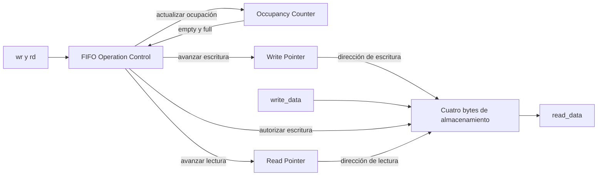

# FIFO de recepción y transmisión UART

- **Tipo:** arquitectura.
- **Estado documental:** especificación vigente.

## Propósito y alcance

Las FIFO conservan el orden de los bytes entre el enlace serie y su procesamiento interno. La FIFO RX guarda bytes completos recibidos hasta que el control del protocolo los consume o descarta. La FIFO TX guarda bytes pendientes de transmisión hasta que la integración los retira según el avance del transmisor.

Se conserva el módulo [fifo del TP2](../../../../tp2/rtl/fifo.sv) y se utilizan dos instancias independientes, conforme al [acuerdo de funcionamiento](../../decisions/DEC-SYS-007.md#acuerdo-parcial-de-dec-sys-007--funcionamiento-de-las-fifo-uart). Ambas tienen ancho de ocho bits y capacidad de cuatro entradas, definidos por `DATA_WIDTH`=8 y `ADDR_WIDTH`=2. Los dos caminos utilizan el mismo clock funcional, con objetivo de 50 MHz, pero sus solicitudes y estados de ocupación son independientes.

## Organización

### Organización interna

Cada instancia conserva cuatro bytes de almacenamiento, un puntero de lectura de dos bits, un puntero de escritura de dos bits y una cuenta de ocupación de tres bits. La cuenta representa valores de cero a cuatro y permite distinguir vacío de lleno aunque ambos punteros coincidan.

La lógica combinacional determina qué solicitudes pueden aceptarse. La lógica de los recursos realiza las escrituras, los avances de puntero y la actualización de ocupación al flanco ascendente del clock funcional. Los recursos permanecen dentro del módulo `fifo`; este bloque conserva el control por solicitudes y flags del TP2, sin introducir estados de trama.

## Interfaces y contratos

### Frontera del módulo fifo

Se conservan los puertos del TP2, con ancho de datos de ocho bits:

| Dirección | Señal        | Ancho | Función                                                 |
|-----------|--------------|-------|---------------------------------------------------------|
| Entrada   | `clk`        | 1     | Clock funcional común.                                  |
| Entrada   | `reset`      | 1     | Reset funcional común, activo alto.                     |
| Entrada   | `rd`         | 1     | Solicitud de retiro del primer byte.                    |
| Entrada   | `wr`         | 1     | Solicitud de escritura de un byte.                      |
| Entrada   | `write_data` | 8     | Byte para una escritura aceptada.                       |
| Salida    | `read_data`  | 8     | Primer byte pendiente, válido cuando `empty` vale cero. |
| Salida    | `empty`      | 1     | Cola vacía.                                             |
| Salida    | `full`       | 1     | Cola llena.                                             |

Las reglas de la FIFO son comunes a ambos caminos. La [integración UART](uart_core.md) fija los productores y consumidores de cada instancia y las solicitudes `rd` y `wr` correspondientes.

La FIFO no informa por sí sola un error de protocolo ante una escritura no aceptada. En RX, la integración debe reportar el desbordamiento si un byte completo recibido no puede guardarse. En TX, el productor conserva el byte pendiente y espera espacio, sin impedir el consumo o descarte RX, conforme al [contrato de buffers](../../decisions/DEC-SYS-007.md#acuerdo-parcial-de-dec-sys-007--buffers-y-contrato-de-consumo-uart).

## Comportamiento

### Solicitudes y operaciones aceptadas

Fuera de reset, las condiciones son:

| Operación        | Condición de aceptación        |
|------------------|--------------------------------|
| Lectura o retiro | `rd` activo y `empty` en cero. |
| Escritura        | `wr` activo y `full` en cero.  |

Las condiciones utilizan el estado previo al flanco. Cuando se solicitan ambas operaciones, los casos límite son:

| Estado previo | Operación aceptada            |
|---------------|-------------------------------|
| FIFO llena    | Solo lectura, como en el TP2. |
| FIFO vacía    | Solo escritura.               |

Las solicitudes que no se aceptan no actualizan el recurso correspondiente.

En cada escritura aceptada, la FIFO guarda `write_data` en la posición del puntero de escritura y ese puntero avanza una posición. En cada lectura aceptada se retira el primer byte y avanza el puntero de lectura. Ambos punteros recorren circularmente las cuatro posiciones, de cero a tres.

La ocupación se actualiza según las operaciones aceptadas:

| Escritura aceptada | Lectura aceptada | Cambio de ocupación |
|--------------------|------------------|---------------------|
| No                 | No               | Se conserva.        |
| Sí                 | No               | Aumenta en uno.     |
| No                 | Sí               | Disminuye en uno.   |
| Sí                 | Sí               | Se conserva.        |

Cuando ambas operaciones se aceptan, el consumidor toma el dato de lectura previo al flanco y la escritura incorpora el nuevo byte en su posición correspondiente. El nuevo primer dato y los flags se hacen visibles después del flanco.

### Salida de lectura y flags

`read_data` presenta combinacionalmente el contenido de la posición señalada por el puntero de lectura. Mientras `empty` esté en cero, representa el byte más antiguo pendiente. Observar esa salida no retira el byte: el retiro ocurre al aceptar `rd` en un flanco.

La salida solo es válida con `empty` en cero. Con la cola vacía puede mostrar un valor residual, incluso después de reset; el consumidor utiliza el flag para determinar si existe un byte disponible.

`empty` vale uno cuando la cuenta de ocupación es cero. `full` vale uno cuando la cuenta es cuatro. Las escrituras y lecturas aceptadas actualizan esos flags a partir del nuevo valor de ocupación después del flanco.

## Estado y temporización

### Clock y reset

La FIFO utiliza `clk` para todas sus actualizaciones. Las solicitudes no dependen de `s_tick` ni de la autorización de ciclos de CPU. Su consumo y producción pueden continuar mientras la CPU está en `HOLD` o ejecuta un programa.

El reset funcional, activo alto y consumido al flanco, pone ambos punteros y la cuenta en cero y suprime las operaciones de ese flanco. La cola queda vacía. No es necesario borrar los cuatro bytes físicos: la ocupación indica que ninguno está disponible para lectura.

La recuperación del protocolo conserva TX y descarta la recepción pendiente mediante el camino RX. El retiro durante descarte está definido en `protocol_controller` mediante `rd_uart` = !reset && !`rx_empty`; no requiere aplicar reset global para vaciar RX.

## Invariantes y condiciones de borde

Los casos de lleno, vacío y operaciones simultáneas se precisan en [Solicitudes y operaciones aceptadas](#solicitudes-y-operaciones-aceptadas). La validez del primer dato y los flags está en [Salida de lectura y flags](#salida-de-lectura-y-flags).

## Verificación y evidencia

### Fundamento de la capacidad y comprobación completada

Se mantienen FIFO RX/TX independientes de cuatro entradas como base aprobada y margen de desacople; no se reabre profundidad. La [comprobación conjunta](uart_core.md#presupuesto-de-integración) demuestra un clock de retiro/procesamiento RX, incluida escritura IMEM con el cuarto byte, frente a al menos 24.776 clocks entre eventos válidos de la FSM RX. Desde reset vacío, la ocupación normal RX máxima es uno; la FIFO no almacena toda la instrucción, que se reconstruye en Loader.

`rd_uart` es independiente de `tx_full`/`response_busy` en las dieciséis fases del controlador, por lo que TX no impide retirar o descartar RX. El serializador conserva el byte preparado y la posición hasta una escritura aceptada, usando flags preflanco.

Un modelo abstracto integrado de trece recorridos comprobó TX hasta cuatro pendientes, orden y fin físico, sin declarar simulación RTL. Las pruebas de implementación y timing siguen pendientes después del cierre global.

### Alcance del siguiente paso

Quedan definidos el almacenamiento, los punteros, la ocupación, la aceptación de operaciones, los flags, el reset y los puertos de las FIFO. Sus productores, consumidores y conexiones con receptor, transmisor y control del protocolo están definidos en [uart_core](uart_core.md), tomando el TP2 como referencia.

El control del protocolo y la demostración de presupuesto están cerrados documentalmente en DEC-SYS-007. La validación RTL y de placa corresponde a implementación. El trabajo continúa únicamente en diseño.

## Referencias y trazabilidad

- [Mapa de autoridad documental](../system_overview.md#autoridad-documental-por-tema): contratos vigentes y origen de las decisiones.
- [Requisitos](../../requirements.md): obligaciones y criterios de aceptación.
- [Decisiones pendientes](../../decisions/pending_decisions.md): decisiones de diseño abiertas y condiciones de cierre.
