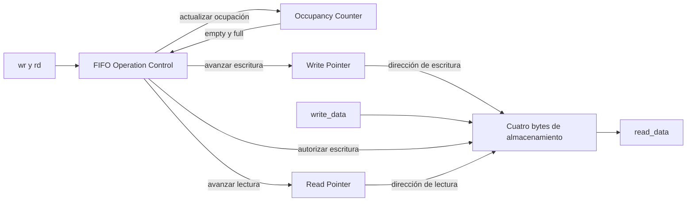

# FIFO de recepción y transmisión UART

- **Tipo:** arquitectura.
- **Estado documental:** especificación vigente.

## Propósito y alcance

Las FIFO conservan el orden de los bytes entre el enlace serie y su procesamiento interno. La FIFO RX guarda bytes completos recibidos hasta que `protocol_controller` los consume o descarta. La FIFO TX guarda bytes pendientes de transmisión hasta que la integración los retira según el avance del transmisor.

Se conserva el módulo [fifo del TP2](../../../../tp2/rtl/fifo.sv) y se utilizan dos instancias independientes, conforme al [acuerdo de funcionamiento](../../decisions/DEC-SYS-007.md#fifo-y-consumo-de-bytes). Ambas tienen ancho de ocho bits y capacidad de cuatro entradas, definidos por `DATA_WIDTH`=8 y `ADDR_WIDTH`=2. Los dos caminos utilizan el mismo clock funcional, con objetivo de 50 MHz, pero sus solicitudes y estados de ocupación son independientes.

## Organización

### Organización interna

Cada instancia conserva cuatro bytes de almacenamiento, un puntero de lectura de dos bits, un puntero de escritura de dos bits y una cuenta de ocupación de tres bits. La cuenta representa valores de cero a cuatro y permite distinguir vacío de lleno aunque ambos punteros coincidan.

La lógica combinacional determina qué solicitudes pueden aceptarse. La lógica de los recursos realiza las escrituras, los avances de puntero y la actualización de ocupación al flanco ascendente del clock funcional. Los recursos permanecen dentro del módulo `fifo`; este bloque conserva el control por solicitudes y flags del TP2, sin introducir estados de trama.

## Interfaces y contratos

### Frontera del módulo fifo

Se conservan los puertos del TP2, con ancho de datos de ocho bits:

| Dirección | Señal        | Ancho | Función                                                 |
|-----------|--------------|-------|---------------------------------------------------------|
| Entrada   | `clk`        | 1     | Clock funcional común.                                  |
| Entrada   | `reset`      | 1     | Reset funcional común, activo alto.                     |
| Entrada   | `rd`         | 1     | Solicitud de retiro del primer byte.                    |
| Entrada   | `wr`         | 1     | Solicitud de escritura de un byte.                      |
| Entrada   | `write_data` | 8     | Byte para una escritura aceptada.                       |
| Salida    | `read_data`  | 8     | Primer byte pendiente, válido cuando `empty` vale cero. |
| Salida    | `empty`      | 1     | Cola vacía.                                             |
| Salida    | `full`       | 1     | Cola llena.                                             |

### Conexiones de las instancias RX y TX

Las reglas de la FIFO son comunes a ambos caminos. La [integración UART](uart_core.md) conecta sus productores y consumidores:

| Puerto FIFO  | Instancia RX                                                | Instancia TX                                           |
| ------------ | ----------------------------------------------------------- | ------------------------------------------------------ |
| `wr`         | `rx_done_tick` desde `uart_rx`                              | `wr_uart` desde `response_serializer`                  |
| `write_data` | `received_data` desde `uart_rx.data_out`                    | `w_data` desde `response_serializer`                   |
| `rd`         | `rd_uart` desde `protocol_controller`                       | `tx_done_tick` desde `uart_tx`                         |
| `read_data`  | `r_data` hacia `protocol_controller`                        | `transmit_data` hacia `uart_tx.data_in`                |
| `empty`      | `rx_empty` hacia `protocol_controller`                      | `tx_empty` hacia la lógica de inicio TX de `uart_core` |
| `full`       | `rx_full` hacia el reporte de desbordamiento de `uart_core` | `tx_full` hacia `response_serializer`                  |

El Controller toma `r_data` antes del flanco que retira el byte. El serializador es el único productor de bytes TX; `uart_tx` captura el primer byte al comenzar su transmisión, pero la FIFO lo conserva hasta el `tx_done_tick` de su Stop completo.

La FIFO no informa por sí sola un error de protocolo ante una escritura no aceptada. En RX, la integración debe reportar el desbordamiento si un byte completo recibido no puede guardarse. En TX, `response_serializer` conserva el byte pendiente y espera espacio, mientras `protocol_controller` continúa consumiendo o descartando RX, conforme al [contrato de buffers](../../decisions/DEC-SYS-007.md#fifo-y-consumo-de-bytes).

## Comportamiento

### Solicitudes y operaciones aceptadas

Fuera de reset, las condiciones son:

| Operación        | Condición de aceptación        |
|------------------|--------------------------------|
| Lectura o retiro | `rd` activo y `empty` en cero. |
| Escritura        | `wr` activo y `full` en cero.  |

Las condiciones utilizan el estado previo al flanco. Cuando se solicitan ambas operaciones, los casos límite son:

| Estado previo | Operación aceptada            |
|---------------|-------------------------------|
| FIFO llena    | Solo lectura, como en el TP2. |
| FIFO vacía    | Solo escritura.               |

Las solicitudes que no se aceptan no actualizan el recurso correspondiente.

En cada escritura aceptada, la FIFO guarda `write_data` en la posición del puntero de escritura y ese puntero avanza una posición. En cada lectura aceptada se retira el primer byte y avanza el puntero de lectura. Ambos punteros recorren circularmente las cuatro posiciones, de cero a tres.

La ocupación se actualiza según las operaciones aceptadas:

| Escritura aceptada | Lectura aceptada | Cambio de ocupación |
|--------------------|------------------|---------------------|
| No                 | No               | Se conserva.        |
| Sí                 | No               | Aumenta en uno.     |
| No                 | Sí               | Disminuye en uno.   |
| Sí                 | Sí               | Se conserva.        |

Cuando ambas operaciones se aceptan, el consumidor toma el dato de lectura previo al flanco y la escritura incorpora el nuevo byte en su posición correspondiente. El nuevo primer dato y los flags se hacen visibles después del flanco.

### Salida de lectura y flags

`read_data` presenta combinacionalmente el contenido de la posición señalada por el puntero de lectura. Mientras `empty` esté en cero, representa el byte más antiguo pendiente. Observar esa salida no retira el byte: el retiro ocurre al aceptar `rd` en un flanco.

La salida solo es válida con `empty` en cero. Con la cola vacía puede mostrar un valor residual, incluso después de reset; el consumidor utiliza el flag para determinar si existe un byte disponible.

`empty` vale uno cuando la cuenta de ocupación es cero. `full` vale uno cuando la cuenta es cuatro. Las escrituras y lecturas aceptadas actualizan esos flags a partir del nuevo valor de ocupación después del flanco.

## Estado y temporización

### Clock y reset

La FIFO utiliza `clk` para todas sus actualizaciones. Las solicitudes no dependen de `s_tick` ni de la autorización de ciclos de CPU. Su consumo y producción pueden continuar mientras la CPU está en `HOLD` o ejecuta un programa.

El reset funcional, activo alto y consumido al flanco, pone ambos punteros y la cuenta en cero y suprime las operaciones de ese flanco. La cola queda vacía. No es necesario borrar los cuatro bytes físicos: la ocupación indica que ninguno está disponible para lectura.

### Consumo RX independiente de TX

El [Controller](../debug/protocol_controller.md#consumo-de-rx) genera `rd_uart = !reset && !rx_empty` en sus once fases. Ese retiro no depende de `tx_full`, `response_busy`, la habilitación de ciclos CPU ni la preparación. La fase y `rx_error_tick` determinan si el dato retirado se interpreta, se entrega al Loader o se descarta; el retiro también ocurre ante un error RX, sin utilizar el byte como válido.

Durante las esperas de transmisión, Debug y recuperación RX, el Controller sigue retirando y descartando bytes. La recuperación conserva TX y descarta la recepción pendiente mediante el camino RX; no requiere reset global ni guarda esos bytes como comandos para después.

## Invariantes y condiciones de borde

Los casos de lleno, vacío y operaciones simultáneas se precisan en [Solicitudes y operaciones aceptadas](#solicitudes-y-operaciones-aceptadas). La validez del primer dato y los flags está en [Salida de lectura y flags](#salida-de-lectura-y-flags).

## Capacidad y continuidad

Las FIFO RX y TX son independientes y conservan cuatro entradas cada una como margen de desacople. El [presupuesto de integración](uart_core.md#presupuesto-de-integración) establece un clock de retiro y procesamiento RX, incluida la validación del quinto byte de tamaño y la escritura IMEM con el cuarto byte de contenido, frente a al menos 24.776 clocks entre eventos válidos de la FSM RX. Desde reset vacío y bajo esas condiciones, la ocupación normal RX máxima es uno. El Loader reconstruye las instrucciones; la FIFO no necesita reunir una palabra completa antes de retirarla.

Si TX está llena, el serializador conserva el byte preparado y su posición hasta una escritura aceptada. El byte en transmisión ocupa una de las cuatro entradas hasta su Stop final. Las reglas de aceptación usan los flags anteriores al flanco. Si el último Stop libera espacio en una FIFO previamente llena, el serializador puede encolar el byte pendiente desde el siguiente flanco.

Estas cotas describen el contrato del diseño. La validación RTL, de timing y de placa corresponde a la implementación.

## Referencias y trazabilidad

- [Mapa de autoridad documental](../system_overview.md#autoridad-documental-por-tema): contratos vigentes y origen de las decisiones.
- [Requisitos](../../requirements.md): obligaciones y criterios de aceptación.
- [Decisiones pendientes](../../decisions/pending_decisions.md): decisiones de diseño abiertas y condiciones de cierre.
