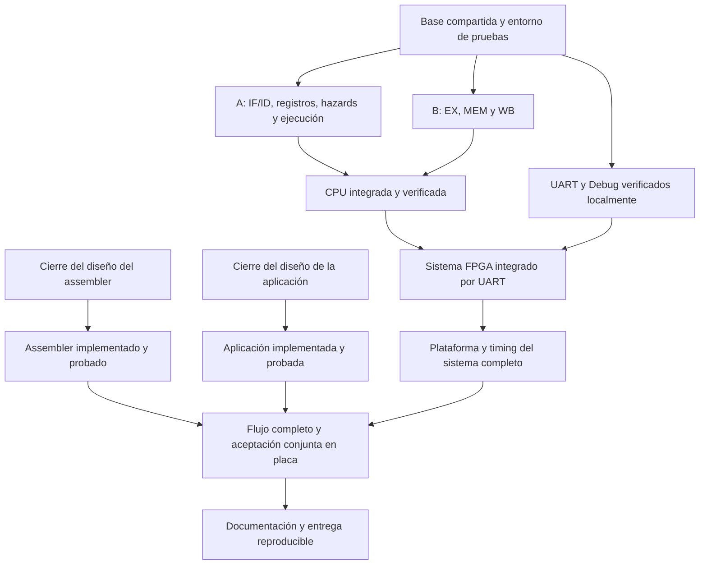
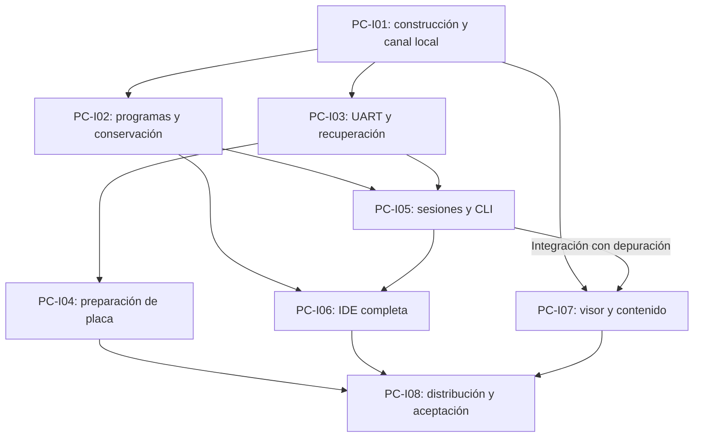

# TP3 — Guía de implementación para dos desarrolladores

- **Tipo:** plan de implementación.
- **Estado documental:** guía de trabajo.
- **Fecha de elaboración:** 2026-10-14.

**Índice**

- [Propósito y alcance](#propósito-y-alcance)
- [Punto de partida](#punto-de-partida)
- [Organización del trabajo](#organización-del-trabajo)
- [Dependencias y trabajo paralelo](#dependencias-y-trabajo-paralelo)
- [Preparación común](#preparación-común)
- [Desarrollo del procesador](#desarrollo-del-procesador)
- [Comunicación y software de PC](#comunicación-y-software-de-pc)
- [Verificación y criterios de avance](#verificación-y-criterios-de-avance)
- [Plataforma y pruebas conjuntas en placa](#plataforma-y-pruebas-conjuntas-en-placa)
- [Organización del mes de trabajo](#organización-del-mes-de-trabajo)
- [Cómo retomar y ajustar el trabajo](#cómo-retomar-y-ajustar-el-trabajo)
- [Cierre de la entrega](#cierre-de-la-entrega)
- [Referencias y trazabilidad](#referencias-y-trazabilidad)

## Propósito y alcance

Esta guía organiza la implementación del TP3 entre dos desarrolladores. Su propósito es que ambos puedan reconocer qué parte del sistema corresponde desarrollar, qué necesitan para probarla y cuándo deben conectarla con el trabajo del compañero. También sirve como punto de consulta cuando una integración falla o cuando deja de estar claro cuál debería ser el siguiente paso.

El recorrido comienza con la preparación del entorno y termina con el sistema completo funcionando desde la PC sobre la Basys 3, con sus pruebas, análisis temporal y documentación de entrega. Comprende el procesador, UART, Debug, carga de programas, assembler, aplicación de PC y plataforma. La entrega requiere completar todo el diseño previsto y demostrar los requisitos mediante las comprobaciones estipuladas.

El plazo de referencia es mediados de noviembre de 2026, aproximadamente un mes desde la elaboración de esta guía. Ese plazo orienta el orden y el reparto del trabajo. No cambia el comportamiento que debe implementarse ni permite retirar partes del diseño o pruebas pendientes.

Los contratos técnicos se consultan en el [diseño FPGA consolidado](architecture/system_overview.md), [Interfaces](interfaces.md), [Protocolo](protocol.md) y los documentos especializados que estos enlazan. Esta guía organiza cómo materializarlos. El [plan general](plan.md) conserva las fases y antecedentes del proyecto; para organizar la implementación concurrente se sigue el acuerdo de trabajo desarrollado aquí.

## Punto de partida

La arquitectura FPGA, sus interfaces y el plan de verificación están cerrados documentalmente. Todavía corresponde producir RTL, testbenches, software y evidencia de ejecución. Tener un contrato definido permite comenzar su implementación, pero su funcionamiento deberá comprobarse en los niveles de verificación previstos.

El acuerdo de trabajo del 14 de octubre permite implementar FPGA mientras se completa el diseño del software de PC. Por eso, las decisiones pendientes de software no detienen las etapas del CPU ni los servicios FPGA ya especificados. Esta organización revisa la condición anterior de esperar al cierre del sistema completo antes de programar cualquier componente; no declara satisfechos los hitos globales que todavía requieren trabajo.

El cierre del diseño del assembler está previsto para el mismo 14 de octubre. Cuando su especificación final esté revisada, incluidas su interfaz, organización y pruebas, puede comenzar su implementación. No necesita esperar al cierre del diseño de la aplicación de PC. El estado de ese acuerdo se consulta en [DEC-SYS-009](decisions/DEC-SYS-009.md) y sus documentos de [software](software/assembler_interface.md).

La aplicación de PC tiene requisitos, arquitectura, contratos e integración especificados en la [documentación de viewrv](software/viewrv/README.md). Su implementación se organiza mediante las [entregas de aplicación de PC](#entregas-de-viewrv), en paralelo con hardware y assembler según sus dependencias. Las definiciones documentales y los hitos de revisión no acreditan software construido ni pruebas ejecutadas.

## Organización del trabajo

Ambos desarrolladores deben participar directamente en la construcción del procesador. El reparto inicial utiliza dos frentes que pueden probarse mediante sus interfaces y reunirse después en `processor_top`. Se los identifica como A y B para describir responsabilidades; cualquiera de los integrantes puede tomar cada recorrido.

| Tramo del desarrollo      | Desarrollador A                                                                         | Desarrollador B                                                                         |
|---------------------------|-----------------------------------------------------------------------------------------|-----------------------------------------------------------------------------------------|
| Etapas del CPU            | IF e ID, con sus memorias, registros, decodificación y operandos.                       | EX, MEM y WB, con ejecución, forwarding, memoria de datos y escritura de resultados.    |
| Coordinación del pipeline | Registros interetapa, arbitraje de hazards y control de ejecución, carga y preparación. | Revisión de las fronteras con EX/MEM/WB y de los efectos de las decisiones del control. |
| Primera integración       | Coordina `processor_top` y la regresión de CPU.                                         | Revisa y depura la integración junto a A; avanza UART y Debug.                          |
| Sistema y software        | Implementa el assembler y coordina el cierre de plataforma y timing.                    | Integra `system_top` e implementa la aplicación de PC.                                  |
| Aceptación y entrega      | Participa en las sesiones de placa y comprueba la ejecución.                            | Participa en las mismas sesiones y comprueba comunicación y presentación.               |

El responsable de una parte implementa sus módulos y las pruebas que demuestran su comportamiento. El compañero revisa el cambio y sus resultados. Ambos necesitan entender el recorrido completo del CPU, por lo que la revisión también debe permitir explicar cómo se relaciona cada entrega con las etapas anteriores y posteriores.

La unidad de planificación es una entrega funcional, como IF/ID completas, EX completa o el mecanismo de carga y ejecución. Cada entrega puede contener varios módulos y avanzar mediante cambios pequeños, pero debe tener un resultado reconocible y verificable. Las futuras issues se extraerán de esas entregas con sus dependencias y criterios de finalización; la guía no exige crear una tarea por cada archivo o variante de prueba.

El reparto se ajusta según el avance observado. A concentra más coordinación e integración del CPU, mientras B continúa con comunicación y aplicación. Si ese tramo de A demora la primera sesión integrada, B puede tomar una entrega completa de registros/hazards o control de ejecución antes de pasar a UART. Se acuerdan su alcance y revisión, manteniendo un responsable por archivo compartido, especialmente `system_pkg.sv` y los tops.

## Dependencias y trabajo paralelo

Para implementar una etapa no hace falta que todas las demás estén terminadas. Su banco de pruebas puede proporcionar los payloads, controles o eventos que normalmente recibiría de otros módulos. Así se comprueba una frontera definida y se puede integrar el módulo real cuando esté disponible. Esa prueba local no acredita por sí sola el comportamiento del sistema conectado.

El siguiente diagrama muestra las dependencias principales. Los dos frentes de CPU reúnen sus entregas locales en el procesador; UART y Debug pueden comprobarse por separado antes de conectarse a él. El assembler y la aplicación tienen cierres de diseño independientes y se incorporan al flujo completo cuando sus implementaciones están listas.

La flecha hacia plataforma representa el cierre con el sistema completo. La preparación de clock, reset, restricciones y las síntesis parciales comienzan antes, en cuanto existen los recursos que se quieren comprobar. De la misma manera, la aplicación puede probarse con respuestas de transporte controladas y una salida de assembler preparada, mientras ambos módulos reales se desarrollan en paralelo.

## Preparación común

El primer trabajo consiste en dejar una base que ambos puedan usar sin resolver nuevamente los mismos detalles. Se acuerdan la organización de fuentes y bancos de prueba, el orden de compilación, las herramientas y un comando reproducible para ejecutar las comprobaciones. La [guía de estilo](../../docs/code-style.md) orienta las convenciones del código existente; los contratos del TP3 determinan los puertos, tipos y organización funcional.

`system_pkg.sv` se implementa siguiendo [Configuración común](architecture/common_configuration.md). Reúne tipos, códigos, perfiles y fórmulas compartidas para que las etapas y servicios interpreten los mismos valores. Ambos revisan esas definiciones antes de continuar con sus respectivos frentes. Se comprueba que los perfiles `REFERENCE` y `ALT_1000` elaboren con los anchos previstos y que los límites aritméticos se verifiquen sin exigir arrays físicos de capacidades impracticables.

El entorno de pruebas debe registrar qué caso se ejecutó y por qué pasó o falló. Se comprueba su funcionamiento con un ejemplo sencillo, incluido un fallo intencional que produzca un resultado de ejecución fallido. Ambos deben poder repetirlo desde un checkout limpio. Esto evita descubrir más adelante que los resultados dependen de archivos o configuraciones que solo tiene uno de los integrantes.

También se confirma desde el comienzo el acceso a Vivado, a la Basys 3 y a los elementos necesarios para el enlace UART. Se aprovechan las utilidades de prueba del TP2 cuando resulten compatibles, adaptándolas al orden de compilación y a los contratos del TP3. La primera entrega queda completa cuando ambos pueden compilar las definiciones comunes y ejecutar las mismas comprobaciones.

## Desarrollo del procesador

### Frente de IF e ID

A comienza con IF e ID como una entrega funcional. IF incorpora el PC, IMEM, selección de la próxima búsqueda y formación del candidato de fault. ID incorpora decoder, banco de registros, inmediatos, muxes de bypass, reconocimiento de faults y detección de load-use. Sus responsabilidades y conexiones se consultan en [IF](architecture/cpu/stage_if.md) e [ID](architecture/cpu/stage_id.md).

Las pruebas comprueban búsquedas válidas y fallidas, decodificaciones legales e ilegales, lectura y escritura de registros, `x0`, formatos de inmediatos y dependencias reales. El testbench suministra las acciones de pipeline, información de productores y controles WB necesarios. El control que produce el bypass pertenece a WB; los muxes que lo aplican permanecen en ID.

La entrega incluye las interfaces de Loader, preparación y Debug previstas para esos recursos. De ese modo, las integraciones posteriores conectan una frontera existente. Los registros IF/ID e ID/EX se implementan en la entrega de registros interetapa y se instancian en el top correspondiente, respetando la [composición](architecture/system_composition.md).

### Frente de EX, MEM y WB

B comienza con EX y continúa con MEM/WB. En [EX](architecture/cpu/stage_ex.md) implementa ALU, forwarding, operandos, resultados, destinos de branches/jumps y comprobaciones propias de la etapa. Sus pruebas reciben un payload ID/EX y productores preparados en el testbench, por lo que pueden comenzar en paralelo con IF/ID.

En [MEM](architecture/cpu/stage_mem.md) construye el acceso a DMEM, stores, selección/extensión de loads y formación del resultado destinado a MEM/WB. La memoria incluye las marcas por byte y las interfaces de mantenimiento y observación. [WB](architecture/cpu/stage_wb.md) utiliza el resultado registrado para escribir RF y producir los controles del bypass hacia ID.

Se comprueban operaciones, dependencias y prioridad de forwarding, accesos por lane, signo, cero lógico y efectos de escritura. También se verifica que entradas inválidas y espera sin ciclo efectivo no repitan stores o writebacks. La selección del resultado en MEM y el uso del estado anterior al flanco en WB deben conservar la temporización aprobada.

### Registros, hazards y control de sesión

Mientras B completa las etapas posteriores, A continúa con los cuatro registros interetapa y `pipeline_hazard_control`. Los campos, acciones y prioridades se consultan en [Pipeline](architecture/cpu/cpu_pipeline.md) y [Control y hazards](architecture/cpu/control_and_hazards.md). Las pruebas locales suministran eventos y datos para comprobar captura, retención, invalidación y la selección de una única acción.

Después se implementan `execution_control`, Loader y preparación. Este conjunto permite aceptar comandos, cargar una imagen, establecer una sesión limpia y autorizar ciclos de CPU. Se verifica la reconstrucción por cuarto byte, aborto, publicación de imagen, preparación, RUN, STEP, halt, faults y drenado conforme a los contratos de [sesión](architecture/session/execution_control.md).

Estas comprobaciones pueden usar señales de resultado y recursos controlados desde el testbench, sin esperar a UART. El driver conserva las responsabilidades que tendrá el controlador sobre tamaño y progreso de carga. La preparación debe terminar antes de iniciar el primer ciclo y STEP debe representar exactamente un ciclo efectivo, incluso cuando ese ciclo contiene un stall o drain.

### Primera integración y regresión del CPU

A coordina la conexión en `processor_top` y B participa en la revisión y depuración. El top reúne etapas, registros, controles locales, hazards, ejecución, Loader y preparación. Se revisan sus conexiones contra [Interfaces](interfaces.md), la propagación de capacidades y el recorrido de estado actual, autorizaciones, datos siguientes y detección de pipeline vacío.

La integración se comprueba por avances. Primero se carga una imagen pequeña mediante un driver que respeta la frontera del procesador, se espera preparación y se ejecutan STEP y RUN hasta halt. Después se incorporan programas que ejercitan memoria, dependencias y cambios de flujo. Finalmente se completa la evidencia de faults, drenado, reset, reutilización de imagen y reprogramación.

La primera sesión que funciona es un punto de integración, no el cierre del CPU. La entrega termina cuando pasan todas las variantes y niveles aplicables de los catálogos de [ISA](verification/isa.md), [Pipeline](verification/pipeline.md), [Memoria](verification/memory.md) y [Ejecución](verification/execution.md). Se comparan commits y estado por ciclo, además de los resultados finales, para detectar efectos duplicados o instrucciones descartadas que modifican estado.

## Comunicación y software de PC

### UART y Debug

Una vez comprobadas sus etapas del CPU, B continúa con UART y Debug mientras A integra el procesador. El RTL y los testbenches de [UART del TP2](../../tp2/rtl/uart_core.sv) sirven como referencia. Deben adaptarse a la configuración y organización del TP3 y exponer los indicadores de actividad, recepción y fin físico TX previstos en [UART](architecture/uart/uart_core.md).

El controlador de protocolo y el serializador se implementan según sus [contratos](architecture/debug/protocol_controller.md). Se pueden probar con bytes, flags, eventos y respuestas de CPU controlados por el testbench. Esto permite comprobar recepción, rechazos, timeouts, recuperación, orden de respuestas y formato de snapshots sin esperar a que `processor_top` complete toda su regresión.

Después B conecta los módulos reales en `system_top`. La primera comprobación vuelve a ser una carga pequeña con STEP y RUN, esta vez atravesando el enlace serial simulado. Luego se completan todas las variantes y niveles de sistema del catálogo de [UART y Debug](verification/uart_debug.md). En esta integración se demuestra la coherencia real de RF, DMEM, contexto y latches, junto con la exclusión hasta el último Stop de la respuesta.

### Assembler

El assembler se implementa a partir de su diseño final revisado, aprovechando que su cierre está previsto desde el comienzo de este recorrido. A puede tomar esa entrega cuando la integración del CPU permita liberar tiempo, o antes si existe una espera y la tarea no retrasa una dependencia crítica. La implementación no está condicionada por elegir una CLI, TUI o GUI para la aplicación.

El módulo traduce el lenguaje aprobado y entrega imagen, relación PC–línea o diagnóstico conforme a [Interfaz del assembler](software/assembler_interface.md). Sus pruebas comprueban instrucciones, etiquetas, operandos, inmediatos, codificación, empaquetado y errores. Las palabras esperadas se contrastan con los contratos; el decoder del RTL no se utiliza como único criterio de corrección.

Las pruebas de hardware conservan sus imágenes de codificación comprobada aunque el assembler ya esté disponible. Así, un error de traducción no impide localizar un error del CPU. El flujo completo con la traducción real se comprueba posteriormente al integrar la aplicación.

### Aplicación de PC

La implementación de viewrv materializa sus [requisitos](software/viewrv/requisitos.md), [arquitectura](software/viewrv/arquitectura.md), [contratos](software/viewrv/contratos.md), [GUI y visor](software/viewrv/gui_y_visor.md) e [integración y distribución](software/viewrv/integracion_y_distribucion.md). La [verificación de la aplicación](software/viewrv/verificacion.md) define los casos y las expectativas. El plan organiza el trabajo sin sustituir esas fuentes ni introducir nuevas tecnologías.

Los [comandos de prueba](software/viewrv/verificacion.md#ejecución-de-pruebas-automatizadas) definen la regresión Python completa y sus ejecuciones por área desde tp3. Cada entrega implementa las comprobaciones de su alcance; los procedimientos visuales, de paquetes y de placa mantienen sus niveles propios.

Se trabaja por entregas funcionales. Los adaptadores controlados permiten probar el core y los clientes mientras se construyen el assembler y la FPGA. Son recursos de prueba; no constituyen un simulador incorporado al producto. La integración del assembler real conserva su interfaz y su catálogo independiente, sin modificar su diseño dentro de estas entregas.

#### Entregas de viewrv

Las dependencias de la tabla indican qué hace falta para cerrar la integración de cada entrega. No impiden preparar sus componentes y pruebas en paralelo.

| ID | Entrega funcional | Dependencias para cerrar | Resultado comprobable |
|----|-------------------|--------------------------|------------------------|
| PC-I01 | Construcción y comunicación local inicial | Contratos y herramientas definidos. | Core Python, CLI y ventana Electron construibles; descubrimiento y validación de instancia, registro de trabajos, consulta de estado y suscripción SSE conectados. La CLI funciona sin iniciar Electron y la GUI conserva recursos locales de Monaco, FlexLayout y el visor. Se comprueba tempranamente el empaquetado del tramo implementado en Linux y Windows, sin confundirlo con la distribución final. |
| PC-I02 | Programas, editor y conservación del código | PC-I01; assembler real disponible para cerrar su integración. | Crear, abrir y copiar ejemplos; editar, ensamblar y presentar diagnóstico o traducción con versión exacta. Funcionan autoguardado, archivos Assembly, recuperación interna, reapertura, guardado explícito y cierre. La coordinación de texto impide retrocesos y permite editar durante operaciones largas. Se incorporan preferencias y sus fallos sin alterar el contrato del assembler. |
| PC-I03 | Transporte UART y recuperación | PC-I01. | El adaptador serial ejecuta los intercambios de LOAD, RUN, STEP, CHECK_READY y RESET con bytes y plazos correctos en ambos perfiles. Decodifica capturas completas, conserva validez y valores, informa incertidumbre y aplica la recuperación correspondiente a cada fase. Las pruebas controlan fragmentación, demora, truncamiento y desconexión. |
| PC-I04 | Preparación de la placa desde el producto | PC-I03; binarios de programador y bitstream compatibles disponibles. | Programador incluido, enumeración y selección de JTAG y UART, programación y comprobación de comunicación por fases. Se comprueban permisos o controladores y acceso a la misma Basys 3 en los sistemas de aceptación, sin exigir Vivado ni sustituir silenciosamente dispositivos. |
| PC-I05 | Operación compartida del procesador y CLI completa | PC-I02 y PC-I03. | Carga y RUN, depuración por pasos, Continuar/Pausar, breakpoints, reinicio y cierre con control exclusivo. GUI y CLI utilizan la misma lógica de sesiones. Están disponibles las 25 operaciones CLI y las consultas locales de ayuda y versión, con sus formatos y códigos. Se conservan registros JSONL y se consultan resultados y pasos sin generar ciclos adicionales. |
| PC-I06 | Flujos completos de la IDE | PC-I02 y PC-I05. | La GUI ofrece edición y acciones de carga, ejecución y depuración, resultados convencionales, tabs y splits y el atajo combinado conforme a Penpot. Aplica las reglas de foco, revisión, protección de edición, cierre y recuperación, mantiene respuesta durante esperas y permite observar una sesión controlada por CLI. |
| PC-I07 | Visor educativo y depuración interactiva | PC-I01; PC-I05 para la integración con sesiones. | Visor existente integrado con recursos locales y adaptador gráfico; explicación conceptual sin placa, catálogo y banco completo de ejemplos. Capturas, cambios, participación funcional y seguimiento de una aparición respetan el perfil y las transiciones del pipeline. Código, debugger y diagrama utilizan la misma observación; las inferencias se distinguen de los datos medidos. |
| PC-I08 | Distribución y aceptación integrada | PC-I04, PC-I06 y PC-I07; assembler y FPGA reales disponibles. | tar.gz y NSIS por usuario, instalación y desinstalación, inventario y licencias completos. El flujo real funciona en Arch, Ubuntu y Windows con las configuraciones registradas, incluida la observación GUI/CLI en ambos sentidos, conservación, calidad visual y funcionamiento sin red externa. Se completa la evidencia de los 30 casos y los 74 requisitos. |

#### Dependencias y avance en paralelo

Después de PC-I01 pueden avanzar en paralelo los programas y la conservación, el transporte y la exploración educativa del visor. Los recursos visuales, las explicaciones y los programas de ejemplo pueden prepararse antes de disponer de sesiones reales. PC-I05 conecta esas piezas con los controles de depuración; PC-I06 y PC-I07 incorporan las presentaciones de una misma sesión.

La preparación de binarios, permisos y recursos de programación se adelanta mientras se desarrolla el resto. PC-I04 solo se da por terminada al demostrar la programación y la comunicación reales con el bitstream correspondiente. La disponibilidad de la placa no bloquea las comprobaciones locales del core, los clientes y los archivos; las pruebas físicas conservan su nivel y su evidencia propios.

La distribución se comprueba desde PC-I01 y se amplía con cada entrega. No se posponen hasta PC-I08 los problemas de arranque de ejecutables, bibliotecas nativas o recursos locales. Los artefactos parciales de comprobación no se presentan como una distribución completa: la entrega final debe contener todos los recursos obligatorios y superar su validación.

#### Comprobación y cierre de entregas

La relación siguiente orienta qué evidencia prepara cada entrega. Los casos conservan sus variantes y criterios en el catálogo; enlazar un caso no lo declara aprobado ni reduce su alcance.

| Entrega | Casos de aplicación relacionados | Evidencia que aporta |
|---------|---------------------------------|---------------------|
| PC-I01 | [TEST-PC-012](software/viewrv/verificacion.md#test-pc-012), [TEST-PC-013](software/viewrv/verificacion.md#test-pc-013), [TEST-PC-015](software/viewrv/verificacion.md#test-pc-015), [TEST-PC-029](software/viewrv/verificacion.md#test-pc-029) y [TEST-PC-030](software/viewrv/verificacion.md#test-pc-030). | Construcción, arranque, acceso local, primeras consultas y canales de observación, con clientes separados y fallos controlados. |
| PC-I02 | [TEST-PC-002](software/viewrv/verificacion.md#test-pc-002), [TEST-PC-010](software/viewrv/verificacion.md#test-pc-010), [TEST-PC-017](software/viewrv/verificacion.md#test-pc-017), [TEST-PC-020](software/viewrv/verificacion.md#test-pc-020) y [TEST-PC-026](software/viewrv/verificacion.md#test-pc-026). | Texto, versiones, traducciones, archivos, recuperación y resolución de conservación al cerrar. |
| PC-I03 | [TEST-PC-003](software/viewrv/verificacion.md#test-pc-003), [TEST-PC-007](software/viewrv/verificacion.md#test-pc-007), [TEST-PC-016](software/viewrv/verificacion.md#test-pc-016), [TEST-PC-023](software/viewrv/verificacion.md#test-pc-023), [TEST-PC-024](software/viewrv/verificacion.md#test-pc-024) y [TEST-PC-025](software/viewrv/verificacion.md#test-pc-025). | Bytes literales, límites de fase, decodificación, interrupciones y recuperación mediante transporte controlado. |
| PC-I04 | [TEST-PC-014](software/viewrv/verificacion.md#test-pc-014) y [TEST-PC-025](software/viewrv/verificacion.md#test-pc-025). | Programación real, selección de dispositivos, permisos, controladores y comprobación UART desde el paquete. |
| PC-I05 | [TEST-PC-003](software/viewrv/verificacion.md#test-pc-003) a [TEST-PC-009](software/viewrv/verificacion.md#test-pc-009), [TEST-PC-013](software/viewrv/verificacion.md#test-pc-013), [TEST-PC-015](software/viewrv/verificacion.md#test-pc-015) a [TEST-PC-017](software/viewrv/verificacion.md#test-pc-017), [TEST-PC-021](software/viewrv/verificacion.md#test-pc-021) a [TEST-PC-024](software/viewrv/verificacion.md#test-pc-024), [TEST-PC-029](software/viewrv/verificacion.md#test-pc-029) y [TEST-PC-030](software/viewrv/verificacion.md#test-pc-030). | Reglas compartidas, exclusión, comandos CLI, resultados, evidencia y observación por consultas, incluidas condiciones de fallo. |
| PC-I06 | [TEST-PC-002](software/viewrv/verificacion.md#test-pc-002) a [TEST-PC-007](software/viewrv/verificacion.md#test-pc-007), [TEST-PC-010](software/viewrv/verificacion.md#test-pc-010) a [TEST-PC-012](software/viewrv/verificacion.md#test-pc-012), [TEST-PC-017](software/viewrv/verificacion.md#test-pc-017), [TEST-PC-020](software/viewrv/verificacion.md#test-pc-020), [TEST-PC-026](software/viewrv/verificacion.md#test-pc-026), [TEST-PC-027](software/viewrv/verificacion.md#test-pc-027), [TEST-PC-029](software/viewrv/verificacion.md#test-pc-029) y [TEST-PC-030](software/viewrv/verificacion.md#test-pc-030). | Flujos de usuario, correspondencia de versiones, presentación convencional, continuidad y observación en GUI. |
| PC-I07 | [TEST-PC-001](software/viewrv/verificacion.md#test-pc-001), [TEST-PC-004](software/viewrv/verificacion.md#test-pc-004), [TEST-PC-018](software/viewrv/verificacion.md#test-pc-018), [TEST-PC-019](software/viewrv/verificacion.md#test-pc-019) y [TEST-PC-028](software/viewrv/verificacion.md#test-pc-028). | Correspondencia de bloques, interpretación temporal, seguimiento, cobertura educativa y comportamiento visual. |
| PC-I08 | [TEST-PC-001](software/viewrv/verificacion.md#test-pc-001) a [TEST-PC-030](software/viewrv/verificacion.md#test-pc-030). | Recorridos completos con componentes reales, paquetes por plataforma, mediciones y evidencia final de aceptación. |

Una entrega se cierra cuando su código compila, pasan las comprobaciones aplicables a su alcance, se revisa su correspondencia con los contratos y queda evidencia reproducible. Un caso que atraviesa varias entregas acumula evidencia y solo se cierra al completar sus niveles y variantes. Los resultados de un doble no acreditan funcionamiento físico, y las mediciones de una plataforma no acreditan las demás.

Si una prueba contradice el contrato, se distingue un defecto de implementación de una necesidad de revisar el diseño. Las correcciones no cambian silenciosamente los requisitos ni retiran capacidades. La validación visual de posiciones y proporciones se realiza con contenido representativo dentro de las entregas de GUI y visor. Los detalles visuales sujetos a esa comprobación no se convierten en decisiones de lógica compartida.

#### Primera entrega de trabajo

El primer trabajo concreto es PC-I01. Se preparan las ubicaciones de fuentes ya definidas y comandos reproducibles para construir y comprobar Python y Electron con las versiones seleccionadas. Se resuelve y fija el árbol de dependencias y se comprueba la carga local de los componentes gráficos.

El recorrido mínimo conecta la CLI y la GUI con un core iniciado bajo demanda: validar identidad y acceso, registrar el trabajo necesario, consultar estado conocido, abrir la suscripción de GUI y finalizar los trabajos conforme a su ciclo de vida. Se comprueban también el inicio concurrente de clientes y la permanencia del core cuando se cierra solo un observador. No necesita ejecutar el procesador para demostrar esa comunicación.

La comprobación de empaquetado utiliza las entradas reales de CLI y core preparadas con PyInstaller y la aplicación Electron, desde un directorio diferente y sin depender de los runtimes de desarrollo en el equipo de prueba. El objetivo de esta primera entrega es demostrar que la separación elegida funciona también distribuida, antes de completar los controles del procesador y la interfaz.

## Verificación y criterios de avance

Cada entrega incluye su implementación y las comprobaciones que permiten revisarla. Las pruebas locales se desarrollan junto a los módulos, y las pruebas de integración se agregan cuando existen las partes reales que deben interactuar. La IA puede ayudar a generar código y variantes; el responsable conserva la revisión de contratos, comportamiento temporal y expectativas independientes de la implementación.

El [plan de verificación](verification/verification_plan.md) y sus catálogos determinan los casos, niveles y reglas de comparación. El [manifiesto](verification/cases.json) enumera las variantes canónicas por grupo y las reejecuciones físicas de casos seleccionados; el [plan de verificación](verification/verification_plan.md#selección-finita-de-casos) mantiene el recuento vigente. Deben realizarse todas las comprobaciones estipuladas en sus niveles correspondientes. Ejecutar una variante representativa no aprueba un grupo que tiene otras pendientes.

La distribución siguiente indica dónde se consolida la evidencia. Los responsables de las entregas anteriores ya aportan sus comprobaciones unitarias y locales; la integración añade los resultados que solo se pueden observar con módulos reales.

| Entrega que consolida la evidencia | Comprobaciones que debe completar                                                                              |
|------------------------------------|----------------------------------------------------------------------------------------------------------------|
| CPU integrada                      | Catálogos de ISA, pipeline, memoria y ejecución, en sus niveles unitarios, locales y CPU.                      |
| UART                               | Tramas, referencia temporal, sincronización y FIFO; grupos TEST-UART-001 y TEST-UART-002.                      |
| Sistema UART/Debug/CPU             | Grupos TEST-UART-003 a TEST-UART-014 y revisión de composición TEST-PLAT-003.                                  |
| Plataforma y realización física    | Perfiles, clock/reset y recursos/timing; TEST-PLAT-001, TEST-PLAT-002 y TEST-PLAT-004.                         |
| Sesiones conjuntas en placa        | Las 151 reejecuciones seleccionadas en TEST-PLAT-005.                                                          |
| Software y entrega                 | Catálogos de assembler y aplicación, aceptación del flujo completo y correspondencia documental TEST-PLAT-006. |

Una entrega queda terminada cuando compila, pasan todas sus variantes aplicables, se ejecuta la regresión afectada y el compañero revisa el cambio y su evidencia. Durante el desarrollo pueden usarse casos breves para localizar un defecto, pero esos resultados parciales no sustituyen la suite necesaria para cerrar la entrega. Las waveforms ayudan a investigar; las comprobaciones deben determinar automáticamente qué expectativa se cumplió o falló.

Los resultados conservan el ID de caso, configuración, comando, resultado y commit de fuentes. Las pruebas artificiales siguen identificadas como tales y no se presentan como ejecuciones legales en placa. La [matriz de cobertura](verification/coverage.md) permite seguir cada requisito desde su contrato hasta las comprobaciones correspondientes. El cierre abarca los **167 requisitos** actuales, incluidos los doce de software y los nueve documentales.

## Plataforma y pruebas conjuntas en placa

### Preparación y análisis temporal

La plataforma se prepara desde el comienzo del trabajo. Se integra Clocking Wizard, clock/reset y restricciones según [Plataforma](architecture/platform/platform_reference.md) e [Integración de reset](architecture/platform/reset_integration.md). En cuanto están disponibles memorias, RF o etapas, se realizan síntesis parciales para revisar inferencia, recursos y semántica. Esto permite resolver un problema físico antes de completar todo el sistema.

El cierre temporal utiliza el sistema completo y el perfil `REFERENCE`. Se comprueban recursos, clocks, CDC, DRC, cobertura de constraints, camino crítico y métricas post-implementation. La entrega debe cumplir **50 MHz**, con setup y hold aceptables: WNS y WHS no negativos, y TNS y THS iguales a cero. También se documenta la frecuencia máxima razonable conforme al catálogo de [Plataforma](verification/platform.md).

Una corrección de recursos o timing debe conservar las interfaces y la temporización funcional aprobadas. Si requiere revisar el diseño, el cambio se registra y se reconcilia con los documentos afectados antes de continuar. Luego se repiten las comprobaciones pertinentes. El perfil `ALT_1000` conserva su obligación de elaboración/simulación, sin exigir una segunda aceptación física.

### Sesiones conjuntas de prueba

**Las sesiones de pruebas sobre la placa se realizan con ambos desarrolladores presentes.** Cada uno puede preparar fuentes, scripts, imágenes, reportes o bitstream por separado. Antes de empezar una sesión conjunta se acuerdan los casos que se van a ejecutar y se verifica que las fuentes, software y bitstream correspondan a las versiones que se quieren comprobar.

Durante la sesión, uno puede operar la aplicación mientras el otro observa y compara resultados, intercambiando funciones para que ambos entiendan el recorrido. Si hay un fallo, se registra el caso y la evidencia antes de cambiar el sistema. La corrección vuelve al nivel de pruebas donde se pueda localizar y verificar; después se repite en placa el caso afectado y su regresión pertinente.

La aceptación sigue [TEST-PLAT-005](verification/platform.md#test-plat-005). Se ejecutan sus 151 reejecuciones seleccionadas sobre Basys 3 con un bitstream `REFERENCE`, conservando los IDs y el setup legal de cada programa. La aplicación real permite cargar y reemplazar imágenes sin volver a sintetizar el diseño, ejecutar RUN y STEP y observar resultados, halt y faults.

También se comprueba el flujo completo desde el código fuente hasta la presentación en PC. Las comprobaciones físicas y de software deben dejar evidencia reproducible. El hecho de que una demostración breve funcione no reemplaza las variantes pendientes de aceptación.

## Organización del mes de trabajo

El objetivo es disponer de un sistema funcional antes de los últimos días del plazo, de modo que haya tiempo para aceptación, correcciones y preparación de la entrega. Las ventanas siguientes organizan la coordinación. Son objetivos de avance y se ajustan con la dedicación disponible y el esfuerzo observado en las primeras entregas.

| Ventana de referencia            | Resultado que se busca alcanzar                                                                                                                                                             |
|----------------------------------|---------------------------------------------------------------------------------------------------------------------------------------------------------------------------------------------|
| 14–20 de octubre                 | Entorno compartido funcionando, desarrollo paralelo de IF/ID y EX, y cierre del diseño del assembler y de la aplicación. Se confirma acceso a herramientas y placa y se prepara plataforma. |
| 21–27 de octubre                 | Etapas y coordinación del CPU disponibles para conectar una primera sesión en `processor_top`; UART adaptada al TP3.                                                                        |
| 28 de octubre–3 de noviembre     | Regresiones de CPU y sistema completas, assembler y aplicación implementados, y sistema completo disponible para síntesis.                                                                  |
| 4–9 de noviembre                 | Flujo desde la aplicación funcionando, timing cerrado y primeras sesiones conjuntas con el bitstream completo.                                                                              |
| 10–12 de noviembre               | Aceptación seleccionada completa, defectos corregidos y evidencia reunida.                                                                                                                  |
| Últimos días antes de la entrega | Margen para correcciones, reproducción final y demostración.                                                                                                                                |

El cierre del assembler se espera el 14 de octubre; su presencia en la primera ventana no significa que deba esperar al resto del software. La preparación física tampoco espera a la ventana de bitstream completo. Se adelantan esas comprobaciones en cuanto sus recursos están disponibles.

La revisión semanal compara resultados demostrados con el objetivo de cada ventana. Si una entrega demora, se identifica qué dependencia afecta y se redistribuye trabajo disponible. El plazo no se utiliza para omitir módulos, señales, funcionalidades o pruebas del diseño acordado. Un pendiente se mantiene visible hasta que esté resuelto; no se declara terminado el sistema reduciendo su alcance.

## Cómo retomar y ajustar el trabajo

Cuando se pierde el hilo, el primer paso es identificar la última entrega que tiene evidencia completa. Desde allí se revisan las dependencias del resultado que se quiere alcanzar. Una etapa ya probada puede necesitar una conexión o una prueba de interacción, mientras que otra puede seguir teniendo un defecto local. Distinguir esas situaciones evita repetir trabajo que ya está comprobado.

Para decidir la próxima tarea, se sigue este recorrido:

1. Se elige la entrega funcional que falta y se consulta su contrato en el mapa de [autoridad documental](architecture/system_overview.md#autoridad-documental-por-tema).
2. Se comprueba qué entradas y recursos reales necesita. Si todavía no están disponibles, se determina qué parte puede verificarse mediante su frontera y qué evidencia debe esperar a la integración.
3. Se acuerdan responsable, revisión y pruebas de finalización. Se registra qué casos ya pasaron y cuáles siguen pendientes.
4. Se implementa o corrige esa parte, se repiten sus comprobaciones pertinentes y se conecta al último conjunto que funcionaba.

Ante un fallo, se busca el nivel más pequeño que pueda reproducirlo. Por ejemplo, si un snapshot muestra un valor incorrecto, primero se distingue si la CPU ya conserva ese valor o si el error aparece durante lectura, serialización o decodificación en PC. Se conserva el caso que detectó el problema y se vuelve a comprobar la integración después de resolverlo.

Los cambios de interfaz, prioridades o comportamiento se acuerdan entre ambos y se reflejan en el diseño antes de incorporarlos. Las diferencias de implementación que no alteran el contrato pueden resolverse dentro de la entrega y revisarse con el compañero. La documentación vigente permite reconstruir las decisiones sin depender de lo que recuerde quien escribió el módulo.

## Cierre de la entrega

El trabajo termina cuando el sistema implementa todo el diseño acordado, cumple todos los requisitos y tiene evidencia de todas las pruebas previstas. El [inventario](architecture/module_inventory.md) y la [composición](architecture/system_composition.md) permiten comprobar los 51 bloques del CPU, los módulos de integración/transporte y el IP de clock, incluidos los controles que comparten archivo con un top o una etapa.

La documentación final debe corresponder al RTL, software, restricciones y bitstream entregados. Se reúne la relación requisito, diseño, prueba y resultado, y se conservan logs, reportes de recursos/timing, herramientas y versiones. Las instrucciones de preparación, build y ejecución deben poder repetirse desde un checkout limpio, según [TEST-PLAT-006](verification/platform.md#test-plat-006).

Ambos revisan el conjunto y preparan una demostración que recorra carga, STEP, RUN, dependencias, observación y reprogramación. Cada uno debe poder explicar el pipeline completo, las decisiones de hazards y drenado, la coherencia de Debug y el camino crítico identificado. La entrega referencia versiones identificables y consistentes de fuentes, software, documentación y bitstream.

## Referencias y trazabilidad

- [Consigna](consigna.md) y [Requisitos](requirements.md): alcance del trabajo y condiciones de aceptación.
- [Diseño FPGA consolidado](architecture/system_overview.md): funcionamiento y mapa de autoridad de los contratos.
- [Inventario](architecture/module_inventory.md), [Composición](architecture/system_composition.md) e [Interfaces](interfaces.md): ubicación, jerarquía y conexiones de los bloques.
- [Configuración común](architecture/common_configuration.md): tipos, perfiles, constantes y anchos compartidos.
- [Plan de verificación](verification/verification_plan.md), [Cobertura](verification/coverage.md) y [Manifiesto](verification/cases.json): pruebas, niveles, expectativas y trazabilidad.
- [Protocolo](protocol.md): interacción que deben respetar FPGA y software de PC.
- [DEC-SYS-009](decisions/DEC-SYS-009.md) e [Interfaz del assembler](software/assembler_interface.md): acuerdos y contrato de traducción.
- [Decisiones pendientes](decisions/pending_decisions.md): estado de los cierres de software todavía abiertos.
- [Plan general](plan.md): fases y antecedentes de organización del proyecto.
- [Guía de estilo](../../docs/code-style.md): convenciones del código del repositorio.
