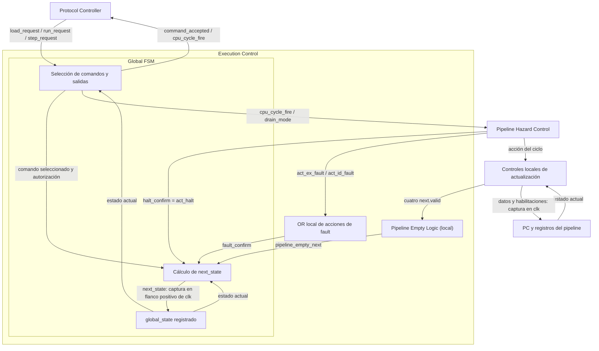
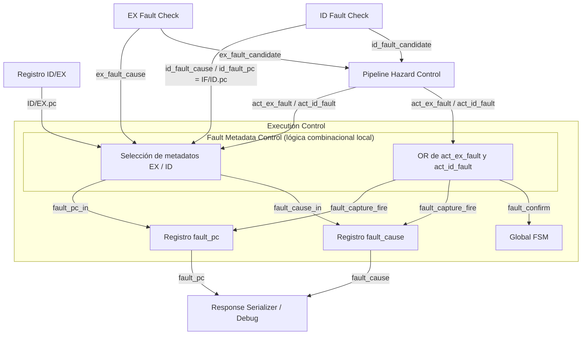

# TP3 — Contratos de interfaces

- **Tipo:** contrato de interfaces.
- **Estado documental:** documentación vigente.

**Estado:** especificación de los contratos funcionales de conexión. La implementación y las pruebas RTL, de síntesis, timing y placa están pendientes.

Este documento formaliza el mapa de bloques, entradas y salidas. Cada conexión identifica productor, consumidor y ancho; cada bloque agrega responsabilidad, comportamiento temporal y criterios para su futura verificación. Los [criterios de aceptación documental](#153-criterio-de-aceptación-documental-y-verificación-posterior) delimitan el alcance de la revisión.

**Índice**

- [Propósito y alcance](#propósito-y-alcance)
- [0. Alcance y reglas comunes](#0-alcance-y-reglas-comunes)
- [1. Etapa IF](#1-etapa-if)
- [2. Etapa ID](#2-etapa-id)
- [3. Etapa EX](#3-etapa-ex)
- [4. Etapa MEM](#4-etapa-mem)
- [5. Control central del pipeline](#5-control-central-del-pipeline)
- [6. Metadata global de fault](#6-metadata-global-de-fault)
- [7. Vaciado del pipeline y estado terminal](#7-vaciado-del-pipeline-y-estado-terminal)
- [8. Control global de sesión](#8-control-global-de-sesión)
- [9. Carga y preparación de sesión](#9-carga-y-preparación-de-sesión)
- [10. Endpoints externos y parámetros](#10-endpoints-externos-y-parámetros)
- [11. Integridad de las conexiones](#11-integridad-de-las-conexiones)
- [12. Nombres y equivalencias](#12-nombres-y-equivalencias)
- [13. Cadena global de control](#13-cadena-global-de-control)
- [14. Contratos de integración por ciclo](#14-contratos-de-integración-por-ciclo)
- [15. Fronteras parciales y condiciones de salida](#15-fronteras-parciales-y-condiciones-de-salida)
- [Referencias y trazabilidad](#referencias-y-trazabilidad)

## Propósito y alcance

Define entradas, salidas, anchos, productores, consumidores y temporización de los bloques. El catálogo conserva los contratos especializados como fuente del comportamiento interno.

## 0. Alcance y reglas comunes

### 0.1 Autoridad y lectura

La [consigna](consigna.md) y los [requisitos](requirements.md) fijan las obligaciones. Este documento define entradas, salidas, anchos, productores, consumidores y temporización de los bloques. Los contratos especializados del [mapa de autoridad](architecture/system_overview.md#autoridad-documental-por-tema) definen su comportamiento y las [decisiones](decisions/decisions.md) su justificación. Ambos deben ser coherentes con las conexiones descritas aquí.

IF detecta, `IF/ID` transporta e **ID confirma todo fetch fault**. El control del pipeline utiliza **ocho acciones**. La Global FSM tiene 14 estados y genera los indicadores de sesión a partir de su estado registrado.

Los bloques son unidades funcionales de conexión. Etiquetas como `Read Address`, `Write Data`, `capture` y `clear de sesión` identifican puertos o acciones locales: no obligan a usar espacios, barras o aliases gráficos como identificadores HDL.

### 0.2 Convenciones, anchos y codificaciones

- **[EXT]**: frontera con comandos, transporte, Debug o plataforma.
- **[CFG]**: configuración de elaboración; no es un bus dinámico.
- **[GLOBAL]**: clock, reset o control de sesión común.
- Una señal escalar de control, validez, selección binaria o evento tiene **1 bit**, salvo ancho explícito.
- Datos, PC, instrucciones, inmediatos, resultados y direcciones arquitectónicas tienen **32 bits**; índices de registros, **5 bits**. Los bits se transportan sin signo; la operación que los interpreta aplica signed/unsigned donde corresponde.
- `alu_op` tiene 6 bits; `result_sel` y selectores de forwarding, 2; `flow_op` y causas de fault, 3; `mem_op`, 4; `cycle_count`, 64 unsigned.
- `global_state` utiliza catorce bits one-hot y permanece interno en `Global FSM`. `global_state_code[7:0]` se genera combinacionalmente para `response_serializer.debug_state_code`, sin otro registro de estado.
- `loaded_image_size_bytes` y el tamaño validado pendiente usado por el `Loader` deben representar la capacidad inclusive. Su ancho es `IMAGE_SIZE_WIDTH = max(1, ceil(log2(IMEM_CAPACITY_BYTES + 1)))`.
- `byte_enable[3:0]` es la **máscara relativa de bytes** aprobada: `SB`=0001, `SH`=0011, `SW`=1111 y otros `mem_op`=0000. DMEM desplaza máscara/dato por `Address[1:0]`; el controlador de escritura no recibe dirección. No es una máscara previamente alineada a lanes.
- Las interfaces de stream, escritura de imagen, mantenimiento y observación están concretadas en §15 y en la composición aprobada. No se agregan handshakes, grants o anchos de paquetes por separar módulos.
- Un slice `instruction[a:b]` o `ex_result[1:0]` es una conexión combinacional, no un registro adicional.

Las codificaciones de `ALU` y controles se toman de [Etapa ID](architecture/cpu/stage_id.md#codificación-de-los-controles); los selectores de forwarding de [Control y hazards](architecture/cpu/control_and_hazards.md#selectores); tamaño de memoria de [MEM Decode](architecture/cpu/stage_mem.md#mem-decode); causas de fault de [Faults](architecture/session/faults_and_termination.md#referencia-de-causas). Un código reservado no se emite para una operación legal; los residuos de una entrada inválida no producen efectos. No se añade una semántica arquitectónica para un estado artificial inválido.

### 0.3 Clock, reset, preparación y enables

Todos los registros funcionales, `Loader`, preparación, memorias, UART y Debug pertenecen al **mismo dominio funcional**. Los bloques combinacionales no tienen clock, reset ni enable de captura; sus salidas pueden variar durante `HOLD` sin causar un efecto registrado.

La plataforma `REFERENCE` es Basys 3: clock primario de 100 MHz y dominio funcional de referencia de 50 MHz, mínimo docente exigido, mediante Clocking Wizard. Superar 50 MHz es opcional (REQ-TIM-006/008). La configuración Clocking Wizard/MMCM (100→50 MHz, BUFG, `locked`) está aprobada; conexión física de reset, pines y restricciones previstas también están concretados en [plataforma](architecture/platform/platform_reference.md), y el cumplimiento temporal se verificará después de implementación; véase DEC-ARCH-005.

El reset interno es activo en alto. La plataforma normaliza la fuente física y acondiciona un reset distribuido con **aserción asíncrona y liberación sincronizada**. La lógica funcional lo **consume síncronamente** en el flanco ascendente. No se distribuye la fuente externa cruda ni se convierte cada registro del CPU en un consumidor de reset asíncrono. Si existe `locked`, su ausencia solicita reset; su retorno no libera directamente los registros. Véase DEC-ARCH-008 y el acuerdo de estabilidad de DEC-ARCH-005.

Las interfaces secuenciales reciben implícitamente `clk` y, donde el contrato de estado lo exige, `reset`. La tabla siguiente explicita su alcance para evitar que la omisión gráfica se interprete como ausencia de reset:

| Estado / recurso                 | Efecto de reset funcional                                              | Preparación de sesión                         | Enable ordinario                                                                     |
|----------------------------------|------------------------------------------------------------------------|-----------------------------------------------|--------------------------------------------------------------------------------------|
| PC                               | `0`                                                                    | `0`                                           | `pc_write_enable`                                                                    |
| Register File                    | `x0`–`x31` en cero lógico                                              | cero lógico completo                          | `rf_write_fire`                                                                      |
| `IF/ID`                          | `valid=0`, `fetch_fault_valid=0`; demás bits pueden retener residuos   | ambos flags en cero                           | `capture` / `hold` / `invalidate`                                                    |
| `ID/EX`, `EX/MEM`, `MEM/WB`      | `valid=0`; demás bits pueden retener residuos                          | `valid=0`                                     | controles locales de actualización                                                   |
| `Global FSM`                     | `NO_IMAGE`                                                             | coordina fase, sin escribir el datapath       | captura `next_state` en cada flanco de `clk`, independientemente de `cpu_cycle_fire` |
| `loaded_image_size_bytes`        | `0`                                                                    | captura tamaño pendiente con `image_publish`  | clear por `load_start` / publicación por `image_publish`                             |
| `cycle_count`                    | `0`                                                                    | `0` antes del primer ciclo                    | `cpu_cycle_fire`                                                                     |
| `fault_cause`, `fault_pc`        | condición invalidada por `Global FSM`; no exige borrar bits            | condición anterior deja de ser vigente        | solo `fault_capture_fire`                                                            |
| IMEM                             | conserva array; imagen inválida por tamaño cero                        | no se borra para reutilizar imagen            | escritura del `Loader` autorizado                                                    |
| DMEM y metadatos                 | no exige borrar datos ni todos los metadatos                           | establece cero lógico antes de `prepare_done` | store / mantenimiento con ownership                                                  |
| `Loader` / `Session Preparation` | aborta trabajo privado anterior; condición segura                      | progreso privado de su operación              | actividad habilitada de su fase                                                      |
| Debug / transporte               | abortar fase/respuesta y no presentar transacción anterior como actual | bitmap `valid`/used DMEM vacío                | controlador/serializador y preparación aprobados, §15.12–15.19                       |

Para la orden UART `RESET`, el [intercambio aprobado](protocol.md#reset-desde-pc) difiere la generación de la solicitud global hasta terminar físicamente `[RESET][ACCEPTED]`, incluido Stop del segundo byte. El botón físico aplica reset directamente. La prioridad siguiente rige cuando el reset funcional está activo.

Durante la respuesta Debug no se reconocen solicitudes UART: PC espera completa y FPGA descarta RX. El botón físico puede interrumpir.

La [integración aprobada de reset](architecture/platform/reset_integration.md) registra la solicitud UART al último Stop y la combina con botón normalizado y falta de `locked`, si existe, antes del único `reset_sync` del TP2. Todos los bloques consumen la salida común; la liberación requiere dos etapas.

La prioridad común es **`RESET` > `LOAD` aceptado / preparación efectiva > ciclo CPU > `HOLD`**. Un `LOAD` rechazado no suprime un ciclo automático. Una frontera joven de halt/fault/redirect tampoco suprime commits `MEM/WB` anteriores. `RESET` impide escrituras CPU, `Loader` y mantenimiento en su flanco funcional; un `LOAD` aceptado impide efectos CPU previos e invalida candidatos/estado de la sesión abandonada antes de ejecutarla nuevamente.

`prepare_active` indica una fase, no es un write-enable. `prepare_done=1` certifica que el estado inicial ya está listo **antes del flanco** y que no hay writes de `Loader`/mantenimiento concurrentes. `PREPARING_RUN`/`STEP` puede ejecutar su primer ciclo en ese flanco y dejar `cycle_count=1`; `PREPARING_READY` publica imagen y queda `READY` con contador cero, sin ciclo CPU.

### 0.4 Tiempo y validez de las conexiones

Capturas, stores, writebacks y captura de metadatos consumen valores **preflanco**; todos sus resultados registrados se observan postflanco. Un dato recién capturado en `MEM/WB` no se usa como un productor EX de ese mismo flanco.

Las lecturas de IMEM, DMEM y RF son combinacionales. Las escrituras son síncronas y no añaden una etapa, handshake ni stall de memoria. En `HOLD` (`cpu_cycle_fire=0` y sin acción global superior) PC, registros interetapa completos, RF y contador se retienen; no se repiten stores ni writebacks.

Una entrada con `valid=0` no es una instrucción. `IF/ID` conserva además `fetch_fault_valid` para el candidato separado. Los demás campos pueden retener residuos después de `bubble` o invalidación; no se exige borrar todos los bits ni registrar una NOP. Tampoco se agregan campos `uses_rsN`, `is_load`, `is_store`, `access_size`, `terminal_kind` o `drain_auto` a los registros interetapa.

### 0.5 Configuración y ownership

Las capacidades en bytes satisfacen `4 <= CAPACITY_BYTES <= 2^32` y son múltiplos de cuatro, sin exigir potencias de dos. Las constantes de capacidad deben representar `2^32` sin truncamiento; las comparaciones de extremos utilizan **33 bits unsigned**.

| Perfil      | IMEM bytes | DMEM bytes | IMEM palabras / ancho de índice | DMEM palabras / ancho de índice | `IMAGE_SIZE_WIDTH` |
|-------------|-----------:|-----------:|---------------------------------|---------------------------------|-------------------:|
| `REFERENCE` |       1024 |       2048 | 256 / 8                         | 512 / 9                         |                 11 |
| `ALT_1000`  |       1000 |       1000 | 250 / 8                         | 250 / 8                         |                 10 |

`WORD_COUNT=CAPACITY_BYTES/4`; cada ancho de índice es `max(1, ceil(log2(WORD_COUNT)))`. Configuración, software y loader deben utilizar el mismo perfil autoritativo. Un valor fuera del dominio se rechaza al elaborar; un perfil legal no soportado por un backend se distingue como error de configuración, no fault del programa. La [configuración común](architecture/common_configuration.md) define fuente, propagación, tipos y validadores.

PC, EA y offsets están expresados en bytes; IMEM y DMEM tienen base cero y espacios independientes. EA se forma módulo `2^32`, pero se comprueba **EA+N completo en 33 bits antes de indexar**. Fetch comprueba además imagen confirmada. Desalineación prevalece sobre rango para el mismo acceso. No se hace alias mediante truncamiento.

IMEM CPU/`Loader` y DMEM CPU/Debug/mantenimiento mantienen ownership exclusivo para operaciones incompatibles. IF y MEM pueden demandar simultáneamente sus memorias independientes. Debug lee directamente el estado retenido: requiere CPU quiescente y acceso exclusivo de DMEM frente a CPU/mantenimiento hasta el último Stop. El diseño aprobado no agrega una copia completa del estado. Un conflicto interno es una violación de implementación, no una octava causa de fault.

---

## 1. Etapa IF

<a id="bloque-1-1"></a>

### 1.1 `PC Update Control`

**Tipo:** Combinacional. **Responsabilidad:** Convertir la acción del pipeline en enable y selección de PC.

**Contrato:** `pc_write_enable=act_normal || act_redirect`; `next_pc_sel=act_redirect`. Sin enable se retiene PC.

**Fuente:** [contrato arquitectónico](architecture/cpu/control_and_hazards.md#pc). **Verificación futura:** Para las ocho acciones y ninguna, comprobar enable/selector y retención.

#### Entradas

| Señal          | Origen                    |
|----------------|---------------------------|
| `act_normal`   | `Pipeline Hazard Control` |
| `act_redirect` | `Pipeline Hazard Control` |

#### Salidas

| Señal             | Destino           |
|-------------------|-------------------|
| `pc_write_enable` | `PC.write_enable` |
| `next_pc_sel`     | `Next PC MUX.sel` |

---

<a id="bloque-1-2"></a>

### 1.2 `Next PC MUX`

**Tipo:** Combinacional. **Responsabilidad:** Seleccionar el próximo PC de ejecución.

**Contrato:** Selector 0: PC+4; selector 1: `redirect_target`. La salida solo se captura con `pc_write_enable`.

**Fuente:** [contrato arquitectónico](architecture/cpu/stage_if.md#next-pc-mux). **Verificación futura:** Comprobar ambos caminos, también con targets distintos del PC global.

#### Entradas

| Señal                   | Origen              |
|-------------------------|---------------------|
| `pc_plus_4[31:0]`       | `PC Adder`          |
| `redirect_target[31:0]` | `Target MUX`        |
| `next_pc_sel`           | `PC Update Control` |

#### Salidas

| Señal           | Destino |
|-----------------|---------|
| `next_pc[31:0]` | `PC`    |

---

<a id="bloque-1-3"></a>

### 1.3 `PC`

**Tipo:** Registro funcional. **Responsabilidad:** Conservar la dirección de fetch global.

**Contrato:** Reset o preparación lo dejan en cero; captura `next_pc` solo con `write_enable`; en el resto retiene.

**Fuente:** [contrato arquitectónico](architecture/cpu/stage_if.md#pc). **Verificación futura:** Prioridad reset/preparación/avance; `HOLD` y stall; wrap secuencial módulo 2^32.

#### Entradas

| Señal                            | Origen                              |
|----------------------------------|-------------------------------------|
| `next_pc[31:0]`                  | `Next PC MUX`                       |
| `write_enable`                   | `PC Update Control.pc_write_enable` |
| inicialización / clear de sesión | `Session Preparation`               |
| `reset`                          | [GLOBAL] reset del sistema          |

#### Salidas

| Señal      | Destino                                     |
|------------|---------------------------------------------|
| `PC[31:0]` | `PC Adder`                                  |
| `PC[31:0]` | `Instruction Memory.Read Address`           |
| `PC[31:0]` | `Fetch Fault Check`                         |
| `PC[31:0]` | `IF/ID Input Logic`                         |
| `PC[31:0]` | [EXT] Debug/Snapshot, contenido obligatorio |

---

<a id="bloque-1-4"></a>

### 1.4 `PC Adder`

**Tipo:** Combinacional. **Responsabilidad:** Formar la dirección secuencial siguiente.

**Contrato:** `pc_plus_4=(PC+4) mod 2^32`; no valida el fetch futuro.

**Fuente:** [contrato arquitectónico](architecture/cpu/stage_if.md#pc-adder). **Verificación futura:** PC alineado y wrap 0xFFFFFFFC → 0.

#### Entradas

| Señal      | Origen |
|------------|--------|
| `PC[31:0]` | `PC`   |

#### Salidas

| Señal             | Destino       |
|-------------------|---------------|
| `pc_plus_4[31:0]` | `Next PC MUX` |

---

<a id="bloque-1-5"></a>

### 1.5 `Instruction Memory`

**Tipo:** Memoria: lectura combinacional / escritura síncrona. **Responsabilidad:** Proveer instrucciones y recibir palabras completas del `Loader`.

**Contrato:** Palabra little-endian de PC validado; write solo del `Loader` con ownership, palabra completa, dirección válida y sin reset. No hay salida registrada ni stall de memoria. Interfaz de carga concretada en diseño.

**Fuente:** [contrato arquitectónico](architecture/memory/memory_architecture.md#instruction-memory). **Verificación futura:** Carga palabra completa, imagen corta, índices de frontera y exclusión CPU/`Loader` en ambos perfiles.

#### Entradas

| Señal                           | Origen                    |
|---------------------------------|---------------------------|
| `Read Address[31:0]`            | `PC`                      |
| interfaz de escritura de imagen | `Loader`                  |
| `IMEM_CAPACITY_BYTES`           | [CFG] perfil autoritativo |

#### Salidas

| Señal               | Destino             |
|---------------------|---------------------|
| `instruction[31:0]` | `IF/ID Input Logic` |

> La entrada «interfaz de escritura de imagen» resume la conexión aprobada `imem_write_index`, `imem_write_data` e `imem_write_enable`, definida en [Loader](architecture/session/loader.md#interfaces-y-contratos). La tabla conserva su etiqueta funcional; los nombres y el recorrido de carga ya están concretados.

---

<a id="bloque-1-6"></a>

### 1.6 `Fetch Fault Check`

**Tipo:** Combinacional. **Responsabilidad:** Detectar un candidato de fetch inválido.

**Contrato:** Misaligned si PC[1:0]!=0; rango exige imagen válida y PC+4 dentro de capacidad e imagen, sumado en 33 bits. Prioridad misaligned (000) sobre access (001). IF nunca confirma.

**Fuente:** [contrato arquitectónico](architecture/memory/memory_architecture.md#validación-de-fetch). **Verificación futura:** Imagen vacía/corta, límite, desalineación simultánea con rango y ausencia de aliasing.

#### Entradas

| Señal                     | Origen                                     |
|---------------------------|--------------------------------------------|
| `PC[31:0]`                | `PC`                                       |
| `image_valid`             | derivado de `loaded_image_size_bytes != 0` |
| `loaded_image_size_bytes` | registro global `loaded_image_size_bytes`  |
| `IMEM_CAPACITY_BYTES`     | [CFG] configuración de memoria             |

#### Salidas

| Señal                       | Destino             |
|-----------------------------|---------------------|
| `if_fetch_fault_candidate`  | `IF/ID Input Logic` |
| `if_fetch_fault_cause[2:0]` | `IF/ID Input Logic` |

> **No hay** camino directo `Fetch Fault Check → Pipeline Hazard Control`.

---

<a id="bloque-1-7"></a>

### 1.7 `IF/ID Input Logic`

**Tipo:** Combinacional. **Responsabilidad:** Formar los cinco campos de entrada `IF/ID`.

**Contrato:** Fetch normal: `valid`=1, `fetch_fault_valid`=0, `instruction`=IMEM, `cause`=000. Candidato: `valid`=0, `fetch_fault_valid`=1, `instruction`=0 y causa recibida. En ambos `pc`=PC. Captura solo si `act_normal`.

**Fuente:** [contrato arquitectónico](architecture/cpu/stage_if.md#ifid-input-logic). **Verificación futura:** Flags excluyentes, palabra cero para candidato y candidato no capturado durante load-use.

#### Entradas

| Señal                       | Origen               |
|-----------------------------|----------------------|
| `PC[31:0]`                  | `PC`                 |
| `instruction[31:0]`         | `Instruction Memory` |
| `if_fetch_fault_candidate`  | `Fetch Fault Check`  |
| `if_fetch_fault_cause[2:0]` | `Fetch Fault Check`  |

#### Salidas

| Señal                            | Destino                   |
|----------------------------------|---------------------------|
| `ifid_in_valid`                  | `IF/ID.valid`             |
| `ifid_in_pc[31:0]`               | `IF/ID.pc`                |
| `ifid_in_instruction[31:0]`      | `IF/ID.instruction`       |
| `ifid_in_fetch_fault_valid`      | `IF/ID.fetch_fault_valid` |
| `ifid_in_fetch_fault_cause[2:0]` | `IF/ID.fetch_fault_cause` |

---

<a id="bloque-1-8"></a>

### 1.8 `IF/ID Update Control`

**Tipo:** Combinacional. **Responsabilidad:** Derivar `capture`, `hold` e `invalidate` de `IF/ID`.

**Contrato:** Capture con `act_normal`; `hold` con `act_load_use`/`act_drain_load_use`; `invalidate` con redirect/halt/fault EX/fault ID/`drain_advance`. Sin acción se retiene.

**Fuente:** [contrato arquitectónico](architecture/cpu/control_and_hazards.md#ifid). **Verificación futura:** Acciones exclusivas; invalidación de ambos flags y retención completa en stall/`HOLD`.

#### Entradas

Todas provienen de `Pipeline Hazard Control`.

| Señal                | Origen                    |
|----------------------|---------------------------|
| `act_ex_fault`       | `Pipeline Hazard Control` |
| `act_halt`           | `Pipeline Hazard Control` |
| `act_redirect`       | `Pipeline Hazard Control` |
| `act_id_fault`       | `Pipeline Hazard Control` |
| `act_load_use`       | `Pipeline Hazard Control` |
| `act_normal`         | `Pipeline Hazard Control` |
| `act_drain_load_use` | `Pipeline Hazard Control` |
| `act_drain_advance`  | `Pipeline Hazard Control` |

#### Salidas

| Señal        | Destino            |
|--------------|--------------------|
| `capture`    | `IF/ID.capture`    |
| `hold`       | `IF/ID.hold`       |
| `invalidate` | `IF/ID.invalidate` |

---

<a id="bloque-1-9"></a>

### 1.9 Registro `IF/ID`

**Tipo:** Registro funcional. **Responsabilidad:** Transportar instrucción o candidato de fetch hacia ID.

**Contrato:** Cinco campos exactos. Capture toma entrada IF; `hold` conserva los cinco; `invalidate`/reset/preparación limpian ambos flags. Datos residuales no son instrucciones.

**Fuente:** [contrato arquitectónico](architecture/cpu/cpu_pipeline.md#registro-ifid). **Verificación futura:** Campos/anchos, `next.valid` y observación; nunca `valid` && `fetch_fault_valid` en ejecución legal.

#### Entradas de datos

| Campo                    | Origen                                        |
|--------------------------|-----------------------------------------------|
| `valid`                  | `IF/ID Input Logic.ifid_in_valid`             |
| `pc[31:0]`               | `IF/ID Input Logic.ifid_in_pc`                |
| `instruction[31:0]`      | `IF/ID Input Logic.ifid_in_instruction`       |
| `fetch_fault_valid`      | `IF/ID Input Logic.ifid_in_fetch_fault_valid` |
| `fetch_fault_cause[2:0]` | `IF/ID Input Logic.ifid_in_fetch_fault_cause` |

#### Entradas de control

| Señal           | Origen                   |
|-----------------|--------------------------|
| `capture`       | `IF/ID Update Control`   |
| `hold`          | `IF/ID Update Control`   |
| `invalidate`    | `IF/ID Update Control`   |
| clear de sesión | `Session Preparation`    |
| `reset`         | [GLOBAL] reset funcional |

#### Salidas

| Campo                    | Destino                     |
|--------------------------|-----------------------------|
| `valid`                  | `ID Fault Check`            |
| `valid`                  | `Load-Use Detector`         |
| `valid`                  | entrada `ID/EX.valid`       |
| `pc[31:0]`               | `ID Fault Check`            |
| `pc[31:0]`               | entrada `ID/EX.pc`          |
| `instruction[31:0]`      | `Decoder`                   |
| `instruction[31:0]`      | `Immediate Generator`       |
| `instruction[19:15]`     | `Registers.Read Register 1` |
| `instruction[24:20]`     | `Registers.Read Register 2` |
| `instruction[19:15]`     | `Load-Use Detector`         |
| `instruction[24:20]`     | `Load-Use Detector`         |
| `instruction[19:15]`     | `WB Bypass Control`         |
| `instruction[24:20]`     | `WB Bypass Control`         |
| `instruction[31:0]`      | entrada `ID/EX.instruction` |
| `instruction[19:15]`     | entrada `ID/EX.rs1`         |
| `instruction[24:20]`     | entrada `ID/EX.rs2`         |
| `instruction[11:7]`      | entrada `ID/EX.rd`          |
| `fetch_fault_valid`      | `ID Fault Check`            |
| `fetch_fault_cause[2:0]` | `ID Fault Check`            |

#### Conexiones de próximo estado y observación

| Señal / contenido                   | Destino                                                 |
|-------------------------------------|---------------------------------------------------------|
| `next.valid` (1 bit, combinacional) | `Pipeline Empty Logic.pipeline_empty_next`              |
| `valid` actual                      | `response_serializer.debug_ifid_valid`                  |
| `pc[31:0]` actual                   | `response_serializer.debug_ifid_pc[31:0]`               |
| `instruction[31:0]` actual          | `response_serializer.debug_ifid_instruction[31:0]`      |
| `fetch_fault_valid` actual          | `response_serializer.debug_ifid_fetch_fault_valid`      |
| `fetch_fault_cause[2:0]` actual     | `response_serializer.debug_ifid_fetch_fault_cause[2:0]` |

La observación de `IF/ID` usa sus campos registrados actuales, incluidos los inactivos, bajo exclusión Debug y sin copia adicional, según la [regla común de selección y avance](architecture/debug/response_serializer.md#regla-común-de-selección-y-avance) basada en `fixed_byte_index`. `next.valid` es combinacional y no se transmite. La tabla anterior conserva las conexiones propias de este registro interetapa.

---

## 2. Etapa ID

<a id="bloque-2-1"></a>

### 2.1 `Decoder`

**Tipo:** Combinacional. **Responsabilidad:** Reconocer el subconjunto y generar controles para EX.

**Contrato:** Whitelist completa de 32 RV32I más halt exacto 0x0000000B; señales/valores de control según Etapa ID. Ilegal: `decode_legal`=0, `ADD`/`RS2`/`ALU`/`NONE`/`NONE`, `reg_write`=`uses_rs1`=`uses_rs2`=0. No confirma fault.

**Fuente:** [contrato arquitectónico](architecture/cpu/stage_id.md#decoder). **Verificación futura:** 33 patrones legales con operandos variables, patrones vecinos ilegales, bits fijos de shifts y defaults neutros.

#### Entradas

| Señal               | Origen  |
|---------------------|---------|
| `instruction[31:0]` | `IF/ID` |

#### Salidas

| Señal             | Destino             |
|-------------------|---------------------|
| `decode_legal`    | `ID Fault Check`    |
| `alu_op[5:0]`     | `ID/EX.alu_op`      |
| `alu_src`         | `ID/EX.alu_src`     |
| `result_sel[1:0]` | `ID/EX.result_sel`  |
| `flow_op[2:0]`    | `ID/EX.flow_op`     |
| `mem_op[3:0]`     | `ID/EX.mem_op`      |
| `reg_write`       | `ID/EX.reg_write`   |
| `uses_rs1`        | `Load-Use Detector` |
| `uses_rs2`        | `Load-Use Detector` |

---

<a id="bloque-2-2"></a>

### 2.2 `Registers`

**Tipo:** Estado con dos lecturas combinacionales y una escritura síncrona. **Responsabilidad:** Conservar los 32 registros arquitectónicos.

**Contrato:** Lee `x0` siempre como cero; reset/preparación establecen cero lógico; escribe el `rd` y dato preflanco de `MEM/WB` solo con `rf_write_fire`. Bypass explícito externo a las lecturas base.

**Fuente:** [contrato arquitectónico](architecture/cpu/stage_wb.md#el-register-file-como-destino-de-wb). **Verificación futura:** `x0`, escrituras, lectura/escritura simultánea corregida por bypass, `HOLD` y preparación.

#### Entradas

| Señal                       | Origen                                                             |
| --------------------------- | ------------------------------------------------------------------ |
| `Read Register 1[4:0]`      | `IF/ID.instruction[19:15]`                                         |
| `Read Register 2[4:0]`      | `IF/ID.instruction[24:20]`                                         |
| `debug_rf_addr[4:0]`        | `response_serializer`, registro `x0`–x31 seleccionado para Debug   |
| `debug_read_select` (1 bit) | `Protocol Controller`, ventana exclusiva Debug                     |
| `Write Register[4:0]`       | `MEM/WB.rd`                                                        |
| `Write Data[31:0]`          | `MEM/WB.wb_value`                                                  |
| `write_enable`              | `WB Bypass Control.rf_write_fire`                                  |
| `prepare_init`              | `Session Preparation`, inicialización RF simultánea                |
| `reset`                     | [GLOBAL] reset funcional                                           |

#### Salidas

| Señal                 | Destino                                                                              |
|-----------------------|--------------------------------------------------------------------------------------|
| `rf_rs1_value[31:0]`  | `RS1 Bypass MUX`                                                                     |
| `rf_rs2_value[31:0]`  | `RS2 Bypass MUX`                                                                     |
| `debug_rf_data[31:0]` | [EXT] `response_serializer`, valor base de la primera lectura con Debug seleccionado |

El [mux de primera lectura RF](architecture/debug/response_serializer.md#lectura-rf-compartida-con-debug) reside dentro de `Registers` y selecciona números de registro de cinco bits. Recibe la misma salida `Protocol Controller.debug_read_select` que el selector de lectura DMEM. Con `debug_read_select` en cero, toma `Read Register 1` CPU; con uno, `debug_rf_addr`. La dirección interna seleccionada determina también la lectura de `x0` como cero. La segunda lectura conserva su conexión CPU.

`debug_rf_data` presenta combinacionalmente el mismo valor base que la primera lectura RF, antes del bypass CPU. Su conexión no agrega una tercera lectura del banco. El serializador lo consume únicamente con Debug seleccionado y durante la sección RF.

Durante esa ventana la CPU permanece retenida, no escribe RF y no se prepara otra sesión. El selector se desactiva durante reset.

La [derivación RF](architecture/debug/response_serializer.md#derivación-de-registro-y-byte-rf) es combinacional: para posiciones 21 a 148 se resta 21; el cociente entero por cuatro forma `debug_rf_addr` y el resto forma `rf_byte_select`. Estas selecciones son combinacionales y toman los cuatro bytes little-endian de `debug_rf_data`. Fuera de producción RF se presentan neutras en cero y el retorno no se consume. La generación del selector y los controles están concretados en §15.12–15.17.

---

<a id="bloque-2-3"></a>

### 2.3 `Immediate Generator`

**Tipo:** Combinacional. **Responsabilidad:** Reconstruir el inmediato de 32 bits.

**Contrato:** Formatos I/S/B/U/J según Datapath; offsets en bytes, B/J con bit cero incorporado, U con 12 ceros. Shifts consumen después `immediate[4:0]`.

**Fuente:** [contrato arquitectónico](architecture/cpu/datapath.md#inmediato). **Verificación futura:** Signos, fronteras y bits fragmentados de cada formato; SRAI sin usar bits fijos como shamt.

#### Entradas

| Señal               | Origen  |
|---------------------|---------|
| `instruction[31:0]` | `IF/ID` |

#### Salidas

| Señal             | Destino           |
|-------------------|-------------------|
| `immediate[31:0]` | `ID/EX.immediate` |

---

<a id="bloque-2-4"></a>

### 2.4 `RS1 Bypass MUX`

**Tipo:** Combinacional. **Responsabilidad:** Seleccionar el valor base RS1 para `ID/EX`.

**Contrato:** `bypass_rs1`=1 selecciona `MEM/WB.wb_value`; 0 selecciona `rf_rs1_value`.

**Fuente:** [contrato arquitectónico](architecture/cpu/stage_id.md#rs1-bypass-mux). **Verificación futura:** Ambos caminos y fuente `x0`.

#### Entradas

| Señal                   | Origen              |
|-------------------------|---------------------|
| `rf_rs1_value[31:0]`    | `Registers`         |
| `MEM/WB.wb_value[31:0]` | `MEM/WB`            |
| `bypass_rs1`            | `WB Bypass Control` |

#### Salidas

| Señal             | Destino           |
|-------------------|-------------------|
| `rs1_value[31:0]` | `ID/EX.rs1_value` |

---

<a id="bloque-2-5"></a>

### 2.5 `RS2 Bypass MUX`

**Tipo:** Combinacional. **Responsabilidad:** Seleccionar el valor base `RS2` para `ID/EX`.

**Contrato:** `bypass_rs2`=1 selecciona `MEM/WB.wb_value`; 0 selecciona `rf_rs2_value`.

**Fuente:** [contrato arquitectónico](architecture/cpu/stage_id.md#rs2-bypass-mux). **Verificación futura:** Ambos caminos y selecciones independientes RS1/`RS2`.

#### Entradas

| Señal                   | Origen              |
|-------------------------|---------------------|
| `rf_rs2_value[31:0]`    | `Registers`         |
| `MEM/WB.wb_value[31:0]` | `MEM/WB`            |
| `bypass_rs2`            | `WB Bypass Control` |

#### Salidas

| Señal             | Destino           |
|-------------------|-------------------|
| `rs2_value[31:0]` | `ID/EX.rs2_value` |

---

<a id="bloque-2-6"></a>

### 2.6 `WB Bypass Control`

**Tipo:** Combinacional. **Responsabilidad:** Habilitar writeback real y resolver coincidencia WB→ID.

**Contrato:** `rf_write_fire=cpu_cycle_fire && MEM/WB.valid && MEM/WB.reg_write && rd!=0`; cada bypass exige `rf_write_fire` y coincidencia de su fuente con `rd`.

**Fuente:** [contrato arquitectónico](architecture/cpu/control_and_hazards.md#bypass-wb--id). **Verificación futura:** WB válido/inválido, `rd`=0, fuentes independientes y ninguna escritura o bypass nuevo en `HOLD`.

#### Entradas

| Señal                      | Origen              |
|----------------------------|---------------------|
| `cpu_cycle_fire`           | `Execution Control` |
| `MEM/WB.valid`             | `MEM/WB`            |
| `MEM/WB.reg_write`         | `MEM/WB`            |
| `MEM/WB.rd[4:0]`           | `MEM/WB`            |
| `IF/ID.instruction[19:15]` | `IF/ID`             |
| `IF/ID.instruction[24:20]` | `IF/ID`             |

#### Salidas

| Señal           | Destino                  |
|-----------------|--------------------------|
| `rf_write_fire` | `Registers.write_enable` |
| `bypass_rs1`    | `RS1 Bypass MUX.sel`     |
| `bypass_rs2`    | `RS2 Bypass MUX.sel`     |

---

<a id="bloque-2-7"></a>

### 2.7 `ID Fault Check`

**Tipo:** Combinacional. **Responsabilidad:** Unificar candidato ilegal y candidato de fetch registrado.

**Contrato:** `id_fault_candidate=(valid && !decode_legal) || (!valid && fetch_fault_valid)`; ilegal selecciona 010 y fetch copia `cause`; `pc`=`IF/ID.pc`. Metadatos sin candidato no se consumen. Confirmación pertenece al arbitraje.

**Fuente:** [contrato arquitectónico](architecture/session/faults_and_termination.md#confirmación-en-id). **Verificación futura:** Bubble residual, ilegal, fetch registrado y descarte ante frontera EX más antigua.

#### Entradas

| Señal                          | Origen    |
|--------------------------------|-----------|
| `IF/ID.valid`                  | `IF/ID`   |
| `IF/ID.pc[31:0]`               | `IF/ID`   |
| `IF/ID.fetch_fault_valid`      | `IF/ID`   |
| `IF/ID.fetch_fault_cause[2:0]` | `IF/ID`   |
| `decode_legal`                 | `Decoder` |

#### Salidas

| Señal                 | Destino                   |
|-----------------------|---------------------------|
| `id_fault_candidate`  | `Pipeline Hazard Control` |
| `id_fault_cause[2:0]` | `Fault Metadata Control`  |
| `id_fault_pc[31:0]`   | `Fault Metadata Control`  |

---

<a id="bloque-2-8"></a>

### 2.8 `Load-Use Detector`

**Tipo:** Combinacional. **Responsabilidad:** Detectar consumidor inmediato de un load.

**Contrato:** Exige `IF/ID.valid`, `ID/EX.valid`, `is_load`(`ID/EX.mem_op`), `rd`!=0 y coincidencia de `rs1` o `rs2` realmente utilizado. Usa usos de Decoder, no bits registrados adicionales.

**Fuente:** [contrato arquitectónico](architecture/cpu/control_and_hazards.md#detección). **Verificación futura:** `ALU`, branch, `JALR`, base/dato de store; falsas dependencias por inmediatos, `x0` y entradas inválidas.

#### Entradas

| Señal               | Origen                     |
|---------------------|----------------------------|
| `IF/ID.valid`       | `IF/ID`                    |
| `rs1[4:0]`          | `IF/ID.instruction[19:15]` |
| `rs2[4:0]`          | `IF/ID.instruction[24:20]` |
| `uses_rs1`          | `Decoder`                  |
| `uses_rs2`          | `Decoder`                  |
| `ID/EX.valid`       | `ID/EX`                    |
| `ID/EX.rd[4:0]`     | `ID/EX`                    |
| `ID/EX.mem_op[3:0]` | `ID/EX`                    |

#### Salidas

| Señal            | Destino                   |
|------------------|---------------------------|
| `load_use_stall` | `Pipeline Hazard Control` |

---

<a id="bloque-2-9"></a>

### 2.9 `ID/EX Update Control`

**Tipo:** Combinacional. **Responsabilidad:** Derivar captura o `bubble` de `ID/EX`.

**Contrato:** Capture con normal/`drain_advance`; `bubble` con load-use/redirect/halt/fault EX/fault ID/`drain_load_use`. Sin acción retiene.

**Fuente:** [contrato arquitectónico](architecture/cpu/control_and_hazards.md#idex). **Verificación futura:** Las ocho acciones y `HOLD`, sin borrar obligatoriamente datos de `bubble`.

#### Entradas

Todas provienen de `Pipeline Hazard Control`.

| Señal                |
|----------------------|
| `act_ex_fault`       |
| `act_halt`           |
| `act_redirect`       |
| `act_id_fault`       |
| `act_load_use`       |
| `act_normal`         |
| `act_drain_load_use` |
| `act_drain_advance`  |

#### Salidas

| Señal     | Destino         |
|-----------|-----------------|
| `capture` | `ID/EX.capture` |
| `bubble`  | `ID/EX.bubble`  |

---

<a id="bloque-2-10"></a>

### 2.10 Registro `ID/EX`

**Tipo:** Registro funcional. **Responsabilidad:** Conservar identidad, operandos base, inmediato y seis controles para EX.

**Contrato:** Quince campos exactos; `capture` toma ID preflanco y valores posbypass; `bubble`/reset/preparación dejan `valid`=0. `uses_rsN` no se registra.

**Fuente:** [contrato arquitectónico](architecture/cpu/cpu_pipeline.md#registro-idex). **Verificación futura:** Esquema, propagación de control/identidad, prioridades y `next.valid`.

#### Entradas de datos

| Campo               | Origen                     |
|---------------------|----------------------------|
| `valid`             | `IF/ID.valid`              |
| `pc[31:0]`          | `IF/ID.pc`                 |
| `instruction[31:0]` | `IF/ID.instruction`        |
| `rs1[4:0]`          | `IF/ID.instruction[19:15]` |
| `rs2[4:0]`          | `IF/ID.instruction[24:20]` |
| `rd[4:0]`           | `IF/ID.instruction[11:7]`  |
| `rs1_value[31:0]`   | `RS1 Bypass MUX`           |
| `rs2_value[31:0]`   | `RS2 Bypass MUX`           |
| `immediate[31:0]`   | `Immediate Generator`      |
| `alu_op[5:0]`       | `Decoder`                  |
| `alu_src`           | `Decoder`                  |
| `result_sel[1:0]`   | `Decoder`                  |
| `flow_op[2:0]`      | `Decoder`                  |
| `mem_op[3:0]`       | `Decoder`                  |
| `reg_write`         | `Decoder`                  |

#### Entradas de control

| Señal           | Origen                   |
|-----------------|--------------------------|
| `capture`       | `ID/EX Update Control`   |
| `bubble`        | `ID/EX Update Control`   |
| clear de sesión | `Session Preparation`    |
| `reset`         | [GLOBAL] reset funcional |

#### Salidas

| Campo               | Destino                                |
|---------------------|----------------------------------------|
| `valid`             | `Forwarding Unit`                      |
| `valid`             | `Load-Use Detector`                    |
| `valid`             | `Flow Control`                         |
| `valid`             | `EX Fault Check`                       |
| `valid`             | `EX/MEM.valid`                         |
| `pc[31:0]`          | `Link Adder`                           |
| `pc[31:0]`          | `Target Adder`                         |
| `pc[31:0]`          | `EX/MEM.pc`                            |
| `pc[31:0]`          | `Fault Metadata Control` para fault EX |
| `instruction[31:0]` | `Forwarding Unit`                      |
| `instruction[31:0]` | `EX/MEM.instruction`                   |
| `rs1[4:0]`          | `Forwarding Unit`                      |
| `rs2[4:0]`          | `Forwarding Unit`                      |
| `rd[4:0]`           | `Load-Use Detector`                    |
| `rd[4:0]`           | `EX/MEM.rd`                            |
| `rs1_value[31:0]`   | `Forward MUX A`                        |
| `rs2_value[31:0]`   | `Forward MUX B`                        |
| `immediate[31:0]`   | `ALUSrc MUX`                           |
| `immediate[31:0]`   | `Result MUX`                           |
| `immediate[31:0]`   | `Target Adder`                         |
| `immediate[31:0]`   | `JALR Adder`                           |
| `immediate[31:0]`   | `EX Fault Check`                       |
| `alu_op[5:0]`       | `ALU`                                  |
| `alu_src`           | `ALUSrc MUX.sel`                       |
| `result_sel[1:0]`   | `Result MUX.sel`                       |
| `flow_op[2:0]`      | `Flow Control`                         |
| `mem_op[3:0]`       | `EX Fault Check`                       |
| `mem_op[3:0]`       | `EX/MEM.mem_op`                        |
| `reg_write`         | `EX/MEM.reg_write`                     |

#### Conexiones de próximo estado y observación

| Señal / contenido                   | Destino                                            |
|-------------------------------------|----------------------------------------------------|
| `next.valid` (1 bit, combinacional) | `Pipeline Empty Logic.pipeline_empty_next`         |
| `valid` actual                      | `response_serializer.debug_idex_valid`             |
| `pc[31:0]` actual                   | `response_serializer.debug_idex_pc[31:0]`          |
| `instruction[31:0]` actual          | `response_serializer.debug_idex_instruction[31:0]` |
| `rs1[4:0]` actual                   | `response_serializer.debug_idex_rs1[4:0]`          |
| `rs2[4:0]` actual                   | `response_serializer.debug_idex_rs2[4:0]`          |
| `rd[4:0]` actual                    | `response_serializer.debug_idex_rd[4:0]`           |
| `rs1_value[31:0]` actual            | `response_serializer.debug_idex_rs1_value[31:0]`   |
| `rs2_value[31:0]` actual            | `response_serializer.debug_idex_rs2_value[31:0]`   |
| `immediate[31:0]` actual            | `response_serializer.debug_idex_immediate[31:0]`   |
| `alu_op[5:0]` actual                | `response_serializer.debug_idex_alu_op[5:0]`       |
| `alu_src` actual                    | `response_serializer.debug_idex_alu_src`           |
| `result_sel[1:0]` actual            | `response_serializer.debug_idex_result_sel[1:0]`   |
| `flow_op[2:0]` actual               | `response_serializer.debug_idex_flow_op[2:0]`      |
| `mem_op[3:0]` actual                | `response_serializer.debug_idex_mem_op[3:0]`       |
| `reg_write` actual                  | `response_serializer.debug_idex_reg_write`         |

La observación de `ID/EX` usa sus campos registrados actuales, incluidos los inactivos, bajo exclusión Debug y sin copia adicional, según la [regla común de selección y avance](architecture/debug/response_serializer.md#regla-común-de-selección-y-avance) basada en `fixed_byte_index`. `next.valid` es combinacional y no se transmite. La tabla anterior conserva las conexiones propias de este registro interetapa.

---

## 3. Etapa EX

<a id="bloque-3-1"></a>

### 3.1 `Forwarding Unit`

**Tipo:** Combinacional. **Responsabilidad:** Elegir el productor más reciente para cada fuente EX.

**Contrato:** Usos se derivan de `ID/EX.instruction`. Match cualificado exige validez, uso real, `reg_write` y `rd`!=0. `EX/MEM` domina; load no reenvía dirección pero bloquea una versión vieja `MEM/WB` por `exmem_match`. Selectores 00/01/10; no emite 11.

**Fuente:** [contrato arquitectónico](architecture/cpu/control_and_hazards.md#forwarding-hacia-ex). **Verificación futura:** Productores dobles, fuentes independientes, `x0` y load que oculta una versión vieja; caso imposible de consumidor inmediato separado como artificial.

#### Entradas

| Señal                     | Origen   |
|---------------------------|----------|
| `ID/EX.valid`             | `ID/EX`  |
| `ID/EX.instruction[31:0]` | `ID/EX`  |
| `ID/EX.rs1[4:0]`          | `ID/EX`  |
| `ID/EX.rs2[4:0]`          | `ID/EX`  |
| `EX/MEM.valid`            | `EX/MEM` |
| `EX/MEM.rd[4:0]`          | `EX/MEM` |
| `EX/MEM.reg_write`        | `EX/MEM` |
| `EX/MEM.mem_op[3:0]`      | `EX/MEM` |
| `MEM/WB.valid`            | `MEM/WB` |
| `MEM/WB.rd[4:0]`          | `MEM/WB` |
| `MEM/WB.reg_write`        | `MEM/WB` |

#### Salidas

| Señal                | Destino             |
|----------------------|---------------------|
| `forward_a_sel[1:0]` | `Forward MUX A.sel` |
| `forward_b_sel[1:0]` | `Forward MUX B.sel` |

---

<a id="bloque-3-2"></a>

### 3.2 `Forward MUX A`

**Tipo:** Combinacional. **Responsabilidad:** Formar RS1 efectivo.

**Contrato:** 00: base `ID/EX`; 01: `EX/MEM.ex_result`; 10: `MEM/WB.wb_value`. Usa exclusivamente `forward_a_sel`. Resultado alimenta `ALU`, `JALR` y validación EX.

**Fuente:** [contrato arquitectónico](architecture/cpu/stage_ex.md#forward-mux-a). **Verificación futura:** Tres fuentes y coherencia de todos los consumidores del operando.

#### Entradas

| Señal                        | Origen            |
|------------------------------|-------------------|
| base `ID/EX.rs1_value[31:0]` | `ID/EX`           |
| `EX/MEM.ex_result[31:0]`     | `EX/MEM`          |
| `MEM/WB.wb_value[31:0]`      | `MEM/WB`          |
| `forward_a_sel[1:0]`         | `Forwarding Unit` |

#### Salidas

| Señal                 | Destino          |
|-----------------------|------------------|
| `rs1_effective[31:0]` | `ALU.A`          |
| `rs1_effective[31:0]` | `JALR Adder`     |
| `rs1_effective[31:0]` | `EX Fault Check` |

---

<a id="bloque-3-3"></a>

### 3.3 `Forward MUX B`

**Tipo:** Combinacional. **Responsabilidad:** Formar `RS2` efectivo y dato de store.

**Contrato:** 00: base `ID/EX`; 01: `EX/MEM.ex_result`; 10: `MEM/WB.wb_value`. Usa exclusivamente `forward_b_sel`. El dato de store no se sustituye por `immediate`.

**Fuente:** [contrato arquitectónico](architecture/cpu/stage_ex.md#forward-mux-b). **Verificación futura:** Tres fuentes; forwarding de datos de store independiente de `ALUSrc`.

#### Entradas

| Señal                        | Origen            |
|------------------------------|-------------------|
| base `ID/EX.rs2_value[31:0]` | `ID/EX`           |
| `EX/MEM.ex_result[31:0]`     | `EX/MEM`          |
| `MEM/WB.wb_value[31:0]`      | `MEM/WB`          |
| `forward_b_sel[1:0]`         | `Forwarding Unit` |

#### Salidas

| Señal                 | Destino             |
|-----------------------|---------------------|
| `rs2_effective[31:0]` | `ALUSrc MUX`        |
| `rs2_effective[31:0]` | `EX/MEM.store_data` |

---

<a id="bloque-3-4"></a>

### 3.4 `ALUSrc MUX`

**Tipo:** Combinacional. **Responsabilidad:** Seleccionar segundo operando de `ALU`.

**Contrato:** `alu_src`=0 selecciona `rs2_effective`; 1 selecciona `immediate`. No altera `store_data`.

**Fuente:** [contrato arquitectónico](architecture/cpu/stage_ex.md#alu-source-mux). **Verificación futura:** Operación registro/`immediate` y store con dirección/dato separados.

#### Entradas

| Señal                   | Origen          |
|-------------------------|-----------------|
| `rs2_effective[31:0]`   | `Forward MUX B` |
| `ID/EX.immediate[31:0]` | `ID/EX`         |
| `alu_src`               | `ID/EX`         |

#### Salidas

| Señal                 | Destino |
|-----------------------|---------|
| `alu_operand_b[31:0]` | `ALU.B` |

---

<a id="bloque-3-5"></a>

### 3.5 `ALU`

**Tipo:** Combinacional. **Responsabilidad:** Ejecutar aritmética, lógica, shifts y comparaciones RV32.

**Contrato:**

- Operaciones y códigos según Datapath/Etapa ID.
- `ADD`/`SUB` módulo 2^32.
- shifts usan B[4:0], `SRA` signed.
- `SLT` signed y `SLTU` unsigned.

En `SUB`, `zero` expresa igualdad entre los operandos efectivos para `BEQ`/`BNE`.

**Fuente:** [contrato arquitectónico](architecture/cpu/datapath.md#alu). **Verificación futura:** Diez operaciones, shamt 0/31, signo y wrap; código `NOR` previo no emitido por decoder legal.

#### Entradas

| Señal         | Origen                        |
|---------------|-------------------------------|
| `A[31:0]`     | `Forward MUX A.rs1_effective` |
| `B[31:0]`     | `ALUSrc MUX.alu_operand_b`    |
| `alu_op[5:0]` | `ID/EX`                       |

#### Salidas

| Señal              | Destino        |
|--------------------|----------------|
| `alu_result[31:0]` | `Result MUX`   |
| `zero`             | `Flow Control` |

---

<a id="bloque-3-6"></a>

### 3.6 `Link Adder`

**Tipo:** Combinacional. **Responsabilidad:** Formar enlace de la instrucción EX.

**Contrato:** `link_value=(ID/EX.pc+4) mod 2^32`; nunca usa el PC global.

**Fuente:** [contrato arquitectónico](architecture/cpu/stage_ex.md#link-adder). **Verificación futura:** PC propio distinto del global y wrap.

#### Entradas

| Señal            | Origen  |
|------------------|---------|
| `ID/EX.pc[31:0]` | `ID/EX` |

#### Salidas

| Señal                       | Destino      |
|-----------------------------|--------------|
| `link_value[31:0] = pc + 4` | `Result MUX` |

---

<a id="bloque-3-7"></a>

### 3.7 `Result MUX`

**Tipo:** Combinacional. **Responsabilidad:** Consolidar el resultado que se registra en `EX/MEM`.

**Contrato:** `result_sel` 00: `ALU`; 01: `immediate`; 10: link; 11 reservado.

**Fuente:** [contrato arquitectónico](architecture/cpu/stage_ex.md#result-mux). **Verificación futura:** Resultado `ALU`/EA, `LUI` y enlace `JAL`/`JALR`; no campos alternativos registrados.

#### Entradas

| Señal              | Origen       |
|--------------------|--------------|
| `alu_result[31:0]` | `ALU`        |
| `immediate[31:0]`  | `ID/EX`      |
| `link_value[31:0]` | `Link Adder` |
| `result_sel[1:0]`  | `ID/EX`      |

#### Salidas

| Señal             | Destino            |
|-------------------|--------------------|
| `ex_result[31:0]` | `EX/MEM.ex_result` |

---

<a id="bloque-3-8"></a>

### 3.8 `Target Adder`

**Tipo:** Combinacional. **Responsabilidad:** Calcular target de branch/`JAL` relativo a su PC.

**Contrato:** `pc_relative_target=(ID/EX.pc+immediate) mod 2^32`. Solo se aplica si redirect aprobado.

**Fuente:** [contrato arquitectónico](architecture/cpu/stage_ex.md#target-adder). **Verificación futura:** Offsets positivos/negativos y PC propio.

#### Entradas

| Señal                   | Origen  |
|-------------------------|---------|
| `ID/EX.pc[31:0]`        | `ID/EX` |
| `ID/EX.immediate[31:0]` | `ID/EX` |

#### Salidas

| Señal                      | Destino      |
|----------------------------|--------------|
| `pc_relative_target[31:0]` | `Target MUX` |

---

<a id="bloque-3-9"></a>

### 3.9 `JALR Adder`

**Tipo:** Combinacional. **Responsabilidad:** Sumar base efectiva e inmediato de `JALR`.

**Contrato:** `jalr_sum=(rs1_effective+immediate) mod 2^32`; la base incluye forwarding.

**Fuente:** [contrato arquitectónico](architecture/cpu/stage_ex.md#jalr-adder). **Verificación futura:** Base reenviada y wrap; sin limpiar bit 1.

#### Entradas

| Señal                   | Origen          |
|-------------------------|-----------------|
| `rs1_effective[31:0]`   | `Forward MUX A` |
| `ID/EX.immediate[31:0]` | `ID/EX`         |

#### Salidas

| Señal            | Destino       |
|------------------|---------------|
| `jalr_sum[31:0]` | `Clear bit 0` |

---

<a id="bloque-3-10"></a>

### 3.10 `Clear bit 0`

**Tipo:** Combinacional. **Responsabilidad:** Aplicar la regla de bit cero de `JALR`.

**Contrato:** `jalr_target=jalr_sum & 0xFFFFFFFE`; solo limpia bit 0, no redondea a múltiplo de cuatro.

**Fuente:** [contrato arquitectónico](architecture/cpu/stage_ex.md#clear-bit-0). **Verificación futura:** Targets con bits bajos 00,01,10,11; bit 1 conserva posible misalignment.

#### Entradas

| Señal            | Origen       |
|------------------|--------------|
| `jalr_sum[31:0]` | `JALR Adder` |

#### Salidas

| Señal               | Destino      |
|---------------------|--------------|
| `jalr_target[31:0]` | `Target MUX` |

---

<a id="bloque-3-11"></a>

### 3.11 `Target MUX`

**Tipo:** Combinacional. **Responsabilidad:** Seleccionar target relativo o indirecto.

**Contrato:** `target_sel`=0: relativo; 1: `JALR`. Sale simultáneamente a validación EX y `Next PC MUX`.

**Fuente:** [contrato arquitectónico](architecture/cpu/stage_ex.md#target-mux). **Verificación futura:** Ambas fuentes y mismo target para validar/aplicar.

#### Entradas

| Señal                      | Origen         |
|----------------------------|----------------|
| `pc_relative_target[31:0]` | `Target Adder` |
| `jalr_target[31:0]`        | `Clear bit 0`  |
| `target_sel`               | `Flow Control` |

#### Salidas

| Señal                   | Destino          |
|-------------------------|------------------|
| `redirect_target[31:0]` | `Next PC MUX`    |
| `redirect_target[31:0]` | `EX Fault Check` |

---

<a id="bloque-3-12"></a>

### 3.12 `Flow Control`

**Tipo:** Combinacional. **Responsabilidad:** Clasificar control de flujo, branch tomado y halt candidato.

**Contrato:** `target_sel`=(`flow_op`==`JALR`); `redirect_requested`=`valid` && ((`BEQ` && `zero`)||(`BNE` && !`zero`)||`JAL`||`JALR`); `ex_halt_candidate`=`valid` && `HALT`. No confirma ni escribe PC.

**Fuente:** [contrato arquitectónico](architecture/cpu/stage_ex.md#flow-control). **Verificación futura:** `BEQ`/`BNE` tomados/no tomados, jumps, halt y entrada inválida.

#### Entradas

| Señal                | Origen  |
|----------------------|---------|
| `ID/EX.valid`        | `ID/EX` |
| `ID/EX.flow_op[2:0]` | `ID/EX` |
| `ALU.zero`           | `ALU`   |

#### Salidas

| Señal                | Destino                   |
|----------------------|---------------------------|
| `target_sel`         | `Target MUX.sel`          |
| `redirect_requested` | `EX Fault Check`          |
| `redirect_requested` | `Pipeline Hazard Control` |
| `ex_halt_candidate`  | `Pipeline Hazard Control` |

---

<a id="bloque-3-13"></a>

### 3.13 `EX Fault Check`

**Tipo:** Combinacional. **Responsabilidad:** Validar accesos de datos y targets tomados en EX.

**Contrato:** EA=(`rs1_effective`+`immediate`) mod 2^32; N=1/2/4 según `mem_op`; rango completo EA+N en 33 bits y alineación natural. Candidatos cualificados por `valid` y clase; misalignment precede acceso. Target solo se valida con `redirect_requested`; target alineado fuera de imagen corresponde a fetch posterior en IF.

**Fuente:** [contrato arquitectónico](architecture/cpu/stage_ex.md#ex-fault-check). **Verificación futura:** Cinco causas posibles EX, región extrema, carry permitido, branch no tomado y `JALR` tras limpiar bit 0.

#### Entradas

| Señal                   | Origen                         |
|-------------------------|--------------------------------|
| `ID/EX.valid`           | `ID/EX`                        |
| `ID/EX.mem_op[3:0]`     | `ID/EX`                        |
| `rs1_effective[31:0]`   | `Forward MUX A`                |
| `ID/EX.immediate[31:0]` | `ID/EX`                        |
| `redirect_requested`    | `Flow Control`                 |
| `redirect_target[31:0]` | `Target MUX`                   |
| `DMEM_CAPACITY_BYTES`   | [CFG] configuración de memoria |

#### Salidas

| Señal                 | Destino                   |
|-----------------------|---------------------------|
| `ex_fault_candidate`  | `Pipeline Hazard Control` |
| `ex_fault_cause[2:0]` | `Fault Metadata Control`  |

---

<a id="bloque-3-14"></a>

### 3.14 `EX/MEM Update Control`

**Tipo:** Combinacional. **Responsabilidad:** Seleccionar captura o invalidación de `EX/MEM`.

**Contrato:** Capture con normal/load-use/redirect/fault ID/`drain_load_use`/`drain_advance`; `invalidate` con halt/fault EX; sin acción retiene.

**Fuente:** [contrato arquitectónico](architecture/cpu/control_and_hazards.md#exmem). **Verificación futura:** Enlace continúa tras redirect; instrucción EX anterior continúa ante fault ID.

#### Entradas

Todas provienen de `Pipeline Hazard Control`.

| Señal                |
|----------------------|
| `act_ex_fault`       |
| `act_halt`           |
| `act_redirect`       |
| `act_id_fault`       |
| `act_load_use`       |
| `act_normal`         |
| `act_drain_load_use` |
| `act_drain_advance`  |

#### Salidas

| Señal        | Destino             |
|--------------|---------------------|
| `capture`    | `EX/MEM.capture`    |
| `invalidate` | `EX/MEM.invalidate` |

---

<a id="bloque-3-15"></a>

### 3.15 Registro `EX/MEM`

**Tipo:** Registro funcional. **Responsabilidad:** Conservar resultado EX y dato de store separados.

**Contrato:** Ocho campos exactos; `capture` toma EX preflanco; `invalidate`/reset/preparación dejan `valid`=0. No registra `immediate`, operandos base, `alu_result` o link separados.

**Fuente:** [contrato arquitectónico](architecture/cpu/cpu_pipeline.md#registro-exmem). **Verificación futura:** Esquema, continuidad de anteriores, dato posforwarding y `next.valid`.

#### Entradas de datos

| Campo               | Origen                        |
|---------------------|-------------------------------|
| `valid`             | `ID/EX.valid`                 |
| `pc[31:0]`          | `ID/EX.pc`                    |
| `instruction[31:0]` | `ID/EX.instruction`           |
| `rd[4:0]`           | `ID/EX.rd`                    |
| `reg_write`         | `ID/EX.reg_write`             |
| `mem_op[3:0]`       | `ID/EX.mem_op`                |
| `ex_result[31:0]`   | `Result MUX`                  |
| `store_data[31:0]`  | `Forward MUX B.rs2_effective` |

#### Entradas de control

| Señal           | Origen                   |
|-----------------|--------------------------|
| `capture`       | `EX/MEM Update Control`  |
| `invalidate`    | `EX/MEM Update Control`  |
| clear de sesión | `Session Preparation`    |
| `reset`         | [GLOBAL] reset funcional |

#### Salidas

| Campo               | Destino                               |
|---------------------|---------------------------------------|
| `valid`             | `Forwarding Unit`                     |
| `valid`             | `DMEM Write Control`                  |
| `valid`             | `MEM/WB.valid`                        |
| `pc[31:0]`          | `MEM/WB.pc`                           |
| `instruction[31:0]` | `MEM/WB.instruction`                  |
| `rd[4:0]`           | `Forwarding Unit`                     |
| `rd[4:0]`           | `MEM/WB.rd`                           |
| `reg_write`         | `Forwarding Unit`                     |
| `reg_write`         | `MEM/WB.reg_write`                    |
| `mem_op[3:0]`       | `Forwarding Unit`                     |
| `mem_op[3:0]`       | `MEM Decode`                          |
| `mem_op[3:0]`       | `DMEM Write Control`                  |
| `ex_result[31:0]`   | `Forward MUX A`                       |
| `ex_result[31:0]`   | `Forward MUX B`                       |
| `ex_result[31:0]`   | `Data Memory.Address`                 |
| `ex_result[1:0]`    | `Load Select/Extend.address_low_bits` |
| `ex_result[31:0]`   | `WB Value MUX`                        |
| `store_data[31:0]`  | `Data Memory.Write Data`              |

#### Conexiones de próximo estado y observación

| Señal / contenido                   | Destino                                             |
|-------------------------------------|-----------------------------------------------------|
| `next.valid` (1 bit, combinacional) | `Pipeline Empty Logic.pipeline_empty_next`          |
| `valid` actual                      | `response_serializer.debug_exmem_valid`             |
| `pc[31:0]` actual                   | `response_serializer.debug_exmem_pc[31:0]`          |
| `instruction[31:0]` actual          | `response_serializer.debug_exmem_instruction[31:0]` |
| `rd[4:0]` actual                    | `response_serializer.debug_exmem_rd[4:0]`           |
| `reg_write` actual                  | `response_serializer.debug_exmem_reg_write`         |
| `mem_op[3:0]` actual                | `response_serializer.debug_exmem_mem_op[3:0]`       |
| `ex_result[31:0]` actual            | `response_serializer.debug_exmem_ex_result[31:0]`   |
| `store_data[31:0]` actual           | `response_serializer.debug_exmem_store_data[31:0]`  |

La observación de `EX/MEM` usa sus campos registrados actuales, incluidos los inactivos, bajo exclusión Debug y sin copia adicional, según la [regla común de selección y avance](architecture/debug/response_serializer.md#regla-común-de-selección-y-avance) basada en `fixed_byte_index`. `next.valid` es combinacional y no se transmite. La tabla anterior conserva las conexiones propias de este registro interetapa.

---

## 4. Etapa MEM

<a id="bloque-4-1"></a>

### 4.1 `MEM Decode`

**Tipo:** Combinacional. **Responsabilidad:** Derivar clase, tamaño y selección de MEM desde `mem_op`.

**Contrato:** `is_load` para `LB`/`LH`/`LW`/`LBU`/`LHU`; `is_store` para `SB`/`SH`/`SW`; size 00/01/10: 1/2/4 bytes; unsigned solo `LBU`/`LHU`; `wb_value_sel`=`is_load`. `is_load` puede ser interno.

**Fuente:** [contrato arquitectónico](architecture/cpu/stage_mem.md#mem-decode). **Verificación futura:** Nueve códigos definidos, tamaño/signo y ausencia de acceso efectivo por residuos.

#### Entradas

| Señal                | Origen   |
|----------------------|----------|
| `EX/MEM.mem_op[3:0]` | `EX/MEM` |

#### Salidas externas necesarias

| Señal              | Destino              |
|--------------------|----------------------|
| `is_store`         | `DMEM Write Control` |
| `access_size[1:0]` | `Load Select/Extend` |
| `load_unsigned`    | `Load Select/Extend` |
| `wb_value_sel`     | `WB Value MUX.sel`   |

#### Señal derivada interna

| Señal     | Uso                                                                                                                  |
|-----------|----------------------------------------------------------------------------------------------------------------------|
| `is_load` | Se usa internamente para derivar `wb_value_sel`; no necesita ser un puerto externo si ningún otro bloque la consume. |

> `is_load` se mantiene interno cuando solo deriva `wb_value_sel`. Una salida adicional requiere un consumidor explícito; no se agrega aquí un pulso de acceso ni un campo registrado.

---

<a id="bloque-4-2"></a>

### 4.2 `Data Memory`

**Tipo:** Memoria: lectura combinacional / escritura síncrona. **Responsabilidad:** Conservar datos y validez por byte de la sesión.

**Contrato:** Byte no escrito se lee cero lógico. Store actualiza bytes seleccionados y sus metadatos con el mismo fire; resto retiene. DMEM resuelve dirección + selección semántica de bytes y little-endian. Preparación y lectura Debug respetan ownership; lectura CPU de palabra alineada, máscara relativa y camino compartido de metadatos/mantenimiento aprobados en [acceso DMEM](architecture/memory/dmem_access.md).

**Fuente:** [contrato arquitectónico](architecture/memory/memory_architecture.md#data-memory). **Verificación futura:** `SB`/`SH`/`SW` parciales, lectura signed/unsigned, datos y validez atómicos, cero lógico y ambos perfiles.

#### Entradas CPU

| Señal                 | Origen                                |
|-----------------------|---------------------------------------|
| `Address[31:0]`       | `EX/MEM.ex_result`                    |
| `Write Data[31:0]`    | `EX/MEM.store_data`                   |
| `write_enable`        | `DMEM Write Control.dmem_store_fire`  |
| `byte_enable[3:0]`    | `DMEM Write Control.byte_enable[3:0]` |
| `DMEM_CAPACITY_BYTES` | [CFG] perfil autoritativo             |

#### Entradas de mantenimiento

| Señal                | Origen                                                         |
|----------------------|----------------------------------------------------------------|
| `prepare_dmem_clear` | `Session Preparation`, un bit, limpiar marca seleccionada      |
| `prepare_dmem_addr`  | `Session Preparation`, `BYTE_ADDRESS_WIDTH`, dirección de byte |

#### Entrada de consulta Debug

| Señal                 | Ancho                                       | Origen                                                                                                     |
| --------------------- | ------------------------------------------- | ---------------------------------------------------------------------------------------------------------- |
| `debug_dmem_addr`     | max(1, ceil(log2(`DMEM_CAPACITY_BYTES`)))   | Registro de dirección de recorrido de `response_serializer`: 11 bits en `REFERENCE` y diez en `ALT_1000`   |
| `debug_read_select`   | 1                                           | `Protocol Controller`: selecciona lectura Debug durante su ventana exclusiva                               |

La [consulta Debug de DMEM](architecture/debug/response_serializer.md#señales-de-consulta-de-dmem) utiliza la dirección de byte seleccionada para devolver valor y metadatos de esa misma posición.

En la [lectura entre flancos](architecture/debug/response_serializer.md#lectura-de-dmem-entre-flancos), `debug_dmem_data` y `debug_dmem_used` son combinacionales y se consumen desde la dirección estable previa al flanco. Durante conteo se procesa una posición por ciclo activo. La nueva dirección seleccionada en ese flanco se observa y consume en el intervalo posterior.

El [selector CPU/Debug](architecture/memory/memory_architecture.md#selector-de-dirección-de-lectura-cpudebug) recibe la misma salida `Protocol Controller.debug_read_select` que RF. Utiliza `Address` de 32 bits con `debug_read_select` en cero y `debug_dmem_addr` extendida con ceros a 32 bits cuando vale uno. La dirección seleccionada es combinacional y no agrega un registro. Fuera de selección Debug, el serializador no consume sus retornos.

Los controles de consumo del serializador están definidos en §15.12; la generación del selector y el mantenimiento están concretados en §15.17/15.19.

#### Salidas

| Señal                     | Destino                                                                     |
|---------------------------|-----------------------------------------------------------------------------|
| `mem_read_data[31:0]`     | `Load Select/Extend`                                                        |
| `debug_dmem_data[7:0]`    | [EXT] `response_serializer`, valor del byte seleccionado                    |
| `debug_dmem_used` (1 bit) | [EXT] `response_serializer`, metadatos de utilización del byte seleccionado |

Dirección, valor e indicador de utilización corresponden a la misma posición de DMEM. El conteo consume solo el indicador de utilizado. En la lista, un indicador cero omite la posición e ignora su valor; uno permite producir dirección y valor, incluidos ceros escritos. La observación conserva cero lógico y ownership de DMEM; CPU y mantenimiento no modifican el estado durante la exclusión Debug.

---

<a id="bloque-4-3"></a>

### 4.3 `Load Select/Extend`

**Tipo:** Combinacional. **Responsabilidad:** Seleccionar bytes del load y extenderlos a 32 bits.

**Contrato:** `mem_read_data` contiene la palabra alineada de cuatro bytes lógicos, sin preselección CPU dentro de DMEM. `Load Select/Extend` usa dirección baja/tamaño para seleccionar little-endian y luego extiende `BYTE`/`HALFWORD` signed/unsigned; `WORD` sin extensión. [Lectura aprobada](architecture/memory/dmem_access.md#lectura-de-cpu), combinacional sin otro ciclo/registro.

**Fuente:** [contrato arquitectónico](architecture/cpu/stage_mem.md#load-select--extend). **Verificación futura:** `LB`/`LBU` en cuatro posiciones, `LH`/`LHU` en dos pares alineados, `LW`; bytes negativos y cero lógico.

#### Entradas

| Señal                   | Origen                  |
|-------------------------|-------------------------|
| `mem_read_data[31:0]`   | `Data Memory`           |
| `address_low_bits[1:0]` | `EX/MEM.ex_result[1:0]` |
| `access_size[1:0]`      | `MEM Decode`            |
| `load_unsigned`         | `MEM Decode`            |

#### Salidas

| Señal              | Destino        |
|--------------------|----------------|
| `load_value[31:0]` | `WB Value MUX` |

---

<a id="bloque-4-4"></a>

### 4.4 `WB Value MUX`

**Tipo:** Combinacional. **Responsabilidad:** Formar el único dato destinado a `MEM/WB`.

**Contrato:** `wb_value_sel`=0 toma `EX/MEM.ex_result`; 1 toma `load_value`. Un valor combinacional sin validez/`reg_write` no produce writeback.

**Fuente:** [contrato arquitectónico](architecture/cpu/stage_mem.md#wb-value-mux). **Verificación futura:** Load y resultados `ALU`/`LUI`/link, captura preflanco.

#### Entradas

| Señal                    | Origen               |
|--------------------------|----------------------|
| `EX/MEM.ex_result[31:0]` | `EX/MEM`             |
| `load_value[31:0]`       | `Load Select/Extend` |
| `wb_value_sel`           | `MEM Decode`         |

#### Salidas

| Señal            | Destino           |
|------------------|-------------------|
| `wb_value[31:0]` | `MEM/WB.wb_value` |

---

<a id="bloque-4-5"></a>

### 4.5 `DMEM Write Control`

**Tipo:** Combinacional. **Responsabilidad:** Autorizar commit de store y selección semántica de bytes.

**Contrato:** `dmem_store_fire=cpu_cycle_fire && EX/MEM.valid && is_store`; selección por `SB`/`SH`/`SW`, con dirección aplicada en DMEM. Mismo fire para datos y metadatos. No incluye veto por fault/halt joven.

**Fuente:** [contrato arquitectónico](architecture/cpu/stage_mem.md#dmem-write-control). **Verificación futura:** Store anterior frente a frontera joven, ninguna repetición en `HOLD`, tamaño y atomicidad.

#### Entradas

| Señal                | Origen              |
|----------------------|---------------------|
| `cpu_cycle_fire`     | `Execution Control` |
| `EX/MEM.valid`       | `EX/MEM`            |
| `is_store`           | `MEM Decode`        |
| `EX/MEM.mem_op[3:0]` | `EX/MEM`            |

#### Salidas

| Señal                              | Destino                        |
|------------------------------------|--------------------------------|
| `dmem_store_fire` / `write_enable` | `Data Memory.write_enable`     |
| `byte_enable[3:0]`                 | `Data Memory.byte_enable[3:0]` |

`byte_enable[3:0]` genera 0001/0011/1111 para `SB`/`SH`/`SW` y 0000 para otros `mem_op`. DMEM aplica `EX/MEM.ex_result[1:0]` para desplazar máscara y dato: `SB` en A escribe `store_data[7:0]` en la posición A, incluso en lane 3. Adaptación a lanes aprobada y combinacional; ningún byte/marca no seleccionado cambia. [Acuerdo de escritura](decisions/DEC-ARCH-006.md#acuerdo-de-concreción-de-dec-arch-006--máscara-y-alineación-de-escritura-dmem).

---

<a id="bloque-4-6"></a>

### 4.6 `MEM/WB Update Control`

**Tipo:** Combinacional. **Responsabilidad:** Habilitar la captura del resultado MEM en `MEM/WB`.

**Contrato:** `capture` es OR de las ocho acciones; se captura MEM anterior aun si EX se descarta. Sin acción retiene.

**Fuente:** [contrato arquitectónico](architecture/cpu/control_and_hazards.md#memwb). **Verificación futura:** Ocho acciones, `HOLD` y última instrucción de drain.

> El nombre funcional es `MEM/WB Update Control`; no se confunde con el control de `EX/MEM`.

#### Entradas

Todas provienen de `Pipeline Hazard Control`.

| Señal                |
|----------------------|
| `act_ex_fault`       |
| `act_halt`           |
| `act_redirect`       |
| `act_id_fault`       |
| `act_load_use`       |
| `act_normal`         |
| `act_drain_load_use` |
| `act_drain_advance`  |

#### Salidas

| Señal     | Destino          |
|-----------|------------------|
| `capture` | `MEM/WB.capture` |

---

<a id="bloque-4-7"></a>

### 4.7 Registro `MEM/WB`

**Tipo:** Registro funcional. **Responsabilidad:** Conservar identidad y valor final de writeback.

**Contrato:** Seis campos exactos; captura `EX/MEM` y `wb_value` preflanco. Reset/preparación invalidan; no lleva `mem_op` ni resultados alternativos. Writeback simultáneo consume la entrada anterior.

**Fuente:** [contrato arquitectónico](architecture/cpu/cpu_pipeline.md#registro-memwb). **Verificación futura:** Esquema, `load_value` registrado, commit de entrada previa y `next.valid`.

#### Entradas de datos

| Campo               | Origen               |
|---------------------|----------------------|
| `valid`             | `EX/MEM.valid`       |
| `pc[31:0]`          | `EX/MEM.pc`          |
| `instruction[31:0]` | `EX/MEM.instruction` |
| `rd[4:0]`           | `EX/MEM.rd`          |
| `reg_write`         | `EX/MEM.reg_write`   |
| `wb_value[31:0]`    | `WB Value MUX`       |

#### Entradas de control

| Señal           | Origen                   |
|-----------------|--------------------------|
| `capture`       | `MEM/WB Update Control`  |
| clear de sesión | `Session Preparation`    |
| `reset`         | [GLOBAL] reset funcional |

#### Salidas

| Campo               | Destino                    |
|---------------------|----------------------------|
| `valid`             | `Forwarding Unit`          |
| `valid`             | `WB Bypass Control`        |
| `rd[4:0]`           | `Forwarding Unit`          |
| `rd[4:0]`           | `WB Bypass Control`        |
| `rd[4:0]`           | `Registers.Write Register` |
| `reg_write`         | `Forwarding Unit`          |
| `reg_write`         | `WB Bypass Control`        |
| `wb_value[31:0]`    | `Forward MUX A`            |
| `wb_value[31:0]`    | `Forward MUX B`            |
| `wb_value[31:0]`    | `RS1 Bypass MUX`           |
| `wb_value[31:0]`    | `RS2 Bypass MUX`           |
| `wb_value[31:0]`    | `Registers.Write Data`     |
| `pc[31:0]`          | [EXT] Debug/Snapshot       |
| `instruction[31:0]` | [EXT] Debug/Snapshot       |

#### Conexiones de próximo estado y observación

| Señal / contenido                   | Destino                                             |
|-------------------------------------|-----------------------------------------------------|
| `next.valid` (1 bit, combinacional) | `Pipeline Empty Logic.pipeline_empty_next`          |
| `valid` actual                      | `response_serializer.debug_memwb_valid`             |
| `pc[31:0]` actual                   | `response_serializer.debug_memwb_pc[31:0]`          |
| `instruction[31:0]` actual          | `response_serializer.debug_memwb_instruction[31:0]` |
| `rd[4:0]` actual                    | `response_serializer.debug_memwb_rd[4:0]`           |
| `reg_write` actual                  | `response_serializer.debug_memwb_reg_write`         |
| `wb_value[31:0]` actual             | `response_serializer.debug_memwb_wb_value[31:0]`    |

La observación de `MEM/WB` usa sus campos registrados actuales, incluidos los inactivos, bajo exclusión Debug y sin copia adicional, según la [regla común de selección y avance](architecture/debug/response_serializer.md#regla-común-de-selección-y-avance) basada en `fixed_byte_index`. `next.valid` es combinacional y no se transmite. La tabla anterior conserva las conexiones propias de este registro interetapa.

---

## 5. Control central del pipeline

<a id="bloque-5-1"></a>

### 5.1 `Pipeline Hazard Control`

**Tipo:** Combinacional. **Responsabilidad:** Seleccionar una única acción dentro del ciclo autorizado.

**Contrato:** Sin ciclo no hay acciones. En contexto no terminal rige esta prioridad:

```text
fault EX > halt EX > redirect EX > fault ID > load-use > normal
```

En drain, `load_use_stall` decide entre las dos ramas.

**Fuente:** [contrato arquitectónico](architecture/cpu/control_and_hazards.md#las-ocho-acciones-del-pipeline). **Verificación futura:** onehot0, prioridad completa, `HOLD`/terminal vacío; `drain_load_use` se prueba como estado artificial separado.

#### Entradas

| Señal                | Origen              |
|----------------------|---------------------|
| `cpu_cycle_fire`     | `Execution Control` |
| `drain_mode`         | `Execution Control` |
| `ex_fault_candidate` | `EX Fault Check`    |
| `ex_halt_candidate`  | `Flow Control`      |
| `redirect_requested` | `Flow Control`      |
| `id_fault_candidate` | `ID Fault Check`    |
| `load_use_stall`     | `Load-Use Detector` |

#### Salidas

| Señal                | Destinos                                                                                                                           |
|----------------------|------------------------------------------------------------------------------------------------------------------------------------|
| `act_ex_fault`       | `IF/ID Update Control`, `ID/EX Update Control`, `EX/MEM Update Control`, `MEM/WB Update Control`, `Fault Metadata Control`         |
| `act_halt`           | `IF/ID Update Control`, `ID/EX Update Control`, `EX/MEM Update Control`, `MEM/WB Update Control`, `Global FSM` como `halt_confirm` |
| `act_redirect`       | `PC Update Control`, `IF/ID Update Control`, `ID/EX Update Control`, `EX/MEM Update Control`, `MEM/WB Update Control`              |
| `act_id_fault`       | `IF/ID Update Control`, `ID/EX Update Control`, `EX/MEM Update Control`, `MEM/WB Update Control`, `Fault Metadata Control`         |
| `act_load_use`       | `IF/ID Update Control`, `ID/EX Update Control`, `EX/MEM Update Control`, `MEM/WB Update Control`                                   |
| `act_normal`         | `PC Update Control`, `IF/ID Update Control`, `ID/EX Update Control`, `EX/MEM Update Control`, `MEM/WB Update Control`              |
| `act_drain_load_use` | `IF/ID Update Control`, `ID/EX Update Control`, `EX/MEM Update Control`, `MEM/WB Update Control`                                   |
| `act_drain_advance`  | `IF/ID Update Control`, `ID/EX Update Control`, `EX/MEM Update Control`, `MEM/WB Update Control`                                   |

> No debe existir `act_if_fault_exception`.

---

## 6. Metadata global de fault

<a id="bloque-6-1"></a>

### 6.1 `Fault Metadata Control`

**Tipo:** Lógica combinacional local de `Execution Control`. **Responsabilidad:** Seleccionar metadatos y evento de captura del fault confirmado.

**Contrato:** `fault_confirm = act_ex_fault || act_id_fault`; EX selecciona su causa e `ID/EX.pc`, ID selecciona su causa e `id_fault_pc`=`IF/ID.pc`.

**Fuente:** [contrato de captura](architecture/session/faults_and_termination.md#captura) y [recursos de ejecución](architecture/session/execution_control.md#estado-global-asociado-a-la-sesión). **Verificación futura:** EX frente a ID, candidato descartado, causas legales y retención en `HOLD`/drain.

#### Entradas

| Señal                 | Origen                    |
|-----------------------|---------------------------|
| `act_ex_fault`        | `Pipeline Hazard Control` |
| `act_id_fault`        | `Pipeline Hazard Control` |
| `ex_fault_cause[2:0]` | `EX Fault Check`          |
| `ID/EX.pc[31:0]`      | `ID/EX`                   |
| `id_fault_cause[2:0]` | `ID Fault Check`          |
| `id_fault_pc[31:0]`   | `ID Fault Check`          |

#### Salidas

| Señal                 | Destino                              |
|-----------------------|--------------------------------------|
| `fault_confirm`       | `Global FSM`                         |
| `fault_capture_fire`  | registros `fault_cause` y `fault_pc` |
| `fault_cause_in[2:0]` | registro `fault_cause`               |
| `fault_pc_in[31:0]`   | registro `fault_pc`                  |

---

<a id="bloque-6-2"></a>

### 6.2 Registro global `fault_cause`

**Tipo:** Registro funcional de metadatos. **Responsabilidad:** Conservar la causa del fault confirmado.

**Contrato:** Captura solo con `fault_capture_fire` y retiene en el resto; reset invalida interpretación por `global_state` sin exigir borrar bits. Solo siete causas legales, 011 reservado.

**Fuente:** [contrato arquitectónico](architecture/session/faults_and_termination.md#validez-de-la-metadata). **Verificación futura:** Captura única por sesión terminada en fault y estabilidad; residuos fuera de fault sin significado.

#### Entradas

| Señal                 | Origen                                      |
|-----------------------|---------------------------------------------|
| `fault_cause_in[2:0]` | `Fault Metadata Control`                    |
| `capture`             | `Fault Metadata Control.fault_capture_fire` |

#### Salidas

| Señal              | Destino            |
|--------------------|--------------------|
| `fault_cause[2:0]` | [EXT] Debug/Status |

---

<a id="bloque-6-3"></a>

### 6.3 Registro global `fault_pc`

**Tipo:** Registro funcional de metadatos. **Responsabilidad:** Conservar el PC del causante del fault.

**Contrato:** Captura solo con `fault_capture_fire`; ID usa `IF/ID.pc` y EX usa `ID/EX.pc`. No guarda dirección de datos ni target; retiene hasta otro fault de una sesión nueva.

**Fuente:** [contrato arquitectónico](architecture/session/faults_and_termination.md#captura). **Verificación futura:** Fetch, ilegal, load/store y target: PC propio correcto y estabilidad durante drain.

#### Entradas

| Señal               | Origen                                      |
|---------------------|---------------------------------------------|
| `fault_pc_in[31:0]` | `Fault Metadata Control`                    |
| `capture`           | `Fault Metadata Control.fault_capture_fire` |

#### Salidas

| Señal            | Destino            |
|------------------|--------------------|
| `fault_pc[31:0]` | [EXT] Debug/Status |

---

## 7. Vaciado del pipeline y estado terminal

<a id="bloque-7-1"></a>

### 7.1 `Pipeline Empty Logic`

**Tipo:** Lógica combinacional local de `Execution Control`. **Responsabilidad:** Calcular si el ciclo actual dejará el pipeline vacío.

**Contrato:** `pipeline_empty_next` niega el OR de los cuatro `next.valid`; `fetch_fault_valid` no participa. `next` proviene de la lógica de actualización de registros interetapa, no de `next_state` de la FSM global. No se requiere una salida de vacío actual.

**Fuente:** [contrato arquitectónico](architecture/session/execution_control.md#pipeline-vacío). **Verificación futura:** Último `valid` consumido, sin ciclo vacío adicional y ausencia de realimentación combinacional.


#### Entradas

| Señal               | Origen                               |
|---------------------|--------------------------------------|
| `IF/ID.next.valid`  | lógica de próximo estado de `IF/ID`  |
| `ID/EX.next.valid`  | lógica de próximo estado de `ID/EX`  |
| `EX/MEM.next.valid` | lógica de próximo estado de `EX/MEM` |
| `MEM/WB.next.valid` | lógica de próximo estado de `MEM/WB` |

#### Salidas

| Señal                 | Destino      |
|-----------------------|--------------|
| `pipeline_empty_next` | `Global FSM` |

---

## 8. Control global de sesión

<a id="bloque-8-1"></a>

### 8.1 `Global FSM`

**Tipo:** Estado registrado y lógica combinacional Moore/Mealy. **Responsabilidad:** Conservar la fase global de sesión, seleccionar solicitudes, autorizar ciclos y emitir controles para los recursos.

**Contrato:** 14 estados; reset→`NO_IMAGE`; LOAD seleccionado→`LOADING`; `load_ok`→`PREPARING_READY`; `PREPARING_READY && prepare_done` activa `image_publish` y pasa a `READY` sin ciclo CPU. El primer ciclo desde `READY` o al consumir `prepare_done` en `PREPARING_RUN`/`PREPARING_STEP` realiza fetch sin confirmar halt ni fault y alcanza `RUNNING`/`STEPPING` según su origen. Desde `RUNNING`/`STEPPING`, las confirmaciones y `pipeline_empty_next` seleccionan terminal o drain según el origen del ciclo. RUN/STEP desde terminal prepara una sesión nueva. La FSM emite controles; los recursos realizan las escrituras.

En un drain alcanzable de halt queda únicamente WB: el siguiente ciclo efectivo lleva a `FINISHED`. Desde `FAULT_DRAIN_STEP`, un `RUN` aceptado lleva a `FAULT` si ese ciclo vacía el pipeline, o a `FAULT_DRAIN_AUTO` si queda trabajo. Sin orden aceptada, los drains `STEP` conservan el estado.

**Fuente:** [contrato arquitectónico](architecture/session/execution_control.md#tabla-de-transiciones). **Verificación futura:** Transiciones alcanzables, primer fetch sin confirmación terminal, rechazo LOAD continuo, resultado de confirmación, halt-drain completado en un ciclo efectivo, conversión `FAULT_DRAIN_STEP`→`FAULT_DRAIN_AUTO` solo si queda trabajo y sesiones reutilizadas. Las entradas forzadas se comprueban por separado de los recorridos legales; las pruebas conducen solicitudes de entrada y observan los controles producidos.

`Global FSM`, en `global_fsm.sv`, es un submódulo de `Execution Control`, en `execution_control.sv`. El registro interno `global_state` es one-hot de catorce bits, con `NO_IMAGE` en bit cero. Captura `next_state` en cada flanco ascendente de `clk`, aunque `cpu_cycle_fire=0`; ese fire habilita recursos CPU y no es el clock de la FSM. El código de ocho bits es una salida combinacional de observación.

#### Entradas

| Señal                 | Origen                                 |
|-----------------------|----------------------------------------|
| `clk`                 | [GLOBAL] clock funcional común         |
| `reset`               | [GLOBAL] reset funcional acondicionado |
| `load_request`        | `Protocol Controller`                  |
| `run_request`         | `Protocol Controller`                  |
| `step_request`        | `Protocol Controller`                  |
| `load_ok`             | `Loader`                               |
| `load_fail`           | `Loader`                               |
| `prepare_done`        | `Session Preparation`                  |
| `halt_confirm`        | `Pipeline Hazard Control.act_halt`     |
| `fault_confirm`       | `Fault Metadata Control.fault_confirm` |
| `pipeline_empty_next` | `Pipeline Empty Logic`                 |

#### Salidas principales

| Señal                    | Tipo  | Destino                                                                                                       |
|--------------------------|-------|---------------------------------------------------------------------------------------------------------------|
| `command_accepted`       | Mealy | `Protocol Controller`                                                                                         |
| `load_start`             | Mealy | `Loader` y registro local `loaded_image_size_bytes`                                                           |
| `cpu_cycle_fire`         | Mealy | `Pipeline Hazard Control`, `WB Bypass Control`, `DMEM Write Control`, `Cycle Counter` y `Protocol Controller` |
| `image_publish`          | Mealy | registro local `loaded_image_size_bytes`                                                                      |
| `loader_active`          | Moore | `Loader`                                                                                                      |
| `prepare_active`         | Moore | `Session Preparation` y `Protocol Controller`                                                                 |
| `drain_mode`             | Moore | `Pipeline Hazard Control`                                                                                     |
| `load_available`         | Moore | `Protocol Controller`                                                                                         |
| `program_finished`       | Moore | `Protocol Controller`                                                                                         |
| `fault_terminal`         | Moore | `Protocol Controller`                                                                                         |
| `global_state_code[7:0]` | Moore | `Response Serializer`                                                                                         |

Las solicitudes `load_request`, `run_request` y `step_request` se generan sin depender de `command_accepted`. La Global FSM resuelve aceptación y autorización de ciclo combinacionalmente desde el estado actual y las solicitudes. Controller y Global consumen esos valores en el mismo flanco. Las fases de transporte y sus reglas de admisión pertenecen al Controller.

#### Frontera de `Execution Control`

El contenedor conserva los registros de causa/PC, tamaño confirmado y contador, junto con la selección local de metadatos y la reducción de próximos `valid`. Sus conexiones son más amplias que las de `Global FSM`:

| Entradas del contenedor                                                          | Origen / uso                                                                                                |
|----------------------------------------------------------------------------------|-------------------------------------------------------------------------------------------------------------|
| `clk`, `reset`                                                                   | [GLOBAL], FSM y recursos registrados locales                                                                |
| `load_request`, `run_request`, `step_request`                                    | `Protocol Controller` → `system_top` → `processor_top` → `Execution Control` → `Global FSM`                 |
| `load_ok`, `load_fail`                                                           | `Loader`, hacia la FSM                                                                                      |
| `prepare_done`                                                                   | `Session Preparation`, hacia la FSM                                                                         |
| `prepare_init`                                                                   | `Session Preparation`, clear local del contador                                                             |
| `halt_confirm`                                                                   | `Pipeline Hazard Control.act_halt`, hacia la FSM                                                            |
| `act_ex_fault`, `act_id_fault`                                                   | `Pipeline Hazard Control`, OR para la FSM y captura de metadatos                                            |
| `ex_fault_cause[2:0]`, `ID/EX.pc[31:0]`                                          | `EX Fault Check` y registro `ID/EX`, selección local de metadatos                                           |
| `id_fault_cause[2:0]`, `id_fault_pc[31:0]`                                       | `ID Fault Check`, PC equivalente a `IF/ID.pc`, selección local de metadatos                                 |
| `IF/ID.next.valid`, `ID/EX.next.valid`, `EX/MEM.next.valid`, `MEM/WB.next.valid` | controles de actualización en `processor_top`, un bit cada uno, reducción local para la FSM                 |
| `pending_image_size_bytes[IMAGE_SIZE_WIDTH-1:0]`                                 | tamaño retenido por `Protocol Controller` y presentado por el alias del Loader, hacia el registro de tamaño |
| `IMEM_CAPACITY_BYTES`, `IMAGE_SIZE_WIDTH`                                        | [CFG], capacidad y ancho derivado para los recursos de imagen                                               |

| Salidas del contenedor                                                                                         | Destino / uso                                                                              |
|----------------------------------------------------------------------------------------------------------------|--------------------------------------------------------------------------------------------|
| `command_accepted`, `load_available`, `prepare_active`, `program_finished`, `fault_terminal`, `cpu_cycle_fire` | `Protocol Controller`, por `processor_top` y `system_top`                                  |
| `load_start`, `loader_active`                                                                                  | `Loader`, mediante `processor_top`                                                         |
| `prepare_active`                                                                                               | `Session Preparation`, mediante `processor_top`                                            |
| `cpu_cycle_fire`, `drain_mode`                                                                                 | `Pipeline Hazard Control`; fire también llega a `WB Bypass Control` y `DMEM Write Control` |
| `global_state_code[7:0]`                                                                                       | `response_serializer.debug_state_code`, por los contenedores                               |
| `loaded_image_size_bytes[IMAGE_SIZE_WIDTH-1:0]`                                                                | `Fetch Fault Check`                                                                        |
| `image_valid`                                                                                                  | `Fetch Fault Check`, `Protocol Controller` y observación Debug                             |
| `fault_cause[2:0]`, `fault_pc[31:0]`, `cycle_count[63:0]`                                                      | observación Debug mediante `response_serializer`                                           |

`image_publish`, `fault_confirm`, `fault_capture_fire` y las entradas de datos de los registros se conectan localmente donde corresponde. `prepare_done` conecta Session Preparation con la Global FSM dentro de `processor_top`. El Controller recibe `prepare_active` y `cpu_cycle_fire` por los contenedores.

---

## 9. Carga y preparación de sesión

<a id="bloque-9-1"></a>

### 9.1 `Loader`

**Tipo:** Reconstrucción secuencial de bytes y control combinacional, sin FSM privada adicional. **Responsabilidad:** Escribir palabras completas de la imagen recibida, con ownership de IMEM.

**Contrato:** El Controller valida el tamaño en 40 bits unsigned antes de presentar `load_request`. Al recibir el quinto byte, presenta el tamaño completo mediante `load_size_bytes`, incluido ese byte actual. La Global FSM decide aceptación y activa `load_start` en el mismo flanco; esa orden inicia la carga e invalida el tamaño confirmado anterior. `loader_active` identifica la fase `LOADING`.

El Controller conserva el tamaño hasta publicar la imagen. El Loader acepta cada `load_byte_valid` sin backpressure, hasta uno por clock. Ensambla palabras little-endian con un registro parcial de 24 bits y escribe IMEM con el cuarto byte. El Controller conserva el contador de bytes pendientes y entrega la posición y la indicación de último byte.

`load_abort` tiene prioridad sobre la entrega y escritura. Con carga activa, genera `load_fail`; la última entrega válida, sin aborto ni reset, completa la última escritura y genera `load_ok` en ese mismo flanco. Ambos resultados son excluyentes y llegan a la Global FSM. `load_ok` inicia preparación; la imagen se publica después, con `image_publish`.

**Fuente:** [Loader](architecture/session/loader.md) y [carga y publicación de imagen](architecture/memory/memory_architecture.md#carga-y-publicación-de-una-imagen). **Verificación futura:** Tamaño completo en la aceptación, una entrega por flanco, posición y última escritura, aborto/reset y publicación posterior a preparación.

#### Entradas

Para este bloque, `BYTE_ADDRESS_WIDTH = max(1, ceil(log2(IMEM_CAPACITY_BYTES)))`; vale diez bits en ambos perfiles. `IMAGE_SIZE_WIDTH` se define en §0.2.

| Señal                                                           | Origen                            | Significado                                                                        |
| --------------------------------------------------------------- | --------------------------------- | ---------------------------------------------------------------------------------- |
| `clk`                                                           | [GLOBAL] clock funcional          | Flanco común de captura y escritura.                                               |
| `reset`                                                         | [GLOBAL] reset funcional          | Aborta la carga y suprime escrituras y resultados normales.                        |
| `loader_active`                                                 | Global FSM, por Execution Control | Autoriza la recepción durante `LOADING`.                                           |
| `load_start`                                                    | Global FSM, por Execution Control | Inicializa los recursos de carga en el flanco de aceptación.                       |
| `load_size_bytes[IMAGE_SIZE_WIDTH-1:0]`                         | Protocol Controller               | Tamaño validado completo en el flanco de aceptación y estable hasta publicación.   |
| `load_byte_valid`                                               | Protocol Controller               | Habilita la entrega de un byte; también decrementa los faltantes en el Controller. |
| `load_byte_data[7:0]`                                           | Protocol Controller               | Byte entregado, consumido con `load_byte_valid`.                                   |
| `load_byte_offset[BYTE_ADDRESS_WIDTH-1:0]`                      | Protocol Controller               | Desplazamiento calculado antes de descontar la entrega actual.                     |
| `load_last_byte`                                                | Protocol Controller               | Indica la última entrega válida del programa.                                      |
| `load_abort`                                                    | Protocol Controller               | Solicita aborto por error UART o timeout durante contenido.                        |
| `IMEM_CAPACITY_BYTES`, `IMAGE_SIZE_WIDTH`, `BYTE_ADDRESS_WIDTH` | [CFG] perfil de IMEM              | Capacidad y anchos de tamaño y dirección.                                          |

#### Salidas

`WORD_INDEX_WIDTH = max(1, ceil(log2(IMEM_CAPACITY_BYTES / 4)))`; vale ocho bits en ambos perfiles.

| Señal                                            | Destino                                             | Significado                                                                    |
| ------------------------------------------------ | --------------------------------------------------- | ------------------------------------------------------------------------------ |
| `imem_write_index[WORD_INDEX_WIDTH-1:0]`         | Instruction Memory                                  | Índice de la palabra completa que se escribe.                                  |
| `imem_write_data[31:0]`                          | Instruction Memory                                  | Palabra little-endian formada con los tres bytes retenidos y el cuarto actual. |
| `imem_write_enable`                              | Instruction Memory                                  | Habilita la escritura en el flanco del cuarto byte válido.                     |
| `load_ok`                                        | Global FSM, por Execution Control                   | Certifica la última escritura en el flanco actual.                             |
| `load_fail`                                      | Global FSM, por Execution Control                   | Certifica el aborto de la carga activa.                                        |
| `pending_image_size_bytes[IMAGE_SIZE_WIDTH-1:0]` | Registro de tamaño confirmado, en Execution Control | Alias combinacional de `load_size_bytes`, disponible hasta `image_publish`.    |

`pending_image_size_bytes` conecta el tamaño retenido por el Controller con Execution Control, sin duplicarlo en el Loader. La publicación captura ese valor en el registro de tamaño confirmado de §9.3.

---

<a id="bloque-9-2"></a>

### 9.2 `Session Preparation`

**Tipo:** Progreso registrado de mantenimiento y control combinacional, sin FSM privada adicional. **Responsabilidad:** Establecer el estado inicial coherente de la nueva sesión.

**Contrato:** PC/RF/pipeline/contador iniciales, DMEM cero lógico y conjunto utilizado vacío. `prepare_active` activa el mismo trabajo en los tres estados `PREPARING_*`; `prepare_done` exige preparación completa preflanco sin writes concurrentes. La FSM decide publicar mediante `image_publish` desde `PREPARING_READY` o autorizar el primer ciclo desde `PREPARING_RUN`/`PREPARING_STEP`.

Para `LOAD` en `REFERENCE` y `ALT_1000`, el presupuesto máximo es 1 ms (50.000 clocks de 50 MHz) desde entrada a `PREPARING_READY` hasta commit. Se confirma apenas termine, sin espera fija.

La [realización de preparación](architecture/session/session_preparation.md) inicializa PC/ciclos/pipeline/RF en el primer flanco y limpia una marca DMEM por clock. Un índice de 12/10 bits según perfil alcanza capacidad inclusive y activa `prepare_done` sin mantenimiento concurrente. `REFERENCE`: 2049 clocks / 40,98 µs; `ALT_1000`: 1001 / 20,02 µs. El timing físico se verifica después de implementar.

El Controller observa `prepare_active` desde Execution Control. La última entrega de `LOAD` deja esa señal activa; al completarse la preparación y publicarse la imagen, baja después del flanco. El Controller captura `LOAD/DONE` en el siguiente flanco. Para `STEP` con preparación, `cpu_cycle_fire` identifica el único ciclo en el flanco que consume `prepare_done`.

Para el mantenimiento DMEM, `BYTE_ADDRESS_WIDTH = max(1, ceil(log2(DMEM_CAPACITY_BYTES)))`: once bits en `REFERENCE` y diez en `ALT_1000`.

**Fuente:** [contrato arquitectónico](architecture/session/execution_control.md#preparación-y-prioridad-global) y [presupuesto aprobado](protocol.md#preparación-y-commit). **Verificación futura:** Clear multiciclo, ningún ciclo prematuro, preparación/commit `LOAD` dentro de 1 ms en los perfiles actuales y primer ciclo con contador 1 en `RUN`/`STEP`.

#### Entradas

| Señal                                       | Origen                                         |
|---------------------------------------------|------------------------------------------------|
| `prepare_active`                            | `Execution Control`                            |
| `DMEM_CAPACITY_BYTES`, `BYTE_ADDRESS_WIDTH` | [CFG] perfil autoritativo y ancho de dirección |
| `reset`                                     | [GLOBAL] reset                                 |

#### Salidas

| Señal / acción                                 | Destino                                    |
| ---------------------------------------------- | ------------------------------------------ |
| `prepare_done`                                 | `Execution Control`                        |
| `prepare_init`: inicializar `PC = 0`           | `PC`                                       |
| `prepare_init`: inicialización simultánea RF   | `Registers`, banco de flip-flops           |
| `prepare_init`: invalidar pipeline             | `IF/ID`, `ID/EX`, `EX/MEM`, `MEM/WB`       |
| `prepare_dmem_clear`, `prepare_dmem_addr`      | `Data Memory`, limpiar una marca de byte   |
| `prepare_init`: poner `cycle_count = 0`        | `Cycle Counter`, por `Execution Control`   |

> `prepare_init` y `prepare_dmem_clear` son de un bit; `prepare_dmem_addr` tiene `BYTE_ADDRESS_WIDTH` bits. La limpieza de marcas deja vacío el conjunto utilizado que observa Debug, sin una orden adicional al serializador. `prepare_index` y su incremento permanecen internos; no se agrega dirección de mantenimiento RF. Cuando `prepare_done=1`, las habilitaciones de inicialización y limpieza valen cero aunque `prepare_active` todavía refleje el estado de preparación.

---

<a id="bloque-9-3"></a>

### 9.3 Registro global `loaded_image_size_bytes`

**Tipo:** Registro funcional local de `Execution Control` y predicado combinacional. **Responsabilidad:** Conservar la única fuente persistente de imagen confirmada.

**Contrato:** Prioridad reset > `load_start` > `image_publish` > conservar. Reset o `load_start` lo dejan cero; `image_publish` captura `pending_image_size_bytes` al completar `PREPARING_READY`. Cualquier otro caso retiene, incluida preparación de reutilización. `load_ok` no publica la imagen. `image_valid`=(size!=0) no es registro.

**Fuente:** [contrato arquitectónico](architecture/memory/memory_architecture.md#estado-persistente-de-la-imagen). **Verificación futura:** Capacidad inclusive, carga fallida, `LOAD` rechazado y reutilización sin modificar tamaño.

#### Entradas

| Señal                                              | Origen                                                                      |
| -------------------------------------------------- | --------------------------------------------------------------------------- |
| `reset`                                            | [GLOBAL] reset, clear a cero                                                |
| `load_start`                                       | `Global FSM`, clear a cero                                                  |
| `image_publish`                                    | `Global FSM`, habilitación de captura                                       |
| `pending_image_size_bytes[IMAGE_SIZE_WIDTH-1:0]`   | alias `load_size_bytes` del Loader, retenido por `Protocol Controller`      |
| `IMAGE_SIZE_WIDTH`                                 | [CFG] derivado de `IMEM_CAPACITY_BYTES`                                     |

#### Salidas

| Señal                                          | Destino                                                        |
|------------------------------------------------|----------------------------------------------------------------|
| `loaded_image_size_bytes`                      | `Fetch Fault Check`                                            |
| `image_valid = (loaded_image_size_bytes != 0)` | `Fetch Fault Check`, `Protocol Controller` y observación Debug |
| valor confirmado                               | [EXT] Debug/Status, si se expone                               |

> El tamaño pendiente incluye el quinto byte actual durante la aceptación de `LOAD` y permanece estable hasta `image_publish`. Su ancho es `IMAGE_SIZE_WIDTH` de §0.2 y representa la capacidad inclusive. En `REFERENCE` son 11 bits; en `ALT_1000` son 10. No se confunde con el ancho del índice de palabras.

---

<a id="bloque-9-4"></a>

### 9.4 `Cycle Counter`

**Tipo:** Registro funcional unsigned de 64 bits, local en `Execution Control`. **Responsabilidad:** Contar ciclos efectivos de la sesión módulo 2^64.

**Contrato:** Prioridad reset > `prepare_init` > `cpu_cycle_fire` > conservar. Reset/preparación lo dejan cero; incrementa una vez por `cpu_cycle_fire`, incluidos stalls y drain. Aceptar LOAD no lo reinicia por sí solo. Wrap no genera flags/fault ni cambia estado. Primer ciclo tras preparación consume el cero ya preparado.

**Fuente:** [contrato arquitectónico](architecture/session/execution_control.md#contador-lógico-de-ciclos). **Verificación futura:** `HOLD` y actividad UART no cuentan; máximo→0→1 en ciclos normales, stall y drain.

#### Entradas

| Señal            | Origen                                              |
|------------------|-----------------------------------------------------|
| `cpu_cycle_fire` | `Global FSM`                                        |
| `prepare_init`   | `Session Preparation`, clear a cero de nueva sesión |
| `reset`          | [GLOBAL] reset                                      |

#### Salidas

| Señal               | Destino            |
|---------------------|--------------------|
| `cycle_count[63:0]` | [EXT] Debug/Status |

> Contador unsigned de 64 bits con wrap modulo `2^64`.

---

## 10. Endpoints externos y parámetros

Estas fuentes/destinos explican las flechas que salen del CPU sin terminar en otro bloque del datapath.

<a id="bloque-10-1"></a>

### 10.1 Fuentes externas

| Fuente                                          | Destino                                                                                |
|-------------------------------------------------|----------------------------------------------------------------------------------------|
| `clk` funcional común, generado por plataforma  | todos los bloques secuenciales; objetivo 50 MHz                                        |
| `reset` funcional acondicionado                 | control/estado global y consumidores de §0.3                                           |
| `load_request` / `step_request` / `run_request` | `Global FSM`                                                                           |
| stream de programa                              | `Loader`                                                                               |
| `IMEM_CAPACITY_BYTES`                           | `Instruction Memory`, `Fetch Fault Check`, `Loader` y derivación de `IMAGE_SIZE_WIDTH` |
| `DMEM_CAPACITY_BYTES`                           | `Data Memory`, `EX Fault Check` y preparación de metadatos                             |

<a id="bloque-10-2"></a>

### 10.2 Destino externo `Debug/Status`

Debe recibir o reconstruir coherentemente el contenido mínimo aprobado; el formato de serialización está aprobado en `protocol.md`. Las entradas de contexto del serializador y las consultas RF/DMEM están definidas en §15.12; las conexiones, selección de bytes de registros interetapa y señales de acción también están aprobadas en esa sección:

- `global_state_code[7:0]`
- `PC[31:0]`
- `image_valid`
- `program_finished`
- `fault_info_valid`
- `fault_cause[2:0]`
- `fault_pc[31:0]`
- `cycle_count[63:0]`
- `valid`, PC e instrucción de los cuatro registros interetapa; campos adicionales según DEC-ARCH-009
- contenido completo del banco de registros, con índice y valor
- memoria de datos utilizada según DEC-SYS-005; siempre con cero lógico y ownership respetados

Los predicados de esta lista expresan significado observable y pueden reconstruirse del código de estado para Debug; no requieren campos UART redundantes ni puertos opcionales nuevos de la FSM. `program_finished` sí tiene un consumidor de control concreto en `Protocol Controller`; `fault_info_valid` no sustituye a `fault_terminal`, porque también reconoce los drains de fault. `fault_cause` y `fault_pc` solo representan un fault vigente en `FAULT_DRAIN_AUTO`/`STEP` o `FAULT`. PC, contador, RF, registros interetapa y DMEM utilizados pertenecen a un único instante lógico, aun si la serialización tarda múltiples clocks. La admisión de comandos UART durante la ejecución se define en [Protocolo](protocol.md#orden-de-los-intercambios).

### 10.3 Composición de Processor Top y frontera del sistema

Processor Top conecta el datapath, registros interetapa, controles locales y recursos de memoria descritos en 1–7 con el control de sesión de 8–9. El wrapper de plataforma aporta clock/reset; la capa de protocolo aporta solicitudes válidas y el stream; Debug consume el estado observable. La inclusión física de memorias o controles en un mismo módulo top puede variar sin cambiar la propiedad de cada señal.

| Frontera conceptual                                       | Dirección hacia el sistema integrado                                        | Contrato / estado                                                                                                         |
| --------------------------------------------------------- | --------------------------------------------------------------------------- | ------------------------------------------------------------------------------------------------------------------------- |
| `clk`                                                     | entrada                                                                     | único dominio funcional; generación física en plataforma                                                                  |
| `reset`                                                   | entrada                                                                     | interno activo alto y acondicionado; consumo funcional síncrono                                                           |
| `load_request` / `run_request` / `step_request`           | entradas hacia `Global FSM`, por `Execution Control`                        | una solicitud por ciclo desde UART; elegibilidad y prioridad resueltas por la FSM, §8.1                                   |
| aceptación e indicadores de sesión                        | salidas de `Global FSM` hacia `Protocol Controller`, por los contenedores   | `command_accepted`, `load_available`, `prepare_active`, `program_finished`, `fault_terminal` y `cpu_cycle_fire`; §15.17   |
| stream de imagen                                          | entrada hacia `Loader`                                                      | reconstrucción de palabras completas y recuperación aprobadas; puertos definidos en §15.17/15.18                          |
| `debug_read_select`                                       | entrada desde Protocol Controller hacia RF y DMEM, por los contenedores     | selección común de las direcciones de lectura Debug; §2.2 y §4.2                                                          |
| [CFG] perfil de memoria                                   | configuración                                                               | capacidades y anchos comunes a loader, memorias, validadores y software                                                   |
| PC, contador, `global_state_code[7:0]`, `image_valid`     | salidas lógicas de observación                                              | estado actual coherente; código conectado a `Response Serializer`, §15.12/15.21                                           |
| RF completo y campos de los cuatro registros interetapa   | observación concretada                                                      | lectura RF compartida, conexiones y selección de bytes de registros interetapa y señales de acción aprobadas en §15.12    |
| `fault_cause` / `fault_pc`                                | salidas lógicas de observación                                              | bits actuales conectados a `response_serializer` según §15.12; par vigente solo en estados de fault                       |
| DMEM utilizada                                            | interfaz, backend y composición del top concretados                         | criterio/lista, puertos y recorrido aprobados en §15.12; cero lógico y ownership obligatorios                             |

La [composición del sistema](architecture/system_composition.md) define los tres tops, las cinco etapas, los puertos, los campos individuales de observación y los aliases. Una frontera de observación no realimenta controles de ejecución por sí misma.

---

### 10.4 `Protocol Controller`

**Tipo:** FSM Mealy y recursos registrados. **Responsabilidad:** Interpretar o descartar RX, presentar solicitudes de operación y determinar opcode, resultado y formato de las respuestas.

**Contrato:** Las solicitudes y la aceptación son combinacionales y se consumen en el mismo flanco. El Controller presenta los campos de cada respuesta directamente al serializador con una habilitación de captura. La transmisión termina físicamente cuando el serializador lo indica. Las fases, prioridades y acciones internas se definen en [Protocol Controller](architecture/debug/protocol_controller.md).

El Controller, UART y serializador usan el clock funcional común de 50 MHz y avanzan independientemente de la habilitación de ciclos CPU. Todas las señales sin ancho indicado son de un bit. Para esta frontera, `BYTE_ADDRESS_WIDTH = max(1, ceil(log2(IMEM_CAPACITY_BYTES)))`; `IMAGE_SIZE_WIDTH` se define en §0.2.

#### Entradas

| Entrada              | Origen                             | Significado                                                                                                                 |
| -------------------- | ---------------------------------- | --------------------------------------------------------------------------------------------------------------------------- |
| `clk`                | Clock funcional                    | Flanco positivo común para la FSM y sus recursos.                                                                           |
| `reset`              | Acondicionamiento del reset global | Reinicia la fase y los recursos; tiene prioridad sobre las acciones normales.                                               |
| `rx_empty`           | UART, FIFO RX                      | Indica que no hay un byte disponible para retirar.                                                                          |
| `r_data[7:0]`        | UART, FIFO RX                      | Byte disponible en la cabecera de la FIFO; válido cuando `rx_empty == 0`.                                                   |
| `rx_error_tick`      | UART, receptor RX                  | Error de recepción; impide interpretar o entregar un byte del mismo ciclo.                                                  |
| `rx_activity`        | UART, detección de actividad RX    | Indica cambio de nivel, línea baja o trama en curso; reinicia el silencio de recuperación.                                  |
| `response_busy`      | Response Serializer                | Indica que hay una respuesta en curso y no puede capturarse otra.                                                           |
| `response_done_tick` | Response Serializer                | Fin físico de la respuesta completa, incluido el último Stop y Debug si corresponde.                                        |
| `load_available`     | Execution Control, Global FSM      | Disponibilidad para aceptar `LOAD`; determina `READY` o `BUSY` para `CHECK_READY`.                                          |
| `prepare_active`     | Execution Control, Global FSM      | Indica preparación activa; su fin cierra la preparación de LOAD y su actividad impide admitir RESET durante RUN.            |
| `program_finished`   | Execution Control, Global FSM      | CPU en `FINISHED`, con pipeline vacío.                                                                                      |
| `fault_terminal`     | Execution Control, Global FSM      | CPU en `FAULT`, con pipeline vacío.                                                                                         |
| `image_valid`        | Execution Control                  | Indica si existe una imagen cargada válida; distingue `NO_IMAGE` de `BUSY` ante rechazo `RUN`/`STEP`.                       |
| `command_accepted`   | Execution Control, Global FSM      | Aceptación combinacional de la solicitud presentada; ambas FSM la consumen en el mismo flanco.                              |
| `cpu_cycle_fire`     | Execution Control, Global FSM      | Habilitación de un ciclo CPU efectivo; permite reconocer el ciclo solicitado por `STEP`.                                    |

#### Salidas

| Salida                                     | Destino                                                     | Significado                                                                                                                  |
| ------------------------------------------ | ----------------------------------------------------------- | ---------------------------------------------------------------------------------------------------------------------------- |
| `rd_uart`                                  | UART, FIFO RX                                               | Retira el byte disponible, para interpretación o descarte según la fase.                                                     |
| `response_start`                           | Response Serializer                                         | Habilita la captura de los campos de respuesta con el serializador libre.                                                    |
| `response_opcode[7:0]`                     | Response Serializer                                         | Código de operación de la respuesta, seleccionado combinacionalmente.                                                        |
| `response_result[7:0]`                     | Response Serializer                                         | Código de resultado de la respuesta, seleccionado combinacionalmente.                                                        |
| `response_with_debug`                      | Response Serializer                                         | Formato decidido por el Controller: uno incluye Debug; cero selecciona una respuesta corta. Se captura con `response_start`. |
| `load_request`                             | Execution Control, Global FSM                               | Solicita `LOAD` al recibir el quinto byte de un tamaño válido.                                                               |
| `run_request`                              | Execution Control, Global FSM                               | Solicita RUN al reconocer su opcode en una fase que admite comandos.                                                         |
| `step_request`                             | Execution Control, Global FSM                               | Solicita STEP al reconocer su opcode en una fase que admite comandos.                                                        |
| `load_size_bytes[IMAGE_SIZE_WIDTH-1:0]`    | Loader y, mediante este, Execution Control                  | Tamaño validado; incluye el quinto byte actual en el flanco de aceptación y permanece disponible hasta publicar la imagen.   |
| `load_byte_valid`                          | Loader                                                      | Entrega un byte válido del programa en el flanco.                                                                            |
| `load_byte_data[7:0]`                      | Loader                                                      | Dato del byte entregado; presenta `r_data`.                                                                                  |
| `load_byte_offset[BYTE_ADDRESS_WIDTH-1:0]` | Loader                                                      | Desplazamiento del byte entregado dentro del programa, desde cero.                                                           |
| `load_last_byte`                           | Loader                                                      | Marca la última entrega válida, con un byte pendiente antes del flanco.                                                      |
| `load_abort`                               | Loader                                                      | Aborta recepción de contenido por error UART o timeout.                                                                      |
| `uart_reset_request`                       | Acondicionamiento del reset global                          | Solicitud registrada después del último Stop de `RESET/ACCEPTED`; el reset distribuido posterior la limpia.                  |
| `debug_read_select`                        | Mux de dirección de lectura RF y selector CPU/Debug de DMEM | Selecciona las direcciones del serializador en ambos módulos durante la observación Debug.                                   |

**Verificación futura:** Concordancia de productores y consumidores, solicitud y aceptación en el mismo flanco, captura con serializador libre, tamaño completo al aceptar LOAD, entrega y decremento simultáneos, fin físico, selección común RF/DMEM y secuencia de reset.

---

## 11. Integridad de las conexiones

Cada entrada funcional tiene un productor y cada salida enumerada tiene un consumidor, una conexión de observación o una frontera parcial explícita. Una señal derivada usada solo dentro de un bloque puede permanecer interna.

| Conexión sensible                                                             | Contrato                                                                                                                |
| ----------------------------------------------------------------------------- | ----------------------------------------------------------------------------------------------------------------------- |
| `id_fault_cause`, `id_fault_pc`, `ex_fault_cause`, `ID/EX.pc`                 | convergen en la selección local de metadatos de `Execution Control`, §6.1; no entran en la FSM                          |
| `ex_halt_candidate`                                                           | `Flow Control` → `Pipeline Hazard Control`                                                                              |
| `forward_a_sel` / `forward_b_sel`                                             | cada selector controla exclusivamente su mux correspondiente                                                            |
| `EX/MEM.ex_result[1:0]`                                                       | posición de selección de `Load Select/Extend`                                                                           |
| `mem_read_data`, dirección y `byte_enable`                                    | selección little-endian consistente; la frontera física de lanes permanece abierta                                      |
| los cuatro `next.valid`                                                       | `Pipeline Empty Logic` → `Global FSM`; no usan la FSM siguiente                                                         |
| `load_request`, `run_request`, `step_request` / `command_accepted`            | solicitud y aceptación combinacionales, consumidas en el mismo flanco; UART distingue la operación por su propia fase   |
| `load_size_bytes` / `pending_image_size_bytes`                                | tamaño validado, incluido el quinto byte en la aceptación; alias del Loader estable hasta publicación                   |
| `response_start`, `response_opcode`, `response_result`, `response_with_debug` | captura directa de 17 bits en el serializador libre; §15.13                                                             |
| `response_busy`, `response_done_tick`                                         | serializador → Controller: ocupación y fin físico de la respuesta completa                                              |
| `prepare_active`, `cpu_cycle_fire`                                            | Execution Control → Controller: fase de preparación y ciclo STEP efectivo                                               |
| `prepare_done` / `load_ok`                                                    | Session Preparation / Loader → Global FSM, por Execution Control                                                        |
| `debug_read_select`                                                           | Controller → selectores RF y DMEM: misma ventana de lectura con direcciones independientes                              |
| `uart_reset_request`                                                          | Controller → integración de reset: solicitud registrada después de la aceptación UART completa                          |
| `load_start` / `image_publish`                                                | órdenes de la FSM al registro de tamaño; inicio también llega al Loader, publicación no pasa por preparación            |
| `cpu_cycle_fire`, `drain_mode`                                                | contexto ordinario/drain hacia hazards, sin decodificar `global_state` fuera de la FSM                                  |
| `global_state_code[7:0]`                                                      | observación en `Response Serializer`; no controla UART                                                                  |
| RF completo, PC, imagen válida y mínimos de los cuatro registros interetapa   | Debug/Snapshot; contenido, representación y puertos definidos en §15.12–15.17                                           |
| `fault_cause`, `fault_pc`, `cycle_count`                                      | Debug/Status, con validez y sesión coherentes                                                                           |

Las siguientes conexiones o estados contradicen los acuerdos vigentes y no se implementan:

- confirmación directa `Fetch Fault Check` → `Pipeline Hazard Control`;
- una acción `act_if_fault_exception`;
- registros globales `terminal_kind`, `drain_auto` o `fault_valid` paralelos a la FSM;
- un bypass `Data Memory` → EX;
- una tercera entrada de `Next PC MUX` para halt/fault;
- una realimentación `next_state` → aceptación, autorización o acciones del mismo ciclo.

## 12. Nombres y equivalencias

| Nombre del mapa formal                    | Equivalente en arquitectura                             | Alcance                                                               |
|-------------------------------------------|---------------------------------------------------------|-----------------------------------------------------------------------|
| `Registers`                               | Register File / Register Bank                           | mismo banco de 32 × 32 bits                                           |
| `ALUSrc MUX`                              | `ALU` Source MUX                                        | mismo selector `RS2`/inmediato                                        |
| `Load Select/Extend`                      | Load Select / Extend                                    | misma selección y extensión de load                                   |
| `capture`, `hold`, `invalidate`, `bubble` | enables locales del registro interetapa correspondiente | señales locales; se identifican por bloque, no un enable global único |
| `IF/ID.next.valid` y análogos             | `valid_next`                                            | salida de lógica combinacional de actualización                       |
| `fault_capture_fire`                      | `fault_confirm = act_ex_fault \|\| act_id_fault`        | mismo evento; captura metadatos y notifica FSM                        |
| `halt_confirm`                            | `act_halt`                                              | mismo evento hacia FSM                                                |
| `loader_active`                           | estado `LOADING`                                        | predicado del estado actual                                           |

`MEM/WB Update Control` controla exclusivamente `MEM/WB`; `EX/MEM Update Control` controla `EX/MEM`. Hay un solo bloque funcional `IF/ID Update Control`. No se certifica ni se prescribe una edición de un XML externo no incluido en el repositorio.

## 13. Cadena global de control

La dependencia vigente parte del estado registrado y las solicitudes hacia `Global FSM`, que genera aceptación, `cpu_cycle_fire` y `drain_mode`. Con esos controles, hazards selecciona la acción y los controles locales calculan los próximos registros interetapa. La reducción de sus cuatro `next.valid` produce `pipeline_empty_next`, utilizado para seleccionar `next_state`. La selección de metadatos de fault es lógica local de `Execution Control`, según §6.1 y §8.1.

Los esquemas siguientes muestran la cadena de control y el camino de fault. Sus conexiones se desarrollan en [Execution Control](architecture/session/execution_control.md#por-qué-hace-falta-un-control-global) y en la [composición](architecture/system_composition.md#aliases-y-conexiones-internas-sensibles).



Y el camino de fault:



## 14. Contratos de integración por ciclo

Esta matriz concreta las salidas de los controles locales para conectarlos sin reinterpretar los nombres. Los términos corresponden a [las ecuaciones aprobadas](architecture/cpu/control_and_hazards.md#controles-locales-derivados-de-las-acciones); se comparan en la verificación documental. Capture, `invalidate` y `bubble` son mutuamente excluyentes para cada registro interetapa; una ausencia de acción significa retención implícita, aunque la salida `hold` de `IF/ID` sea cero.

| Salida local                             | Ecuación                                                                                                          |
|------------------------------------------|-------------------------------------------------------------------------------------------------------------------|
| `pc_write_enable`                        | `act_normal \|\| act_redirect`                                                                                    |
| `next_pc_sel`                            | `act_redirect`                                                                                                    |
| `ifid_capture_if` (`IF/ID.capture`)      | `act_normal`                                                                                                      |
| `ifid_hold` (`IF/ID.hold`)               | `act_load_use \|\| act_drain_load_use`                                                                            |
| `ifid_invalidate` (`IF/ID.invalidate`)   | `act_redirect \|\| act_halt \|\| act_ex_fault \|\| act_id_fault \|\| act_drain_advance`                           |
| `idex_capture_id` (`ID/EX.capture`)      | `act_normal \|\| act_drain_advance`                                                                               |
| `idex_bubble` (`ID/EX.bubble`)           | `act_load_use \|\| act_redirect \|\| act_halt \|\| act_ex_fault \|\| act_id_fault \|\| act_drain_load_use`        |
| `exmem_capture_ex` (`EX/MEM.capture`)    | `act_normal \|\| act_load_use \|\| act_redirect \|\| act_id_fault \|\| act_drain_load_use \|\| act_drain_advance` |
| `exmem_invalidate` (`EX/MEM.invalidate`) | `act_halt \|\| act_ex_fault`                                                                                      |
| `memwb_capture_mem` (`MEM/WB.capture`)   | `pipeline_action` (OR de las ocho acciones)                                                                       |

Los aliases entre paréntesis son el mismo cable local; no agregan campos o enables registrados.

| Commit / evento                        | Predicado / efecto                                                                                   |
|----------------------------------------|------------------------------------------------------------------------------------------------------|
| `rf_write_fire`                        | `cpu_cycle_fire && MEM/WB.valid && MEM/WB.reg_write && MEM/WB.rd!=0`; escribe el `rd`/dato preflanco |
| `dmem_store_fire`                      | `cpu_cycle_fire && EX/MEM.valid && is_store(EX/MEM.mem_op)`; aplica dirección/dato preflanco         |
| `dmem_metadata_write_fire`             | mismo `dmem_store_fire`; modifica validez solo de bytes seleccionados                                |
| `fault_capture_fire` / `fault_confirm` | `act_ex_fault \|\| act_id_fault`; captura par del causante y notifica FSM                            |
| `halt_confirm`                         | `act_halt`; no es `FINISHED` por sí solo                                                             |
| `redirect_apply`                       | `act_redirect`; actualización de PC y descarte de jóvenes                                            |
| `cycle_counter_increment`              | `cpu_cycle_fire`; exactamente una vez por ciclo, también stall/drain                                 |

Los commits CPU están suprimidos por `RESET` o `LOAD` aceptado/preparación efectiva a través de la autorización y prioridad común. Un store MEM o writeback WB anterior puede coexistir con fault/halt/redirect joven; no se agrega un veto por el tipo de frontera.

**Secuencia crítica load-use + fetch candidato:**

1. El stall conserva PC y los cinco campos `IF/ID`.
2. Al siguiente avance normal, el consumidor pasa a `ID/EX` y el candidato entra en `IF/ID`.
3. Durante el ciclo posterior, EX resuelve el consumidor antes de una confirmación ID. Una frontera EX descarta al candidato; sin ella, ID confirma con `fault_pc=IF/ID.pc`.

La simulación futura debe comprobar esa secuencia bajo `RUN`, `STEP` y `HOLD`. No debe usar el dato recién capturado en `MEM/WB` antes del flanco que lo produjo.

**Drenado legal:** después de confirmar halt/fault, `IF/ID.valid`, `IF/ID.fetch_fault_valid` e `ID/EX.valid` son cero. Solo quedan anteriores en `EX/MEM` o `MEM/WB`; por ello `load_use_stall` es cero y el drain legal usa `act_drain_advance`. La rama `act_drain_load_use` se conserva y se prueba con estado artificial, sin atribuirle alcanzabilidad legal.

**Observación:** el snapshot usa estado actual registrado y DMEM lógica del mismo instante. `next.valid`, candidatos no confirmados y bits residuales no se presentan como instrucciones/fault vigentes. El acuerdo parcial de DEC-ARCH-009 incluye el candidato registrado de `IF/ID` como tal; su representación UART está aprobada en D03/D05 y DEC-ARCH-009.

## 15. Fronteras parciales y condiciones de salida

Esta sección agrupa las fronteras de integración y sus fuentes de comportamiento. Los contratos de puertos, recursos y prioridades se consultan en las secciones de cada bloque.

Operaciones, resultados, códigos de estado, orden de intercambios, errores, plazos y perfiles se consultan en [Protocolo](protocol.md). Significado e instante de observación corresponden a [Debug](architecture/debug/debug_architecture.md); producción y fin físico a [Serializador](architecture/debug/response_serializer.md); coordinación a [Controlador](architecture/debug/protocol_controller.md). Las aprobaciones son DEC-PROTO-001/002/003, DEC-ARCH-009 y DEC-SYS-007, enlazadas desde el [mapa de autoridad](architecture/system_overview.md#autoridad-documental-por-tema).

### 15.1 Decisiones que siguen abiertas

| Decisión    | Interfaz / entregable afectado | Alcance abierto                      |
|-------------|--------------------------------|--------------------------------------|
| DEC-SYS-008 | aplicación PC                  | CLI/TUI/GUI y presentación de estado |

El diseño del assembler se define en [DEC-SYS-009](decisions/DEC-SYS-009.md). La selección de CLI/TUI/GUI y presentación de estado se registra en [Decisiones pendientes](decisions/pending_decisions.md). Las condiciones de implementación y verificación del sistema se consultan en [Hitos formales del proyecto](plan.md#28-hitos-formales-del-proyecto).

<a id="152-detalles-de-realización-que-deben-concretarse-por-módulo"></a>

### 15.2 Estado de los detalles de realización por módulo

| Frontera                       | Contrato                                                                                   | Realización                                                                                                                                                       |
| ------------------------------ | ------------------------------------------------------------------------------------------ | ----------------------------------------------------------------------------------------------------------------------------------------------------------------- |
| Loader → IMEM                  | Palabra completa, escritura síncrona y ownership exclusivo.                                | `imem_write_index`, `imem_write_data[31:0]` e `imem_write_enable`; cuarto byte y anchos en §9.1.                                                                  |
| Controller → Loader            | Tamaño validado completo, entrega, posición, último byte y aborto.                         | Tamaño y faltantes en Controller; ensamblado parcial de 24 bits en Loader. Resultados exclusivos `load_ok`/`load_fail` hacia Global; §9.1.                        |
| Preparación y mantenimiento    | Estado inicial listo antes de `prepare_done`, sin writes concurrentes con el primer ciclo. | `prepare_init`, `prepare_dmem_clear` y dirección; inicialización RF simultánea y marcas DMEM secuenciales; §9.2.                                                  |
| Lanes DMEM y `byte_enable`     | Dirección, tamaño, little-endian y actualización atómica de datos y validez.               | Lectura de palabra alineada con selección/extensión; máscara relativa de cuatro bits y alineación en DMEM. Prioridad reset > clear > store; §4.2 y §15.24–15.27.  |
| Ownership de memorias          | Un agente autorizado para cada operación incompatible.                                     | Carga IMEM, mantenimiento DMEM y lectura Debug respetan las fases de sesión; [composición](architecture/system_composition.md).                                   |
| Observación Debug              | Estado postciclo retenido hasta el último Stop; reset físico puede abortar.                | Descriptor en serializador, lecturas RF/DMEM con `debug_read_select`, contexto y pipeline; §10.2 y §15.12–15.15.                                                  |
| Codificación global            | 14 estados y códigos externos 0x00–0x0D.                                                   | Catorce bits one-hot en Global FSM y código combinacional de ocho bits hacia Response Serializer; §8.1 y §15.21.                                                  |
| Plataforma                     | Un dominio funcional de 50 MHz y reset acondicionado; REQ-TIM-008.                         | Clocking Wizard/MMCM, pines, duración de reset y restricciones en [plataforma](architecture/platform/platform_reference.md).                                      |
| Configuración común            | Un perfil compartido por memorias, validadores, Loader y software.                         | `system_pkg`, selección única en wrapper, capacidades, tipos y validadores en [configuración común](architecture/common_configuration.md).                        |
| Agrupación RTL y Processor Top | Productores, consumidores y prioridades de los bloques.                                    | Tres tops, cinco etapas y agrupación de los 51 bloques CPU en [inventario](architecture/module_inventory.md) y [composición](architecture/system_composition.md). |

Los contratos de esta tabla se implementan con las capacidades y prioridades del perfil seleccionado. Los trabajos de implementación y las pruebas de integración se organizan en el [plan de verificación](verification/verification_plan.md). La selección de la aplicación PC figura en §15.1.

### 15.3 Criterio de aceptación documental y verificación posterior

La revisión documental debe demostrar:

- Cobertura de los 51 bloques del inventario vigente, con las funciones de control integradas y los campos válidos de pipeline conservados.
- Concordancia con anchos/códigos aprobados y fuentes/destinos de las señales.
- Clock, reset, enables, preparación, `HOLD` y orden preflanco/postflanco identificados para cada clase de recurso.
- Ocho acciones exclusivas y controles locales equivalentes al acuerdo 47.
- FSM de 14 estados y autorización desde estado actual, sin lazos combinacionales ni estado global redundante.
- Accesos de memoria por bytes, región completa en 33 bits, cero lógico, atomicidad y ownership.
- Contenido, representación y conexiones de Debug aprobados; frontera clara con implementación física posterior.
- Referencias vigentes entre requisitos, contratos de interfaces, representación integrada y [pruebas de verificación](verification/verification_plan.md).

El [gate de fase 11](plan.md#14-fase-11--contratos-de-interfaces) exige que un módulo pueda implementarse sin modificar arbitrariamente otro. Los puertos FPGA de §15.2 están concretados; las decisiones todavía abiertas se registran en §15.1 y en [Decisiones pendientes](decisions/pending_decisions.md); el documento no afirma que el gate global del sistema esté satisfecho.

Los criterios de verificación futura de cada bloque son insumos para `verification_plan.md`, testbenches y assertions. Siguen pendientes ejecución RTL, validación de I01–I25 en simulación, inferencia de memorias, cobertura de constraints, timing post-implementation y FPGA. La comparación documental de ecuaciones no sustituye esas pruebas.

### 15.4 Control y acciones en las FSM relacionadas con UART

Las FSM y sus recursos de datos se describen por separado dentro de cada contrato UART. Estados, acciones, condiciones y flancos vigentes están en [RX](architecture/uart/uart_rx.md), [TX](architecture/uart/uart_tx.md), [Controlador](architecture/debug/protocol_controller.md) y [Serializador](architecture/debug/response_serializer.md). La separación funcional y el uso de `casez` proceden del [acuerdo de correcciones TP2](decisions/DEC-SYS-007.md#control-y-actualización-de-recursos); la agrupación física está en [Inventario](architecture/module_inventory.md).

<a id="155-organización-del-receptor-uart-en-desarrollo"></a>

### 15.5 Organización del receptor UART vigente

Contrato vigente: [uart_rx](architecture/uart/uart_rx.md). Allí están organización, estados, acciones, muestras, sincronización, indicadores y puertos aprobados; [uart_core](architecture/uart/uart_core.md) fija sus conexiones. Aprobación/origen: DEC-SYS-007.

<a id="156-organización-del-transmisor-uart-en-desarrollo"></a>

### 15.6 Organización del transmisor UART vigente

Contrato vigente: [uart_tx](architecture/uart/uart_tx.md). Allí están organización, estados, acciones, selector, eventos y puertos; [uart_core](architecture/uart/uart_core.md) fija sus conexiones. Aprobación/origen: DEC-SYS-007.

### 15.7 Generador de ticks UART

Contrato vigente: [generador de ticks](architecture/uart/uart_baud_tick_gen.md). Parámetros, divisor y señal compartida RX/TX se consultan allí; [plataforma](architecture/platform/platform_reference.md) fija el clock funcional. Aprobación/origen: DEC-SYS-007 y DEC-ARCH-005.

### 15.8 FIFO UART

Contrato vigente: [FIFO](architecture/uart/uart_fifo.md). Instancias, capacidad, arbitraje `rd`/wr, retención y puertos se consultan allí; [uart_core](architecture/uart/uart_core.md) fija productores y consumidores. Aprobación/origen: DEC-SYS-007.

### 15.9 Conexiones internas de uart_core

Contrato vigente: [uart_core](architecture/uart/uart_core.md), incluidas [frontera](architecture/uart/uart_core.md#frontera-de-uart_core) y [comprobación documental](architecture/uart/uart_core.md#presupuesto-de-integración). Aprobación/origen: DEC-SYS-007. La integración RTL continúa pendiente.

### 15.10 Organización funcional del control del protocolo

Contrato vigente: [organización funcional del controlador](architecture/debug/protocol_controller.md#organización-funcional). Transporte y recuperación se coordinan allí; [Loader](architecture/session/loader.md), [ejecución](architecture/session/execution_control.md) y [preparación](architecture/session/session_preparation.md) conservan sus responsabilidades. Aprobación/origen: DEC-SYS-007.

### 15.11 Módulos de protocolo y serialización

Contratos vigentes: [controlador](architecture/debug/protocol_controller.md#agrupación-en-módulos) y [serializador](architecture/debug/response_serializer.md#comunicación-con-el-controlador). La [composición](architecture/system_composition.md) fija instancias y conexiones sin crear un módulo por recurso local. Aprobación/origen: DEC-SYS-007; agrupación de DEC-ARCH-006.

### 15.12 Recursos internos de response_serializer

Contrato vigente: [response_serializer](architecture/debug/response_serializer.md). Organización, descriptor, seguimiento TX, recorridos DMEM, índices compartidos, captura/encolado, diez estados, codificación y trece acciones se consultan allí. Sus tablas conservan anchos, productor/consumidor y flanco de cada recurso. El [protocolo](protocol.md#distribución-general) fija la representación externa, y [Debug](architecture/debug/debug_architecture.md) el estado retenido. Aprobación/origen: acuerdos de DEC-SYS-007 y DEC-PROTO-001.

### 15.13 Entrega de respuestas al serializador

`response_start` habilita la captura de `response_opcode[7:0]`, `response_result[7:0]` y `response_with_debug` con `response_busy=0` antes del flanco. Los 17 bits se registran dentro del serializador. Después de la captura, este conserva los campos durante todo el envío y el Controller puede variar sus buses sin alterar el mensaje en curso.

`response_busy` depende del estado del serializador y no de `response_start`; permanece activo hasta el fin físico de la respuesta. `response_done_tick` informa ese cierre, incluido el último Stop y el cuerpo Debug cuando corresponda. En el flanco de finalización, `response_busy` todavía vale uno antes del flanco y queda libre después; otra captura puede ocurrir desde el siguiente flanco. Reset tiene prioridad sobre la captura y aborta la transmisión.

La [entrega y finalización de respuestas](architecture/debug/protocol_controller.md#entrega-y-finalización-de-respuestas) define la disponibilidad por fase. La [arquitectura del serializador](architecture/debug/response_serializer.md) define la generación de bytes y el seguimiento de TX.

### 15.14 Diseño conjunto vigente de Protocol Controller

El [Controller](architecture/debug/protocol_controller.md#estados-de-control) distingue 11 fases mediante estado one-hot. Coordina `LOAD`, `RUN`, `STEP`, `RESET`, `CHECK_READY` y recuperación RX. La Global FSM conserva sus 14 estados y la autoridad sobre aceptación, preparación y ciclos CPU.

Las [tablas Mealy](architecture/debug/protocol_controller.md#tabla-principal-de-transiciones-y-salidas-mealy) definen estado siguiente, controles y datos; las [acciones comunes](architecture/debug/protocol_controller.md#acciones-comunes) se evalúan en paralelo. Sus recursos internos pertenecen al Controller; sus puertos se enumeran en §10.4.

### 15.15 Coordinación de respuestas y Debug

`run_result_required` conserva que un RUN aceptado debe entregar su resultado final. Execution Control mantiene el terminal mientras se completa una aceptación en curso; el Controller entrega el resultado cuando el serializador está libre y limpia la marca en ese flanco. Reconocer RESET también la cancela.

`debug_hold` retiene la observación hasta el último Stop de Debug. La salida común `debug_read_select` selecciona las direcciones del serializador en RF y DMEM desde la observación terminal RUN o la retención posterior al ciclo STEP; se inhibe durante reset. Cada memoria conserva sus propias direcciones de lectura.

Las condiciones y los flancos se definen en [Terminal RUN y exclusión Debug](architecture/debug/protocol_controller.md#terminal-run-y-exclusión-debug).

### 15.16 Codificación y anchos de Protocol Controller

Contrato vigente: [codificación y dimensionamiento](architecture/debug/protocol_controller.md#codificación-y-dimensionamiento). Estados, registros, tamaños y temporizador se consultan allí. Aprobación/origen: DEC-SYS-007.

### 15.17 Señales y conexiones del controlador

Los [puertos de §10.4](#104-protocol-controller) conectan el Controller con UART, serializador, Loader, Execution Control, reset y los selectores de lectura RF/DMEM. La [composición](architecture/system_composition.md) define su recorrido por `system_top` y `processor_top`.

El camino RX → solicitud → aceptación o autorización de ciclo → campos y captura de respuesta es combinacional, sin lazos, y debe cumplir el período funcional de 20 ns. La solicitud se genera independientemente de su aceptación. Los recursos internos reciben las [órdenes de la FSM](architecture/debug/protocol_controller.md#salidas-hacia-recursos-internos) y se actualizan al flanco común.

### 15.18 Realización del Loader

La [frontera de §9.1](#91-loader) conecta tamaño, entrega, posición, último byte y aborto desde el Controller con el [Loader](architecture/session/loader.md). El Controller conserva tamaño y faltantes; el Loader conserva el ensamblado parcial y produce las escrituras IMEM y los resultados hacia la Global FSM.

### 15.19 Preparación de sesión y mantenimiento

La [frontera de §9.2](#92-session-preparation) conecta `prepare_active` desde Execution Control y `prepare_done` hacia su Global FSM. El Controller recibe `prepare_active` y `cpu_cycle_fire`. Las acciones de inicialización y mantenimiento se distribuyen a PC, RF, pipeline, contador y DMEM según [Session Preparation](architecture/session/session_preparation.md).

### 15.20 Acondicionamiento del reset global

El Controller registra `uart_reset_request` al consumir `response_done_tick` de RESET/ACCEPTED. El [acondicionamiento de reset](architecture/platform/reset_integration.md) combina esa solicitud con el botón físico y la falta de `locked`, cuando corresponda. El reset distribuido se afirma después del último Stop; los consumidores lo muestrean en el siguiente flanco funcional y el Controller limpia su solicitud. La liberación es sincronizada.

El botón físico conserva su conexión directa, con las [condiciones de duración de plataforma](architecture/platform/platform_reference.md#condiciones-de-reset-en-la-placa). La CPU puede continuar según su estado mientras se transmite la aceptación UART.

### 15.21 Representación física del estado global

Contrato vigente: [representación física global](architecture/session/global_state_encoding.md); semántica en [ejecución](architecture/session/execution_control.md) y código externo en [protocolo](protocol.md#global_state). Aprobación/origen: DEC-SYS-007, DEC-ARCH-003 y DEC-PROTO-001.

### 15.22 Presupuesto de integración UART

El [presupuesto RX/LOAD y TX/Debug](architecture/uart/uart_core.md#presupuesto-de-integración) fija las condiciones de servicio del enlace. El retiro de RX continúa mientras TX espera espacio o completa una respuesta; la fase del Controller determina si cada byte se interpreta o descarta. Los caminos combinacionales deben cumplir el período funcional y el Loader debe aceptar cada entrega sin backpressure.

### 15.23 Revisión integral de pendientes FPGA

Los contratos de bloques se consultan en el [mapa de autoridad](architecture/system_overview.md#autoridad-documental-por-tema). La selección de la aplicación PC permanece en [Decisiones pendientes](decisions/pending_decisions.md); los trabajos de implementación y verificación se organizan en [Hitos formales del proyecto](plan.md#28-hitos-formales-del-proyecto).

### 15.24 Diseño conjunto de acceso y mantenimiento DMEM

Contrato vigente: [acceso y mantenimiento DMEM](architecture/memory/dmem_access.md). Conserva lectura, escritura, metadatos y prioridades; [memoria](architecture/memory/memory_architecture.md) fija semántica y ownership. Aprobación/origen: DEC-ARCH-006.

### 15.25 Lectura DMEM aprobada

Contrato vigente: [lectura CPU y Debug](architecture/memory/dmem_access.md#lectura-de-cpu) y [Load Select/Extend](architecture/cpu/stage_mem.md#load-select--extend). Puertos en [§4.2](#42-data-memory). Aprobación/origen: concreción de lectura DMEM de DEC-ARCH-006.

### 15.26 Escritura DMEM aprobada

Contrato vigente: [escritura de datos y marcas](architecture/memory/dmem_access.md#escritura-de-stores). Puertos y máscara relativa permanecen en [§4.2](#42-data-memory). Aprobación/origen: concreción de máscara/alineación de DEC-ARCH-006.

### 15.27 Mantenimiento DMEM y cierre local

Contrato vigente: [preparación y metadata compartida](architecture/memory/dmem_access.md#camino-compartido-de-actualización-de-marcas), con [comprobación local](architecture/memory/dmem_access.md#invariantes-y-condiciones-de-borde). Aprobación/origen: concreción de mantenimiento de DEC-ARCH-006.

<a id="1528-inventario-completo-de-módulos-y-archivos-propuesto"></a>

### 15.28 Inventario completo de módulos y archivos aprobado

El [Inventario](architecture/module_inventory.md) define los 51 bloques CPU y su agrupación en módulos y archivos. La [Composición](architecture/system_composition.md) define tops, aliases y conexiones. Las entradas, salidas y temporización se especifican en §1–14 de este documento.

## Referencias y trazabilidad

- [Mapa de autoridad documental](architecture/system_overview.md#autoridad-documental-por-tema): contratos especializados de comportamiento.
- [Composición del sistema](architecture/system_composition.md): jerarquía, puertos principales y conexiones.
- [Requisitos](requirements.md): obligaciones y criterios de aceptación.
