# Plan profesional de desarrollo — TP3 Procesador RISC-V Pipeline

- **Tipo:** plan.
- **Estado documental:** documentación vigente.

**Prioridad vigente — 2026-10-06:** consolidar y contrastar primero el diseño FPGA aprobado, antes del plan de pruebas. La entrada principal es [Diseño FPGA consolidado](architecture/system_overview.md). FPGA-01–06 están cerrados en diseño documental; la consolidación arquitectónica está completada y siguen FPGA-07/08 (verificación/oráculo) y FPGA-09 (revisión final con esos entregables). Software PC pospuesto. No se implementa ni se cierra D0/M6 global.

**Índice**

- [Propósito y alcance](#propósito-y-alcance)
- [2. Principios de trabajo](#2-principios-de-trabajo)
- [3. Organización inicial del repositorio](#3-organización-inicial-del-repositorio)
- [4. Fase 1 — Congelamiento de requisitos](#4-fase-1--congelamiento-de-requisitos)
- [5. Fase 2 — Registro de decisiones abiertas](#5-fase-2--registro-de-decisiones-abiertas)
- [6. Fase 3 — Arquitectura global](#6-fase-3--arquitectura-global)
- [7. Fase 4 — Especificación del ISA soportado](#7-fase-4--especificación-del-isa-soportado)
- [8. Fase 5 — Diseño del datapath base](#8-fase-5--diseño-del-datapath-base)
- [9. Fase 6 — Diseño del control](#9-fase-6--diseño-del-control)
- [10. Fase 7 — Diseño de los registros del pipeline](#10-fase-7--diseño-de-los-registros-del-pipeline)
- [11. Fase 8 — Diseño de forwarding y hazards](#11-fase-8--diseño-de-forwarding-y-hazards)
- [12. Fase 9 — Diseño de branches, jumps y flush](#12-fase-9--diseño-de-branches-jumps-y-flush)
- [13. Fase 10 — Diseño de STOP y drenado del pipeline](#13-fase-10--diseño-de-stop-y-drenado-del-pipeline)
- [14. Fase 11 — Contratos de interfaces](#14-fase-11--contratos-de-interfaces)
- [15. Fase 12 — Plan de verificación](#15-fase-12--plan-de-verificación)
- [16. Fase 13 — Implementación RTL incremental](#16-fase-13--implementación-rtl-incremental)
- [17. Fase 14 — Validación del CPU con programas diagnósticos](#17-fase-14--validación-del-cpu-con-programas-diagnósticos)
- [18. Fase 15 — Modelo de referencia](#18-fase-15--modelo-de-referencia)
- [19. Fase 16 — Diseño del protocolo UART/Debug](#19-fase-16--diseño-del-protocolo-uartdebug)
- [20. Fase 17 — UART y Debug Unit aislados](#20-fase-17--uart-y-debug-unit-aislados)
- [21. Fase 18 — Software de PC](#21-fase-18--software-de-pc)
- [22. Fase 19 — Integración end-to-end](#22-fase-19--integración-end-to-end)
- [23. Fase 20 — Regresión automática](#23-fase-20--regresión-automática)
- [24. Fase 21 — Síntesis y análisis temporal](#24-fase-21--síntesis-y-análisis-temporal)
- [25. Fase 22 — Validación en FPGA real](#25-fase-22--validación-en-fpga-real)
- [26. Fase 23 — Cierre técnico](#26-fase-23--cierre-técnico)
- [27. Uso profesional de agentes de IA](#27-uso-profesional-de-agentes-de-ia)
- [28. Hitos formales del proyecto](#28-hitos-formales-del-proyecto)
- [29. Orden resumido recomendado](#29-orden-resumido-recomendado)
- [30. Criterio principal de avance](#30-criterio-principal-de-avance)
- [Referencias y trazabilidad](#referencias-y-trazabilidad)

<a id="1-propósito-del-documento"></a>

## Propósito y alcance

**Rol vigente:** fases, actividades, gates, entregables e hitos. Las políticas implementables se consultan en el [mapa de contratos](architecture/system_overview.md#autoridad-documental-por-tema); los ejemplos y criterios de prueba de este plan son insumos para FPGA-07/08, todavía pendientes. No constituyen tests ejecutados ni el contrato completo del oráculo.

Este documento define el proceso de trabajo recomendado para desarrollar el TP3 de manera ordenada, verificable y mantenible.

El objetivo principal es **reducir errores costosos de integración y rediseño**, invirtiendo más tiempo al comienzo en requisitos, diseño y verificación, para disminuir el tiempo total del proyecto.

La implementación no debe comenzar como una sucesión de módulos escritos de manera aislada. El proyecto debe avanzar siguiendo una secuencia controlada:

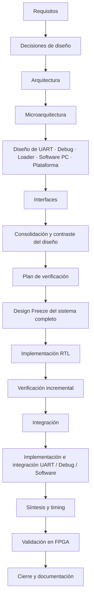

Cada fase tiene entregables concretos y una condición de salida. No se debe avanzar a la fase siguiente mientras la anterior tenga decisiones críticas sin resolver.

**Vigencia de hazards (2026-09-26):** `DEC-ARCH-003` está aprobada con 47 acuerdos. Las referencias de este plan a los acuerdos previos de confirmación, arbitraje, enables y verificación se interpretan con la revisión del acuerdo 47: IF solo detecta, todo fetch fault se confirma en ID, y el control selecciona ocho acciones (seis no terminales y dos de drenado). La matriz 46 queda revisada por el 47. Para los escenarios de fetch/load-use, los contratos de consulta son el [efecto del stall](architecture/control_and_hazards.md#efecto-del-stall) y la [secuencia del candidato](architecture/faults_and_termination.md#coincidencia-con-load-use); el [acuerdo 47](decisions.md#acuerdo-47-aprobado--confirmación-de-todo-fetch-fault-en-id-y-revisión-de-aud-001) conserva la aprobación y la matriz de regresión.

---

## 2. Principios de trabajo

### 2.1. Diseñar antes de implementar

Ningún bloque RTL debe escribirse antes de conocer:

- qué responsabilidad tiene;
- qué datos recibe;
- qué datos produce;
- en qué ciclo actúa;
- qué estado mantiene;
- qué requisitos satisface;
- cómo se verificará.

La implementación debe materializar una arquitectura previamente definida, no crearla de manera accidental.

#### Condición común para comenzar implementación

**Criterio de trabajo establecido — 2026-09-30:** completar el diseño del sistema entero antes de programar cualquier componente. Esto comprende CPU, Debug, UART, protocolo, Loader, preparación de sesión, software de PC y plataforma. Tener especificada una ALU u otro bloque independiente no habilita a implementarlo mientras el diseño global siga abierto.

**Criterio de alcance establecido — 2026-10-01:** Mantener el diseño proporcional al trabajo práctico. La PC y la FPGA se diseñan conjuntamente y se asume que el cliente cumple el protocolo. Conservar las comprobaciones, timeouts y recuperación básicos aprobados, sin agregar mecanismos ni pendientes por incumplimientos arbitrarios del emisor o casos extremos ajenos al uso previsto. Completar el diseño significa especificar el funcionamiento requerido para el TP, sin exigir robustez de un producto de propósito general.

Antes de escribir RTL, software, modelos ejecutables o testbenches deben estar definidos y revisados:

- los dos ADR de software abiertos y los entregables de verificación/oráculo y revisión final FPGA según [revisión FPGA](pending_decisions.md), respetando sus dependencias;
- el criterio de DMEM utilizada, contenido observable y mecanismo de captura coherente;
- los servicios UART, comandos, paquetes, respuestas, errores, timeouts y recuperación;
- la microarquitectura de Debug, recepción/carga y preparación: estados privados, eventos, secuencias, ownership y relación con la FSM global;
- la estrategia del assembler y validación de imagen, las capas de software, sus interfaces y los flujos de uso;
- la concordancia de puertos, parámetros, tipos, codificaciones, adaptaciones físicas y composición de tops con [Interfaces](interfaces.md) y [Composición](architecture/system_composition.md), ya concretadas documentalmente;
- la integración prevista de clock/reset, recursos y restricciones de plataforma;
- los casos de prueba, resultados esperados, assertions previstas y matriz requisito → diseño → prueba, documentados sin programar todavía los tests.

El hito **D0 — Design Freeze del sistema completo** registra ese cierre. Durante esta etapa se trabaja en especificaciones, tablas, diagramas, secuencias por ciclo y revisión documental. La implementación incremental comienza después de D0 y M6; no se adelantan bloques por considerar que sus contratos locales ya están cerrados.

El cierre significa que las decisiones y conexiones necesarias están especificadas. Simulación, inferencia, timing y FPGA se comprobarán en implementación. Si esa evidencia exige un cambio, se revisará explícitamente el diseño y sus documentos antes de continuar; no se resolverá una ambigüedad silenciosamente dentro del código.

---

### 2.2. Ninguna decisión arquitectónica debe quedar escondida dentro del código

Toda decisión importante debe estar documentada.

Ejemplos:

- política de `STOP`/`HALT`;
- política de flush;
- política de stalls;
- política de forwarding;
- estado que se limpia al reprogramar;
- significado de “memoria utilizada”;
- protocolo UART;
- frecuencia de operación;
- tamaño de memorias.

El código no debe ser la única fuente desde la cual pueda descubrirse una decisión importante.

---

### 2.3. Todo requisito debe poder verificarse

Cada requisito debe terminar asociado a uno o más tests.

La relación deseada es:

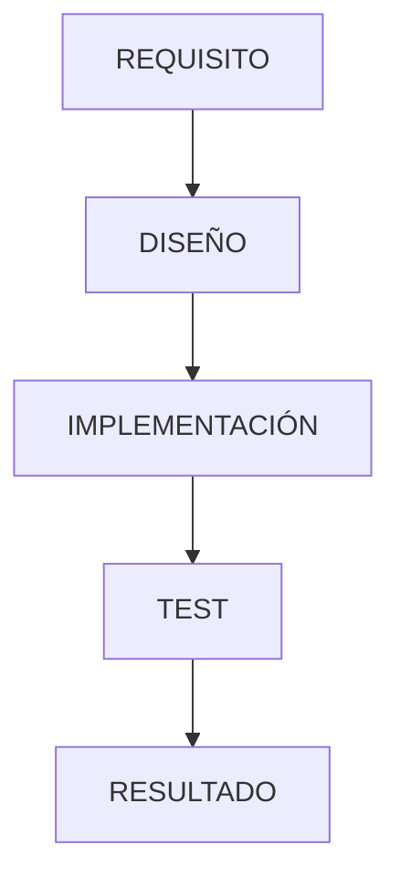

El proyecto debe poder responder objetivamente si cada requisito está:

- verificado;
- pendiente;
- fallando.

---

### 2.4. Integrar progresivamente

Nunca debe esperarse al final para conectar todos los módulos.

El trabajo sigue esta secuencia:

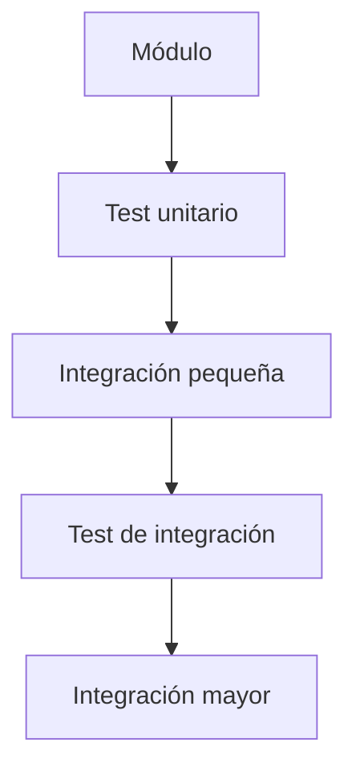

La integración progresiva reduce la cantidad de posibles causas cuando aparece un error.

---

### 2.5. La IA implementa especificaciones; no inventa la arquitectura

Los agentes de IA deben utilizarse como herramientas de implementación, revisión y generación de tests.

No deben recibir instrucciones vagas como:

> Implementar el procesador completo.

Deben recibir tareas acotadas y basadas en documentos ya aprobados.

---

## 3. Organización inicial del repositorio

Antes de diseñar el hardware debe definirse una estructura de proyecto consistente.

La organización documental vigente usa los archivos siguientes. `verification_plan.md` es un entregable futuro de FPGA-07; esta lista no acredita su existencia:

```text
/docs
    requirements.md
    decisions.md
    architecture/
        system_overview.md
        stage_id.md
        cpu_pipeline.md
        datapath.md
        control_and_hazards.md
        ...
    interfaces.md
    protocol.md
    verification_plan.md

/rtl
    ...

/tb
    ...

/software
    ...

/programs
    ...

/scripts
    ...

/constraints
    ...
```

### Entregables de esta fase

- repositorio creado;
- estructura de carpetas definida;
- convención de nombres acordada;
- estrategia de branches/commits definida;
- documento de requisitos incorporado.

<a id="gate-de-salida"></a>

### Condición de salida

No avanzar hasta que todos los integrantes sepan dónde se documentan requisitos, decisiones, diseño, tests y código.

---

## 4. Fase 1 — Congelamiento de requisitos

### Objetivo

Transformar la consigna en una lista de requisitos claros, numerados y verificables.

Cada requisito debe tener un identificador.

Ejemplo:

```text
REQ-CPU-002
El procesador debe implementar las etapas IF, ID, EX, MEM y WB.

REQ-EXEC-009
En modo paso a paso, cada comando STEP debe permitir avanzar exactamente un ciclo del procesador.

REQ-DBG-005
La Debug Unit debe transmitir los 32 registros con índice y valor.
```

### Clasificación recomendada

- `REQ-CPU-*` — procesador;
- `REQ-ISA-*` — instrucciones;
- `REQ-HAZ-*` — hazards;
- `REQ-MEM-*` — memorias;
- `REQ-DBG-*` — debug;
- `REQ-UART-*` — comunicación;
- `REQ-EXEC-*` — modos de ejecución;
- `REQ-SW-*` — software de PC;
- `REQ-TIM-*` — timing;
- `REQ-DOC-*` — documentación.

### Actividades

1. Recorrer la consigna completa.
2. Convertir cada obligación en un requisito independiente.
3. Eliminar ambigüedades de redacción.
4. Identificar decisiones abiertas.
5. Separar requisitos obligatorios de decisiones de implementación.

### Entregables

- `requirements.md`;
- matriz inicial de requisitos;
- listado de decisiones abiertas.

<a id="gate-de-salida-1"></a>

### Condición de salida

No avanzar si existe un requisito importante cuya interpretación todavía sea ambigua.

---

## 5. Fase 2 — Registro de decisiones abiertas

### Objetivo

Resolver las decisiones que la consigna deja al grupo antes de que estas aparezcan accidentalmente dentro del código.

Cada decisión debe registrarse con un identificador.

Ejemplo:

```text
DEC-001 — Política de reprogramación

Decisión:
...

Motivo:
...

Consecuencias:
...

Requisitos afectados:
...
```

### Decisiones que deben cerrarse tempranamente

- representación de `STOP`/`HALT`;
- criterio de finalización;
- política de vaciado del pipeline;
- comportamiento ante programa sin `STOP`;
- política de reprogramación;
- estado que se reinicia;
- capacidades parametrizables de las memorias y perfil de referencia;
- criterio de “memoria utilizada”;
- formato general del protocolo UART;
- información exacta que expondrá Debug;
- política general de reset.

<a id="entregable"></a>

### Entregables

- `decisions.md`.

<a id="gate-de-salida-2"></a>

### Condición de salida

Toda decisión que afecte a más de un módulo debe estar resuelta antes de diseñar esos módulos.

---

## 6. Fase 3 — Arquitectura global

### Objetivo

Definir los grandes subsistemas y sus responsabilidades sin entrar todavía en señales RTL.

El sistema debe visualizarse como tres subsistemas principales:

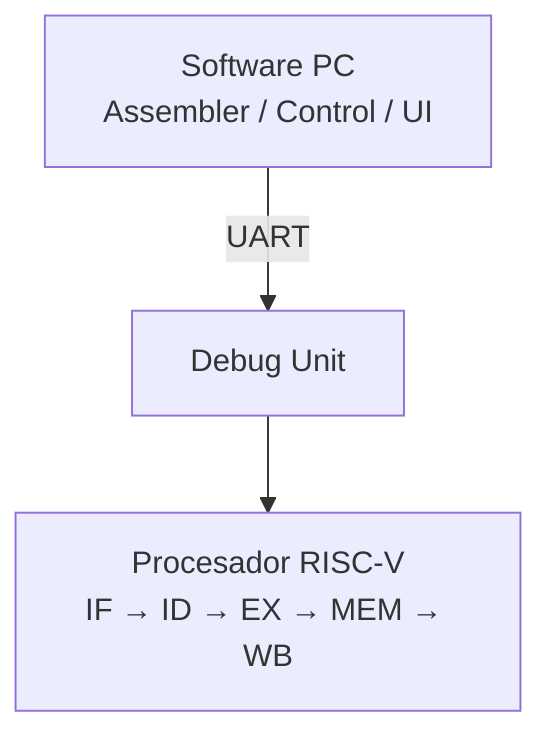

### Subsistemas principales

#### Procesador

Responsable de ejecutar instrucciones RISC-V.

#### Debug Unit

Responsable de:

- carga de programa;
- control de ejecución;
- recopilación de estado;
- comunicación con la UART.

#### Software de PC

Responsable de:

- traducir assembler;
- transmitir programas;
- enviar comandos;
- interpretar respuestas;
- mostrar el estado del procesador.

### Invariantes de direccionamiento acordadas

Revisar direccionamiento por bytes, mapa independiente, imagen y ownership contra [Arquitectura de memoria](architecture/memory_architecture.md). Los invariantes derivados y sus fuentes están en [I01–I25](architecture/architectural_invariants.md); no se define aquí otra política de memoria.

<a id="entregable-1"></a>

### Entregables

- [Visión general](architecture/system_overview.md) y [Composición](architecture/system_composition.md);
- diagrama general;
- descripción de responsabilidades.

<a id="gate-de-salida-3"></a>

### Condición de salida

Todos los integrantes deben poder explicar el sistema completo sin consultar código.

---

## 7. Fase 4 — Especificación del ISA soportado

### Objetivo

Definir formalmente el comportamiento de cada instrucción requerida.

Debe construirse una tabla única que actúe como referencia para `Control Unit`, datapath, tests y assembler.

La tabla vigente de patrones legales, usos de fuentes y controles está en [Decoder ID](architecture/stage_id.md#decoder). Contrastar las instrucciones de [Requisitos](requirements.md), los [caminos de datos](architecture/datapath.md) y la [política de ilegal/fault](architecture/faults_and_termination.md); aprobaciones DEC-SYS-010, DEC-ARCH-004 y DEC-ARCH-003.

Ejemplo:

| Instrucción | rs1 | rs2 | Inmediato | Operación | Memoria | rd | Cambio de flujo |
|---|---:|---:|---|---|---|---:|---|
| `add` | Sí | Sí | — | ADD | — | Sí | No |
| `addi` | Sí | No | I | ADD | — | Sí | No |
| `lw` | Sí | No | I | dirección | lectura word | Sí | No |
| `sw` | Sí | Sí | S | dirección | escritura word | No | No |
| `beq` | Sí | Sí | B | comparación | — | No | Condicional |
| `jal` | No | No | J | salto | — | Sí | Incondicional |

### Debe definirse para cada instrucción

- registros fuente;
- registro destino;
- tipo de inmediato;
- extensión de signo;
- operación ALU;
- acceso a memoria;
- tamaño de acceso;
- signed/unsigned;
- valor de Write Back;
- modificación del PC.

La tabla de ISA deberá permitir distinguir patrón legal de contenido dentro de la imagen confirmada y de validez de una entrada del pipeline. Una palabra puede pertenecer al prefijo cargado de IMEM y ser ilegal: **ID** detecta su codificación; un fetch fuera de ese prefijo es un candidato distinto detectado en **IF**, conforme a `DEC-ARCH-001` y el quinto acuerdo de `DEC-ARCH-004`. Un candidato de instrucción inválida descartado por un redirect más antiguo no se confirma arquitectónicamente por la mera coincidencia de bits, conforme a `DEC-ARCH-002`. La inspección preventiva opcional del loader no reemplaza la política aprobada de confirmación, drenado y llegada a `FAULT`; la integración vigente se consulta en [ID](architecture/stage_id.md), [Faults](architecture/faults_and_termination.md) y [Control](architecture/control_and_hazards.md).

Verificar la clasificación de las **33 instrucciones legales** con campos variables permitidos (destinos `x0`, operandos e inmediatos de frontera incluidos) y rechazar patrones cercanos no soportados: otros branches/operaciones estándar, bits fijos o combinaciones `funct3`/`funct7` ilegales, codificaciones reservadas, `0x00000000` y otras palabras `custom-0` que no sean exactamente `0x0000000B`. Contrastar tres casos:

- una palabra ilegal dentro del prefijo confirmado;
- un fetch fuera de imagen;
- una codificación candidata del camino joven `wrong-path`.

Verificar su **clasificación como candidato**. Cuando ambas instrucciones pertenezcan al camino correcto, comprobar la prioridad de la más antigua y el descarte del candidato joven ante un evento anterior prevaleciente. Aplicar las confirmaciones del cuadragésimo acuerdo, sin prescribir enables, flush o coincidencias globales aún no cubiertas.

Dentro de un mismo acceso, misalignment prevalece sobre access fault. Un fault confirmado sigue el drenado preciso y la atomicidad de `DEC-ARCH-004`.

<a id="entregable-2"></a>

### Entregables

- [Decoder/ISA ID](architecture/stage_id.md#decoder), vinculado a [Requisitos](requirements.md).

<a id="gate-de-salida-4"></a>

### Condición de salida

No debe existir ninguna instrucción requerida cuyo comportamiento interno siga siendo ambiguo; la tabla y sus casos de clasificación deberán distinguir las codificaciones de las 33 instrucciones legales del resto sin clasificar como legal una palabra cargada ilegal ni tratar los bits residuales de una entrada inválida como instrucción activa.

---

## 8. Fase 5 — Diseño del datapath base

### Objetivo

Determinar cómo viajan los datos por el procesador antes de introducir optimizaciones o resolución de hazards.

Debe diseñarse:

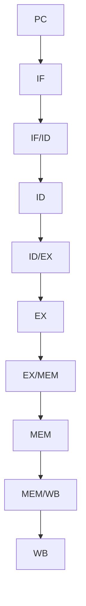

Como caso de análisis, si `I1` escribe `x5 = 10` en WB mientras `I2` más reciente producirá `x5 = 20` e `I4` lee `x5` en ID, el bypass puede capturar `10` como base de I4; al llegar I4 a EX, usa `20` si I2 es el productor pendiente más reciente con dato disponible. Si I2 aún no tiene su dato (por ejemplo, un load), I4 espera sin utilizar `10` como fallback. Si WB es el único productor relevante, el valor posbypass ya es el correcto y no se introduce stall adicional. El bypass WB→ID tampoco elimina el stall nominal de un `load-use` inmediato ni el reenvío posterior desde `MEM/WB`.

Consultar [Datapath](architecture/datapath.md), [RF ID](architecture/stage_id.md#register-file), [WB→ID](architecture/control_and_hazards.md#bypass-wb--id) y [writeback](architecture/stage_wb.md). La realización RF y sus prioridades están aprobadas por DEC-ARCH-007/008; esta fase analiza el recorrido, sin elegir otra temporización.

### Análisis obligatorio

Debe seguirse manualmente el recorrido de al menos:

- `add`;
- `addi`;
- `lw`;
- `sw`;
- `beq`;
- `jal`;
- `jalr`;
- `lui`.

Para cada una debe identificarse:

- dónde nace cada dato;
- en qué etapa se utiliza;
- hasta qué etapa debe conservarse;
- dónde termina.

Para `jal` y `jalr`, seguir además `instruction_PC + 4` desde `ID/EX.pc` hasta la escritura arquitectónica en WB, independiente del PC global de IF. El `Link Adder` lo calcula físicamente en EX, el `Result MUX` lo consolida en `EX/MEM.ex_result` y el `WB Value MUX` en MEM selecciona ese mismo resultado como `MEM/WB.wb_value`, sin campo registrado adicional `link_value`.

Verificar la interfaz 2R1W con dos índices fuente distintos leídos de manera independiente en ID y disponibles conjuntamente para los valores originales de `ID/EX`; contrastar cada dirección con su dato, inclusive cuando una instrucción solo usa una de las fuentes. Sin escritura concurrente al registro leído, variar cada índice de lectura y comprobar que su salida refleja el valor correspondiente **sin esperar flanco ni ciclo adicional**. En un ciclo efectivo `RUN` o `STEP` que capture una entrada válida en `ID/EX`, comprobar que `rs1_value` y `rs2_value` corresponden a esa instrucción y quedan disponibles como respaldo del forwarding; una bubble o flush no convierte bits residuales en operandos válidos. Durante `HOLD` las salidas pueden cambiar combinacionalmente, pero `ID/EX` y el pipeline permanecen estables sin writeback.

Comprobar que un productor válido en WB entrega su `rd` y `wb_value` al puerto de escritura y que una instrucción sin escritura válida, inválida o dirigida a `x0` no altera el banco; confirmar que EX y MEM no escriben arquitectónicamente el banco de registros. Para `x0` comprobar siempre lectura de cero sin prescribir su bloqueo o representación física. En `RUN` y `STEP`, comprobar que solo el flanco del ciclo efectivo escribe una vez como máximo desde los campos previos de `MEM/WB` cuando `valid`, `reg_write` y `rd != x0`; en `HOLD`, mantener `MEM/WB` válida durante varios clocks físicos sin cambio del banco ni repetición de writeback. Probar `valid=0`, `reg_write=0`, `rd=x0`, bits residuales, stores, branches, `halt`, entradas descartadas y causantes de fault sin escritura propia, conservando las escrituras anteriores supervivientes al fault.

Para la coincidencia WB→ID, comprobar por separado `rs1`, `rs2` y ambos a la vez (por ejemplo, WB escribe `x5 = 100` e ID lee `add x7, x5, x5`): cada puerto coincidente presenta `MEM/WB.wb_value` y ese valor base se captura en `ID/EX` si ingresa una instrucción válida. El puerto no coincidente conserva su lectura ordinaria; `rd=x0`, `valid=0`, `reg_write=0` o `HOLD` no seleccionan `wb_value` por coincidencia de bits y leer `x0` siempre da cero. Comparar el valor seleccionado desde los campos **previos al flanco** con la entrada que `MEM/WB` capturará en ese mismo ciclo, preservando la distinción. Exigir bypass combinacional explícito a cada lectura ID sin depender de la semántica física read-first/write-first/no-change; su frontera funcional con forwarding externo y hazards ya está acordada; el forwarding de `EX/MEM` y `MEM/WB` sigue el contrato independiente de `DEC-ARCH-003`, y el recurso físico elegido deberá satisfacer [RF ID](architecture/stage_id.md#register-file) y documentarse durante síntesis, conforme a DEC-ARCH-007.

En la verificación del bypass explícito, forzar en la prueba un valor **crudo** de RF distinto de `MEM/WB.wb_value` para el índice coincidente y comprobar que la salida combinacional elegida y la captura válida en `ID/EX` usan el valor nuevo de WB, tanto con un solo puerto coincidente como con ambos. Contrastar con puerto no coincidente, `rd=x0`, `rs1=x0`/`rs2=x0`, `MEM/WB.valid=0`, `reg_write=0` y `HOLD`: no hay selección espuria ni efectos de bits residuales; ambos puertos que leen `x0` entregan cero. Repetir con productores elegibles de distinto origen arquitectónico y comprobar que el dato base posbypass no anula la selección posterior del productor pendiente más reciente en EX. No imponer modo específico del recurso de almacenamiento; el contrato vigente de [writeback](architecture/stage_wb.md#condición-efectiva-de-writeback) fija `rf_write_fire` y su uso común como `wb_write_enable`, según el acuerdo 43.

Ejercitar la frontera funcional mediante esta secuencia de casos:

| Caso | Resultado esperado |
|---|---|
| Productor WB como único coincidente | Base posbypass correcta, sin espera adicional |
| Otro productor más reciente con dato disponible en `EX/MEM` o `MEM/WB`, según su avance | En EX, ese dato prevalece sobre la base |
| Load inmediato cuyo dato aún no está disponible en `EX/MEM` | Subsiste el stall nominal; después de avanzar, la consumidora utiliza `MEM/WB`, sin usar la base vieja ni añadir otro stall por el bypass |

Verificar ambos operandos de forma independiente y distinguir el `MEM/WB.wb_value` de WB→ID de la fuente `MEM/WB` de los muxes de EX; conservar validez, `rd != x0`, uso semántico de fuentes y la invariancia de `HOLD`. Las prioridades globales de reset y `LOAD` provienen de `DEC-ARCH-008`, sin definir aquí nuevas fases o enables RTL.

Verificar el contrato temporal del banco después de ensuciar varios registros y dejar una instrucción escritora en `MEM/WB`:

| Modo | Resultado esperado |
|---|---|
| `RUN` | Cada ciclo efectivo compromete a lo sumo el writeback elegible **preflanco** una vez |
| `STEP` | Una orden aceptada permite exactamente un ciclo y cero o una escritura; no hay otra hasta un nuevo `STEP` |
| `HOLD` | Varios clocks físicos con `MEM/WB` válida no cambian el RF |

Hacer coincidir reset funcional con un writeback candidato: prevalece el cero lógico de `x0…x31` y no se compromete la instrucción; al aceptar `LOAD` se inhiben commits CPU y la nueva sesión solo puede confirmarse tras restablecer el cero lógico del banco, quedando preparada pero detenida.

Durante `HALT_DRAIN` y `FAULT_DRAIN`, comprobar que anteriores válidas escriben exactamente al avanzar por los ciclos autorizados de `RUN` o `STEP`, sin escrituras de causantes/jóvenes descartadas ni duplicación en `HOLD`. El mecanismo físico de puesta a cero no es criterio de estas pruebas; `x0` siempre lee cero.

El octavo acuerdo de `DEC-ARCH-007` permite implementar el banco de registros con registros, RAM distribuida/LUT, BRAM u otro recurso equivalente, sujeto a su **interfaz y temporización observables**, no a la primitiva inferida. En evaluación de síntesis y timing, documentar el recurso elegido y comprobar:

- que ambas lecturas ID entregan el dato combinacionalmente, sin presentar la dirección y esperar un flanco ni insertar ciclos o etapas;
- que la escritura sigue siendo síncrona y única por ciclo efectivo elegible;
- que el bypass explícito entrega el nuevo valor para coincidencias WB→ID independientemente del modo físico `write-first`/`read-first`/`no-change`. Si el recurso no satisface directamente esas condiciones, emplear otro o lógica adicional que preserve el contrato, incluidos `x0`, `HOLD`, `RUN`/`STEP`, drenados y cero lógico tras reset/preparación. El noveno acuerdo fija la matriz mínima obligatoria de 23 casos y cierra `DEC-ARCH-007`; sus pruebas de forwarding y `load-use` son la frontera con `DEC-ARCH-003`, cuya implementación permanece pendiente.

Tomar la **matriz de 23 casos de `DEC-ARCH-007` en `decisions.md`** como criterio mínimo de aceptación del banco de registros. Cubrir:

- índices iguales y distintos, y ambas lecturas combinacionales;
- escrituras válidas e inhibidas y `x0`;
- cada coincidencia WB→ID;
- prioridad del productor más reciente, `load-use` y WB como único productor;
- `RUN`, `STEP` y `HOLD` con `MEM/WB` retenida durante varios clocks físicos;
- reset, nueva sesión y ambos drenados;
- equivalencia entre recursos físicos elegibles. La matriz documenta verificaciones exigidas; no presupone que ya se hayan ejecutado.

Para las instrucciones que calculan direcciones deberá identificarse además:

- la dirección arquitectónica expresada en bytes;
- el desplazamiento en bytes definido por el ISA;
- la conversión posterior a un índice físico, sin incorporarla a la semántica arquitectónica;
- el ancho del acceso cuando corresponda.

<a id="entregable-3"></a>

### Entregables

- [Datapath](architecture/datapath.md) y su vínculo con [Pipeline](architecture/cpu_pipeline.md);
- diagrama de datapath.

<a id="gate-de-salida-5"></a>

### Condición de salida

Cada dato necesario en una etapa posterior debe tener un camino explícito desde su origen.

---

## 9. Fase 6 — Diseño del control

### Objetivo

Determinar qué decisiones necesita tomar el procesador para cada instrucción.

Deben identificarse conceptos de control como:

- escritura de registros;
- lectura/escritura de memoria;
- tamaño de memoria;
- signed/unsigned;
- selección de operandos;
- operación de ALU;
- selección de Write Back;
- branch;
- jump;
- uso de inmediato.

Después debe determinarse en qué etapa se utiliza cada decisión.

Esto permite definir qué información de control debe atravesar:

```text
ID/EX
EX/MEM
MEM/WB
```

<a id="entregable-4"></a>

### Entregables

- tabla de control;
- vínculos de control en [Pipeline](architecture/cpu_pipeline.md) y [Control/hazards](architecture/control_and_hazards.md).

<a id="gate-de-salida-6"></a>

### Condición de salida

Cada instrucción debe tener completamente definido su comportamiento de control.

---

## 10. Fase 7 — Diseño de los registros del pipeline

### Objetivo

Definir con precisión qué información conserva cada registro interetapa.

Para cada registro interetapa debe especificarse:

```text
Nombre
Datos almacenados
Señales de control almacenadas
Validez observable
PC asociado
Instrucción asociada
Reset
Enable
Flush
Comportamiento ante stall
```

La representación observable de trabajo del pipeline se consulta en [Debug](architecture/debug_architecture.md). Los esquemas vigentes de [IF/ID](architecture/cpu_pipeline.md#registro-ifid), [ID/EX](architecture/cpu_pipeline.md#registro-idex), [EX/MEM](architecture/cpu_pipeline.md#registro-exmem) y [MEM/WB](architecture/cpu_pipeline.md#registro-memwb) fijan campos/anchos; [Control](architecture/control_and_hazards.md#efecto-de-cada-acción-sobre-el-pipeline) fija actualización y [Faults](architecture/faults_and_termination.md) confirma eventos. Revisar estos contratos en conjunto sin reconstruir el orden de los acuerdos de DEC-ARCH-003.

### Registros

- `IF/ID`;
- `ID/EX`;
- `EX/MEM`;
- `MEM/WB`.

### Regla

No agregar señales “por si acaso”.

Cada campo debe existir porque una etapa posterior lo necesita o porque forma parte del contrato de observabilidad aprobado por `DEC-SYS-006`.

<a id="entregable-5"></a>

### Entregables

- esquemas de registros interetapa en [Pipeline](architecture/cpu_pipeline.md).

<a id="gate-de-salida-7"></a>

### Condición de salida

Toda señal almacenada debe tener un consumidor claramente identificado.

---

## 11. Fase 8 — Diseño de forwarding y hazards

### Objetivo

Resolver dependencias en papel antes de escribir lógica RTL.

Las ecuaciones, prioridades, selectores y ocho acciones vigentes están en [Control y hazards](architecture/control_and_hazards.md). Usos de fuentes y controles se consultan en [ID](architecture/stage_id.md#decoder); operandos efectivos en [EX](architecture/stage_ex.md) y campos transportados en [Pipeline](architecture/cpu_pipeline.md). Aprobación/origen: DEC-ARCH-003 y sus revisiones.

Se deben estudiar secuencias representativas.

#### Dependencia ALU → ALU

```asm
add x1, x2, x3
sub x4, x1, x5
```

#### Load-use

```asm
lw  x1, 0(x2)
add x3, x1, x4
```

#### Dependencias con store

```asm
add x1, x2, x3
sw  x1, 0(x4)
```

Contrastar el uso de `rs1` para dirección con el de `rs2` para dato en secuencias `lw x5, 0(x1); sw x6, 0(x5)` y `lw x5, 0(x1); sw x5, 0(x6)`. En ambos casos inmediatos aislados deberá verse el stall `load-use` nominal; al retomar, el store resuelve en EX el valor requerido y transporta el dato efectivo por `EX/MEM` hasta la escritura en MEM. Verificar también productores ALU disponibles para base y dato de store sin forzar un stall innecesario ni un bypass adicional hacia MEM.

#### Dependencias asociadas a branch

```asm
add x1, x2, x3
beq x1, x0, label
```

Contrastar también productores consecutivos del mismo `rd` antes de un consumidor (vence `EX/MEM` sobre `MEM/WB`), dependencias separadas sobre `rs1` y `rs2`, escrituras a `x0`, entradas inválidas y operaciones sin escritura de registro. Ante un `load` más reciente en `EX/MEM` y un productor anterior del mismo `rd` en `MEM/WB`, el consumidor esperará el dato cargado en lugar de tomar el valor obsoleto. Comprobar el uso posterior de un valor elegible desde `MEM/WB`. Para un `load-use` inmediato aislado, verificar una sola bubble y un ciclo de stall; aplicar las prioridades de los acuerdos 40–47 ante causas concurrentes. Se emplearán los dos muxes aprobados con selectores y ecuaciones por fuente fijados en los acuerdos trigésimo cuarto y trigésimo noveno.

Verificar la tabla de fuentes con codificaciones cuyos bits en posiciones de `rs1` o `rs2` coincidan accidentalmente con el `rd` de un load anterior: `jal`, `lui` y `halt` no generan dependencias; las instrucciones I y los shifts inmediatos ignoran `rs2`. Comparar con dependencias reales de ambos operandos en instrucciones ALU registro-registro y branches. Para stores, comprobar que tanto la base `rs1` como el dato `rs2` son fuentes y que el dato se resuelve en EX, se transporta en `EX/MEM.store_data` y se consume en MEM, utilizando las codificaciones de selectores pactadas sin imponer ecuaciones RTL adicionales.

Ejercitar consumidores inmediatos de resultados R-type, I-type aritmética/shifts y `lui` con `rd != x0`, observando forwarding desde `EX/MEM` cuando el dato esté disponible. Para `jal`/`jalr`, comprobar que el enlace es obtenible desde `EX/MEM` y que una instrucción del flujo válido que dependa de él recibe el valor correcto cuando alcance EX, sin presuponer un consumidor inmediato en el camino secuencial descartado. Contrastar loads en `EX/MEM` que todavía no pueden reenviar su dato con el posterior uso del dato seleccionado para WB en `MEM/WB`. Comprobar desde `MEM/WB` valores de ALU, DMEM, LUI y enlace y rechazar productores inválidos, sin escritura o con `rd = x0`; si un load más reciente coincide mientras `MEM/WB` guarda un valor anterior del mismo registro, no consumir este último. Aplicar los códigos de selectores del trigésimo cuarto acuerdo con las prioridades de eventos concurrentes aprobadas en los acuerdos 40–47.

Probar selecciones independientes de `rs1` y `rs2`:

- Ambos desde `EX/MEM` en `add x5, x1, x2; sub x6, x5, x5`.
- Uno desde `EX/MEM` y el otro desde `MEM/WB`.
- Uno reenviado y el otro conservado desde `ID/EX`.

Contrastar además los siguientes casos de productores y fuentes:

| Caso | Resultado esperado |
|---|---|
| Dos productores sucesivos del mismo `rd` | Deben entregar el valor más reciente de `EX/MEM`. |
| Load más reciente aún no disponible | No podrá ser sustituido por el valor previo de `MEM/WB`. |
| `EX/MEM` inválido, sin escritura, con `rd=x0` o que escribe otro registro | No bloqueará un `MEM/WB` coincidente válido. |
| Sin productores pendientes aplicables | Se usa el valor original de `ID/EX`. |
| Fuente semánticamente no usada | No activa forwarding. |

Repetir con `beq`, `bne`, `jalr` y stores, respetando `forward_a_sel`/`forward_b_sel` ya fijados y sin bypass de dato de store en MEM.

Verificar que cada uno de los dos muxes 3:1 de 32 bits tiene como entradas solo el valor original de su propia fuente en `ID/EX`, el `ex_result` de `EX/MEM` y el único `wb_value` de `MEM/WB`. Ejercitar para cada fuente las tres elecciones y sus combinaciones independientes: ambos originales, ambos desde `EX/MEM`, ambos desde `MEM/WB`, etapas distintas y mezcla de original/reenviado.

Contrastar R-type, I-type aritmética/shifts, `lui` y enlaces de `jal`/`jalr` desde `EX/MEM` frente a loads solo desde `MEM/WB`.

Si `EX/MEM` contiene el productor más reciente pero es un load sin valor disponible, el consumidor no usará como operando válido ni la dirección efectiva, ni un `MEM/WB` anterior, ni el dato original: deberá esperar, aunque el mux presente bits combinacionales. Fuentes semánticamente no usadas, productores inválidos/no escritores y `rd=x0` no habilitarán forwarding.

Repetir con comparación de branches, dirección/dato de stores y destino de `jalr`, con nombres/codificación de selectores del trigésimo cuarto acuerdo y sin bypass adicional a MEM.

Verificar la `Forwarding Unit` para `rs1` y `rs2` por separado: comparar los índices de `ID/EX` con cada `rd` elegible, observar `reg_write`, validez y `rd != x0` en `EX/MEM` y `MEM/WB`, y derivar uso de fuentes y disponibilidad desde el estado ya presente sin ampliar registros interetapa.

Contrastar ambos productores del mismo registro (vence `EX/MEM` disponible), `EX/MEM` no productor con `MEM/WB` coincidente y ninguno con original de `ID/EX`; repetir con fuentes desde etapas distintas y con `jal`/`lui` o instrucciones I que no usan una fuente.

Frente al load más reciente en `EX/MEM`, comprobar que el consumidor retenido no toma como válido el dato anterior o la dirección, aunque el mux presente bits durante la espera; tras el avance del load a `MEM/WB`, comprobar que se usa el `wb_value` correcto.

Una instrucción inválida en `ID/EX` o productores inválidos/sin escritura/a `x0` no pueden originar forwarding funcional; repetir con ALU, base y dato de store, branches y `jalr`. Aplicar los bits de selectores pactados, sin hacer que esta unidad genere el stall del detector en ID.

Comprobar las **ecuaciones funcionales definitivas** por fuente de forma independiente:

| Condición | Resultado esperado |
|---|---|
| `EX/MEM` y `MEM/WB` coinciden en el mismo `rd` | `exmem_match_rsN=1` excluye `forward_memwb_rsN`, aun si `EX/MEM` es un load no disponible |
| `EX/MEM` coincidente disponible | Se selecciona exactamente `ex_result` de ALU, LUI o enlace `jal`/`jalr` |
| Sin coincidencia `EX/MEM` y con coincidencia `MEM/WB` | Se selecciona exactamente `wb_value` |
| Sin productor elegible | Se usa el valor base posbypass de `ID/EX` |

Repetir para `rs1` y `rs2` con productores de etapas diferentes, una fuente no usada, registros `x0`, consumidores/productores inválidos o no escritores y una escritura WB→ID que capturó un valor base desplazado después por un productor más reciente.

Si `EX/MEM` coincide sin dato disponible, las dos habilitaciones son cero: ningún valor residual del mux ni un `MEM/WB` obsoleto se **consume** arquitectónicamente; el stall previo retiene a la consumidora hasta que pueda recibir el load desde `MEM/WB`. Usar `forward_a_sel[1:0]`/`forward_b_sel[1:0]` según sus códigos aprobados, sin exigir cuarta entrada, campo de disponibilidad ni bypass DMEM→EX.

Para el **RTL combinacional del trigésimo noveno acuerdo**, contrastar `ifid_rs1=IF/ID.instruction[19:15]`, `ifid_rs2=IF/ID.instruction[24:20]`, `ifid_uses_rs1/rs2` del decoder e `idex_is_load=is_load(ID/EX.mem_op)` con la condición booleana exacta del detector. `IF/ID.valid=0, fetch_fault_valid=1` no cuenta como consumidor aunque los índices residuales coincidan.

Por fuente, comprobar las cuatro coincidencias `exmem_match_rs1/rs2` y `memwb_match_rs1/rs2` con productor/consumidor válidos, uso real, escritura, `rd!=5'd0` y `rd==ID/EX.rsN`, volviendo a derivar `idex_uses_rs1/rs2` de `ID/EX.instruction` sin registrar esos bits.

Ejercitar de manera independiente ambos selectores: `01` para `EX/MEM` coincidente disponible, `10` solo si `EX/MEM` no coincide y `MEM/WB` sí, `00` si ninguna habilitación es verdadera, nunca `11` funcionalmente; cotejar sus tres entradas con los valores efectivos de cada mux.

Para `EX/MEM` load coincidente y `MEM/WB` anterior coincidente, `forward_a_sel` o `forward_b_sel` **puede ser físicamente `00`** porque ambas habilitaciones son cero, pero esa salida base no se consume. Negar `exmem_match_rsN` —no `forward_exmem_rsN`— al evaluar `MEM/WB`; contrastar fuente no usada, `x0`, entrada inválida, store con dato `rs2`, bubble y `HOLD` sin transición. Mantener el control de aplicación del stall separado de la detección combinacional.

Verificar la condición de `load-use` por grupos de casos:

- **Resultado verdadero:** coincidencia real de `rs1`, de `rs2` y de ambos frente a un load válido en `ID/EX` y consumidor válido en `IF/ID`.
- **Resultado falso:** negar por separado cada término habilitante: productor inválido, productor no load, `rd=x0`, consumidor inválido, fuente no usada pese a coincidencia numérica, o fuentes usadas sin coincidencia.
- **Instrucciones de contraste:** usar instrucciones I y shifts inmediatos para falsos `rs2`, `jal`/`lui`/`halt` sin fuentes, y stores, `beq`/`bne` y `jalr` para dependencias verdaderas.

Comprobar los efectos en `RUN` y `STEP`:

| Resultado de la condición | Efecto esperado |
|---|---|
| Caso verdadero aislado | Único ciclo nominal de stall con PC/`IF/ID` retenidos, bubble en `ID/EX` y avance del load y de instrucciones anteriores, seguido de forwarding desde `MEM/WB`. |
| Caso falso | No introduce ese stall. |

No exigir un redirect simultáneo del mismo `ID/EX` ni una implementación específica de las compuertas internas del detector.

Con un candidato IF concurrente, verificar que el stall nominal no lo capture ni confirme, según la [coincidencia con load-use](architecture/faults_and_termination.md#coincidencia-con-load-use).

Una evaluación combinacional durante `HOLD` no aplica stall, forwarding ni cambios de pipeline; `RUN`/`STEP` y la frontera seleccionada gobiernan los efectos. Verificar la misma ecuación sin añadir índices ni usos como campos de `IF/ID` o `ID/EX`.

Contrastar la salida combinacional del bloque de detección en ID con la ecuación aprobada para las combinaciones anteriores: índices/usos derivados de `IF/ID`, validez y destino de `ID/EX`, y clasificación load sin imponer un subcampo de `control`. Ante `load_use_stall=1` durante `HOLD`, verificar que ni PC, ni `IF/ID`, ni `ID/EX`, ni los registros interetapa posteriores cambian por esa evaluación; con el siguiente ciclo efectivo autorizado, comprobar la retención de PC e `IF/ID`, bubble en `ID/EX` y progreso de `EX/MEM` y `MEM/WB`, incluso al consumir un `STEP`. Las condiciones falsas no aplican este patrón y un candidato invalidado no puede producir efectos; la integración RTL con otros eventos y faults queda para `DEC-ARCH-003`, preservando `DEC-ARCH-004`.

Verificar las decisiones nominales del `Pipeline Hazard Control` y las ocho acciones del cuadragésimo primer acuerdo revisado por el 47. Usar los enables y valores `next` exactos fijados después en el cuadragésimo segundo acuerdo:

| Condición | Resultado esperado |
|---|---|
| Redirect válido | Seleccionar target, habilitar PC e invalidar `IF/ID` e `ID/EX` |
| Sin redirect, con `load_use_stall` aplicable | Inhibir escrituras de PC e `IF/ID` e insertar bubble en `ID/EX` |
| Sin ambas condiciones | PC elige `pc_plus_4`; los registros interetapa capturan sus entradas anteriores respetando `valid` |

Tanto en `RUN` como en `STEP`, comprobar que `EX/MEM` captura la instrucción de control ante redirect o el load ante stall, y `MEM/WB` la entrada anterior de `EX/MEM`, sin pérdida de instrucciones ni duplicación de compromisos.

Contrastar un branch no tomado con stall independiente y una retención causada solo por trabajo `wrong-path` descartado con redirect más antiguo: en este último caso ni PC ni registros interetapa jóvenes quedan retenidos como válidos.

Durante `HOLD` los resultados combinacionales pueden variar, pero PC, registros interetapa y contador permanecen estables; no exigir colisión directa imposible del load-use clásico con redirect de la misma entrada y contrastar las fronteras fault/`halt`/redirect y stalls según el cuadragésimo primer acuerdo, aplicando también las coincidencias cerradas por los acuerdos 44–47.

Para `lb`/`lbu`, `lh`/`lhu` y `lw` válidos, comprobar en MEM selección de lanes little-endian, ensamblado y extensión signed/unsigned **antes de `MEM/WB`**, y que el valor capturado coincide bit a bit con el escrito en WB y el reenviado desde `MEM/WB`. Repetir con resultados ALU, LUI y enlace `instruction_PC + 4` transportados desde `EX/MEM`. En stores, branches, `halt`, entradas inválidas o destinos `rd=x0`, verificar que bits residuales del dato seleccionado no causan escrituras ni forwarding. Un load que requiere stall no reenvía desde `EX/MEM` ni por bypass DMEM→EX; las condiciones semánticas de confirmación y antigüedad de `DEC-ARCH-004` dejan el instante físico para integración en `DEC-ARCH-003`, pero sí fijan respuesta precisa, invalidez selectiva y cero efectos de la causante.

Comprobar que `MEM/WB` registra exactamente `valid`, `pc[31:0]`, `instruction[31:0]`, `rd[4:0]`, `reg_write` y `wb_value[31:0]` y que PC e instrucción acompañan a su valor bajo avance normal, `load-use stall` y redirect de una instrucción más joven. Con `valid=0`, `reg_write=0` o `rd=x0`, inyectar datos residuales en `wb_value` y comprobar que ni WB ni forwarding los usan; con un productor válido escritor y fuente coincidente, verificar que ambos leen el mismo campo. Confirmar que `ex_result`, `load_value`, `store_data`, `immediate`, operandos fuente y `mem_op` no requieren campos separados en `MEM/WB`. Enables e integración con flush/faults siguen el acuerdo 47; la representación serializada de Debug está aprobada en `protocol.md`.

Verificar por ciclo efectivo que `MEM/WB.next.valid`, `pc`, `instruction`, `rd` y `reg_write` coinciden con la entrada **anterior al flanco** de `EX/MEM` y que `MEM/WB.next.wb_value` coincide con el valor ya seleccionado en MEM para esa instrucción, no con un resultado de la instrucción nueva de `EX/MEM`. Repetir con load ensamblado/extendido y con resultado de EX, incluido el enlace de `jal`/`jalr`; usar exactamente ese dato para WB y forwarding cuando haya un productor elegible. Ante `load-use` y redirect, comprobar que `MEM/WB` recibe la instrucción más antigua sin retención o flush específicos, mientras `EX/MEM` recibe respectivamente al load o a la instrucción de control. Con `EX/MEM` inválida, comprobar propagación `MEM/WB.valid=0` sin atribuirla a un flush y ausencia de escrituras o forwarding aunque los demás bits sean residuales. Repetir en `RUN` y `STEP`, contrastar estabilidad total durante `HOLD` y preservar reset/`LOAD` y faults para sus políticas respectivas.

Comprobar que `EX/MEM` registra exactamente `valid`, `pc[31:0]`, `instruction[31:0]`, `rd[4:0]`, `reg_write`, `mem_op`, `ex_result[31:0]` y `store_data[31:0]`; verificar PC e instrucción asociados bajo avance, `load-use stall` y redirect (la instrucción de control antigua sigue válida y el trabajo joven descartado no causa efectos).

Ejercitar `ex_result` como valor de ALU, LUI y enlace reenviable, y como dirección efectiva de `lb`/`lbu`/`lh`/`lhu`/`lw` y `sb`/`sh`/`sw`; en MEM, interpretar `mem_op[3:0]` para tipo, ancho y extensión con los bits pactados.

Para stores dependientes, incluidos `load → store-data`, comprobar que `store_data` lleva `rs2` resuelto por forwarding en EX y se consume en MEM, sin bypass especial.

Con `EX/MEM` inválido o `reg_write=0`/`rd=x0` rechazar forwarding aun si `ex_result` contiene bits residuales; un store válido no escribe `rd` pero sí puede escribir DMEM, mientras uno inválido no escribe DMEM aunque `mem_op` y `store_data` conserven bits.

Confirmar que operandos, inmediato, `link_value` y `alu_result` no necesitan campos separados. La frontera y prioridades arquitectónicas de faults se verificarán conforme a `DEC-ARCH-004`; el cuadragésimo tercer acuerdo de `DEC-ARCH-003` fija después `dmem_store_fire` y `dmem_metadata_write_fire` para ese efecto.

Comprobar por clase la selección combinacional de las **tres entradas** del `Result MUX`:

| Clase | Resultado esperado |
|---|---|
| R-type e I-type aritmética/shifts | `ex_result = alu_result` arquitectónico |
| Loads y stores | `ex_result = alu_result` como dirección efectiva; el load no reenvía su dirección como dato |
| `lui` | `ex_result = immediate` ya representado arquitectónicamente |
| `jal`/`jalr` | `ex_result = link_value = ID/EX.pc + 4`, aunque el PC global de IF difiera |

Tras el ciclo efectivo, comparar `EX/MEM.ex_result` con lo seleccionado **antes** del flanco, sin registrar las entradas por separado. Comprobar que `beq`, `bne`, `halt`, entradas inválidas y cualquier otra instrucción sin escritura de `rd` no reenvían ni escriben registros por bits residuales, manteniendo el acceso de un store válido a MEM y el redirect de un salto válido.

Repetir la captura en `RUN` y `STEP`; durante `HOLD`, permitir variaciones combinacionales sin cambiar `EX/MEM` ni provocar escrituras. Usar `result_sel[1:0]` y sus códigos pactados, con las reglas de faults y prioridades aprobadas.

Verificar la captura física de `EX/MEM` por ciclo efectivo comparando los ocho campos con la entrada **anterior al flanco** de `ID/EX` y la salida de EX: `valid`, `pc`, `instruction`, `rd`, control `reg_write`/`mem_op`, resultado `ex_result` y `rs2_effective` en `store_data`. En `load-use`, `EX/MEM` debe recibir al load válido aunque `ID/EX` capture simultáneamente una bubble; el dato cargado llega luego a `MEM/WB` para forwarding, sin usar la dirección efectiva como dato. Ante redirect, `EX/MEM` recibe válida la instrucción de control, incluido su enlace para `jal`/`jalr` cuando corresponda, aunque la nueva `ID/EX` e `IF/ID` queden inválidas. En avance normal una `ID/EX` previamente inválida produce `EX/MEM` inválida aun si los campos restantes presentan residuos. Repetir en `RUN` y `STEP` y comprobar estabilidad completa de `EX/MEM` durante `HOLD`; no exigir enables particulares ni generalizar el comportamiento a faults u otros eventos.

Comprobar que `ID/EX` captura conjuntamente desde ID `valid`, PC e instrucción asociados, índices `rs1`/`rs2`/`rd`, valores originales `rs1_value`/`rs2_value`, inmediato extendido y el conjunto semántico `control` bajo avance normal, sin reactivar una entrada inválida.

Ejercitar fuentes usadas y campos con bits coincidentes que no se usan, selección independiente de originales/`EX/MEM`/`MEM/WB` y rechazo de un valor antiguo ante un load más reciente sin dato disponible; contrastar ambas fuentes de ALU registro-registro, stores y branches, y solo `rs1` en `jalr` e instrucciones I. Verificar el PC propio para destinos relativos y enlace `PC + 4`, el inmediato para instrucciones pertinentes y el avance de `rd` a `EX/MEM`.

Durante `load-use stall` y redirect, verificar `ID/EX.valid_next=0` como bubble o flush de la nueva entrada: respectivamente avanza el load o la instrucción de control válida a `EX/MEM`, sin pérdida del consumidor retenido en `IF/ID` ni efectos de bits residuales.

No imponer NOP, limpieza de datos, bus `control` empaquetado, mecanismo físico de coincidencias lectura/escritura del banco ni mecanismos distintos de las ecuaciones de invalidación y arbitraje de los acuerdos 40–47: códigos, decoder y control ya están fijados.

Verificar el **decoder del trigésimo séptimo acuerdo** sobre la whitelist de 33 instrucciones: ejercitar los diez pares `funct7/funct3` R-type y rechazar variantes cercanas, especialmente ADD/SUB y SRL/SRA con el bit fijo cambiado; las seis I aritméticas conservan sus inmediatos variables y las tres I shifts exigen los siete bits fijos exactos de SLLI/SRLI/SRAI, admitiendo todo `shamt[4:0]`.

Probar los cinco `funct3` de loads, los tres de stores, los dos de branches, `jal`, `lui`, `jalr` solo con `funct3=000` y `halt` solo si la palabra completa es `32'h0000000B`; rechazar los `funct3` no soportados, otros custom-0, `0x00000000` y otros opcodes.

Variar registros, destinos `x0` e inmediatos permitidos en familias legales sin falsos rechazos.

Comparar `decode_legal`, las seis categorías de control y `uses_rs1`/`uses_rs2` con las tablas exactas, incluidos `alu_op=ADD, alu_src=1 (IMMEDIATE)` para `jal`/`lui` y `alu_op=ADD, alu_src=0 (RS2)` para `halt`, deterministas y sin consumo funcional de la ALU en esas tres clases, y el dato `rs2` de store reenviado en EX aunque `alu_src=1`.

Para ilegal, exigir defaults `decode_legal=0`, `alu_op=ADD`, `alu_src=0`, `result_sel=00`, `flow_op=000`, `mem_op=0000`, `reg_write=0` y ambas fuentes no usadas; si se confirma su fault ID, no ingresa válida a `ID/EX`.

Probar `illegal_candidate=IF/ID.valid && !decode_legal` frente a `halt_candidate=IF/ID.valid && decode_legal && (instruction==32'h0000000B)` con `IF/ID` válida, inválida, residuo de palabra ilegal y `fetch_fault_valid=1`: nunca tratar un fetch candidato como instrucción ilegal ni confirmar `halt` por match parcial. Un redirect EX anterior descarta la ilegal joven detectada, y `HOLD` no confirma nada por combinaciones residuales. Estas salidas son combinacionales, no nuevos campos de pipeline.

Verificar las **ecuaciones locales del trigésimo octavo acuerdo** con los nueve `mem_op` funcionales: NONE no activa `is_load`, `is_store` ni `mem_access`; LB/LH/LW/LBU/LHU activan solo `is_load`, SB/SH/SW solo `is_store`, y `mem_access` es la disyunción.

Contrastar `access_size[1:0]`: `00` LB/LBU/SB, `01` LH/LHU/SH, `10` LW/SW, nunca `11` para un acceso válido; con NONE, códigos reservados o `mem_access=0` no exigir tamaño funcional.

LB/LH/LW se extienden como signed y LBU/LHU como unsigned según `load_unsigned`; en stores o entrada sin load no exigir que este valor sea consumido.

En `ID/EX` `is_load` identifica al productor del stall; en `EX/MEM` `exmem_result_available = !is_load(EX/MEM.mem_op)` es falso para cada load.

Probar por fuente una coincidencia con load reciente en `EX/MEM` y un productor antiguo del mismo `rd` en `MEM/WB`: `forward_exmem_rsN=0` y `forward_memwb_rsN=0` por negar **`exmem_match_rsN`**, sin consumir dirección `EX/MEM`, dato `MEM/WB` ni base `ID/EX` obsoletos. Para `EX/MEM` inválida o no escritora, `!is_load` puede ser uno pero la coincidencia cualificada es falsa y no hay forwarding espurio.

Recorrer `flow_op=NONE/BEQ/BNE/JAL/JALR/HALT` y comprobar que solo el predicado local correspondiente se activa; `target_sel=is_jalr` selecciona `JALR_TARGET` solo para JALR y `PC_RELATIVE` para BEQ/BNE/JAL, sin efecto de target para NONE/`HALT` o entrada inválida. Probar `wb_value_sel=is_load(EX/MEM.mem_op)` para los cinco loads frente al resto y asegurar que su salida no compromete writeback si falta `EX/MEM.valid`/`reg_write` o hay fault propio; `result_sel=00/01/10` selecciona ALU/IMMEDIATE/LINK y `11` no se genera para instrucción válida. Estos controles no añaden campos a los registros interetapa ni autorizan ciclos por sí solos; mantener la prioridad por antigüedad y la integración funcional auditada después en el acuerdo 45.

Verificar la codificación del **trigésimo cuarto acuerdo** para instrucciones válidas y cada selector: las diez operaciones ALU con los opcodes de seis bits pactados y datos de 32 bits, incluidas SLL, SLT y SLTU aún ausentes en la ALU previa; un decoder válido nunca emite NOR aunque siga implementado en la ALU.

Comprobar `alu_src` registro/inmediato, tres entradas `result_sel` (descartando `11`), seis clases `flow_op` (sin emitir `110`/`111`) y nueve valores `mem_op` (sin emitir `1001`–`1111`) y su preservación de `ID/EX` a `EX/MEM`.

Verificar `reg_write` en clases escritoras/no escritoras, su avance a `MEM/WB` y su subordinación a `valid`/fault/ciclo efectivo.

Para ambos operandos, ejercitar `forward_a_sel` y `forward_b_sel` en `00`, `01` y `10` de forma independiente, sin emitir `11` para una selección funcional válida; cuando `EX/MEM` coincide pero su load no tiene dato, el mux puede presentar bits residuales que **no se consumen**.

En EX, `target_sel = (flow_op == JALR)` debe seleccionar JALR solo para esa clase; en MEM, `wb_value_sel = is_load(EX/MEM.mem_op)` debe elegir `LOAD_VALUE` para loads válidos elegibles; con una entrada inválida el selector puede presentar bits residuales que no se consumen.

Contrastar `next_pc_sel` y `pc_write_enable`: normal (0,1), redirect (1,1) y stall/`halt`/fault/drenado (selector indiferente, enable=0); `HOLD` no captura.

Asegurar que estos selectores son locales, sin campos de pipeline añadidos, y que un código residual/RESERVED en entrada inválida no produce efectos. No derivar de estas tablas una política de tratamiento RTL de codificaciones reservadas en una entrada que ya fue invalidada.

Verificar la **reducción semántica del control** por familias de instrucciones en ciclos efectivos: ID distingue operaciones ALU y selecciona `alu_src` registro/inmediato, ADD para dirección de loads/stores y SUB con `ALU.zero` para `beq`/`bne`; `result_sel` lleva a `EX/MEM.ex_result` respectivamente ALU (resultado o dirección), inmediato de `lui` o enlace `ID/EX.pc + 4` de `jal`/`jalr`.

`flow_op` identifica NONE, BEQ, BNE, JAL, JALR y `HALT` sin confirmar en ID el `halt` candidato: solo EX válido confirma o redirige según corresponda, con `Target MUX` ya aprobado y fault propio prevaleciente.

Comprobar los nueve casos de `mem_op` (NONE, cinco loads y tres stores): `EX/MEM` conserva tipo, ancho y signed/unsigned necesarios para MEM y permite derivar `is_load`/disponibilidad sin bit extra; `reg_write` continúa por `EX/MEM` y `MEM/WB` para escritores, nunca habilita escritura por sí solo si `valid=0` o la causante se invalida.

Confirmar que `alu_op`, `alu_src`, `result_sel` y `flow_op` no se transportan operativamente a `EX/MEM`, y `mem_op` no llega a `MEM/WB`; contrastar bubble/flush y residuos de control con entradas válidas sin exigir NOP ni bus único.

Repetir en `RUN`/`STEP` y `HOLD` y aceptar representaciones RTL equivalentes, sin imponer un bus empaquetado ni modificar las ecuaciones de enables/flush ya fijadas para las ocho acciones; el cuadragésimo quinto acuerdo audita después las coincidencias y deja el empaquetado como detalle RTL.

Verificar que la escritura habilitada de `IF/ID` captura juntos sus cinco campos físicos revisados (`valid`, `pc[31:0]`, `instruction[31:0]`, `fetch_fault_valid`, `fetch_fault_cause[2:0]`) y que solo con instrucción válida ID deriva de la palabra registrada los índices fuente/destino, el inmediato y `uses_rs1`/`uses_rs2` conforme a 3A, sin más campos en `IF/ID`.

Con un `load-use stall` aislado en `RUN` y `STEP`, comprobar que la escritura inhibida conserva los cinco campos bit a bit, no admite el fetch siguiente, y el consumidor avanza más tarde a `ID/EX` con el mismo PC e instrucción; los bits de campos semánticamente no usados no provocan stalls falsos.

Ante redirect válido, comprobar que `valid_next=0` y `fetch_fault_valid_next=0` dejan `IF/ID` sin instrucción ni candidato joven aunque `pc`, `instruction` y `fetch_fault_cause` conserven residuos, que estos no activen decode/hazard/control y que el fetch del target solo se capture válidamente en un ciclo efectivo posterior. Una retención causada únicamente por trabajo joven `wrong-path` no conserva válida la entrada frente al redirect.

Durante `HOLD` las señales combinacionales no producirán captura o invalidación. Aplicar las ecuaciones de enable/flush del acuerdo 47, sin confirmación anticipada de fetch en IF.

Comparar físicamente los dos resultados nominales: en el stall efectivo, PC conserva exactamente su valor e `IF/ID` conserva `valid`, `pc` e `instruction`, mientras `ID/EX` **cambia** a `valid=0` y `EX/MEM`/`MEM/WB` avanzan; en el redirect efectivo, PC cambia al target, `IF/ID` e `ID/EX` se invalidan y `EX/MEM`/`MEM/WB` avanzan con sus instrucciones correspondientes. Inyectar bits residuales no nulos en las entradas que quedan inválidas y comprobar que no se decodifican como activas, no comprometen resultados ni generan un fault; no exigir borrado ni NOP física. En un `STEP` con stall o redirect comprobar un único ciclo efectivo, y durante `HOLD` ninguna evaluación combinacional aplicará retención selectiva, bubble o flush como transición. Contrastar una petición de retención atribuible exclusivamente a trabajo joven `wrong-path` con redirect más antiguo válido: se descarta ese trabajo y se captura el target sin conservarlo como válido, sin generalizar la prioridad a otros stalls o faults.

Comprobar específicamente en `RUN` y `STEP` que `ID/EX.valid_next=0` invalida la **nueva** entrada en ambos casos nominales, sin retener en `ID/EX` al load ni invalidar en `EX/MEM` a la instrucción de control que redirige. Usar residuos no triviales en los demás elementos de `ID/EX`, incluidas las categorías de control e impedir cualquier ejecución, escritura, forwarding o fault arquitectónico causado por esa entrada inválida. Durante `HOLD` las condiciones combinacionales pueden cambiar, pero no se captura una entrada ni se modifica `valid`. No exigir una prioridad adicional entre un `load-use` clásico y un redirect de la misma entrada `ID/EX`, que no pueden coexistir; otras coincidencias requieren integración RTL en `DEC-ARCH-003` conforme a `DEC-ARCH-004`.

### Para cada caso debe determinarse

- cuándo se produce el dato;
- cuándo se necesita;
- si puede resolverse mediante forwarding;
- si requiere stall;
- qué etapa debe detenerse;
- qué registro interetapa debe conservarse;
- si es necesario insertar una bubble;
- si existe un candidato de fault y qué condición puede descartarlo;
- cómo se suprimen los efectos de una operación causante y de las posteriores;
- cómo progresan simultáneamente IF y MEM sin stalls atribuibles a la lectura combinacional de las memorias.

### Resultado conceptual

Cada dependencia debe clasificarse como:

```text
sin acción
forward
stall
flush
combinación de las anteriores
```

<a id="entregable-6"></a>

### Entregables

- [Control y hazards](architecture/control_and_hazards.md);
- diagramas ciclo por ciclo de casos representativos.

<a id="gate-de-salida-8"></a>

### Condición de salida

Los acuerdos trigésimo segundo, trigésimo cuarto, trigésimo séptimo, trigésimo octavo y trigésimo noveno cierran la especificación combinacional de los dos bloques de hazards de datos y los dos muxes de forwarding. Su implementación deberá conservar las ecuaciones y los casos verificables; el cuadragésimo primer acuerdo fija después la aplicación del stall y el arbitraje combinacional de acciones mediante `Pipeline Hazard Control`. Los acuerdos 42, 44 y 45 fijan después, respectivamente, enables/flush, autorización de ciclo y auditoría de coincidencias; la matriz final del acuerdo 46 está aprobada y revisada por el 47; resta ejecutar la verificación RTL.

---

## 12. Fase 9 — Diseño de branches, jumps y flush

### Objetivo

Analizar branches, jumps, descarte y prioridades antes de implementar. Consultar destinos/enlace en [EX](architecture/stage_ex.md#camino-de-control-de-flujo) y [Datapath](architecture/datapath.md), confirmación precisa en [Faults](architecture/faults_and_termination.md) y aplicación sobre PC/registros interetapa en [Control](architecture/control_and_hazards.md#efecto-de-cada-acción-sobre-el-pipeline). Aprobación/origen: DEC-ARCH-002/003/004; autorización del ciclo en [Ejecución](architecture/execution_control.md).

### Casos obligatorios

- `beq` tomado;
- `beq` no tomado;
- `bne` tomado;
- `bne` no tomado;
- `jal`;
- `jalr`.

Comprobar para todos los casos que solo una instrucción de control válida en EX puede decidir el cambio de flujo.

Ejercitar los siguientes estímulos:

- operandos iguales y distintos de 32 bits para `beq`/`bne`;
- desplazamientos RV32I positivos y negativos con el PC de la instrucción retenido hasta EX;
- dependencias que exijan operandos recientes;
- saltos incondicionales;
- borrado del bit 0 de `jalr`.

Verificar los destinos, su **clasificación por alineación** y que uno desalineado no aplica redirect. Usar `target_misaligned_candidate` y `redirect_apply`, fijados después en el cuadragésimo acuerdo, sin imponer ecuaciones globales de enable/flush.

Comprobar que el branch no tomado conserva el camino secuencial, que una entrada inválida en EX no redirige y que la selección del próximo PC solo se aplica en un ciclo habilitado en los casos nominales sin candidato de fault, sin avance durante `HOLD` ni duplicación por flancos físicos posteriores a un `STEP`.

Ante un candidato de fetch joven, comprobar que el redirect EX aplicable lo descarte, según la [prioridad por antigüedad](architecture/faults_and_termination.md#confirmación-y-prioridad-según-el-orden-del-programa).

Clasificar por separado destinos de control alineados y desalineados en EX: `beq`/`bne` con `ID/EX.pc + immediate_B` que termina en `00` o `10`, tanto con branch tomado como **no tomado**; la variante no tomada nunca produce candidato por la alineación de un target que no usa.

Para `jal`, usar inmediatos J con ambos resultados; para `jalr`, reenviar `rs1_effective` cuando corresponda y ejercitar `jalr_sum[1:0] = 00`, `01`, `10` y `11`: tras `& 0xFFFFFFFE`, `00`/`01` producen target alineado y `10`/`11` candidato `instruction-address-misaligned` por `target[1]`.

Repetir con `ID/EX.valid=0` y bits residuales de control sin confirmar un fault, y con candidato joven `wrong-path` descartado por una instrucción anterior.

No imponer una modificación de la ecuación **nominal** `redirect_valid`, pero exigir que un target desalineado no aplique redirect ni produzca fetch arquitectónico desde él; aplicar PC, flush, forwarding y control según el acuerdo 47, pero exigir ausencia de enlace si se confirma el fault del salto. `RUN`/`STEP` solo pueden aplicar transiciones en ciclos efectivos y `HOLD` no aplica ninguna, aun si cambian las salidas combinacionales de EX.

Comprobar la generación combinacional de EX separando los **dos caminos de destino**:

| Instrucción | Camino y resultado esperado |
|---|---|
| `beq`/`bne` tomados y `jal` válido | `Target Adder` calcula `pc_relative_target = ID/EX.pc + immediate_B/J`; `Target MUX` lo selecciona como `redirect_target`, incluso si el PC global de IF es distinto |
| `jalr` válido | `JALR Adder` usa `rs1_effective + immediate_I`, borra el bit 0 y `Target MUX` selecciona ese `jalr_target`, también cuando `rs1_effective` provenga de forwarding |

Ejercitar desplazamientos positivos y negativos, valores de `rs1` reenviados y resultados con bit 0 originalmente uno.

En branches, comprobar la resta ALU de los dos operandos efectivos tras forwarding y que `equal = ALU.zero` produce redirect en `beq` solo con cero, en `bne` solo sin cero, sin depender de signed/unsigned.

Una entrada `ID/EX.valid=0` no activa `redirect_valid` aun con bits residuales de branch/jump; un branch no tomado no activa flush aunque `redirect_target` presente bits.

Verificar que `redirect_valid` conduce la decisión nominal del `Pipeline Hazard Control` y `redirect_target` es el dato del Next-PC MUX **solo cuando** se aplica un redirect válido en un ciclo efectivo `RUN` o `STEP`; durante `HOLD` pueden cambiar las salidas combinacionales sin mover PC ni registros interetapa.

El `Target MUX` de EX no sustituye al Next-PC MUX ni al `Link Adder`; aplicar `target_sel` codificado y `redirect_apply` condicionado a `!ex_fault_candidate && !ex_halt_candidate` según el cuadragésimo acuerdo, aplicando enables/flush de PC y registros interetapa del cuadragésimo segundo acuerdo sin imponer prioridades globales ajenas a las ocho acciones cubiertas.

Comprobar la ruta física nominal de próximo PC en `RUN` y `STEP`, con destinos alineados y sin candidato de fault concurrente:

| Caso | Resultado esperado |
|---|---|
| Avance normal | Capturar `pc_plus_4` calculado desde el PC global |
| `load-use stall` | Inhibir la escritura y preservar bit a bit PC aun si cambia la salida del mux; retener `IF/ID` e invalidar `ID/EX` |
| `beq`/`bne` tomados y `jal`/`jalr` válidos | Seleccionar y capturar `redirect_target` junto al flush de `IF/ID` e `ID/EX` |

Un branch no tomado selecciona el camino secuencial salvo stall válido independiente. Una redirección más antigua supera solo la retención causada exclusivamente por trabajo joven `wrong-path`; durante `HOLD` ningún valor combinacional del mux cambia PC. Usar `next_pc_sel` y `pc_write_enable` con sus códigos aprobados; las coincidencias con faults siguen la frontera por antigüedad y la supresión de efectos propios de la causante.

Probar redirecciones por `beq`/`bne` tomados y `jal`/`jalr` con trabajo joven del camino incorrecto que intentaría escribir `rd`, hacer store, redirigir nuevamente, ejecutar `halt` o producir un candidato de fault. Verificar la ausencia de esos efectos, el progreso de instrucciones anteriores que no tengan otra causa de detención y la preservación del camino secuencial ante branches no tomados.

`IF/ID` e `ID/EX` quedarán inválidos, sin exigir que siempre hubieran contenido dos instrucciones válidas ni una señal de flush particular; la instrucción de control avanzará válida a `EX/MEM` y las anteriores a `MEM/WB`.

Si aparece una petición de stall originada exclusivamente por ese trabajo joven, comprobar que no impide aplicar el destino ni retiene como válidas las instrucciones descartadas. Un branch no tomado no invoca esa prioridad y conserva el tratamiento normal de un stall válido.

No exigir una colisión imposible del `load-use` clásico y un branch/jump ocupando simultáneamente `ID/EX`; las coincidencias con fault se verifican por antigüedad y por supervivencia del trabajo al que se atribuye el stall, sin fijar otros stalls.

En el ciclo de redirect nominal con target alineado y sin fault candidato concurrente, comprobar que PC toma el target y que IMEM combinacional presenta su instrucción después del flanco, mientras `IF/ID.valid=0` e `ID/EX.valid=0` sin capturar el target como instrucción válida en `IF/ID` en ese flanco. En el siguiente ciclo efectivo habilitado podrá ingresar el fetch del target; durante `HOLD` no ocurrirá tal captura. Para `jal`/`jalr` sin fault, confirmar que el flush no invalida su recorrido hacia WB; si el fault por destino desalineado se confirma, no se aplica redirect, PC se retiene y la instrucción no entra válidamente en `EX/MEM` ni escribe enlace.

Contrastar la invalidación por redirect con la retención por `load-use`: en el redirect, `IF/ID` no conserva como válida la instrucción joven aunque una condición de retención de trabajo `wrong-path` fuese candidata; PC captura el target e `ID/EX` recibe `valid=0`. Con residuos en `IF/ID` e `ID/EX`, no se producirán escrituras, un segundo redirect, `halt` ni fault arquitectónico desde el camino descartado.

Para el candidato de fetch, contrastar descarte por redirect y redetección tras retención según la [secuencia de load-use](architecture/faults_and_termination.md#coincidencia-con-load-use).

Contrastar trazas con fetch secuencial por defecto en branches tomados/no tomados y `jal`/`jalr`, con distinta ocupación y bubbles. Verificar para `beq`/`bne` la equivalencia observable con `not taken`: antes de resolver en EX IF continúa por `PC + 4` cuando se habilita el avance; un branch no tomado conserva las instrucciones secuenciales y uno tomado invalida el trabajo joven `wrong-path` tras el redirect. Revisar que la descripción y realización no introduzcan estructura ni decisión explícita de predicción, y que `HOLD` o un stall no fuercen `PC + 4` por la mera política provisional. Documentar la penalización observada para cada caso sin exigir una cifra fija ni introducir un predictor o resolución alternativa en ID.

En `STEP`, verificar que una orden aceptada autoriza un único ciclo efectivo capaz de seleccionar el PC de destino e invalidar el trabajo joven `wrong-path` coherentemente, y que esa resolución no se repite ni necesita un `STEP` adicional. Contrastar con `HOLD`, donde una evaluación combinacional de EX no aplica la redirección; reset y `LOAD` aceptado conservan su prioridad global sobre los ciclos CPU.

Verificar las **ecuaciones del cuadragésimo acuerdo** en tres niveles separados: (1) detección, causa priorizada y metadatos candidatos, (2) confirmación/aplicación condicionada a `cpu_cycle_fire && terminal_none` y a las fronteras anteriores, (3) transiciones preflanco ya aprobadas.

En IF ensayar imagen inválida, último fetch completo, un byte fuera de imagen/capacidad, PC desalineado dentro y fuera de rango, suma de PC+4 cercana a `2^32` y perfil no potencia de dos: gana `000` sobre `001` dentro del mismo fetch.

En ID distinguir `IF/ID.valid=1` ilegal de `valid=0, fetch_fault_valid=1`, sin activar legalidad por residuos ni tratar al candidato como consumidor load-use.

En EX ensayar `mem_nbytes` 1/2/4 y región completa, incluidos último acceso admisible, cruces de límite y suma ensanchada, byte sin desalineación, halfword/word desalineados dentro y fuera de rango y las causas load `100/101` y store `110/111` sin escritura parcial.

Ejercitar `branch_taken` con operandos efectivos, branch no tomado con target desalineado (sin candidatura), `jalr_sum[1:0]=00/01/10/11` tras borrar bit 0, y target alineado fuera de imagen que redirige antes de detectar un fetch inválido posterior.

Probar conjuntamente `ex_fault_candidate`, `ex_halt_candidate` y `redirect_requested`: fault propio EX bloquea el redirect y el enlace aun con solicitud combinacional; `halt` EX no recompara la palabra, se consume sin avanzar válido; redirect EX aplicable conserva válida la instrucción de control y descarta candidatos jóvenes de ID/IF.

En estas coincidencias, verificar que la [frontera EX](architecture/control_and_hazards.md#prioridad-de-los-eventos-no-terminales) descarte el candidato IF/ID joven; la captura global corresponde solo a la etapa confirmante.

Exigir exclusividad de `ex_fault_confirm`, `id_fault_confirm`, `fault_confirm` como OR, captura única de `fault_cause_in`/`fault_pc_in` de la etapa confirmante, la transición a estados `FAULT` o `HALT` según `pipeline_empty_next`, estabilidad de metadatos durante drenado y ausencia de efectos por candidatos durante `HOLD`, después de una frontera terminal o sin ciclo efectivo.

Comprobar los efectos de reset/`LOAD` conforme a su precedencia sin inferir de las candidaturas la autorización del ciclo fijada en el cuadragésimo cuarto.

Contrastar la [selección de acciones](architecture/control_and_hazards.md#selección-de-una-única-acción) con la autorización global y el drenado que se verifican a continuación.

Tras una frontera terminal representada por el estado FSM, las confirmaciones de EX/ID y el avance nominal permanecen a cero.

En estados alcanzables, `drain_advance` permite completar anteriores en `EX/MEM` y `MEM/WB`, sin nuevos fetches ni flush global; `IF/ID` e `ID/EX` permanecen inválidos y `load_use_stall` es cero.

La retención y bubble de `drain_load_use` se comprueban con entradas/estado artificial rotulado como no alcanzable desde una sesión legal bajo el acuerdo 47.

Con pipeline vacío y terminal activo no existe acción; con `cpu_cycle_fire=0` tampoco se producen acciones secuenciales aunque cambien candidatos combinacionales.

Contrastar las **ocho** acciones para `$onehot0` en todo caso y exactamente una si `cpu_cycle_fire && (terminal_none || drain_active)`, incluidos `RUN`, `STEP`, `HOLD`, drenado `HALT`/`FAULT` y el ciclo que vacía el último registro interetapa; los estados `AUTO` solo solicitan ciclo a `Cycle Authorization`, y el árbitro no lo genera por sí mismo.

Las transiciones precisas de los registros interetapa siguen la tabla aprobada y las ecuaciones de enables/valores `next` del cuadragésimo segundo acuerdo, sin agregar estados ni registros interetapa.

Verificar las **ecuaciones de próximo estado del cuadragésimo segundo acuerdo** mediante una matriz por las ocho acciones y las cinco columnas PC/`IF/ID`/`ID/EX`/`EX/MEM`/`MEM/WB`.

La matriz conserva `act_drain_load_use` como prueba combinacional con entradas/estado artificial, explícitamente no alcanzable end-to-end desde reset bajo el acuerdo 47; no exige un cover de ejecución legal para esa rama.

`pipeline_action=0` debe retener íntegros los cinco registros, incluido `IF/ID` con su candidato de fetch, sin bubbles ni repetición de commits; reset/`LOAD` conservan mayor prioridad.

Con `act_normal` y fetch normal o candidato, exigir respectivamente `(valid,fetch_fault_valid)=(1,0)` con `if_instruction` o `(0,1)` con instrucción cero y causa seleccionada; `fetch_fault_cause=000` de fetch normal carece de efecto.

En redirect, halt, fault EX, fault ID y drenado con avance, exigir `IF/ID` `valid_next=fetch_fault_valid_next=0`, sin imponer borrado de sus otros campos.

Con `act_load_use` o `act_drain_load_use`, retener bit a bit los cinco campos, insertando bubble `ID/EX` y permitiendo que el EX previo y la MEM previa progresen.

En `act_drain_advance`, `ID/EX` captura la entrada previa de `IF/ID` con su validez y campos, mientras `IF/ID` queda invalidado y PC se retiene. Se conservan esta ecuación y la acción `act_drain_load_use`.

Bajo el acuerdo 47, toda confirmación EX/ID invalida `IF/ID`, incluido `fetch_fault_valid`, e `ID/EX`; por eso la captura de `act_drain_advance` mantiene `ID/EX` inválido durante todo drenado alcanzable. Aplicar los dos niveles de verificación siguientes.

**Criterio de verificación AUD2-002 — alcanzabilidad del drenado (REQ-HAZ-004).** Se mantienen exactamente la FSM de **14 estados**, las **8 acciones** oficiales y todas las ecuaciones funcionales del CPU, incluidas `act_drain_load_use` y `act_drain_advance`. La distinción siguiente afecta únicamente a las pruebas y su cobertura.

**A. Pruebas end-to-end desde reset, sin inyección de estado.** En una sesión legal bajo el acuerdo 47, comprobar la propiedad de estado:

```text
global_state en {HALT_DRAIN_AUTO, HALT_DRAIN_STEP,
                 FAULT_DRAIN_AUTO, FAULT_DRAIN_STEP}
    implica IF/ID.valid == 0
         && IF/ID.fetch_fault_valid == 0
         && ID/EX.valid == 0
    y, por consecuencia, load_use_stall == 0
```

La propiedad se comprueba después del flanco que confirma la frontera y durante todo el drenado, incluidos `HOLD` y los cambios `STEP`→`AUTO`. Toda confirmación EX/ID establece esos tres ceros; `HOLD` los conserva y `act_drain_advance` vuelve a invalidar `IF/ID` y captura en `ID/EX` una entrada inválida. Solo sobrevive trabajo anterior en `EX/MEM` y `MEM/WB`. Con `cpu_cycle_fire=1` se selecciona `act_drain_advance`; sin autorización no se selecciona ninguna acción. Verificar los commits anteriores exactamente una vez y la transición final mediante `pipeline_empty_next`, sin ciclo vacío adicional.

**B. Prueba combinacional con entradas/estado artificial.** Conservar y verificar `act_drain_load_use` mediante inyección que presente un load válido en `ID/EX` y un consumidor dependiente válido en `IF/ID` junto con drenado y ciclo habilitado. Rotular el ensayo **«no alcanzable desde una sesión legal bajo el acuerdo 47»**. Comprobar selección, retención de PC/`IF/ID`, bubble `ID/EX`, capturas `EX/MEM` y `MEM/WB`, exclusión mutua y ausencia de nuevas confirmaciones según las ecuaciones existentes. Es cobertura de la rama combinacional, no evidencia de una traza legal. No exigir que un cover end-to-end desde reset alcance `act_drain_load_use`, ni alterar la arquitectura o las hipótesis de la prueba A para hacerlo alcanzable.

Para `EX/MEM`, contrastar `exmem_capture_ex` con las seis acciones autorizadas y `exmem_invalidate=act_halt || act_ex_fault`, verificando que redirect conserva válida la instrucción de control y fault ID conserva válida a EX anterior; `store_data` siempre se forma de `rs2_effective` y `ex_result` de ALU/inmediato/enlace según `result_sel` sin campo adicional. Para `MEM/WB`, toda acción captura la **`EX/MEM` previa**, no la nueva entrada desde EX, seleccionando `load_value` solo cuando `is_load(EX/MEM.mem_op)` y en otro caso `EX/MEM.ex_result`; `MEM/WB` previa y un store anterior en MEM pueden comprometerse una sola vez aun si EX se invalida. Comprobar las fórmulas `pc_write_enable=act_normal || act_redirect` y `next_pc_sel=act_redirect`, incluidos `HOLD`, drenado y fault, sin tercera entrada ni capturas por selector residual. Un `valid_next=0` hace inertes los campos residuales en cada registro interetapa; solo validez, ciclo y antigüedad habilitan efectos.

Verificar el **gating del cuadragésimo tercer acuerdo** sobre campos previos al flanco: `rf_write_fire` requiere ciclo efectivo, `MEM/WB` válido, `reg_write` y `rd!=x0`; ambos bypasses WB→ID coinciden únicamente con ese permiso.

`dmem_store_fire` requiere ciclo, `EX/MEM` válido e `is_store`; selecciona dirección/dato/lanes SB/SH/SW de esa entrada y habilita exactamente el mismo commit de metadatos, con atomicidad de dato/validez por byte.

Contrastar `EX/MEM.valid=0` con `mem_op` residual, un store con fault propio EX que nunca llega válido a MEM, un load cuyo acceso físico opcional no escribe RF hasta WB y un store MEM anterior coincidente con fault/`halt` joven: el store se compromete y la nueva `EX/MEM` causante se invalida.

Repetir con writeback WB anterior en la misma frontera, sin veto por fault/`halt`/redirect joven ni repetición durante `HOLD`.

`jal`/`jalr` no tienen escritura de enlace separada: el enlace válido atraviesa `EX/MEM`→`MEM/WB`→`rf_write_fire`; su fault propio no redirige ni escribe enlace. `redirect_commit` debe igualar `redirect_apply`, mientras un target combinacional durante `HOLD` no mueve PC.

Para el candidato de fetch, comprobar el [gating de captura global](architecture/faults_and_termination.md#captura) sin vetar los commits de instrucciones anteriores.

`halt_commit=halt_confirm=act_halt` conduce a `FINISHED` o `HALT_DRAIN_AUTO`/`STEP` sin cambiar metadatos de fault. Sin confirmación el estado y los metadatos se conservan ante candidatos `wrong-path` o `HOLD`; no existen registros `terminal_kind` ni `drain_auto` ni sus enables anteriores. `cycle_from_continuous` solo clasifica el ciclo confirmante como continuo o `STEP`; la modalidad queda codificada en el estado `DRAIN` correspondiente. `cycle_counter_increment=cpu_cycle_fire` suma una vez en avance, stall, redirect, confirmación y cada ciclo de drenado; con terminal vacío no se autoriza otro ciclo. `RESET` o `LOAD` aceptado prevalecen, sin commit CPU previo ni incremento.

Verificar los **14 estados del cuadragésimo cuarto acuerdo** y los eventos aceptados con una matriz de transición, incluyendo reset desde cualquier estado, `LOAD` admitido en `READY`/`STEPPING`/drenado `STEP`/`FINISHED`/`FAULT` y rechazado en `RUNNING`/drenado `AUTO`, prioridad `STEP` sobre `RUN`, carga con `load_ok`/`load_fail` mutuamente excluyentes, y abandono de sesión de paso a paso por `LOAD` aceptado.

`load_ok` no publica tamaño: `loaded_image_size_bytes=0` hasta el commit de `PREPARING_READY && prepare_done`, que llega a `READY` sin CPU; `LOAD` fallido deja tamaño cero.

Durante `PREPARING_RUN/STEP` se reutiliza la imagen vigente; antes del flanco con `prepare_done=1` PC, RF, DMEM lógica, registros interetapa y contador deben estar preparados **ya en flancos anteriores**, sin escrituras de mantenimiento/Loader concurrentes.

El flanco de `prepare_done` consume el primer ciclo continuo/`STEP` con `cycle_count` pasando de cero a uno; sin `prepare_done` no hay CPU ni `STEP` consumido.

Desde `FINISHED`/`FAULT`, `RUN`/`STEP` inicia una **sesión nueva**, nunca reanuda el pipeline previo.

En drenado `STEP`, `RUN` aceptado ejecuta un ciclo y cambia a `AUTO` si sobreviven anteriores; un `STEP` aceptado ejecuta solo un ciclo de `act_drain_advance` en estados alcanzables. El `STEP` con stall se verifica por separado en ejecución no terminal.

Con `pipeline_empty_next=1`, confirmar o vaciar el último registro interetapa lleva directamente a `FINISHED`/`FAULT`, sin ciclo extra. Contrastar `terminal_none` y `drain_active` derivados del estado con los ocho `act_*`, ausencia de lazos entre FSM, autorización, acciones y `valid_next`, y retención estable de `fault_cause`/`fault_pc` hasta nuevo fault válido.

La [selección de una única acción](architecture/control_and_hazards.md#selección-de-una-única-acción) es el contrato de contraste para las aserciones de acciones siguientes.

Contrastar `$onehot0` y una acción entre seis nominales o dos de drenado en cada ciclo procesable, ninguna sin autorización; PC/registros interetapa actualizan solo según la tabla preflanco.

Con una frontera joven y un productor anterior en MEM o WB, comprobar commit una vez; `cycle_count` cuenta también stalls, redirects y drenado, sin commits durante `HOLD`.

Probar fetch IF y acceso MEM válidos simultáneos sin stall estructural, y productores `EX/MEM`/`MEM/WB` coincidentes por fuente, incluido load más reciente no disponible que impide usar dato anterior. Selectores o datos residuales en entradas inválidas, `HOLD` y camino descartado no crean efectos.

La matriz del cuadragésimo sexto acuerdo, revisada por el 47, cierra formalmente `DEC-ARCH-003` como decisión **Aprobada**; la representación externa corresponde a `DEC-ARCH-009` y Debug/UART. Esa matriz es criterio de verificación para el RTL futuro, no prueba de hardware ya implementado.

Ejercitar una detección candidata antes de saber si la instrucción pertenece al camino correcto: un `halt` o candidato de fault más joven descartado no iniciará drenado, `FINISHED` ni una condición de error, ni detendrá la admisión desde el destino válido. Contrastar con eventos de instrucciones que permanecen en el flujo válido. El evento de una instrucción anterior prevalece sobre candidatos jóvenes, incluido un redirect más antiguo que los descarta.

Los acuerdos concretan esa regla en este orden:

1. El cuadragésimo fija las condiciones de confirmación RTL de fault y `halt` en sus etapas respectivas.
2. El cuadragésimo primero fija la selección combinacional de acciones.
3. El cuadragésimo segundo fija después los enables/flush de PC y registros interetapa para estas acciones.
4. El cuadragésimo quinto audita y resuelve después esas coincidencias. Un salto con fault **propio** por destino desalineado suprime redirect y escritura de enlace.

Verificar `halt` con palabra exacta y `IF/ID.valid=1` frente a codificaciones parecidas o `IF/ID` inválido: la coincidencia en ID solo produce un candidato y no ordena por sí misma retener PC ni iniciar drenado; durante `HOLD` no hay transición arquitectónica.

Con branch tomado o jump anterior en EX y `halt` joven en ID, el redirect prevalece, el candidato se invalida y no aparece `HALT_DRAIN`/`FINISHED`.

En otra traza confirmar un `halt` válido en EX durante ciclo efectivo con anteriores en `MEM/WB` y `EX/MEM` y jóvenes en `IF/ID` e IF: PC conserva **su valor global registrado previo** sin recargar el PC de `halt`; IF no admite, `EX/MEM`, `ID/EX` e `IF/ID` reciben `valid_next=0` en la frontera, mientras el store/writeback de anteriores progresa exactamente una vez.

Comprobar que no se introduce entrada adicional al Next-PC MUX, ni efectos del `halt` o de jóvenes (incluidos redirect y fault).

Continuar `HALT_DRAIN` en `RUN` y bajo `STEP` separado por órdenes aceptadas, con `HOLD` intercalado sin cambios ni commits repetidos; `FINISHED` aparece solo tras confirmación y `valid=0` en los cuatro registros interetapa, nunca por mera detección ID ni como `FAULT`.

Cuando no haya anteriores, no exigir un ciclo de drenado vacío. Comprobar `flow_op=3'b101` para `halt` válido sin modificar las ecuaciones de enables/flush del cuadragésimo segundo acuerdo ni las transiciones de la FSM del cuadragésimo cuarto.

Para `jal` y `jalr` con destino alineado y sin fault candidato concurrente, comprobar `link_value = ID/EX.pc + 4` calculado en EX con el PC global de IF diferente del PC del salto.

Verificar que el `Result MUX` selecciona el enlace en `ex_result`, que `EX/MEM` lo captura válido aun durante redirect, y que el `WB Value MUX` selecciona exactamente ese `EX/MEM.ex_result` como `MEM/WB.wb_value` antes de escribirlo arquitectónicamente solo en WB.

Para `rd` no nulo verificar forwarding elegible desde `EX/MEM` y `MEM/WB`, y para `rd = x0` confirmar redirect sin alterar cero ni habilitar forwarding por ese destino.

Una instrucción inválida tampoco puede escribir o reenviar aunque el sumador y muxes presenten bits residuales; durante `HOLD` no se captura ni escribe nada y un `STEP` aceptado autoriza una sola transición.

Ante target desalineado comprobar candidato y ausencia de redirect, sin imponer ecuaciones globales de enable/flush; el cuadragésimo acuerdo fija después `ex_fault_confirm` y la ausencia de `redirect_apply` por fault propio, y los nombres/códigos de selectores ya están aprobados; si el fault se confirma, no se escribe el enlace.

<a id="entregable-7"></a>

### Entregables

- control de flujo en [EX](architecture/stage_ex.md) y [Pipeline](architecture/cpu_pipeline.md);
- aplicación de prioridades en [Control y hazards](architecture/control_and_hazards.md).

<a id="gate-de-salida-9"></a>

### Condición de salida

Debe poder dibujarse ciclo por ciclo qué ocurre con instrucciones tomadas por el camino incorrecto.

---

## 13. Fase 10 — Diseño de STOP y drenado del pipeline

### Objetivo

Definir de manera explícita la diferencia entre:

```text
dejar de hacer fetch
```

y:

```text
haber terminado completamente la ejecución
```

El procesador no debe considerarse finalizado mientras queden instrucciones válidas pendientes dentro del pipeline.

### Debe definirse

- cómo se detecta `STOP`/`HALT`;
- en qué momento deja de ingresar trabajo nuevo;
- cómo terminan las instrucciones anteriores;
- cómo se invalidan instrucciones posteriores;
- cómo se detecta que el pipeline está vacío;
- cuándo se genera el evento `program_finished`;
- cómo se mantiene distinguible un fault de memoria sin reportarlo como finalización normal.

<a id="entregable-8"></a>

### Entregables

- [Faults y terminación](architecture/faults_and_termination.md) y [Ejecución](architecture/execution_control.md).

<a id="gate-de-salida-10"></a>

### Condición de salida

Debe existir una secuencia temporal inequívoca desde la detección de `STOP` hasta el estado final.

---

## 14. Fase 11 — Contratos de interfaces

**Estado documental — 2026-10-06:** [Interfaces](interfaces.md) conserva los contratos de 54 bloques; sus fronteras FPGA están concretadas en §15.2 y los módulos/tops en [Inventario](architecture/module_inventory.md) y [Composición](architecture/system_composition.md). La [auditoría fechada](archive/audits/interfaces_audit.md) conserva el contraste original. FPGA-07/08, FPGA-09 y el gate global D0/M6 siguen pendientes; no hay verificación RTL acreditada.

### Objetivo

Definir formalmente las interfaces antes de repartir implementación entre personas o agentes.

Para cada módulo debe documentarse:

```text
Nombre
Responsabilidad
Inputs
Outputs
Clock
Reset
Enable
Condiciones especiales
Errores posibles
```

### Módulos conceptuales mínimos

- PC;
- `Instruction Memory`;
- `Register Bank`;
- `Immediate Generator`;
- `Control Unit`;
- ALU;
- `Data Memory`;
- `IF/ID`;
- `ID/EX`;
- `EX/MEM`;
- `MEM/WB`;
- Forwarding;
- `Hazard Detection`;
- `Processor Top`;
- `Debug Unit`.

### Capacidades y límites

Los contratos de `Instruction Memory`, `Data Memory` y los componentes de carga y observabilidad deberán documentar:

- capacidad expresada en bytes;
- configuración autoritativa y parámetros derivados;
- relación entre capacidad total e imagen o posiciones válidas;
- límites de carga y observación derivados del perfil;
- ausencia de constantes mágicas independientes para representar una misma capacidad.

Para cada contrato de esta fase, contrastar interfaces y dependencias con las fuentes indicadas a continuación, conservando los puertos, anchos y condiciones vigentes. Registrar discrepancias con su requisito y aprobación antes de implementar. Cada apartado delimita el tema y sus contratos de consulta.

### Contrato de configuración autoritativa

Contratos de consulta: [common_configuration](architecture/common_configuration.md).

### Contratos de direccionamiento de memorias

Contratos de consulta: [memory_architecture](architecture/memory_architecture.md).

### Contrato del estado confirmado de imagen

Contratos de consulta: [memory_architecture](architecture/memory_architecture.md), [loader](architecture/loader.md), [execution_control](architecture/execution_control.md).

### Contrato de reset e inicialización de sesión

Contratos de consulta: [execution_control](architecture/execution_control.md), [reset_integration](architecture/reset_integration.md), [session_preparation](architecture/session_preparation.md).

### Contrato de estrategia temporal del reset global

Contratos de consulta: [reset_integration](architecture/reset_integration.md), [platform_reference](architecture/platform_reference.md).

### Contrato de dominio de clock funcional

Contratos de consulta: [platform_reference](architecture/platform_reference.md), [execution_control](architecture/execution_control.md).

### Contrato parcial de plataforma y frecuencia funcional de referencia

Contratos de consulta: [platform_reference](architecture/platform_reference.md).

### Contrato parcial de estabilidad del generador y reset funcional

Contratos de consulta: [platform_reference](architecture/platform_reference.md), [reset_integration](architecture/reset_integration.md).

### Contrato de prioridad y avance

Contratos de consulta: [execution_control](architecture/execution_control.md), [control_and_hazards](architecture/control_and_hazards.md).

### Contrato de HOLD

Contratos de consulta: [execution_control](architecture/execution_control.md).

### Contrato de ciclo lógico

Contratos de consulta: [execution_control](architecture/execution_control.md).

### Contrato de generación desde RUN y STEP

Contratos de consulta: [execution_control](architecture/execution_control.md).

### Contrato de inicialización de sesión

Contratos de consulta: [session_preparation](architecture/session_preparation.md), [execution_control](architecture/execution_control.md).

### Contrato de polaridad del reset

Contratos de consulta: [reset_integration](architecture/reset_integration.md), [platform_reference](architecture/platform_reference.md).

### Contrato de rebotes y entrada física de reset

Contratos de consulta: [platform_reference](architecture/platform_reference.md).

### Contrato de aceptación de LOAD durante ejecución continua

Contratos de consulta: [execution_control](architecture/execution_control.md), [protocol_controller](architecture/protocol_controller.md).

### Contrato de recuperación mínima durante RUN

Contratos de consulta: [execution_control](architecture/execution_control.md), [reset_integration](architecture/reset_integration.md).

### Alcance de realización

Contratos de consulta: [module_inventory](architecture/module_inventory.md), [system_composition](architecture/system_composition.md).

### Contratos de ownership y demanda

Contratos de consulta: [memory_architecture](architecture/memory_architecture.md), [dmem_access](architecture/dmem_access.md).

### Contrato temporal de memorias

Contratos de consulta: [memory_architecture](architecture/memory_architecture.md).

### Contrato de implementación física de memorias

Contratos de consulta: [memory_architecture](architecture/memory_architecture.md), [dmem_access](architecture/dmem_access.md).

#### Perfiles

Revisar `REFERENCE` y `ALT_1000` contra [Perfiles definidos](architecture/memory_architecture.md#perfiles-definidos) y [validadores comunes](architecture/common_configuration.md#rechazo-antes-de-ejecutar), respetando el alcance físico/simulación aprobado.

### Contrato de cero lógico de DMEM

Contratos de consulta: [memory_architecture](architecture/memory_architecture.md), [dmem_access](architecture/dmem_access.md).

### Contrato de observabilidad

Contratos de consulta: [debug_architecture](architecture/debug_architecture.md), [response_serializer](architecture/response_serializer.md).

<a id="entregable-9"></a>

### Entregables

- `interfaces.md`.

<a id="gate-de-salida-11"></a>

### Condición de salida

Un integrante debe poder implementar un módulo sin necesitar modificar arbitrariamente la interfaz de otro.

---

## 15. Fase 12 — Plan de verificación

### Objetivo

Diseñar los tests del sistema completo antes de implementar cualquier componente. En esta fase se documentan estímulos, resultados esperados, cobertura y criterios de aceptación; la programación de testbenches, modelos y scripts de regresión comienza después de D0 y M6.

Debe existir una matriz:

| Requisito | Test | Nivel | Estado |
|---|---|---|---|
| REQ-ISA-008 | `test_add` | unitario/integración | pendiente |
| REQ-ISA-018 | `test_lb_sign` | CPU | pendiente |
| REQ-HAZ-004 | `test_load_use` | CPU | pendiente |
| REQ-EXEC-009 | `test_step_cycle` | sistema | pendiente |

### Niveles de prueba

#### Nivel 1 — Unitarios

Módulos individuales:

- ALU;
- `Immediate Generator`;
- `Register Bank`;
- `Control Unit`;
- memorias;
- registros interetapa.

#### Nivel 2 — Integración local

Combinaciones pequeñas:

- ID;
- EX;
- MEM;
- forwarding + EX;
- hazard + pipeline.

#### Nivel 3 — Procesador completo

Programas pequeños ejecutados sobre CPU sin UART.

#### Nivel 4 — Sistema de debug

UART + protocolo + `Debug Unit` sin depender inicialmente del CPU completo.

#### Nivel 5 — End-to-end

PC → UART → FPGA → CPU → Debug → UART → PC.

### Automatización recomendada

Los tests deberían poder ejecutarse mediante scripts reproducibles.

Idealmente:

```text
./run_tests
```

o equivalente.

<a id="entregable-10"></a>

### Entregables

- `verification_plan.md`;
- estructura inicial de `/tb`.

<a id="gate-de-salida-12"></a>

### Condición de salida

Ningún bloque principal debe comenzar a implementarse sin saber qué tests deberá superar.

---

## 16. Fase 13 — Implementación RTL incremental

**Precondición:** D0 — Design Freeze del sistema completo y M6 — Verification Ready satisfechos. El diseño de UART/Debug, carga, software y plataforma se completa antes de esta fase, aunque sus secciones descriptivas aparezcan después en el documento.

### Orden recomendado

1. ALU.
2. `Immediate Generator`.
3. `Register Bank`.
4. PC.
5. `Instruction Memory`.
6. `Data Memory`.
7. `Control Unit`.
8. `Pipeline Registers`.
9. Datapath básico.
10. Forwarding.
11. `Hazard Detection`.
12. Branches y jumps.
13. `STOP` y drenado.
14. `Processor Top`.

### Ciclo de trabajo por módulo

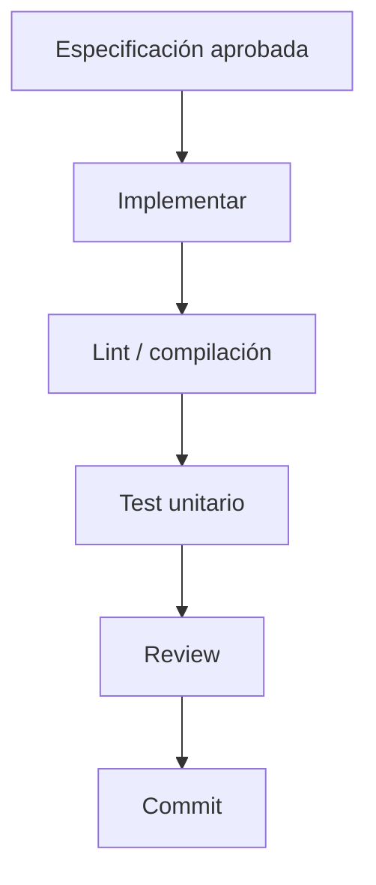

No deben acumularse varios módulos sin probar.

---

## 17. Fase 14 — Validación del CPU con programas diagnósticos

### Objetivo

Validar el procesador completo antes de incorporar UART.

Crear programas assembler pequeños y específicos.

### Orden recomendado

#### Aritmética

- `addi`;
- `add`;
- `sub`.

#### Lógica y shifts

- `and`;
- `or`;
- `xor`;
- `sll`;
- `srl`;
- `sra`.

#### Comparaciones

- `slt`;
- `sltu`;
- inmediatas equivalentes.

#### Memoria

- `sw` / `lw`;
- `sb` / `lb` / `lbu`;
- `sh` / `lh` / `lhu`;
- almacenar `0x12345678` como `78 56 34 12` en direcciones crecientes y reconstruirlo con `lw`;
- combinar `sb` y `sh` sobre lanes distintos y verificar reconstrucción y extensión signed/unsigned;
- cargar los bytes `B3 85 A5 00` en IMEM y obtener por fetch la instrucción `0x00A585B3`;
- fetch lineal en `0x00000000`, `0x00000004` y `0x00000008`;
- primer y último PC alineados de una imagen confirmada con fetch de cuatro bytes dentro del límite;
- PC desalineado (`PC[1:0] = 01`, `10` o `11`) con cuatro bytes candidatos dentro de IMEM y de la imagen: candidato `instruction-address-misaligned`, sin truncar PC ni admitir una palabra residual o reconstruida desde dos palabras;
- PC alineado fuera de imagen/capacidad (`instruction-access-fault`) y PC desalineado también fuera de imagen/capacidad: detectar ambas condiciones, pero seleccionar `instruction-address-misaligned` para ese mismo fetch;
- fetch desalineado del trabajo joven `wrong-path` invalidado por un redirect anterior sin confirmar un fault arquitectónico; no equiparar esta prueba a la legalidad del destino de branch/jump;
- flujo secuencial con `PC + 4`;
- branches y `jal` con desplazamientos byte-addressed positivos y negativos;
- `jalr` con el cálculo normativo de destino;
- `lb`, `lbu` y `sb` con offsets de byte no múltiplos de cuatro;
- accesos alineados de halfword y word;
- clasificación de `lh`/`lhu`/`sh` con `address[0]=1` y `lw`/`sw` con `address[1:0] != 00` como candidatos de fault por desalineación, incluso cuando toda la región candidata esté dentro de capacidad;
- `sb`/`lb`/`lbu` en cada posición de byte por alineación; un byte fuera de rango sigue siendo inválido por rango;
- stores multibyte desalineados sin escrituras de bytes ni metadatos, sin truncar bits bajos o dividir entre dos palabras, y loads desalineados sin ensamblado arquitectónico de dos palabras;
- contrastar para load y store una dirección alineada fuera de rango (`load-access-fault`/`store-access-fault`), otra desalineada dentro de rango (`load-address-misaligned`/`store-address-misaligned`) y otra que viola ambas condiciones: seleccionar la causa de desalineación dentro de esa operación, independientemente de cuál condición se detecte antes;
- mismo valor numérico en IMEM y DMEM con contenidos diferentes y sin aliasing;
- fetch dentro de capacidad pero fuera de la imagen;
- fetch fuera de la capacidad configurada;
- fetch inválido del camino incorrecto descartado sin fault;
- lectura de bytes DMEM válidos no escritos con resultado cero;
- regiones multibyte válidas con mezcla de bytes escritos y no escritos;
- primer y último acceso válido de 1, 2 y 4 bytes;
- acceso que cruza el límite por uno o más bytes;
- dirección fuera de rango con los mismos bits bajos que una válida;
- suma ensanchada de dirección efectiva y ancho cuyo extremo excede capacidad, sin confundirla con el carry permitido de base más inmediato;
- store inválido sin escrituras parciales;
- load inválido sin writeback;
- equivalencia observable de direccionamiento y lanes little-endian entre un modelo por bytes y memorias internas organizadas por palabras o bancos.

Las pruebas de rango y endianness de operaciones válidas conservarán direcciones naturalmente alineadas; además se verificará por separado la **clasificación** de los casos desalineados de DMEM e Instruction Fetch y de los destinos de control efectivamente usados, acordada en `DEC-ARCH-004`. Ante destino de control desalineado, no se aplicará redirect ni habrá fetch arquitectónico desde él; tras confirmar un fault solo completarán las anteriores y se llegará a `FAULT` conservando causa y PC de la instrucción causante. La implementación RTL se verificará contra las coincidencias aprobadas en `DEC-ARCH-003`; la representación externa y las vías adicionales de recuperación se resolverán en Debug y protocolo.

**Regresión obligatoria de AUD-004 — dos sumas distintas.** Verificar primero `effective_address=(rs1_effective+immediate) mod 2^32` (inmediato con signo extendido a 32 bits) y después el extremo exclusivo `end={1'b0,effective_address}+N` sin signo en 33 bits. Rango válido significa `end<=DMEM_CAPACITY_BYTES`; la alineación se evalúa independientemente. Los casos con carry que terminan dentro de rango deben ejecutar normalmente si cumplen las demás condiciones, sin veto adicional por el carry.

| `rs1_effective` | immediate | N | `DMEM_CAPACITY_BYTES` | `effective_address` | Rango válido | Alineación válida |
|---|---:|---:|---:|---|---|---|
| `0xFFFFFFFF` | +1 | 1 | 2048 | `0x00000000` | Sí | Sí |
| `0xFFFFFFFC` | +4 | 4 | 2048 | `0x00000000` | Sí | Sí |
| `0x00000000` | -1 | 1 | 2048 | `0xFFFFFFFF` | No | Sí |
| `0xFFFFFFFF` | +0 | 1 | 4294967296 | `0xFFFFFFFF` | Sí | Sí |
| `0xFFFFFFFF` | +0 | 2 | 4294967296 | `0xFFFFFFFF` | No | No |
| `0xFFFFFFFE` | +0 | 2 | 4294967296 | `0xFFFFFFFE` | Sí | Sí |
| `0xFFFFFFFC` | +0 | 4 | 4294967296 | `0xFFFFFFFC` | Sí | Sí |
| `0xFFFFFFFD` | +0 | 4 | 4294967296 | `0xFFFFFFFD` | No | No |
| `0x000003E4` | +0 | 4 | 1000 | `0x000003E4` | Sí | Sí |
| `0x000003E5` | +0 | 4 | 1000 | `0x000003E5` | No | No |
| `0x000003E8` | +0 | 1 | 1000 | `0x000003E8` | No | Sí |

`4294967296=2^32` es la capacidad conceptual máxima aprobada, no una obligación de implementar una memoria física de ese tamaño para esta prueba. Verificar aritméticamente ese límite sin truncar la capacidad. Repetir los vectores para loads y stores del ancho correspondiente, con base leída o reenviada. Cuando fallen rango y alineación, conservar la prioridad de desalineación; ningún store causante modifica datos/metadatos y ningún load causante escribe `rd`. La dirección que se transporta por `EX/MEM.ex_result[31:0]` sigue siendo el resultado modular, sin carry registrado ni una causa de fault nueva.

Contrastar explícitamente la **etapa de detección** y la asociación con cada operación:

| Etapa | Casos de detección |
|---|---|
| IF | Primer/último fetch completo; PC alineado o desalineado dentro de imagen; PC dentro/fuera de imagen o IMEM, incluso dos causas en un mismo fetch |
| ID | Palabra completa legal, ilegal y parecida a `halt` o a otra instrucción válida **solo tras fetch válido**, incluyendo bits residuales con `IF/ID.valid=0` |
| EX: loads/stores, tamaños y fuente | Accesos de 1, 2 y 4 bytes con `rs1_effective` reenviado |
| EX: loads/stores, posiciones | Primer/último acceso válido y región que cruza límite |
| EX: loads/stores, aritmética de rango | Suma ensanchada de dirección efectiva y ancho cuyo extremo excede capacidad, sin confundirla con el carry permitido de base más inmediato |
| EX: loads/stores, causas | Desalineación y causas simultáneas |

Comprobar que la detección de memoria usa la dirección efectiva y el ancho **antes de MEM**. No debe permitir accesos físicos inválidos, efectos parciales de stores ni escritura de `rd` por un load inválido.

En EX verificar además la alineación del destino tras resolver `beq`/`bne` tomado/no tomado o calcular `jal`/`jalr` enmascarado. La prueba no equipara esta evaluación al fetch posterior.

Candidatos jóvenes en `IF/ID` descartados por redirect de una instrucción anterior no producirán efectos arquitectónicos ni alterarán estado global. Compararlos con candidatos de operaciones que permanecen en el flujo válido sin fijar cuándo se confirman.

Durante `HOLD` se podrán observar condiciones combinacionales sin transiciones. En `RUN`/`STEP` las transiciones requieren ciclos efectivos, sin prescribir registros interetapa ni señales adicionales para candidatos.

Verificar por separado la **confirmación arquitectónica y antigüedad**:

| Coincidencia entre instrucciones | Resultado esperado |
|---|---|
| Load desalineado válido en EX, palabra ilegal en ID y fetch fuera de rango en IF del mismo flujo | Prevalece el evento de la instrucción en EX por ser la más antigua; la etapa no constituye una prioridad universal |
| Branch tomado más antiguo en EX y candidatos en ID e IF | Los candidatos se descartan como `wrong-path` sin cambiar el estado global |

Incluir un candidato inválido o ya descartado, y un evento anterior que prevalece aunque el candidato joven se detecte primero.

Para un fault confirmado, comprobar estos efectos:

- La operación causante y las posteriores no escriben registros ni DMEM ni comprometen otros efectos arquitectónicos.
- **Todas las más antiguas activas completan normalmente**.
- PC queda retenido y no ingresa trabajo nuevo.
- Se alcanza `FAULT` después del drenado y con los cuatro registros interetapa inválidos.

Distinguir de esa antigüedad la prioridad `misalignment > access fault` **dentro de la operación**, según las etapas de resolución ya aprobadas con el arbitraje de los acuerdos 40–47. `HOLD` no confirma por evaluación combinacional; `RUN`/`STEP` solo aplican transiciones en ciclos efectivos.

Repetir la frontera precisa con fault confirmado por codificación inválida en ID, fetch inválido detectado en IF y confirmado en ID, acceso DMEM inválido o destino desalineado en EX, y con anteriores en `MEM/WB` o bubbles: cada store y writeback previo se compromete exactamente una vez, incluso si el trabajo causante o joven permanece como bits residuales sin validez arquitectónica. Comparar `RUN`, `STEP` y `HOLD` durante el drenado y el estado final `FAULT` con el drenado de `halt` hacia `FINISHED`, con las ecuaciones del acuerdo 47 y los estados `AUTO`/`STEP` del acuerdo 44, sin imponer codificación binaria, nombres de puertos ni cantidad fija de ciclos.

Comprobar **desde valores preflanco** la selección por etapa causante en un ciclo efectivo: solo EX o ID pueden confirmar; ID invalida la nueva entrada de `ID/EX` y descarta `IF/ID` e IF mientras `ID/EX`, `EX/MEM` y `MEM/WB` anteriores avanzan; EX invalida la nueva entrada de `EX/MEM`, `IF/ID` e `ID/EX` y descarta IF, mientras `EX/MEM` y `MEM/WB` anteriores avanzan.

En todos los casos PC se retiene bit a bit y los registros interetapa que preservan anteriores no se vacían en bloque; las entradas jóvenes pueden contener bits residuales pero quedan con `valid=0`.

Un branch tomado, `jal` o `jalr` causante de destino desalineado en EX no redirige; los saltos tampoco escriben enlace ni pasan válidos a `EX/MEM`.

En `FAULT_DRAIN` alcanzable las anteriores en `EX/MEM` y `MEM/WB` progresan por ciclos efectivos mediante `act_drain_advance`, con `IF/ID` e `ID/EX` inválidos y sin load-use; verificar finalmente `IF/ID.valid=ID/EX.valid=EX/MEM.valid=MEM/WB.valid=0` antes de `FAULT` y conservar pipeline vacío allí.

El candidato no confirmado o `wrong-path` no inicia estas acciones y `HOLD` no actualiza nada.

Verificar cuatro órdenes entre eventos de **instrucciones distintas**:

| Evento anterior | Evento joven | Resultado esperado |
|---|---|---|
| Redirect aplicable | Fault | El candidato queda `wrong-path` sin `FAULT` |
| Fault | Redirect | Sin redirect; `FAULT` tras drenado |
| `halt` válido | Fault | Candidato descartado, drenado y `FINISHED` |
| Fault | `halt` | `halt` descartado; `FAULT` sin `FINISHED` |

La candidatura de `halt` se detecta en ID, pero solo se confirma en EX en un ciclo efectivo si sigue válida; no aplicar una prioridad fija por tipo de evento. Para control con fault **propio** por destino desalineado, suprimir redirect y enlace del propio salto, sin alterar la ecuación combinacional nominal de `redirect_valid`.

El contraste siguiente aplica la [prioridad de fronteras sobre load-use](architecture/control_and_hazards.md#prioridad-de-los-eventos-no-terminales): verificar el stall solo para el consumidor que sobrevive.

Contrastar la dependencia de un consumidor joven descartado (no bloquea la frontera ni aplica stall) con un load-use nominal sin frontera EX/ID prevaleciente (aplica `act_load_use`).

No exigir stalls entre supervivientes durante drenado alcanzable; allí solo quedan anteriores en `EX/MEM` y `MEM/WB`.

Durante `FAULT_DRAIN`/`HALT_DRAIN` no se confirma ningún candidato del trabajo joven descartado, pero sí avanzan anteriores en `RUN` o por `STEP` nuevo por ciclo; `HOLD` no confirma ni progresa. Preservar selección de causas de una misma operación, con las ocho acciones y la FSM de 14 estados pactadas, sin modificar la prioridad por antigüedad.

Verificar las **ocho acciones** de la tabla de transición vigente del acuerdo 47 a partir de entradas previas al flanco. Para los siguientes casos, comprobar:

| Acción | Resultado esperado |
|---|---|
| Normal | Captura `IF/ID`/`EX/MEM` y `PC+4` |
| `load-use` | Retiene PC y los cinco campos de `IF/ID`; inserta bubble sin congelar `EX/MEM` |
| Redirect EX | Captura destino, invalida `IF/ID` e `ID/EX` **incluido `fetch_fault_valid`** y conserva válida a la instrucción de control en `EX/MEM` |
| `halt` EX o fault EX | Invalida la nueva `EX/MEM` sin perder la antigua MEM |
| Fault ID | Invalida solo a causante/jóvenes y preserva la EX anterior |

Para probar la [secuencia de fetch durante load-use](architecture/faults_and_termination.md#coincidencia-con-load-use), situar el load productor en EX, su consumidor en ID y un candidato en IF, sin frontera EX/ID prevaleciente. Durante el stall, exigir solo `act_load_use`, sin captura ni confirmación del candidato ni cambios de causa/PC globales.

En el siguiente ciclo efectivo normal, comprobar que el consumidor sale de `IF/ID` hacia `ID/EX` mientras el load progresa a `MEM/WB` y el candidato se captura en `IF/ID`, todavía sin confirmación.

En el ciclo posterior, resolver primero el consumidor en EX con forwarding y solo después el candidato ID: un redirect/fault propio EX descarta ese candidato; sin frontera EX se confirma en ID y el consumidor avanza.

Intercalar `HOLD` y `STEP` para descartar avances o commits duplicados.

Hacer coincidir cada frontera con writeback previo en WB y store anterior en MEM: ambos surten efecto exactamente una vez en ese mismo ciclo efectivo; las entradas nuevas inválidas no eliminan efectos previos.

Contrastar drenado con anteriores en `EX/MEM` o `MEM/WB` y terminación directa sin anteriores; toda frontera confirmada EX/ID invalida `IF/ID` e `ID/EX`; en ambos, alcanzar `FINISHED`/`FAULT` al quedar los cuatro `valid=0`, sin ciclo extra. Un fetch candidato todavía no confirmado se captura en `IF/ID` sin activar prematuramente las acciones de fault.

Como variante de la secuencia anterior, provocar un fault del load productor en EX durante el stall potencial: exigir `act_ex_fault`, descarte del consumidor y del candidato joven, sin ejecutar el stall por la dependencia descartada, según el [fault propio de EX](architecture/control_and_hazards.md#fault-propio-de-ex).

Para la **ruta normal de fetch** comprobar que `IF/ID` captura `valid=1, fetch_fault_valid=0` con instrucción válida, o `valid=0, fetch_fault_valid=1` con PC causante y causa seleccionada (incluida la prioridad entre desalineación y acceso inválido), sin interpretar como ilegal la palabra residual.

En ID, un candidato joven descartado por redirect, fault o `halt` anterior limpia el flag **aunque `valid` ya sea cero**, sin publicar error; uno superviviente confirma el fault con `fault_pc=IF/ID.pc` y no avanza a `ID/EX`.

Diferenciar la entrada `valid=0, fetch_fault_valid=0` (bubble/flush/residuo) que nunca confirma.

Aplicar la [confirmación en ID](architecture/faults_and_termination.md#confirmación-en-id) a estos pares de flags; los residuos de una entrada sin candidato no deben confirmar un fault.

Una ilegal en ID se detecta solo con `IF/ID.valid=1`, y un fault de load/store/target en EX no añade campos a `ID/EX`, `EX/MEM` o `MEM/WB`.

Comprobar los cinco campos estables en `HOLD`, una sola transición por `STEP`, descarte de flag ante reset/`LOAD` y persistencia global de `fault_cause`/`fault_pc` tras confirmar, comprobando `fetch_fault_cause[2:0]` solo en 000/001 para candidatos válidos sin imponer exposición UART.

Para el candidato de fetch superviviente, contrastar el [origen de causa y PC en ID](architecture/faults_and_termination.md#confirmación-en-id) con el caso EX siguiente.

Contrastar expresamente `fault_pc` de EX con el PC global de IF retenido y con dirección efectiva/target problemático: solo el primero corresponde a la instrucción causante.

Ante causas concurrentes de un mismo acceso, la causa persistente respeta `misalignment > access fault`; entre candidatos de instrucciones distintas persiste la causa/PC de la más antigua prevaleciente.

Un candidato `wrong-path`, invalidado o no confirmado no publica metadatos de fault actual.

Al confirmar se capturan una sola vez causa y PC, y ambos permanecen estables aunque drenen stores/writebacks anteriores en `EX/MEM` y `MEM/WB`, se evalúen candidatos posteriores o haya `HOLD`. En drenado alcanzable no ocurre load-use.

La estabilidad de metadatos bajo `act_drain_load_use` se verifica solo mediante inyección combinacional de entradas/estado artificial, rotulada como no alcanzable desde una sesión legal bajo el acuerdo 47, sin cover end-to-end desde reset.

En snapshots **permitidos**, verificar coherencia de estado y metadatos de un mismo ciclo, sin exigir captura arbitraria mientras `RUN` avanza.

Para la **codificación del trigésimo quinto acuerdo**, comprobar en el ciclo efectivo de confirmación los siete valores `fault_cause[2:0]`:

| Código | Caso |
|---|---|
| `000` | Fetch IF desalineado y, por separado, target desalineado de branch/jal/jalr EX |
| `001` | Acceso fetch fuera de IMEM/imagen |
| `010` | Instrucción ilegal ID |
| `100` | Load desalineado |
| `101` | Load fuera de rango |
| `110` | Store desalineado |
| `111` | Store fuera de rango |

Ante desalineación y rango inválido simultáneos de un mismo acceso, priorizar `000` para fetch/target, `100` para load y `110` para store.

Nunca confirmar `011=RESERVED` como causa válida ni fabricar `NONE`: sin candidato `IF/ID.fetch_fault_valid=0` hace irrelevante `IF/ID.fetch_fault_cause[2:0]`, y sin fault global el estado/flag vuelve irrelevante la causa global.

Para candidatos válidos de IF, verificar exclusivamente `000` y `001`; cuando uno se confirma normalmente en ID, el código llega al estado global **sin traducción**.

Verificar la [captura de metadata](architecture/faults_and_termination.md#captura) solo cuando el candidato confirme; el transporte de su código no publica por sí solo un fault.

Comprobar que `HOLD`, trabajo `wrong-path` o posterior a una frontera anterior no publica ni reemplaza causa; durante `FAULT_DRAIN` y `FAULT` el código confirmado persiste con su `fault_pc`, incluso si los bits de candidato descartado quedan residuales. La representación Debug/UART y la codificación del estado/flag global permanecen independientes de esta tabla.

Verificar la **semántica terminal revisada por el cuadragésimo cuarto acuerdo**: tras reset `global_state=NO_IMAGE`, y tras preparación nueva `READY`/`RUNNING`/`STEPPING`, con metadatos de fault anteriores sin validez aunque conserven bits. La candidatura joven descartada no altera el estado.

Contrastar el [candidato sin confirmación](architecture/faults_and_termination.md#detección-candidato-y-confirmación) con las transiciones terminales siguientes: su sola detección no debe iniciar drenado.

`halt_confirm` procede de EX y `fault_confirm` de EX/ID; `cycle_from_continuous` conserva la selección `AUTO`/`STEP`. Con `pipeline_empty_next=1` se llega directamente a `FINISHED`/`FAULT` y de otro modo a un estado `DRAIN` del tipo/origen correcto. `FINISHED` y `FAULT` son excluyentes y solo aparecen con los cuatro `valid=0`.

En estados `HALT_DRAIN_AUTO/STEP` o `FAULT_DRAIN_AUTO/STEP` alcanzables desde reset, probar drenado automático desde confirmación continua o por `STEP` separado por órdenes nuevas.

Verificar en todo ese drenado `IF/ID.valid == 0`, `IF/ID.fetch_fault_valid == 0` e `ID/EX.valid == 0`, y por consecuencia `load_use_stall == 0`; solo pueden completar anteriores en `EX/MEM` y `MEM/WB`.

Cada ciclo efectivo selecciona `act_drain_advance` y cuenta una vez; `HOLD` no selecciona ninguna acción.

La rama `act_drain_load_use` se conserva, pero su cobertura es combinacional con entradas/estado artificial y no un cover end-to-end desde reset.

`LOAD` aceptado en drenado `STEP` domina el avance y abandona la sesión, mientras un `LOAD` rechazado en drenado `AUTO` no la modifica. Sin autorización no hay commits ni avance, y reset/`LOAD` dominante inhibe los efectos CPU.

Los metadatos de fault son válidos solo en `FAULT_DRAIN_AUTO`/`STEP` o `FAULT`; fuera de allí sus bits residuales no significan fault. El flanco que vacía el último registro interetapa cambia a `FINISHED`/`FAULT` sin ciclo extra; la representación UART está aprobada en `protocol.md`.

Comprobar que la confirmación vuelve observable la condición de error: si hay anteriores activas, distinguir `FAULT_DRAIN` de ejecución y de `FAULT` hasta que completen y queden los cuatro registros interetapa inválidos; si ya no hay trabajo anterior, no imponer un ciclo artificial de drenado antes de `FAULT`.

En ambas fases cuando correspondan hay error observable con la **misma causa y PC**, sin `program_finished` ni confusión con drenado de `halt`/`FINISHED`; aplicar los estados `AUTO`/`STEP` del acuerdo 44 sin duración fija del drenado.

Aplicar reset global desde `FAULT_DRAIN` y desde `FAULT`: cuando toma efecto funcional invalida la condición y la interpretación de metadatos, pone PC a cero, registros interetapa inválidos y `image_valid=0`/`loaded_image_size_bytes=0`, sin `FINISHED` ni reanudación por `RUN`/`STEP` hasta una nueva sesión confirmada.

Verificar que no se presenta el fault anterior como actual tras el reset o el nuevo `LOAD`, sin exigir borrar bits físicos de causa/PC, IMEM ni DMEM y sin decidir comandos UART de recuperación adicionales.

En la comprobación UART, `RUN` termina con `[RUN][FAULT][Debug]`. Cada `STEP` realizado responde `[STEP][DONE][Debug]`, incluso si confirma o drena un fault; `global_state` indica `FAULT_DRAIN_STEP` o `FAULT`, con `fault_cause` y `fault_pc` vigentes. `DONE` confirma el ciclo realizado y no significa finalización normal por `halt`; contrastar con [RUN](protocol.md#aceptación-y-terminal) y [STEP ante halt, fault y drain](protocol.md#halt-fault-y-drain-por-pasos).

Verificar destinos de control con `beq`/`bne` tomados y no tomados, `jal` y `jalr` tras borrar solo el bit 0: un destino efectivo desalineado de transferencia tomada o incondicional genera candidato `instruction-address-misaligned` en EX y **no aplica redirect** ni provoca fetch arquitectónico desde ese destino; un branch no tomado no produce ese candidato.

Con target alineado pero fuera de IMEM o imagen confirmada, permitir el redirect por alineación y detectar `instruction-access-fault` en el fetch posterior de IF, no en la instrucción de control.

Contrastar además fetch IF desalineado y fuera de rango/imagen a la vez, y loads y stores EX desalineados y fuera de DMEM: ambas condiciones se detectan en su etapa, pero la causa prevaleciente de la misma operación es la desalineación.

Para fetch inválido, ID no puede producir `illegal-instruction` por una palabra residual.

No derivar una prioridad temporal de la detección paralela ni exigir selector, enable, PC alternativo o flush específicos; aplicar los códigos de causa aprobados en el trigésimo quinto acuerdo y exigir ausencia de redirect y de link del salto causante de fault confirmado.

La regresión mínima de `DEC-ARCH-004` deberá cubrir las **dieciséis áreas de la matriz aprobada**. Los aspectos a comprobar son:

- legalidad de las 33 palabras soportadas frente a reservadas, `0x00000000` y matches parciales de `halt`;
- alineación de byte/halfword/word y los cuatro patrones de `PC[1:0]`;
- branch tomado/no tomado, `jal` y `jalr` con bit 0 enmascarado;
- desalineación y fuera de rango simultáneos;
- descarte `wrong-path` y prioridad por antigüedad;
- fault preciso con carga sin writeback;
- store sin ningún byte enable ni modificación de datos/metadatos, incluso parcialmente dentro de rango;
- control sin redirect/link;
- instrucción ilegal sin RegFile/DMEM/redirect/`halt`;
- `FAULT` distinto de `FINISHED`;
- `fault_cause`/`fault_pc` estables durante drenado y final;
- reset global que elimina fault y sesión. Ejecutar casos de drenado en `RUN`, `STEP` y `HOLD` según su disciplina de ciclos efectivos, sin fijar ecuaciones RTL ni representación UART.

#### Latencia y compromiso de escrituras

- cambiar un PC válido entre flancos y observar la instrucción correspondiente sin aplicar otro clock;
- cambiar una dirección DMEM válida entre flancos y observar el dato correspondiente sin aplicar otro clock;
- capturar la instrucción combinacional en `IF/ID` dentro del mismo ciclo IF;
- capturar el dato de load en `MEM/WB` dentro del mismo ciclo MEM;
- seleccionar en MEM el dato de load ya ensamblado y extendido antes de `MEM/WB`, sin agregar latencia de memoria ni un bypass combinacional DMEM→EX;
- comprobar por revisión y aserciones que no existe `ready`, latencia variable ni stall atribuible a la lectura de memoria;
- verificar que IMEM y DMEM no cambian antes del flanco activo de una escritura habilitada;
- leer después del flanco y observar el valor nuevo;
- ejecutar un store seguido de un load y observar el contenido actualizado;
- repetir el compromiso síncrono con `sb`, `sh` y `sw`, preservando little-endian;
- producir datos combinacionales desde accesos inválidos y verificar que nunca generan writeback ni efectos;
- atender simultáneamente fetch y load o store sin espera propia de memoria;
- comprobar por separado que load-use utiliza el stall nominal aprobado y que los demás hazards conservan los stalls que se aprueben posteriormente;
- ejecutar stores en `RUN` y `STEP` y verificar un único compromiso por cada ciclo habilitado correspondiente;
- comparar simulación RTL y netlist para detectar cambios de latencia introducidos por inferencia u optimización.

#### Inferencia y fallback físico

- elaborar, simular, sintetizar e implementar `REFERENCE` mediante RTL inferido;
- inspeccionar y registrar por separado el recurso efectivamente inferido para IMEM, DMEM y metadatos;
- registrar warnings de inferencia en lugar de asumir el mapping por el estilo RTL;
- comprobar en netlist que no se introdujo una salida registrada;
- medir LUTs, registros, RAM distribuida, BRAM y timing atribuibles a cada memoria;
- elaborar, simular y ejecutar smoke tests de `ALT_1000` sin exigir síntesis ni timing closure;
- si resultados físicos justifican evaluar XPM o primitivas, comparar recursos, timing y regresión sin cambiar consumidores ni contrato observable.

#### Organización por words y lanes

- acceder a la primera, una intermedia y la última palabra válida de IMEM;
- rechazar como fetch arquitectónico un `PC` desalineado incluso si `PC >> 2` apunta a una palabra cargada; comprobar por separado alineación y región de los cuatro bytes;
- verificar que el loader solo escribe una entrada IMEM después de reconstruir una palabra completa;
- comprobar ausencia de cambios IMEM antes del flanco de escritura;
- mapear `0x12345678` como `78 56 34 12` en los cuatro lanes y reconstruirlo;
- ejecutar `sb` en cada offset y conservar los otros bytes;
- ejecutar `sh` en offsets 0 y 2 y `sw` en offset 0 de una palabra con la selección lógica exacta;
- reconstruir `lb`, `lbu`, `lh`, `lhu` y `lw` con extensión correcta;
- comprobar que stores parciales no realizan read-modify-write de la palabra completa;
- calcular bank y row por byte candidato, incluidos cruces hacia la row siguiente solo como **mapping de candidatos**;
- rechazar por alineación los candidatos multibyte que crucen palabra, sin efectuar accesos entre rows, dividir, corregir ni truncar la dirección;
- suprimir escrituras de datos y metadatos de stores desalineados sin efectos parciales; conservar por separado la comprobación de rango y el descarte `wrong-path`;
- verificar equivalencia aunque Vivado no materialice cuatro RAM físicas.

#### Ownership y concurrencia

- permitir ciclos sin agente activo y comprobar mediante assertions que existe como máximo uno por memoria;
- ejercer CPU y loader sobre IMEM en fases excluyentes;
- ejercer CPU y Debug directo sobre DMEM con quiescencia;
- atender fetch y load/store simultáneos sobre memorias lógicamente independientes;
- ejecutar loads o stores consecutivos con fetch continuo;
- tratar una operación multibyte como una única transacción CPU;
- verificar que `LOAD`, `STEP`, stalls y flushes no pierden ni duplican escrituras bajo las condiciones conceptuales de enable aprobadas en `DEC-ARCH-008`;
- comprobar una implementación mínima sin exigir puertos adicionales.

#### Cero lógico y metadata DMEM

- precargar datos físicos residuales y observar `0x00` para bytes lógicamente inválidos;
- mezclar bytes válidos e inválidos en byte, halfword y word;
- aplicar sign/zero extension después de sustituir bytes inválidos por cero;
- comprobar que `sb`, `sh` y `sw` actualizan dato y validez de exactamente sus bytes;
- conservar dato y validez de bytes no seleccionados;
- ejecutar stores fuera de rango, descartados o del camino incorrecto sin cambios;
- hacer que un programa A escriba DMEM y que un programa B observe cero al iniciar una nueva sesión;
- impedir el commit de sesión y `RUN`/`STEP` mientras no se haya establecido el cero lógico;
- comprobar 2048 valid bits en la implementación de referencia;
- verificar que el criterio Debug de memoria utilizada no se deduce automáticamente del bitmap;
- si se adopta otra representación, ejecutar la misma regresión de granularidad por byte, sesiones, loads, stores y Debug;
- dejar cantidad de bits por ciclo, FSM y señales concretas como detalles de implementación, preservando el comportamiento de reset de `DEC-ARCH-008`.

#### Capacidades parametrizables

- elaborar, simular, sintetizar, implementar y probar en hardware `REFERENCE=1024/2048`;
- cargar una imagen válida de 256 instrucciones y rechazar una de 257;
- elaborar, simular y ejecutar smoke tests de `ALT_1000=1000/1000` sin asumir potencias de dos;
- comprobar en `ALT_1000` límites, índices, cantidades de palabras y metadatos derivados;
- verificar que comandos de runtime no alteran capacidades sintetizadas;
- comprobar los límites inclusivos del perfil de referencia;
- distinguir una posición de IMEM dentro de capacidad pero fuera de la imagen válida;
- elaborar el caso arquitectónico mínimo de 4 bytes sin convertirlo en perfil formal;
- rechazar tempranamente capacidades inválidas;
- distinguir el rechazo de una configuración válida pero no soportada;
- comprobar cálculos del límite arquitectónico `2^32` sin exigir síntesis FPGA;
- buscar parámetros redundantes y números mágicos mediante revisión estática.

#### Punto de entrada y validez de carga

- comprobar que una carga válida deja el PC en `0x00000000` sin iniciar `RUN` ni `STEP`;
- comprobar que el primer fetch habilitado utiliza `0x00000000`;
- cargar una imagen mínima de una instrucción desde cero;
- cargar imágenes contiguas de varios tamaños, incluida una que ocupe toda la capacidad;
- rechazar una imagen vacía;
- rechazar imágenes sparse, con huecos o cuyo tamaño no sea múltiplo de cuatro;
- verificar que todos estos rechazos mantienen `RUN` y `STEP` deshabilitados;
- completar luego una carga válida y comprobar la recuperación;
- verificar que la carga mínima no transporta un entry point configurable;
- comprobar que aceptar `LOAD` escribe `loaded_image_size_bytes = 0` y deriva inmediatamente `image_valid = 0`;
- comprobar que una solicitud `LOAD` rechazada conserva la imagen confirmada vigente;
- mantener el progreso de recepción separado y comprobar que ninguna escritura parcial aumenta el tamaño confirmado;
- verificar que imagen, DMEM y restante estado inicial estén listos antes del único write no nulo;
- verificar que el commit escribe una vez `loaded_image_size_bytes` y deriva combinacionalmente `image_valid = 1`;
- verificar que una carga vacía, truncada, mal formada, interrumpida, sobredimensionada o fallida conserva tamaño cero e `image_valid = 0`;
- cargar un programa B más corto que A y comprobar que el sufijo físico residual no pertenece a la imagen;
- verificar el último comienzo válido y el primer fetch fuera del límite confirmado mediante `PC + 4`;
- comprobar el límite exclusivo `2^32` con aritmética ensanchada y sin wrap-around;
- verificar que capacidades de 4, 1000, 1024 y `2^32` derivan anchos de 3, 10, 11 y 33 bits;
- representar exactamente una imagen de capacidad completa sin truncamiento;
- activar assertions con tamaños 1, 2, 6 y mayores que capacidad, sin producir faults arquitectónicos;
- derivar exactamente instruction count para todos los tamaños legales probados;
- confirmar mediante revisión estática que no existen flip-flop global `image_valid`, instruction count persistente ni bitmap de validez por instrucción;
- comprobar equivalencia RTL/netlist de `image_valid = (loaded_image_size_bytes != 0)`.

#### Dominio de clock funcional

- revisar que registros de CPU, pipeline, control, loader, Debug, UART y metadatos utilicen el mismo clock funcional principal;
- comprobar en los reportes de clocking que ningún otro clock funcional alcance estado secuencial del RTL de usuario;
- buscar y prohibir sensibilidad `posedge` o `negedge` sobre `RUN`, `STEP`, `HOLD`, ticks UART, divisores lógicos o enables;
- comprobar que reset, `RUN`, `STEP`, `HOLD`, `LOAD`, mantenimiento y comunicación UART no detengan ni gateen el clock principal mientras el generador entregue un clock válido; la pérdida de estabilidad puede impedir flancos válidos;
- aceptar `STEP` y comprobar exactamente una transición lógica sin alterar ni generar clock;
- generar ticks UART con distintas relaciones y verificar que solo habilitan transiciones dentro del dominio principal;
- comprobar que un `baud_tick` nunca se distribuye como clock ni crea endpoints temporales de otro dominio;
- comprobar en Basys 3 la conversión del oscilador de 100 MHz al único clock funcional de 50 MHz con distribución dedicada, sin divisores ordinarios usados como clocks;
- comprobar que la integración del recurso no modifica las interfaces funcionales internas;
- si el recurso expone `locked`, arrancar con estabilidad ausente y verificar reset distribuido activo; recuperar estabilidad con reset externo todavía activo, luego liberar ambas causas y comprobar desaserción sincronizada antes de operación normal;
- perder `locked` durante `RUN`, drenado y `LOAD` parcial, incluso sin flancos funcionales válidos: comprobar aserción asíncrona del reset distribuido y efectos funcionales solo en el primer flanco válido que lo observe;
- tras esa pérdida, comprobar aborto sin `FINISHED`/`DONE`, `loaded_image_size_bytes = 0`, `image_valid = 0` derivado y nueva `LOAD` válida únicamente después de recuperar estabilidad y liberar reset;
- bloquear una futura incorporación de otro dominio hasta revisar `DEC-ARCH-005` y documentar CDC, constraints y verificación;
- mantener selección/configuración concreta del generador, conexión y secuencia RTL de `locked`/reset, pin y XDC como detalles de integración, y la evidencia post-implementation como tarea de timing closure posterior a la aprobación de `DEC-ARCH-005`.

#### Reset global e inicialización de sesión

- partir de un sistema con imagen y estado de sesión no triviales y aplicar el reset global cuando su interfaz definitiva lo permita;
- comprobar, en el flanco que consume el reset interno, `PC = 0x00000000`, `x0 ... x31 = 0` y contador lógico de ciclo igual a cero;
- comprobar `IF/ID.valid = ID/EX.valid = EX/MEM.valid = MEM/WB.valid = 0`, permitiendo residuos en los demás campos inactivos;
- comprobar `loaded_image_size_bytes = 0`, `image_valid = 0`, ausencia de ejecución activa y control en condición segura;
- ensuciar previamente `RUN`, `STEP` pendiente, drenado, finalización, fault, `LOAD` parcial y operaciones en tránsito, y comprobar que no quedan activas ni producen efectos arquitectónicos posteriores al reset funcional;
- no exigir borrado físico de IMEM, datos DMEM o metadatos DMEM ni interpretar sus residuos como una sesión válida;
- no fijar todavía el valor, disponibilidad o interpretación del campo Debug de memoria utilizada cuando no existe sesión;
- iniciar después un `LOAD` y comprobar que el sistema puede preparar una nueva sesión sin aplicar nuevamente el reset global;
- comprobar que DMEM todavía requiere la preparación lógica de sesión aunque PC, banco, contador y pipeline ya presenten sus valores de reset;
- mantener tamaño e imagen válida en cero aunque la imagen completa ya haya sido recibida y validada mientras falte cualquier preparación de sesión;
- comprobar en la frontera de commit que PC, registros, pipeline, cero lógico DMEM, memoria utilizada, contador y estado de ejecución forman un estado inicial coherente;
- verificar que completar el commit deja el sistema preparado pero detenido, sin iniciar `RUN` ni `STEP`;
- aplicar solicitudes externas válidas con distintos desfases respecto del clock y comprobar aserción `00 -> 11` sin esperar un flanco y desaserción `11 -> 10 -> 00` por flancos;
- comprobar que el reset distribuido puede asertarse entre flancos, que solo se desaserta por flancos y que sus efectos funcionales ocurren en flancos;
- verificar mediante revisión RTL y CDC que la entrada externa solo alcanza los recursos asíncronos del acondicionador y no alimenta directamente lógica funcional;
- comprobar que CPU, pipeline y control consumen reset mediante lógica síncrona en `posedge clk`, sin generalizar sensibilidad asíncrona a sus registros;
- no exigir respuesta a pulsos que incumplan el ancho mínimo del recurso asíncrono ni tratar el acondicionador como debouncer;
- diferir las pruebas del pin o fuente física, duración mínima concreta y realización física de la relación con `locked` a integración y `DEC-ARCH-005`.

#### Recuperación por reset durante RUN

- ejecutar un loop sin `halt`, aplicar reset global y comprobar que `RUN` se aborta en el primer flanco de consumo funcional;
- repetir durante ejecución normal y drenado continuo, sin esperar `FINISHED` ni vaciado del pipeline;
- comprobar que la recuperación no activa `program_finished`, `DONE` ni otra indicación de finalización normal;
- verificar pipeline inválido, PC, registros y contador en cero, tamaño confirmado cero, `image_valid = 0` y control detenido;
- retener writeback, store y transacciones en vuelo y comprobar ausencia de efectos posteriores al flanco dominado por reset;
- comprobar que `LOAD` sigue rechazándose antes del reset mientras existe contexto continuo y que esa solicitud no queda latente;
- enviar una nueva solicitud `LOAD` después del reset y completar una sesión nueva antes de autorizar `RUN` o `STEP`;
- permitir mecanismos adicionales de protocolo sin convertirlos en requisito para satisfacer `REQ-EXEC-015`.

#### Prioridad global y enables

- coincidir reset, `LOAD` aceptado y solicitud de ciclo CPU, y observar únicamente los efectos de reset;
- asertar reset durante `LOAD` y comprobar que no progresa una escritura del loader, mantenimiento ni commit de sesión en el flanco dominado;
- coincidir aceptación o progreso de `LOAD` con una solicitud de CPU y comprobar que loader o mantenimiento pueden progresar mientras se suprimen fetch, avance, writeback, store y contador CPU;
- verificar que una solicitud `LOAD` rechazada no entra en la prioridad de preparación ni invalida por sí sola la imagen vigente;
- Sin imagen o durante `LOAD` no hay ejecución CPU. En `FINISHED`/`FAULT` con imagen confirmada, `RUN`/`STEP` elegibles aceptan preparar una sesión nueva mediante `PREPARING_RUN`/`STEP`, sin ejecutar ni reanudar la sesión anterior; al cumplirse `prepare_done` consumen su primer ciclo. En drenado `STEP`, `STEP` ejecuta un ciclo y `RUN` puede convertir a `AUTO`; en drenado `AUTO` se conserva la autorización continua.
- ejecutar `RUN` y comprobar ciclos sucesivos autorizados;
- aceptar un `STEP` y comprobar exactamente un ciclo efectivo, incluido un `STEP` durante drenado;
- mantener `HOLD` durante varios clocks con WB o store pendiente y comprobar PC, registros interetapa y contador estables, sin writes repetidos;
- ejecutar un ciclo con stall y comprobar un incremento del contador aunque los enables locales retengan parte del pipeline;
- comprobar que cada writeback, store y actualización de metadatos CPU requiere ciclo efectivo y validez local y se compromete como máximo una vez;
- permitir actividad de UART y control externo durante `HOLD` sin avance de CPU ni incremento del contador;
- verificar por revisión que `RUN`, `STEP` y `HOLD` no detienen, generan ni gatean arbitrariamente el clock principal;
- aplicar mediante el `Pipeline Hazard Control` combinacional los patrones nominales de `DEC-ARCH-003`.

| Patrón nominal | Resultado esperado |
|---|---|
| Avance normal | Avance por etapa con mux secuencial y escritura de PC |
| `load-use` | Escritura de PC inhibida, retención de `IF/ID` sin nueva captura, bubble `valid=0` en `ID/EX` y progreso posterior |
| Redirect | Mux hacia target, escritura de PC habilitada, `IF/ID` e `ID/EX` inválidos por `valid=0` y avance de `EX/MEM` y `MEM/WB` |

Aplicar los enables/valores `next` de las ocho acciones fijados en el acuerdo 42 y la integración auditada en el 45, con la matriz del acuerdo 46 revisada por el 47.

#### HOLD y actividad independiente

- inicializar PC, banco, cuatro registros interetapa, contador, drenado y estado de ejecución con valores no triviales y comprobar que permanecen estables durante múltiples clocks de `HOLD`;
- retener una instrucción de WB y una de store y comprobar ausencia de writes repetidos; autorizar luego un ciclo legal y observar como máximo un compromiso;
- variar entradas y selecciones combinacionales durante `HOLD` y comprobar que no generan captura ni efecto arquitectónico;
- recibir y decodificar comandos UART, capturar un snapshot permitido y serializarlo sin alterar CPU ni contador;
- aceptar `STEP` desde un estado preparado y comprobar un único ciclo seguido nuevamente por ausencia de avance;
- repetir `STEP` durante drenado y comprobar exactamente un ciclo por orden;
- Sin imagen o durante `LOAD` no hay ejecución CPU. En `FINISHED`/`FAULT` con imagen confirmada, `RUN`/`STEP` elegibles aceptan preparar una sesión nueva mediante `PREPARING_RUN`/`STEP`, sin ejecutar ni reanudar la sesión anterior; al cumplirse `prepare_done` consumen su primer ciclo. En drenado `STEP`, `STEP` ejecuta un ciclo y `RUN` puede convertir a `AUTO`; en drenado `AUTO` se conserva la autorización continua.
- reanudar un estado legalmente habilitable y comprobar continuidad desde los mismos PC, registros y registros interetapa;
- comprobar que la espera física no cambia el resultado arquitectónico del programa;
- aplicar DEC-PROTO-002 aprobada: sin PAUSE/RESUME ni captura adicional durante `RUN`; rechazo `LOAD`, reset y recuperación según `protocol.md`.

#### Evento final de ciclo lógico

- generar una solicitud de avance simultánea con reset y con `LOAD` aceptado, y comprobar que no existe ciclo efectivo ni incremento del contador;
- Sin imagen o durante `LOAD` no hay ejecución CPU. En `FINISHED`/`FAULT` con imagen confirmada, `RUN`/`STEP` elegibles aceptan preparar una sesión nueva mediante `PREPARING_RUN`/`STEP`, sin ejecutar ni reanudar la sesión anterior; al cumplirse `prepare_done` consumen su primer ciclo. En drenado `STEP`, `STEP` ejecuta un ciclo y `RUN` puede convertir a `AUTO`; en drenado `AUTO` se conserva la autorización continua.
- ejecutar varios ciclos `RUN` y comprobar correspondencia uno a uno entre eventos finales, transiciones CPU e incrementos;
- ejecutar un `STEP` nominal y comprobar exactamente un evento final;
- ejecutar un `STEP` con stall `load-use` y comprobar que la orden se consume, el contador incrementa una vez, PC e `IF/ID` se retienen, `ID/EX` recibe una bubble y el load y las instrucciones más antiguas avanzan; requerir nuevos `STEP` para los ciclos siguientes;
- comparar stall autorizado con `HOLD`: ambos podrán retener PC, pero solo el primero contará y permitirá progreso local;
- producir bubbles, flushes e invalidaciones dentro de ciclos efectivos y comprobar que cuentan con los patrones de registros interetapa del acuerdo 47;
- verificar drenado automático por ciclos en `RUN` y un `STEP` por ciclo durante drenado paso a paso;
- comprobar que ciclos del clock funcional con actividad exclusiva de UART, Debug, loader y mantenimiento no producen eventos CPU ni incrementos;
- verificar que, salvo reset e inicialización efectiva de sesión, el contador solo cambia ante un evento final de ciclo.

#### Contador lógico de 64 bits — revisión AUD-005

Verificar `cycle_count[63:0]` unsigned y el incremento módulo `2^64` por `cpu_cycle_fire`. Sembrar valores cercanos al máximo en el banco de prueba, sin simular `2^64` ciclos: `0xFFFFFFFFFFFFFFFE → 0xFFFFFFFFFFFFFFFF → 0 → 1` con cuatro estados consecutivos. Con `cpu_cycle_fire=0`, incluido `HOLD` y actividad exclusiva de UART/Loader/mantenimiento, conservar el valor incluso en el máximo. Repetir el wrap en un ciclo de stall y uno de drenado; comprobar ausencia de fault, detención, cambio de `global_state` debido al contador, flag de overflow o estado persistente adicional. Los cambios de estado debidos a otros eventos conservan su contrato.

Reset e inicialización efectiva de nueva sesión prevalecen y dejan cero antes del primer ciclo. `PREPARING_RUN/STEP && prepare_done` ejecuta ese primer ciclo y deja uno; `PREPARING_READY && prepare_done` deja cero sin ciclo CPU. Verificar el valor completo en un snapshot permitido sin fijar orden de bytes ni framing UART.

#### Generación desde RUN, STEP y drenado

Aplicar los [estados y transiciones aprobados](architecture/execution_control.md#resultado-de-un-ciclo): el drenado conceptual corresponde a `HALT_DRAIN_AUTO`, `HALT_DRAIN_STEP`, `FAULT_DRAIN_AUTO` o `FAULT_DRAIN_STEP`, según causa y modalidad. `drain_mode` es una [decodificación combinacional de esos estados](architecture/execution_control.md#señales-derivadas-de-global_state); la autorización de avance procede del contexto continuo o de una orden aceptada.

- aceptar `RUN` desde una sesión preparada y comprobar eventos finales sucesivos sin comandos adicionales;
- confirmar `halt` durante contexto continuo con anteriores pendientes, observar `HALT_DRAIN_AUTO` y continuar automáticamente hasta `FINISHED`; si el pipeline ya queda vacío en la confirmación, pasar directamente a `FINISHED` sin ciclo de drenado adicional;
- confirmar `halt` durante control paso a paso con anteriores pendientes, observar `HALT_DRAIN_STEP`, volver a ausencia de avance y requerir un `STEP` por cada ciclo de drenado; si el pipeline ya queda vacío en la confirmación, pasar directamente a `FINISHED`;
- mantener `HALT_DRAIN_STEP` o `FAULT_DRAIN_STEP` sin orden aceptada ni acción global superior y comprobar que el estado se conserva y no aparece un evento final de ciclo;
- aceptar un `STEP` y comprobar una sola solicitud y un solo evento, incluso ante stall, bubble, flush o invalidación;
- verificar que un `STEP` rechazado o suprimido no reaparece como ciclo latente al desaparecer reset, `LOAD` u otra condición superior;
- Sin imagen o durante `LOAD` no hay ejecución CPU. En `FINISHED`/`FAULT` con imagen confirmada, `RUN`/`STEP` elegibles aceptan preparar una sesión nueva mediante `PREPARING_RUN`/`STEP`, sin ejecutar ni reanudar la sesión anterior; al cumplirse `prepare_done` consumen su primer ciclo. En drenado `STEP`, `STEP` ejecuta un ciclo y `RUN` puede convertir a `AUTO`; en drenado `AUTO` se conserva la autorización continua.
- confirmar un fault durante contexto continuo, cesar la admisión y los efectos de causante/jóvenes, observar `FAULT_DRAIN_AUTO` si quedan anteriores pendientes y continuar automáticamente solo los ciclos necesarios para que completen y alcanzar `FAULT` sin reportar `FINISHED`; si el pipeline ya queda vacío en la confirmación, pasar directamente a `FAULT`;
- comprobar mediante revisión que la implementación no depende de estados o señales RTL con nombres `run_active`, `step_pulse` o `DRAIN`.

#### Inicialización multiciclo y commit de sesión

- aceptar `LOAD` y comprobar en ese flanco `loaded_image_size_bytes = 0`, `image_valid = 0` derivado y ausencia de ciclo CPU;
- rechazar una solicitud `LOAD` y comprobar que conserva la sesión vigente;
- recibir y escribir una imagen completa mientras DMEM u otro estado aún no está preparado, y comprobar que el tamaño continúa en cero;
- comprobar que loader, UART y mantenimiento progresan durante la fase sin writeback, store, fetch válido ni incremento del contador CPU;
- ejercer la implementación elegida con tareas de preparación superpuestas o secuenciales y comprobar que ninguna publica prematuramente la sesión;
- intentar commit omitiendo por separado imagen válida, PC, banco, pipeline, cero lógico DMEM, memoria utilizada, contador o control inicial, y comprobar que se bloquea;
- completar todas las precondiciones y comprobar un único write no nulo del tamaño, con `image_valid` derivado y sin estado redundante;
- comprobar que el estado posterior al commit permanece detenido hasta un `RUN` o `STEP` posterior;
- fallar o interrumpir la carga en distintas fases y comprobar tamaño cero, ausencia de rollback y posibilidad de una carga válida posterior;
- aplicar reset durante recepción, escrituras IMEM y preparación DMEM, y comprobar aborto sin writes de loader o mantenimiento en el flanco dominado;
- confirmar que punteros, contadores o flags internos de progreso nunca se interpretan como sesión confirmada.

#### Polaridad y frontera de placa

- simular una fuente física activa en alto y comprobar aserción asíncrona y desaserción sincronizada;
- simular una fuente activa en bajo con una única inversión en wrapper y comprobar comportamiento funcional idéntico;
- verificar que ninguna señal física alcanza directamente CPU, pipeline, control o enables;
- comprobar que el reset interno activo en alto produce los valores funcionales acordados;
- comprobar que la aserción de la cadena y del reset distribuido no espera un flanco y que la desaserción atraviesa las dos etapas;
- revisar que `_n` solo identifique señales activas en bajo y que no existan interpretaciones opuestas de una misma señal;
- cambiar el wrapper de placa en la prueba sin modificar módulos funcionales;
- aplicar pulsos por debajo del requisito asíncrono del dispositivo y documentar que su respuesta no está garantizada;
- aplicar una aserción válida y comprobar que activa inmediatamente la cadena, aunque no ocurra un flanco;
- simular rebotes de aserción y liberación con distintas duraciones, incluyendo prolongación, liberación sincronizada y reaserción asíncrona;
- comprobar que cada reentrada aplica nuevamente el estado global aprobado sin producir un ciclo CPU válido;
- bloquear comandos funcionales hasta que reset se estabilice;
- validar repetidamente el pulsador o fuente real sobre FPGA y registrar cualquier evidencia que justifique añadir un filtro;
- mantener duración mínima concreta, pin concreto y realización física de la relación con `locked` como pruebas de integración pendientes.

#### LOAD durante contexto continuo

- solicitar `LOAD` durante varios ciclos de `RUN` y comprobar correspondencia uno a uno entre ciclos efectivos, incrementos del contador y evolución normal del CPU;
- coincidir la solicitud rechazada con fetch, store, writeback, branch y stall, verificando que no añade ni suprime efectos arquitectónicos;
- comprobar que `loaded_image_size_bytes` e `image_valid` conservan sus valores y que no comienzan recepción, preparación DMEM ni invalidación del pipeline;
- reconocer `halt` bajo contexto continuo, solicitar `LOAD` durante el drenado y comprobar rechazo mientras las instrucciones anteriores completan hasta `FINISHED`;
- solicitar `LOAD` alrededor de un fault y comprobar que el rechazo no se reporta como `FINISHED`, aplicando la elegibilidad y prioridades del acuerdo 44 según el estado previo;
- mantener o repetir solicitudes durante `RUN` y comprobar que ninguna se acepta automáticamente al terminar el contexto continuo;
- emitir posteriormente una nueva solicitud desde una condición que la FSM definitiva permita y comprobar que solo su aceptación efectiva invalida la imagen;
- comprobar `LOAD` > `STEP` > `RUN` entre comandos elegibles desde reposo, con reset dominante, conforme al acuerdo 44; el formato de respuesta UART está aprobado en `protocol.md`.

#### Ownership y concurrencia

Para Debug, aplicar la [lectura directa del estado retenido](architecture/debug_architecture.md#por-qué-la-coherencia-importa-con-uart), con la [exclusión del controlador](architecture/protocol_controller.md#terminal-run-y-exclusión-debug) y el [recorrido del serializador](architecture/response_serializer.md#recorrido-de-dmem-y-orden-de-producción) aprobados.

- permitir ciclos sin ningún agente activo sobre una memoria;
- comprobar mediante assertions la condición at-most-one, sin exigir XOR exacto;
- atender fetch y load simultáneos sobre memorias independientes;
- atender fetch y store simultáneos;
- ejecutar loads o stores consecutivos con fetch continuo;
- comprobar que la CPU no emite más de una transacción por memoria y ciclo;
- tratar un store alineado que active varios lanes de una misma row como una única transacción DMEM; el mapeo de candidatos hacia otra row no autoriza un store desalineado ni crea una transacción funcional adicional;
- aceptar `LOAD` únicamente sin fetch válido ni escritura concurrente de CPU;
- solicitar `LOAD` durante `RUN` normal y comprobar rechazo sin transferencia de ownership ni modificación de IMEM;
- repetir durante el drenado automático iniciado por `RUN` y comprobar rechazo hasta finalizar la autorización continua;
- comprobar que un `LOAD` rechazado no queda latente ni se acepta automáticamente al terminar `RUN`;
- dejar para protocolo y control la respuesta concreta y el arbitraje de `RUN`/`LOAD` coincidentes desde reposo;
- construir un snapshot `STEP` coherente entre avances;
- leer directamente DMEM solo con CPU quiescente;
- comprobar que PC, RF, registros interetapa, contador, estado, imagen y DMEM permanecen estables desde el estado observado posterior a `STEP` o terminal de `RUN` hasta el último Stop físico, incluida la espera por una respuesta previa, sin ciclos CPU ni inicio de `LOAD` o preparación;
- distinguir el instante lógico observado de la transmisión UART y conservar la exclusión durante toda la cabecera y el cuerpo, hasta el último Stop físico;
- verificar el selector de lectura CPU/Debug aprobado para DMEM: durante la ventana exclusiva se consulta la dirección Debug, sin acceso incompatible de CPU ni mantenimiento;
- comprobar que la espera por espacio TX y el encolado del último byte no liberan la retención; los registros de bytes, índices y cantidad del serializador conservan su función de recorrido y transporte;
- si se adopta un backend físico compartido, atender simultáneamente ambas interfaces sin aliasing ni stall;
- usar iguales valores numéricos en IMEM y DMEM sin cruzar espacios;
- rechazar o diferir `LOAD`/Debug incompatible antes de que alcance la memoria;
- introducir stalls documentados por hazards o control sin perder ni duplicar operaciones, manteniendo ausencia de espera propia de lectura de memoria;
- comprobar mediante assertions que las transiciones de control aprobadas por `DEC-ARCH-008` preservan ownership exclusivo;
- detectar una colisión de ownership como violación interna, sin convertirla en fault de programa ni fijar aquí su secuencia temporal.

#### Observabilidad y snapshots

- comprobar un snapshot posterior a `STEP` y el incremento exacto de su contador;
- comprobar varios ciclos `RUN` contra el contador de avances efectivos;
- contar ciclos habilitados con stall y durante drenado;
- comprobar que espera de `STEP`, carga y actividad exclusiva de UART no incrementan el contador;
- verificar que una nueva sesión reinicia el contador en cero;
- diferenciar el PC global de los PCs asociados a instrucciones en tránsito;
- seguir instrucciones activas mediante `valid`, PC e instrucción en los cuatro registros interetapa;
- presentar como inactivas entradas con bits residuales cuando `valid = 0`;
- aceptar una misma representación inactiva para bubble, flush y vacío;
- distinguir conceptualmente `RUN`/`STEP`, drenado por `halt`, `FINISHED`, `FAULT_DRAIN` y `FAULT`; en los dos últimos, observar `fault_cause` y `fault_pc` persistentes sin presentar candidatos no confirmados como fault actual;
- verificar que registros, registros interetapa, estado, imagen válida y memoria utilizada pertenecen a un único ciclo lógico;
- verificar que, cuando se capture un snapshot permitido durante el error, su estado, causa, PC causante y registros interetapa pertenecen al mismo ciclo lógico; comprobar que reset invalida la interpretación de los metadatos anteriores sin exigir bits cero ni snapshot durante `RUN`;
- comprobar que una transmisión lenta no mezcla estados de ciclos diferentes;
- comprobar que observar Debug no altera el resultado arquitectónico;
- verificar que el contrato funciona sin consultar capacidades al hardware.

#### Hazards

- ALU → ALU;
- prioridad `EX/MEM` sobre `MEM/WB` con productores consecutivos del mismo `rd`;
- forwarding independiente de `rs1` y `rs2` y rechazo de productores inválidos, sin escritura o con `rd = x0`;
- selección independiente con ambas fuentes desde `EX/MEM`, fuentes desde etapas distintas y fallback a `ID/EX`; un load coincidente más reciente y no disponible bloquea un `MEM/WB` anterior del mismo `rd`;
- dos muxes combinacionales 3:1 independientes hacia EX, con los tres datos aprobados por operando y combinaciones de orígenes distintas, sin seleccionar datos no disponibles ni imponer codificación de selectores;
- `Forwarding Unit` combinacional que controla ambos muxes por productor más reciente y fuente usada, sin consumo funcional de selecciones residuales ante consumidor inválido o load aún no disponible;
- captura normal de los diez elementos funcionales enumerados de `ID/EX` (con control representable de forma distribuida) para fuente realmente usada, valor original y destino independientes; bubble por `load-use` y flush por redirect comparten `valid_next=0` de la nueva entrada, con PC e instrucción vinculados y residuos inertes, sin codificación anticipada de `control`;
- `IF/ID` conserva sus cinco campos (`valid`, `pc`, `instruction`, `fetch_fault_valid`, `fetch_fault_cause`): captura normal de instrucción o candidato, retención íntegra en `HOLD`/load-use y limpieza de ambos flags ante descarte; un candidato coincidente con stall se redetecta desde el mismo PC y solo puede confirmarse después en ID;
- resultados R-type, I-type aritmética/shifts, `lui` y enlaces de `jal`/`jalr` disponibles desde `EX/MEM`; loads solo desde `MEM/WB`, que reutiliza el valor arquitectónico seleccionado para WB;
- enlace de `jal`/`jalr` calculado en EX por `Link Adder` desde `ID/EX.pc + 4`, seleccionado por `Result MUX` en `EX/MEM.ex_result` y por `WB Value MUX` en `MEM/WB.wb_value`; verificar forwarding elegible, descarte de `rd=x0` o entrada inválida y escritura únicamente en WB, sin campo registrado `link_value`;
- `Result MUX` combinacional de EX con entradas `alu_result`, `immediate` y `link_value`: comprobar resultados ALU R/I, direcciones de loads/stores, inmediato de `lui` y enlace de `jal`/`jalr` en el único `EX/MEM.ex_result`; el load no reenvía la dirección como dato, y bits residuales de instrucciones sin escritura no habilitan WB ni forwarding;
- ocho campos de `EX/MEM` capturados desde la instrucción previa en `ID/EX` y los resultados de EX tanto en avance normal como en `load-use` y redirect nominales, sin retención por ese stall ni invalidación por ese redirect. Comprobar resultado de ALU/LUI/enlace o dirección efectiva en `ex_result`, `rs2_effective` en `store_data`, control de memoria en `mem_op` y validez/identidad del productor. No aceptar un load como fuente de dato disponible en `EX/MEM`;
- convergencia en MEM de load ensamblado/extendido y resultado de EX hacia un único valor de `MEM/WB`, idéntico para WB y forwarding y sin efecto si la entrada no escribe `rd`;
- seis campos de `MEM/WB` capturados desde `EX/MEM` anterior y el `wb_value` ya seleccionado en MEM: avance normal, `load-use` y redirect sin retención o flush específicos; propagación de `valid=0` desde `EX/MEM` sin atribuirla a flush y rechazo de forwarding/escritura ante invalidez, ausencia de escritura o `rd=x0`;
- load-use inmediato aislado con un ciclo nominal de stall, PC e `IF/ID` retenidos, bubble en `ID/EX`, progreso y único compromiso del load y de las instrucciones anteriores, y consumo posterior del dato desde `MEM/WB` sin perder ni duplicar instrucciones;
- retención por inhibición de captura de PC e `IF/ID`, diferenciada de bubble/flush por `valid=0` en `ID/EX` o `IF/ID`; residuos inválidos inertes, avance de registros interetapa antiguos y una sola transición efectiva en `RUN`/`STEP` frente a ninguna en `HOLD`;
- Next-PC MUX con entradas secuencial `pc_plus_4` y `redirect_target`: escritura habilitada en avance normal y redirect válido, inhibida en `load-use` aunque cambie la entrada; PC de target coherente con flush y prioridad local sobre stall del camino descartado, con los códigos RTL pactados para `next_pc_sel`/`pc_write_enable`, con la integración de faults del acuerdo 47;
- redirect combinacional en EX: `Target Adder` desde `ID/EX.pc + immediate` para `beq`/`bne`/`jal`, `JALR Adder` desde `rs1_effective + immediate` con bit 0 borrado y `Target MUX` para `redirect_target`; branches comparados por resta ALU de operandos efectivos y `ALU.zero`, `redirect_valid` cualificado por validez, conectado al `Pipeline Hazard Control`, con target al Next-PC MUX sin transición durante `HOLD`;
- `Pipeline Hazard Control` combinacional con ocho acciones (seis no terminales y dos de drenado), `$onehot0`, prioridad de fronteras EX→ID y después stall/avance normal; el detector load-use y la `Forwarding Unit` conservan sus funciones, sin confirmación desde IF ni registros adicionales;
- detección `load-use` solo con `ID/EX` load válido y `rd != x0`, `IF/ID` válido y coincidencia con `rs1` o `rs2` realmente usados; rechazar por separado productor inválido/no load, consumidor inválido, `x0`, fuente no utilizada y ausencia de coincidencia;
- bloque combinacional de detección en ID con índices y uso de fuentes derivados de `IF/ID`: misma condición conceptual, sin transición durante `HOLD` y stall nominal al autorizar `RUN`/`STEP`;
- ausencia de stall `load-use` cuando `rd = x0`, el consumidor es inválido o la coincidencia corresponde a un campo fuente que no utiliza;
- ausencia de hazards o forwarding por bits de inmediatos de `jal`, `lui`, instrucciones I y shifts inmediatos, o por campos de `halt`; dependencias reales en ambos operandos de ALU registro-registro y branches;
- store dependiente de `rs1` como base en EX o `rs2` como dato en MEM; dato resuelto en EX y preservado por `EX/MEM`, sin bypass especial hacia MEM;
- `load → store-address` y `load → store-data` inmediatos con stall nominal y posterior forwarding `MEM/WB`→EX, sin perder ni duplicar el store;
- load-use sin bypass combinacional directo DMEM→EX, incluido el caso de un `MEM/WB` anterior al load que escribe el mismo `rd`;
- consumo desde `MEM/WB` cuando es el productor válido más reciente disponible;
- ALU→store para base y dato, con valores disponibles resueltos en EX y escritura correcta en DMEM;
- dependencias múltiples.

#### Control

- branches tomados/no tomados;
- `jal`;
- `jalr`;
- alineación `target[1:0]=00` solo para branches tomados y `jal`/`jalr` válidos; `jalr` comprueba `target[1]` después de forzar `target[0]=0`, sin fault candidato por branch no tomado ni por entrada inválida; destino desalineado no aplica redirect ni genera fetch arquitectónico desde él, sin fijar el control físico de PC, flush o enlace.

#### Legalidad de codificación

- reconocer todas las instrucciones de la whitelist con variantes legales de registros e inmediatos, y solo `0x0000000B` como `halt`;
- clasificar como candidato de instrucción inválida `0x00000000`, instrucciones RV32I no soportadas, campos funcionales o bits fijos incorrectos y palabras `custom-0` que coincidan parcialmente con `halt`;
- diferenciar en ID la palabra ilegal dentro de la imagen confirmada del candidato de fetch fuera de imagen detectado en IF y de bits residuales de una entrada inválida o descartada `wrong-path`;
- confirmar solo para operación válida del camino correcto sin evento anterior prevaleciente, sin adelantar instante físico; la respuesta arquitectónica y ausencia de efectos de la causante ya están aprobadas en `DEC-ARCH-004`.

#### Finalización

- ensamblado y reconocimiento de `halt` como `0x0000000B`;
- `0x00000000` no interpretado como `halt`;
- `STOP` con instrucciones previas todavía activas;
- ausencia de efectos de instrucciones posteriores a `STOP`;
- `halt` joven descartado por un branch o jump anterior;
- drenado automático del pipeline durante `RUN`;
- drenado de exactamente un ciclo por cada `STEP`;
- loop sin `halt` en `STEP`: un ciclo por comando y ninguna finalización al dejar de enviar comandos;
- loop sin `halt` en `RUN`: ausencia de finalización normal y recuperación mediante reset global;
- fin de la región cargada y `0x00000000` sin activación de `program_finished`;
- timeout del testbench que finaliza la prueba, pero no el DUT;
- recuperación externa y condiciones de error distinguibles de la finalización normal.

<a id="gate-de-salida-13"></a>

### Condición de salida

No comenzar la integración con UART hasta que el CPU funcione de manera estable en simulación.

---

## 18. Fase 15 — Modelo de referencia

**Pendiente FPGA-08:** los criterios siguientes son insumos de diseño. Aún deben definirse entradas/salidas, momentos y reglas de comparación según [Pendientes](pending_decisions.md); no hay modelo ejecutable ni resultados acreditados.

### Objetivo

Crear un modelo funcional secuencial del subconjunto de RISC-V implementado.

Puede escribirse en Python.

No necesita modelar el pipeline.

Debe modelar únicamente el comportamiento arquitectónico:

```text
PC
registros
memoria
ejecución de instrucciones
```

El modelo representará IMEM y DMEM con semántica little-endian, limitará los fetches a la imagen contigua confirmada mediante `image_valid` y `loaded_image_size_bytes`, y mantendrá validez lógica por byte para que DMEM no escrita en la sesión devuelva cero. El formato de entrada del modelo podrá utilizar otro orden de transporte únicamente si existe una conversión explícita antes de poblar la memoria lógica.

El resultado del modelo deberá distinguir conceptualmente:

- finalización normal por `halt`;
- `instruction-address-misaligned` (`000`), distinguiendo fetch desalineado de target de control desalineado;
- `instruction-access-fault` (`001`);
- `illegal-instruction` (`010`);
- `load-address-misaligned` / `load-access-fault` (`100` / `101`);
- `store-address-misaligned` / `store-access-fault` (`110` / `111`).

Conservar el PC causante y suprimir todos los efectos de la instrucción defectuosa. Un target desalineado no redirige ni escribe enlace y usa el PC del salto; un target alineado fuera de imagen permite redirect y el fetch posterior usa su propia dirección como `fault_pc`. La desalineación prevalece sobre acceso fuera de rango en una misma operación. Se pueden usar categorías simbólicas equivalentes a los siete códigos internos; `011` permanece reservado. No se necesita modelar pipeline, drenado ni formato UART. Comparar causa, PC y ausencia de efectos, además de registros/memoria. La dirección de loads/stores sigue la aclaración AUD-004 (32 bits modulares, región ensanchada).

### Uso

Ejecutar un mismo programa sobre:

```text
modelo de referencia
```

y:

```text
procesador RTL
```

Al finalizar comparar:

- registros;
- memoria;
- PC cuando corresponda.

### Beneficio

El modelo de referencia permite detectar errores funcionales complejos sin depender solamente de inspección manual de waveforms.

<a id="gate-de-salida-14"></a>

### Condición de salida

No es estrictamente necesario para comenzar el proyecto, pero es altamente recomendable antes de pruebas complejas y regresiones.

---

## 19. Fase 16 — Diseño del protocolo UART/Debug

**Orden de ejecución:** esta fase de diseño se completa antes de D0, M6 y cualquier implementación RTL o software. La numeración histórica de las fases identifica secciones; no autoriza a diferir el protocolo hasta después de programar el CPU.

### Objetivo

Definir el protocolo antes de implementarlo.

**Estado del diseño — 2026-10-06:** protocolo consolidado en [protocol.md](protocol.md), con [revisión histórica V03](archive/audits/debug_protocol_audit.md). DEC-PROTO-001/002/003 y `DEC-SYS-007` aprobadas; bloques FPGA concretados. El checklist temporal fue retirado, con anotación histórica en el informe. Siguen FPGA-07/08, revisión FPGA-09 y diseño PC antes de D0; este cierre no habilita implementación.

### Debe especificarse

- comandos;
- códigos;
- formato de paquetes;
- tamaño de campos;
- orden de bytes del transporte y conversión explícita hacia el little-endian arquitectónico;
- direcciones;
- delimitación de mensajes;
- finalización de carga;
- formato de imagen contigua desde cero, sin huecos y con tamaño múltiplo de cuatro;
- separación entre progreso y el único tamaño confirmado durante y después de la carga;
- `image_valid` derivado del tamaño y único write no nulo al completar el commit de sesión;
- rechazo o falta de efecto de `RUN` y `STEP` sin una imagen válida;
- capacidades o identificación del perfil activo solo si se decide reportarlas opcionalmente;
- rechazo de imágenes que exceden la capacidad configurada;
- rechazo de imágenes vacías, sparse, con huecos o de tamaño no múltiplo de cuatro;
- ausencia de un campo obligatorio de entry point configurable;
- reporte de faults de fetch, load y store: `RUN` final `FAULT`, `STEP` realizado `DONE` con estado de fault en Debug;
- identificación y delimitación inequívoca de cada snapshot;
- contador lógico de ciclo, PC global y estado de ejecución;
- validez y campos de los cuatro registros interetapa;
- garantía de que todos los campos transportados pertenecen a una misma captura lógica;
- respuestas;
- errores;
- estado de ejecución.

### Comandos conceptuales

Como mínimo deben existir mecanismos equivalentes a:

```text
LOAD_PROGRAM
RUN
STEP
```

y mensajes de respuesta capaces de transportar:

```text
REGISTERS
PIPELINE_STATE
MEMORY
DONE
ERROR
```

Los nombres y códigos concretos están aprobados en `protocol.md`; los nombres conceptuales anteriores no agregan operaciones ni resultados.

<a id="gate-de-salida-15"></a>

### Condición de salida

Python y Verilog deben poder implementarse leyendo exactamente el mismo documento, sin inventar comportamientos adicionales.

---

## 20. Fase 17 — UART y Debug Unit aislados

### Objetivo

Verificar la comunicación sin introducir todavía la complejidad del procesador completo.

### Secuencia recomendada

#### Test 1 — UART básica


#### Test 2 — Recepción de comandos


#### Test 3 — Carga de memoria


Verificar que los bytes recibidos se convierten desde el orden de transporte aprobado y quedan almacenados con semántica little-endian. El test deberá demostrar que cambiar el endianness UART no altera la representación arquitectónica esperada si se aplica la conversión correspondiente.

Verificar además que aceptar una carga escribe tamaño confirmado cero y deriva `image_valid = 0`, que una solicitud rechazada conserva la imagen vigente, que el progreso de recepción permanece separado y que la invalidación lógica de DMEM puede avanzar sin exponer una sesión parcial. Una carga truncada, inválida o fallida no publicará imagen ni sesión; una carga válida posterior solo escribirá el tamaño no nulo cuando imagen, metadatos DMEM y estado inicial estén preparados, estableciendo por derivación la validez de la nueva sesión.

Para el perfil de referencia, verificar la carga válida de 256 instrucciones y el rechazo de una imagen de 257 instrucciones. Comprobar que loader, testbench, Debug y software aplican límites coherentes con el perfil declarado.

Verificar también el rechazo de una imagen vacía, sparse, con huecos o de tamaño no múltiplo de cuatro, sin habilitar `RUN` o `STEP`, y la recuperación mediante una carga válida posterior. El mecanismo mínimo de carga producirá una secuencia contigua desde `0x00000000` y no dependerá de transmitir un entry point configurable. La pertenencia de una palabra al prefijo de imagen confirmada no garantiza su legalidad de codificación. La whitelist de `DEC-ARCH-004` clasifica por separado las 32 instrucciones RV32I soportadas y `halt = 0x0000000B`.

La eventual validación preventiva de palabras por el loader es opcional. El instante físico de confirmación está definido en [Faults](architecture/faults_and_termination.md) y [Control](architecture/control_and_hazards.md), conservando la prioridad por antigüedad y el fault preciso aprobados.

Verificar que una carga aceptada no coincida con fetch válido. Una solicitud recibida durante `RUN` normal o su drenado automático deberá rechazarse sin writes de loader, transferencia de ownership, invalidación de imagen ni perturbación del avance CPU; al terminar el contexto no se aceptará de forma latente.

#### Test 4 — Lectura de estado simulado

Conectar patrones conocidos para contador lógico, PC global, estado de ejecución, validez de imagen, banco de registros, cuatro registros interetapa y memoria utilizada, y verificar que los valores enviados por Debug coinciden con ese estado.

Incluir entradas de pipeline inválidas con contenido residual y comprobar que nunca se presentan como instrucciones activas. Simular una transmisión lenta y mantener estables los patrones de origen desde el estado posterior al `STEP` o terminal de `RUN` observado hasta el último Stop físico, incluida la espera previa al envío. Verificar que la respuesta reconstruida corresponde a ese único estado lógico, conforme a la lectura directa retenida aprobada.

La prueba debe distinguir el instante observado del recorrido y la transmisión: la CPU permanece sin nuevos ciclos efectivos y no comienza `LOAD` ni preparación durante toda la exclusión Debug. El encolado del último byte no finaliza esa ventana; la liberación corresponde al fin físico de la respuesta, incluido el último Stop, salvo aborto por reset físico. UART y lectura Debug continúan activas con el clock funcional común. Comprobar este comportamiento con los [contratos de coherencia](architecture/debug_architecture.md#por-qué-la-coherencia-importa-con-uart) y [fin físico del serializador](architecture/response_serializer.md#seguimiento-físico-ocupación-y-reset).

<a id="gate-de-salida-16"></a>

### Condición de salida

UART y Debug deben funcionar independientemente del CPU antes de integrarlos con él.

---

## 21. Fase 18 — Software de PC

**Diseño previo obligatorio:** antes de D0 se resuelven `DEC-SYS-009` y `DEC-SYS-008`, se especifican las capas e interfaces siguientes y se documentan los flujos y errores conforme al protocolo. La implementación de esas capas comienza después de D0 y M6.

### Arquitectura recomendada

Separar claramente:

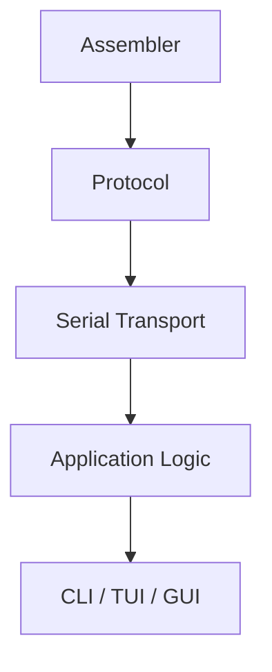

### Componentes

#### Assembler

Convierte código fuente en instrucciones máquina. El toolchain deberá producir una imagen little-endian no vacía, contigua y sin huecos desde `0x00000000`, con tamaño múltiplo de cuatro, y aplicar los límites del perfil sin duplicar constantes.

#### Serial Transport

Maneja el puerto serie.

#### Protocol

Codifica comandos y decodifica respuestas. Debe reconstruir y validar un snapshot completo antes de entregarlo a la lógica de aplicación.

#### Application Logic

Coordina carga, ejecución y lectura de estado.

#### UI

Presenta las operaciones al usuario, incluidos el contador lógico, PC global, estado de ejecución, validez de imagen, registros, pipeline y memoria utilizada. Un fault de memoria deberá mostrarse como ejecución anormal y no como finalización normal.

### Regla

La interfaz visual no debe contener la lógica del protocolo ni del assembler.

### Estrategia recomendada

El formato de aplicación se selecciona al cerrar `DEC-SYS-008`; CLI, TUI o GUI deben integrarse con las mismas capas funcionales especificadas. El orden de implementación se fija después de esa elección y del cierre global del diseño.

---

## 22. Fase 19 — Integración end-to-end

### Objetivo

Verificar el sistema completo.

Flujo:

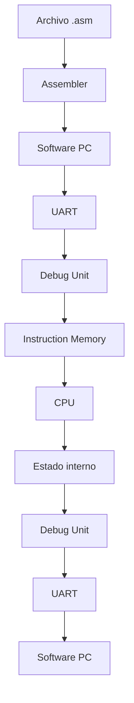

### Pruebas de aceptación mínimas

#### Carga

- cargar programa A;
- comprobar que la imagen es contigua, comienza en `0x00000000`, utiliza little-endian arquitectónico y no transporta un entry point configurable;
- ejecutarlo;
- comprobar resultado.

#### Reprogramación

- cargar programa B sin resintetizar;
- ejecutarlo;
- comprobar que registros, memoria de datos y metadatos de posiciones utilizadas comienzan lógicamente en cero o vacíos;
- comprobar que PC y pipeline presentan el estado inicial definido antes de ejecutar;
- comprobar que no depende incorrectamente del programa A;
- usar un programa B más corto y comprobar que no se ejecutan instrucciones residuales de A;
- comprobar que finalizar la carga no inicia `RUN` ni `STEP`;
- comprobar que el PC queda en `0x00000000` hasta recibir `RUN` o `STEP`;
- intentar `RUN` y `STEP` durante una carga en curso y verificar que no avanza la ejecución;
- comprobar que aceptar `LOAD` pone el tamaño confirmado en cero y deriva `image_valid = 0` sin confundir el progreso con el tamaño publicado;
- mantener bloqueado el commit de sesión mientras los metadatos de DMEM no estén completamente invalidados;
- completar la recepción y validación de la imagen mientras todavía falta preparar estado de sesión, y comprobar que el tamaño continúa en cero;
- interrumpir o invalidar una carga y verificar que no queda una imagen ejecutable parcial ni un tamaño confirmado distinto de cero;
- rechazar una imagen vacía, sparse, con huecos o de tamaño no múltiplo de cuatro;
- verificar el único write no nulo del tamaño y el commit coherente de contador y sesión solo después de preparar DMEM;
- completar después una carga válida y comprobar que el sistema vuelve a quedar preparado;
- comprobar que Debug no presenta estado de la sesión anterior como estado actual;
- comprobar que el contador lógico de la nueva sesión comienza en cero;
- comprobar que una dirección de instrucciones no cargada no se interpreta como `halt`.

#### Ejecución continua

- `RUN`;
- ejecución completa;
- recepción de un snapshot final coherente;
- comprobación del contador contra la cantidad de ciclos habilitados.

#### Faults de memoria

- provocar fetch fuera de imagen y fuera de capacidad en el flujo válido;
- provocar load y store total o parcialmente fuera de rango;
- comprobar ausencia de writeback o escrituras de la operación causante;
- para `sb`/`sh`/`sw` defectuosos por rango o desalineación, comprobar habilitación nula de **todos** los bytes candidatos de escritura y ausencia de cambios en datos y metadatos DMEM, aun cuando solo algunos bytes del acceso caigan fuera de rango; comparar con el mismo store legal, que escribe sus bytes exactamente una vez;
- comprobar que ninguna codificación ilegal reconocida como fault escribe RegFile/DMEM, redirige ni inicia `halt`, y que `jal`/`jalr` causantes de target desalineado tampoco escriben link;
- comprobar ausencia de efectos de instrucciones posteriores;
- descartar un acceso inválido del camino incorrecto sin entrar en fault;
- con I1 válida más antigua en MEM, I2 causante en EX e I3/I4 jóvenes en ID/IF, permitir que I1 complete exactamente una vez, impedir cualquier efecto de I2/I3/I4 y retener PC sin admitir instrucciones nuevas; repetir con anteriores en WB, fetch detectado en IF y confirmado en ID, ilegal en ID, otras ocupaciones/bubbles y candidato detectado pero todavía no confirmado;
- comprobar desde valores preflanco que IF captura candidatos solo con avance normal; ante load-use sin frontera EX/ID, PC/`IF/ID` se retienen, `ID/EX` recibe bubble y no hay confirmación. El candidato redetectado pasa después por `IF/ID` y solo puede confirmar en ID, donde se invalidan `IF/ID` e `ID/EX`; una causante EX invalida además `EX/MEM`. En ambos casos progresan las anteriores;
- comprobar `fault_cause` y `fault_pc` únicos al confirmar cada clase, estables durante el drenado y en `FAULT` aun con anteriores activas; un fetch causante usa su dirección y una instrucción obtenida su PC propio, nunca el target o dirección efectiva por defecto;
- tras completar **todas** las instrucciones anteriores y tener `IF/ID.valid=ID/EX.valid=EX/MEM.valid=MEM/WB.valid=0`, comprobar `FAULT` con pipeline vacío y metadatos aún observables, nunca `FINISHED`. En `RUN`, esperar la respuesta terminal `FAULT`, y en el `STEP` que alcanza ese terminal, `DONE` con `global_state=FAULT` en Debug. Contrastar con `halt` válido que termina en `FINISHED`;
- verificar drenado automático en `RUN`, un `STEP` por ciclo en modo paso a paso y ninguna transición durante `HOLD`, con PC retenido, registros interetapa jóvenes inválidos y progreso de anteriores; sin cantidad fija de ciclos y usando `FAULT_DRAIN_AUTO`/`STEP` conforme al acuerdo 44;
- distinguir estado de fault observable desde `FAULT_DRAIN` de drenado por `halt`/`FINISHED`;
- desde `FAULT_DRAIN` o `FAULT`, comprobar que reset global invalida metadatos y sesión, deja PC=0 y pipeline vacío, sin reanudación de la sesión previa;
- comprobar que una nueva sesión con la imagen todavía válida puede prepararse por `RUN`/`STEP` desde `FAULT` conforme al cuadragésimo cuarto acuerdo;
- dejar para Debug y protocolo la codificación de transporte externo, la representación de estado y metadatos, el acceso UART y vías adicionales de recuperación;
- comprobar que la FSM global sustituye el registro `terminal_kind[1:0]`, mientras `fault_cause[2:0]` conserva su codificación interna;
- conservar la prioridad por antigüedad;
- comprobar que en drenado alcanzable solo completan anteriores en `EX/MEM` y `MEM/WB` mediante `act_drain_advance`, con `IF/ID` e `ID/EX` inválidos y sin load-use. La rama `act_drain_load_use` se verifica solo con entradas/estado artificial rotulado como no alcanzable desde una sesión legal bajo el acuerdo 47, sin exigir cover end-to-end desde reset.

#### Paso a paso

- enviar `STEP`;
- verificar avance de exactamente un ciclo;
- observar un snapshot coherente con el contador incrementado exactamente una vez;
- repetir.

#### Finalización

- ensamblar y detectar `halt` con la codificación aprobada;
- dejar de incorporar instrucciones;
- descartar instrucciones posteriores sin efectos arquitectónicos;
- drenar el pipeline;
- comprobar drenado automático en `RUN` y ciclo a ciclo en `STEP`;
- comprobar que una ejecución sin `halt` no informa finalización normal;
- recuperar una ejecución no terminante durante `RUN` mediante reset global;
- verificar que la recuperación no emite el indicador de protocolo reservado para la finalización normal;
- informar finalización.

<a id="gate-de-salida-17"></a>

### Condición de salida

Todos los requisitos funcionales del sistema deben estar trazados a una prueba de aceptación ejecutada con éxito.

---

## 23. Fase 20 — Regresión automática

### Objetivo

Evitar que una corrección rompa características que ya funcionaban.

Debe mantenerse un conjunto estable de tests y ejecutarlo de forma frecuente.

Idealmente cada cambio relevante debe ejecutar:

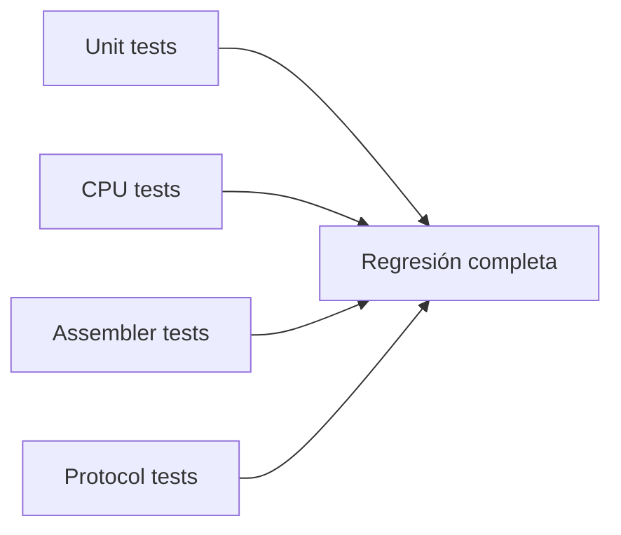

Antes de integrar una rama:

```text
toda la regresión debe pasar
```

Esto es especialmente importante cuando se utilicen agentes de IA para modificar código existente.

---

## 24. Fase 21 — Síntesis y análisis temporal

### Objetivo

Comprobar que la implementación sobre la FPGA satisface el diseño funcional y los criterios de análisis temporal.

Flujo:

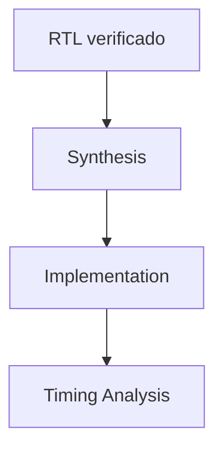

### Analizar

- WNS;
- TNS;
- WHS;
- THS;
- camino crítico;
- fanout problemático;
- clock skew;
- restricciones;
- caminos e interfaces relevantes sin restringir y excepciones temporales justificadas;
- frecuencia máxima razonable.

Para `REFERENCE=1024/2048` en Digilent Basys 3 (Artix-7 `XC7A35T-1CPG236C`), el objetivo inicial será un único clock funcional de 50 MHz / 20 ns generado por recurso dedicado desde el oscilador físico de 100 MHz. Se deberán restringir y verificar tanto el clock primario como el generado, mediante los constraints del recurso elegido o equivalentes sin duplicarlos, y comprobar que las rutas e interfaces relevantes se analizan. El Timing Summary y los reportes de Vivado post-implementation, después de place-and-route, deberán documentar WNS/TNS, WHS/THS, camino crítico, skew, cobertura y excepciones; todavía no se presume cumplimiento.

La puerta de cierre a 50 MHz exigirá `WNS >= 0 ns`, `TNS = 0 ns`, `WHS >= 0 ns` y `THS = 0 ns` para **todos los caminos relevantes restringidos** de la implementación, no solo los del dominio funcional. Comprobar clocks reconocidos, caminos síncronos analizados, interfaces con constraints adecuados y ausencia de caminos críticos relevantes sin restringir. Toda excepción temporal tendrá justificación, documentación y verificación; los slacks favorables con cobertura incompleta no serán evidencia suficiente. No se exigirá margen positivo adicional: uno pequeño podrá anotarse sin invalidar el cierre.

Para `REFERENCE` también deben registrarse la tecnología efectivamente inferida para IMEM, lanes de DMEM y metadatos de validez, los warnings relevantes, utilización de recursos e impacto sobre timing. `ALT_1000` requiere elaboración, simulación y smoke tests de parametrización, pero no síntesis, implementación ni timing closure obligatorios.

La organización física de `REFERENCE` deberá verificarse bajo la demanda simultánea de fetch y acceso de datos, preservando lectura combinacional y escritura síncrona. No podrá incorporarse salida registrada, handshake o stall para cerrar timing sin revisar `DEC-ARCH-006`.

El análisis deberá cubrir explícitamente:

- `PC -> detección en IF de rango, imagen y alineación -> IMEM -> IF/ID`;
- `ID/EX + forwarding -> dirección efectiva y detección de rango/alineación en EX -> EX/MEM -> organización DMEM habilitada solo para acceso válido -> filtro de validez -> ensamblado/extensión -> MEM/WB`, sin trasladar la detección de candidatos de DMEM a MEM;
- equivalencia de latencia entre simulación RTL y netlist;
- inferencia y timing de `REFERENCE`;
- frecuencia alcanzable y recursos consumidos por memoria;
- ancho derivado de `loaded_image_size_bytes`, incluido el caso conceptual de 33 bits;
- costo del comparador `loaded_image_size_bytes != 0` y ausencia de un flip-flop global `image_valid`;
- único write no nulo del tamaño durante el commit completo de sesión;
- assertions de rango y múltiplo de cuatro activas en simulación o formal sin convertir su lógica en semántica arquitectónica;
- preservación de ownership y ausencia de escrituras duplicadas según el contrato aprobado en `DEC-ARCH-008`;
- atomicidad entre dato y validez para los bytes seleccionados;
- costo de row/lane selection, ensamblado y extensión;
- cantidad de valid bits y recursos consumidos por metadatos;
- costo y timing del mecanismo de invalidación elegido por la implementación;
- efecto del mux `valid ? data : 0` sobre el camino crítico;
- preservación de la máscara lógica de escritura sin read-modify-write;
- cantidad y tipo real de puertos inferidos, sin exigir etiquetas single/simple-dual/true-dual;
- ausencia de dependencia funcional respecto de puertos opcionales;
- simultaneidad IF/MEM en netlist y hardware;
- un único clock funcional alcanzando el estado secuencial de CPU, pipeline, control, memorias, Debug y UART;
- origen de 100 MHz, generación y distribución dedicada del funcional a 50 MHz y análisis temporal de ambos clocks;
- setup y hold sin violaciones en todos los caminos relevantes restringidos, incluidos los de interfaces, con cobertura y excepciones temporales verificadas;
- operación funcional posterior a clock válido si el generador expone `locked`, sin fijar todavía su circuito de integración;
- ausencia de clocks generados desde `RUN`, `STEP`, `HOLD`, divisores lógicos o ticks UART;
- ancho de banda, no aliasing y timing concurrente si se comparte un backend físico;
- evidencia objetiva antes de evaluar XPM o primitivas.

RTL inferido será la implementación inicial. Si no cumple los gates funcionales o físicos, podrán evaluarse XPM o primitivas por memoria siempre que preserven el contrato. Cambiar a lectura síncrona requerirá revisar la decisión y sus dependencias.

La documentación deberá diferenciar explícitamente una configuración inválida de una configuración válida pero no soportada por el target, justificando cualquier límite práctico mediante recursos, herramientas o tecnología elegida.

La frecuencia final debe justificarse a partir de estos resultados. Si hay violaciones de setup o hold, o falta cobertura relevante, no se declarará timing cerrado ni se reducirá el objetivo silenciosamente: cualquier revisión deberá motivarse por el análisis de los caminos, respetar el mínimo de 50 MHz y quedar documentada antes de declarar aprobado el cierre temporal. Ni la síntesis exitosa ni la ausencia de errores generales de Vivado sustituyen los reportes post-implementation.

### Regla

Si falla setup, hold o la cobertura de constraints:

1. Identifique los caminos afectados, las rutas no analizadas y las excepciones aplicadas;
2. Comprenda las causas de las violaciones o de la cobertura incompleta;
3. Decida y justifique qué modificar;
4. Vuelva a ejecutar la regresión funcional;
5. Vuelva a sintetizar, implementar y analizar timing post-implementation.

No optimizar el diseño a ciegas.

---

## 25. Fase 22 — Validación en FPGA real

### Objetivo

Repetir sobre hardware físico los escenarios ya verificados en simulación.

### Orden

1. UART básica.
2. Carga de programa.
3. Programa aritmético simple.
4. Memoria.
5. Hazards.
6. Branches/jumps.
7. Continuo.
8. Step.
9. Debug completo.
10. Reprogramación.

### Diagnóstico

Si falla en simulación:

> problema lógico o de especificación.

Si funciona en simulación y falla en FPGA:

> investigar clock, constraints, timing, reset, UART, inicialización o integración física.

---

## 26. Fase 23 — Cierre técnico

Antes de considerar terminado el desarrollo:

- eliminar código muerto;
- resolver warnings relevantes;
- eliminar señales temporales de debug;
- revisar resets;
- revisar constantes mágicas;
- uniformar nombres;
- revisar comentarios;
- ejecutar la regresión completa;
- repetir síntesis;
- verificar timing final;
- actualizar diagramas;
- actualizar protocolo;
- actualizar decisiones;
- actualizar README.

La documentación final debe describir **el sistema realmente implementado**, no una versión anterior del diseño.

---

## 27. Uso profesional de agentes de IA

Los agentes deben trabajar sobre tareas pequeñas y completamente especificadas.

### Formato recomendado de tarea

```text
Tarea:
Implementar RegisterBank.

Fuente de verdad:
docs/interfaces.md
docs/architecture/stage_id.md
docs/decisions.md

Requisitos:
REQ-CPU-...
REQ-DBG-...

Tests:
tb/register_bank/...

Restricciones:
- No modificar interfaces externas.
- No modificar otros módulos.
- No introducir decisiones arquitectónicas.
- No cambiar requisitos.
- Si la especificación es insuficiente, reportar la ambigüedad.
- Ejecutar los tests definidos antes de dar la tarea por terminada.
```

### Flujo por cambio generado por IA

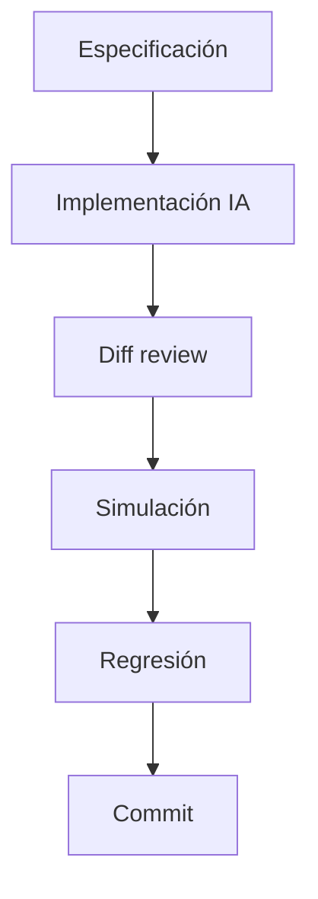

Nunca aceptar código generado únicamente porque compila.

---

## 28. Hitos formales del proyecto

| Hito | Condición |
|---|---|
| **M0 — Requirements Freeze** | requisitos identificados y numerados |
| **M1 — Decision Freeze** | decisiones globales críticas cerradas |
| **M2 — Architecture Freeze** | arquitectura global aprobada |
| **M3 — ISA Freeze** | todas las instrucciones especificadas |
| **M4 — Pipeline Freeze** | datapath, control, registros interetapa y flujo definidos |
| **M5 — Hazard Freeze** | forwarding, stalls y flush definidos |
| **D0 — Design Freeze del sistema completo** | CPU, Debug, UART/protocolo, Loader/preparación, software y plataforma diseñados; pendientes resueltos e interfaces físicas concretadas |
| **M6 — Verification Ready** | casos de prueba, resultados esperados y matriz de trazabilidad documentados; programación de tests todavía posterior |
| **M7 — CPU Functional** | CPU pasa regresión sin UART |
| **M8 — Debug Functional** | UART + Debug pasan pruebas aisladas |
| **M9 — Full Integration** | sistema end-to-end funcional |
| **M10 — Timing Closure** | implementación cumple timing |
| **M11 — Hardware Acceptance** | FPGA supera pruebas de aceptación |
| **M12 — Release** | documentación y código finalizados |

---

## 29. Orden resumido recomendado

```text
1. Preparar repositorio
2. Congelar requisitos
3. Resolver decisiones abiertas
4. Diseñar arquitectura global
5. Especificar ISA
6. Diseñar datapath
7. Diseñar control
8. Diseñar latches
9. Diseñar forwarding y hazards
10. Diseñar branches/jumps
11. Diseñar STOP y drenado
12. Definir servicios y parámetros UART
13. Definir memoria utilizada, campos Debug y captura coherente
14. Diseñar protocolo, comandos, respuestas, errores y recuperación
15. Diseñar Debug, Loader y preparación de sesión en detalle
16. Diseñar assembler, validación de imagen, capas de PC e interfaz de usuario
17. Concretar plataforma, clock/reset y restricciones previstas
18. Completar interfaces físicas y composición de tops
19. Diseñar modelo de referencia, pruebas y matriz de trazabilidad
20. Auditar el diseño completo y cerrar D0 y M6
21. Implementar RTL incrementalmente y programar sus tests
22. Implementar modelo de referencia y validar CPU sin UART
23. Implementar y verificar UART, Loader y Debug aislados
24. Implementar software de PC según el diseño cerrado
25. Integrar sistema completo
26. Ejecutar regresiones
27. Sintetizar y analizar timing
28. Validar en FPGA
29. Cerrar documentación y entrega
```

---

## 30. Criterio principal de avance

La regla general del proyecto debe ser:

> **No avanzar por cantidad de código escrito. Avanzar por evidencia de que una fase está correctamente especificada, implementada y verificada.**

El objetivo no es producir RTL rápidamente.

El objetivo es construir un sistema cuya corrección pueda demostrarse de manera progresiva.

Invertir tiempo en requisitos, arquitectura, interfaces y verificación al comienzo reduce significativamente el riesgo de rediseños tardíos, problemas de integración y errores difíciles de localizar al final del proyecto.

### Estado de la ruta de diseño — cierre UART 2026-10-05

[DEC-SYS-007](decisions.md#dec-sys-007--servicios-y-parámetros-generales-de-uart) quedó consolidada como aprobada después de la [comprobación de conexiones y presupuesto](architecture/uart_core.md#presupuesto-de-integración). UART, controlador/serializador, Loader, preparación/mantenimiento, reset y adaptación global tienen diseño de referencia concretado. La prioridad vigente sustituye ese orden: primero el [cierre de diseño FPGA](pending_decisions.md), dejando assembler/aplicación PC (`DEC-SYS-009`/008) para más adelante. D0/M6 siguen pendientes; no se autoriza RTL, software ni testbenches por este cierre parcial del sistema.

### Prioridad vigente — FPGA primero, 2026-10-05

La prioridad vigente es completar el diseño FPGA y posponer la PC. DMEM/metadatos, plataforma, configuración/tops y representación integrada están cerrados documentalmente (FPGA-01–06). Ruta vigente: plan de verificación/oráculo (FPGA-07/08) → revisión final FPGA-09. [único seguimiento de pendientes](pending_decisions.md) contiene fuentes y criterios por pendiente. Después se retoman software e integración global; D0/M6 y autorización de implementación no se adelantan por cambiar este orden.

## Referencias y trazabilidad

- [Requisitos](requirements.md): obligaciones y criterios de aceptación.
- [Pendientes](pending_decisions.md): único seguimiento actual del trabajo abierto.
- [Mapa de autoridad documental](architecture/system_overview.md#autoridad-documental-por-tema): contratos implementables y fuentes de origen.
