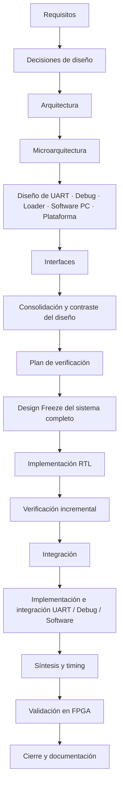
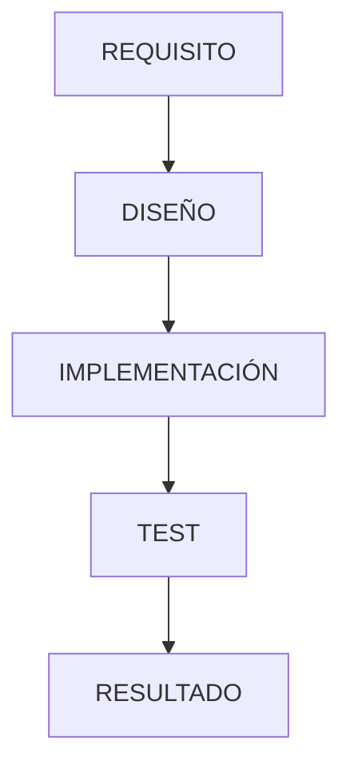
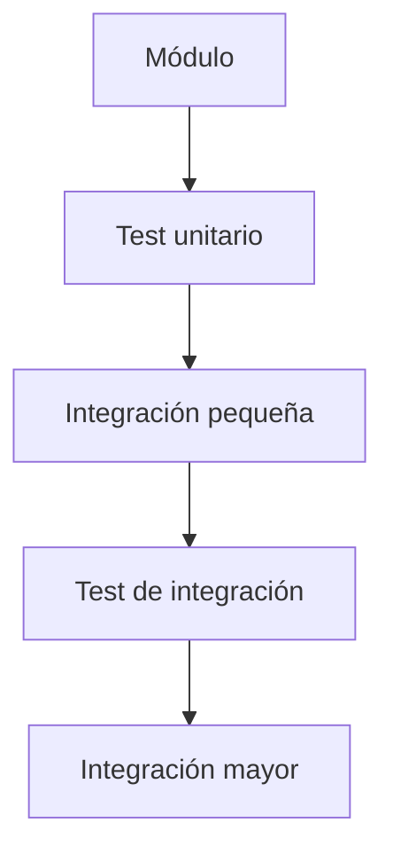
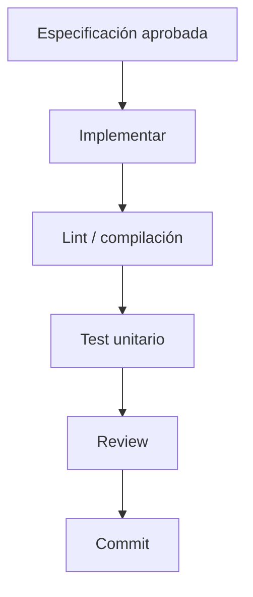
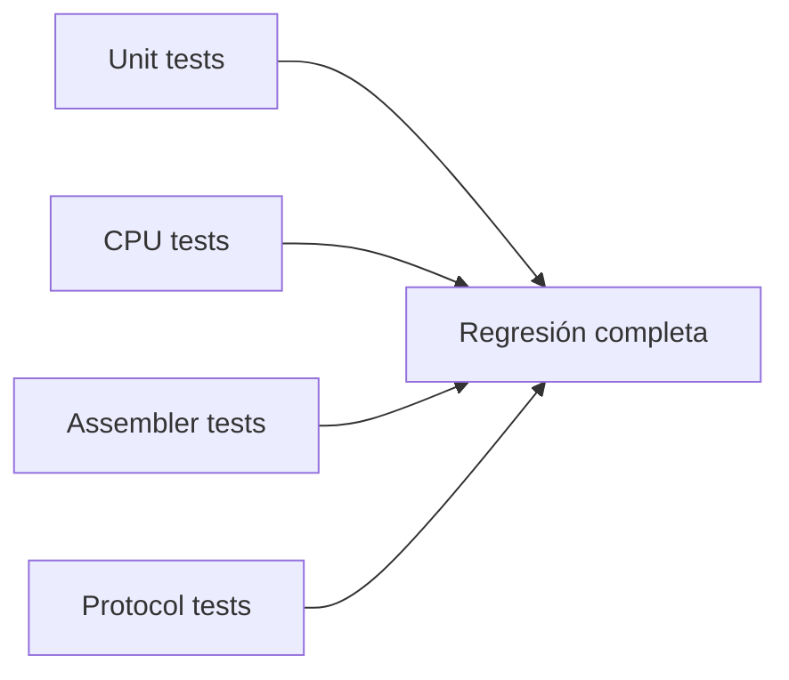
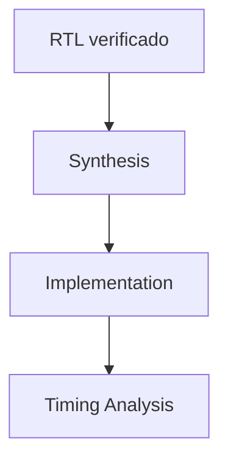
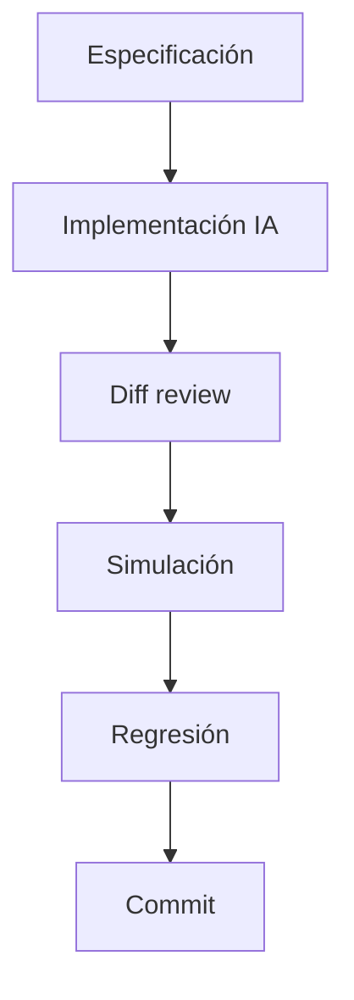

# Plan profesional de desarrollo — TP3 Procesador RISC-V Pipeline

- **Tipo:** plan.
- **Estado documental:** documentación vigente.

**Prioridad vigente:** completar el diseño de la aplicación de PC y el cierre conjunto del sistema antes de D0/M6 y de la implementación. El diseño del assembler está aprobado en [DEC-SYS-009](decisions/DEC-SYS-009.md). Las decisiones abiertas y sus condiciones de cierre se consultan en [Decisiones pendientes](decisions/pending_decisions.md).

**Índice**

- [Propósito y alcance](#propósito-y-alcance)
- [2. Principios de trabajo](#2-principios-de-trabajo)
- [3. Organización inicial del repositorio](#3-organización-inicial-del-repositorio)
- [4. Fase 1 — Congelamiento de requisitos](#4-fase-1--congelamiento-de-requisitos)
- [5. Fase 2 — Registro de decisiones abiertas](#5-fase-2--registro-de-decisiones-abiertas)
- [6. Fase 3 — Arquitectura global](#6-fase-3--arquitectura-global)
- [7. Fase 4 — Especificación del ISA soportado](#7-fase-4--especificación-del-isa-soportado)
- [8. Fase 5 — Diseño del datapath base](#8-fase-5--diseño-del-datapath-base)
- [9. Fase 6 — Diseño del control](#9-fase-6--diseño-del-control)
- [10. Fase 7 — Diseño de los registros del pipeline](#10-fase-7--diseño-de-los-registros-del-pipeline)
- [11. Fase 8 — Diseño de forwarding y hazards](#11-fase-8--diseño-de-forwarding-y-hazards)
- [12. Fase 9 — Diseño de branches, jumps y flush](#12-fase-9--diseño-de-branches-jumps-y-flush)
- [13. Fase 10 — Diseño de STOP y drenado del pipeline](#13-fase-10--diseño-de-stop-y-drenado-del-pipeline)
- [14. Fase 11 — Contratos de interfaces](#14-fase-11--contratos-de-interfaces)
- [15. Fase 12 — Plan de verificación](#15-fase-12--plan-de-verificación)
- [16. Fase 13 — Implementación RTL incremental](#16-fase-13--implementación-rtl-incremental)
- [17. Fase 14 — Validación del CPU con programas diagnósticos](#17-fase-14--validación-del-cpu-con-programas-diagnósticos)
- [18. Fase 15 — Resultados esperados y comparación](#18-fase-15--resultados-esperados-y-comparación)
- [19. Fase 16 — Diseño del protocolo UART/Debug](#19-fase-16--diseño-del-protocolo-uartdebug)
- [20. Fase 17 — UART y Debug Unit aislados](#20-fase-17--uart-y-debug-unit-aislados)
- [21. Fase 18 — Software de PC](#21-fase-18--software-de-pc)
- [22. Fase 19 — Integración end-to-end](#22-fase-19--integración-end-to-end)
- [23. Fase 20 — Regresión automática](#23-fase-20--regresión-automática)
- [24. Fase 21 — Síntesis y análisis temporal](#24-fase-21--síntesis-y-análisis-temporal)
- [25. Fase 22 — Validación en FPGA real](#25-fase-22--validación-en-fpga-real)
- [26. Fase 23 — Cierre técnico](#26-fase-23--cierre-técnico)
- [27. Uso profesional de agentes de IA](#27-uso-profesional-de-agentes-de-ia)
- [28. Hitos formales del proyecto](#28-hitos-formales-del-proyecto)
- [29. Orden resumido recomendado](#29-orden-resumido-recomendado)
- [30. Criterio principal de avance](#30-criterio-principal-de-avance)
- [Referencias y trazabilidad](#referencias-y-trazabilidad)

<a id="1-propósito-del-documento"></a>

## Propósito y alcance

**Rol vigente:** fases, actividades, gates, entregables e hitos. Los contratos implementables se consultan en el [mapa de autoridad documental](architecture/system_overview.md#autoridad-documental-por-tema). Los casos, expectativas y reglas de comparación se consultan en el [plan de verificación](verification/verification_plan.md). La implementación y la ejecución de las pruebas siguen pendientes.

Este documento define el proceso de trabajo recomendado para desarrollar el TP3 de manera ordenada, verificable y mantenible.

El objetivo principal es **reducir errores costosos de integración y rediseño**, invirtiendo más tiempo al comienzo en requisitos, diseño y verificación, para disminuir el tiempo total del proyecto.

La implementación no debe comenzar como una sucesión de módulos escritos de manera aislada. El proyecto debe avanzar siguiendo una secuencia controlada:



Cada fase tiene entregables concretos y una condición de salida. No se debe avanzar a la fase siguiente mientras la anterior tenga decisiones críticas sin resolver.

La especificación vigente de hazards se consulta en [Control y hazards](architecture/cpu/control_and_hazards.md) y [Faults y terminación](architecture/session/faults_and_termination.md). [DEC-ARCH-003](decisions/DEC-ARCH-003.md) conserva los acuerdos y sus revisiones.

---

## 2. Principios de trabajo

### 2.1. Diseñar antes de implementar

Ningún bloque RTL debe escribirse antes de conocer:

- qué responsabilidad tiene;
- qué datos recibe;
- qué datos produce;
- en qué ciclo actúa;
- qué estado mantiene;
- qué requisitos satisface;
- cómo se verificará.

La implementación debe materializar una arquitectura previamente definida, no crearla de manera accidental.

#### Condición común para comenzar implementación

**Criterio de trabajo establecido — 2026-09-30:** completar el diseño del sistema entero antes de programar cualquier componente. Esto comprende CPU, Debug, UART, protocolo, Loader, preparación de sesión, software de PC y plataforma. Tener especificada una ALU u otro bloque independiente no habilita a implementarlo mientras el diseño global siga abierto.

**Criterio de alcance establecido — 2026-10-01:** Mantener el diseño proporcional al trabajo práctico. La PC y la FPGA se diseñan conjuntamente y se asume que el cliente cumple el protocolo. Conservar las comprobaciones, timeouts y recuperación básicos aprobados, sin agregar mecanismos ni pendientes por incumplimientos arbitrarios del emisor o casos extremos ajenos al uso previsto. Completar el diseño significa especificar el funcionamiento requerido para el TP, sin exigir robustez de un producto de propósito general.

Antes de escribir RTL, software o testbenches deben estar definidos y revisados:

- la decisión de aplicación PC `DEC-SYS-008` abierta en [Decisiones pendientes](decisions/pending_decisions.md) y el diseño aprobado del assembler en [DEC-SYS-009](decisions/DEC-SYS-009.md), los entregables del [plan de verificación](verification/verification_plan.md), los [criterios de comparación](verification/verification_plan.md#resultados-esperados-y-criterios-de-comparación) y la revisión final del [diseño FPGA](architecture/system_overview.md#fuentes-de-detalle-y-trabajo-que-sigue), respetando sus dependencias;
- el criterio de DMEM utilizada, contenido observable y mecanismo de captura coherente;
- los servicios UART, comandos, paquetes, respuestas, errores, timeouts y recuperación;
- la microarquitectura de Debug, recepción/carga y preparación: estados privados, eventos, secuencias, ownership y relación con la FSM global;
- la estrategia del assembler, las responsabilidades de traducción y validación de imagen del sistema, las capas de software, sus interfaces y los flujos de uso; el [acuerdo de DEC-SYS-009](decisions/DEC-SYS-009.md#acuerdo-parcial-de-dec-sys-009--responsabilidad-de-traducción-y-validación-de-tamaño) conserva la validación de capacidad en FPGA;
- la concordancia de puertos, parámetros, tipos, codificaciones, adaptaciones físicas y composición de tops con [Interfaces](interfaces.md) y [Composición](architecture/system_composition.md), ya concretadas documentalmente;
- la integración prevista de clock/reset, recursos y restricciones de plataforma;
- los casos de prueba, resultados esperados, assertions previstas y matriz requisito → diseño → prueba, documentados sin programar todavía los tests.

El hito **D0 — Design Freeze del sistema completo** registra ese cierre. Durante esta etapa se trabaja en especificaciones, tablas, diagramas, secuencias por ciclo y revisión documental. La implementación incremental comienza después de D0 y M6; no se adelantan bloques por considerar que sus contratos locales ya están cerrados.

El cierre significa que las decisiones y conexiones necesarias están especificadas. Simulación, inferencia, timing y FPGA se comprobarán en implementación. Si esa evidencia exige un cambio, se revisará explícitamente el diseño y sus documentos antes de continuar; no se resolverá una ambigüedad silenciosamente dentro del código.

---

### 2.2. Ninguna decisión arquitectónica debe quedar escondida dentro del código

Toda decisión importante debe estar documentada.

Ejemplos:

- política de `STOP`/`HALT`;
- política de flush;
- política de stalls;
- política de forwarding;
- estado que se limpia al reprogramar;
- significado de “memoria utilizada”;
- protocolo UART;
- frecuencia de operación;
- tamaño de memorias.

El código no debe ser la única fuente desde la cual pueda descubrirse una decisión importante.

---

### 2.3. Todo requisito debe poder verificarse

Cada requisito debe terminar asociado a uno o más tests.

La relación deseada es:



El proyecto debe poder responder objetivamente si cada requisito está:

- verificado;
- pendiente;
- fallando.

---

### 2.4. Integrar progresivamente

Nunca debe esperarse al final para conectar todos los módulos.

El trabajo sigue esta secuencia:



La integración progresiva reduce la cantidad de posibles causas cuando aparece un error.

---

### 2.5. La IA implementa especificaciones; no inventa la arquitectura

Los agentes de IA deben utilizarse como herramientas de implementación, revisión y generación de tests.

No deben recibir instrucciones vagas como:

> Implementar el procesador completo.

Deben recibir tareas acotadas y basadas en documentos ya aprobados.

---

## 3. Organización inicial del repositorio

Antes de diseñar el hardware debe definirse una estructura de proyecto consistente.

La organización y los recorridos de lectura de la documentación se consultan en el [índice general](README.md). La organización de los testbenches por nivel se define en el [plan de verificación](verification/verification_plan.md#organización-de-la-verificación).

La estructura inicial distingue documentación, implementación, pruebas, software, programas, scripts y restricciones:

```text
/docs
/rtl
/tb
/software
/programs
/scripts
/constraints
```

### Entregables de esta fase

- repositorio creado;
- estructura de carpetas definida;
- convención de nombres acordada;
- estrategia de branches/commits definida;
- documento de requisitos incorporado.

<a id="gate-de-salida"></a>

### Condición de salida

No avanzar hasta que todos los integrantes sepan dónde se documentan requisitos, decisiones, diseño, tests y código.

---

## 4. Fase 1 — Congelamiento de requisitos

### Objetivo

Transformar la consigna en una lista de requisitos claros, numerados y verificables.

Cada requisito debe tener un identificador.

Los identificadores, la clasificación y los criterios de aceptación se consultan en [Requisitos](requirements.md#1-convenciones).

### Actividades

1. Recorrer la consigna completa.
2. Convertir cada obligación en un requisito independiente.
3. Eliminar ambigüedades de redacción.
4. Identificar decisiones abiertas.
5. Separar requisitos obligatorios de decisiones de implementación.

### Entregables

- `requirements.md`;
- matriz inicial de requisitos;
- listado de decisiones abiertas.

<a id="gate-de-salida-1"></a>

### Condición de salida

No avanzar si existe un requisito importante cuya interpretación todavía sea ambigua.

---

## 5. Fase 2 — Registro de decisiones abiertas

### Objetivo

Resolver las decisiones que la consigna deja al grupo antes de que estas aparezcan accidentalmente dentro del código.

Cada decisión debe registrarse con un identificador.

El formato y los campos del registro se consultan en [Decisiones](decisions/decisions.md#2-convenciones). Las decisiones abiertas se registran en [Decisiones pendientes](decisions/pending_decisions.md).

### Decisiones que deben cerrarse tempranamente

- representación de `STOP`/`HALT`;
- criterio de finalización;
- política de vaciado del pipeline;
- comportamiento ante programa sin `STOP`;
- política de reprogramación;
- estado que se reinicia;
- capacidades parametrizables de las memorias y perfil de referencia;
- criterio de “memoria utilizada”;
- formato general del protocolo UART;
- información exacta que expondrá Debug;
- política general de reset.

<a id="entregable"></a>

### Entregables

- `decisions/decisions.md`.

<a id="gate-de-salida-2"></a>

### Condición de salida

Toda decisión que afecte a más de un módulo debe estar resuelta antes de diseñar esos módulos.

---

## 6. Fase 3 — Arquitectura global

### Objetivo

Definir los grandes subsistemas y sus responsabilidades sin entrar todavía en señales RTL.

Las responsabilidades de los subsistemas se consultan en [Diseño FPGA consolidado](architecture/system_overview.md) y su integración en [Composición](architecture/system_composition.md). Revisar direccionamiento, imagen y ownership contra [Arquitectura de memoria](architecture/memory/memory_architecture.md), y las propiedades compartidas contra [Invariantes arquitectónicas](architecture/architectural_invariants.md).

<a id="entregable-1"></a>

### Entregables

- [Visión general](architecture/system_overview.md) y [Composición](architecture/system_composition.md);
- diagrama general;
- descripción de responsabilidades.

<a id="gate-de-salida-3"></a>

### Condición de salida

Todos los integrantes deben poder explicar el sistema completo sin consultar código.

---

## 7. Fase 4 — Especificación del ISA soportado

### Objetivo

Definir formalmente el comportamiento de cada instrucción requerida.

Debe construirse una tabla única que actúe como referencia para `Control Unit`, datapath, tests y assembler.

La tabla vigente de patrones legales, usos de fuentes y controles está en [Decoder ID](architecture/cpu/stage_id.md#decoder). Contrastar las instrucciones de [Requisitos](requirements.md), los [caminos de datos](architecture/cpu/datapath.md) y la [política de ilegal/fault](architecture/session/faults_and_termination.md); aprobaciones DEC-SYS-010, DEC-ARCH-004 y DEC-ARCH-003.

### Actividades

Completar la tabla de cada instrucción con sus fuentes, destino, inmediato, operación, acceso a memoria, valor de Write Back y modificación del PC. Los patrones legales y controles se consultan en [ID](architecture/cpu/stage_id.md#decoder), los efectos en [Datapath](architecture/cpu/datapath.md) y la confirmación de eventos en [Faults](architecture/session/faults_and_termination.md).

Los casos de clasificación, codificación y flujo arquitectónico se consultan en el [catálogo de ISA](verification/isa.md).

<a id="entregable-2"></a>

### Entregables

- [Decoder/ISA ID](architecture/cpu/stage_id.md#decoder), vinculado a [Requisitos](requirements.md).

<a id="gate-de-salida-4"></a>

### Condición de salida

No debe existir ninguna instrucción requerida cuyo comportamiento interno siga siendo ambiguo. La tabla de [ID](architecture/cpu/stage_id.md#decoder) y los casos del [catálogo de ISA](verification/isa.md) deben distinguir las codificaciones legales del resto.

---

## 8. Fase 5 — Diseño del datapath base

### Objetivo

Determinar cómo viajan los datos por el procesador antes de introducir optimizaciones o resolución de hazards.

Consultar los recorridos en [Datapath](architecture/cpu/datapath.md), la lectura de registros en [ID](architecture/cpu/stage_id.md#register-file), el [bypass WB→ID](architecture/cpu/control_and_hazards.md#bypass-wb--id) y la escritura en [WB](architecture/cpu/stage_wb.md).

### Análisis obligatorio

Debe seguirse manualmente el recorrido de al menos:

- `add`;
- `addi`;
- `lw`;
- `sw`;
- `beq`;
- `jal`;
- `jalr`;
- `lui`.

Para cada una debe identificarse:

- dónde nace cada dato;
- en qué etapa se utiliza;
- hasta qué etapa debe conservarse;
- dónde termina.

Para las instrucciones que calculan direcciones deberá identificarse además:

- la dirección arquitectónica expresada en bytes;
- el desplazamiento en bytes definido por el ISA;
- la conversión posterior a un índice físico, sin incorporarla a la semántica arquitectónica;
- el ancho del acceso cuando corresponda.

Los casos de RF, bypass, forwarding y writeback se consultan en el [catálogo de pipeline](verification/pipeline.md); los accesos y su temporización, en el [catálogo de memoria](verification/memory.md). La aprobación y la matriz del banco de registros se conservan en [DEC-ARCH-007](decisions/DEC-ARCH-007.md).

<a id="entregable-3"></a>

### Entregables

- [Datapath](architecture/cpu/datapath.md) y su vínculo con [Pipeline](architecture/cpu/cpu_pipeline.md);
- diagrama de datapath.

<a id="gate-de-salida-5"></a>

### Condición de salida

Cada dato necesario en una etapa posterior debe tener un camino explícito desde su origen.

---

## 9. Fase 6 — Diseño del control

### Objetivo

Determinar qué decisiones necesita tomar el procesador para cada instrucción.

Identificar las decisiones de control de cada instrucción y determinar en qué etapa se utilizan. Los controles se consultan en [Decoder ID](architecture/cpu/stage_id.md#decoder); su transporte, en [Pipeline](architecture/cpu/cpu_pipeline.md); y su aplicación, en [Control y hazards](architecture/cpu/control_and_hazards.md).

<a id="entregable-4"></a>

### Entregables

- tabla de control;
- vínculos de control en [Pipeline](architecture/cpu/cpu_pipeline.md) y [Control/hazards](architecture/cpu/control_and_hazards.md).

<a id="gate-de-salida-6"></a>

### Condición de salida

Cada instrucción debe tener completamente definido su comportamiento de control.

---

## 10. Fase 7 — Diseño de los registros del pipeline

### Objetivo

Definir con precisión qué información conserva cada registro interetapa.

Los campos, anchos y registros interetapa se consultan en [Pipeline](architecture/cpu/cpu_pipeline.md), su actualización en [Control y hazards](architecture/cpu/control_and_hazards.md#efecto-de-cada-acción-sobre-el-pipeline) y su representación observable en [Debug](architecture/debug/debug_architecture.md). Revisar estos contratos en conjunto.

### Regla

No agregar señales “por si acaso”.

Cada campo debe existir porque una etapa posterior lo necesita o porque forma parte del contrato de observabilidad aprobado por `DEC-SYS-006`.

<a id="entregable-5"></a>

### Entregables

- esquemas de registros interetapa en [Pipeline](architecture/cpu/cpu_pipeline.md).

<a id="gate-de-salida-7"></a>

### Condición de salida

Toda señal almacenada debe tener un consumidor claramente identificado.

---

## 11. Fase 8 — Diseño de forwarding y hazards

### Objetivo

Resolver dependencias en papel antes de escribir lógica RTL.

Las ecuaciones, prioridades, selectores y ocho acciones vigentes están en [Control y hazards](architecture/cpu/control_and_hazards.md). Usos de fuentes y controles se consultan en [ID](architecture/cpu/stage_id.md#decoder); operandos efectivos en [EX](architecture/cpu/stage_ex.md) y campos transportados en [Pipeline](architecture/cpu/cpu_pipeline.md). Aprobación/origen: DEC-ARCH-003 y sus revisiones.

### Análisis obligatorio

Para cada dependencia debe determinarse:

- cuándo se produce el dato;
- cuándo se necesita;
- si puede resolverse mediante forwarding;
- si requiere stall;
- qué etapa debe detenerse;
- qué registro interetapa debe conservarse;
- si es necesario insertar una bubble.

Los estímulos, secuencias por ciclo y criterios de aceptación se consultan en el [catálogo de pipeline](verification/pipeline.md). Los casos de faults, drenado y autorización se consultan en el [catálogo de ejecución](verification/execution.md).

<a id="entregable-6"></a>

### Entregables

- [Control y hazards](architecture/cpu/control_and_hazards.md);
- diagramas ciclo por ciclo de casos representativos.

<a id="gate-de-salida-8"></a>

### Condición de salida

La especificación de dependencias, forwarding, stalls, flush y arbitraje debe quedar definida en [Control y hazards](architecture/cpu/control_and_hazards.md), con sus casos de verificación en [Pipeline](verification/pipeline.md) y [Ejecución](verification/execution.md). [DEC-ARCH-003](decisions/DEC-ARCH-003.md) conserva la aprobación y sus revisiones; la ejecución de las pruebas RTL corresponde a la implementación.

---

## 12. Fase 9 — Diseño de branches, jumps y flush

### Objetivo

Analizar branches, jumps, descarte y prioridades antes de implementar. Consultar destinos/enlace en [EX](architecture/cpu/stage_ex.md#camino-de-control-de-flujo) y [Datapath](architecture/cpu/datapath.md), confirmación precisa en [Faults](architecture/session/faults_and_termination.md) y aplicación sobre PC/registros interetapa en [Control](architecture/cpu/control_and_hazards.md#efecto-de-cada-acción-sobre-el-pipeline). Aprobación/origen: DEC-ARCH-002/003/004; autorización del ciclo en [Ejecución](architecture/session/execution_control.md).

Los casos de branches, jumps, enlace y targets se consultan en el [catálogo de ISA](verification/isa.md), y los de descarte y prioridad en el [catálogo de pipeline](verification/pipeline.md).

<a id="entregable-7"></a>

### Entregables

- control de flujo en [EX](architecture/cpu/stage_ex.md) y [Pipeline](architecture/cpu/cpu_pipeline.md);
- aplicación de prioridades en [Control y hazards](architecture/cpu/control_and_hazards.md).

<a id="gate-de-salida-9"></a>

### Condición de salida

Debe poder dibujarse ciclo por ciclo qué ocurre con instrucciones tomadas por el camino incorrecto.

---

## 13. Fase 10 — Diseño de STOP y drenado del pipeline

### Objetivo

Definir la secuencia temporal desde la detección de `STOP`/`HALT` hasta la finalización de la ejecución, incluido el drenado del trabajo pendiente.

Detección, confirmación, descarte y terminación se consultan en [Faults y terminación](architecture/session/faults_and_termination.md). La autorización y los estados se consultan en [Control de ejecución](architecture/session/execution_control.md), y los casos de halt y fault en el [catálogo de ejecución](verification/execution.md).

<a id="entregable-8"></a>

### Entregables

- [Faults y terminación](architecture/session/faults_and_termination.md) y [Ejecución](architecture/session/execution_control.md).

<a id="gate-de-salida-10"></a>

### Condición de salida

Debe existir una secuencia temporal inequívoca desde la detección de `STOP` hasta el estado final.

---

## 14. Fase 11 — Contratos de interfaces

**Fuentes de consulta:** [Interfaces](interfaces.md), [Inventario](architecture/module_inventory.md) y [Composición](architecture/system_composition.md). Las condiciones del cierre global se consultan en [Hitos formales del proyecto](#28-hitos-formales-del-proyecto).

### Objetivo

Definir formalmente las interfaces antes de repartir implementación entre personas o agentes.

Para cada módulo debe documentarse:

```text
Nombre
Responsabilidad
Inputs
Outputs
Clock
Reset
Enable
Condiciones especiales
Errores posibles
```

### Revisión de contratos

Contrastar interfaces y dependencias con las fuentes del [mapa de autoridad documental](architecture/system_overview.md#autoridad-documental-por-tema), conservando los puertos, anchos y condiciones vigentes. Registrar discrepancias con su requisito y aprobación antes de implementar.

Consultar configuración y validadores en [Configuración común](architecture/common_configuration.md), capacidades y ownership en [Memoria](architecture/memory/memory_architecture.md), y recursos/puertos/tops en [Inventario](architecture/module_inventory.md) y [Composición](architecture/system_composition.md). [Interfaces](interfaces.md) relaciona las conexiones con los contratos especializados de ejecución, reset, preparación, Debug, UART y plataforma.

<a id="entregable-9"></a>

### Entregables

- `interfaces.md`.

<a id="gate-de-salida-11"></a>

### Condición de salida

Un integrante debe poder implementar un módulo sin necesitar modificar arbitrariamente la interfaz de otro.

---

## 15. Fase 12 — Plan de verificación

**Entregable de consulta:** [Plan de verificación](verification/verification_plan.md), [matriz de cobertura](verification/coverage.md) y catálogos por área. El cierre documental se consulta en el [plan de verificación](verification/verification_plan.md#condición-de-entrega-y-cierre).

### Objetivo

Diseñar los tests del sistema completo antes de implementar cualquier componente. En esta fase se documentan estímulos, resultados esperados, cobertura y criterios de aceptación; la programación de testbenches y scripts de regresión comienza después de D0 y M6.

La [matriz del entregable](verification/coverage.md) relaciona requisitos, contratos, comprobaciones y niveles. Los identificadores concretos son los `TEST-*` de los catálogos por área; ninguna fila acredita una prueba ejecutada.

Los niveles de observación y la evidencia requerida se consultan en el [plan de verificación](verification/verification_plan.md#niveles-de-verificación-y-evidencia-requerida).

### Automatización recomendada

Los tests deberían poder ejecutarse mediante scripts reproducibles.

Idealmente:

```text
./run_tests
```

o equivalente.

<a id="entregable-10"></a>

### Entregables

- `verification/verification_plan.md`, `verification/coverage.md` y catálogos por área;
- organización futura de `/tb` descrita en el plan de verificación; no se programan testbenches en esta fase.

<a id="gate-de-salida-12"></a>

### Condición de salida

Ningún bloque principal debe comenzar a implementarse sin saber qué tests deberá superar.

---

## 16. Fase 13 — Implementación RTL incremental

**Precondición:** D0 — Design Freeze del sistema completo y M6 — Verification Ready satisfechos. El diseño de UART/Debug, carga, software y plataforma se completa antes de esta fase, aunque sus secciones descriptivas aparezcan después en el documento.

### Orden recomendado

1. ALU.
2. `Immediate Generator`.
3. `Register Bank`.
4. PC.
5. `Instruction Memory`.
6. `Data Memory`.
7. `Control Unit`.
8. `Pipeline Registers`.
9. Datapath básico.
10. Forwarding.
11. `Hazard Detection`.
12. Branches y jumps.
13. `STOP` y drenado.
14. `Processor Top`.

### Ciclo de trabajo por módulo



No deben acumularse varios módulos sin probar.

---

## 17. Fase 14 — Validación del CPU con programas diagnósticos

### Objetivo

Validar el procesador completo antes de incorporar UART.

Crear programas assembler pequeños y específicos.

### Orden recomendado

1. Aritmética: [catálogo de ISA](verification/isa.md#test-isa-001).
2. Lógica, shifts y comparaciones: [catálogo de ISA](verification/isa.md).
3. Memoria: [catálogo de memoria](verification/memory.md).
4. Hazards: [catálogo de pipeline](verification/pipeline.md).
5. Control y legalidad de codificación: [ISA](verification/isa.md) y [Pipeline](verification/pipeline.md).
6. Finalización: [catálogo de ejecución](verification/execution.md).

El [plan de verificación](verification/verification_plan.md) define condiciones iniciales, niveles de observación, evidencia y comparación de resultados. Las comprobaciones de configuración, recursos y realización física se consultan en el [catálogo de plataforma](verification/platform.md) y se ejecutan en el nivel correspondiente.

#### Generación desde RUN, STEP y drenado

Consultar el contrato de [Control de ejecución](architecture/session/execution_control.md) y los casos de autorización, halt y fault del [catálogo de ejecución](verification/execution.md).

<a id="ownership-y-concurrencia-1"></a>

#### Ownership y concurrencia

Consultar [Memoria](architecture/memory/memory_architecture.md), [lectura directa del estado retenido](architecture/debug/debug_architecture.md#por-qué-la-coherencia-importa-con-uart), [exclusión del controlador](architecture/debug/protocol_controller.md#terminal-run-y-exclusión-debug) y [recorrido del serializador](architecture/debug/response_serializer.md#recorrido-de-dmem-y-orden-de-producción). Los casos se consultan en [Memoria](verification/memory.md#test-mem-006) y [UART y Debug](verification/uart_debug.md#test-uart-011).

<a id="gate-de-salida-13"></a>

### Condición de salida

No comenzar la integración con UART hasta que el CPU funcione de manera estable en simulación.

---

## 18. Fase 15 — Resultados esperados y comparación

**Criterios de consulta:** [Resultados esperados y criterios de comparación](verification/verification_plan.md#resultados-esperados-y-criterios-de-comparación). El cierre documental se consulta en el [plan de verificación](verification/verification_plan.md#condición-de-entrega-y-cierre).

### Objetivo

Definir los resultados esperados de las pruebas a partir de sus entradas, su estado inicial y los contratos vigentes. Cada variante utiliza valores, tablas o secuencias explícitas que el banco de pruebas compara con los resultados del procesador.

Los datos, tablas, secuencias y reglas de las expectativas se consultan en los [catálogos por área](verification/verification_plan.md#propósito-y-alcance) y en el [manifiesto de casos](verification/cases.json).

### Uso

El banco aplica el estado inicial y los estímulos de cada variante, observa sus efectos y los compara con las expectativas del catálogo y del manifiesto. Los resultados esperados se calculan independientemente del DUT, conforme a los [criterios de comparación](verification/verification_plan.md#resultados-esperados-y-criterios-de-comparación).

### Beneficio

Las expectativas explícitas permiten comprobar los resultados y localizar diferencias sin depender solamente de la inspección manual de waveforms. La observación de commits detecta errores que podrían quedar ocultos al comparar únicamente el estado final.

<a id="gate-de-salida-14"></a>

### Condición de salida

Cada variante tiene una expectativa determinada por sus datos o por una referencia concreta del catálogo. Los criterios fijan los efectos que se comparan y el momento de observación. La revisión documental se completa antes de implementar los testbenches, conforme al cierre global del diseño.

---

## 19. Fase 16 — Diseño del protocolo UART/Debug

**Orden de ejecución:** esta fase de diseño se completa antes de D0, M6 y cualquier implementación RTL o software. La numeración histórica de las fases identifica secciones; no autoriza a diferir el protocolo hasta después de programar el CPU.

### Objetivo

Definir el protocolo antes de implementarlo.

Las solicitudes, respuestas, códigos, formatos, errores y recuperación se consultan en [Protocolo](protocol.md). [Debug](architecture/debug/debug_architecture.md) define el contenido y la coherencia de la observación; [Ejecución](architecture/session/execution_control.md) define la semántica interna. [DEC-PROTO-001](decisions/DEC-PROTO-001.md), [DEC-PROTO-002](decisions/DEC-PROTO-002.md) y [DEC-PROTO-003](decisions/DEC-PROTO-003.md) conservan las aprobaciones y sus revisiones.

Las decisiones de diseño PC se registran en [Decisiones pendientes](decisions/pending_decisions.md). Las condiciones de cierre conjunto se consultan en [Hitos formales del proyecto](#28-hitos-formales-del-proyecto).

<a id="gate-de-salida-15"></a>

### Condición de salida

Python y Verilog deben poder implementarse leyendo exactamente el mismo documento, sin inventar comportamientos adicionales.

---

## 20. Fase 17 — UART y Debug Unit aislados

### Objetivo

Verificar la comunicación sin introducir todavía la complejidad del procesador completo.

### Secuencia recomendada

#### Test 1 — UART básica

Consultar tramas, tick, sincronización y FIFO en el [catálogo de UART y Debug](verification/uart_debug.md).

#### Test 2 — Recepción de comandos

Consultar [comandos, disponibilidad y rechazos](verification/uart_debug.md#test-uart-003), con el contrato de [Protocolo](protocol.md).

#### Test 3 — Carga de memoria

Consultar [LOAD](verification/uart_debug.md#test-uart-004), [Loader](verification/memory.md#test-mem-007) y [publicación de imagen](verification/memory.md#test-mem-008). Los contratos de carga, preparación y memoria se consultan en [Loader](architecture/session/loader.md), [Preparación](architecture/session/session_preparation.md) y [Memoria](architecture/memory/memory_architecture.md).

#### Test 4 — Lectura de estado simulado

Consultar [snapshot fijo](verification/uart_debug.md#test-uart-007), [lista de memoria utilizada](verification/uart_debug.md#test-uart-008), [retención TX y fin físico](verification/uart_debug.md#test-uart-009) y [exclusión Debug](verification/uart_debug.md#test-uart-011). Aplicar los [contratos de coherencia](architecture/debug/debug_architecture.md#por-qué-la-coherencia-importa-con-uart) y [fin físico del serializador](architecture/debug/response_serializer.md#seguimiento-físico-ocupación-y-reset).

<a id="gate-de-salida-16"></a>

### Condición de salida

UART y Debug deben funcionar independientemente del CPU antes de integrarlos con él.

---

## 21. Fase 18 — Software de PC

**Diseño previo obligatorio:** `DEC-SYS-009` está aprobada. Antes de D0 se resuelve `DEC-SYS-008`, se especifican las capas e interfaces siguientes y se documentan los flujos y errores conforme al protocolo. La implementación de esas capas comienza después de D0 y M6.

### Actividades de diseño

Especificar las responsabilidades e interfaces de assembler, transporte serie, protocolo, lógica de aplicación e interfaz de usuario. Definir los flujos de carga, ejecución, lectura de estado y tratamiento de errores antes de implementar esas capas.

El alcance se consulta en [Requisitos de software](requirements.md#8-software-de-pc), los intercambios en [Protocolo](protocol.md) y las decisiones de assembler/aplicación en [Pendientes](decisions/pending_decisions.md#7-software-de-pc).

### Regla

La interfaz visual no debe contener la lógica del protocolo ni del assembler.

### Estrategia recomendada

El formato de aplicación se selecciona al cerrar `DEC-SYS-008`; CLI, TUI o GUI deben integrarse con las mismas capas funcionales especificadas. El orden de implementación se fija después de esa elección y del cierre global del diseño.

---

## 22. Fase 19 — Integración end-to-end

### Objetivo

Verificar el sistema completo.

La composición del sistema se consulta en [Composición](architecture/system_composition.md) y los intercambios PC–FPGA en [Protocolo](protocol.md).

### Pruebas de aceptación

Ejecutar las comprobaciones de carga, reprogramación, ejecución continua, faults, paso a paso y finalización del [catálogo de UART y Debug](verification/uart_debug.md), con los casos de [Memoria](verification/memory.md) y [Ejecución](verification/execution.md) correspondientes. La [matriz de cobertura](verification/coverage.md) relaciona los requisitos con sus comprobaciones; el [plan de verificación](verification/verification_plan.md#niveles-de-verificación-y-evidencia-requerida) distingue los niveles de sistema y placa y la evidencia requerida.

<a id="gate-de-salida-17"></a>

### Condición de salida

Todos los requisitos funcionales del sistema deben estar trazados a una prueba de aceptación ejecutada con éxito.

---

## 23. Fase 20 — Regresión automática

### Objetivo

Evitar que una corrección rompa características que ya funcionaban.

Debe mantenerse un conjunto estable de tests y ejecutarlo de forma frecuente.

Idealmente cada cambio relevante debe ejecutar:



Antes de integrar una rama:

```text
toda la regresión debe pasar
```

Esto es especialmente importante cuando se utilicen agentes de IA para modificar código existente.

---

## 24. Fase 21 — Síntesis y análisis temporal

### Objetivo

Comprobar que la implementación sobre la FPGA satisface el diseño funcional y los criterios de análisis temporal.

Flujo:



### Analizar

- WNS;
- TNS;
- WHS;
- THS;
- camino crítico;
- fanout problemático;
- clock skew;
- restricciones;
- caminos e interfaces relevantes sin restringir y excepciones temporales justificadas;
- frecuencia máxima razonable.

Los criterios de constraints, recursos, cobertura, excepciones y timing post-implementation se consultan en [TEST-PLAT-004](verification/platform.md#test-plat-004). La generación de clock y las restricciones previstas se consultan en [Plataforma](architecture/platform/platform_reference.md); los contratos físicos de memoria, perfiles y alternativas en [Arquitectura de memoria](architecture/memory/memory_architecture.md) y [DEC-ARCH-006](decisions/DEC-ARCH-006.md).

La frecuencia final debe justificarse a partir de los reportes post-implementation. Toda modificación exigida por recursos o timing debe preservar los contratos o dar lugar a una revisión explícita del diseño antes de declarar el cierre.

### Regla

Si falla setup, hold o la cobertura de constraints:

1. Identifique los caminos afectados, las rutas no analizadas y las excepciones aplicadas;
2. Comprenda las causas de las violaciones o de la cobertura incompleta;
3. Decida y justifique qué modificar;
4. Vuelva a ejecutar la regresión funcional;
5. Vuelva a sintetizar, implementar y analizar timing post-implementation.

No optimizar el diseño a ciegas.

---

## 25. Fase 22 — Validación en FPGA real

### Objetivo

Repetir sobre hardware físico los escenarios ya verificados en simulación, conforme a [Aceptación Basys 3](verification/platform.md#test-plat-005).

### Orden

1. UART básica.
2. Carga de programa.
3. Programa aritmético simple.
4. Memoria.
5. Hazards.
6. Branches/jumps.
7. Continuo.
8. Step.
9. Debug completo.
10. Reprogramación.

### Diagnóstico

Si falla en simulación:

> problema lógico o de especificación.

Si funciona en simulación y falla en FPGA:

> investigar clock, constraints, timing, reset, UART, inicialización o integración física.

---

## 26. Fase 23 — Cierre técnico

Antes de considerar terminado el desarrollo:

- eliminar código muerto;
- resolver warnings relevantes;
- eliminar señales temporales de debug;
- revisar resets;
- revisar constantes mágicas;
- uniformar nombres;
- revisar comentarios;
- ejecutar la regresión completa;
- repetir síntesis;
- verificar timing final;
- actualizar diagramas;
- actualizar protocolo;
- actualizar decisiones;
- actualizar README.

La documentación final debe describir **el sistema realmente implementado**, no una versión anterior del diseño.

---

## 27. Uso profesional de agentes de IA

Los agentes deben trabajar sobre tareas pequeñas y completamente especificadas.

### Formato recomendado de tarea

```text
Tarea:
Implementar RegisterBank.

Fuente de verdad:
docs/interfaces.md
docs/architecture/cpu/stage_id.md
docs/decisions/decisions.md

Requisitos:
REQ-CPU-...
REQ-DBG-...

Tests:
tb/register_bank/...

Restricciones:
- No modificar interfaces externas.
- No modificar otros módulos.
- No introducir decisiones arquitectónicas.
- No cambiar requisitos.
- Si la especificación es insuficiente, reportar la ambigüedad.
- Ejecutar los tests definidos antes de dar la tarea por terminada.
```

### Flujo por cambio generado por IA



Nunca aceptar código generado únicamente porque compila.

---

## 28. Hitos formales del proyecto

| Hito                                        | Condición                                                                                                                              |
|---------------------------------------------|----------------------------------------------------------------------------------------------------------------------------------------|
| **M0 — Requirements Freeze**                | requisitos identificados y numerados                                                                                                   |
| **M1 — Decision Freeze**                    | decisiones globales críticas cerradas                                                                                                  |
| **M2 — Architecture Freeze**                | arquitectura global aprobada                                                                                                           |
| **M3 — ISA Freeze**                         | todas las instrucciones especificadas                                                                                                  |
| **M4 — Pipeline Freeze**                    | datapath, control, registros interetapa y flujo definidos                                                                              |
| **M5 — Hazard Freeze**                      | forwarding, stalls y flush definidos                                                                                                   |
| **D0 — Design Freeze del sistema completo** | CPU, Debug, UART/protocolo, Loader/preparación, software y plataforma diseñados; pendientes resueltos e interfaces físicas concretadas |
| **M6 — Verification Ready**                 | casos de prueba, resultados esperados y matriz de trazabilidad documentados; programación de tests todavía posterior                   |
| **M7 — CPU Functional**                     | CPU pasa regresión sin UART                                                                                                            |
| **M8 — Debug Functional**                   | UART + Debug pasan pruebas aisladas                                                                                                    |
| **M9 — Full Integration**                   | sistema end-to-end funcional                                                                                                           |
| **M10 — Timing Closure**                    | implementación cumple timing                                                                                                           |
| **M11 — Hardware Acceptance**               | FPGA supera pruebas de aceptación                                                                                                      |
| **M12 — Release**                           | documentación y código finalizados                                                                                                     |

---

## 29. Orden resumido recomendado

```text
1. Preparar repositorio
2. Congelar requisitos
3. Resolver decisiones abiertas
4. Diseñar arquitectura global
5. Especificar ISA
6. Diseñar datapath
7. Diseñar control
8. Diseñar latches
9. Diseñar forwarding y hazards
10. Diseñar branches/jumps
11. Diseñar STOP y drenado
12. Definir servicios y parámetros UART
13. Definir memoria utilizada, campos Debug y captura coherente
14. Diseñar protocolo, comandos, respuestas, errores y recuperación
15. Diseñar Debug, Loader y preparación de sesión en detalle
16. Diseñar assembler y capas de PC con sus responsabilidades de traducción, carga e interfaz de usuario
17. Concretar plataforma, clock/reset y restricciones previstas
18. Completar interfaces físicas y composición de tops
19. Definir pruebas, resultados esperados, criterios de comparación y matriz de trazabilidad
20. Auditar el diseño completo y cerrar D0 y M6
21. Implementar RTL incrementalmente y programar sus tests
22. Validar CPU sin UART contra los resultados esperados de sus pruebas
23. Implementar y verificar UART, Loader y Debug aislados
24. Implementar software de PC según el diseño cerrado
25. Integrar sistema completo
26. Ejecutar regresiones
27. Sintetizar y analizar timing
28. Validar en FPGA
29. Cerrar documentación y entrega
```

---

## 30. Criterio principal de avance

La regla general del proyecto debe ser:

> **No avanzar por cantidad de código escrito. Avanzar por evidencia de que una fase está correctamente especificada, implementada y verificada.**

El objetivo no es producir RTL rápidamente.

El objetivo es construir un sistema cuya corrección pueda demostrarse de manera progresiva.

Invertir tiempo en requisitos, arquitectura, interfaces y verificación al comienzo reduce significativamente el riesgo de rediseños tardíos, problemas de integración y errores difíciles de localizar al final del proyecto.

### Estado de la ruta de diseño — cierre UART 2026-10-05

El origen y alcance del cierre UART se consultan en [DEC-SYS-007](decisions/DEC-SYS-007.md), y sus fundamentos en [Integración UART](architecture/uart/uart_core.md#presupuesto-de-integración).

### Prioridad vigente — FPGA primero, 2026-10-05

El assembler está diseñado y aprobado en [DEC-SYS-009](decisions/DEC-SYS-009.md). Concretar la aplicación de PC y completar el cierre conjunto del sistema antes de D0/M6 y de la implementación. Las decisiones abiertas, sus fuentes y condiciones de cierre se consultan en [Decisiones pendientes](decisions/pending_decisions.md).

## Referencias y trazabilidad

- [Requisitos](requirements.md): obligaciones y criterios de aceptación.
- [Decisiones pendientes](decisions/pending_decisions.md): decisiones de diseño abiertas y condiciones de cierre.
- [Mapa de autoridad documental](architecture/system_overview.md#autoridad-documental-por-tema): contratos implementables y fuentes de origen.
