# Arquitectura de viewrv

- **Tipo:** arquitectura de software.
- **Estado documental:** especificación vigente.

**Índice**

- [Propósito y alcance](#propósito-y-alcance)
- [Organización del producto](#organización-del-producto)
- [Organización y responsabilidades](#organización-y-responsabilidades)
- [Organización de ejecución](#organización-de-ejecución)
- [Arquitectura interna del core](#arquitectura-interna-del-core)
- [Arquitectura interna de GUI](#arquitectura-interna-de-gui)
- [Arquitectura interna de CLI](#arquitectura-interna-de-cli)

## Propósito y alcance

Describe los procesos, componentes, responsabilidades, dependencias y mecanismos de coordinación de la aplicación. El core mantiene la lógica compartida de GUI y CLI y la autoridad sobre programas, placa, sesiones y conservación.

## Organización del producto

viewrv es una aplicación de escritorio local para Linux y Windows x86_64. La GUI utiliza Electron, React y TypeScript. El core y la CLI utilizan Python. GUI y CLI son clientes pares de un único core local, iniciado bajo demanda. HTTP transporta solicitudes y resultados; SSE publica el estado vivo de las GUI. La CLI no requiere abrir Electron ni mantener una terminal residente.

## Organización y responsabilidades

La lógica compartida se organiza en cuatro áreas. Son límites de responsabilidad; no fijan un número de archivos, bibliotecas o procesos.

| Área | Responsabilidad |
|------|-----------------|
| Programas y traducciones | Gestionar identidad, texto y versión de los programas; invocar el assembler; asociar imagen y mapa PC–línea con su fuente; determinar vigencia y restricciones de modificación. |
| Preparación y conexión | Coordinar la programación del bitstream, resolver el puerto, establecer y cerrar el enlace, conservar su estado y ejecutar la recuperación aplicable. |
| Sesiones y resultados | Admitir y coordinar LOAD, RUN y depuración; vincular versiones con imágenes y ensayos; interpretar observaciones; gestionar breakpoints, seguimiento, interrupciones y resultados. |
| Conservación del código y la evidencia | Leer, guardar y recuperar código y registros; conservar los datos de continuidad y preferencias; informar resultados de almacenamiento. |

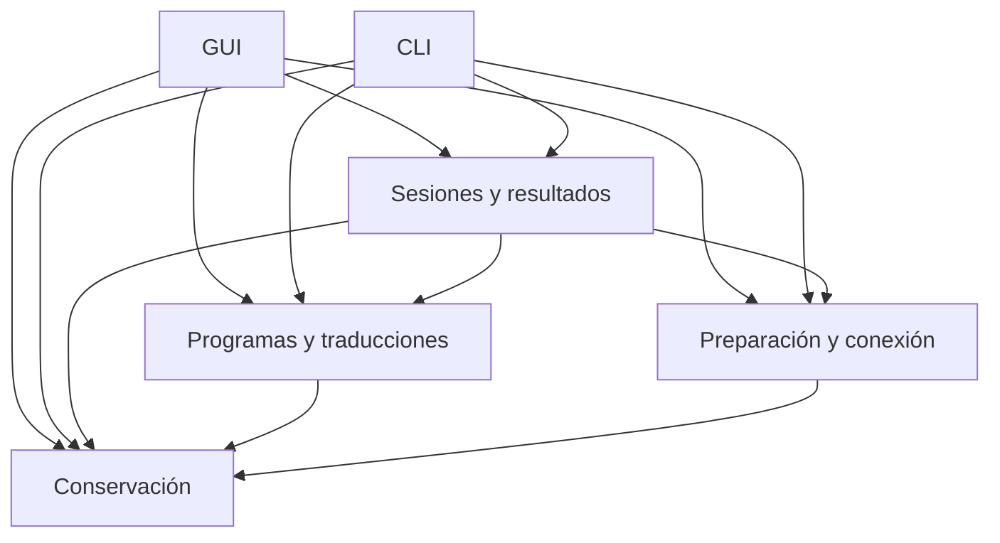

Las flechas representan solicitudes y dependencias lógicas, no un transporte elegido. Los resultados y cambios de estado se comunican a los consumidores correspondientes. Conservación devuelve datos y resultados de almacenamiento; no decide cómo avanzar el procesador. La GUI gestiona presentación y edición interactiva; la CLI interpreta sus invocaciones y presenta salidas humanas o estructuradas. Ninguna de las dos implementa una política de sesión distinta.

El assembler es utilizado por Programas. La integración de comunicación implementa los intercambios y la recepción del protocolo para Preparación y Sesiones. La herramienta de programación es utilizada por Preparación; se seleccionó openFPGALoader. El acceso al almacenamiento pertenece a Conservación.

## Organización de ejecución

### Procesos y continuidad

El core se ejecuta en un proceso local separado y mantiene la conexión UART y el estado de la sesión entre invocaciones de CLI. Cada comando puede recibir el resultado y terminar sin cerrar la depuración. La GUI no es necesaria para operar desde la terminal.

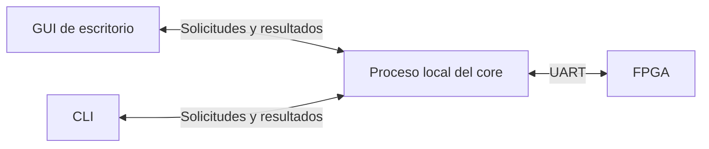

El core actúa como servidor local y las interfaces como clientes pares. Las cuatro áreas lógicas conservan sus responsabilidades dentro del core. La comunicación no requiere Internet. La GUI puede observar una depuración controlada por CLI. Terminar una invocación de CLI es distinto de solicitar desconectar o salir de la aplicación, operaciones cuyos efectos conservan los contratos anteriores.

### Inicio bajo demanda

La GUI o la CLI inicia automáticamente el core cuando necesita utilizarlo y no hay uno ejecutándose. Si ya hay un core disponible, se conecta al existente. La interfaz espera a que el core esté preparado antes de enviar la operación solicitada; si el inicio falla, informa el error y no ejecuta esa operación. El usuario no debe iniciar manualmente un servidor.

El core se ejecuta como proceso del usuario, sin instalar un servicio del sistema ni iniciarse al encender la computadora. La reutilización del proceso no concede por sí sola control sobre una sesión de otro cliente.

### Continuidad del trabajo y cierre

La duración de un comando de CLI no determina la duración de su trabajo en el core. Para la primera versión existe una única sesión de trabajo de CLI por core. El primer comando que inicia un trabajo la crea; las invocaciones posteriores la reutilizan automáticamente, incluso desde terminales distintas, sin exigir un identificador de sesión en cada comando. Se conserva hasta que una orden explícita la finaliza; otro trabajo posterior crea una sesión nueva, aunque el core siga disponible para GUI. Las terminales no representan investigaciones independientes y se mantienen los rechazos de operaciones incompatibles.

Esta sesión de trabajo representa el uso persistente del core; no se confunde con una sesión de depuración, que mantiene su identidad y sus reglas propias. Un trabajo de CLI puede comprender ensamblados, cargas, ejecuciones y distintas depuraciones sucesivas. El trabajo de GUI sigue separado. La CLI no requiere un proceso cliente permanentemente ejecutándose.

| Acción | Efecto sobre el core |
|--------|---------------------|
| Termina un comando de CLI | Conserva la sesión de trabajo y su contexto para la siguiente invocación. |
| Se cierra la GUI y queda trabajo de CLI | Finaliza el uso de GUI; conserva el core y el trabajo de CLI. |
| Se cierra la GUI y no queda trabajo de CLI ni otra interfaz abierta | Completa el cierre ordenado y termina el core. |
| La CLI finaliza explícitamente su trabajo y queda una GUI abierta | Finaliza el trabajo de CLI; el core permanece para GUI. |
| Finaliza el último trabajo de CLI y no queda ninguna interfaz abierta | Completa el cierre ordenado y termina el core. |

Cerrar la GUI no termina una sesión de trabajo de CLI por la ausencia momentánea de comandos. Cada salida resuelve la actividad y los guardados de su propio trabajo sin desconectar ni terminar el trabajo ajeno. Esto incluye el cierre de una GUI que observa la depuración controlada por CLI. Se mantiene la exclusión de control de la placa; observar no habilita operar simultáneamente la misma depuración desde ambas interfaces.

El core termina cuando concluye su último uso, después de resolver la actividad, la conexión correspondiente y los guardados conforme a las políticas de salida. Si falla el guardado del código al salir de GUI, esta permanece abierta y el core sigue disponible para resolverlo. No se introduce un cierre por tiempo de inactividad entre comandos. Las solicitudes identifican el trabajo mediante los encabezados y contratos HTTP de la aplicación.

### Responsabilidad de cierre del trabajo de CLI

La persona, agente o automatización que utiliza CLI es responsable de solicitar la desconexión para liberar la placa y de finalizar explícitamente su trabajo cuando termina de utilizar el core. La aplicación garantiza el tratamiento de esas solicitudes conforme a las reglas de cierre; no garantiza que el cliente las emita.

| Situación | Tratamiento definido |
|-----------|----------------------|
| El usuario o script termina su trabajo | Debe solicitar desconectar o finalizar, según el recurso que quiera liberar. |
| El cliente termina o falla sin emitir el cierre | El core conserva el trabajo y la reserva que mantuviera; no deduce abandono por ausencia de comandos. |
| Se necesita liberar manualmente ese trabajo | Puede solicitarse el cierre desde otra terminal, utilizando el contexto único de CLI. |

Esta política no incorpora detección automática de abandono, vencimiento por inactividad ni cancelación forzada del trabajo de CLI desde GUI. El cierre manual sigue resolviendo la operación pendiente y sus confirmaciones; no consiste en borrar una reserva. La finalización de un proceso cliente es distinta de una pérdida del enlace PC/FPGA y no activa por sí sola la recuperación UART. Los fallos del propio core y del enlace conservan sus tratamientos definidos.

### Observación en vivo desde GUI

El core conserva la sesión controlada por CLI y pone a disposición de la GUI observadora su contexto y sus capturas completas. La fuente y la versión mostradas son las del ensayo observado, no las de un archivo independiente con foco en el editor. Se conservan identidad, orden y significado temporal de las observaciones.

| Participación | Alcance |
|---------------|---------|
| CLI como controlador | Envía las operaciones de depuración y conserva sus efectos y restricciones. |
| GUI como observadora | Presenta la sesión, las capturas y su interpretación, sin enviar operaciones a la placa ni modificar avance o breakpoints. |

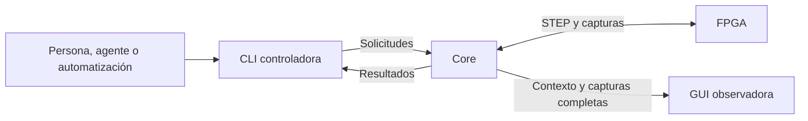

Observar utiliza los datos ya recibidos por el core: no agrega STEP, consultas UART ni señales medidas. Abrir o cerrar la observación no inicia, termina ni reinicia la depuración; las esperas conservan los plazos del enlace. La reproducción posterior en GUI sigue siendo una ejecución independiente, distinta de esta observación. Las actualizaciones utilizan SSE con vista inicial coherente y resincronización. La observación no incorpora un agente al producto ni historial navegable.

### Observación en vivo desde CLI

La CLI puede observar una depuración controlada desde GUI. Las consultas y el puerto de publicación proporcionan el programa, versión, estado y capturas completas de la sesión observada sin transferir su control. Abrir o cerrar la observación CLI no genera UART ni modifica avance o breakpoints del ensayo GUI.

La CLI obtiene los pasos de una sesión mediante invocaciones finitas de solicitud y respuesta. Por defecto se devuelven todos los pasos disponibles de la sesión; opcionalmente, el consumidor puede indicar el último paso recibido y obtener los posteriores en orden. La consulta completa no exige gestionar un cursor. El seguimiento incremental conserva su referencia en el consumidor: el core no mantiene un registro de consumo por persona, agente o script. La consulta no avanza la depuración ni modifica su control. No existe un comando residente de seguimiento continuo ni una espera de eventos en CLI.

Los pasos anteriores se consultan desde el registro de la sesión, conservado progresivamente según R01–R07. La lógica de sesión mantiene el estado actual y entrega cada captura completa a Conservación. Storage worker guarda y lee las capturas; el hilo de aplicación coordina la consulta y devuelve los datos de la sesión solicitada. No se añade un hilo ni un segundo historial completo en memoria. Las lecturas utilizan la coordinación de almacenamiento existente y mantienen la prioridad definida del guardado de código.

Con registro activo, las capturas completas conservadas quedan disponibles para consulta; una captura pendiente de escritura se incorpora cuando termine de guardarse. El registro permanece hasta borrado explícito, conforme a la política existente. Con registro desactivado o fallido se conserva la consulta del estado actual y de la evidencia ya disponible, sin garantizar todos los pasos anteriores. El core informa la falta de registro o su integridad incompleta; no confunde una captura aún pendiente con una captura guardada ni un resultado vacío con evidencia de que no hubo pasos. El fallo de registro no impide continuar la depuración.

La sesión se identifica explícitamente en los datos para no atribuir a otra ejecución una captura anterior. La CLI utiliza consultas HTTP finitas; SSE se utiliza para GUI. La consulta completa significa todos los pasos disponibles en el registro consultado, sin inventar los no conservados. La observación no crea un historial visual. Las rutas y representaciones se definen en contratos.

### Canal local: HTTP y SSE

El canal local utiliza FastAPI con Uvicorn y SSE integrado de FastAPI. Uvicorn se ejecuta en un único proceso servidor, sin workers que dupliquen el estado del core. El servidor escucha en loopback y publica el puerto asignado mediante el archivo privado de descubrimiento.

HTTP conserva la correlación entre solicitud y resultado. SSE entrega a cada GUI una vista inicial y actualizaciones ordenadas. El core arbitra la placa y mantiene las sesiones; terminar una petición HTTP no finaliza el trabajo de CLI. La credencial Bearer por instancia permite acceder al canal, pero no transfiere el control de una sesión ajena.

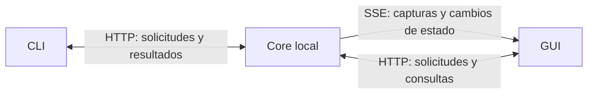

## Arquitectura interna del core

El core utiliza una arquitectura modular de puertos y adaptadores dentro de un único proceso local. La lógica de aplicación conserva las cuatro áreas de responsabilidad definidas y se mantiene independiente de las bibliotecas de transporte y acceso a recursos. Los adaptadores concretan las integraciones con HTTP/SSE, UART, programación del bitstream, almacenamiento y assembler existente.

| Elemento | Responsabilidad |
|----------|-----------------|
| Application logic | Aplicar las reglas de programas, preparación, sesiones y conservación; mantener el estado y coordinar las operaciones. |
| Ports | Expresar los contratos de entrada a la aplicación y de uso de recursos externos sin depender de las bibliotecas que los implementan. |
| Adapters | Convertir solicitudes y resultados entre esos contratos y FastAPI, pySerial, openFPGALoader, archivos y assembler. |

Cada puerto debe justificarse por una necesidad concreta de separación, sustitución o prueba. Las colaboraciones internas pueden utilizar llamadas directas; no se requiere una interfaz por función, una clase por operación, múltiples procesos ni un framework de inyección de dependencias. Los contratos de las fronteras con recursos externos utilizan Protocol de Python.

Los recursos controlados de prueba permiten comprobar las reglas del core, pero no acreditan el funcionamiento físico de la FPGA. Un almacenamiento temporal en memoria no acredita durabilidad. No se incorpora un simulador al producto ni restauración de una depuración física tras reiniciar el core. La recuperación conserva los contratos ya definidos de código, evidencia y comunicación.

La regla de dependencias mantiene la lógica independiente de FastAPI y pySerial: los adaptadores se ajustan a los contratos de la lógica, que no importa sus implementaciones concretas. Runtime composition construye y conecta los adaptadores al iniciar el core.

El fundamento del enfoque se describe en el [artículo original de puertos y adaptadores de Alistair Cockburn](https://alistair.cockburn.us/hexagonal-architecture). Su selección para este proyecto se apoya en la separación de reglas compartidas, transporte local y hardware físico, y en la posibilidad de comprobar esas reglas mediante recursos controlados.

### Modelo de ejecución del core

Se separa la coordinación de la aplicación y la comunicación UART en dos hilos principales dentro del mismo proceso del core.

| Contexto | Responsabilidad |
|----------|-----------------|
| Application thread | Atender HTTP/SSE, comprobar y reservar las operaciones admitidas y actualizar el estado lógico de la aplicación. |
| Serial thread | Ejecutar los intercambios UART mediante pySerial y comunicar resultados o errores al hilo de aplicación. |

La admisión y la reserva de una operación deben completarse antes de encargar el intercambio al hilo serial. Mientras este espera una respuesta, el hilo de aplicación puede seguir atendiendo consultas y observadores. Las solicitudes incompatibles se rechazan; no se acumulan STEP para ejecución posterior. El hilo serial no modifica directamente el estado lógico de programas o sesiones.

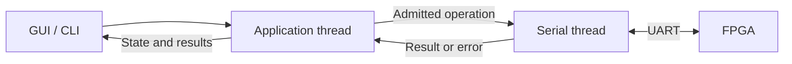

La separación atiende las esperas bloqueantes de pySerial fuera del bucle HTTP/SSE. Describe los dos hilos principales de este mecanismo; la ejecución de almacenamiento, ensamblado y programación del bitstream se concreta por separado. No se fija el número total de hilos auxiliares de las bibliotecas.

### Atención cooperativa de solicitudes de control

El hilo serial atiende las solicitudes de control mediante sondeo entre lecturas UART acotadas. El hilo serial utiliza lecturas con esperas acotadas y revisa entre ellas los pedidos de interrupción comunicados desde el hilo de aplicación. Durante cada espera de lectura permanece bloqueado esperando datos; no se establece un bucle de espera activa.

El vencimiento de una espera de lectura permite revisar el control y continuar el intercambio, conservando los bytes parciales. No constituye por sí mismo un fallo de comunicación, no reinicia los plazos del protocolo ni introduce un límite de duración de RUN. Las esperas deben respetar el tiempo restante de cada fase. Cada espera de lectura tiene un límite inicial de 50 ms. Si el plazo restante de la fase es menor, la espera se acorta para respetarlo. La lectura puede terminar antes al recibir los bytes solicitados; los bytes parciales se conservan al vencer una espera. En ausencia de datos, este valor permite aproximadamente veinte revisiones por segundo. La detección del pedido depende también de la planificación del sistema operativo; el valor no garantiza completar la detención en 50 ms y su comportamiento debe comprobarse en la verificación.

Atender el pedido conserva las reglas ya definidas: durante RUN se tramita RESET en las condiciones del protocolo; una respuesta terminal ya iniciada se recibe completa; STEP y LOAD pendientes completan su intercambio dentro de sus plazos antes del cierre solicitado. Detectar el pedido no equivale a que se haya completado la detención ni a tener confirmado un RESET. El mismo hilo serial mantiene el control de los intercambios UART.

### Comunicación entre los hilos principales

Se separa la entrega de trabajo, la solicitud de interrupción y la devolución de resultados. El control puede ser revisado por el hilo serial durante el intercambio actual, sin esperar a que termine para retirar otra operación del buzón.

| Mecanismo | Dirección | Responsabilidad |
|-----------|-----------|-----------------|
| Work mailbox | Application thread a Serial thread | Entregar una única operación previamente admitida y reservada por la lógica. |
| Control signal | Application thread a Serial thread | Comunicar una solicitud de interrupción de esa operación, revisada mediante el sondeo definido. |
| Result notification | Serial thread a Application thread | Comunicar el resultado o error para su procesamiento y actualización del estado lógico en el hilo de aplicación. |

El buzón admite una única entrega y no acumula acciones del usuario. Retirar el trabajo del buzón no libera la reserva: se conserva hasta que el hilo de aplicación procese su resolución. Las solicitudes incompatibles se rechazan también durante esa ventana. Cada operación utiliza una señal de control propia, inicialmente sin activar; una señal anterior no se reutiliza para otra operación. El pedido de interrupción conserva el tratamiento por fase del protocolo y no representa una operación normal adicional encolada.

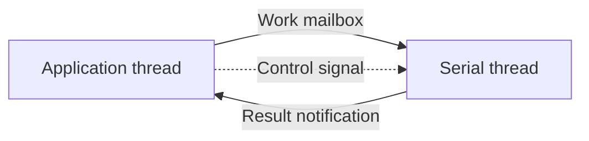

### Mensaje de trabajo SerialRequest

SerialRequest transporta una operación admitida desde el hilo de aplicación hacia el hilo serial.

| Campo | Contenido |
|-------|-----------|
| operation_id | Identificador interno de la operación, generado por la aplicación, para relacionar el trabajo con sus notificaciones y resultado. |
| operation | Trabajo solicitado, por ejemplo LOAD, RUN o STEP. |
| parameters | Datos necesarios para ese trabajo; por ejemplo, la imagen concreta que LOAD debe transmitir. |
| control_signal | Referencia a la señal de interrupción propia de la operación, inicialmente sin activar. |

Los parámetros conservan los datos tomados para esa solicitud: un cambio posterior del editor no altera la imagen que ya se entregó para LOAD. El identificador es interno y no requiere entrada manual desde GUI o CLI. La señal permite solicitar después la interrupción del trabajo actual, sin entregar una segunda operación normal al buzón.

### Mensaje de vuelta SerialNotification

SerialNotification comunica avances, resultados y errores desde el hilo serial hacia el hilo de aplicación.

| Campo | Contenido |
|-------|-----------|
| operation_id | Identificador de la operación a la que corresponde la notificación. |
| kind | Tipo de notificación: progress, completed o failed. |
| data | Información del avance, resultado completo o error, según el tipo. |
| observed_at | Instante en que el hilo serial observó el hecho, medido con un reloj monotónico común al proceso. |

Una operación puede emitir notificaciones progress y debe concluir con una notificación final completed o failed. Los avances incluyen hechos necesarios para la coordinación, como recibir ACCEPTED de RUN o detectar el comienzo de su respuesta terminal. El instante se toma al observar el hecho para no atribuir a la temporización del protocolo una demora en entregar o procesar la notificación.

| Tipo final | Significado |
|------------|-------------|
| completed | El intercambio terminó y se dispone del resultado completo. Un resultado de CPU FAULT también corresponde a esta categoría. |
| failed | El intercambio no pudo completarse correctamente, por ejemplo por pérdida de comunicación. |

Un fault de CPU comunicado mediante una respuesta completa no se convierte en un error del transporte. Las notificaciones conservan el identificador del trabajo que las produjo; el hilo de aplicación procesa los datos y mantiene la autoridad sobre el estado lógico. Cada operación utiliza los avances de fase y resultados definidos por el protocolo y los contratos de la aplicación.

### Mecanismos de transferencia entre hilos

Se utilizan mecanismos de la biblioteca estándar de Python para concretar los tres caminos de comunicación entre los hilos principales.

| Camino | Mecanismo | Uso |
|--------|-----------|-----|
| Work mailbox | queue.Queue con capacidad de un elemento | Transferir SerialRequest al hilo serial mediante entrega no bloqueante desde el hilo de aplicación. |
| Control signal | threading.Event propio de cada operación | La aplicación activa la señal y el hilo serial consulta su estado durante el sondeo definido. |
| Result notification | loop.call_soon_threadsafe | Programar la entrega de SerialNotification para su procesamiento en el hilo de aplicación. |

La capacidad del buzón no reemplaza la admisión: la reserva de la operación se conserva hasta procesar su resolución, aunque el hilo serial ya haya retirado el mensaje. No se acumulan STEP ni otras operaciones incompatibles. Las notificaciones se procesan en el hilo de aplicación y no autorizan al hilo serial a modificar el estado lógico.

Estos mecanismos pertenecen a la integración entre hilos y a su conexión durante el arranque. La lógica del TP conserva sus contratos independientes de las implementaciones de transporte y sincronización. No se añade una dependencia externa ni se seleccionan clases propias para representar los mensajes.

Las herramientas están documentadas en [queue](https://docs.python.org/3.14/library/queue.html), [threading.Event](https://docs.python.org/3.14/library/threading.html#event-objects) y [comunicación con el bucle de asyncio desde otros hilos](https://docs.python.org/3.14/library/asyncio-dev.html#concurrency-and-multithreading).

### Ciclo de vida del hilo serial

La vida del hilo serial coincide con la del proceso del core. Se crea al iniciar el core y permanece disponible hasta su terminación ordenada; abrir y cerrar UART no crea ni destruye ese hilo.

| Momento | Comportamiento |
|---------|----------------|
| Inicio del core | Crear el hilo serial, con el puerto cerrado, esperando trabajo en su buzón. |
| Conectar la placa | Abrir el puerto y comprobar la comunicación desde el hilo serial. |
| Desconectar la placa | Resolver el intercambio pendiente según el protocolo, cerrar el puerto y volver a esperar trabajo en el mismo hilo. |
| Cerrar el core | Resolver previamente las operaciones y los guardados necesarios, solicitar la terminación del hilo serial y esperar a que termine antes de finalizar el proceso. |

Mientras espera trabajo en el buzón, el hilo permanece bloqueado, sin sondear un puerto cerrado. La secuencia de cierre se ejecuta cuando corresponde terminar el core según sus usos activos y las condiciones de conservación ya definidas. Un fallo de guardado que exige mantener abierta la aplicación no se convierte en una autorización para terminar anticipadamente el hilo. Cerrar la GUI conserva el core y el hilo serial cuando queda trabajo de CLI.

### Cierre del buzón del hilo serial

Queue.shutdown(immediate=False) cierra el buzón durante la terminación ordenada del core. Este mecanismo de la biblioteca estándar está disponible en el CPython elegido y se documenta en [Queue.shutdown](https://docs.python.org/3.14/library/queue.html#queue.Queue.shutdown).

El cierre se utiliza después de resolver las operaciones y los guardados necesarios y de autorizar la terminación del core. El buzón deja de aceptar nuevas entregas. Una vez vacío, la espera de trabajo termina mediante queue.ShutDown; el hilo serial trata esa condición como fin del servicio, cierra UART si sigue abierto y termina. El proceso espera la terminación del hilo antes de finalizar.

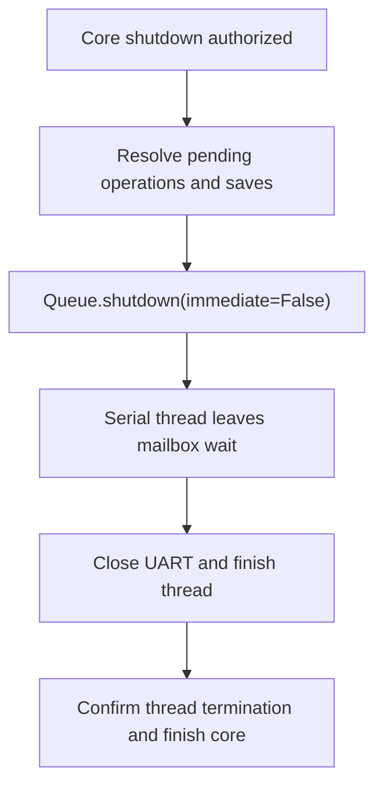

Cerrar el buzón termina el servicio del hilo serial.

### Confirmación de terminación del hilo serial

Durante el cierre del core se comprueba Thread.is_alive() mediante esperas asíncronas de 50 ms con asyncio.sleep().

Tras cerrar el buzón, la tarea de cierre comprueba si el hilo sigue vivo. Mientras siga vivo, cede la ejecución durante 50 ms y vuelve a comprobarlo. El hilo de aplicación puede atender notificaciones durante esa espera. Cuando confirma que el hilo serial terminó, continúa la finalización del core. El intervalo entre revisiones no es un límite de duración del cierre ni autoriza una terminación forzada.

Este sondeo de terminación es distinto del sondeo de control entre lecturas UART, aunque ambos utilizan inicialmente 50 ms. No se crea un hilo auxiliar para esperar el cierre. Las herramientas se describen en [Thread.is_alive](https://docs.python.org/3.14/library/threading.html#threading.Thread.is_alive) y [asyncio.sleep](https://docs.python.org/3.14/library/asyncio-task.html#asyncio.sleep).

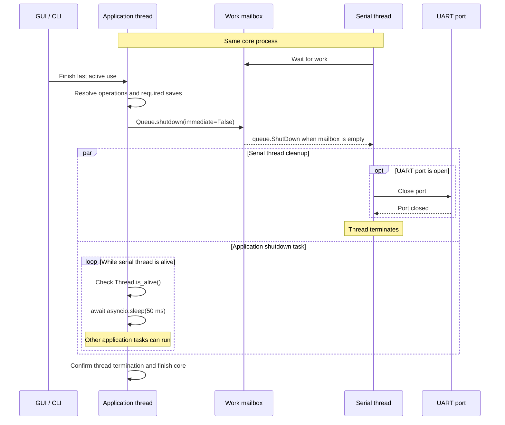

El diagrama representa el cierre autorizado del último uso. Si queda trabajo de CLI al cerrar la GUI, se conserva el core y esta secuencia de terminación no comienza.

### Ejecución del almacenamiento

ThreadPoolExecutor(max_workers=1) proporciona un ejecutor dedicado al almacenamiento. Ejecuta las lecturas y escrituras de programas, recuperación, preferencias y registros fuera del hilo de aplicación. El trabajador se crea cuando se utiliza el almacenamiento.

| Contexto | Responsabilidad |
|----------|-----------------|
| Application thread | Recibir solicitudes de GUI y CLI, aplicar las reglas, actualizar el estado lógico y publicar eventos y resultados. |
| Serial thread | Gestionar la comunicación UART con la placa. |
| Storage worker | Ejecutar las lecturas y escrituras de archivos del core. |

Se añade un trabajador de almacenamiento a los dos hilos principales ya definidos. Los tres pertenecen al proceso del core; GUI y CLI conservan sus procesos de cliente. El trabajador devuelve resultados o errores y no modifica directamente el estado lógico de la aplicación. La aplicación conserva la versión encargada para un guardado y actualiza su confirmación según el resultado efectivo.

El ejecutor permite una sola operación de almacenamiento en ejecución a la vez. Se mantiene la distinción entre fallo de evidencia y fallo de guardado del código.

La herramienta pertenece a la biblioteca estándar de Python y se documenta en [ThreadPoolExecutor](https://docs.python.org/3.14/library/concurrent.futures.html#concurrent.futures.ThreadPoolExecutor).

### Entrega y resultado de tareas de almacenamiento

Se utiliza loop.run_in_executor para encargar tareas al ejecutor exclusivo de almacenamiento y recibir sus resultados. Se proporciona explícitamente el ThreadPoolExecutor(max_workers=1) definido para conservar la separación de este trabajo.

La aplicación entrega la operación con los datos concretos que debe utilizar, como la versión del programa tomada para un guardado. El mecanismo devuelve un Future de asyncio que representa su resultado pendiente. La tarea de seguimiento puede esperarlo mediante await, cediendo la ejecución del hilo de aplicación mientras el trabajador realiza la E/S. El resultado o error se procesa de nuevo en el hilo de aplicación, que actualiza el estado lógico.

El seguimiento pertenece al core y se conserva hasta procesar el resultado; no depende de que siga abierta una petición HTTP concreta. La confirmación de guardado se emite al completar el procedimiento de conservación duradera, no al admitir la tarea en el ejecutor. Este mecanismo no sustituye las reglas de orden, versiones, fallos y cierre ya definidas.

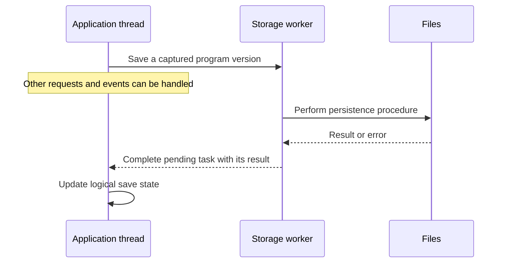

El mecanismo está documentado en [loop.run_in_executor](https://docs.python.org/3.14/library/asyncio-eventloop.html#asyncio.loop.run_in_executor).

### Selección del próximo trabajo de almacenamiento

El hilo de aplicación mantiene los trabajos de almacenamiento pendientes y entrega uno por vez al ejecutor. Tras procesar el resultado del anterior, se selecciona el siguiente con prioridad para guardar el código y la información necesaria para recuperarlo.

| Situación | Regla |
|-----------|-------|
| Operación de almacenamiento en ejecución | Dejarla terminar. |
| Guardados de código o de su copia de recuperación pendientes | Atenderlos antes que los demás trabajos pendientes, respetando las dependencias necesarias. |
| Otras operaciones pendientes | Atenderlas por orden de llegada, conservando las dependencias y el orden de cada archivo. |

La prioridad se aplica al seleccionar el siguiente trabajo; no interrumpe una escritura en curso. Si se está guardando una captura y quedan otra captura y un autoguardado pendientes, se termina la captura actual, se guarda el código y después se atiende la captura pendiente. La selección no reordena operaciones de una forma que produzca archivos incoherentes.

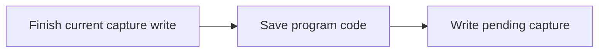

Los pendientes se conservan bajo la coordinación del core, sin entregar anticipadamente al ejecutor una cola de registros que retrase los autoguardados. La prioridad contribuye a atender la conservación del código, pero no acredita por sí sola el límite de pérdida ni la durabilidad exigidos.

### Actualización de autoguardados pendientes

Se conserva un único autoguardado pendiente por programa y destino, actualizado con la versión más reciente. La agrupación es por programa: los pendientes de programas diferentes son independientes y no se reemplazan entre sí.

| Situación de un mismo programa y destino | Escritura en curso | Autoguardado pendiente |
|------------------------------------------|--------------------|-----------------------|
| Comienza el guardado de A | A | Ninguno. |
| La edición produce B | A | B. |
| La edición produce C antes de terminar A | A | C reemplaza al pendiente B. |
| Termina A y corresponde atender ese pendiente | Puede comenzar C. | Ninguno, salvo nuevas ediciones. |

La escritura iniciada utiliza la versión capturada y termina normalmente. Solo se actualiza el autoguardado que aún permanece pendiente para el mismo programa y destino. Si dos programas tienen cambios, ambos conservan su propio pendiente. Tampoco se agrupan entre sí los destinos distintos de un mismo programa.

Actualizar el pendiente no reinicia ni posterga el plazo de autoguardado. Los guardados explícitos conservan su propia confirmación y las capturas de depuración mantienen sus registros individuales. RecoverySnapshot concreta a continuación la unidad interna de recuperación.

### Archivo de recuperación RecoverySnapshot

Cada programa tiene una copia interna JSON independiente para recuperar su código. Los archivos del usuario conservan texto Assembly normal; la copia JSON se guarda en los datos internos de la aplicación. La copia JSON es adicional para todos los programas, incluidos los que ya tienen archivo Assembly; un borrador sin archivo asociado se conserva mediante esa copia hasta elegir su destino normal.

| Campo | Contenido |
|-------|-----------|
| schema_version | Versión del formato de recuperación, inicialmente 1. |
| program_id | Identidad estable del programa. |
| source_version | Versión del código conservado. |
| text | Texto completo de esa versión. |
| source_path | Ruta del archivo asociado, o null si todavía es un borrador. |
| is_open | Estado de apertura conservado para la reapertura posterior. |
| example_id | Identificador del ejemplo de origen, o null si no corresponde. |

La copia conserva el texto, la identidad y los metadatos de apertura del programa. El archivo JSON reúne texto y metadatos de un programa. El formato tiene soporte en la [biblioteca estándar de Python](https://docs.python.org/3.14/library/json.html). No se transforma el archivo Assembly del usuario en JSON ni se obliga a otras herramientas a interpretar el formato interno.

| Sistema | Ubicación de las copias internas |
|---------|---------------------------------|
| Linux | `recovery/` bajo la ubicación de datos de la aplicación en `XDG_DATA_HOME`; por defecto, `~/.local/share/viewrv/recovery/`. |
| Windows | `%LOCALAPPDATA%\viewrv\recovery\`. |

El directorio de datos de la aplicación se denomina viewrv. La carpeta es administrada por el core y está separada de los archivos Assembly y de los recursos instalados. El usuario del sistema operativo puede acceder manualmente a sus datos; la condición de carpeta interna no constituye una barrera de seguridad frente a su propietario.

Las copias se mantienen durante el uso para poder recuperar la última versión conservada tras una caída; no se generan después de perder la memoria del proceso. El archivo asociado que falta no se recrea automáticamente. La confirmación de un guardado no cambia el estado de apertura actual ni presenta una versión posterior como conservada.

### Preparación y reemplazo de la copia de recuperación

Cada RecoverySnapshot se escribe completo en un archivo temporal y después reemplaza la copia vigente. El temporal se crea en la misma carpeta de recuperación para mantener el reemplazo dentro del mismo sistema de archivos.

| Paso | Actuación |
|------|-----------|
| Preparar | Conservar la copia vigente mientras se escribe el JSON nuevo en un temporal. |
| Completar | Finalizar y cerrar el temporal completo. |
| Publicar | Reemplazar la copia vigente por el temporal completo. |

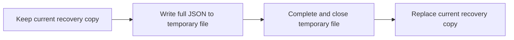

El objetivo es publicar la versión completa mediante un reemplazo atómico, sin exponer como vigente un JSON escrito parcialmente. La atomicidad corresponde al reemplazo que ofrece el sistema de archivos, no a toda la escritura del temporal. El reemplazo utiliza [os.replace](https://docs.python.org/3.14/library/os.html#os.replace) y los mecanismos de sincronización por plataforma descritos en la sección siguiente.

Durante la escritura del temporal no se sobrescribe la copia vigente. Un fallo anterior al reemplazo no confirma la nueva versión. La atomicidad no acredita durabilidad frente a corte de energía ni el límite de pérdida de edición de la SRS.

### Sincronización y confirmación de recuperación

La copia de recuperación se confirma después de sincronizar el contenido y completar su publicación mediante el mecanismo de persistencia del sistema operativo. Todo el procedimiento se ejecuta en Storage worker; el hilo de aplicación recibe su resultado y confirma la versión correspondiente.

| Sistema | Procedimiento seleccionado |
|---------|----------------------------|
| Linux | Escribir el temporal completo, vaciar los buffers de Python y sincronizar el archivo; cerrarlo, reemplazar la copia vigente y sincronizar el directorio que contiene el reemplazo. |
| Windows | Escribir el temporal completo, vaciar los buffers de Python y sincronizar el archivo; cerrarlo y realizar el reemplazo solicitando MOVEFILE_WRITE_THROUGH. |

En Linux se utilizan la sincronización del archivo y del directorio y el reemplazo dentro de la misma carpeta. El [contrato de fsync](https://man7.org/linux/man-pages/man2/fsync.2.html) distingue la conservación del contenido de archivo y de su entrada de directorio. En Windows la sincronización del archivo utiliza el mecanismo de [commit del sistema](https://learn.microsoft.com/en-us/cpp/c-runtime-library/reference/commit); el adaptador de publicación debe solicitar reemplazo de la copia existente y MOVEFILE_WRITE_THROUGH mediante [MoveFileExW](https://learn.microsoft.com/en-us/windows/win32/api/winbase/nf-winbase-movefileexw). No se habilita un traslado entre volúmenes: el temporal permanece en la misma carpeta.

Si falla un paso, se devuelve un fallo de guardado y no se confirma esa versión como conservada. Un error posterior al reemplazo no permite afirmar que la copia anterior siga vigente ni que la nueva esté confirmada duraderamente. La confirmación tampoco convierte en guardada una edición posterior a la versión entregada al trabajador.

La efectividad del procedimiento, sus errores y su comportamiento ante interrupciones requieren verificación en los sistemas de aceptación. La selección documental no acredita una prueba de corte de energía ni cierra el diseño global. El intervalo inicial de autoguardado es de un segundo.

### Intervalo inicial de autoguardado

El autoguardado se solicita un segundo después del primer cambio pendiente de cada programa, utilizando el texto más reciente. Las ediciones posteriores actualizan el contenido sin reiniciar el plazo original. Los guardados explícitos y el cierre solicitan conservar lo pendiente sin esperar al temporizador, respetando la operación en curso y el orden definido.

Los temporizadores se administran en el hilo de aplicación. El segundo es un valor inicial para dejar margen dentro del límite de pérdida de dos segundos de edición exigido por la SRS; la verificación debe cubrir el recorrido desde la edición en GUI, su comunicación al core, la espera del trabajador y la conservación duradera. El temporizador por sí solo no acredita ese límite.

### Integración del assembler y del programador

El core utiliza un trabajador dedicado al assembler y un proceso hijo supervisado para openFPGALoader. La lógica y la coordinación permanecen en Application thread.

| Integración | Ejecución | Responsabilidad de la aplicación |
|-------------|-----------|---------------------------------|
| Assembler | Assembly worker, un trabajador único creado bajo demanda dentro del proceso del core, que invoca la biblioteca Python definida. | Capturar texto y versión, solicitar la traducción y asociar resultado o diagnóstico a esa misma versión. |
| Programador | Ejecutable openFPGALoader incluido en la entrega, iniciado como proceso hijo y supervisado asíncronamente por el core. | Mantener el control de la placa durante la preparación y distinguir el resultado del programador de la comprobación UART. |

Assembly worker añade un cuarto hilo de ejecución previsto, independiente de UART y del almacenamiento. Se integra mediante un ejecutor de un trabajador; el resultado vuelve al hilo de aplicación con el mecanismo asíncrono ya seleccionado. La entrada sigue siendo assemble(source_text) y la salida AssemblyResult conforme al [contrato del assembler](../assembler_interface.md). El trabajador no lee por su cuenta el archivo del editor, modifica el estado lógico ni controla la placa. La lectura UTF-8 que necesite la aplicación corresponde al almacenamiento. Se conserva la asociación entre texto, versión, imagen, mapa y diagnóstico y la comprobación de vigencia antes de LOAD.

El ejecutor se mantiene bajo responsabilidad del core y se resuelve su trabajo al cerrar ordenadamente. No se crea un trabajador por programa ni se comparte el de almacenamiento, para conservar la separación de los autoguardados.

El adaptador de programación inicia el ejecutable mediante la ruta resuelta de la entrega y argumentos separados, supervisa sus salidas y recoge su terminación. Se utiliza la integración asíncrona de subprocesos de Python, sin dedicar otro hilo principal a esperar al programador. El core conserva el proceso y el seguimiento de la preparación hasta resolverla; el cierre ordenado no abandona ese trabajo.

La preparación conserva la secuencia definida: obtener control de placa, cerrar UART desde Serial thread, programar y, tras éxito, abrir y comprobar UART. La reserva pertenece a la preparación completa y no se libera porque termine uno de sus intercambios seriales o el buzón quede vacío. Durante el proceso hijo se mantienen disponibles las consultas, la edición y el almacenamiento según los contratos vigentes. Al comenzar la programación se invalida la identificación de la imagen anterior; un fallo no acredita continuidad del estado previo. Programación y comprobación de comunicación se informan como fases separadas.

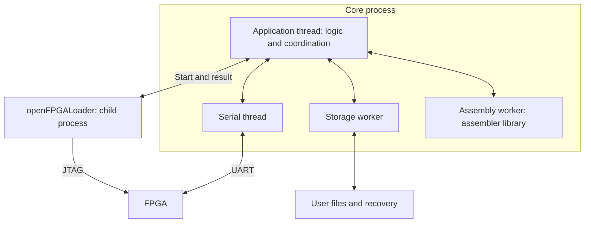

Python documenta [ejecutores de hilos](https://docs.python.org/3.14/library/concurrent.futures.html#concurrent.futures.ThreadPoolExecutor) y [subprocesos asíncronos](https://docs.python.org/3.14/library/asyncio-subprocess.html). En Windows el soporte de subprocesos exige ProactorEventLoop; [Uvicorn documenta ese bucle en modo de un único proceso](https://uvicorn.dev/concepts/event-loop/), sin recarga ni varios workers, conforme a la organización definida. La compatibilidad documental no acredita todavía integración empaquetada ni programación física.

### Coordinación, estado y eventos

Application API es la entrada lógica común para operaciones y consultas de GUI y CLI; Application thread mantiene la coordinación y el estado y publica novedades después de aplicar cambios coherentes. Se mantienen las cuatro áreas funcionales ya definidas.

| Parte | Responsabilidad |
|-------|-----------------|
| Application API | Ofrecer operaciones y consultas independientes de HTTP; el adaptador HTTP interpreta la petición y utiliza esta entrada lógica. |
| Coordinación | Colaborar con las cuatro áreas, comprobar condiciones, reservar recursos y encargar trabajo a las integraciones. |
| Estado | Mantener la información lógica de programas, placa, sesiones y conservación en el hilo de aplicación. |
| Publicación | Producir actualizaciones después de aplicar los cambios; el adaptador SSE las entrega a la GUI. |

Las consultas de estado leen la información conocida por el core; avanzar la FPGA requiere una operación explícita. Los resultados de las integraciones se aplican al programa, versión y sesión que corresponden. Una captura completa se incorpora junto con su contexto antes de publicarla o devolverla como resultado; una recepción parcial no se presenta como captura actual. Los buffers, handles y fases privadas de una integración no se convierten por sí mismos en estado lógico compartido.

El core aplica la captura y después informa a CLI y GUI mediante sus canales respectivos; no se exige un orden de llegada entre la respuesta HTTP y el evento SSE. La fuente de información de ambas es el mismo resultado coherente. La conservación de observaciones completas conserva su coordinación dentro del core y no depende de que la GUI esté suscrita.

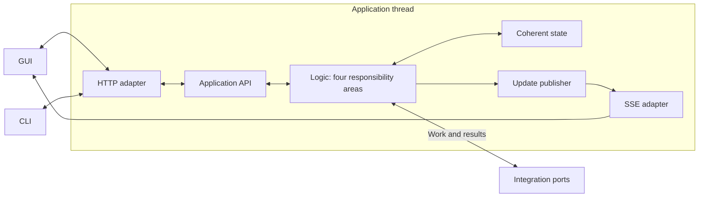

Al abrir una suscripción SSE, la GUI recibe primero una vista del estado actual y después actualizaciones ordenadas con una revisión de estado. La revisión identifica la evolución del estado publicado de esa instancia del core; no sustituye la versión del programa ni el ciclo de FPGA. La captura inicial de la vista y el registro de la suscripción deben coordinarse para no perder cambios entre ambas acciones. Tras perder la conexión, la GUI vuelve a sincronizarse con el estado actual, sin reiniciar ni repetir operaciones del ensayo controlado por CLI.

La API lógica, la actualización del estado y la publicación no requieren FastAPI para utilizarse o comprobarse. Los adaptadores realizan la representación HTTP/SSE y la conexión con las integraciones. No se incorpora un broker, un historial visual de eventos ni restauración de ejecución física.

### Arranque y composición del core

El core se inicia bajo demanda, con exclusión entre instancias y composición centralizada de componentes. GUI y CLI localizan y validan una instancia preparada o inician el ejecutable del core cuando no hay una disponible.

| Parte | Responsabilidad |
|-------|-----------------|
| Client bootstrap | Localizar y validar el core; iniciar un candidato si es necesario y registrar el uso antes de operar. |
| Instance guard | Obtener exclusión del sistema operativo antes de inicializar los recursos del core y conservarla durante su vida. |
| Runtime composition | Crear la lógica, conectar sus adaptadores y preparar trabajadores, configuración y recursos de la entrega. |
| Discovery | Publicar dirección local e información privada de acceso al estar preparado el servidor. |
| Shutdown | Resolver el último uso según las reglas vigentes, retirar su descubrimiento y liberar la exclusión al finalizar. |

El procedimiento de cliente tiene implementaciones locales en el host de GUI y en CLI, con el mismo contrato; no exige compartir código entre TypeScript y Python. La unicidad la impone el propio core. Si dos clientes inician candidatos simultáneamente, solo quien obtiene el bloqueo inicializa y publica una instancia activa; el otro se retira y su cliente espera y valida la instancia existente. La espera de arranque es limitada. Si existe un bloqueo ocupado sin una instancia que llegue a estar disponible, se informa el fallo, sin terminar automáticamente al propietario ni iniciar otro servidor competidor.

El bloqueo utiliza una ubicación de coordinación común para la aplicación y el usuario, separada de los archivos de programas. Se mantiene por el core y no se hereda al programador. Se utiliza el mecanismo exclusivo del sistema, como [flock en Linux](https://docs.python.org/3.14/library/fcntl.html#fcntl.flock) y [bloqueo de archivo en Windows](https://learn.microsoft.com/en-us/windows/win32/api/fileapi/nf-fileapi-lockfileex). La existencia de un archivo de bloqueo o descubrimiento no acredita un proceso activo; el bloqueo efectivo del sistema y la validación de la instancia conservan responsabilidades diferentes. La identificación residual no autoriza matar un proceso por su PID.

Runtime composition conecta Application API, las cuatro áreas lógicas, los puertos y adaptadores, la publicación y los ejecutores. El hilo serial comienza esperando trabajo con UART cerrado. Los trabajadores de almacenamiento y ensamblado se crean bajo demanda. Se resuelven los recursos desde la entrega, sin depender de PATH ni del directorio actual. Leer configuración y recuperación no reconstruye una ejecución física ni programa la FPGA automáticamente.

La fase de arranque mantiene una referencia provisional hasta que se registra un uso o se resuelve el fallo de inicio; no aplica prematuramente el cierre por ausencia de clientes mientras el solicitante espera disponibilidad. El tratamiento acotado de ese intento no introduce vencimiento del trabajo CLI ya establecido. El registro de usos y los trabajos en curso pertenecen a la coordinación del core, no al archivo de descubrimiento.

Se abre el servidor solo en la computadora, con puerto asignado automáticamente, y se publica el descubrimiento al estar preparada la instancia. Dirección, identidad de instancia, compatibilidad y autorización se comprueban antes de enviar operaciones. El token por instancia conserva su tratamiento privado y por encabezado; no se publica en URL, argumentos ni registros. Los datos de arranque no se recuperan como una sesión física.

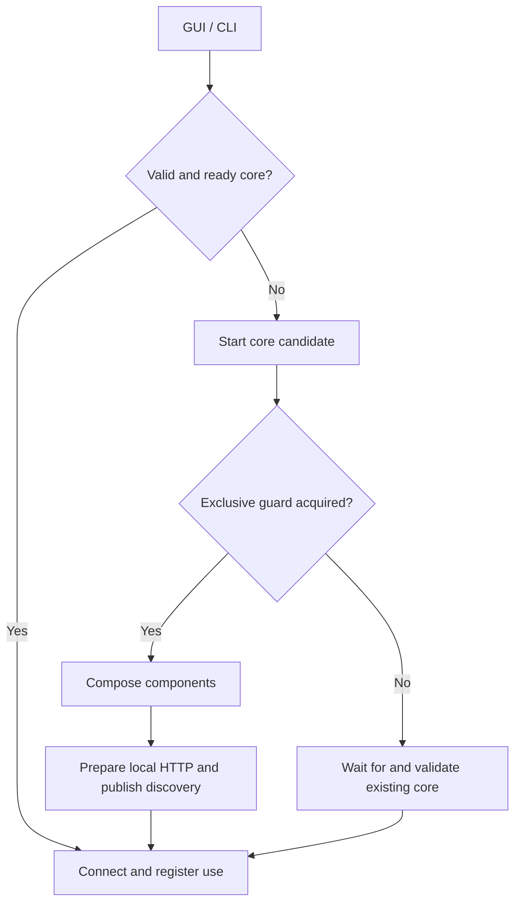

El cierre conserva la distinción entre invocación CLI y trabajo persistente: terminar un comando no termina ese trabajo. Cerrar GUI conserva usos CLI ajenos; el último uso habilita el cierre ordenado ya definido. El core deja de admitir nuevo trabajo durante su terminación, resuelve la actividad y conservación, retira solo la información de descubrimiento propia y libera el bloqueo al finalizar. No se elimina el archivo soporte del bloqueo como sustituto de liberar la exclusión, evitando crear propietarios sobre archivos diferentes durante un relevo.

Este bloque asigna arranque, exclusión, composición y salida.

## Arquitectura interna de GUI

### Organización y dependencias

Se separa integración de escritorio, comunicación con el core, estado de presentación y vistas en los siguientes bloques. Son responsabilidades arquitectónicas; no fijan clases, carpetas ni un proceso independiente por bloque. La distribución aplica separaciones habituales a las necesidades del producto, sin presentarse como un patrón oficial de cinco componentes.

| Bloque | Responsabilidad |
|--------|-----------------|
| Desktop host | Administrar la ventana, descubrir o iniciar el core y coordinar el cierre de GUI conforme a los usos compartidos. Atender funciones nativas, como los diálogos para seleccionar archivos. |
| Desktop bridge | Exponer a la presentación operaciones nativas concretas mediante preload, manteniendo el aislamiento de contextos. No constituye un tercer proceso ni proporciona acceso genérico al sistema. |
| Core client | Centralizar solicitudes HTTP y recepción de actualizaciones SSE, incluida la reconexión, utilizando las tecnologías y reglas de acceso ya definidas. |
| Presentation state | Mantener la representación de información confirmada por el core y el estado compartido de presentación que necesitan las vistas. |
| Views | Componer editor, paneles de depuración, visor y ajustes conforme a Penpot y los acuerdos funcionales, integrando las bibliotecas seleccionadas. |

Desktop host corresponde al proceso principal de Electron. La presentación utiliza el proceso renderer de la ventana; preload ofrece el puente aislado. Core client utiliza HTTP/SSE directamente desde el entorno de ventana, conforme al [canal local](contratos.md#origen-interno-de-la-gui): los pedidos de depuración no se desvían por Desktop host. Desktop bridge suministra los datos de conexión y las funciones nativas necesarias; su contrato se define en [Puente nativo de GUI](integracion_y_distribucion.md#puente-nativo-de-gui).

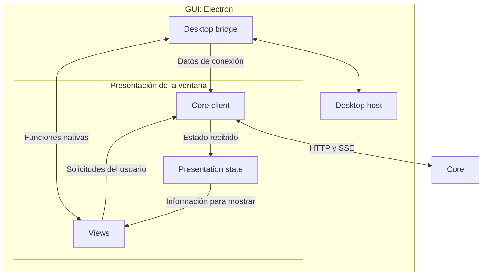

Al solicitar STEP, la vista utiliza Core client. El core conserva la admisión, el control exclusivo y la coordinación del avance físico. Una actualización completa se incorpora a Presentation state y alimenta las vistas de código, registros y pipeline. Estas vistas comparten el contexto recibido; no mantienen reglas de depuración independientes. La organización no agrega operaciones UART desde GUI ni transfiere a Electron la conservación de los archivos que administra el core.

Views integra Monaco, FlexLayout y el visor GraphViewer conservado, además de los controles y estilos definidos. Se mantienen apariencia e interacciones del visor y fidelidad a Penpot.

La separación nativa se apoya en el [modelo de procesos de Electron](https://www.electronjs.org/docs/latest/tutorial/process-model) y su [aislamiento de contextos](https://www.electronjs.org/docs/latest/tutorial/context-isolation). Las responsabilidades de Presentation state y Core client organizan la comunicación y el estado de presentación del proyecto; los cinco nombres son propios de esta organización.

### Propiedad del estado de GUI

El core, los documentos en edición y la presentación tienen autoridades separadas. Esta asignación completa la organización anterior sin agregar otro bloque de ejecución ni seleccionar clases o carpetas.

| Información | Propiedad y representación |
|-------------|----------------------------|
| Estado de la placa y del ensayo | El core conserva la autoridad sobre conexión, sesión, capturas, breakpoints y resultados. Presentation state mantiene una representación compartida de lo recibido. |
| Texto en edición | Un modelo de documento de Monaco por programa, compartido por las vistas del mismo documento. Las modificaciones se comunican al core para versionado y conservación conforme a los contratos vigentes. |
| Estado visual | Pertenece a GUI. Pestaña activa, selecciones y otros datos necesarios para varias vistas se comparten; el estado que solo requiere un panel permanece local a ese panel. |

Mostrar un documento en dos paneles no crea dos contenidos independientes: las vistas utilizan el mismo modelo de edición. Monaco conserva el contenido de edición; la asignación no exige copiar el texto completo en un almacén independiente por panel. La representación del programa ejecutado conserva la fuente y versión exactas del ensayo, según las reglas existentes de edición y vigencia.

Las vistas de código, registros y pipeline utilizan una misma actualización completa con su contexto. Una confirmación atrasada del core se asocia a su versión y no reemplaza modificaciones locales posteriores; tampoco se presenta la conservación de una versión anterior como confirmación de los cambios nuevos.

Core client coordina por programa la comunicación del texto con las acciones que lo utilizan. Antes de ensamblar, cargar, guardar o cerrar, confirma la recepción de la revisión elegida según el [contrato de actualizaciones de texto](contratos.md#coordinación-del-texto-antes-de-acciones). La confirmación no espera la conservación en disco. Durante ensamblado, carga o guardado puede seguir enviando nuevas ediciones; cerrar resuelve la última revisión sin dejar actualizaciones posteriores de ese documento.

Cambiar pestaña, selección visual o encuadre no constituye por sí mismo una operación sobre la FPGA. Las selecciones que intervienen en las funciones lógicas ya definidas, como seguir una aparición, conservan esos contratos; no se trasladan sus reglas a cada panel. El reparto tampoco incorpora restauración de la disposición entre aperturas.

La distinción entre documento y vista utiliza los [modelos y editores de Monaco](https://github.com/microsoft/monaco-editor#concepts). Zustand mantiene el estado compartido de presentación; React conserva el estado local de cada vista.

### Integración de editor, visor y espacio de trabajo

Views concentra la integración con las bibliotecas. Cada parte administra la adaptación de datos e interacciones y los recursos específicos de su biblioteca. Esta separación no selecciona nuevas bibliotecas, procesos, clases ni carpetas.

| Parte interna de Views | Responsabilidad |
|------------------------|-----------------|
| Editor integration | Conectar Monaco con documentos, diagnósticos, marcas de instrucciones y breakpoints; administrar sus vistas y recursos conforme a la propiedad del estado definida. |
| Pipeline viewer integration | Conectar el visor existente con capturas, selecciones y resaltados; concentrar los detalles de GraphViewer y del diagrama, conservando apariencia e interacciones. |
| Workspace integration | Conectar FlexLayout con pestañas y divisiones; crear, ubicar y retirar las vistas correspondientes. |

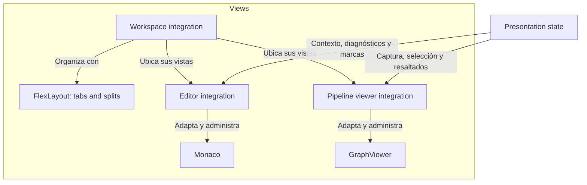

El ciclo de vida del contenido se distingue del de su representación. Cambiar de pestaña, mover un panel o recrear una vista no reinicia la depuración ni crea una conexión con el core. Una nueva vista del editor reutiliza el documento mientras el programa siga abierto; dos vistas del mismo documento comparten sus modificaciones. Retirar una vista libera sus recursos y suscripciones locales. Cerrar el programa conserva las reglas de guardado y cierre definidas, sin equipararse a retirar una representación temporal.

Core client conserva la comunicación HTTP/SSE de GUI independientemente de la cantidad y disposición de paneles; las integraciones no crean conexiones propias por panel. Las reglas de depuración y de interpretación compartida mantienen su autoridad en el core. Los detalles gráficos de resaltado se concentran en Pipeline viewer integration, sin repartir conocimiento de GraphViewer por el resto de la GUI.

### Apertura, conexión, reconexión y cierre de GUI

Desktop host, Desktop bridge y Core client coordinan el ciclo de vida de GUI con el core. Se conserva el arranque bajo demanda, la autoridad del core, la independencia de sus usos y las reglas de conservación y cierre existentes.

Desktop host localiza o inicia el core y Desktop bridge entrega los datos de conexión a Core client. El cliente valida la instancia y registra el uso de GUI antes de operar. La suscripción entrega un estado inicial coherente seguido de actualizaciones, según el contrato de publicación del core. Un fallo de arranque o validación se informa sin enviar la operación pendiente ni programar automáticamente la placa.

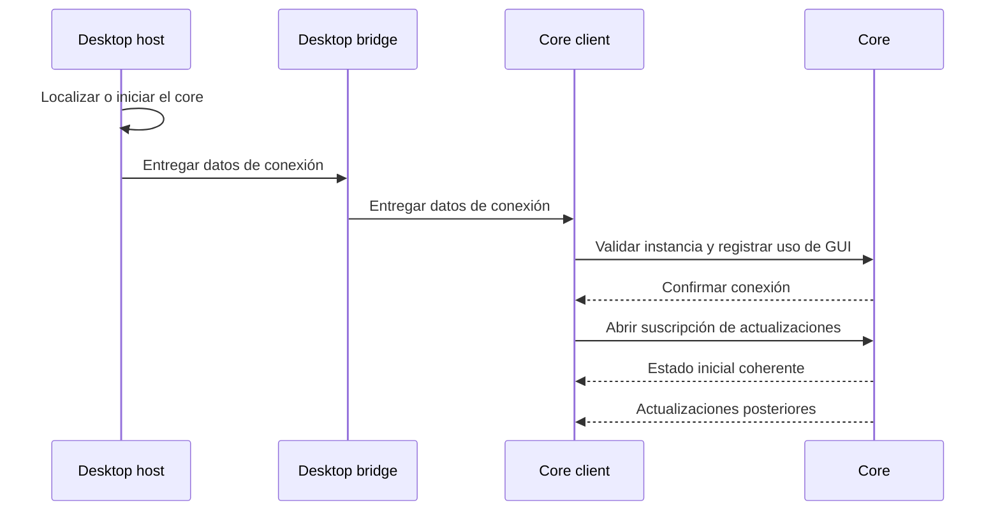

Core client mantiene la comunicación independientemente del montaje y disposición de paneles. Ante una pérdida de comunicación, informa el estado de conexión a Presentation state y restablece la sincronización. Si necesita redescubrir la instancia, utiliza Desktop bridge y Desktop host. La reconexión no repite STEP, LOAD o RUN ni restaura una ejecución física. Recuperar el estado de la misma instancia se distingue de validar una instancia nueva, que conserva las condiciones de recuperación y preparación ya definidas para el core.

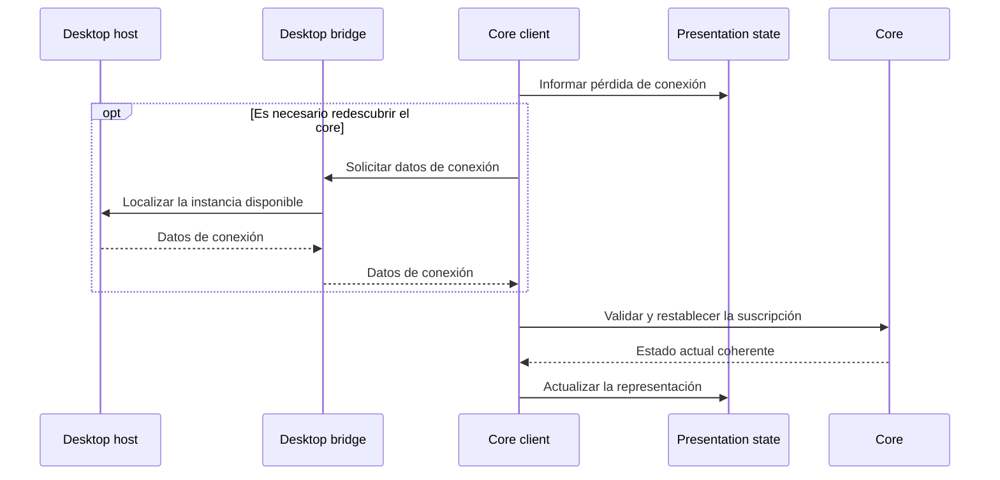

Desktop host recibe la intención de cerrar y conserva la ventana hasta que se resuelva el cierre del trabajo propio de GUI. Core client solicita al core finalizar ese trabajo conforme a las reglas vigentes de actividad, conservación de código y registros. Un fallo de guardado de código mantiene la ventana disponible para reintentar, elegir destino o autorizar explícitamente un descarte. Los fallos de registro conservan su política independiente. Confirmado el cierre del trabajo de GUI, se liberan sus recursos y se cierra la ventana. El core conserva la decisión de continuar por otros usos o terminar ordenadamente al concluir el último; Desktop host no termina el proceso del core por su cuenta.

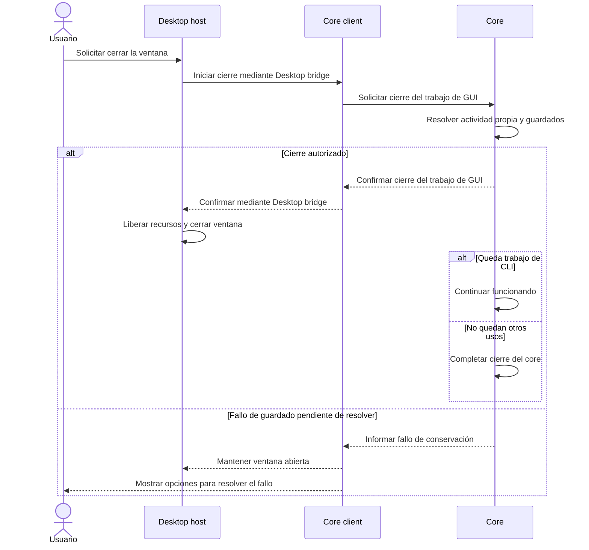

En el diagrama, cierre autorizado significa código conservado o descarte solicitado explícitamente por el usuario. Una autorización previa para intentar cerrar no constituye autorización para perder código.

## Arquitectura interna de CLI

### Organización y responsabilidades

El cliente CLI se organiza en cuatro bloques. Son responsabilidades internas del cliente Python, sin fijar todavía clases, carpetas ni un proceso independiente por bloque. Se mantienen Click, HTTPX síncrono y el catálogo funcional definido.

| Bloque | Responsabilidad |
|--------|-----------------|
| Command interface | Interpretar el comando mediante Click, convertir y validar argumentos y opciones y coordinar su atención. La validación local no sustituye las reglas de admisión y ejecución del core. |
| Client bootstrap | Localizar el core o iniciar un candidato cuando corresponda y obtener los datos necesarios para conectarse, conforme al descubrimiento y la exclusión ya definidos. |
| Core client | Utilizar HTTPX para validar la instancia y el acceso, enviar solicitudes y recibir resultados y fallos de transporte. La comunicación pertenece a la invocación; el trabajo persistente sigue en el core. |
| Result presenter | Presentar resultados y errores locales o remotos en modo humano o JSON y determinar el código de terminación conforme al contrato de salida. |

El reparto distingue interpretación de entrada, acceso al proceso servidor, transporte y presentación. Client bootstrap concentra el descubrimiento y posible inicio del proceso, mientras Core client concentra la comunicación con una instancia. Una operación ordinaria solicita una acción al core; no ejecuta UART, programa físicamente la placa por su cuenta ni reproduce las reglas del depurador.

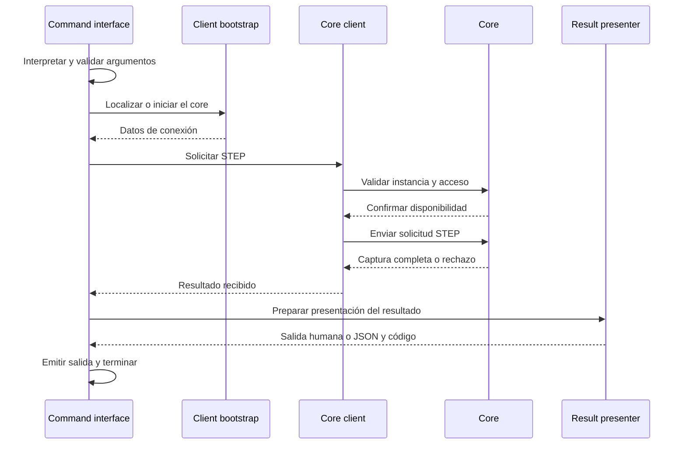

La secuencia ilustra la colaboración y la validación previa a efectos; no fija rutas, campos ni intercambios HTTP concretos. Ayuda, versión y errores de argumentos se resuelven localmente antes de requerir acceso al core. Ayuda y versión válidas siempre se presentan como texto, incluso con --output json. Un argumento inválido puede entregarse directamente a Result presenter en modo JSON sin iniciar el servidor.

La observación de una depuración GUI utiliza consultas finitas de Core client y no toma control ni genera STEP. Una solicitud de RUN puede esperar mientras otra invocación CLI solicita detenerlo: son procesos clientes independientes que utilizan el mismo contexto de trabajo en el core. Cada invocación presenta su resultado y termina; la conexión con la FPGA y el ensayo pertenecen al core, no al proceso cliente que inició la solicitud.

### Interrupción de la espera de CLI por Ctrl+C

Ctrl+C termina la espera de la invocación CLI sin detener implícitamente el programa que ya ejecuta la FPGA ni finalizar el trabajo persistente.

| Acción | Efecto |
|--------|--------|
| Presionar Ctrl+C mientras la CLI espera | Terminar la espera y la invocación, liberando sus recursos propios. El core conserva el trabajo y una operación ya definida puede continuar bajo sus reglas. |
| viewrv run stop | Solicitar explícitamente detener el RUN controlado por CLI. |
| viewrv work finish | Solicitar explícitamente finalizar el trabajo completo de CLI conforme a sus reglas de cierre. |

La interrupción del cliente no envía por sí misma STOP, RESET, pausa, desconexión ni cierre del trabajo. El resultado real de la operación pertenece al core; finalizar la espera no permite afirmar que el procesador se detuvo ni que el ensayo tuvo éxito o falló. Los controles propios de depuración conservan sus comandos explícitos y no se convierten en efectos de la salida de un cliente.

```mermaid
sequenceDiagram
actor U as Usuario
participant C as CLI
participant K as Core
U->>C: viewrv run start
C->>K: Solicitar ejecución
K->>K: Coordinar RUN en la FPGA
U->>C: Presionar Ctrl+C
C-->>U: Terminar la espera del comando
K->>K: Mantener la operación en curso
```

El ejemplo representa un RUN definido que sigue activo al interrumpir el cliente; no garantiza que toda ejecución siga activa después de Ctrl+C. El código de terminación y la representación exacta de la interrupción se concretan en el contrato de salida. El tratamiento de pérdidas de comunicación se describe en la sección siguiente.

### Pérdida de comunicación sin resultado confirmado

Si la CLI pierde la comunicación después de enviar una solicitud y antes de recibir su resultado completo, termina informando que el resultado no pudo confirmarse y que la operación pudo haberse ejecutado. No se reenvía automáticamente la operación ni se afirma que la FPGA falló o que el programa se detuvo.

| Situación | Información y efecto |
|-----------|----------------------|
| Solicitud enviada cuyo resultado no llegó completo | Presentar resultado no confirmado y terminar la invocación, sin repetir la solicitud con efectos. |
| Operación definida por el core | Su ejecución y desenlace siguen siendo responsabilidad del core; la falta de respuesta al cliente no acredita cancelación. |
| Acceso recuperado posteriormente | El usuario puede consultar el estado conocido y decidir su siguiente acción mediante los comandos existentes. |

Core client detecta el fallo de transporte y Command interface entrega esa condición a Result presenter. La información humana o JSON conserva la incertidumbre; no convierte una respuesta parcial en resultado válido. La política mantiene separadas pérdida de comunicación, rechazo confirmado y FAULT del procesador. Los campos y códigos se definen en contratos. HTTPX no garantiza ejecución única ni cancelación remota.

```mermaid
sequenceDiagram
actor U as Usuario
participant C as CLI
participant K as Core
U->>C: viewrv run start
C->>K: Solicitar RUN
C->>C: Se pierde la conexión con el core
C-->>U: Resultado no confirmado
```
