# Contratos y funcionamiento de viewrv

- **Tipo:** contratos de software.
- **Estado documental:** especificación vigente.

**Índice**

- [Propósito y alcance](#propósito-y-alcance)
- [Programas y traducciones](#programas-y-traducciones)
- [Preparación y conexión de la placa](#preparación-y-conexión-de-la-placa)
- [Sesiones y resultados](#sesiones-y-resultados)
- [Interpretación de observaciones](#interpretación-de-observaciones)
- [Interfaz de línea de comandos](#interfaz-de-línea-de-comandos)
- [Solicitudes HTTP](#solicitudes-http)
- [Resultados y estructuras de datos](#resultados-y-estructuras-de-datos)
- [Errores y avisos](#errores-y-avisos)
- [Publicación del estado vivo](#publicación-del-estado-vivo)
- [Conservación del código y la evidencia](#conservación-del-código-y-la-evidencia)

## Propósito y alcance

Define operaciones, estados, datos, solicitudes y respuestas comunes de la aplicación. Las reglas de admisión, versiones, control de la placa y conservación se aplican por igual a GUI y CLI. El protocolo UART conserva la autoridad sobre bytes y comportamiento de la FPGA.

## Programas y traducciones

### Identidad y versiones

La identidad del programa se mantiene al asignarle nombre o cambiar su archivo asociado. Una versión identifica un contenido exacto. El cambio de foco entre programas no modifica identidades, versiones ni el programa que se ejecuta en la placa.

| Información | Significado |
|-------------|-------------|
| Programa | Identidad del contenido de trabajo, incluso sin nombre o destino. |
| Versión | Referencia al texto exacto de una revisión del programa. |
| Texto | Código fuente completo de esa versión. |
| Archivo asociado | Ubicación opcional del archivo propio. |
| Ejemplo de origen | Referencia opcional al código y la guía originales del catálogo. |

La correspondencia con un ejemplo se determina comparando el texto de la versión consultada o ejecutada con el original. El vínculo se conserva al guardar y recuperar la copia. Una variante modificada conserva la guía como referencia del original, sin atribuirle una explicación sincronizada de su ejecución.

### Incorporación y recuperación

Crear un programa produce un borrador sin exigir nombre o destino. Si el archivo solicitado ya está abierto, Programas devuelve el programa existente con su identidad, texto y versión actuales, incluidos los cambios sin guardar; no vuelve a leerlo ni crea otra copia editable. Si no está abierto, solicita a Conservación la lectura del texto UTF-8; ante un error de acceso o decodificación se devuelve el motivo sin incorporar un programa incompleto. Abrir un ejemplo crea una copia editable con identidad propia y conserva el original del catálogo.

Recuperar un programa restaura el último texto y versión conservados, su identidad y su asociación con el archivo, cuando exista. No requiere recuperar una traducción persistida: se vuelve a ensamblar cuando se solicite. Si el archivo asociado fue movido o eliminado, el contenido recuperable sigue disponible y la ubicación anterior queda como referencia, sin recrear automáticamente el archivo. El usuario puede localizarlo o elegir otro destino.

### Ensamblado y vigencia

Programas toma una copia del texto al solicitar el ensamblado. La edición y el autoguardado pueden continuar; el resultado pertenece a la versión tomada al inicio. Los diagnósticos conservan esa asociación y no se atribuyen a una línea de una versión posterior.

El resultado respeta la [interfaz del assembler](../assembler_interface.md): imagen y mapa completos, o un diagnóstico con línea y mensaje, sin traducción parcial. Los fallos de lectura y los defectos internos de aplicación se distinguen de un error del lenguaje. Un ensamblado exitoso no acredita tamaño cargable ni ausencia de faults de ejecución. La traducción vacía y la validación de tamaño por la FPGA mantienen el contrato vigente.

Una modificación deja desactualizada la traducción anterior respecto del texto actual. No borra la imagen física ni modifica los resultados de un ensayo que ya utiliza aquella versión. Para iniciar una carga, Sesiones obtiene de Programas una traducción vigente con los siguientes datos asociados:

| Campo | Contenido |
|-------|-----------|
| Programa y versión | Identificación exacta de la fuente traducida. |
| Texto fuente | Texto de esa versión. |
| Imagen | Bytes completos producidos por el assembler. |
| Mapa PC–línea | Correspondencia con ese mismo texto. |

Si no existe traducción vigente, la solicitud se rechaza antes de transferirla. Los datos obtenidos permanecen asociados a su versión durante la operación.

En la secuencia combinada, una modificación durante el ensamblado impide continuar con la carga de aquella versión desactualizada. Si la carga de A ya comenzó y el editor cambia a B, la carga continúa y, si tiene éxito, el RUN posterior también utiliza A. Se informa la diferencia con el texto actual. El resultado y su registro corresponden a A.

### Restricción de modificaciones y descarte

Sesiones solicita a Programas restringir las modificaciones del programa depurado y libera esa restricción al detener debug o al concluir un inicio fallido. Programas aplica el rechazo en la lógica compartida; los demás programas siguen editables.

Cerrar una pestaña no descarta su borrador. Si el programa está asociado a una depuración abierta, incluso pausada o con resultado terminal en inspección, Programas rechaza el descarte e indica que primero debe terminarse la depuración. El rechazo no deja un descarte pendiente: debe solicitarse nuevamente después del cierre. La regla se aplica en la lógica compartida a GUI y CLI.

Si el descarte está permitido, suspende modificaciones y nuevos autoguardados del borrador afectado, resuelve los guardados anteriores y solicita eliminar su copia recuperable. Programas lo retira después de la confirmación de Conservación. Ante un fallo lo mantiene disponible y restablece edición y autoguardado. Los registros que ya contienen una copia del código conservan su evidencia.

## Preparación y conexión de la placa

### Preparación inicial

La preparación utiliza el bitstream ya generado por el grupo; no sintetiza ni implementa RTL. Obtiene el control de la placa, cierra un enlace anterior si existe, programa el bitstream y después abre y comprueba la comunicación. Si no puede cerrar el enlace anterior, no comienza la programación. Si la programación falla, no presenta como comprobada la conexión anterior.

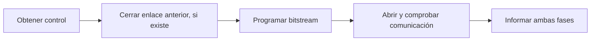

| Información del resultado | Significado |
|--------------------------|-------------|
| Programación del bitstream | Si fue confirmada por la herramienta. |
| Comprobación de comunicación | Si se recibió una respuesta válida, no pudo comprobarse o no se intentó. |
| Motivo del fallo | Fase afectada y explicación disponible. |

Programación confirmada y conexión fallida son resultados distintos. En ese caso puede reintentarse la conexión sin repetir automáticamente el bitstream. Al comenzar un intento de programación, Sesiones invalida la identificación de la imagen de instrucciones anterior, aunque el intento falle. Esto expresa pérdida de confianza en el estado previo, no una afirmación sobre qué contenido físico quedó.

### Puerto y comprobación

El puerto explícito tiene prioridad. Si no se indicó, se utiliza el último recordado. Si tampoco existe uno, la política definida de selección permite resolverlo únicamente con un candidato inequívoco; en otro caso se informa que falta seleccionarlo. Un puerto explícito o recordado indisponible no se sustituye automáticamente por otro. La CLI devuelve el error sin esperar una respuesta interactiva.

Abrir el puerto no basta para declarar comprobada la comunicación. Se realiza CHECK_READY conforme al protocolo: READY confirma comunicación y disponibilidad para LOAD; BUSY confirma comunicación sin esa disponibilidad. La disponibilidad es la observada en ese momento y se vuelve a consultar antes de cada LOAD. Ninguna respuesta identifica el bitstream ni el programa cargado.

| Estado del enlace | Significado |
|-------------------|-------------|
| Cerrado | No hay puerto abierto por la aplicación. |
| Comprobando | Se está estableciendo o recuperando la comunicación. |
| Comprobado | Se verificó la comunicación; la admisión sigue sujeta al protocolo y al control de la placa. |
| No confiable | No puede darse por comprobado el enlace; las operaciones normales quedan bloqueadas. |

Una desconexión invalida la identificación de la imagen actual para la aplicación. Reconectar comprueba comunicación, pero no restituye aquella identificación: se necesita una nueva LOAD confirmada. El código, el ensamblado y los resultados anteriores se conservan; la reconexión no programa automáticamente el bitstream.

### Control exclusivo y recuperación

La placa tiene un único responsable de control dentro de la lógica de la aplicación. Preparación lo utiliza al programar o conectar. Sesiones solicita el uso antes de cargar, ejecutar o iniciar debug; una preparación o conexión en curso impide concederlo. Mientras Sesiones lo mantiene, se rechazan la reprogramación y el cambio de puerto. Un debug pausado conserva ese uso hasta detenerse o cerrarse por desconexión.

Ante un fallo durante LOAD, RUN o debug, Sesiones conserva la coordinación y solicita la recuperación a Preparación. Preparación actúa por encargo, sin iniciar una segunda recuperación independiente. Durante la conexión o preparación, coordina su propia recuperación. Se respetan las secuencias distintas de LOAD y de los demás intercambios, incluidas sus esperas y límites de intentos.

| Contexto pendiente | Uso |
|-------------------|-----|
| Fase interrumpida | Seleccionar la recuperación aplicable. |
| Tamaño de imagen de LOAD | Calcular la ventana correspondiente cuando sea necesaria. |
| Perfil común | Determinar los presupuestos asociados al tamaño máximo de Debug. |
| RESET automático ya intentado | Impedir que cerrar y reabrir el puerto renueve por sí solo el intento automático. |

Sesiones proporciona fase y tamaño cuando corresponda. Preparación conserva el contexto aunque se cierre el puerto, hasta resolver la recuperación. Su resultado informa estado del enlace, RESET no intentado, confirmado o sin confirmación, y motivo disponible del fallo. Recuperar comunicación no repite la operación ni reconstruye ciclos. La desconexión solicitada conserva los tratamientos específicos de RUN, LOAD y STEP definidos en el protocolo y la SRS.

Si al abrir o reiniciar la aplicación no se dispone del contexto necesario para determinar la recuperación aplicable, se exige una preparación explícita de la placa mediante programación del bitstream y comprobación de comunicación antes de nuevas operaciones normales. No se intenta reconstruir la comunicación desconocida ni renovar implícitamente el RESET automático por haber reiniciado la aplicación. Si se conserva contexto suficiente, se aplica la recuperación ya definida. Esta limitación no exige reprogramar en cada conexión ni selecciona un mecanismo de persistencia del contexto. Una programación confirmada seguida de un fallo de conexión conserva el tratamiento por fases descrito en Preparación inicial.

## Sesiones y resultados

### Modalidad e identidad

| Modalidad lógica | Significado |
|------------------|-------------|
| Sin ensayo activo | Puede iniciarse RUN o debug si se cumplen las precondiciones. Una carga pendiente sigue bloqueando operaciones incompatibles. |
| Ejecución RUN | Se espera el resultado o la resolución de una interrupción. |
| Depuración | Permanece abierta hasta Detener debug, incluso pausada o con resultado terminal. |

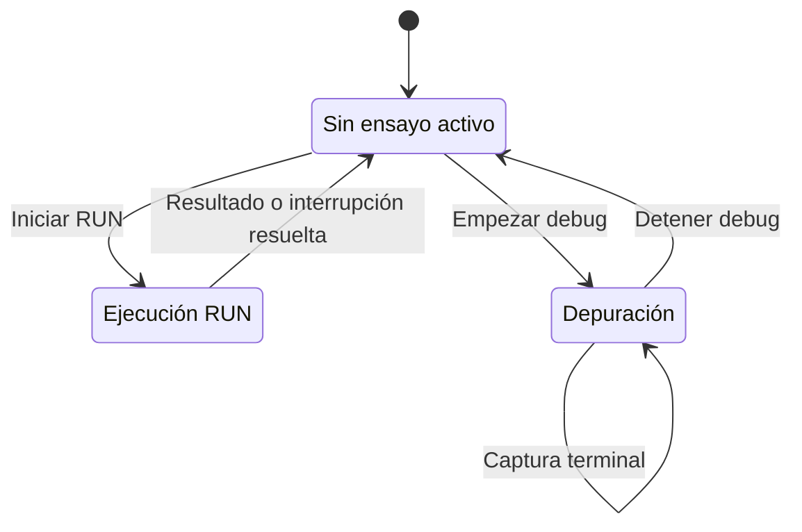

Las órdenes incompatibles se rechazan con motivo y no se encolan para ejecutarse después. RUN se rechaza mientras hay una depuración abierta; Continuar es la operación que avanza aquella depuración desde su posición actual. Pausar, detener y desconectar conservan el tratamiento definido del intercambio pendiente.

### LOAD y RUN

Sesiones distingue contenido actual, traducción vigente e imagen confirmada en la FPGA. LOAD requiere conexión y traducción vigente. Se consulta disponibilidad y se respetan aceptación, transmisión y confirmación: ACCEPTED invalida la imagen anterior; únicamente DONE confirma la carga nueva. Un rechazo explícito previo a la aceptación conserva el estado anterior; una aceptación o respuesta perdida no permite suponer una reversión. La recuperación no vuelve a cargar automáticamente.

RUN utiliza la imagen confirmada y la fuente vinculada a ella. El core comprueba la referencia de programa y revisión de la solicitud contra esa imagen al admitir la operación, conforme a [Identificación de la revisión al iniciar RUN o debug](#identificación-de-la-revisión-al-iniciar-run-o-debug). La continuación de la secuencia combinada conserva la versión tomada por su LOAD, incluso si el editor cambió durante la carga. ACCEPTED no es el resultado del ensayo: se publica solo la respuesta terminal completa. Un fallo conserva las observaciones completas anteriores como anteriores, descarta el parcial y no repite RUN.

El límite opcional de RUN permanece desactivado por defecto. Se cuenta desde la recepción completa de ACCEPTED hasta el comienzo de la respuesta terminal; una vez iniciada, se aplican los plazos de recepción del protocolo. Su vencimiento solicita RESET, sin atribuirlo a un fault o a falta de respuesta de la FPGA. Solo la confirmación acredita el reset. Si la respuesta terminal ya comenzó, se recibe completa y se conserva el desenlace real. La solicitud de detención y el resultado observado se distinguen.

### Depuración y reinicio

Durante el inicio, Sesiones solicita la protección del programa y comprueba bajo esa restricción que la versión corresponde a la imagen que utilizará la depuración. La apertura satisfactoria mantiene la protección y el control de la placa. Si el inicio falla, se resuelve el intercambio o la recuperación pendiente conforme a sus reglas y se liberan las restricciones y el control adquiridos por ese intento, informando el motivo. Esta liberación no declara recuperado el enlace ni revierte los efectos de una carga definida o incierta. Un fallo de conservación del registro mantiene la política de aviso y continuación del ensayo.

Empezar debug sobre una imagen recién cargada abre la sesión sin ejecutar un ciclo ni inventar una captura inicial. STEP ejecuta un ciclo y publica su observación completa. No se acumulan pedidos de avance mientras hay uno pendiente. Continuar repite STEP, evalúa cada captura y decide si solicita otro; Pausar impide el siguiente después del intercambio en curso.

Detener debug completa el STEP pendiente y no emite otro. Si la captura resultante es no terminal, el cierre indica detención solicitada. Si es FINISHED o FAULT, conserva ese resultado real. Si falla la comunicación, el cierre identifica la interrupción y retiene la última captura completa anterior. Se libera la restricción del programa al terminar la transición.

Tras detener, la preparación de una nueva ejecución se difiere hasta que sea necesaria. Una imagen recién cargada y sin ciclos puede utilizarse directamente. Un estado no terminal abandonado requiere nueva LOAD para comenzar desde el inicio. RUN desde un estado terminal utiliza la preparación definida por la FPGA; para abrir debug sin ejecutar un primer ciclo se utiliza LOAD. Una edición exige ensamblar y cargar la nueva versión, sin incorporar silenciosamente texto modificado.

Reiniciar debug recarga la misma versión. Una LOAD confirmada abre una nueva identidad de sesión, conserva los breakpoints de esa versión, restablece la referencia de comparación y espera la primera orden de avance. Las capturas previas siguen perteneciendo a la identidad anterior. Ante rechazo explícito anterior a la aceptación de LOAD se conserva la sesión previa, sin reanudar avance automáticamente; puede avanzarse de nuevo si su estado lo permite. Después de una aceptación o respuesta incierta no se continúa aquella sesión: se conserva para consulta y se exige recuperación aplicable y nueva carga confirmada.

Una captura terminal completa finaliza el resultado del ensayo y se entrega su cierre a Conservación si el registro está activo. La depuración permanece abierta para inspección. Detenerla después no reemplaza el resultado terminal por una detención manual.

### Desconexión con actividad

Desconectar cierra también la sesión lógica activa. Una depuración pausada se cierra sin iniciar otro ciclo. Si hay STEP o LOAD pendiente, se completa el intercambio dentro de sus plazos y se cierra sin iniciar otra operación; durante Continuar no se envía otro STEP. Durante RUN se aplica el intento de RESET y cierre definido, respetando una respuesta terminal ya iniciada. Una pérdida inesperada del enlace cierra el ensayo como interrumpido y conserva la última captura completa. Un resultado terminal completo ya obtenido conserva su desenlace, sin reemplazarlo por la desconexión posterior.

Al concluir el tratamiento del intercambio y del cierre, se liberan el control de la placa y la restricción de edición del programa. Esta liberación no acredita una detención física sin confirmación ni resuelve por sí sola una recuperación pendiente. Se conservan el contexto de recuperación y los datos completos disponibles; se entrega el cierre del ensayo a Conservación conforme a la política de registro. Reconectar no reabre la sesión anterior: requiere nueva sesión y nueva LOAD confirmada según las reglas del enlace.

### Salida de la aplicación

La salida normal reutiliza el cierre por desconexión para resolver la actividad y cerrar el enlace de su propio trabajo. Después completa los guardados pendientes de código y registros. Si se conserva el código, puede finalizar la interfaz; el core termina cuando no queda otro uso, conforme a Continuidad del trabajo y cierre. Un fallo de conservación del código mantiene la aplicación abierta para reintentar o elegir otro destino; salir con contenido sin conservar requiere una solicitud explícita. La sesión y la conexión ya cerradas no se reanudan por este fallo. Un fallo de conservación del registro se informa y no impide la salida, sin presentar como completa la evidencia incompleta. La salida de una interfaz no termina el trabajo de otra.

### Breakpoints

Cada breakpoint existe o se elimina; no se incorpora un estado separado de desactivado con definición retenida. Se asocia a la versión, el PC de una instrucción y uno de IF/ID, ID/EX, EX/MEM o MEM/WB, exigiendo entrada válida. Las coincidencias se evalúan sobre cada captura nueva. Si hay varias, se informa el conjunto sobre esa misma captura y se detiene una sola vez. Una retención puede producir coincidencias consecutivas sin suprimirlas.

La administración de breakpoints es posible durante debug. Los cambios definidos antes del inicio de la evaluación se aplican a esa captura; los posteriores, a la siguiente. No provocan pasos ni reevaluación de la captura anterior. Reiniciar la misma versión conserva sus breakpoints; una versión modificada requiere definirlos nuevamente, sin trasladar automáticamente los PCs anteriores.

## Interpretación de observaciones

### Contexto y temporalidad

| Campo de la observación lógica | Contenido |
|-------------------------------|-----------|
| Sesión | Identidad del ensayo. |
| Programa y versión | Fuente exacta ejecutada. |
| Operación | STEP o terminación de RUN. |
| Captura | Datos completos recibidos, incluido cycle_count. |

Estos campos de contexto pertenecen a la aplicación y no amplían el mensaje UART. Se interpretan flags de validez y causas conforme al estado recibido, sin promover bits residuales a instrucciones activas ni atribuir una línea a un PC fuera del mapa.

Los cambios se comparan con la observación completa anterior de la misma sesión. La primera no se compara con datos iniciales fabricados. Cambio de valor, selección y participación funcional tienen significados diferentes.

La explicación de un ciclo relaciona observación de partida, de llegada y participación interpretada durante ese ciclo. El snapshot posterior no debe confundirse con las etapas que trabajaron antes del flanco. En el primer STEP se utilizan las garantías iniciales de una LOAD recién confirmada, sin convertirlas en una observación medida. Los valores presentados como recibidos proceden de la captura real.

El resaltado general se fundamenta en las reglas del procesador. No presenta como medidas señales combinacionales ausentes ni incorpora valores adicionales reconstruidos fuera del alcance. Si no puede justificarse una interpretación, se conservan los datos completos válidos y se informa la limitación, sin inventar una causa física ni pausar por ese solo hecho.

### Seguimiento de una instrucción seleccionada

Se sigue únicamente la aparición elegida, sin numerar globalmente todas las instrucciones. Su origen es una observación completa y un registro válido, no el PC aislado. Si la selección identifica una captura ya reemplazada, se rechaza como anterior en lugar de elegir otra aparición.

| Información del seguimiento | Significado |
|----------------------------|-------------|
| Observación de origen | Captura con su sesión, programa y versión. |
| Registro de origen | Ubicación válida seleccionada. |
| Última ubicación identificada | Registro en el que pudo justificarse su continuidad. |
| Estado | En seguimiento, finalizado o continuidad no establecida. |

La continuidad requiere capturas completas de la misma sesión separadas por exactamente un STEP y un incremento coherente de cycle_count, incluido su wrap definido. Se comprueban validez, PC e instrucción en el destino permitido, sin buscar el mismo PC en cualquier registro.

| Ubicación anterior | Transición respaldada por el contrato |
|--------------------|--------------------------------------|
| IF/ID | Avanza a ID/EX, se retiene por load-use o finaliza por un descarte justificable. |
| ID/EX | Avanza a EX/MEM; HALT o fault propio pueden consumirla sin publicar una entrada válida allí. |
| EX/MEM | Avanza a MEM/WB. |
| MEM/WB | Sale del pipeline en el siguiente ciclo, aunque el nuevo ocupante tenga igual PC e instrucción. |

La retención requiere el patrón coherente de load-use: load válido anterior con destino distinto de x0 realmente utilizado por la instrucción, IF/ID retenido, bubble en ID/EX y evolución compatible del resto. En un drenado legal IF/ID e ID/EX ya están inválidos; act_drain_load_use no es alcanzable en una sesión legal según [Control y hazards](../../architecture/cpu/control_and_hazards.md#drenado-del-pipeline).

La tabla de acciones respalda estas posibilidades a nivel documental. No demuestra que una implementación defectuosa respete el contrato ni sustituye los casos de verificación. Una transición no justificable termina la identificación de continuidad, sin reasignar la selección a otra iteración. El fin del seguimiento no agrega una pausa a Continuar. Su presentación y el encuadre corresponden a la GUI.

## Interfaz de línea de comandos

### Identificación del programa para ensamblado y carga

El programa se identifica por su archivo y LOAD requiere una traducción vigente, mediante las invocaciones siguientes.

| Invocación | Contrato definido |
|---------------------|-------------------|
| `viewrv program assemble <file>` | Lee el archivo y ensambla una versión concreta de su contenido. La traducción o el diagnóstico quedan asociados al programa y versión procesados dentro del core. |
| `viewrv program load <file>` | Identifica el programa por el archivo y comprueba que corresponde a una traducción vigente. Si falta la traducción, cambió el contenido o el archivo no puede leerse, rechaza la carga con el diagnóstico correspondiente. No ensambla automáticamente ni carga silenciosamente una versión anterior. |

Las rutas relativas se interpretan respecto del directorio de la terminal que invoca CLI. La ruta resuelta identifica el archivo, sin utilizar solo su nombre para distinguir programas en directorios diferentes. El mecanismo concreto de normalización por plataforma se especifica posteriormente. La comprobación mantiene la identidad y versión lógicas del core: la coincidencia del nombre no acredita vigencia de la traducción.

Una vez iniciada una carga válida, se utiliza la versión capturada para esa operación. Los cambios posteriores no sustituyen los bytes que se están transfiriendo ni cancelan por sí mismos LOAD, conforme al contrato de versiones ya definido. El punto de captura y su coordinación se concretan en la especificación detallada.

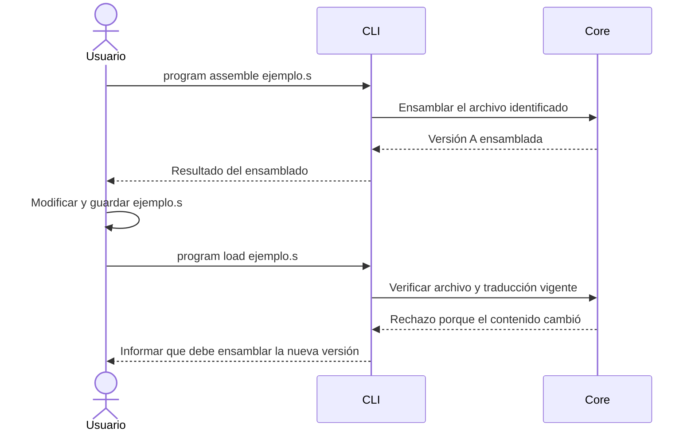

### Selección de sesión para consultas

La selección predeterminada es la sesión más reciente iniciada por el trabajo actual de CLI, abierta o terminada. La regla se aplica a session show, session steps y session logs; no otorga control sobre la sesión consultada.

| Situación | Selección |
|-----------|-----------|
| Se proporciona `--session <id>` | La sesión explícita, incluida una sesión controlada por GUI, con acceso de solo lectura. |
| Se omite --session y el trabajo actual de CLI inició ensayos | El ensayo más reciente de ese trabajo, aunque haya terminado. |
| Se omite --session y el trabajo actual no inició ensayos | Error que solicita una selección explícita; no se elige automáticamente una sesión GUI. |
| Se finaliza el trabajo de CLI y se inicia otro | El nuevo contexto comienza sin sesión predeterminada; las anteriores conservadas pueden consultarse por identificador. |

Consultar explícitamente otra sesión no cambia la selección predeterminada. La selección procede de los ensayos iniciados por el trabajo de CLI, no de la última consulta ni de la actividad global más reciente del core. Reiniciar debug con una nueva sesión confirmada conserva las reglas de identidad existentes y la nueva sesión pasa a ser la más reciente de ese trabajo. La selección para consulta no modifica la titularidad, los breakpoints ni el avance de GUI u otro controlador.

La sintaxis --session y los nombres de consulta se definen en el catálogo.

### Referencia de pasos para consultas incrementales

Las capturas completas de cada depuración se numeran desde 1 en orden de recepción; --after utiliza esa referencia. Cada captura conserva su número al registrarse y consultarse; no se renumera ni se compacta la secuencia si falta evidencia. Esta referencia no sustituye el contador medido en la FPGA.

| Dato conceptual | Significado |
|----------------|-------------|
| session_id | Identidad de la sesión a la que pertenece la captura. |
| step_index | Número asignado por el core dentro de esa sesión, desde 1. |
| cycle_count | Contador informado por la FPGA, conservado como dato medido independiente. |

Los nombres de campos expresan la asignación conceptual; los esquemas exactos de respuesta conservan su concreción posterior. La referencia incremental se interpreta dentro de la sesión seleccionada, sin mantener consumo por observador.

| Consulta | Resultado |
|----------|-----------|
| Sin --after | Todas las capturas disponibles de la sesión seleccionada. |
| --after 0 | Todas las capturas disponibles. |
| --after N, con N entero no negativo | Capturas conservadas cuyo step_index es estrictamente mayor que N, en orden. |
| Sin capturas posteriores disponibles | Resultado vacío, sin afirmar que el ensayo terminó ni que toda evidencia esté conservada. |
| Valor negativo o no entero | Error de argumento. |

La disponibilidad mantiene las condiciones de registro ya definidas: las capturas pendientes de escritura se incorporan después de conservarse, y los fallos o la desactivación se informan. La consulta no reconstruye datos faltantes, ejecuta ciclos ni altera la sesión predeterminada.

### Selección de dispositivo de programación y puerto serie

La programación del bitstream y la comunicación UART tienen destinos separados. board devices enumera identificadores de programación y board ports enumera puertos serie.

| Opción | Objetivo | Operaciones |
|--------|----------|------------------------|
| `--device <id>` | Dispositivo de programación al que se envía el bitstream del producto. Acepta un identificador presentado por board devices. | board prepare. |
| `--port <port>` | Puerto serie para la comunicación con el procesador. Acepta un puerto presentado por board ports. | board prepare y board connect. |

| Consulta | Única acción |
|----------|--------------|
| viewrv board devices | Enumerar dispositivos de programación e identificadores definidos por --device. |
| viewrv board ports | Enumerar puertos serie e información disponible para reconocerlos, como /dev/ttyUSB1 o COM3. |

| Selección solicitada | Comportamiento |
|----------------------|----------------|
| Destino explícito | Utilizar ese destino o informar el error, sin sustituirlo por otro. |
| Se omite --device | Seleccionar automáticamente solo si hay un único candidato compatible. |
| Se omite --port y existe un puerto recordado | Utilizar el recordado; si no está disponible, informar el problema sin cambiar automáticamente a otro. |
| Se omite --port y no existe un puerto recordado | Seleccionar automáticamente solo si hay un único candidato. |
| No se puede resolver la selección | Informar un error con los candidatos disponibles, sin preguntas interactivas. |

La selección de puerto respeta la prioridad explícita, el puerto recordado y los parámetros UART; recordar un puerto no acredita la identidad de la placa ni su bitstream. Las consultas de enumeración no programan el bitstream ni ejecutan el procesador. La selección resuelta no debe delegarse a una elección arbitraria del primer adaptador por la herramienta externa.

openFPGALoader 1.2.0 proporciona escaneo USB y selectores de dispositivo según su [fuente oficial](https://github.com/trabucayre/openFPGALoader/blob/v1.2.0/src/main.cpp). La enumeración efectiva, los atributos e identificadores expuestos por plataforma y su correspondencia con los selectores del programador conservan su especificación y verificación de integración posteriores; no se acredita aquí acceso físico ni una asociación automática entre cualquier dispositivo y cualquier puerto serie.

### Selección explícita del formato de salida de CLI

La salida predeterminada es humana; --output json selecciona explícitamente JSON incluso cuando se redirige la salida a un archivo o tubería. --output se coloca antes del grupo y modifica la presentación sin cambiar valores, significado ni efectos de la operación.

| Invocación ilustrativa | Presentación |
|------------------------|--------------|
| viewrv session show | Legible para personas. |
| viewrv --output human session show | Selección explícita de la misma presentación humana. |
| viewrv --output json session show | Resultado estructurado en JSON. |

La presentación JSON contempla tanto resultados como errores de operación y de argumentos, conforme a C03/C05 y. Esta decisión selecciona el formato de salida de CLI y no impone JSON como formato interno de los registros persistentes.

### Opciones de breakpoints en CLI

Los breakpoints se agregan y eliminan mediante línea o PC, junto con un registro interetapa obligatorio. Las líneas corresponden a la fuente de la versión depurada, sin adoptar modificaciones posteriores del archivo en disco.

| Invocación ilustrativa | Única acción |
|------------------------|--------------|
| viewrv debug breakpoint add --line 12 --latch ID/EX | Agregar un breakpoint para la instrucción de la línea 12 cuando aparezca válida en ID/EX. |
| viewrv debug breakpoint remove --line 12 --latch ID/EX | Eliminar ese breakpoint. |
| viewrv debug breakpoint list | Consultar los breakpoints definidos, mostrando línea, PC y registro interetapa. |

| Opción de add y remove | Valores y condición |
|------------------------|---------------------|
| `--line <number>` | Entero desde 1. Selecciona una línea de la fuente de la versión depurada. |
| `--pc <address>` | Dirección en decimal o hexadecimal con prefijo 0x. Alternativa a --line para identificar directamente la instrucción. |
| `--latch <latch>` | Obligatoria, sin valor predeterminado: IF/ID, ID/EX, EX/MEM o MEM/WB. |

Se proporciona exactamente una de --line o --pc y siempre --latch. Si la línea no contiene una instrucción o el PC no corresponde a una instrucción del programa, se rechaza la solicitud sin elegir otra posición automáticamente. El mapa del ensamblado permite obtener la misma identidad interna por PC, registro interetapa y versión desde ambas formas de selección. La asociación, eliminación sin estado de desactivado y evaluación durante debug conservan los contratos existentes. list no modifica definiciones ni ejecuta ciclos.

### Opciones de inicio de ensayo en CLI

Las operaciones que abren un ensayo admiten opciones de límite de RUN, registro y autor. Se concretan nombres, valores y alcance sin modificar las políticas de ejecución, conservación ni reinicio ya definidas.

| Opción | Operaciones | Contrato |
|--------|-------------|----------|
| `--limit <seconds>` | run start. | Número positivo y finito de segundos, con decimales admitidos. Al omitirlo no hay límite de ejecución. |
| --record | run start, debug start y debug restart. | Activar el registro del ensayo solicitado. |
| --no-record | run start, debug start y debug restart. | Desactivar el registro del ensayo solicitado. |
| `--author <text>` | run start, debug start y debug restart. | Autor no vacío del ensayo. Si se omite, se utiliza el configurado; sin autor aplicable se indica autor no especificado. |

--record y --no-record son mutuamente excluyentes; proporcionarlos juntos constituye un error de argumentos. Sin selección explícita se utiliza la preferencia vigente, activada por defecto. Las opciones se aplican al ensayo solicitado y no modifican preferencias generales ni registros anteriores. En debug restart corresponden al nuevo ensayo que se abre al confirmar la recarga, conservando el anterior con su identidad y evidencia propias.

El límite de RUN conserva su cómputo desde ACCEPTED completo hasta el inicio de la respuesta terminal. Su vencimiento solicita la detención definida, sin atribuir un FAULT ni desconocer una respuesta terminal ya iniciada. Este límite no establece un timeout implícito para el resto de operaciones ni sustituye los plazos del protocolo.

### Finalización explícita del trabajo de CLI

El cierre exige conservar el código por defecto; --discard-unsaved autoriza explícitamente finalizar sin conservar el contenido pendiente. La opción establece la política de cierre de esa invocación y no autoriza eliminar archivos ya guardados, registros anteriores ni modificaciones pertenecientes a GUI.

| Invocación | Única acción |
|------------|--------------|
| viewrv work finish | Finalizar el trabajo de CLI exigiendo conservar su código pendiente. |
| viewrv work finish --discard-unsaved | Finalizar ese trabajo autorizando el descarte de código pendiente si no puede conservarse. |

Si el código queda conservado, ambas formas permiten terminar. Si falla su conservación y falta la autorización, se informa el fallo y se mantiene el contexto para resolverlo mediante otra invocación, sin preguntas interactivas. Con autorización puede finalizarse, informando qué contenido quedó sin conservar. La resolución previa de actividad y conexión mantiene las reglas definidas, sin reanudar automáticamente una ejecución ya detenida. El core continúa mientras queden otros usos y completa su cierre al terminar el último.

### Catálogo consolidado de comandos y opciones de CLI

El catálogo define las operaciones, argumentos y opciones de viewrv. Cada fila corresponde a una operación funcional y las opciones no encadenan otras operaciones de forma implícita.

Las opciones generales --output human y --output json se colocan antes del grupo. La salida humana es predeterminada también ante redirección o tubería; JSON requiere selección explícita y contempla resultados y errores. --help consulta el nivel indicado sin ejecutar la operación ni iniciar trabajo del core. --version consulta la versión del cliente desde el nivel principal. Las consultas de ayuda y versión no requieren FPGA.

Ayuda y versión son excepciones al formato de salida: una invocación válida de --help o --version siempre escribe texto legible en stdout y termina con código 0, aunque se haya indicado --output json. No utiliza la envoltura JSON ni inicia el core. Esta excepción no modifica la representación de los errores de argumentos de una invocación inválida.

| Comando | Argumentos y opciones específicas | Única acción y contrato |
|---------|----------------------------------|--------------------------|
| viewrv board devices | Ninguno. | Enumerar dispositivos de programación e identificadores definidos por --device. No programa el bitstream ni ejecuta el procesador. El acceso y la representación de atributos concretos por plataforma mantienen su diseño y verificación de integración. |
| viewrv board ports | Ninguno. | Enumerar puertos serie e información disponible para reconocerlos. No abre UART, programa la placa ni toma control de un ensayo. La enumeración no acredita que un puerto corresponda al procesador esperado. |
| viewrv board prepare | `--device <id>` y `--port <port>`, opcionales según la política de selección. | Preparar la placa mediante el recorrido combinado de programación del bitstream incluido y establecimiento y comprobación de comunicación. El core coordina cierre UART, programador y comprobación posterior, respetando el control exclusivo. Informa por separado los fallos de cada fase e invalida el conocimiento de una imagen anterior cuando corresponde. No ensambla ni carga un programa Assembly y no promete reversión física de fases completadas. |
| viewrv board connect | `--port <port>`, opcional según la política de selección. | Establecer y comprobar la comunicación con una placa preparada. No programa el bitstream, carga un programa ni reanuda una depuración anterior. Si falta preparación o no puede resolverse el puerto, informa la condición sin preguntar interactivamente ni cambiar automáticamente a otro destino. |
| viewrv board disconnect | Ninguno. | Cerrar la conexión del trabajo de CLI resolviendo su actividad conforme al protocolo: completar LOAD o STEP y aplicar la detención correspondiente durante RUN. No termina por sí mismo el trabajo persistente ni desconecta una sesión controlada por GUI. |
| viewrv board status | Ninguno. | Consultar el estado conocido de conexión, puerto, preparación, controlador y recuperación pendiente. No inicia comprobaciones UART ni crea capturas nuevas. Distingue la información conocida de una comprobación física recién realizada. |
| viewrv program assemble | `<file>`, argumento obligatorio. | Ensamblar una versión concreta del archivo y devolver traducción o diagnóstico asociados a programa y versión. No requiere FPGA ni conecta, carga o ejecuta. Un resultado satisfactorio del assembler no sustituye las condiciones posteriores de tamaño y admisibilidad para LOAD. |
| viewrv program load | `<file>`, argumento obligatorio. | Cargar la traducción vigente del programa identificado por archivo, con conexión y tamaño admitido. Si falta traducción, cambió el contenido o no puede leerse, se rechaza sin ensamblar automáticamente ni usar silenciosamente otra versión. Solo DONE confirma la nueva imagen; una respuesta incierta no acredita conservación de la anterior. No ejecuta después de cargar. |
| viewrv run start | `--limit <seconds>`, --record o --no-record, `--author <text>`, todos opcionales. | Ejecutar normalmente la imagen confirmada y esperar el desenlace o la resolución de una interrupción, conservando su fuente y versión. No ensambla ni carga otra imagen, proporciona capturas intermedias ni admite RUN durante debug abierto. El límite opcional conserva su cómputo desde ACCEPTED completo hasta el comienzo de la respuesta terminal y solicita la detención definida al vencer. |
| viewrv run stop | Ninguno. | Solicitar la detención del RUN controlado por el trabajo de CLI, incluso desde otra terminal. Aplica el procedimiento RESET y distingue solicitud, confirmación y desenlace real. No constituye pausa reanudable, desconexión ni finalización del trabajo. Una respuesta terminal ya iniciada se conserva completa. |
| viewrv debug start | --record o --no-record y `--author <text>`, opcionales. | Abrir una depuración vinculada a la versión e imagen preparadas para comenzar, aplicando protección de edición y control definidos. No ejecuta un primer ciclo ni fabrica captura inicial. Informa si falta la carga o preparación necesaria sin presentar un estado abandonado como nuevo inicio. |
| viewrv debug step | Ninguno. | Ejecutar exactamente un ciclo y devolver su captura completa, contexto y coincidencias de breakpoints. No equivale a ejecutar una instrucción completa. Rechaza otro avance mientras haya uno pendiente, sin acumular solicitudes. |
| viewrv debug continue | Ninguno. | Continuar mediante STEP sucesivos coordinados por el core, evaluando cada captura completa antes del siguiente avance. Termina ante breakpoint, resultado terminal, pausa o fallo e informa la causa y observación disponible. No utiliza RUN ni deshabilita breakpoints. |
| viewrv debug pause | Ninguno. | Pausar la secuencia Continuar completando el STEP pendiente e impidiendo el siguiente. Conserva la depuración abierta para inspección o continuación. No corta una captura parcial ni sustituye un resultado terminal ocurrido durante el intercambio. |
| viewrv debug restart | --record o --no-record y `--author <text>`, opcionales. | Reiniciar la misma versión mediante recarga y, con LOAD confirmada, abrir un ensayo con nueva identidad y sus breakpoints conservados, esperando una orden de avance. No incorpora ediciones posteriores ni modifica evidencia previa. Las opciones afectan al nuevo ensayo; una recarga fallida no se presenta como reinicio satisfactorio. |
| viewrv debug stop | Ninguno. | Terminar la depuración propia resolviendo el STEP pendiente, sin emitir nuevos avances y liberando restricciones y control correspondientes. Conserva FINISHED o FAULT si fueron el desenlace real. No desconecta la placa, prepara automáticamente otro ensayo ni finaliza el trabajo de CLI. |
| viewrv debug breakpoint add | Exactamente una de `--line <number>` o `--pc <address>`; `--latch <latch>` obligatorio. | Agregar un breakpoint de instrucción válida y registro interetapa en la versión depurada. Puede administrarse durante debug con la regla temporal definida. No ejecuta ciclos ni reevalúa una captura anterior; no selecciona otra instrucción si la referencia es inválida. |
| viewrv debug breakpoint remove | Exactamente una de `--line <number>` o `--pc <address>`; `--latch <latch>` obligatorio. | Eliminar el breakpoint identificado por instrucción, registro interetapa y versión. No conserva una definición desactivada, provoca avances ni cambia capturas anteriores. La eliminación durante debug mantiene el momento de aplicación definido. |
| viewrv debug breakpoint list | Ninguno. | Consultar los breakpoints definidos para la depuración actual, mostrando línea, PC, registro interetapa y asociación con su programa y versión. No modifica definiciones ni ejecuta ciclos. |
| viewrv session list | Ninguno. | Enumerar sesiones conocidas y las identificables mediante registros disponibles, con identidad, modo, programa, versión y estado conocido. Permite localizar una sesión GUI para observarla. No recupera evidencia inexistente ni interpreta la falta de cierre como prueba de ejecución activa. |
| viewrv session show | `--session <id>`, opcional según la selección de sesión definida. | Consultar contexto, estado conocido, última observación completa disponible y resultado de una sesión. Indica ausencia de captura y limitaciones conocidas. No obtiene una captura nueva ni toma control de una sesión observada. |
| viewrv session steps | `--session <id>` y `--after <number>`, opcionales según sus políticas definidas. | Consultar todas las capturas conservadas de la depuración seleccionada o solo las de step_index posterior al indicado, en orden. Conserva identidad y contexto sin estado de consumo por observador. Informa registro desactivado, fallido o incompleto; una captura pendiente aparece al conservarse. Un resultado vacío no declara finalización y no se reconstruyen faltantes ni se envía STEP. Se aplica a depuración; los resultados de RUN se consultan mediante show o logs, sin inventar pasos intermedios. |
| viewrv session logs | `--session <id>`, opcional según la selección definida. | Obtener la evidencia registrada con fuente, versión, metadatos, observaciones, cierre e integridad disponibles. Se distingue de steps por incluir el registro y su contexto e integridad. No escribe por sí mismo una copia en otro archivo, reconstruye datos ni reanuda el ensayo. |
| viewrv work status | Ninguno. | Consultar la existencia y el contexto del trabajo persistente de CLI y su actividad, conexión y sesión propias. No toma control ni confunde ese trabajo con una única depuración; puede comprender distintos ensayos sucesivos. |
| viewrv work finish | --discard-unsaved, opcional y desactivada por defecto. | Finalizar el trabajo de CLI resolviendo actividad, conexión y conservación conforme a sus reglas. Sin autorización, un fallo de conservación de código mantiene el contexto para resolverlo sin preguntas interactivas. Con autorización puede terminar informando contenido no conservado. No elimina archivos, registros ni cambios de GUI. El core decide continuar por otros usos o cerrar al finalizar el último. |
| viewrv --help | --help también está disponible en cada grupo y comando. | Consultar ayuda del nivel seleccionado y terminar sin ejecutar la operación ni iniciar trabajo del core. Por ejemplo, viewrv debug step --help no avanza la FPGA. |
| viewrv --version | Ninguno adicional; opción del nivel principal. | Consultar la versión del cliente CLI instalado y terminar sin iniciar el core. No se confunde con la versión de una instancia de servidor conectada. |

Ninguno en la columna de opciones específicas mantiene las opciones generales de presentación y ayuda aplicables. Las combinaciones --record con --no-record y --line con --pc se rechazan como argumentos incompatibles. No se añaden opciones para ejecutar, desconectar o finalizar trabajo después de otra operación: esas solicitudes se realizan explícitamente mediante sus propios comandos.

La validez y los valores predeterminados de cada opción se definen en las subsecciones definidas anteriores. Los identificadores de sesión y dispositivo se obtienen de las consultas correspondientes; no se exige interpretarlos como direcciones UART, PCs o contadores de FPGA. Las opciones de sesión, salida y registro no transfieren control ni cambian las reglas del core.

Las consultas distinguen sesión inexistente, sesión sin captura recibida, ausencia de registro, evidencia incompleta y consulta válida sin capturas posteriores. Esas condiciones se informan con el contexto disponible; no se reducen indistintamente a una lista vacía ni acreditan por sí mismas finalización o ausencia de ciclos. Los campos y códigos se definen en [Resultados y estructuras de datos](#resultados-y-estructuras-de-datos) y [Errores y avisos](#errores-y-avisos). Una selección explícita inválida no se sustituye por la sesión predeterminada.

## Solicitudes HTTP

### Convención común de solicitudes HTTP

Las solicitudes de GUI y CLI al core utilizan las siguientes convenciones HTTP. GET /api/v1/board/status consulta el estado conocido de la placa y POST /api/v1/debug/step solicita un ciclo de depuración.

| Aspecto | Convención definida |
|---------|---------------------|
| Prefijo de rutas | /api/v1 identifica la primera versión del contrato de comunicación. |
| Consultas | GET obtiene información sin modificar el trabajo ni operar la placa. |
| Acciones | POST solicita una operación concreta. |
| Datos de una acción | Cuerpo JSON con sus parámetros. |
| Respuestas | Se utilizan las estructuras de resultado y error ya definidas. |

GUI y CLI utilizan las mismas rutas y contratos.

El segmento api identifica la interfaz de comunicación del core y v1 la versión del contrato, no la versión del programa. La aplicación puede recibir actualizaciones compatibles conservando v1; los cambios incompatibles se identifican mediante otra versión del contrato. El prefijo no sustituye las comprobaciones de identidad, compatibilidad ni autorización del arranque y acceso ya definidas.

### Identificación del trabajo en las solicitudes HTTP

Cada operación identifica al trabajo solicitante y comprueba si controla la sesión afectada.

| Encabezado | Contenido |
|--------------------------------|-----------|
| X-Viewrv-Work-Id | UUID del trabajo al que pertenece la solicitud. Es el nombre concreto del encabezado, no un placeholder. |

El core asigna el identificador al registrar el trabajo y conserva su asociación con la interfaz. El trabajo propio de GUI se identifica también mediante UUID. CLI conserva su trabajo único persistente, reutilizado automáticamente entre comandos y terminales. La interfaz incorpora el encabezado sin exigir al usuario que escriba el UUID al ejecutar un comando.

| Interfaz | Trabajo utilizado |
|----------|--------------------|
| GUI | Su propio trabajo, distinto del trabajo de CLI. |
| CLI | El único trabajo persistente de CLI en esa instancia del core. |

El encabezado identifica al trabajo solicitante; el control de una sesión es un dato conservado por el core. Para admitir modificaciones o avances, el core contrasta ambos y aplica las precondiciones de la operación. El mero envío del identificador no modifica la titularidad de una sesión. La autorización de acceso al canal conserva su mecanismo Bearer por instancia, independiente de esta referencia de contexto.

Una GUI observadora de una depuración de CLI conserva su propio trabajo y señala la sesión consultada mediante session_id. No adopta la identidad del trabajo controlador para observarla. Una solicitud de avance desde otro trabajo conserva el rechazo BOARD_CONTROL_CONFLICT; las consultas permitidas no conceden control. Las consultas generales, como board status o work status, pueden realizarse sin crear un trabajo.

El ejemplo de CLI con trabajo A, GUI con trabajo B y ensayo S usa nombres abreviados para ilustrar las referencias; los valores reales de identificación siguen el formato UUID definido. El [registro automático del trabajo](#registro-automático-del-trabajo) concreta la obtención del identificador. No se crean nuevas opciones públicas de CLI por este mecanismo.

### Registro automático del trabajo

GUI y CLI registran automáticamente su trabajo mediante la operación siguiente.

| Solicitud HTTP | Contrato definido |
|----------------|--------------------|
| POST /api/v1/work/register | Registrar el trabajo o reutilizar el correspondiente y devolver su identificador. |

| Campo del cuerpo JSON | Contenido definido |
|-----------------------|--------------------|
| client_type | gui o cli. |
| registration_id | Para GUI, UUID que identifica esa apertura de la aplicación. CLI lo omite. |

| Solicitud | Comportamiento definido del core |
|-----------|---------------------------------|
| Registrar CLI | Devuelve el trabajo de CLI existente; si todavía no existe, lo crea. |
| Registrar GUI con una referencia nueva | Crea su trabajo propio. |
| Repetir un registro de GUI con la misma referencia | Devuelve el mismo trabajo, permitiendo recuperar la respuesta sin crear trabajos duplicados. |

| Campo de result | Contenido definido |
|-----------------|--------------------|
| work_id | UUID del trabajo registrado. |

El resultado satisfactorio conserva error igual a null en la envoltura compartida. El registro no requiere un work_id previo, porque obtiene esa referencia; mantiene la autorización Bearer de la instancia del core. La asociación y reutilización pertenecen a esa instancia, sin reconstruir trabajos ni sesiones físicas de una instancia anterior.

El core garantiza un único trabajo de CLI también ante dos registros simultáneos. Cada nueva invocación puede obtener el mismo contexto, sin asociarlo a la vida de un proceso de terminal. Para GUI, registration_id identifica la apertura que solicita registrarse, mientras work_id identifica el trabajo devuelto por el core. La referencia de apertura evita duplicar registros de la misma GUI al repetir esa solicitud.

El registro crea o recupera el contexto; no concede por sí mismo control sobre la placa ni inicia una conexión, carga o avance. Las operaciones posteriores incluyen X-Viewrv-Work-Id conforme a sus requisitos y conservan sus validaciones. No se reenvían automáticamente las operaciones con efectos sobre la FPGA por recuperar el registro del trabajo.

Todo el mecanismo es interno y automático para las interfaces. Las consultas generales no necesitan registrar un trabajo, y consultar o finalizar uno existente no debe crear otro. Las solicitudes concretas para resolver esos casos se especifican a continuación, sin añadir comandos públicos de registro a CLI.

### Solicitudes de consulta y finalización del trabajo

Las solicitudes siguientes consultan el trabajo único de CLI y finalizan el trabajo identificado.

| Acción de la interfaz | Solicitud HTTP | Identificación del trabajo |
|----------------------|----------------|-----------------------------|
| viewrv work status | GET /api/v1/work/cli/status | Consulta el trabajo único de CLI; no necesita work_id. |
| viewrv work finish | POST /api/v1/work/finish | Envía el UUID del trabajo de CLI mediante X-Viewrv-Work-Id. |
| Cerrar el trabajo de GUI | POST /api/v1/work/finish | Envía el UUID propio de GUI mediante X-Viewrv-Work-Id. |

| Campo del cuerpo JSON de finalización | Contenido definido |
|--------------------------------------|--------------------|
| discard_unsaved | Booleano opcional, false por defecto. Autoriza el descarte conforme a la política definida; en CLI corresponde a --discard-unsaved. |

Las respuestas reutilizan exactamente las estructuras de [work status](#resultado-de-work-status) y [work finish](#respuesta-satisfactoria-de-work-finish). La lógica de finalización es compartida por GUI y CLI y se aplica al trabajo identificado, sin cerrar trabajos ajenos. La autorización Bearer por instancia se conserva en ambas solicitudes, aunque la consulta de trabajo de CLI no requiera el encabezado de contexto.

Una nueva invocación de CLI que solicita finalizar consulta el trabajo existente, obtiene su UUID y solicita finalizar ese trabajo. Si la consulta indica que no existe, se informa WORK_NOT_ACTIVE sin registrar otro trabajo para cerrarlo. Se mantiene la referencia obtenida para esa solicitud: la finalización no se transforma en una petición de cierre de cualquier trabajo que aparezca posteriormente.

La consulta no crea trabajo ni opera la placa. La finalización conserva las reglas de resolución de actividad y conexión, conservación o descarte autorizado y emisión de la respuesta antes de terminar el último uso del core. Para GUI se aplica la misma operación a su propio contexto al cerrar la ventana, conservando el tratamiento ya definido ante fallos de conservación de código.

### Solicitudes compartidas de placa, programas, ejecución y sesiones

GUI y CLI comparten las solicitudes siguientes para operar la placa, los programas y las sesiones. Las rutas y parámetros distinguen el archivo de CLI de la captura del editor de GUI.

Todas las rutas siguientes llevan el prefijo /api/v1. GET envía los datos como parámetros de URL, sin cuerpo; POST utiliza un cuerpo JSON. El objeto vacío de una acción se representa mediante {}.

| Operación | Método y ruta tras /api/v1 | Datos enviados |
|-----------|---------------------------|----------------|
| board devices | GET /board/devices | Ninguno. |
| board ports | GET /board/ports | Ninguno. |
| board prepare | POST /board/prepare | device_id y port, opcionales. |
| board connect | POST /board/connect | port, opcional. |
| board disconnect | POST /board/disconnect | Objeto vacío. |
| board status | GET /board/status | Ninguno. |
| program assemble | POST /program/assemble | source_path o captura de editor, según las formas de fuente siguientes. |
| program load | POST /program/load | source_path o captura de editor, según las mismas formas de fuente. |
| run start | POST /run/start | program_id y source_version según la regla de referencia siguiente; limit_seconds, record y author, opcionales. |
| run stop | POST /run/stop | Objeto vacío. |
| debug start | POST /debug/start | program_id y source_version según la misma regla; record y author, opcionales. |
| debug step | POST /debug/step | Objeto vacío. |
| debug continue | POST /debug/continue | Objeto vacío. |
| debug pause | POST /debug/pause | Objeto vacío. |
| debug restart | POST /debug/restart | record y author, opcionales. |
| debug stop | POST /debug/stop | Objeto vacío. |
| debug breakpoint add | POST /debug/breakpoint/add | Exactamente uno de line o pc, más latch. |
| debug breakpoint remove | POST /debug/breakpoint/remove | Exactamente uno de line o pc, más latch. |
| debug breakpoint list | GET /debug/breakpoint/list | Ninguno; consulta la depuración del trabajo identificado. |
| session list | GET /session/list | Ninguno. |
| session show | GET /session/show | session_id, opcional según la selección predeterminada definida. |
| session steps | GET /session/steps | session_id y after, opcionales. |
| session logs | GET /session/logs | session_id, opcional según la misma regla. |

| Forma de fuente en program assemble y program load | Campos del cuerpo JSON | Uso definido |
|---------------------------------------------------|------------------------|--------------|
| Archivo | source_path: ruta absoluta. | CLI identifica el archivo que lee el core. |
| Captura del editor | program_id, source_version y source_text: identificadores y texto completo de esa revisión. | GUI opera sobre el contenido exacto del editor aunque todavía no esté guardado. |

Se proporciona una sola forma de fuente. program_id y source_version mantienen sus formatos UUID definidos; source_text conserva el texto completo de esa revisión. La captura del editor no es una captura de registros de FPGA. La traducción o el diagnóstico corresponden a la revisión procesada; LOAD exige una traducción vigente de la fuente indicada y no ensambla automáticamente. Se conservan las reglas de edición durante ensamblado y carga, incluida la continuidad de la versión ya tomada por LOAD.

| Campo de opción | Regla definida |
|-----------------|----------------|
| limit_seconds | Número positivo y finito de segundos; admite decimales. Omitido significa sin límite de ejecución. |
| record | Booleano para activar o desactivar el registro. Omitido utiliza la preferencia vigente. |
| author | Texto no vacío. Omitido utiliza el autor configurado, si existe. |
| after | Entero no negativo; omitido equivale a 0 y filtra índices estrictamente posteriores. |
| line, pc y latch | Conservan la selección y validación de breakpoints ya definidas. pc viaja como entero JSON; la CLI interpreta previamente la escritura decimal o hexadecimal admitida. |

Los campos device_id y port conservan los identificadores de enumeración y las políticas de selección ya definidas: dispositivo único, puerto recordado o candidato único según el caso, sin sustitución automática de un destino explícito. latch conserva los valores IF/ID, ID/EX, EX/MEM y MEM/WB.

Las acciones y la consulta de breakpoints llevan X-Viewrv-Work-Id. Los controles se aplican al RUN o debug propio del trabajo identificado y mantienen la admisión y las restricciones existentes. Las consultas con session_id explícito pueden observar otro trabajo; si CLI omite el identificador, utiliza la selección predeterminada de su contexto existente. Las consultas generales no necesitan crear un trabajo. Todas mantienen la autorización de acceso al core.

Las respuestas y errores se reutilizan sin cambios, incluida la respuesta de session list con sessions y limitations. Los esquemas de trabajo ya definidos se conservan en sus apartados; ayuda y versión siguen siendo operaciones locales. Este bloque cubre las 25 operaciones del catálogo CLI junto con las dos solicitudes de trabajo ya definidas, sin dar por completadas las operaciones propias del editor, el acceso inicial, SSE ni la correspondencia HTTP de errores.

### Identificación de la revisión al iniciar RUN o debug

POST /api/v1/run/start y POST /api/v1/debug/start identifican el destino mediante los campos siguientes del cuerpo JSON. Son referencias a una imagen ya cargada; no envían texto ni solicitan otro ensamblado o LOAD.

| Campo | Contenido |
|-------|-----------|
| program_id | UUID del programa que se solicita ejecutar o depurar. |
| source_version | UUID de la revisión exacta de ese programa. |

Los dos campos se proporcionan juntos o se omiten juntos. Una referencia parcial o un formato inválido devuelve INVALID_ARGUMENT con HTTP 400, sin operar la FPGA.

| Origen de la solicitud | Referencia utilizada |
|------------------------|----------------------|
| Correr o Empezar debug individual desde GUI | Ambos campos son obligatorios. La GUI toma el programa con foco y su revisión al solicitar la acción. |
| RUN posterior a LOAD en el atajo combinado de GUI | Ambos campos son obligatorios y proceden del resultado de la LOAD confirmada de esa secuencia. Una edición posterior no los sustituye. |
| run start o debug start desde CLI | El cliente omite ambos campos. El core toma el programa y revisión de la imagen confirmada al admitir la operación. No se añaden argumentos ni opciones públicas de CLI. |

La comprobación se realiza junto con la admisión y la reserva de la operación, antes de enviar UART o abrir una depuración. Si no hay una imagen confirmada y vinculada a una fuente, se devuelve IMAGE_NOT_LOADED. Una referencia de programa inexistente recibe PROGRAM_NOT_FOUND; una referencia conocida que no coincide con el programa y revisión cargados recibe SOURCE_VERSION_MISMATCH con HTTP 409. Una GUI que omite ambos campos recibe INVALID_ARGUMENT con HTTP 400. El identificador de trabajo conserva la comprobación de control; estos campos no conceden propiedad de la placa.

La coincidencia se comprueba contra la imagen confirmada, sin reemplazar la referencia solicitada por el texto actual del editor. Por eso, si la secuencia cargó A y el editor pasó a B durante LOAD, su RUN puede ejecutar A y la GUI informa la diferencia. Una acción individual sobre B envía B y no puede ejecutar silenciosamente A. Si otra carga sustituyó la imagen antes de admitir la operación, la discrepancia se rechaza en vez de adoptar el nuevo destino.

El inicio de debug conserva además la protección de edición y la comprobación de versión del programa que va a depurarse. debug restart y los controles de un ensayo abierto conservan el destino de esa sesión; no incorporan estos campos ni toman otra revisión del editor.

### Representación común de programa para el editor

Las operaciones del editor devuelven una misma representación del programa.

| Campo | Contenido definido |
|-------|--------------------|
| program_id | UUID del programa. |
| source_version | UUID de la revisión del texto. |
| source_text | Texto completo de esa revisión. |
| source_path | Ruta del archivo Assembly asociado, o null para un borrador sin archivo. |
| example_id | Ejemplo del que proviene, o null. |
| is_open | Indica si el documento está abierto en el espacio de trabajo. |
| edit_protected | Indica si el core impide modificarlo por estar asociado a una depuración abierta. |
| saved_version | Última revisión cuya conservación en el archivo Assembly se confirmó, o null. |
| recovery_version | Última revisión cuya conservación en la copia interna de recuperación se confirmó, o null. |

La estructura describe datos de respuesta que viajan entre core y GUI; permite mostrar el contenido, identificar programa y revisión, reconocer protección de edición y distinguir texto actual de texto conservado. Si el texto actual es B y termina el guardado de A, saved_version o recovery_version pueden identificar A sin presentar B como conservada. Cada confirmación corresponde al destino indicado.

Se reutiliza al crear, abrir, actualizar o guardar un programa y al consultar los programas disponibles, sin mantener variantes independientes de sus campos. Las identidades y referencias de revisión utilizan los UUID definidos. La GUI conserva sus reglas de edición local y tratamiento de confirmaciones antiguas; la recepción de una respuesta no sustituye una edición local posterior por el texto de una revisión anterior.

### Solicitudes propias del editor

El editor utiliza las nueve solicitudes siguientes. Se utiliza el prefijo /api/v1 y el trabajo registrado de GUI mediante X-Viewrv-Work-Id, conservando la autorización común.

Captura designa los tres campos ya definidos program_id, source_version y source_text. En POST los datos se envían en el cuerpo JSON; el listado GET no tiene cuerpo.

| Acción | Solicitud tras /api/v1 | Datos enviados |
|--------|------------------------|----------------|
| Listar programas y borradores recuperables | GET /program/list | Ninguno. |
| Crear un programa vacío | POST /program/create | Objeto vacío. |
| Abrir un archivo | POST /program/open | source_path: ruta absoluta. |
| Abrir una copia editable de un ejemplo | POST /program/open-example | example_id. |
| Comunicar el texto editado al core | POST /program/update | Captura. |
| Guardar o guardar como | POST /program/save | Captura y source_path opcional. Para un borrador sin archivo debe indicarse el destino. |
| Cerrar un programa conservándolo | POST /program/close | Captura con su último contenido. |
| Recuperar un borrador cerrado | POST /program/recover | program_id. |
| Descartar un programa recuperable | POST /program/discard | program_id. |

Las operaciones devuelven la [representación común del programa](#representación-común-de-programa-para-el-editor), salvo las dos excepciones siguientes.

| Operación | Contenido de result |
|-----------|---------------------|
| Listado | programs: lista de representaciones comunes de programa; limitations: avisos de lectura o recuperación con code, section y message, según la estructura compartida. |
| Descarte | program_id y discarded igual a true, una vez confirmado. |

Actualizar texto confirma su recepción en el core. La conservación en disco tiene sus propias confirmaciones y no se acredita por haber recibido una actualización. Guardar confirma la conservación solicitada; informar versiones guardadas no reemplaza ediciones posteriores. La representación mantiene sus referencias de revisión por destino.

Cerrar conserva el borrador y marca is_open igual a false. Descartar elimina la copia recuperable y retira el programa después de confirmar la operación; conserva los archivos Assembly y los registros existentes. Si falla la eliminación se mantienen el programa y el tratamiento de RECOVERY_DELETE_FAILED ya definido.

Abrir un archivo ya abierto devuelve el programa existente con sus cambios. Abrir un ejemplo crea una copia propia editable, conservando el original del catálogo. Los programas cerrados y recuperables se mantienen disponibles conforme a las políticas definidas; recuperar no reanuda una ejecución física ni recrea automáticamente un archivo asociado que falta.

La protección durante debug y los fallos de conservación mantienen sus políticas y códigos definidos. El listado comunica sus limitaciones de recuperación con la estructura de avisos compartida, sin convertir datos ausentes o inválidos en programas inventados. El encabezado de trabajo no sustituye las comprobaciones de modificación ni de protección de cada programa.

Estas rutas concretan la interfaz del editor. No se añaden comandos públicos de edición a CLI ni se trasladan al core las acciones locales de presentación.

### Orden de las actualizaciones de texto de GUI

GUI mantiene una sola solicitud program/update en curso por programa. Mientras espera su respuesta, el usuario puede seguir editando y la revisión más reciente queda pendiente de envío.

| Situación ilustrativa | Tratamiento definido |
|-----------------------|----------------------|
| Se envía la revisión B | La solicitud de actualización de ese programa queda en curso. |
| El usuario escribe C y después D antes de recibir la respuesta | El editor muestra D y D reemplaza a C como actualización pendiente. |
| Se confirma la recepción de B | Se conserva el texto local D y puede enviarse su actualización. |
| Se confirma la recepción de D | El core conoce esa revisión; las confirmaciones de conservación permanecen independientes. |

Cada programa mantiene su propio envío pendiente; los documentos distintos no se reemplazan entre sí. La coordinación ordena los mensajes de texto y mantiene libre la edición, evitando que una actualización atrasada haga retroceder el contenido conocido por el core. Las vistas del mismo documento conservan el modelo compartido de GUI ya definido.

La respuesta de program/update confirma recepción, no conservación en disco. Una respuesta antigua no sustituye el texto local más reciente. Los destinos de guardado conservan sus confirmaciones por revisión, y el Storage worker mantiene la coordinación de escrituras definida de forma separada. Esta regla no cambia las capturas de fuente tomadas por ensamblado o LOAD ni las restricciones de admisión de operaciones sobre la FPGA.

#### Coordinación del texto antes de acciones

Antes de solicitar ensamblar, cargar, guardar o cerrar desde GUI, se confirma que el core recibió la revisión elegida para esa acción. La coordinación es por programa y utiliza la misma secuencia de program/update; no crea un canal de texto independiente para cada operación.

| Momento | Regla |
|---------|-------|
| Preparar la acción | Tomar programa, revisión y texto concretos; resolver la actualización anterior en curso y comunicar la revisión elegida si aún no fue confirmada. |
| Confirmar recepción | Esperar la respuesta de program/update correspondiente a esa revisión. Esta confirmación no espera a su conservación en disco. |
| Solicitar la acción | Enviar la captura de fuente elegida después de confirmar su recepción. La acción utiliza esa copia, sin convertirla nuevamente en el contenido actual del documento. |
| Editar durante ensamblado, carga o guardado | Permitir nuevas revisiones y comunicarlas mediante la secuencia normal, sin esperar el resultado de la operación larga ni cambiar su entrada. |
| Cerrar el documento | Suspender su edición, comunicar y confirmar la última revisión y resolver el cierre sin dejar actualizaciones de ese documento para enviar después. |
| No obtener confirmación de recepción | Conservar el texto local e informar el problema; no enviar la acción que dependía de esa confirmación. |

La revisión tomada para una acción no se reemplaza por una edición posterior mientras espera su confirmación. La agrupación de actualizaciones ordinarias conserva por separado esa referencia fija. Después de enviar la acción, las revisiones nuevas pueden seguir llegando al core: ensamblar, cargar o guardar una copia anterior no hace retroceder el texto actual, y sus resultados no vuelven a aplicarse como ediciones. El cierre confirmado tampoco se revierte por una confirmación anterior.

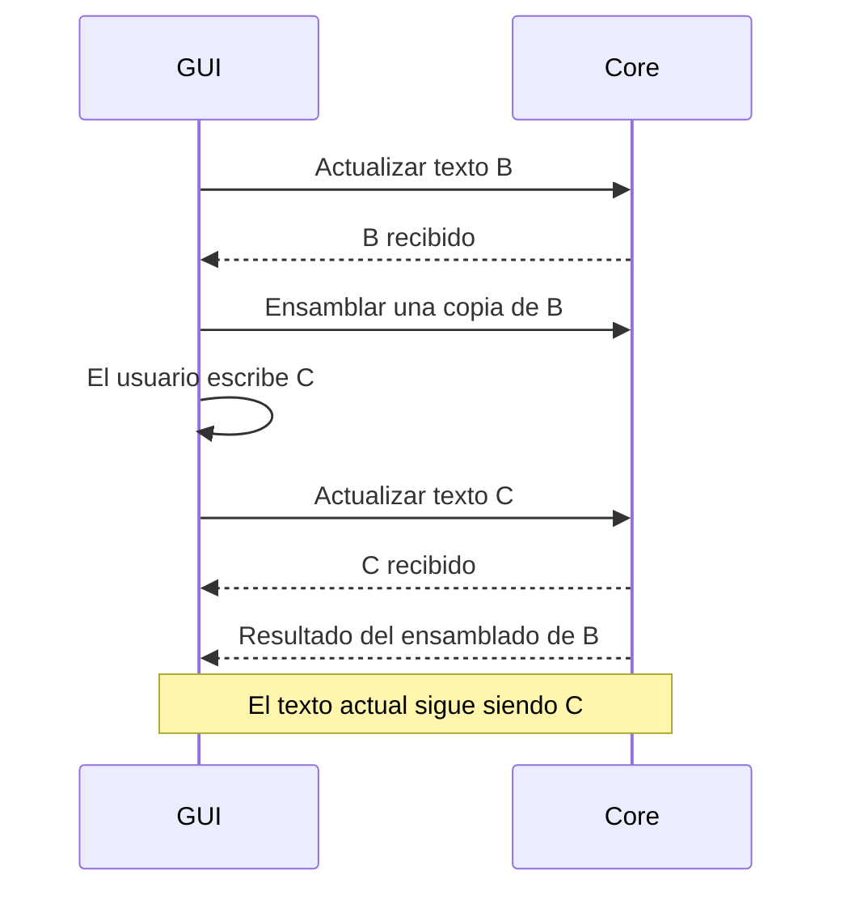

La coordinación no sustituye las comprobaciones de vigencia de LOAD: una modificación anterior al inicio de la carga impide utilizar una traducción desactualizada. Si LOAD ya comenzó, conserva su versión y el RUN del atajo combinado utiliza la referencia de su carga confirmada. No se pausa el autoguardado ni se bloquea el envío de texto durante una operación larga. El cierre conserva además sus condiciones de guardado y tratamiento de fallos.

### Correspondencia de resultados y errores con estados HTTP

El estado HTTP clasifica la respuesta del core y error.code identifica su motivo específico. La asignación del proyecto conserva la envoltura común y las definiciones de [HTTP Semantics, RFC 9110](https://www.rfc-editor.org/rfc/rfc9110.html#name-status-codes).

| Estado HTTP | Uso definido en la aplicación |
|-------------|-------------------------------|
| 200 | Resultado satisfactorio, incluidas capturas con FAULT y consultas con avisos. |
| 400 | Argumentos ausentes o inválidos, JSON incorrecto, solicitud mal estructurada o incumplimiento de las reglas de Host, Origin o comprobación previa CORS. |
| 401 | Credencial de acceso ausente o inválida. |
| 404 | Ruta o referencia solicitada inexistente: programa, sesión, archivo, dispositivo o breakpoint. |
| 405 | La ruta existe, pero no admite ese método HTTP. |
| 409 | Conflicto con el estado actual: otro controlador, operación incompatible, programa protegido o preparación pendiente. |
| 415 | Tipo de contenido no admitido. |
| 422 | Contenido recibido correctamente, pero inválido para la operación; por ejemplo, un error de Assembly o un tamaño LOAD inválido. |
| 500 | Fallo de comunicación, almacenamiento o procesamiento interno que impide completar la operación. |
| 503 | El core está cerrándose y ya no admite la solicitud. |

El motivo concreto determina la clasificación. LOAD_REJECTED conserva su significado anterior a la aceptación y puede acompañarse de 409 ante BUSY o de 422 ante INVALID_SIZE. Un fallo UART conserva su clasificación de comunicación. Los errores compuestos, como BOARD_PREPARATION_FAILED, mantienen su fase y sus confirmaciones, sin sustituir esos detalles por el número HTTP.

OPERATION_CONFLICT se devuelve con 409 y la envoltura result igual a null y error con code y message. Los éxitos mantienen error igual a null. Una consulta con datos válidos y avisos sigue siendo 200; no se convierte el código de un aviso en el fallo de toda la consulta. Una captura completa con FAULT conserva también 200 porque la observación se obtuvo correctamente.

La clasificación corresponde a respuestas efectivamente emitidas por el core. Los errores generados localmente por GUI o CLI no se presentan como estados HTTP recibidos. La incertidumbre de una respuesta perdida y la ausencia de reenvío automático de operaciones con efectos conservan sus reglas; un número HTTP no acredita qué efectos físicos ocurrieron.

El adaptador HTTP aplica la envoltura y esta clasificación a los errores de API, incluida su validación de solicitudes, conservando la independencia de la lógica respecto de FastAPI. Las respuestas 401 y 405 deben conservar los encabezados exigidos por el estándar: el desafío WWW-Authenticate de Bearer y Allow con los métodos admitidos, respectivamente. Esta obligación de protocolo no cambia los objetos JSON definidos.

### Consulta inicial de identidad y compatibilidad del core

GET /api/v1/core/info permite comprobar identidad y compatibilidad antes de utilizar el core. La consulta no recibe cuerpo ni requiere un trabajo registrado. Utiliza la autorización obtenida mediante el descubrimiento privado y no opera sobre la FPGA.

La respuesta satisfactoria utiliza la envoltura común con error igual a null y el siguiente objeto result:

| Campo | Representación y significado |
|-------|-----------------------------|
| instance_id | UUID nuevo en cada arranque del core. Debe coincidir con la instancia esperada a partir del descubrimiento. |
| api_version | Entero que identifica la versión del contrato de comunicación; el contrato actual utiliza 1. El cliente comprueba que sea compatible. |
| core_version | Cadena con la versión del ejecutable core, útil para identificación y diagnóstico. No sustituye la comprobación de api_version. |
| processor_profile | Perfil semántico esperado por el software, con profile_id, revision y memory_profile; se contrasta con el perfil local del visor según su especificación de integración. |

El resultado satisfactorio indica que el core está preparado para atender solicitudes. La validación precede al registro del trabajo cuando este sea necesario. Una identidad distinta o un contrato incompatible detienen esa inicialización con CORE_IDENTITY_MISMATCH o CORE_INCOMPATIBLE, respectivamente, como errores del cliente ya definidos.

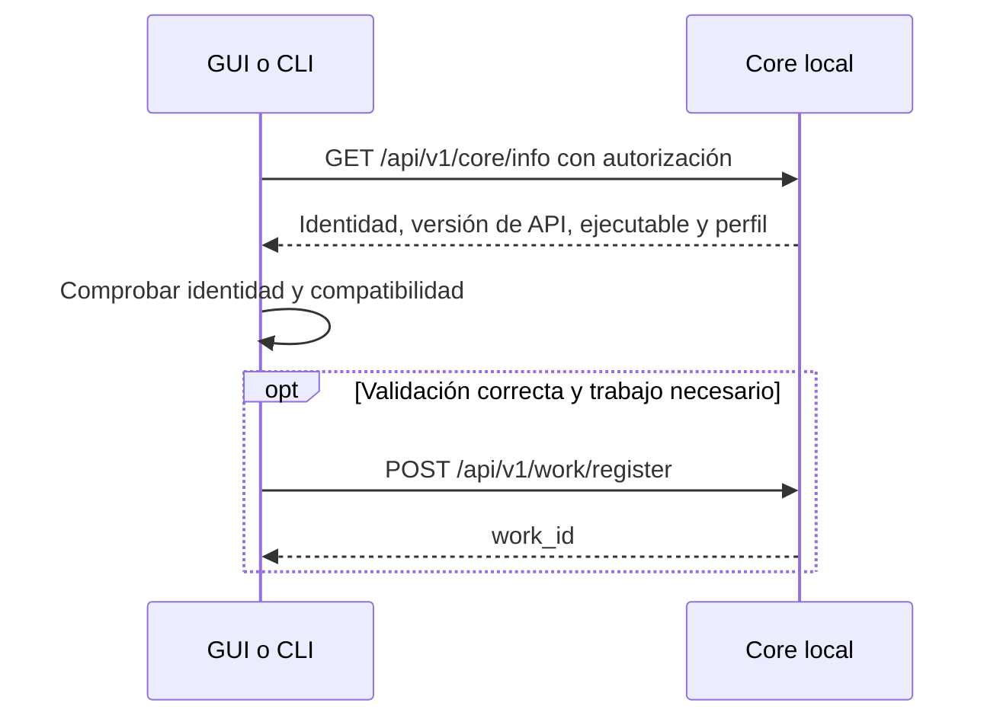

Distintas versiones del ejecutable pueden compartir api_version cuando conservan el contrato. Esta consulta identifica y valida el core encontrado; no selecciona ni instala versiones ni modifica la regla de una instancia compartida por usuario. El [contenido del descubrimiento](#contenido-del-archivo-privado-de-descubrimiento) proporciona la identidad y versión esperadas. La [ubicación y administración del archivo](#ubicación-y-administración-del-archivo-de-descubrimiento) tienen reglas definidas. Las [reglas de validación del destino por GUI y CLI](#validación-del-destino-local-por-los-clientes) están definidas; se conservan las [reglas de admisión HTTP definidas](#admisión-http-y-cors-del-core-empaquetado) y su comprobación posterior.

### Contenido del archivo privado de descubrimiento

El archivo privado JSON permite que GUI y CLI localicen y validen el core. El objeto contiene los cuatro campos siguientes:

| Campo | Contenido y finalidad |
|-------|----------------------|
| base_url | Cadena con la dirección HTTP local del core, por ejemplo http://127.0.0.1:49152. Indica el destino de las solicitudes. |
| instance_id | UUID de la instancia publicada. Proporciona la identidad esperada para contrastarla con core/info. |
| api_version | Entero que identifica el contrato publicado; el actual utiliza 1. Permite detectar incompatibilidad antes de utilizar sus rutas. |
| access_token | Cadena con la credencial generada al arrancar esa instancia. Autoriza las solicitudes de GUI y CLI. |

El cliente obtiene de este archivo la identidad y el contrato esperados y los contrasta con la consulta inicial definida. Una versión de contrato no admitida se detecta antes de utilizar sus rutas y se informa mediante CORE_INCOMPATIBLE. El contenido no requiere edición manual ni copia de credenciales por parte del usuario. Su lectura queda restringida a su cuenta y access_token conserva las reglas de uso de la autorización privada.

### Ubicación y administración del archivo de descubrimiento

core.json se administra automáticamente en las ubicaciones siguientes. Se conserva el contenido privado ya definido y la separación entre descubrimiento y exclusión del sistema operativo.

| Plataforma o condición | Ubicación de core.json |
|------------------------|------------------------|
| Linux con directorio de ejecución disponible | $XDG_RUNTIME_DIR/viewrv/core.json. |
| Linux sin ese directorio disponible | $XDG_STATE_HOME/viewrv/runtime/core.json; si XDG_STATE_HOME no está definido se utiliza ~/.local/state/viewrv/runtime/core.json. |
| Windows | %LOCALAPPDATA%\viewrv\runtime\core.json. |

El [directorio de ejecución del usuario en Linux](https://freedesktop.org/software/systemd/man/latest/systemd.exec.html) y [LocalAppData en Windows](https://learn.microsoft.com/en-us/windows/win32/shell/knownfolderid#folderid_localappdata) proporcionan las bases por plataforma. El uso del directorio de estado como alternativa de Linux es una política de la aplicación. El archivo contiene información de la instancia en ejecución, aunque su ubicación alternativa pueda sobrevivir al cierre o a una caída.

| Aspecto | Regla definida |
|---------|----------------|
| Acceso | Restringido a la cuenta del usuario. En Linux, carpeta privada de la aplicación con modo 0700 y archivo con modo 0600; en Windows, permisos equivalentes. |
| Publicación | Cuando el core esté preparado, escribir un archivo temporal privado y reemplazar atómicamente el definitivo, evitando lecturas parciales del JSON. |
| Cierre normal | Retirar el archivo de esa instancia antes de liberar el bloqueo del core. |
| Caída inesperada | El archivo puede quedar como residuo. El siguiente arranque comprueba el bloqueo y valida la instancia antes de reutilizar o sustituir la información. |

El reemplazo no autoriza una segunda instancia ni sustituye la exclusión ya definida. Un cliente no elimina el descubrimiento de un core que conserva el bloqueo solo porque no responda. La publicación y retirada se coordinan con el propietario del bloqueo y conservan la prohibición de retirar el archivo soporte del bloqueo como sustituto de liberar la exclusión. La gestión no exige intervención del usuario; los mecanismos efectivos por plataforma y su comprobación no se presentan como implementados.

### Validación del destino local por los clientes

GUI y CLI validan el descubrimiento y el destino antes de enviar la credencial. La comunicación con el core permanece dentro de la computadora.

| Comprobación | Regla definida |
|--------------|----------------|
| Archivo | JSON válido y cuatro campos con los formatos esperados en la definición compartida del descubrimiento. |
| Dirección | Solo http://127.0.0.1:<puerto>, sin usuario, contraseña, ruta, parámetros ni fragmentos. El core escucha en esa misma dirección local. |
| Compatibilidad previa | Comprobar api_version antes de consultar las rutas. |
| Redirecciones | Rechazar respuestas que indiquen consultar otra dirección; no seguir redirecciones del servidor. |
| Proxies | Conectar directamente al core, sin intermediarios configurados en el sistema o el entorno. |
| Identidad | Consultar core/info y contrastar instance_id y api_version con los del archivo privado. |

Solo después de validar la instancia se registra el trabajo necesario y se envían operaciones. Las comprobaciones se aplican también a cada nueva invocación CLI que encuentra un core en funcionamiento. La autorización se utiliza en la consulta inicial, después de validar el destino local; no se pospone la credencial hasta después de esa consulta autenticada.

Los clientes requieren configuración explícita para conservar estas reglas. Por ejemplo, [HTTPX utiliza de forma predeterminada las variables de entorno de proxy](https://www.python-httpx.org/environment_variables/); el cliente local debe desactivar ese comportamiento. La selección del adaptador no acredita por sí sola que las reglas estén implementadas o comprobadas. El catálogo mantiene los errores de descubrimiento, identidad y compatibilidad y la distinción entre ausencia inicial normal y fallo del procedimiento.

### Origen interno de la GUI

La GUI utiliza el origen interno fijo viewrv://app. Electron carga los archivos locales de la presentación mediante ese origen, mientras el core conserva su dirección HTTP local y el cliente de ventana utiliza HTTP y SSE directamente.

| Parte | Regla definida |
|-------|----------------|
| Presentación de GUI | Electron carga sus archivos locales bajo viewrv://app. |
| Core | Atiende en http://127.0.0.1:<puerto>. |
| Permiso para GUI | El core permite explícitamente el origen viewrv://app mediante CORS. |
| CLI | Conecta directamente, sin necesitar un origen de página. |
| Autorización | GUI y CLI presentan la credencial de la instancia para sus solicitudes de API. |

viewrv://app identifica recursos locales de la aplicación; no requiere un dominio público ni un servidor web adicional. [Electron permite registrar un protocolo propio y configurar sus capacidades](https://www.electronjs.org/docs/latest/api/protocol#protocolregisterschemesasprivilegedcustomschemes). El adaptador del host debe materializar ese origen de forma compatible con fetch y CORS; la selección no acredita todavía una prueba integrada.

Se mantiene la separación entre permiso de origen, autorización por credencial y control de sesión por trabajo. Las [reglas de admisión HTTP y CORS de la entrega](#admisión-http-y-cors-del-core-empaquetado) están definidas; su adaptación al entorno de desarrollo mantiene su definición posterior.

### Admisión HTTP y CORS del core empaquetado

El servidor de la aplicación empaquetada aplica las comprobaciones siguientes. Se conservan el descubrimiento privado, la validación del destino por los clientes y el origen interno de GUI.

| Comprobación | Regla definida |
|--------------|----------------|
| Host | Debe indicar 127.0.0.1 y el puerto de esa instancia. |
| Origin presente | Debe ser exactamente viewrv://app. |
| Origin ausente | Se admite para CLI y otras herramientas, con credencial válida. |
| Autorización de API | Consultas, acciones y apertura de SSE requieren Authorization: Bearer <token>. |
| CORS | Permitir explícitamente viewrv://app, los métodos GET y POST y los encabezados Authorization, Content-Type y X-Viewrv-Work-Id. |
| Comprobación previa OPTIONS | Se responde sin exigir credencial cuando cumple los permisos anteriores. Solo consulta permisos; no registra trabajo ni ejecuta acciones. |
| Rechazo de destino, origen o comprobación previa | HTTP 400 con INVALID_REQUEST. |
| Credencial ausente o incorrecta | HTTP 401 con AUTHENTICATION_FAILED, conservando WWW-Authenticate: Bearer. |

La comprobación previa válida recibe HTTP 200 sin resultado de aplicación. Este intercambio de transporte no utiliza la envoltura result/error de una operación; la solicitud real conserva su credencial obligatoria y su contrato de respuesta. El [mecanismo de preflight CORS de FastAPI](https://fastapi.tiangolo.com/tutorial/cors/#cors-preflight-requests) permite tratar esa consulta previa. Un rechazo generado por el adaptador conserva el código de error definido, sin depender del cuerpo de error predeterminado de un middleware.

Los permisos CORS acompañan también las respuestas de error dirigidas al origen permitido, de modo que la GUI pueda leerlas y explicarlas. La validación de Host y Origin no acredita por sí sola la identidad del ejecutable ni sustituye la autorización por posesión de la credencial. El control de la placa y las sesiones conserva, además, las reglas de trabajo y propiedad existentes.

## Resultados y estructuras de datos

### Resolución de solicitudes HTTP

La petición HTTP permanece abierta hasta resolver la operación; el resultado, rechazo o fallo se devuelve en esa misma petición. Se concreta así la espera ya definida para los comandos de CLI, sin incorporar un ciclo obligatorio de consultas para obtener la resolución de la operación propia.

| Solicitud | Momento y significado de la respuesta |
|-----------|---------------------------------------|
| Avanzar un ciclo | Captura completa incorporada a la sesión o fallo correspondiente. |
| Cargar un programa | Confirmación, rechazo o fallo de LOAD conforme a su contrato. |
| Iniciar RUN | Resolución de la ejecución o de su interrupción, manteniendo el desenlace real y la incertidumbre que corresponda. |
| Continuar debug | Resolución de la secuencia por breakpoint, pausa, terminación o fallo, conforme a sus reglas. |
| Consultar estado | Estado conocido disponible, sin esperar la finalización de un RUN en curso ni enviar nuevas consultas UART. |

ACCEPTED de la FPGA pertenece al intercambio UART y no constituye la respuesta HTTP final ni un resultado de ejecución. La petición original puede permanecer pendiente mientras el core atiende consultas, solicitudes de control permitidas y publicación SSE. Esta disponibilidad no elimina los rechazos de operaciones incompatibles ni permite varios controladores de la placa.

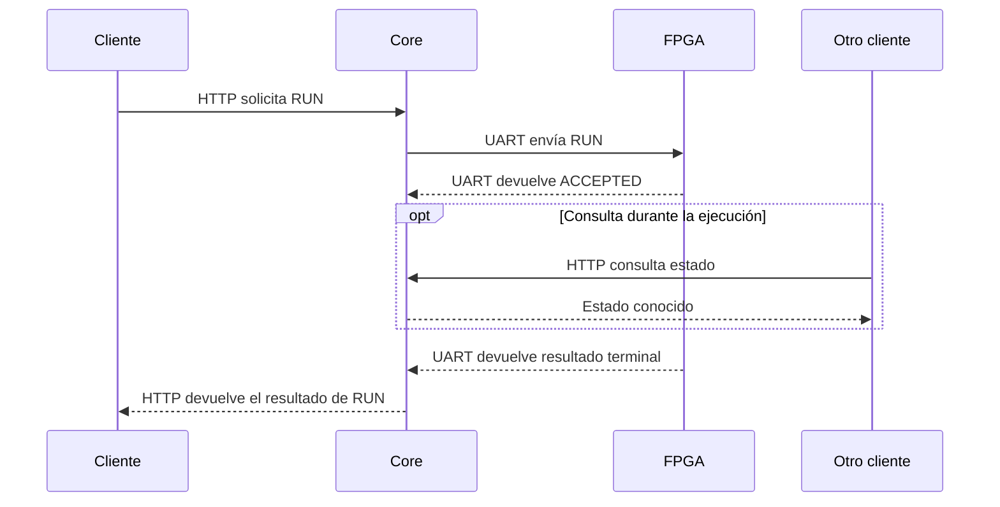

Las actualizaciones SSE utilizan un canal independiente y solo presentan información conocida por el core. RUN no adquiere capturas intermedias por mantener la petición pendiente. La respuesta HTTP y los avisos correspondientes no tienen un orden de llegada exigido, conservando la misma información coherente.

La operación definida conserva su responsabilidad en el core si el cliente interrumpe la espera o pierde comunicación. Se mantienen Ctrl+C sin detención implícita y resultado no confirmado sin reenvío automático ante una respuesta perdida. Los presupuestos de transporte no introducen un límite implícito de ejecución; el límite opcional de RUN y los plazos UART mantienen sus contratos.

La resolución de una operación no acredita por sí misma que toda su evidencia se haya guardado: cada comando conserva sus condiciones de resultado y conservación. Al finalizar el último trabajo, el cierre del servidor debe permitir emitir la respuesta correspondiente antes de terminar el proceso; la pérdida de esa respuesta sigue teniendo el tratamiento de incertidumbre definido. Las rutas, esquemas y códigos HTTP se definen en este documento.

### Envoltura común de las respuestas del core

Las respuestas del core utilizan una envoltura JSON común, independiente de los datos específicos de cada operación. El catálogo de comandos y sus opciones ya está definido; las rutas, parámetros y cuerpos concretos de las solicitudes HTTP se especifican en el bloque correspondiente.

El contrato establece envoltura JSON común de las respuestas del core, distinguiéndola expresamente del JSON completo de cada operación. GUI y CLI reciben el mismo contrato interno; la salida humana o JSON de CLI sigue siendo una decisión de presentación del cliente.

| Campo | Significado definido |
|-------|----------------------|
| result | Datos completos del resultado de la operación. Es null ante rechazo o fallo sin ese resultado. Su contenido se especifica por operación. |
| error | Null si se obtuvo el resultado; en caso contrario, objeto que describe el error. |
| error.code | Identificador estable en inglés que permite reconocer el problema sin interpretar el texto humano. |
| error.message | Explicación legible para la persona, conforme al idioma de la primera entrega. |

La respuesta contiene resultado o error, sin ambos con contenido simultáneamente.

```json
{
  "result": null,
  "error": {
    "code": "DEBUG_NOT_ACTIVE",
    "message": "No hay una depuración abierta."
  }
}
```

El ejemplo ilustra el rechazo de STEP sin depuración y el uso de code y message; no declara completo el catálogo de errores. Un FAULT del procesador recibido como observación válida pertenece a result y no se confunde con un fallo de comunicación de la aplicación. Los fallos de conservación de evidencia mantienen su información diferenciada y no sustituyen el desenlace del ensayo.

La ausencia de una respuesta HTTP completa no equivale a recibir esta envoltura de error desde el core. En ese caso el cliente mantiene el tratamiento definido de resultado no confirmado, sin inventar una respuesta del servidor ni reenviar automáticamente la operación.

### Estructura general del resultado de STEP

Un STEP satisfactorio devuelve los campos siguientes y una captura completa de la FPGA. El resultado vincula una única observación con su sesión y la versión exacta ejecutada.

| Campo | Contenido definido |
|-------|--------------------|
| session_id | Identificador de la sesión de depuración. |
| program_id | Identificador del programa ejecutado. |
| source_version | Versión exacta del código ejecutado. |
| step_index | Número de captura dentro de la sesión, desde 1. |
| snapshot | Captura completa recibida de la FPGA. |
| breakpoint_hits | Lista de coincidencias en esa captura, conforme a la estructura definida. Es vacía cuando no hay coincidencias. |
| interpretation | Información educativa inferida por el core, separada de los datos medidos. |

Todos los campos corresponden al mismo paso, sesión y versión, aunque después cambie el programa seleccionado. step_index identifica la captura dentro de la sesión y no sustituye al cycle_count medido por la FPGA.

La captura válida que alcanza FAULT conserva su lugar en result, con error igual a null en la envoltura común. Una respuesta incompleta de la FPGA no se presenta como un nuevo resultado completo de STEP.

### Estructura de snapshot en el resultado de STEP

snapshot contiene íntegramente los datos recibidos según la estructura del protocolo UART. Los campos corresponden a la [estructura del snapshot UART](../../protocol.md#estructura-del-snapshot); no incluyen información educativa inferida.

| Campo | Contenido definido |
|-------|--------------------|
| global_state | Estado del procesador después del ciclo. |
| image_valid | Indicación de imagen de programa válida. |
| pc | Valor del PC global. |
| cycle_count | Contador de ciclos efectivos de la FPGA. |
| fault_cause | Causa del fault global, significativa únicamente en los estados correspondientes del protocolo. |
| fault_pc | PC asociado al fault global, con la misma condición de vigencia. |
| registers | Los 32 registros, ordenados desde x0 hasta x31. |
| if_id | Campos capturados del registro interetapa IF/ID. |
| id_ex | Campos capturados del registro interetapa ID/EX. |
| ex_mem | Campos capturados del registro interetapa EX/MEM. |
| mem_wb | Campos capturados del registro interetapa MEM/WB. |
| used_count | Cantidad de direcciones de memoria incluidas en la captura. |
| memory | Lista de direcciones de bytes escritos durante la sesión y su valor actual, incluidos los valores cero. |

Se conservan los campos transmitidos de los registros interetapa incluso cuando su entrada es inválida. valid determina la interpretación de instrucciones activas; fetch_fault_valid conserva su habilitación independiente conforme al protocolo. Los valores globales de fault se conservan sin atribuirles vigencia fuera de los estados correspondientes. La lista de memoria representa los valores actuales del conjunto escrito, no un historial de escrituras.

### Campos de los registros interetapa en snapshot

Cada objeto contiene todos los campos del registro interetapa correspondiente y conserva sus nombres del protocolo. La selección no añade datos calculados a los registros medidos ni elimina campos transmitidos.

| Campos comunes | Contenido |
|----------------|-----------|
| valid | Indica si contiene una instrucción válida. |
| pc | Dirección de la instrucción. |
| instruction | Codificación binaria de la instrucción. |

| Objeto | Campos adicionales definidos |
|--------|------------------------------|
| if_id | fetch_fault_valid, fetch_fault_cause |
| id_ex | rs1, rs2, rd, rs1_value, rs2_value, immediate, alu_op, alu_src, result_sel, flow_op, mem_op, reg_write |
| ex_mem | rd, reg_write, mem_op, ex_result, store_data |
| mem_wb | rd, reg_write, wb_value |

Los tres campos comunes están presentes en los cuatro objetos. Se mantienen los valores recibidos incluso en entradas inválidas y la habilitación independiente de fetch_fault_valid. El inventario coincide con los [latches del protocolo](../../protocol.md#latches).

### Representación JSON de los valores de snapshot

Se conserva exactamente los valores recibidos al decodificar los campos binarios de UART y representarlos en JSON mediante las siguientes reglas. La presentación elegida por el usuario no modifica el dato de snapshot.

| Datos | Representación definida |
|-------|-------------------------|
| Datos de 32 bits, direcciones e instrucciones | Números enteros sin signo que conservan el patrón de bits recibido. |
| Códigos de estado, operaciones y causas | Números enteros con la codificación del protocolo. |
| Índices de registros, bytes de datos y used_count | Números enteros sin signo con el valor completo recibido. |
| valid, image_valid, fetch_fault_valid y reg_write | Booleanos false o true, correspondientes a los valores binarios 0 y 1. |
| cycle_count | Cadena decimal para todo su rango unsigned de 64 bits, incluso para valores pequeños. |

La decodificación respeta el ancho de cada campo, el orden little-endian y la representación de indicadores definidos por el [protocolo](../../protocol.md#campos-binarios-y-orden-de-bytes). Los patrones de datos arquitectónicos se conservan sin reinterpretarlos como números con signo. Por ejemplo, FF FF FF FF en un dato de 32 bits se representa mediante el número JSON 4294967295; la vista puede mostrarlo como 0xFFFFFFFF, binario o -1 con signo a partir del mismo dato.

La cadena decimal de cycle_count evita perder precisión al intercambiar con JavaScript valores que exceden su rango de enteros seguros, descrito en [Number.MAX_SAFE_INTEGER](https://developer.mozilla.org/en-US/docs/Web/JavaScript/Reference/Global_Objects/Number/MAX_SAFE_INTEGER). Se conserva su contador completo y su wrap del protocolo, sin sustituirlo por step_index. Las opciones visuales y la salida humana de CLI pueden cambiar base, signo o nombres de códigos conservando esta representación de intercambio.

Esta decisión concreta los valores de snapshot; no selecciona el formato de archivo de los registros de evidencia ni los tipos de identificadores y demás metadatos de la API.

### Entradas de memoria en snapshot

Cada entrada de memoria contiene address y value, según la lista de bytes utilizados del protocolo.

| Campo | Contenido definido | Representación JSON |
|-------|--------------------|---------------------|
| address | Dirección del byte de memoria. | Número entero sin signo de 32 bits. |
| value | Valor actual de ese byte. | Número entero entre 0 y 255. |

memory es una lista de estas entradas, con direcciones únicas en orden creciente. used_count coincide con el número de entradas. Se incluyen los bytes escritos cuyo valor actual es cero. Si no hay direcciones escritas durante la sesión, used_count es 0 y memory es una lista vacía. Se conserva el estado actual recibido, sin inventar valores para direcciones ausentes ni convertir la lista en un historial de escrituras.

```json
{
  "used_count": 2,
  "memory": [
    { "address": 16, "value": 255 },
    { "address": 17, "value": 0 }
  ]
}
```

El ejemplo es un fragmento de snapshot. La coherencia con el perfil de hardware y la validación del mensaje se rigen por el protocolo y sus casos de verificación.

### Coincidencias de breakpoints en el resultado de STEP

Un breakpoint se identifica por versión de programa, PC y registro interetapa; no tiene un breakpoint_id adicional. Cada elemento de breakpoint_hits describe una coincidencia en la captura del STEP.

| Campo | Contenido definido |
|-------|--------------------|
| pc | Dirección de la instrucción que produjo la coincidencia. |
| line | Línea correspondiente en el código de la versión depurada. |
| latch | Registro interetapa donde apareció válida esa instrucción: IF/ID, ID/EX, EX/MEM o MEM/WB. |

El programa y la versión se obtienen del contexto del resultado, sin repetirlos en cada coincidencia. La línea facilita la referencia al código; la identidad del breakpoint sigue siendo versión, PC y registro interetapa. Si no hay coincidencias, breakpoint_hits es una lista vacía.

Una coincidencia posterior del mismo breakpoint se informa nuevamente en la lista de su STEP. El step_index del resultado distingue las coincidencias de capturas diferentes, incluidas las consecutivas debidas a una retención. No se incorpora un identificador adicional de coincidencia ni se confunde esta referencia con la identidad dinámica del seguimiento de una instrucción.

### Organización inicial de interpretation

interpretation separa la información inferida en cuatro campos. Se utiliza como base para avanzar, sin presentar las inferencias como comprobadas ni sus esquemas internos como cerrados.

| Campo | Contenido definido como base |
|-------|-----------------------------|
| instruction_locations | Correspondencias entre instrucciones válidas de los registros interetapa y el código fuente ejecutado: PC y línea cuando pueda determinarse. |
| changes | Cambios de valores respecto de la captura completa anterior de la misma sesión. En la primera captura se indica que esa comparación no está disponible. |
| cycle_activity | Participación funcional de instrucciones y bloques durante el ciclo recién ejecutado, deducida conforme a las reglas del procesador. |
| limitations | Aspectos de la interpretación que no pudieron determinarse con suficiente fundamento. |

Se conserva la distinción temporal entre las posiciones capturadas después del flanco y la participación durante el ciclo ejecutado. Las interpretaciones respetan las reglas de contexto, validez y continuidad ya definidas y permanecen separadas de snapshot. Su revisión en las pruebas previstas debe contrastar los datos y la explicación; la aceptación inicial no sustituye esa verificación ni autoriza su ejecución en esta etapa.

Los contenidos internos se concretan a continuación. La estructura permanece sujeta a los ajustes justificados que surjan de las pruebas.

### Correspondencias instruction_locations

instruction_locations contiene una entrada por cada registro interetapa con instrucción válida en la captura posterior al ciclo.

| Campo | Contenido definido |
|-------|--------------------|
| latch | Registro interetapa: IF/ID, ID/EX, EX/MEM o MEM/WB. |
| pc | PC recibido para esa instrucción. |
| line | Línea correspondiente en la versión ejecutada, o null si no puede establecerse. |

Se conservan entradas distintas cuando el mismo PC aparece en varios registros interetapa. Una instrucción con PC repetido no se fusiona por dirección o línea. La correspondencia utiliza la versión ejecutada del programa y no una edición posterior del archivo. Si no puede establecerse la línea, se conserva el PC observado sin inventar una correspondencia.

La lista describe posiciones posteriores al ciclo y no atribuye por sí misma una identidad dinámica entre capturas. El seguimiento de una aparición elegida conserva su mecanismo y sus condiciones de continuidad ya definidos. La aceptación de estos campos no acredita la validación de las inferencias ni cierra los demás campos de interpretation.

### Diferencias changes entre capturas

changes describe las diferencias respecto de la captura completa anterior de la misma sesión, con el valor anterior y la referencia al campo. El valor actual se obtiene del snapshot del mismo resultado, sin duplicarlo en las listas ni realizar otra petición.

| Campo | Contenido definido |
|-------|--------------------|
| previous_step_index | Número de la captura utilizada para comparar, o null si es la primera. |
| register_changes | Lista de cambios en RF; cada entrada contiene register y previous. |
| memory_changes | Lista de cambios en bytes de memoria; cada entrada contiene address y previous. |
| latch_changes | Lista de cambios en registros interetapa; cada entrada contiene latch, field y previous. |
| global_changes | Lista de cambios en los campos simples restantes de snapshot, como PC, estado o contador; cada entrada contiene field y previous. |

register identifica el índice de x0 a x31; address identifica la dirección del byte en memory; latch y field identifican un campo del registro interetapa; field en global_changes identifica el campo simple de snapshot. Las referencias se resuelven siempre sobre el snapshot que acompaña al mismo resultado, sin depender del último estado visual del cliente.

previous conserva la representación JSON definida del valor correspondiente en la captura anterior. En memory_changes, previous igual a null indica que la dirección no estaba en la lista anterior; no atribuye un valor previo inventado. La aparición de una dirección nueva se informa incluso si su valor actual es cero. El valor actual se busca por dirección, no por posición de la lista.

En la primera captura previous_step_index es null y las cuatro listas están vacías. En capturas comparables, cada lista vacía indica ausencia de diferencias en su grupo. El cálculo mantiene contexto de la misma sesión y no utiliza una captura inicial fabricada. Estas diferencias describen cambios observados; la participación funcional se explica por separado en cycle_activity.

Por ejemplo, una entrada con register igual a 5 y previous igual a 10, junto con snapshot.registers[5] igual a 15, permite presentar x5: 10 → 15 sin duplicar el valor actual en changes.

### Participación funcional cycle_activity

cycle_activity contiene una entrada por etapa: IF, ID, EX, MEM y WB. Se mantiene la revisión de la interpretación durante las pruebas definida para este bloque.

| Campo | Contenido definido |
|-------|--------------------|
| stage | Etapa descrita. |
| status | Indica si pudo interpretarse su actividad, estaba vacía o no pudo determinarse. |
| pc | PC de la instrucción que ocupaba la etapa durante el ciclo, o null si no corresponde o no puede identificarse. |
| blocks | Identificadores de los bloques cuya participación funcional puede justificarse. |

| Valor de status | Significado definido |
|-----------------|----------------------|
| interpreted | Puede establecerse la participación funcional indicada. |
| empty | Puede establecerse que la etapa no tenía una instrucción válida. |
| unavailable | No hay fundamento suficiente para interpretar su actividad. La limitación se explica en limitations. |

cycle_activity describe el ciclo recién ejecutado. La posición posterior al flanco corresponde a instruction_locations, sin confundir ambas referencias temporales. Se fundamenta en las reglas del procesador y en las observaciones y garantías de partida admitidas por el contrato lógico. En el primer STEP, las garantías de la LOAD confirmada no se convierten en una captura inicial medida.

Los bloques indicados representan participación funcional interpretada y no señales combinacionales medidas ni rutas exactas reconstruidas fuera del alcance. unavailable no afirma que la etapa estuviera vacía. La vinculación concreta de los identificadores de bloques con el modelo del procesador, el contenido educativo y el visor conserva su especificación de integración pendiente; no se adoptan identificadores gráficos de GraphViewer mediante esta estructura.

### Avisos limitations de interpretation

limitations identifica las partes de la interpretación que no pudieron determinarse con suficiente fundamento.

| Campo | Contenido definido |
|-------|--------------------|
| code | Código estable en inglés que identifica la limitación. |
| section | Parte afectada: instruction_locations, changes o cycle_activity. |
| message | Explicación legible de qué no pudo determinarse y por qué. |

Cuando no hay limitaciones se devuelve una lista vacía. Los avisos acompañan al resultado válido: se conserva snapshot, se informa la interpretación sustentada y se explicita lo indeterminado. Su presencia por sí sola no pausa la depuración ni convierte la respuesta en un error de la envoltura.

NO_PREVIOUS_SNAPSHOT ilustra el aviso de changes en la primera captura, con el mensaje «No hay una captura anterior para comparar valores». Los avisos se mantienen diferenciados de los errores de aplicación y de los faults del procesador.

### Resultado de RUN con captura terminal completa

Un RUN con captura terminal completa devuelve los campos siguientes.

| Campo | Contenido definido |
|-------|--------------------|
| session_id | Identificador del ensayo de ejecución. |
| program_id | Programa ejecutado. |
| source_version | Versión exacta del código ejecutado. |
| snapshot | Captura terminal completa, con la misma estructura y representación de valores definidas para STEP. |

El desenlace se obtiene de snapshot.global_state, con FINISHED o FAULT. En caso de fault, la causa y el PC permanecen en los campos globales correspondientes de la captura. Ambos desenlaces son resultados válidos con error igual a null en la envoltura común.

Se reutiliza el contrato de snapshot conservando la diferencia temporal de RUN: es el estado terminal posterior al último ciclo, con los commits finales incluidos, y no proporciona capturas intermedias.

### Resultado de RUN detenido mediante RESET confirmado

interruption distingue la terminación con captura de la detención mediante RESET confirmado. Se conservan session_id, program_id y source_version.

| Campo | Terminación con captura completa | Detención mediante RESET confirmado |
|-------|---------------------------------|--------------------------------------|
| snapshot | Captura terminal completa recibida. | null. |
| interruption | null. | Objeto con el motivo de la detención. |

| Campo de interruption | Valores definidos para este caso |
|-----------------------|---------------------------------|
| reason | user_request para una detención solicitada; time_limit para el vencimiento del límite configurado. |

La envoltura contiene error igual a null en ambos casos. El resultado de detención requiere confirmar RESET y no fabrica una captura de registros o memoria posterior al reset. La confirmación conserva el efecto de invalidación de la imagen establecido por el protocolo.

Si ya comenzó la respuesta terminal de RUN, se recibe completa y se conserva el desenlace real y su captura; interruption permanece null. Solicitar la detención no reemplaza un resultado terminal observado. Un RESET sin confirmación no se presenta mediante este resultado satisfactorio: su fallo y la situación de comunicación conservan su concreción posterior.

La estructura describe los motivos user_request y time_limit aquí definidos; la representación de otros contextos de cierre se completa junto con sus operaciones. Esta ampliación no modifica la política de interrupción de CLI mediante Ctrl+C ni introduce cancelación implícita al perder una petición HTTP.

### Error de comunicación UART durante RUN

Un fallo de comunicación UART durante RUN sin resultado completo devuelve error y conserva el contexto del ensayo en details. El core puede responder al cliente; la pérdida de la respuesta HTTP mantiene su tratamiento separado.

| Campo | Contenido definido |
|-------|--------------------|
| result | null. |
| error.code | RUN_RESULT_UNCONFIRMED. |
| error.message | Explicación del fallo y de que no se obtuvo un resultado completo. |
| error.details.session_id | Ensayo afectado. |
| error.details.program_id | Programa ejecutado. |
| error.details.source_version | Versión exacta ejecutada. |

El objeto details identifica la ejecución afectada independientemente de la selección posterior del cliente. No se publica una captura parcial como resultado; cualquier observación completa anterior conserva su condición de anterior. El error no inventa un FAULT, una terminación normal ni una detención física confirmada.

La recuperación mantiene la política del protocolo, sin repetir RUN automáticamente. Recuperar comunicación no reconstruye los ciclos o la evidencia perdidos. La falta de una respuesta HTTP completa no se representa como si el cliente hubiera recibido esta envoltura desde el core: conserva su condición de resultado no confirmado a nivel del cliente.

La estructura aplica al fallo de comunicación sin resultado completo; los rechazos explícitos y los errores de admisión mantienen su clasificación correspondiente. La representación de RESET sin confirmación se concreta a continuación, conservando las reglas existentes de recuperación y detención.

### Respuestas ante RESET sin confirmar durante RUN

Cuando RESET no queda confirmado, RUN y la solicitud de detención mantienen respuestas independientes. Se conserva una única conexión UART administrada por el core; esta aclaración no añade otro propietario de la placa.

| Solicitud pendiente | error.code definido |
|--------------------|---------------------|
| viewrv run start, que esperaba el resultado del ensayo | RUN_RESULT_UNCONFIRMED |
| viewrv run stop, que solicitó detenerlo | RESET_UNCONFIRMED |

Ambas respuestas contienen result igual a null y mantienen session_id, program_id y source_version en error.details. El mensaje explica que no pudo confirmarse RESET. Los códigos describen qué solicitud quedó sin confirmar ante el mismo incidente; no afirman que se haya ejecutado un segundo RUN.

La falta de confirmación no acredita ni una detención física ni la ausencia de aplicación del reset. Se conserva la política definida de no repetir RESET automáticamente y de requerir una acción explícita para otro intento. El core no publica una captura inventada ni sustituye por este caso una respuesta terminal completa conservada conforme al protocolo.

El ejemplo de dos terminales corresponde a dos invocaciones HTTP que permanecen pendientes por sus operaciones, dentro del mismo trabajo de CLI. La solicitud de detención se admite conforme a las reglas de control existentes, mientras las operaciones incompatibles se rechazan. No se introduce una segunda conexión serial ni se exige una terminal adicional para toda ejecución.

### Respuesta satisfactoria de run stop

| Desenlace observado | Resultado que reciben ambas solicitudes |
|--------------------|------------------------------------------|
| RESET confirmado por la detención solicitada | session_id, program_id y source_version del ensayo, snapshot igual a null e interruption.reason igual a user_request. |
| Respuesta terminal ya iniciada y recibida completa | Contexto del mismo ensayo, snapshot terminal completo e interruption igual a null. |

En ambos casos error es null. La respuesta de detención informa el desenlace real, sin convertir una terminación conservada en una interrupción ni confirmar por anticipado un RESET. Se reutiliza la estructura de resultado de RUN ya definida.

El caso presupone que la solicitud de detención fue admitida mientras existía RUN pendiente. Los rechazos de admisión mantienen su especificación en el catálogo común de errores. Si RESET no queda confirmado, se conservan los errores diferenciados de RUN y de la solicitud de detención establecidos en la sección anterior.

Estas estructuras definen la resolución de RUN y de run stop admitido durante su ejecución.

### Resultado de LOAD confirmada

Una LOAD confirmada mediante DONE devuelve la identidad del programa, su revisión y el tamaño de la imagen binaria cargada.

| Campo | Contenido definido |
|-------|--------------------|
| program_id | Programa cuya imagen se cargó. |
| source_version | Versión exacta correspondiente a esa imagen. |
| byte_count | Cantidad de bytes de la imagen cuya carga quedó confirmada. |

La envoltura contiene error igual a null. program_id y source_version identifican la fuente de la imagen y byte_count informa su tamaño binario, sin confundirlo con el tamaño del archivo de texto Assembly. Este último campo se conserva por su utilidad informativa para el usuario.

Son datos de contexto conocidos por el core: la FPGA confirma mediante DONE, sin devolver esos identificadores ni una cuenta de bytes. No se fabrica una captura de RF, memoria o registros interetapa a partir de las garantías de preparación. ACCEPTED no basta para devolver este resultado de carga confirmada.

La imagen permanece asociada a la versión tomada por LOAD, incluso si cambia el texto durante una carga ya iniciada. Los fallos de carga y los rechazos mantienen su concreción posterior conforme a la distinción entre aceptación y confirmación del protocolo.

### Errores del intercambio de LOAD

El resultado distingue rechazo anterior a la aceptación, fallo explícito posterior y ausencia de respuesta concluyente. En todos los casos result es null y error.message explica el motivo.

| Situación | error.code | Conocimiento de la imagen |
|-----------|------------|----------------------------|
| La FPGA rechaza o aborta la solicitud antes de aceptarla. | LOAD_REJECTED | Se conserva la imagen anterior. |
| La FPGA informa un fallo después de aceptar la carga. | LOAD_FAILED | La imagen anterior quedó invalidada y la nueva no es válida. |
| Se pierde una respuesta o la comunicación no permite confirmar el desenlace. | LOAD_RESULT_UNCONFIRMED | No puede asegurarse qué imagen quedó en la placa. |

| Campo de error.details | Contenido definido |
|------------------------|--------------------|
| program_id | Programa que se intentó cargar. |
| source_version | Versión correspondiente a esa imagen. |
| byte_count | Tamaño de la imagen que se intentó cargar. |

La clasificación respeta el punto del intercambio y la respuesta completa recibida, sin deducir la fase únicamente del código UART. Por ejemplo, UART_ERROR puede producirse antes o después de la aceptación, con efectos distintos sobre la imagen según el protocolo. Una pérdida de DONE no acredita fallo físico: la FPGA podría haber completado el commit sin que el core recibiera la confirmación.

Los datos de details describen la imagen intentada; byte_count no declara bytes efectivamente recibidos ni confirmados en una operación fallida. Se mantienen el contexto y las reglas de recuperación aplicables, sin repetir LOAD automáticamente ni restaurar una vinculación de imagen que dejó de estar confirmada. Los errores de admisión anteriores al intercambio conservan su especificación en el catálogo común de errores.

### Resultado de ensamblado correcto

El resultado de ensamblado contiene programa, revisión, imagen completa y mapa PC–línea, adaptados al transporte JSON.

| Campo | Contenido definido |
|-------|--------------------|
| program_id | Programa ensamblado. |
| source_version | Versión exacta del texto utilizado. |
| image | Lista de bytes de la traducción completa, como números enteros entre 0 y 255. |
| pc_to_line | Lista de correspondencias entre direcciones de instrucciones y líneas del código fuente. |

| Campo de cada entrada de pc_to_line | Contenido definido |
|------------------------------------|--------------------|
| pc | Dirección de la instrucción. |
| line | Línea original, numerada desde 1. |

La envoltura contiene error igual a null. Se conservan todos los bytes y entradas del mapa, asociados al texto exacto tomado al inicio, aunque la edición avance durante el ensamblado. image representa la secuencia little-endian completa del assembler y no añade la cabecera UART. Una traducción vacía conserva su condición de éxito conforme al contrato existente y se representa mediante image y pc_to_line vacíos; su elegibilidad para LOAD permanece separada.

Esta estructura corresponde a la adaptación externa: la operación interna assemble(source_text) y sus tipos AssemblyResult, bytes y dict[int, int] conservan el contrato ya definido. No se seleccionan archivos de exportación ni se incorpora la carga o ejecución a la operación de ensamblado.

### Diagnóstico de error del código fuente al ensamblar

Un error de código fuente utiliza la envoltura de error y conserva línea, mensaje y revisión procesada por el assembler.

| Campo | Contenido definido |
|-------|--------------------|
| result | null. |
| error.code | ASSEMBLY_SOURCE_ERROR. |
| error.message | Mensaje del diagnóstico producido por el assembler. |
| error.details.program_id | Programa que se intentó ensamblar. |
| error.details.source_version | Versión exacta del texto utilizado. |
| error.details.line | Línea del error, numerada desde 1. |

Se devuelve un único diagnóstico y ninguna traducción parcial, conforme al contrato del assembler. Por ejemplo, el error de un inmediato 2048 puede señalar la línea 1 y explicar que está fuera del rango permitido de -2048 a 2047. La referencia corresponde a la versión ensamblada, aunque el programa haya cambiado después.

ASSEMBLY_SOURCE_ERROR identifica un problema del código fuente. Los errores de lectura del archivo y los defectos internos se conservan separados y sus códigos y detalles se completan en el catálogo común de errores. Esta estructura no altera la interfaz interna ni el orden de detección del assembler.

### Resultado de iniciar o reiniciar depuración

debug start y debug restart satisfactorios comparten el resultado siguiente, sin captura medida antes del primer STEP.

| Campo | Contenido definido |
|-------|--------------------|
| session_id | Identificador de la sesión de depuración abierta. |
| program_id | Programa que se va a depurar. |
| source_version | Versión exacta utilizada. |
| breakpoints | Lista de breakpoints definidos para esa versión, cada uno con pc, line y latch. |
| snapshot | null, porque todavía no se ejecutó el primer STEP. |

La envoltura contiene error igual a null y la sesión queda esperando una orden de avance. breakpoints enumera las definiciones vigentes de la versión asociada. El resultado no fabrica un snapshot inicial a partir de las garantías de LOAD.

En debug restart, se devuelve después de confirmar la recarga. Conserva programa, versión y breakpoints y proporciona un session_id nuevo. Las capturas previas siguen perteneciendo a la sesión anterior. La estructura satisfactoria no sustituye las reglas de protección del código, la resolución de una recarga fallida ni los errores de admisión ya identificados para su especificación común.

### Resultado de debug continue

El resultado informa por qué terminó el avance automático y conserva el contexto y la última observación completa.

| Campo | Contenido definido |
|-------|--------------------|
| session_id | Sesión de depuración. |
| program_id | Programa depurado. |
| source_version | Versión exacta ejecutada. |
| stop_reasons | Lista de motivos por los que terminó el avance automático. |
| last_step | Último STEP completo de esa sesión, o null si todavía no hay capturas. |

| Campo de last_step | Contenido definido |
|--------------------|--------------------|
| step_index | Número de captura. |
| snapshot | Captura completa recibida. |
| breakpoint_hits | Coincidencias de esa captura. |
| interpretation | Interpretación correspondiente. |

last_step agrupa los datos ya definidos para STEP y utiliza el contexto de sesión, programa y versión del resultado, sin repetirlo dentro de la observación. Se refiere a la última captura completa de esa sesión, incluso si ya existía antes de la invocación y no se produjo otra; no fabrica una observación antes del primer STEP.

| Motivo de stop_reasons | Significado definido |
|------------------------|----------------------|
| breakpoint | El avance se detuvo por coincidencia de breakpoint. |
| pause_requested | Se atendió una solicitud de pausa. |
| terminal | Se alcanzó un estado terminal del procesador. |
| session_closed | Se cerró la sesión de depuración. |

Si coinciden varios motivos, se informan juntos. Por ejemplo, una pausa solicitada puede coincidir con un STEP que alcanza terminal; la captura conserva su estado terminal real. La envoltura contiene error igual a null para este resultado. Los fallos de comunicación utilizan la respuesta de error correspondiente, conservando las capturas completas anteriores conforme a las políticas definidas; no se promueve una captura parcial a last_step.

### Resultados satisfactorios de debug pause y debug stop

Las respuestas de pausa y cierre reutilizan session_id, program_id, source_version, stop_reasons y last_step de debug continue.

| Comando | Motivo incluido | Estado de la depuración al resolverlo |
|---------|-----------------|--------------------------------------|
| debug pause | pause_requested | Abierta, esperando otra orden de avance. |
| debug stop | session_closed | Cerrada, liberando la protección de edición del programa. |

Se conservan los otros motivos que correspondan. Si la última captura es terminal, también se informa terminal y se preserva el resultado real. last_step mantiene la última observación completa, sea la captura pendiente que termina de recibirse o una que ya existía; es null si todavía no hay capturas. Se utilizan las mismas referencias y representaciones del resultado de debug continue.

Cuando existe un continue pendiente, también recibe el resultado correspondiente al fin de ese avance. Las respuestas satisfactorias contienen error igual a null. Se conserva la diferencia funcional ya definida entre impedir el siguiente STEP y cerrar la depuración, sin emitir ciclos adicionales para construir estas respuestas ni reevaluar capturas anteriores.

La reutilización del formato no modifica la admisión de controles ni convierte en satisfactorio un fallo de comunicación. Su representación y los rechazos se completan en el catálogo común de errores.

### Resultados de gestión de breakpoints

Agregar, eliminar y consultar breakpoints devuelve el conjunto completo de definiciones vigentes. Las tres operaciones reutilizan el mismo formato satisfactorio.

| Campo de result | Contenido definido |
|-----------------|--------------------|
| session_id | Sesión de depuración correspondiente. |
| program_id | Programa asociado. |
| source_version | Versión exacta a la que pertenecen los breakpoints. |
| breakpoints | Lista de definiciones vigentes, cada una con pc, line y latch. |

| Comando | Lista devuelta |
|---------|----------------|
| viewrv debug breakpoint add | Definiciones vigentes después de agregarlo. |
| viewrv debug breakpoint remove | Definiciones vigentes después de eliminarlo. |
| viewrv debug breakpoint list | Definiciones vigentes al consultar. |

La envoltura contiene error igual a null en las respuestas satisfactorias. Si no hay definiciones, breakpoints es una lista vacía. El cliente obtiene el conjunto actualizado en la misma respuesta, sin otra consulta para reconstruirlo ni necesidad de aplicar localmente una mutación al conjunto anterior.

Se conservan las acciones atómicas del catálogo, la asociación con la versión y las reglas temporales de aplicación durante debug. Las operaciones no ejecutan ciclos ni reevalúan capturas anteriores.

### Resultado de session list

La respuesta del core hacia GUI o CLI devuelve un objeto con sessions y limitations. Permite informar enumeraciones parciales mediante avisos y conserva los siete campos de cada resumen.

| Campo de result | Contenido definido |
|-----------------|--------------------|
| sessions | Lista de resúmenes de las sesiones conocidas y de las identificables mediante registros disponibles. |
| limitations | Avisos con code, section y message, reutilizando la estructura compartida; lista vacía si no hay limitaciones. |

Los problemas de enumeración parcial utilizan section igual a sessions y los códigos correspondientes ya definidos, como RECORD_READ_FAILED o RECORD_INVALID. Los resúmenes individuales conservan sus definiciones canónicas y el alcance de consulta del catálogo CLI.

| Campo de cada resumen | Contenido definido |
|-----------------------|--------------------|
| session_id | Identificador de la sesión. |
| mode | run o debug. |
| program_id | Programa utilizado. |
| source_version | Versión exacta ejecutada. |
| started_at | Fecha y hora de inicio. |
| execution_status | Estado conocido del ensayo según los valores siguientes. |
| debug_open | Indica si la depuración sigue abierta para control o inspección. Es false en RUN. |

| Valor de execution_status | Significado definido |
|---------------------------|----------------------|
| ongoing | Ensayo vigente en esta instancia del core, incluso si debug está pausado. |
| finished | Terminación normal confirmada. |
| fault | Fault del procesador confirmado. |
| interrupted | Ensayo cerrado por una interrupción. |
| unknown | No hay información suficiente para establecer su desenlace. |

Un ensayo puede tener execution_status igual a finished y debug_open igual a true: el programa terminó y la depuración permanece abierta para inspección. interrupted describe el cierre del ensayo por una interrupción y conserva los límites de lo conocido sobre el estado físico, conforme al motivo y confirmaciones del caso.

Una sesión recuperada de registros sin cierre no se presenta como activa por esa ausencia. La lectura no restaura una sesión física ni abre una depuración. Una enumeración válida sin sesiones identificables devuelve sessions y limitations como listas vacías y error igual a null. Los problemas que permiten devolver una enumeración parcial se informan en limitations; si no puede resolverse la consulta, se mantiene la política de error definida. La consulta no toma control de las sesiones enumeradas.

La estructura utiliza los formatos compartidos definidos de identificadores, revisiones y fechas. Los datos inexistentes no se reconstruyen mediante una nueva captura ni leyendo una versión posterior del programa.

### Campos principales de session show

session show reutiliza los siete campos del resumen de session list y añade los datos siguientes. El resultado mantiene session_id, mode, program_id, source_version, started_at, execution_status y debug_open en el mismo nivel que estos campos, sin una copia adicional del resumen.

| Campo adicional | Contenido definido |
|-----------------|--------------------|
| source_text | Texto exacto de la versión ejecutada, o null si no está disponible. |
| last_observation | Última observación completa disponible de esa sesión, o null. |
| outcome | Detalles del desenlace conocido, incluido el motivo de interrupción cuando corresponda. |
| breakpoints | Definiciones vigentes conocidas, o null si esa información no está disponible. Una lista vacía indica que se conoce que no hay definiciones. |
| evidence | Información sobre la disponibilidad e integridad de los datos y registros de la sesión. |

La consulta permite a un observador obtener el código ejecutado y lo último conocido de su ejecución, conservando las limitaciones de la información disponible. La fuente corresponde a source_version, sin sustituirla por una lectura del archivo actual. Los datos no disponibles no se inventan ni se presentan mediante listas vacías que afirmen su ausencia.

La envoltura contiene error igual a null cuando la consulta puede resolverse. No se obtienen capturas nuevas ni se modifica el control de la placa. Las definiciones de breakpoints reutilizan pc, line y latch y permanecen asociadas al programa y versión del resultado.

### Última observación last_observation de session show

last_observation reutiliza la representación correspondiente al mode de la sesión, sin duplicar programa, revisión ni contexto.

| Campo | Sesión debug | Sesión run |
|-------|--------------|------------|
| snapshot | Última captura completa de STEP. | Captura terminal completa de RUN. |
| step_index | Número de esa captura. | No se incluye. |
| breakpoint_hits | Coincidencias evaluadas en ese STEP. | No se incluye. |
| interpretation | Interpretación correspondiente a ese STEP. | No se incluye. |

En debug, el contenido coincide con last_step. El contexto procede de los campos principales de session show y la observación pertenece siempre a esa misma sesión y versión. Los campos propios de STEP se omiten en RUN, sin presentar como evaluadas coincidencias o una interpretación de ciclo que no fueron obtenidas.

Si no hay una observación completa disponible, last_observation es null. Esto incluye la ausencia de capturas antes del primer STEP y un RUN que todavía no entregó su respuesta terminal completa. evidence distinguirá la ausencia esperada de observación de la falta de datos conservados. La consulta no produce nuevos ciclos ni nuevas capturas.

### Desenlace outcome de session show

outcome describe el desenlace sin repetir la captura. outcome es null mientras no haya un desenlace conocido.

| Campo de outcome | Contenido definido |
|------------------|--------------------|
| ended_at | Fecha y hora en que el core dio por finalizado el ensayo, o null si ese dato no está disponible. |
| interruption_reason | Motivo de interrupción conocido, o null cuando no corresponde o se desconoce. |
| failure | Fallo de aplicación o comunicación que interrumpió el ensayo: objeto con code y message, o null. |

| Valor de interruption_reason | Significado definido |
|------------------------------|----------------------|
| user_request | Cierre o detención solicitados por el usuario. |
| time_limit | Vencimiento del límite configurado de RUN. |
| communication_failure | Fallo de comunicación. |
| internal_error | Fallo interno de la aplicación. |

Una captura terminal completa permite reconocer el desenlace aunque falte el cierre del registro. Los detalles no conservados permanecen en null, sin inventar una fecha final ni deducir actividad de la ausencia del cierre. ended_at describe la finalización registrada por el core y no un instante físico medido por la FPGA.

El FAULT del procesador conserva su causa y PC en snapshot. failure identifica el fallo de aplicación o comunicación que interrumpió el ensayo, manteniendo su distinción respecto del fault observado. Los fallos de conservación del registro se informan en evidence y no sustituyen el desenlace real del ensayo. La consulta puede resolverse satisfactoriamente aunque consulte un ensayo interrumpido por un fallo anterior.

### Disponibilidad e integridad evidence de session show

Se separa el estado conocido del registro persistente de la disponibilidad de la última observación completa.

| Campo de evidence | Contenido definido |
|-------------------|--------------------|
| record_status | Estado conocido del registro persistente. |
| observation_status | Disponibilidad de la última observación completa. |
| limitations | Avisos con code, section y message sobre los datos de esta consulta. |

| Valor de record_status | Significado definido |
|------------------------|----------------------|
| disabled | El registro estaba desactivado para ese ensayo. |
| writing | El registro sigue en elaboración. |
| complete | Registro cerrado y completo según su validación. |
| incomplete | Hay información recuperable, pero faltan partes o el cierre. |
| failed | Se conoce un fallo de guardado; puede existir información válida. |
| unavailable | No se puede obtener el registro. |

| Valor de observation_status | Significado definido |
|-----------------------------|----------------------|
| available | last_observation contiene una observación completa. |
| none_received | Se sabe que no se recibió ninguna observación completa para ese ensayo. |
| unavailable | La información disponible no permite recuperar o establecer la última observación. |

Puede haber record_status igual a disabled y observation_status igual a available: la captura está disponible en memoria del core aunque no exista registro persistente. Un fallo de guardado tampoco descarta por sí solo una observación completa disponible.

Los avisos explican las limitaciones concretas. section identifica el campo afectado de session show, como source_text u outcome; estos avisos se refieren a disponibilidad e integridad de la consulta, conservando su diferencia respecto de las inferencias de interpretation.limitations. No se deduce none_received por la mera ausencia de observaciones en un archivo incompleto.

### Definiciones compartidas del contrato JSON

| Datos compartidos | Definición canónica | Usos |
|-------------------|---------------------|------|
| processor_profile | [Perfil de interpretación y memoria](gui_y_visor.md#separación-de-datos-contenido-y-dibujo). | core/info, start e inventario de entrega; profile_id, revision y memory_profile conservan el mismo significado. |
| program_id, session_id y work_id | [UUID v4 para identidades](#formato-compartido-de-identidades). | Todos los campos que referencian estas identidades, incluidas consultas, errores y datos conservados. |
| source_version | [UUID v4 para revisión del texto](#formato-de-source_version). | Todos los campos que referencian la revisión, incluidos errores, registros y RecoverySnapshot. |
| started_at y ended_at | [Fecha y hora ISO 8601 en UTC con milisegundos](#formato-común-de-fechas-y-horas). | Resúmenes, consultas y fechas conservadas del ensayo. |
| execution_status | [Resumen de sesión](#resultado-de-session-list). | session list, session show, session steps y session logs. |
| debug_open | [Resumen de sesión](#resultado-de-session-list). | session list, session show, session steps y work status. |
| record_status | [Disponibilidad e integridad](#disponibilidad-e-integridad-evidence-de-session-show). | evidence de session show y estado del registro en session steps y session logs. |
| snapshot | [Campos de la captura](#estructura-de-snapshot-en-el-resultado-de-step), sus registros interetapa, memoria y representación JSON. | Resultados y consultas que incluyen una captura completa. |
| last_step y cada elemento de steps | [Observación de STEP con cuatro campos](#resultado-de-debug-continue): step_index, snapshot, breakpoint_hits e interpretation. | Continue, pausa, cierre, last_observation de debug, session steps y observations de debug en session logs. |
| outcome | [Detalles del desenlace](#desenlace-outcome-de-session-show). | session show y session logs. |
| port y reset_used de conexión satisfactoria | [Respuesta de conexión](#respuesta-satisfactoria-de-board-connect). | board connect y board prepare. |
| connection_status | [Estado conocido del enlace](#resultado-de-board-status). | board status y valor closed de board disconnect. |
| Formato de limitations | [Aviso con code, section y message](#avisos-limitations-de-interpretation). | Interpretación y avisos de disponibilidad de las consultas. |
| Representación de programa del editor | [Identidad, texto y estado de conservación](#representación-común-de-programa-para-el-editor). | Operaciones y consultas del editor que devuelven el estado de un programa. |
| Estado de cada trabajo en SSE | [Campos de work status y client_type](#representación-de-trabajos-en-la-vista-sse). | works en la vista SSE, conservando el significado compartido de actividad, control y sesión. |
| Ensamblado en SSE | [Estado del ensamblado, imagen, mapa y error](#representación-de-ensamblados-en-la-vista-sse). | assemblies en la vista SSE, reutilizando los formatos y diagnósticos del resultado de ensamblado. |
| Imagen cargada en SSE | [Estado de conocimiento y contexto confirmado](#representación-de-la-imagen-cargada-en-la-vista-sse). | loaded_image en la vista SSE, reutilizando program_id, source_version y byte_count de LOAD confirmada. |

El formato de aviso se comparte; el campo section y los códigos aplicables se interpretan en el contexto de la interpretación o consulta correspondiente. Los errores y avisos de operación, los avisos de interpretación y los de conservación se definen en sus apartados correspondientes. Las identidades, revisiones y fechas utilizan sus formatos compartidos definidos. Las referencias representan definiciones del contrato de datos, sin decidir mediante sus nombres clases o archivos de implementación.

### Resultado de session steps

session steps reutiliza las definiciones compartidas del contrato sin variantes independientes.

| Campo de result | Contenido definido |
|-----------------|--------------------|
| session_id | Sesión de depuración consultada. |
| program_id | Programa ejecutado. |
| source_version | Versión exacta ejecutada. |
| execution_status | [Estado conocido del ensayo](#resultado-de-session-list). |
| debug_open | [Apertura de depuración](#resultado-de-session-list). |
| steps | Lista de [observaciones completas de STEP](#resultado-de-debug-continue) conservadas que cumplen el filtro solicitado. Cada elemento contiene step_index, snapshot, breakpoint_hits e interpretation. |
| record_status | [Estado conocido del registro](#disponibilidad-e-integridad-evidence-de-session-show). |
| limitations | [Avisos con code, section y message](#avisos-limitations-de-interpretation) sobre faltantes o problemas conocidos de esta consulta. |

Cada observación utiliza el contexto del resultado y conserva su numeración original. Sin --after, o con --after 0, se devuelven todos los pasos disponibles; con --after N se devuelven únicamente los índices estrictamente mayores que N, en orden y sin renumerar. Se mantienen el argumento no negativo y la selección de sesión ya definidos.

Se consultan capturas conservadas conforme al mecanismo de historial definido. Una captura pendiente de guardado aparece al conservarse, sin incorporar un segundo historial completo en memoria. steps igual a una lista vacía no declara que el ensayo terminó ni que el registro está completo; record_status y limitations conservan esa información diferenciada.

La consulta se aplica exclusivamente a debug y no ejecuta ciclos ni altera el control de la sesión. La envoltura contiene error igual a null cuando puede resolverse, incluyendo respuestas que informan limitaciones de evidencia. Los errores de admisión y de resolución de la consulta mantienen su especificación en el catálogo compartido.

### Resultado de session logs

session logs devuelve el contexto del ensayo y la evidencia conservada mediante las definiciones compartidas.

| Campo de result | Contenido definido |
|-----------------|--------------------|
| session_id | Sesión consultada. |
| mode | run o debug. |
| program_id | Programa utilizado. |
| source_version | Versión exacta ejecutada. |
| started_at | Fecha y hora de inicio. |
| author | Autor indicado para el ensayo, o null. |
| source_text | Código fuente exacto conservado, o null si no está disponible. |
| execution_status | Estado conocido del ensayo, con la definición compartida. |
| observations | Observaciones completas conservadas, en su orden original. |
| outcome | Desenlace conservado o reconocible mediante una captura terminal conservada, con la estructura ya definida. |
| record_status | Estado del registro, con la definición compartida. |
| limitations | Avisos con code, section y message sobre faltantes o problemas conocidos. |

| Modo | Contenido de cada elemento de observations |
|------|--------------------------------------------|
| debug | step_index, snapshot, breakpoint_hits e interpretation, según la [observación de STEP](#resultado-de-debug-continue). |
| run | Únicamente snapshot, según [last_observation de RUN](#última-observación-last_observation-de-session-show). Puede haber cero o una observación terminal. |

La consulta conserva las identidades, versiones, numeración y orden originales. No incorpora capturas pendientes de conservar ni reconstruye datos perdidos. outcome utiliza la [definición compartida](#desenlace-outcome-de-session-show); record_status y limitations informan las limitaciones de la evidencia. La falta de cierre no se interpreta como ejecución activa.

La envoltura contiene error igual a null cuando puede resolverse, aunque informe evidencia incompleta. La consulta no utiliza la FPGA, no modifica el control ni reanuda una sesión. La respuesta de consulta reutiliza los datos conservados en el formato JSON Lines definido para los registros.

### Respuestas de enumeración de dispositivos y puertos

board devices y board ports devuelven una lista de candidatos con la estructura siguiente. Estas estructuras son respuestas del core hacia GUI o CLI, no solicitudes enviadas por los clientes.

| Campo de cada elemento de result | Contenido definido |
|---------------------------------|--------------------|
| id | Valor utilizado para seleccionar el candidato. |
| description | Descripción legible, o null si no está disponible. |

| Comando | Uso de id |
|---------|-----------|
| viewrv board devices | Argumento de --device para seleccionar el programador. |
| viewrv board ports | Argumento de --port para seleccionar el puerto serie. |

Si la enumeración termina sin candidatos, result es una lista vacía y error es null. Si falla la enumeración, se utiliza la envoltura de error; no se presenta el fallo como ausencia de candidatos. Se mantienen las políticas de selección explícita o candidato único ya definidas, sin modificar destinos automáticamente.

Son consultas de enumeración y preservan el control y el estado de la placa. La representación concreta de los identificadores del programador y su resolución en cada sistema mantienen su integración pendiente; la lista devuelve los valores admitidos por la selección correspondiente. La estructura de respuesta no selecciona rutas HTTP ni cuerpos o parámetros de solicitudes.

### Respuesta satisfactoria de board connect

board connect satisfactorio confirma el establecimiento y la comprobación de comunicación mediante los campos siguientes.

| Campo de result | Contenido definido |
|-----------------|--------------------|
| port | Puerto serie con el que quedó establecida y comprobada la comunicación. |
| reset_used | true si esta operación requirió un RESET UART y quedó confirmado; false si no lo necesitó. |

La envoltura contiene error igual a null. El éxito representa comunicación comprobada, sin convertir la consulta previa en una reserva ni garantía permanente de disponibilidad: LOAD vuelve a consultar disponibilidad conforme al protocolo.

Si la conexión no puede comprobarse, o un RESET necesario queda sin confirmar, se devuelve un error en lugar de este resultado satisfactorio. Se mantienen la selección de puerto, la ausencia de sustitución automática de destino y los límites de recuperación ya definidos. reset_used se refiere al RESET UART de esta operación y no renueva intentos por cerrar o reabrir el puerto.

### Respuesta satisfactoria de board prepare

board prepare reutiliza los datos de conexión y añade el acceso de programación utilizado.

| Campo de result | Contenido definido |
|-----------------|--------------------|
| device_id | Identificador del programador utilizado, correspondiente a un candidato de board devices. |
| port | Puerto con el que quedó establecida y comprobada la comunicación, con la [definición compartida de board connect](#respuesta-satisfactoria-de-board-connect). |
| reset_used | Indicación de RESET UART utilizado y confirmado durante esta operación, con la [definición compartida de board connect](#respuesta-satisfactoria-de-board-connect). |

La envoltura contiene error igual a null. Se devuelve cuando quedaron confirmadas tanto la programación del bitstream como la comunicación posterior. Los fallos conservan su información por fase y no prometen reversión física de las fases completadas.

En este contexto, programador designa el acceso USB/JTAG empleado para cargar el bitstream. La Basys 3 incorpora esa interfaz y comparte la conexión USB con UART, según su [manual oficial](https://digilent.com/reference/_media/basys3:basys3_rm.pdf). device_id selecciona el acceso de programación y port el acceso UART utilizado para los comandos del procesador. Sus roles se mantienen diferenciados; la identificación y asociación concretas por sistema conservan su integración pendiente.

reset_used se refiere al comando RESET de UART durante esta operación. La programación del bitstream se confirma por su fase propia y no se contabiliza mediante esa indicación de RESET UART.

### Error de board prepare

El error de preparación identifica la fase afectada y las confirmaciones obtenidas.

La envoltura contiene result igual a null, error.code igual a BOARD_PREPARATION_FAILED y error.message con la explicación del fallo.

| Campo de error.details | Contenido definido |
|------------------------|--------------------|
| phase | programming o connection, según la fase en la que ocurrió el problema. |
| device_id | Acceso USB/JTAG seleccionado, o null si no llegó a seleccionarse. |
| port | Puerto serie seleccionado para el intento, o null. |
| programming_status | Estado de confirmación de la programación del bitstream. |
| reset_status | Estado de confirmación del RESET UART durante esta operación. |

| Valor de programming_status o reset_status | Significado |
|-------------------------------------------|-------------|
| not_attempted | No se inició el intento correspondiente. |
| confirmed | Se obtuvo la confirmación correspondiente. |
| unconfirmed | Se inició el intento, pero no se obtuvo confirmación; pueden haberse producido efectos físicos. |

Si la programación se confirmó y después falló la conexión, phase es connection y programming_status es confirmed. reset_status se refiere exclusivamente al comando RESET de UART, no a los efectos de configurar la FPGA. La respuesta conserva los efectos y la incertidumbre de cada fase, sin prometer reversión de la programación ni equiparar falta de confirmación con ausencia de cambios físicos. Los errores de admisión previos a la operación conservan su tratamiento en el catálogo compartido.

### Respuesta satisfactoria de board disconnect

La respuesta confirma el cierre de la conexión.

| Campo de result | Contenido definido |
|-----------------|--------------------|
| connection_status | closed: el core cerró el puerto serie y liberó el control de la placa. |

La envoltura contiene error igual a null. La respuesta se entrega después de resolver la actividad pendiente conforme a [Desconexión con actividad](#desconexión-con-actividad). Si había una sesión lógica abierta del trabajo que desconecta, queda cerrada y sus resultados completos conservados continúan disponibles para consulta. Se mantienen los desenlaces terminales ya obtenidos y las limitaciones de evidencia conocidas.

La confirmación corresponde al cierre del enlace y no acredita por sí misma una detención física de la CPU ni resuelve una recuperación pendiente. No termina el trabajo persistente de CLI ni cierra una conexión controlada por otro trabajo. Los fallos y rechazos conservan su especificación en el catálogo compartido; esta estructura no los convierte en éxito ni selecciona políticas adicionales para solicitudes sin conexión propia.

### Resultado de board status

board status devuelve el estado conocido de la placa sin emitir comandos UART.

| Campo de result | Contenido definido |
|-----------------|--------------------|
| connection_status | closed, checking, checked o unreliable, según el estado conocido del enlace. |
| port | Puerto utilizado por la conexión, o null si está cerrada. |
| controller | gui, cli o null, según el trabajo que conserva el control de la placa. Incluye una depuración pausada. |
| preparation_required | Indica si el core exige preparar explícitamente la placa antes de admitir operaciones normales. |
| recovery_pending | Indica si queda pendiente resolver una recuperación de comunicación. |

| Valor de connection_status | Significado |
|----------------------------|-------------|
| closed | No hay puerto abierto por la aplicación. Es el mismo estado informado al completar board disconnect. |
| checking | Se está estableciendo o recuperando la comunicación. |
| checked | Se comprobó la comunicación; la admisión de operaciones sigue sujeta al protocolo y al control de la placa. |
| unreliable | No puede darse por comprobado el enlace y las operaciones normales quedan bloqueadas. |

La envoltura contiene error igual a null cuando se resuelve la consulta. Los estados representan el conocimiento del core y no una comprobación física nueva. checked y preparation_required igual a false no garantizan que exista un programa cargado ni que cualquier operación esté permitida. Las precondiciones se comprueban al admitir cada operación.

La consulta conserva el control ajeno, no toma posesión de la placa y no crea capturas. recovery_pending puede conservarse con el enlace cerrado, conforme a la política de desconexión. preparation_required expresa la exigencia de preparación explícita ya definida para un contexto insuficiente, sin atribuir al protocolo una identificación del bitstream.

### Resultado de work status

work status devuelve el contexto del trabajo persistente de CLI.

| Campo de result | Contenido definido |
|-----------------|--------------------|
| work_id | Identificador del trabajo persistente de CLI, o null si no existe. |
| pending_commands | Lista de órdenes admitidas todavía sin resolver, identificadas por el nombre del catálogo sin el prefijo viewrv, como run start o debug continue. Excluye consultas y no representa una cola de órdenes futuras. |
| owns_board | Indica si ese trabajo conserva el control de la placa; corresponde a controller igual a cli en board status. |
| session_id | Último ensayo iniciado por ese trabajo, utilizado como selección predeterminada para consultas; puede haber terminado. null si el trabajo no inició ninguno. |
| debug_open | Indica si mantiene una depuración abierta, con la definición compartida ya definida. |

La envoltura contiene error igual a null cuando se resuelve la consulta. pending_commands informa operaciones admitidas aún pendientes de resolución, no la existencia de un proceso cliente vivo. En una depuración pausada puede ser una lista vacía mientras owns_board y debug_open siguen siendo true.

La consulta no crea un trabajo si todavía no existe. En ese caso work_id y session_id son null, pending_commands es una lista vacía y owns_board y debug_open son false. No toma control, no avanza la ejecución ni modifica el contexto. La consulta informa el trabajo único de CLI compartido entre terminales, sin confundirlo con el estado global de board status ni con un único ensayo.

Los identificadores utilizan los formatos compartidos definidos. Los valores abreviados mostrados en ejemplos anteriores fueron ilustrativos.

### Respuesta satisfactoria de work finish

work finish confirma la finalización e informa contenido descartado y avisos que no impidieron el cierre. La respuesta inicial de CLI se reutiliza sin variantes en el cierre del trabajo propio de GUI, conforme a las solicitudes de finalización definidas. La dirección es core → GUI o CLI.

| Campo de result | Contenido definido |
|-----------------|--------------------|
| work_id | Identificador del trabajo finalizado. |
| finished | true: se resolvieron su actividad, conexión y conservación conforme a la política solicitada. |
| discarded_sources | Lista de versiones de código sin conservar que se descartaron con autorización explícita; vacía normalmente. |
| warnings | Avisos que no impidieron finalizar, como un fallo de conservación del registro de ejecución; vacía si no hubo ninguno. |

| Lista | Campos de cada elemento |
|-------|-------------------------|
| discarded_sources | program_id y source_version, identificando exactamente el contenido descartado. |
| warnings | code y message, identificando y explicando el aviso. |

La envoltura contiene error igual a null cuando se finaliza el trabajo. Si falla la conservación del código y no se autorizó el descarte mediante discard_unsaved, se devuelve un error y se mantiene el trabajo para resolverlo. En CLI esa autorización corresponde a --discard-unsaved, según la [política de finalización](#finalización-explícita-del-trabajo-de-cli); GUI conserva la autorización explícita de salida sin guardar ya definida. No se presenta finished igual a false como resultado satisfactorio de ese fallo. Las operaciones y conexiones previamente cerradas no se reanudan por mantener el contexto.

La respuesta confirma el fin del trabajo identificado, de GUI o CLI. El core permanece si quedan otros usos; de lo contrario, permite entregar esta respuesta y completa el cierre ordenado. No se informa como hecho un proceso ya terminado antes de entregar su respuesta. Se utilizan los códigos de aviso, admisión y conservación del catálogo compartido definido.

### Formato compartido de identidades

program_id, session_id y work_id son UUID versión 4, representados como texto en minúsculas y con guiones.

| Campo | Identidad y continuidad definidas |
|-------|----------------------------------|
| program_id | Identifica un programa, incluso sin archivo asociado. Se crea otro para otro programa; guardar o renombrar mantiene la identidad. |
| session_id | Identifica un ensayo de RUN o debug. Cada ensayo nuevo, incluido reiniciar debug con recarga confirmada, recibe otra identidad. |
| work_id | Identifica un trabajo de GUI o CLI, conforme al mecanismo de contexto HTTP definido posteriormente. CLI conserva un único trabajo persistente por core; otro trabajo después de finalizar el anterior recibe otra identidad. |

Los identificadores se conservan al guardar y recuperar los datos correspondientes. Recuperar evidencia de un ensayo no restaura su sesión física ni reabre un trabajo finalizado. El formato permite intercambiar registros sin depender de contadores que vuelvan a empezar con cada instancia del core.

La cadena 25eaec27-3ae6-4e9b-8a45-ef34a4cabff5 ilustra el formato. Los identificadores breves utilizados en ejemplos anteriores eran ilustrativos. source_version tiene su [definición específica posterior](#formato-de-source_version). device_id, port y las referencias de bloques del visor conservan sus contratos específicos.

### Formato de source_version

source_version utiliza UUID versión 4 en el mismo formato de minúsculas y guiones. Identifica una revisión concreta del texto de un programa.

| Acción | Comportamiento definido |
|--------|-------------------------|
| Modificar el texto | Se asigna otra identidad de revisión. |
| Guardar, renombrar o ensamblar sin modificar el texto | Se conserva la identidad de revisión. |
| Recuperar una revisión guardada | Se recupera también su identificador. |

El ensamblado, la imagen cargada y el ensayo conservan la referencia a la revisión exacta que utilizaron, aunque el editor muestre después otra. Un resultado de ensamblar la revisión A no pasa a corresponder a B por una edición posterior. El UUID evita depender de un contador de revisiones que pueda reutilizarse después de reiniciar o recuperar código; su valor no expresa orden cronológico.

Esta referencia identifica una revisión y no constituye una huella calculada del contenido ni cambia las reglas de protección, vigencia y conservación ya definidas. La definición se aplica a todos los usos de source_version, incluidos errores, registros y RecoverySnapshot.

### Formato común de fechas y horas

Las fechas y horas utilizan texto ISO 8601 en UTC, con Z final y tres cifras decimales de milisegundos.

| Campo | Significado definido |
|-------|----------------------|
| started_at | Instante en que el core inició el ensayo. |
| ended_at | Instante en que el core dio por finalizado el ensayo, o null cuando no está disponible conforme a las reglas de outcome. |

La cadena 2026-10-27T18:42:10.123Z ilustra la representación. La zona UTC hace inequívoco el instante al intercambiar registros entre equipos con distintas zonas horarias. La presentación puede mostrar hora local sin cambiar el valor intercambiado. El formato se comparte entre los campos de fecha y hora del contrato y su conservación.

Las fechas describen los instantes registrados por el core; no constituyen mediciones del instante físico de ejecución de la FPGA. Esta representación no cambia las reglas de temporización ni sustituye los plazos del protocolo por diferencias de fechas de calendario.

## Errores y avisos

### Errores de control y actividad incompatible

Las operaciones incompatibles devuelven los códigos siguientes en la envoltura de error, con result igual a null.

| error.code | Cuándo se devuelve | Ejemplo |
|------------|--------------------|---------|
| BOARD_CONTROL_CONFLICT | Se intenta operar una placa controlada por otro trabajo. | CLI solicita STEP sobre una depuración controlada por GUI. |
| OPERATION_CONFLICT | La operación es incompatible con la actividad del mismo trabajo. | Otro STEP mientras hay uno pendiente, o RUN con debug abierto. |
| DEBUG_NOT_ACTIVE | La acción requiere una depuración propia abierta y no existe. | STEP sin haber iniciado debug. |
| RUN_NOT_ACTIVE | Se solicita detener un RUN propio que no está activo. | run stop después de que terminó. |

error.message explica el rechazo específico. Estos rechazos no envían comandos a la FPGA ni dejan la solicitud en cola. Concretan la comunicación de las reglas de control y admisión ya definidas, sin convertir las consultas de observadores en operaciones de control. El código DEBUG_NOT_ACTIVE del ejemplo de la envoltura queda incorporado a este catálogo definido.

Los errores del cliente sin una respuesta completa del core conservan su tratamiento separado.

### Errores de argumentos y precondiciones

Los argumentos y precondiciones inválidos se informan mediante los códigos siguientes. Las respuestas utilizan result igual a null y error.message explica el caso concreto.

| error.code | Cuándo corresponde |
|------------|--------------------|
| INVALID_ARGUMENT | Falta un argumento, tiene un valor inválido o se combinaron opciones incompatibles. |
| PROGRAM_NOT_FOUND | El identificador solicitado no corresponde a un programa conocido. |
| SESSION_NOT_FOUND | No se encuentra la sesión indicada. |
| WORK_NOT_ACTIVE | Se solicita finalizar un trabajo de CLI que no existe. work status mantiene su respuesta vacía ya definida. |
| SESSION_SELECTION_REQUIRED | Se omitió la sesión y el trabajo no tiene un ensayo predeterminado. |
| SESSION_MODE_MISMATCH | La consulta requiere otro modo de sesión; por ejemplo, session steps sobre RUN. |
| ASSEMBLY_REQUIRED | Se intenta cargar un programa sin un ensamblado satisfactorio disponible. |
| SOURCE_VERSION_MISMATCH | El ensamblado no corresponde a la revisión que se quiere cargar, o la referencia de programa y revisión de RUN o inicio de debug no coincide con la imagen confirmada. |
| IMAGE_NOT_LOADED | Se intenta ejecutar sin una imagen válida cuya carga y asociación conozca el core. |
| PROGRAM_PROTECTED | Se intenta modificar o descartar un programa protegido por una depuración abierta. |
| INVALID_BREAKPOINT_LOCATION | La línea o el PC no corresponden a una instrucción válida de la versión depurada. |
| BREAKPOINT_ALREADY_EXISTS | Se intenta agregar un breakpoint que ya existe para ese PC y registro interetapa. |
| BREAKPOINT_NOT_FOUND | Se intenta eliminar un breakpoint que no existe. |

Los rechazos de breakpoint duplicado o inexistente conservan el conjunto sin cambios. La ubicación se resuelve sobre la versión depurada, conforme al contrato de línea y PC, sin seleccionar una instrucción vecina como sustitución. Una traducción de una versión anterior no se carga silenciosamente en lugar de la versión solicitada.

Los errores de argumentos detectables por CLI se informan localmente, según el contrato de validación antes de iniciar el core. Las respuestas recibidas del core conservan la envoltura compartida; Las selecciones de dispositivo de programación y puerto se concretan con los errores de placa del tercer grupo. Los fallos al leer archivos, decodificar texto o recuperar evidencia se distinguen de la inexistencia de una referencia y mantienen su clasificación en los grupos correspondientes.

### Errores de preparación y comunicación con FPGA

Los fallos de selección, conexión e intercambio con FPGA utilizan los códigos siguientes. La dirección es core → GUI o CLI, mediante la envoltura compartida con result igual a null.

| error.code nuevo | Cuándo corresponde |
|------------------|--------------------|
| DEVICE_ENUMERATION_FAILED | No se pudieron enumerar los dispositivos de programación. |
| PORT_ENUMERATION_FAILED | No se pudieron enumerar los puertos serie. |
| DEVICE_SELECTION_REQUIRED | Sin selección explícita, no hay un único dispositivo compatible para elegir. |
| PORT_SELECTION_REQUIRED | No hay puerto explícito ni recordado y tampoco un único candidato. |
| DEVICE_NOT_FOUND | El dispositivo indicado no está disponible entre los candidatos. |
| PORT_NOT_FOUND | El puerto indicado o recordado no está disponible; no se sustituye automáticamente. |
| BOARD_NOT_CONNECTED | La operación requiere una conexión y no existe. |
| BOARD_PREPARATION_REQUIRED | Falta contexto suficiente y se exige preparar explícitamente la placa. |
| BOARD_RECOVERY_REQUIRED | Una recuperación pendiente impide admitir operaciones normales. |
| BOARD_NOT_READY | La comunicación funciona, pero CHECK_READY informa BUSY antes de LOAD. |
| BOARD_CONNECTION_FAILED | No se pudo abrir o comprobar la comunicación durante board connect. |
| BOARD_DISCONNECTION_FAILED | No se pudo completar el cierre del enlace solicitado. |
| RUN_REJECTED | La FPGA devuelve un rechazo explícito de RUN antes de aceptarlo. |
| STEP_REJECTED | La FPGA devuelve un rechazo explícito de STEP. |
| STEP_RESULT_UNCONFIRMED | Se intentó STEP, pero no se obtuvo una captura completa válida; no se asegura si el ciclo ocurrió. |

| Código existente conservado | Definición canónica |
|-----------------------------|---------------------|
| BOARD_PREPARATION_FAILED | [Error de preparación por fase](#error-de-board-prepare). |
| LOAD_REJECTED | [Rechazo anterior a la aceptación de LOAD](#errores-del-intercambio-de-load). |
| LOAD_FAILED | [Fallo explícito posterior a la aceptación de LOAD](#errores-del-intercambio-de-load). |
| LOAD_RESULT_UNCONFIRMED | [Desenlace de LOAD sin confirmar](#errores-del-intercambio-de-load). |
| RUN_RESULT_UNCONFIRMED | [Resultado completo de RUN sin confirmar](#error-de-comunicación-uart-durante-run). |
| RESET_UNCONFIRMED | [Detención mediante RESET sin confirmar](#respuestas-ante-reset-sin-confirmar-durante-run). |

| Nuevos errores que requieren contexto | Campos de error.details definidos |
|--------------------------------------|-----------------------------------|
| DEVICE_SELECTION_REQUIRED, PORT_SELECTION_REQUIRED, DEVICE_NOT_FOUND y PORT_NOT_FOUND | candidates: lista disponible de id y description, reutilizando el [formato de enumeración](#respuestas-de-enumeración-de-dispositivos-y-puertos). |
| BOARD_CONNECTION_FAILED | port y reset_status, con los estados de confirmación [ya definidos](#error-de-board-prepare). |
| RUN_REJECTED | program_id y source_version de la ejecución solicitada. |
| STEP_REJECTED y STEP_RESULT_UNCONFIRMED | session_id, program_id y source_version de la depuración. |

Durante board prepare, los fallos de programación o conexión conservan BOARD_PREPARATION_FAILED y sus detalles por fase. Los códigos específicos de selección corresponden a resolver el destino antes de comenzar esa preparación. No se sustituye el código de la operación compuesta por el de una fase interna ni se pierden sus confirmaciones parciales.

Los errores de enumeración se distinguen de una enumeración válida sin candidatos. Un rechazo explícito requiere una respuesta que permita establecerlo; una pérdida o respuesta incompleta no acredita rechazo ni ausencia de efectos físicos. Una captura completa que informa FAULT sigue siendo un resultado válido. Las respuestas de STEP incompletas no se publican como nuevas observaciones completas, y los fallos conservan las reglas de recuperación y ausencia de reenvío automático ya definidas.

### Errores de lectura y ensamblado

La lectura y el ensamblado distinguen los errores siguientes. La dirección es core → GUI o CLI, con result igual a null ante estos fallos.

| error.code | Cuándo corresponde |
|------------|--------------------|
| SOURCE_NOT_FOUND | El archivo fuente solicitado no existe. |
| SOURCE_READ_FAILED | El archivo no puede leerse por permisos u otro problema de acceso. |
| SOURCE_ENCODING_INVALID | Su contenido no puede interpretarse como texto UTF-8. |
| ASSEMBLY_INTERNAL_ERROR | El assembler falla inesperadamente; es un defecto de la herramienta y no un diagnóstico sobre el programa. |
| ASSEMBLY_SOURCE_ERROR | El assembler detecta un error en el código y devuelve el diagnóstico con número de línea, según la [definición canónica](#diagnóstico-de-error-del-código-fuente-al-ensamblar). |

| Errores | Campos de error.details definidos |
|---------|-----------------------------------|
| SOURCE_NOT_FOUND, SOURCE_READ_FAILED y SOURCE_ENCODING_INVALID | path: ruta absoluta del archivo que se intentó leer. |
| ASSEMBLY_INTERNAL_ERROR | program_id y source_version procesados. |
| ASSEMBLY_SOURCE_ERROR | program_id, source_version y line, con la estructura ya definida. |

Ningún fallo se presenta como un ensamblado parcial satisfactorio. Los problemas de acceso o decodificación del archivo, los diagnósticos sobre el código y los defectos internos del assembler conservan clasificaciones distintas. La referencia de revisión de los errores de ensamblado corresponde al texto procesado y no se sustituye por una edición posterior.

### Errores y avisos de conservación y evidencia

La conservación distingue errores de operación y avisos compatibles con continuar. La dirección de los datos es core → GUI o CLI.

| Código | Qué indica |
|--------|------------|
| CODE_SAVE_FAILED | No se pudo conservar una versión del código, en su archivo o en la copia de recuperación. |
| RECOVERY_READ_FAILED | No se pudo leer una copia de recuperación. |
| RECOVERY_INVALID | La copia de recuperación tiene contenido o formato inválido. |
| RECOVERY_DELETE_FAILED | No se pudo eliminar la copia recuperable al descartar un programa; el programa se mantiene disponible. |
| RECORD_WRITE_FAILED | Falló el guardado del registro de un ensayo. |
| RECORD_READ_FAILED | No se pudo leer su registro. |
| RECORD_INVALID | Se detectaron datos inválidos en el registro. |
| EVIDENCE_UNAVAILABLE | Un dato solicitado no está disponible; es un aviso de la consulta. |
| EVIDENCE_INCOMPLETE | La evidencia recuperada tiene faltantes, como observaciones o cierre; es un aviso de la consulta. |

Se conservan las políticas definidas: un fallo de conservación del código impide finalizar normalmente sin autorización de descarte; un fallo de registro permite continuar y no reemplaza el resultado del procesador. Si una consulta puede devolver información válida parcial, devuelve ese resultado con los avisos correspondientes; utiliza error cuando no puede resolverla. Los avisos se refieren a faltantes y problemas conocidos, conservando los estados de evidencia y su distinción entre falta de observaciones recibidas e información no disponible.

| Errores devueltos mediante error | Contenido de error.details definido |
|---------------------------------|-------------------------------------|
| CODE_SAVE_FAILED | failures: lista de versiones y destinos que no pudieron conservarse. |
| RECOVERY_READ_FAILED y RECOVERY_INVALID | path: ruta absoluta de la copia afectada. |
| RECOVERY_DELETE_FAILED | program_id y path. |
| RECORD_READ_FAILED, RECORD_WRITE_FAILED y RECORD_INVALID | session_id y path. |

| Campo de cada elemento de failures | Contenido definido |
|-----------------------------------|--------------------|
| program_id | Programa afectado. |
| source_version | Revisión que no pudo conservarse. |
| target | source_file o recovery. |
| path | Destino del guardado. |
| message | Motivo concreto del fallo. |

Los avisos reutilizan las estructuras definidas: code y message en warnings de work finish, y code, section y message en limitations de las consultas. Los detalles de error no se añaden implícitamente a esas estructuras de aviso. Los códigos de disponibilidad e integridad no inventan datos ausentes ni seleccionan por sí mismos el formato persistente del registro. La lectura de un registro parcialmente recuperable conserva sus unidades válidas conforme al contrato de recuperación; un problema del archivo no sustituye el desenlace conocido del ensayo.

### Errores del core y del canal local

Los errores emitidos por el core se distinguen de los errores generados por los clientes.

| error.code de respuesta core → GUI o CLI | Cuándo corresponde |
|-----------------------------------------|--------------------|
| INVALID_REQUEST | La solicitud HTTP tiene JSON inválido, una estructura que el core no puede interpretar o encabezados de destino, origen o comprobación previa que incumplen las reglas de admisión. |
| REQUEST_NOT_SUPPORTED | La ruta, el método o el tipo de contenido solicitado no están admitidos. |
| AUTHENTICATION_FAILED | Falta la credencial de acceso o no es válida. |
| CORE_SHUTTING_DOWN | El core está cerrándose y ya no admite la operación solicitada. |
| INTERNAL_ERROR | Ocurrió un fallo interno inesperado sin un código específico de los grupos anteriores. |

| Código generado localmente por GUI o CLI | Cuándo corresponde |
|------------------------------------------|--------------------|
| CORE_START_FAILED | No se pudo iniciar el proceso del core. |
| CORE_DISCOVERY_FAILED | No se pudo obtener o validar su información de descubrimiento. |
| CORE_IDENTITY_MISMATCH | El servidor encontrado no corresponde a la instancia esperada. |
| CORE_INCOMPATIBLE | El cliente y el core tienen contratos incompatibles. |
| CORE_UNAVAILABLE | No se logró disponer de un core accesible antes de enviar la operación. |
| REQUEST_RESULT_UNCONFIRMED | La solicitud pudo llegar al core, pero el cliente no obtuvo una respuesta completa válida. |
| CLIENT_WAIT_INTERRUPTED | El usuario interrumpió la espera con Ctrl+C; la operación definida continúa bajo responsabilidad del core. |
| EVENT_STREAM_INTERRUPTED | La GUI perdió el canal SSE y necesita reconectarse y resincronizarse conforme a lo definido. |

En la salida JSON de CLI, los errores locales utilizan también result igual a null y error con code y message. Reutilizar la representación no atribuye al servidor un error que generó el cliente. El canal SSE y su resincronización conservan el contrato de GUI; este código no introduce un flujo SSE permanente en CLI.

No encontrar un core inicialmente es normal: el cliente intenta iniciarlo automáticamente según el mecanismo definido. CORE_DISCOVERY_FAILED corresponde a un fallo del procedimiento y no a la mera ausencia inicial de un archivo de descubrimiento. Una respuesta perdida no provoca el reenvío automático de una operación con efectos. Las condiciones específicas de arranque, identidad y compatibilidad mantienen su concreción técnica en el contrato de descubrimiento e inicio.

## Publicación del estado vivo

### Suscripción y envoltura de mensajes SSE

GET /api/v1/events abre la suscripción SSE de core a GUI y utiliza la envoltura siguiente. La suscripción utiliza la credencial de la instancia y X-Viewrv-Work-Id del trabajo de GUI. La conexión permanece abierta y recibe mensajes SSE con datos JSON; no convierte la CLI en un cliente persistente de eventos.

| Campo del objeto JSON de cada mensaje | Contenido definido |
|--------------------------------------|--------------------|
| instance_id | Identidad de la instancia del core que publica el mensaje. |
| state_revision | Entero creciente que identifica la revisión del estado publicado de esa instancia; independiente del ciclo de FPGA y de source_version. |
| type | state para la vista inicial y update para una actualización posterior. |
| data | Vista inicial o cambios correspondientes. Los bloques de la vista inicial están definidos en [Composición de la vista inicial SSE](#composición-de-la-vista-inicial-sse); las actualizaciones utilizan [reemplazo de bloques completos](#actualizaciones-sse-por-reemplazo-de-bloques-completos). |

El [formato SSE](https://html.spec.whatwg.org/multipage/server-sent-events.html) proporciona el flujo de mensajes; el JSON anterior define el contenido de aplicación. La suscripción recibe primero una vista coherente del estado actual y después actualizaciones ordenadas, manteniendo la coordinación entre captura inicial y registro de la suscripción ya definida. La envoltura de eventos es distinta de la envoltura de respuestas HTTP; data utiliza los bloques definidos para el estado vivo.

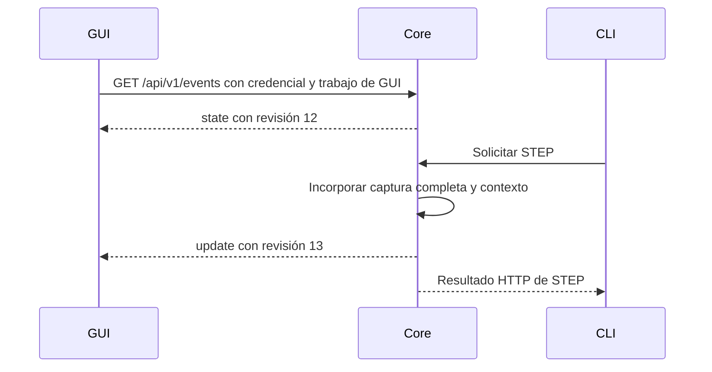

Los dos últimos mensajes pueden llegar en cualquier orden. Ambos representan la misma resolución coherente, sin exigir una nueva captura ni trasladar la conservación a la GUI observadora. Al reconectar, la GUI recibe otra vista inicial del estado actual; no se repiten operaciones físicas ni se reconstruye un historial de eventos perdidos.

state_revision permite comprobar sincronización y reconocer información anterior. Como ejemplos explicativos definidos, agregar un breakpoint, incorporar un STEP o desconectar la placa pueden producir revisiones sucesivas aunque solo STEP avance la FPGA. Una discontinuidad puede indicar que faltan actualizaciones y requerir resincronización; un mensaje pendiente anterior a la vista actual no debe hacerla retroceder. SSE conserva el orden dentro de una conexión; el contador aporta la comprobación de coherencia durante cortes, reconexiones y tratamiento de mensajes pendientes. La identidad de instancia delimita el contador: un reinicio crea otro instance_id y comienza una secuencia nueva. Las [reglas de continuidad y resincronización](#continuidad-de-revisiones-y-resincronización-sse) concretan el incremento por actualización, su publicación a todas las GUI y el tratamiento de discontinuidades; no acreditan un mecanismo implementado.

### Composición de la vista inicial SSE

data del mensaje state contiene ocho bloques coherentes del estado conocido por el core. Representan una vista coherente de lo que conoce el core en ese momento, incluida la información necesaria para que una GUI recién abierta observe una depuración controlada desde CLI.

| Campo de data | Contenido definido |
|---------------|--------------------|
| board | Estado de conexión, controlador y necesidades de preparación o recuperación; reutiliza la representación de board status. |
| works | Trabajos registrados de GUI y CLI, operaciones pendientes y relación con la placa y las sesiones. |
| programs | Programas administrados actualmente por el core; reutiliza la representación común del editor. |
| assemblies | Estado del ensamblado de cada programa y revisión: traducción disponible, en curso o diagnóstico correspondiente. |
| loaded_image | Identificación del programa y revisión que el core considera cargados, conservando cualquier incertidumbre. |
| sessions | Último ensayo de cada trabajo registrado, en curso o terminado, con su estado y última observación completa disponible; reutiliza las definiciones de session show y el [alcance vivo definido](#alcance-de-sessions-en-la-vista-viva-sse). |
| preferences | [Preferencias persistentes](integracion_y_distribucion.md#preferencias-persistentes); se reemplaza el objeto completo cuando cambia. |
| limitations | Avisos sobre información no disponible, con el formato compartido de code, section y message. |

La composición permite reconocer el programa ejecutado, el trabajo que controla su sesión y la última captura aunque la GUI se conecte después del comienzo del ensayo. Se publica información conocida por el core sin solicitar nuevas capturas UART. Los registros históricos y las listas completas de pasos mantienen sus consultas específicas y quedan fuera de la vista viva.

Todos los bloques reutilizan las definiciones canónicas del contrato. Cada actualización reemplaza completos los bloques incluidos; los ausentes conservan su valor.

### Representación de trabajos en la vista SSE

works reutiliza los campos de work status y añade client_type para cada trabajo registrado. La lista incluye los trabajos registrados en esa instancia, con GUI y CLI como interfaces pares.

| Campo de cada elemento de works | Contenido definido |
|--------------------------------|--------------------|
| work_id | UUID del trabajo registrado. |
| client_type | gui o cli. |
| pending_commands | Operaciones admitidas todavía sin resolver; no representa una cola de órdenes futuras. |
| owns_board | Indica si el trabajo conserva el control de la placa. |
| session_id | Último ensayo iniciado por el trabajo, o null si no inició ninguno. Puede corresponder a un ensayo terminado. |
| debug_open | Indica si mantiene una depuración abierta, incluso pausada o disponible para inspección tras terminar el programa. |

Los cinco campos compartidos conservan los significados de [work status](#resultado-de-work-status), aplicados al trabajo identificado de GUI o CLI. work_id no es null en una entrada porque esta representa un trabajo registrado; la ausencia del trabajo CLI se expresa mediante la ausencia de su entrada, sin crear un contexto para publicarlo. Esta lista no cambia la respuesta específica de work status, que conserva sus cinco campos y su representación de ausencia.

Como máximo un trabajo tiene owns_board igual a true. La GUI identifica su propio trabajo mediante el UUID obtenido al registrarse. Si CLI controla una depuración y GUI observa, se publican ambos trabajos con control solo en el de CLI. La publicación no transfiere ese control ni convierte las terminales en trabajos independientes.

### Representación de ensamblados en la vista SSE

assemblies publica contexto de programa y revisión, estado de ensamblado y traducción o diagnóstico. Se reutilizan la imagen, el mapa y los errores ya definidos para el resultado de ensamblado.

| Campo de cada elemento de assemblies | Contenido definido |
|-------------------------------------|--------------------|
| program_id | Programa al que corresponde el ensamblado. |
| source_version | Revisión exacta del texto procesado. |
| status | assembling, ready o failed. |
| image | Bytes completos de la traducción con el formato definido; null mientras se ensambla o si falla. |
| pc_to_line | Correspondencias PC–línea con el formato definido; null mientras se ensambla o si falla. |
| error | Error con code, message y los detalles definidos cuando falla; null en los demás estados. |

| Estado | Significado definido |
|--------|----------------------|
| assembling | El core está ensamblando esa revisión. |
| ready | Se obtuvo una traducción completa. La elegibilidad para LOAD conserva las comprobaciones existentes. |
| failed | El intento terminó con un diagnóstico de código o un fallo interno identificado. |

Un programa para el que todavía no se intentó ensamblar no tiene entrada. Cada resultado conserva la revisión exacta capturada al comenzar: si se ensambló A y el editor muestra B, la traducción sigue perteneciendo a A y no se presenta como vigente para B. Una traducción vacía conserva el éxito definido y utiliza listas vacías, sin confundirlas con null ni acreditar su elegibilidad para LOAD.

Se reutilizan el [resultado de ensamblado correcto](#resultado-de-ensamblado-correcto), el [diagnóstico de fuente](#diagnóstico-de-error-del-código-fuente-al-ensamblar) y los [errores de lectura y ensamblado](#errores-de-lectura-y-ensamblado). El diagnóstico de fuente conserva un único error y ninguna traducción parcial; los detalles identifican el programa, revisión y línea correspondiente. Esta representación no modifica la interfaz interna del assembler ni selecciona un historial persistente de traducciones.

### Representación de la imagen cargada en la vista SSE

loaded_image representa el conocimiento de la carga confirmada y reutiliza el contexto del resultado de LOAD. Se reutilizan los tres campos del resultado de LOAD confirmada.

| Campo de loaded_image | Contenido definido |
|-----------------------|--------------------|
| status | loaded, none o unknown. |
| program_id | Programa cuya carga está confirmada; null cuando status no es loaded. |
| source_version | Revisión exacta de esa imagen; null cuando status no es loaded. |
| byte_count | Cantidad de bytes de la imagen cargada; null cuando status no es loaded. |

| Estado | Significado definido |
|--------|----------------------|
| loaded | El core tiene una carga confirmada y conserva su asociación con el programa y la revisión. |
| none | El core sabe que no hay una imagen válida, por ejemplo tras un RESET confirmado. |
| unknown | El core no puede confirmar qué imagen quedó en la placa o vincularla con un programa conocido. |

Los tres campos de contexto se completan solo para loaded y conservan las definiciones del [resultado de LOAD confirmada](#resultado-de-load-confirmada). Una pérdida de DONE produce unknown porque la carga podría haber terminado físicamente sin que el core recibiera la confirmación. El contexto del intento fallido o incierto mantiene su conservación y diagnóstico correspondientes; no se presenta como una imagen confirmada en estos campos.

La representación conserva las reglas del protocolo: un rechazo anterior a ACCEPTED mantiene la imagen anterior; ACCEPTED la invalida y solo DONE confirma la nueva. La operación de carga en curso figura en works. Una revisión posterior del editor no sustituye la revisión confirmada y no modifica por sí sola esta imagen. La ausencia de contexto no se convierte en una afirmación física de imagen inexistente.

### Actualizaciones SSE por reemplazo de bloques completos

data de cada update contiene completos los bloques que cambiaron. Se acepta el compromiso entre simplicidad de la lógica de actualización y cantidad de datos transmitidos.

| Regla | Comportamiento definido |
|-------|-------------------------|
| Bloque incluido en data | La GUI reemplaza su representación de ese bloque por la recibida. |
| Bloque ausente | La GUI conserva el valor que ya tiene. |
| Listas | Se envían completas para el bloque afectado. Una lista vacía indica que ese bloque quedó sin elementos. |
| Varios bloques afectados | Viajan juntos en un único mensaje y la GUI los aplica juntos. |
| Revisión | Una sola state_revision identifica el conjunto coherente de cambios del mensaje. |

Los bloques utilizan las mismas estructuras de board, works, programs, assemblies, loaded_image, sessions, preferences y limitations de la vista inicial. Si cambia algo dentro de uno de ellos, se incluye todo ese bloque y se omiten los que permanecieron iguales. El reemplazo de programs conserva la regla de no sobrescribir una edición local más reciente mediante información o confirmaciones anteriores del core.

| Ejemplo | Bloques publicados |
|---------|--------------------|
| Modificación del código | programs completo con la nueva revisión. |
| Incorporación de un breakpoint | sessions completo con el conjunto actualizado de breakpoints. |
| Resolución de un ensamblado | assemblies y cualquier otro bloque que haya cambiado al resolver la operación. |

El reemplazo reutiliza estructuras existentes y representa incorporaciones, cambios y eliminaciones mediante una misma regla, sin un contrato de modificaciones por campo. Como contrapartida, transmite información repetida: cambiar un breakpoint requiere publicar también las demás sesiones y últimas observaciones incluidas en sessions. Es una elección de diseño del producto, no una exigencia de SSE ni una afirmación de rendimiento ya medido. El alcance de las colecciones, los límites de consumidores y las comprobaciones de volumen mantienen su concreción o verificación posterior.

### Continuidad de revisiones y resincronización SSE

La GUI aplica revisiones consecutivas y obtiene una vista completa nueva si detecta una discontinuidad. La GUI mantiene su representación del core a partir de una vista inicial coherente y las actualizaciones de esa instancia.

El core incrementa state_revision en uno por cada actualización coherente y la publica a todas las GUI suscritas. La vista inicial utiliza la revisión actual; abrir una suscripción no incrementa el contador. Las revisiones no se filtran por panel ni por el trabajo que controla el ensayo.

| Mensaje recibido con revisión aplicada 14 | Tratamiento definido |
|------------------------------------------|----------------------|
| update 15 de la misma instancia | Aplicar todos los bloques del mensaje juntos. |
| update 14 o anterior de esa instancia | Descartar para evitar retroceder. |
| update 17 de esa instancia | Detectar el salto y resincronizar sin aplicar ese mensaje aislado. |
| Mensaje de otra instancia | Descartar y volver a validar el core mediante el procedimiento de conexión. |

La resincronización por salto cierra y reabre la suscripción SSE. Su apertura devuelve un nuevo state con el estado actual completo y su revisión; a partir de esa base se continúan aplicando las actualizaciones. No se solicitan por esta vía los mensajes perdidos ni una nueva captura UART.

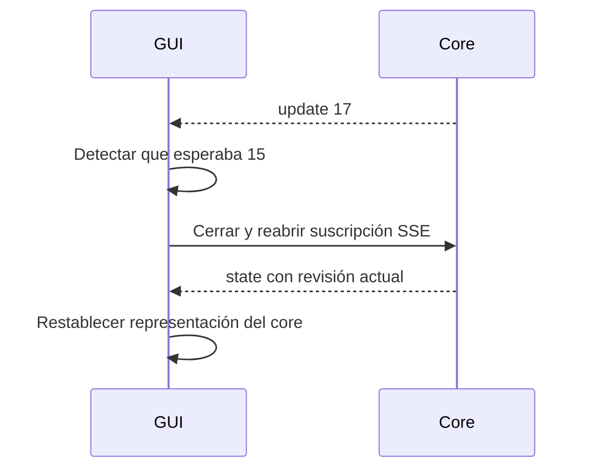

Durante la recuperación de sincronización, la GUI conserva la vista anterior e indica que está desactualizada. La depuración continúa bajo responsabilidad del core; este procedimiento no repite órdenes, no detiene la FPGA ni finaliza el trabajo controlador. Un cambio de instance_id conserva la validación y el registro correspondientes, sin restaurar por esa vía una sesión física de la instancia anterior. La sustitución de la representación del core mantiene la protección definida de las ediciones locales más recientes.

Las reglas concretan la continuidad observable y el tratamiento de discontinuidades. La [política de saturación y límite provisional de pendientes](#límite-de-pendientes-por-suscripción-sse) está definida. La [coordinación del alta](#alta-coherente-de-suscripciones-sse) está definida. La [política de keepalive y reconexión](#keepalive-y-reconexión-del-canal-sse) está definida; el dimensionamiento de pendientes requiere verificación.

### Límite de pendientes por suscripción SSE

| Situación | Comportamiento definido |
|-----------|-------------------------|
| Recepción normal | Entregar mensajes en orden. |
| Retraso momentáneo de una GUI | Conservar hasta 32 mensajes pendientes para esa suscripción como límite inicial provisional. |
| Límite lleno al publicar el siguiente mensaje | Cerrar esa suscripción y descartar sus pendientes. |
| Reconexión de GUI | Obtener el estado actual completo mediante una nueva suscripción, según la resincronización definida. |
| Otras interfaces y ensayo | Continuar su funcionamiento y conservar la política independiente de registro de la depuración. |

El cierre afecta al canal SSE de esa GUI, no finaliza su trabajo ni transfiere control ni detiene la FPGA. La publicación no espera confirmaciones de recepción de aplicación por cada mensaje. La política limita la acumulación en el core cuando se frena el envío; no acredita detectar una ventana congelada, porque Electron puede seguir recibiendo datos aunque su presentación no los muestre todavía.

El límite inicial de 32 mensajes permite absorber retrasos breves sin acumular mensajes indefinidamente. Es un parámetro provisional, sin dimensionamiento medido: no representa un tamaño fijo en memoria ni un intervalo temporal fijo. Ante saturación se recupera la vista completa. El valor se comprueba con el tamaño real de los mensajes y equipos modestos en la etapa de verificación.

### Alta coherente de suscripciones SSE

El hilo de aplicación toma la copia inicial y registra la suscripción en una acción indivisible. La coordinación evita perder un cambio entre obtener la vista y comenzar a observar sus actualizaciones.

La copia conserva el contenido y revisión conocidos en ese punto. El envío se realiza después y los cambios posteriores quedan pendientes detrás de la vista inicial, respetando el orden de la suscripción. Preparar esta vista utiliza el estado lógico conocido del core; no solicita otra captura UART ni espera que la GUI termine de recibir para admitir otras operaciones.

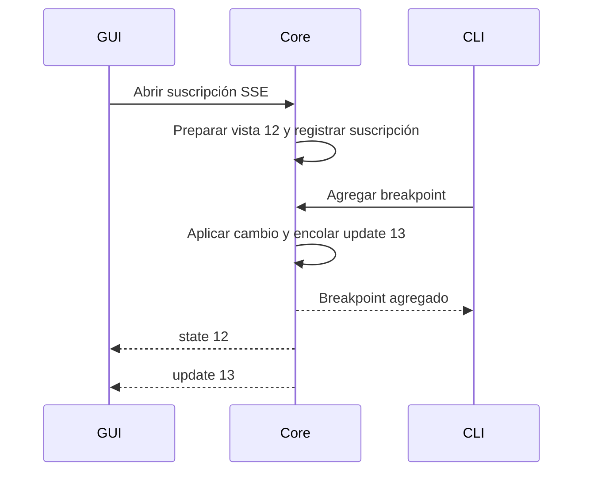

La vista 12 conserva su contenido aunque el estado del core cambie antes de completar su envío. La GUI recibe primero esa vista y luego la actualización 13. El envío hacia una suscripción no bloquea las demás operaciones y conserva el límite de pendientes y tratamiento de saturación ya definidos. La coordinación se aplica también a una nueva suscripción utilizada para resincronizar, sin incorporar una reproducción del historial perdido ni repetir operaciones físicas.

### Keepalive y reconexión del canal SSE

La GUI detecta cortes del canal y reintenta la suscripción con esperas crecientes. Los tiempos siguientes son parámetros iniciales sujetos a verificación.

| Situación | Comportamiento definido |
|-----------|--------------------------|
| Sin cambios para publicar | Enviar un pequeño keepalive cada 15 segundos. |
| Cierre de la conexión | Iniciar la reconexión al detectar el cierre. |
| Canal silencioso | Tras 45 segundos sin actividad recibida, considerar interrumpida la suscripción y reconectar. |
| Intento de reconexión fallido | Esperar 1, 2, 4, 8 y después 10 segundos entre intentos; mantener el máximo de 10 segundos mientras la GUI siga abierta. |
| Nuevo estado inicial completo y válido | Restablecer la sincronización y reiniciar la secuencia de esperas. |
| Problema de credencial o identidad | Volver al procedimiento de descubrimiento y validación antes de continuar. |

El keepalive utiliza un comentario SSE y no una actualización de aplicación: no consulta la FPGA, no avanza ciclos y no modifica state_revision. El [estándar SSE contempla comentarios periódicos](https://html.spec.whatwg.org/multipage/server-sent-events.html#authoring-notes). El cliente debe observar esa actividad en el flujo de transporte aunque el analizador no la entregue como un mensaje de aplicación; comprobar solo eventos con datos JSON no permite aplicar correctamente el timeout durante un período de inactividad normal.

El plazo de 45 segundos se refiere al canal SSE y deja margen para varios intervalos de keepalive. El vencimiento no demuestra un fallo de la FPGA. La GUI marca la vista como desactualizada, cancela la suscripción anterior y abre una nueva para obtener el estado actual completo. Si no consigue reconectar, conserva la vista anterior con el aviso y utiliza las esperas definidas. La ejecución no se detiene ni se repiten operaciones por esta recuperación; el trabajo propio se conserva si continúa la misma instancia.

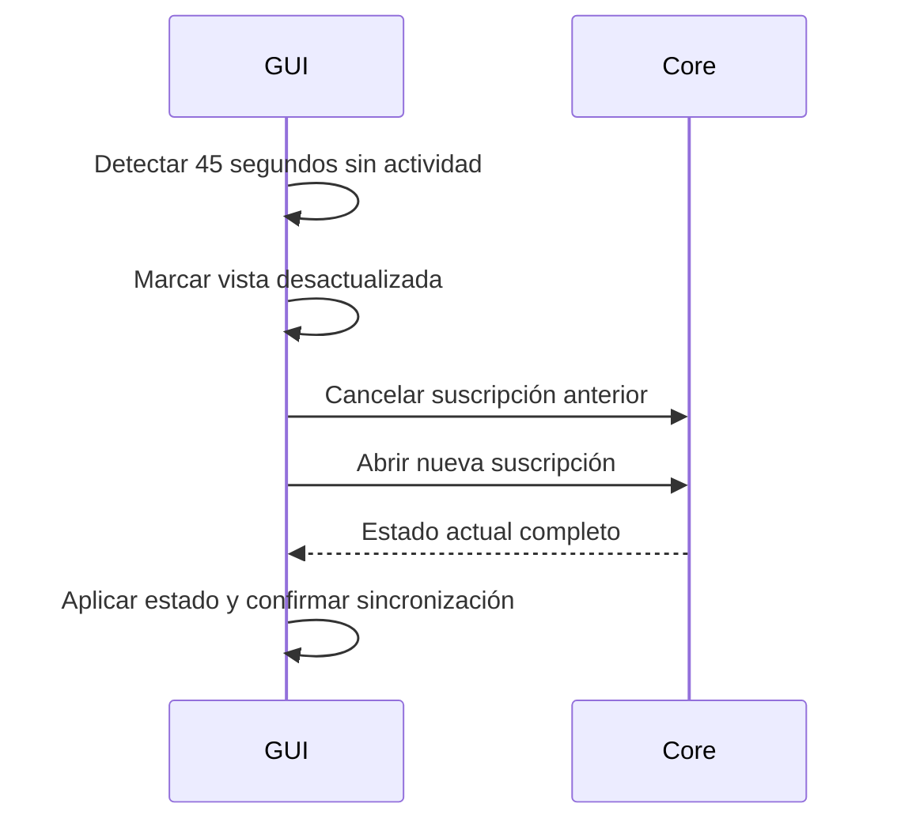

Los valores no se presentan como dimensionamiento medido ni sustituyen los plazos UART o el límite opcional de RUN. Las esperas crecientes evitan reintentos continuos ante indisponibilidad. Los mecanismos efectivos deben conservar la política de cierre y el funcionamiento del cliente de GUI independientemente de los paneles.

### Alcance de sessions en la vista viva SSE

sessions incluye el último ensayo de cada trabajo registrado y su última observación completa disponible. Se acota la publicación viva sin eliminar evidencia conservada ni añadir un historial completo en memoria.

| Situación | Alcance definido |
|-----------|-------------------|
| CLI depura | Incluir esa sesión, también cuando está pausada. |
| El trabajo termina un ensayo | Mantenerlo incluido mientras sea el último de ese trabajo. |
| El mismo trabajo inicia otro ensayo | El nuevo sustituye al anterior en la vista SSE. |
| GUI y CLI tienen ensayos propios | Incluir el último de cada trabajo registrado. |
| Un trabajo no inició ensayos | No aporta ninguna sesión a la lista. |

Cada entrada reutiliza las definiciones de session show indicadas en la composición de la vista inicial. El alcance se relaciona con session_id de cada entrada de works y conserva el control y la apertura de depuración definidos. El bloque no crece automáticamente con todos los ensayos realizados en la instancia.

Las sesiones anteriores mantienen sus consultas por identificador, según la información y registros disponibles. Sustituir una sesión en esta vista no borra registros conservados ni garantiza recuperar evidencia que no fue registrada. El nuevo ensayo se incorpora según sus reglas existentes de inicio y confirmación; un intento fallido de iniciar o reiniciar no se convierte por esta política en otro ensayo confirmado.

### Resultados HTTP y estado vivo de GUI

Se utiliza SSE como única fuente de actualización del estado vivo compartido de GUI. Las respuestas HTTP mantienen el resultado completo de la solicitud y la CLI conserva su consumo de resultados HTTP.

| Información recibida | Uso definido por GUI |
|----------------------|-----------------------|
| state o update SSE | Actualizar la representación compartida del estado vivo del core. |
| Respuesta HTTP de una operación | Resolver la espera, comunicar resultado o error y coordinar la continuación de la acción, sin reemplazar el estado vivo. |
| Consulta de sesión histórica | Presentar el resultado de esa consulta separado de la vista viva. |
| Texto en edición | Mantener las reglas de Monaco y la protección de ediciones locales posteriores. |

Las respuestas no se reducen a un acuse de recibo. STEP devuelve su captura completa o el error correspondiente; guardar confirma la revisión conservada o el fallo; una operación incompatible devuelve el rechazo aunque no haya cambios que publicar. GUI puede finalizar su indicación local de espera, mostrar un diagnóstico o continuar el atajo combinado a partir del resultado HTTP. Por ejemplo, LOAD confirmado permite solicitar el RUN posterior sobre la imagen correspondiente, conservando las reglas de revisión existentes.

El estado vivo de registros, pipeline, conexión, sesiones y demás bloques proviene de SSE, incluidos cambios provocados por CLI. Si llega una respuesta HTTP del paso 8 después de una actualización SSE del paso 9, el resultado anterior sigue perteneciendo a su solicitud y no sustituye la vista viva posterior. Las consultas y resultados específicos mantienen sus identidades de programa, revisión y sesión. Las acciones del editor conservan la identificación del documento que debe abrirse o seleccionarse y las reglas de edición local, sin introducir una segunda autoridad sobre la representación del core.

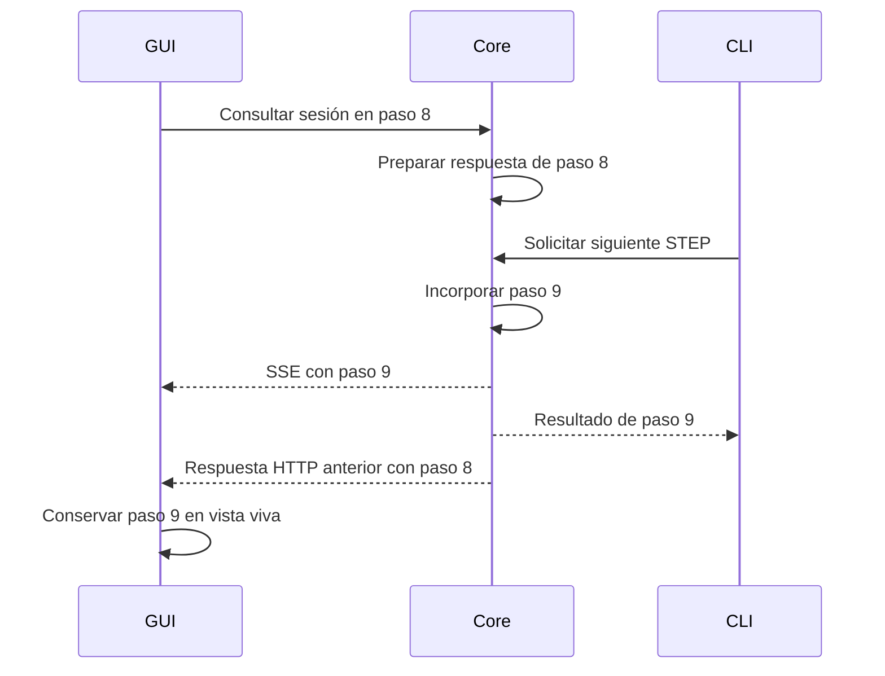

La duplicación de una observación completa en HTTP y SSE se mantiene deliberadamente: CLI necesita el resultado de su orden sin depender de un canal SSE permanente y GUI necesita una fuente ordenada de estado compartido. Las envolturas se conservan y no agrega una revisión a las respuestas HTTP ni exige un orden de llegada entre canales.

### Ciclo de vida de la suscripción en GUI

La suscripción pertenece a la GUI completa, continúa al minimizar y se resincroniza tras reanudar la computadora.

| Situación | Comportamiento definido |
|-----------|--------------------------|
| Cambiar o cerrar un panel | La suscripción continúa; pertenece a la GUI completa. |
| Minimizar la ventana o dejarla detrás de otra | La conexión sigue activa y recibe actualizaciones. |
| Suspender y reanudar la computadora | Marcar la vista como desactualizada y obtener un estado actual completo al restablecer la conexión. |
| Cierre confirmado del trabajo de GUI | Cancelar su suscripción y cualquier reintento pendiente; el core conserva los otros trabajos conforme a las reglas vigentes. |

La integración de [fetch-event-source permite desactivar el cierre automático al ocultarse el documento](https://github.com/Azure/fetch-event-source#readme); se requiere configurar esa continuidad explícitamente. La recuperación tras suspensión corresponde a la representación de GUI y no determina por sí sola el estado físico de la FPGA. Las operaciones, recuperación UART, propiedad y conservación mantienen sus contratos independientes. El cierre de la ventana conserva la espera por finalización del trabajo y las opciones de conservación del código ya definidas.

### Preferencias e interpretación

Las preferencias forman el octavo bloque del estado SSE. Su estructura, consulta, actualización y errores se definen en integración y distribución. El cálculo de continuidad de una aparición se consulta mediante POST /api/v1/interpretation/follow, según GUI y visor. Reutiliza la autenticación y el trabajo solicitante sin transferir el control de la placa.

## Conservación del código y la evidencia

### Código recuperable

| Unidad de conservación | Contenido |
|------------------------|-----------|
| Programa | Identidad estable. |
| Texto y versión | Contenido completo de la versión conservada. |
| Archivo asociado | Ubicación opcional, sin recreación automática si falta. |
| Estado de apertura | Distingue los programas abiertos al salir de los borradores cerrados pero recuperables. |
| Origen de ejemplo | Referencia conservada cuando el programa proviene del catálogo. |

El resultado de un guardado identifica programa, versión, éxito o fallo y motivo disponible. Confirmar A no presenta B como guardada si hubo una edición posterior. Un guardado antiguo no reemplaza una versión recuperable más reciente ya confirmada. Si B falla y A se conserva, A queda recuperable y se mantiene informado el fallo de B.

Guardar el texto no modifica el estado de apertura del programa. La finalización de un guardado anterior al cierre de una pestaña conserva el código sin volver a marcar el programa como abierto. Esta regla no selecciona un mecanismo de ordenamiento o almacenamiento; su realización corresponde al diseño detallado.

Se mantienen las garantías de la SRS: recuperación completa tras cierre normal con guardado completado y pérdida máxima de dos segundos de edición ante caída o corte de energía. Ese límite no selecciona el intervalo ni el mecanismo de autoguardado. Una confirmación representa conservación de esa versión, no solo recepción de la solicitud. El procedimiento de conservación se define en arquitectura y se comprueba mediante los casos de verificación.

El cierre normal exige resolver el código pendiente. Ante fallo se conserva la aplicación abierta, identifica el contenido y permite reintento o cambio de destino; salir sin conservar exige una solicitud explícita. La presentación, el bloqueo temporal de edición durante la salida y las interacciones concretas pertenecen al diseño de GUI. La reapertura automática comprende los programas abiertos al salir, no los borradores cuyas pestañas se cerraron previamente; estos siguen recuperables. No restaura disposición ni sesión física.

### Registro de ensayo

| Campo del registro | Contenido |
|--------------------|-----------|
| Sesión | Identidad del ensayo. |
| Programa ejecutado | Texto y versión exactos. |
| Modo | RUN o depuración. |
| Fechas | Inicio y cierre disponible. |
| Autor | Identificación opcional o ausencia explícita. |
| Observaciones | Capturas completas ordenadas; puede no haber ninguna si hubo interrupción previa. |
| Cierre | Resultado y motivo conocido, sin inventar una captura terminal. |

La opción de registro se fija al comenzar el ensayo: prevalece la solicitud explícita; en su ausencia, se usa la preferencia vigente, activada por defecto. Cambiar la preferencia afecta ensayos posteriores. Un reinicio completado abre un nuevo ensayo y toma nuevamente la opción vigente.

Sesiones entrega apertura y fuente al comenzar, cada observación completa al recibirla y los datos de cierre al terminar. Conservación no espera al final para guardar toda la prueba. Un fallo se informa, conserva lo ya guardado y permite continuar y consultar resultados; no cambia la política de autoguardado del código ni se confunde con un fault del procesador.

La finalización de conservación resuelve los guardados anteriores antes de confirmar el cierre. Solo se presenta registro completo si se conservaron apertura, observaciones entregadas y cierre. Un cierre guardado no borra los fallos previos; si el cierre no se conserva, tampoco se confirma conservación completa. El resultado del ensayo y la integridad de su evidencia son datos independientes.

### Formato JSON Lines de los registros de ensayo

Cada ensayo utiliza un archivo .jsonl con un objeto JSON completo por línea y unidades añadidas progresivamente. Se selecciona [JSON Lines](https://jsonlines.org/) como representación estructurada de la evidencia conservada.

| Unidad | Contenido |
|--------|--------------------------------|
| Apertura | Identidad del ensayo, programa y revisión exactos, texto fuente, modo, autor y fecha. |
| Observación | Cada captura completa recibida con su contexto correspondiente. |
| Cierre | Desenlace, fecha y motivo conocido de terminación. |

Conservación escribe progresivamente durante el ensayo conforme al orden y prioridades ya definidos. Si una caída deja la última escritura incompleta, la lectura puede recuperar las líneas completas conservadas y señalar la información faltante; no se convierte una última línea parcial en una observación válida. La ausencia de cierre sigue indicando un registro incompleto, sin afirmar que la ejecución física continúe ni reconstruir resultados.

### Envoltura de cada línea del registro de ensayo

Cada línea del archivo utiliza la envoltura de cuatro campos siguiente.

| Campo | Contenido definido |
|-------|--------------------|
| schema_version | Versión del formato del registro; inicialmente 1. Permite reconocer cómo interpretar el archivo cuando evolucione el formato. |
| session_id | UUID del ensayo al que pertenece la línea. |
| record_type | start, observation o end. |
| data | Contenido específico de apertura, observación o cierre. |

Todas las líneas de un mismo archivo corresponden al mismo session_id y utilizan la misma schema_version. La identidad reutiliza el formato compartido de sesión y no se genera una sesión distinta por unidad de escritura. record_type distingue la función de cada línea sin convertirla en un evento SSE ni una respuesta HTTP.

schema_version identifica el contrato del archivo de evidencia, separado de api_version y de la versión del ejecutable. Los [campos de end](#cierre-end-del-registro-de-ensayo) están definidos. Las [reglas de validación y recuperación](#validación-y-recuperación-de-unidades-json-lines) están definidas, reutilizando las representaciones existentes.

### Apertura start del registro de ensayo

start conserva el contexto y el perfil del ensayo.

| Campo de data en start | Contenido definido |
|------------------------|--------------------|
| mode | run o debug. |
| program_id | UUID del programa ejecutado. |
| source_version | Revisión exacta utilizada por el ensayo. |
| source_text | Texto completo de esa revisión. |
| started_at | Fecha de inicio del ensayo con el formato UTC compartido. |
| author | Autor indicado o configurado; null si no hay uno. |
| processor_profile | Metadato del perfil semántico usado, con profile_id, revision y memory_profile, compartido con core/info. Identifica el contrato de interpretación y su configuración de memoria. |

session_id se conserva en la envoltura y no se duplica en data. Las identidades y revisiones reutilizan los formatos compartidos definidos. started_at identifica el inicio lógico del ensayo en el core y no una medición temporal de la FPGA. mode, programa, revisión, texto, autor y fecha reutilizan el contexto ya definido en session logs.

source_text es obligatorio en una apertura válida: el core conoce la fuente vinculada a la imagen utilizada. Se conserva el texto exacto del ensayo aunque después se edite, mueva o elimine el archivo Assembly asociado. La ausencia de texto en una consulta histórica por evidencia perdida mantiene su tratamiento de disponibilidad y no transforma una apertura válida en una referencia al archivo actual.

### Observación observation del registro de ensayo

data de observation reutiliza la observación completa correspondiente al modo conservado en start. El modo conservado en start determina la forma de los datos.

| Campo de data | Modo debug | Modo run |
|---------------|------------|----------|
| step_index | Número original del paso dentro del ensayo. | No se incluye. |
| snapshot | Captura completa recibida en ese STEP. | Captura terminal completa. |
| breakpoint_hits | Coincidencias detectadas en ese paso. | No se incluye. |
| interpretation | Interpretación del paso con la estructura definida. | No se incluye. |

La observación de debug reutiliza los cuatro campos de [STEP y debug continue](#resultado-de-debug-continue); la de run reutiliza snapshot según [session logs](#resultado-de-session-logs). Se conservan el formato íntegro de la captura, los valores recibidos, la numeración original y las definiciones de coincidencias e interpretación, sin crear variantes para el archivo.

session_id pertenece a la envoltura; programa, revisión y modo están en start y no se repiten por esta representación. Solo se escribe una observación cuando existe una captura completa. Una recepción parcial no genera una observación y RUN interrumpido sin captura terminal puede tener apertura y cierre sin ninguna línea observation. El cierre de la evidencia y su integridad mantienen su tratamiento independiente del resultado físico del ensayo.

### Cierre end del registro de ensayo

Se conserva el desenlace y datos de integridad en data de la línea end, manteniendo separados el resultado del ensayo y la calidad de su evidencia.

| Campo de data en end | Contenido definido |
|----------------------|--------------------|
| execution_status | Desenlace conocido: finished, fault, interrupted o unknown. |
| outcome | Estructura compartida con fecha final, motivo de interrupción y fallo de aplicación o comunicación cuando corresponda. |
| observation_count | Cantidad total de capturas completas recibidas durante el ensayo, incluidas las que no se pudieron guardar. |
| limitations | Avisos de conservación conocidos, con code, section y message; lista vacía si no hay ninguno. |

execution_status reutiliza los estados de sesión para un ensayo concluido, sin ongoing en una línea end válida. outcome conserva la [definición compartida del desenlace](#desenlace-outcome-de-session-show). La captura terminal pertenece a observation y no se duplica en el cierre. Los fallos de guardado se informan en limitations y no sustituyen el desenlace real ni se convierten en un fault del procesador.

observation_count permite comparar lo recibido con lo recuperado del archivo. Si el ensayo recibió 20 capturas completas y solo se conservaron 18, el cierre no permite presentar el registro como completo. El contador no incluye recepciones parciales ni inventa observaciones ausentes. Un RUN interrumpido sin captura terminal puede cerrar con cero observaciones; la ausencia de capturas en un registro incompleto no acredita por sí sola ese cero.

Un ensayo puede terminar normalmente y conservar evidencia incompleta. La presencia de end no borra faltantes ni fallos previos: la integridad se determina también mediante las unidades recuperadas y los avisos conocidos. Las [reglas de validación y lectura](#validación-y-recuperación-de-unidades-json-lines) están definidas y conservan la separación entre desenlace e integridad.

### Validación y recuperación de unidades JSON Lines

La lectura recupera unidades válidas y distingue la integridad del registro del desenlace del ensayo. Se reutilizan los estados y códigos existentes.

| Situación del archivo | Tratamiento definido |
|-----------------------|----------------------|
| Apertura, observaciones y cierre válidos, cantidad coincidente y sin avisos | Registro complete. |
| Última línea con JSON incompleto | Conservar las unidades válidas anteriores y señalar incomplete. |
| Línea intermedia inválida | Descartar esa unidad, informar el problema y continuar recuperando las siguientes que sean válidas y pertenezcan al mismo ensayo. |
| Sin apertura válida | Informar RECORD_INVALID por falta del contexto necesario para interpretar el archivo como un ensayo. |
| Sin cierre | writing si el core confirma que todavía lo está escribiendo; en otro caso, incomplete. |
| Cantidad recuperada distinta de observation_count | incomplete, con aviso sobre la inconsistencia y las observaciones faltantes que puedan establecerse. |
| Fallo de guardado conocido | Conservar failed aunque exista línea de cierre. |

Cada unidad se valida contra schema_version, session_id, su estructura y el orden definido para apertura, observaciones y cierre. Una unidad inválida no se incorpora a los resultados válidos. En debug se conservan los step_index originales, incluidos los saltos debidos a información perdida, sin renumeración ni creación de capturas intermedias.

Una captura terminal completa válida permite reconocer el desenlace aunque el registro haya quedado incompleto; los detalles de cierre no conservados permanecen ausentes conforme al contrato compartido. La ausencia de end no prueba que el ensayo siga ejecutándose. Recuperar evidencia parcial no reconstruye lo perdido ni reanuda la FPGA.

Las consultas conservan la regla general: si pueden devolver información válida parcial, la devuelven con sus avisos; si no pueden resolverse, utilizan el error correspondiente. La apertura inválida impide interpretar autónomamente ese archivo y no autoriza inventar el programa, la revisión ni el modo. Los fallos de guardado solo se consideran conocidos cuando existe información que los acredita; no se inventa un motivo concreto tras una caída por la mera ausencia de cierre.

### Escritura del registro tras un fallo

El primer fallo de escritura detiene las escrituras del archivo de ese ensayo. Se conserva el alcance de continuidad del ensayo y consulta de resultados disponibles definido en SRS-PC-R06.

| Aspecto | Comportamiento definido |
|---------|--------------------------|
| Estado del registro | failed; informar el problema. |
| Datos anteriores | Conservar lo que ya pudo guardarse. |
| Capturas posteriores | Continuar la ejecución y mantener disponible la última captura, sin añadirlas al archivo afectado. |
| Autoguardado del código | Continuar con su política independiente. |
| Ensayos posteriores | Intentar crear su propio registro según la configuración vigente. |

La política afecta a ese archivo, no desactiva la preferencia de registro ni modifica el desenlace del procesador. Evita reintentos continuos y reparación de una escritura parcial durante la prueba, con el costo definido de perder conservación posterior en ese ensayo aunque el fallo fuera transitorio. El archivo puede quedar sin end y la lectura posterior lo trata como incompleto según sus unidades válidas y el conocimiento disponible; no se inventa después de una caída un fallo de escritura que no quedó acreditado.

### Lectura y recuperación de registros

| Información devuelta | Contenido |
|----------------------|-----------|
| Contexto conservado | Programa, versión, modo, autor y fechas disponibles. |
| Observaciones | Capturas completas conservadas en su orden original. |
| Cierre | Resultado guardado o indicación de ausencia de cierre conservado. |
| Integridad | Registro completo o incompleto, con faltantes y fallos conocidos. |

La lectura no utiliza la FPGA, no reconstruye datos faltantes ni reanuda una sesión. La ausencia de cierre conservado no afirma que el ensayo siga ejecutándose. Tras una caída se recuperan las observaciones completas ya guardadas y pueden perderse las pendientes, sin extender a los registros el límite de dos segundos del código.

Los registros se mantienen hasta una eliminación explícita, sin caducidad ni limpieza automática. Esta política no añade un gestor visual ni selecciona una interfaz de borrado. El [formato JSON Lines por ensayo](#formato-json-lines-de-los-registros-de-ensayo) está definido; destinos, estructuras y reglas de integridad se concretan en las secciones anteriores y en los paquetes de integración y verificación.
