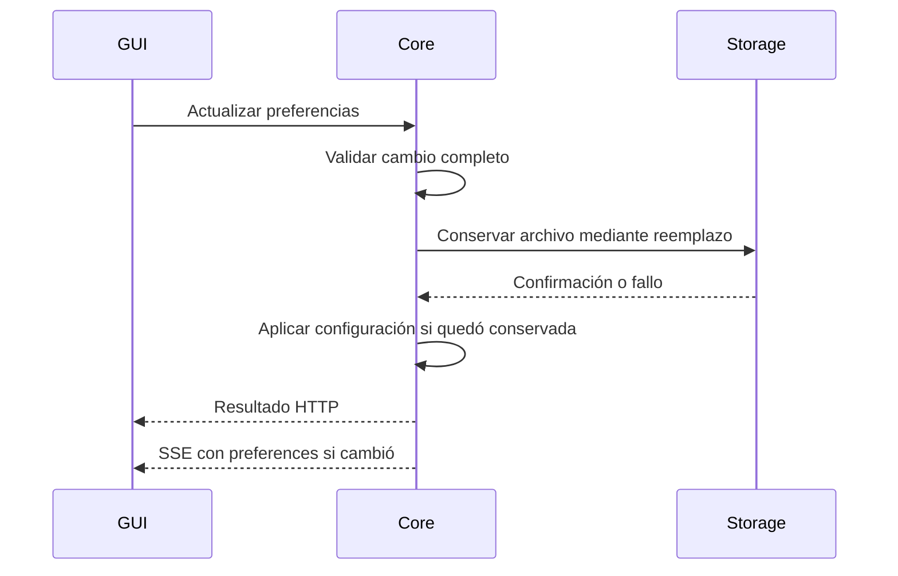

# Integración y distribución de viewrv

- **Tipo:** integración de software.
- **Estado documental:** especificación vigente.

**Índice**

- [Propósito y alcance](#propósito-y-alcance)
- [Dependencias y versiones](#dependencias-y-versiones)
- [Organización prevista del código](#organización-prevista-del-código)
- [Puente nativo de GUI](#puente-nativo-de-gui)
- [Datos persistentes](#datos-persistentes)
- [Preferencias y coherencia del estado](#preferencias-y-coherencia-del-estado)
- [Recursos y entradas de la entrega](#recursos-y-entradas-de-la-entrega)
- [Arranque y límites del transporte](#arranque-y-límites-del-transporte)
- [Configuración de hardware y adaptación UART](#configuración-de-hardware-y-adaptación-uart)
- [Preparación de Basys 3](#preparación-de-basys-3)
- [Instalación, desinstalación y construcción](#instalación-desinstalación-y-construcción)
- [Códigos de terminación de CLI](#códigos-de-terminación-de-cli)

## Propósito y alcance

Define la organización del código, las dependencias, la conexión entre componentes, los recursos y la entrega para Linux y Windows. Incluye la preparación de Basys 3 y la instalación y desinstalación por usuario.

## Dependencias y versiones

Las siguientes versiones constituyen la base de construcción. La resolución completa de dependencias se fija mediante archivos de bloqueo por plataforma. Una versión declarada no acredita por sí sola una compilación o compatibilidad ejecutada.

| Componente de base | Versión seleccionada | Alcance |
|--------------------|-------------------|---------|
| Node.js | [24.22.1 LTS](https://nodejs.org/en/blog/release/v24.22.1) | Herramientas de construcción. No sustituye el Node incorporado por Electron. |
| CPython | [3.14.9](https://www.python.org/downloads/release/python-3149/) | Intérprete estándar para desarrollar y empaquetar core y CLI. Se consideran los artefactos CPython convencionales, no una variante free-threaded. |

| Componente de GUI y construcción | Versión seleccionada | Alcance |
|--------------------------------|-------------------|---------|
| Electron | 45.0.0 | Ventana y runtime de aplicación. |
| TypeScript | [6.0.3](https://registry.npmjs.org/typescript/6.0.3) | Comprobación de tipos separada de Vite. |
| React y React DOM | 19.3.1 para ambos | Componentes y montaje de GUI. |
| Estado compartido de GUI | [Zustand 5.0.16](https://registry.npmjs.org/zustand/5.0.16) | Estado compartido de presentación; conserva la autoridad del core. |
| Base UI | 1.9.0 | Controles comunes. |
| Iconos de GUI | [lucide-react 1.61.0](https://registry.npmjs.org/lucide-react/1.61.0) | Iconos locales adaptados a Penpot. |
| FlexLayout | 0.11.1 | Pestañas y divisiones. |
| Monaco Editor | 0.57.0 | Editor de código. |
| Runtime del visor draw.io | viewer-static.min.js | SHA-256 32c73b8e42e784d0ace7d59754cbea6c2a78a0f506d390e2a3870546b9242f7c; versión upstream no identificada. |
| Adaptador Monaco para React | [@monaco-editor/react 4.7.0](https://registry.npmjs.org/%40monaco-editor%2Freact/4.7.0) | Integración de Monaco con React. |
| Vite | 8.3.5 | Construcción de la interfaz. |
| electron-vite | 6.0.0 | Integración de construcción de Electron. |
| Complemento React para Vite | [@vitejs/plugin-react 6.1.2](https://registry.npmjs.org/%40vitejs%2Fplugin-react/6.1.2) | Integración oficial de React con Vite; declara Vite ^8 y Node ^20.19.0 o >=22.12.0. |
| vanilla-extract CSS | 1.21.3 | Estilos de la aplicación. |
| Complemento vanilla-extract para Vite | 5.2.6 | Integración de estilos con la construcción de la GUI. |
| fetch-event-source | 2.0.1 | Cliente SSE en la ventana Electron. |
| electron-builder | 26.18.0 | Distribución tar.gz y NSIS. |
| Tipos de Node | [@types/node 24.19.2](https://registry.npmjs.org/%40types%2Fnode/24.19.2) | Rama de tipos 24 para el entorno definido. |
| Tipos de React y React DOM | [@types/react 19.3.0](https://registry.npmjs.org/%40types%2Freact/19.3.0) y [@types/react-dom 19.3.0](https://registry.npmjs.org/%40types%2Freact-dom/19.3.0) | Definiciones para comprobación de tipos; React DOM requiere @types/react ^19.3.0. |

| Componente de Python o programación de placa | Versión seleccionada | Alcance |
|---------------------------------------------|-------------------|---------|
| FastAPI | 0.162.0 | Servidor HTTP y SSE integrado. |
| Uvicorn | 0.54.0 | Un proceso servidor, sin incorporar automáticamente extras standard. |
| pySerial | 3.5 | Comunicación serie directa. |
| Click | 8.5.0 | Comandos y ayuda de CLI. |
| HTTPX | 0.28.1 | Cliente HTTP síncrono de CLI. |
| PyInstaller | 6.22.3 | Empaquetado onedir de core y CLI. |
| openFPGALoader | 1.2.0 | Fuentes oficiales para generar e incluir binarios por plataforma; construcción efectiva pendiente. |

La construcción utiliza Node.js 24 LTS y CPython 3.14 convencionales. El módulo assembler conserva su mínimo CPython 3.11 independiente. Los runtimes Node y Chromium incorporados pertenecen a la versión de Electron; Node de construcción no los reemplaza.

Las versiones y artefactos transitivos se resuelven respetando los rangos de sus dependientes. La entrega no incorpora actualizaciones automáticas ni exige instalar Python, Node.js o Vivado para usarla. El programador se construye desde las fuentes oficiales de openFPGALoader 1.2.0.

## Organización prevista del código

Las ubicaciones siguientes son destinos de implementación; no se crean módulos ejecutables en esta etapa. Se conserva el assembler definido y se evita una clase o interfaz por comando.

| Ubicación prevista bajo tp3 | Responsabilidad |
|----------------------------|-----------------|
| software/assembler.py | Módulo público ya definido: assemble, AssemblyResult y AssemblyDiagnostic. |
| software/viewrv/contracts.py | Representaciones de intercambio, códigos y conversión de valores; sin inicio de procesos ni acceso a dispositivos al importar. |
| software/viewrv/core/ | Programas, preparación, sesiones, conservación, interpretación, coordinación y composición. Módulos con esos nombres en inglés y entrada core/__main__.py; lógica independiente de FastAPI y pySerial. |
| software/viewrv/core/ports.py | Contratos Protocol únicamente para assembler, procesador, programador y almacenamiento. |
| software/viewrv/adapters/ | Adaptadores HTTP/SSE, serial, archivos, assembler y openFPGALoader, más las diferencias efectivas de plataforma. |
| software/viewrv/client/ | Descubrimiento, arranque y cliente HTTP de Python utilizados por CLI; sin importar la composición del core. |
| software/viewrv/cli/ | Comandos Click, validación de argumentos y presentación humana o JSON. |
| software/tests/viewrv/ | Pruebas unittest de core, protocolo, API/CLI, almacenamiento e interpretación; __init__.py vacío y módulos test_core.py, test_protocol.py, test_api_cli.py, test_storage.py y test_interpretation.py, separados del catálogo del assembler. |
| software/gui/src/main/ y software/gui/src/preload/ | Desktop host y Desktop bridge. |
| software/gui/src/renderer/ | Core client, estado de presentación, vistas e integraciones de Monaco, FlexLayout y GraphViewer. |
| software/resources/ y software/packaging/ | Recursos de producto y descriptores de construcción, PyInstaller, electron-builder e instalación. |

La lógica comparte estado únicamente en el hilo de aplicación. Las llamadas a los puertos conservan los trabajadores y reservas ya definidos. Las definiciones TypeScript reflejan el contrato de transporte; la comprobación de contratos se define en [Verificación](verificacion.md). No se agrega un generador ni una infraestructura de inyección de dependencias.

La [ejecución de pruebas automatizadas](verificacion.md#ejecución-de-pruebas-automatizadas) fija los comandos desde tp3 y su relación con los casos TEST-PC-NNN. Las ubicaciones de prueba se materializan durante la implementación de la aplicación.

## Puente nativo de GUI

El objeto expuesto por preload es window.viewrvDesktop. Cada método representa una capacidad concreta; la ventana usa HTTP/SSE directamente para operar sobre el core.

| Método | Entrada | Resultado o efecto |
|--------|---------|--------------------|
| getCoreConnection() | Ninguna. | Descubrimiento validable con base_url, instance_id, api_version y access_token, reutilizando su definición. Puede redescubrir o iniciar conforme al ciclo definido. |
| getRegistrationId() | Ninguna. | UUID conservado por Desktop host para esa apertura de ventana; una recarga del renderer no crea otra apertura. |
| chooseProgramFile() | Ninguna. | Ruta absoluta elegida en diálogo de apertura, o null por cancelación. El core lee el archivo. |
| chooseSavePath(suggestedName) | Nombre sugerido opcional. | Ruta absoluta elegida, o null. El core conserva el texto. |
| openExternal(url) | URL HTTP o HTTPS procedente de los enlaces del contenido local. | Solicitar apertura en el navegador del sistema. |
| getZoomFactor() | Ninguna. | Escala actual de esa ventana. |
| setZoomFactor(factor) | Número finito; rango inicial 0.5 a 2.0, sujeto a verificación visual. | Aplicar escala general local. La persistencia se solicita al core mediante preferencias. |
| requestWindowClose() | Ninguna. | Entrar al mismo recorrido de cierre que el control de la ventana. |
| onCloseRequested(callback) | Callback sin acceso al evento IPC original. | Notificar intención de cierre; devuelve una función para retirar la suscripción. |
| finishWindowClose() | Ninguna. | Cerrar la ventana después de la resolución del trabajo propio conforme al flujo definido. |

Desktop host valida el emisor IPC y los argumentos. Se conservan contextIsolation, sandbox y webSecurity, con nodeIntegration desactivado en renderer. El protocolo viewrv se registra como estándar y seguro, con soporte de fetch y CORS, sin bypass de CSP. El contenido externo se abre en el navegador del sistema. No se expone ejecución de comandos, acceso arbitrario al sistema de archivos ni el objeto IPC completo. Esta frontera sigue las capacidades de [contextBridge](https://www.electronjs.org/docs/latest/api/context-bridge) y las [recomendaciones de Electron](https://www.electronjs.org/docs/latest/tutorial/security).

## Datos persistentes

### Destinos de los datos persistentes por usuario

Los datos persistentes utilizan destinos por usuario separados de la instalación. Se conserva la ubicación de recuperación ya definida, se utiliza viewrv como nombre de aplicación y se separan datos, estado persistente y configuración en Linux.

| Tipo de dato | Linux | Windows |
|--------------|-------|---------|
| Copia recuperable de un programa | $XDG_DATA_HOME/viewrv/recovery/<program_id>.json | %LOCALAPPDATA%\viewrv\recovery\<program_id>.json |
| Registro de ensayo | $XDG_STATE_HOME/viewrv/records/<session_id>.jsonl | %LOCALAPPDATA%\viewrv\records\<session_id>.jsonl |
| Preferencias | $XDG_CONFIG_HOME/viewrv/preferences.json | %LOCALAPPDATA%\viewrv\preferences.json |

Si las variables XDG no están definidas o están vacías, se utilizan las bases ~/.local/share, ~/.local/state y ~/.config, respectivamente. Las variables XDG relativas se consideran no aplicables y se utilizan las bases predeterminadas. Windows utiliza la ubicación LocalAppData de la cuenta conforme al contrato de plataforma. La correspondencia de datos, estado y configuración utiliza las convenciones XDG descritas en las referencias de [datos](https://docs.gtk.org/glib/func.get_user_data_dir.html), [estado](https://docs.gtk.org/glib/func.get_user_state_dir.html) y [configuración](https://docs.gtk.org/glib/func.get_user_config_dir.html); estas referencias no incorporan GLib como dependencia.

Los nombres se derivan de las identidades UUID de programa y ensayo, no de nombres proporcionados como rutas por el usuario. El archivo Assembly conserva su destino elegido y su texto normal; no se sustituye por el JSON interno. Los recursos de la entrega se resuelven desde la instalación y los archivos de usuario no se guardan dentro de ella. El descubrimiento de ejecución mantiene sus ubicaciones y retirada propias, separadas de estos registros persistentes.

Los destinos conservan las políticas de retención definidas: registros hasta eliminación explícita y recuperación conforme al cierre o descarte del programa. Las preferencias utilizan la estructura siguiente; permisos, publicación y durabilidad requieren verificación en los sistemas de aceptación.

### Preferencias persistentes

Se conservan las preferencias siguientes entre aperturas en preferences.json, con el destino por usuario ya definido.

| Campo | Contenido y valor inicial definidos |
|-------|-------------------------------------|
| schema_version | Versión del formato; 1. |
| default_author | Autor predeterminado; null si no se configuró. |
| record_by_default | Registrar ensayos por defecto; true. |
| last_serial_port | Último puerto utilizado con conexión confirmada; inicialmente null. |
| ui_zoom | Escala general de GUI; 1.0 equivale a 100 %. Se conserva la elegida. |
| language | Idioma seleccionado; inicialmente es, preparado para incorporar en cuando exista la traducción. |

Las opciones explícitas de cada ensayo conservan su prioridad sobre los valores predeterminados. La selección de idioma no exige disponer de la traducción inglesa en la primera entrega. La preferencia de escala corresponde a toda la GUI y no solo al editor. Se mantienen la selección de puerto y los errores por un puerto recordado que dejó de estar disponible, sin sustituirlo automáticamente.

El core administra lectura, validación y conservación de preferencias mediante Storage worker y publica los cambios confirmados por HTTP/SSE.

## Preferencias y coherencia del estado

Se reutilizan los seis campos de preferences.json definidos. El core administra su conservación mediante Storage worker. Las opciones explícitas de ensayo no modifican por sí solas los valores predeterminados.

### Concreción del contrato

preferences es uno de los ocho bloques de state y update SSE. Contiene los seis campos de preferencias y utiliza reemplazo completo, como los otros bloques del estado vivo.

| Solicitud | Entrada | Respuesta |
|-----------|---------|---------------------|
| GET /api/v1/preferences | Credencial; no crea trabajo. | result con preferences y limitations. |
| POST /api/v1/preferences/update | Credencial, X-Viewrv-Work-Id y objeto con los campos que se desean cambiar, sin schema_version. | Misma representación tras conservación confirmada, o error. |

| Campo del resultado | Contenido |
|---------------------|-----------|
| preferences | Objeto definido de preferencias. |
| limitations | Avisos con code, section y message; vacío si no hay problemas conocidos. |

La actualización es una sola acción: validar el conjunto, conservarlo y después publicar la nueva configuración. Se admite una actualización de preferencias en curso; otra incompatible recibe OPERATION_CONFLICT. No se mezclan escrituras concurrentes del mismo archivo. La GUI puede conservar localmente el último ajuste visual pendiente y enviarlo después de resolver su solicitud anterior.

La aplicación publica la configuración nueva solo tras el guardado confirmado; una respuesta HTTP resuelve la solicitud y SSE actualiza la representación compartida. El cambio visual local responde inmediatamente y un fallo informa que no quedó recordado. Las preferencias operativas se toman al comenzar los ensayos siguientes. Las otras ventanas no cambian forzosamente su escala al modificarla una de ellas; conservan su presentación local y las nuevas aperturas utilizan la preferencia persistida.

Los dos últimos envíos no tienen orden de llegada exigido. Un fallo conserva la configuración confirmada anterior. La escritura reutiliza temporal en el mismo directorio, reemplazo y confirmación de conservación; respeta la prioridad del código ya definida.

### Lectura y errores de preferencias

Si falta el archivo se usan los valores iniciales, sin aviso de fallo. Si es ilegible o inválido se mantienen los valores iniciales y se informa el problema, conservando el archivo original. Antes de sustituir un archivo inválido por una actualización explícita se conserva una copia identificada del original; si no es posible, se rechaza ese guardado.

| Código | Uso |
|------------------|-----|
| PREFERENCES_READ_FAILED | Aviso por fallo de lectura, con valores iniciales utilizados. |
| PREFERENCES_INVALID | Aviso por formato, versión o valores no admitidos, con valores iniciales utilizados. |
| PREFERENCES_WRITE_FAILED | Error HTTP 500 al conservar; la configuración anterior sigue vigente. |

Los avisos usan section igual a preferences. El error de escritura conserva details.path y el mensaje del motivo. Estos tres códigos concretan el catálogo para preferencias; no se reutiliza CODE_SAVE_FAILED para un archivo de configuración.

CLI consulta preferencias durante su acceso al core para informar los avisos de inicio por stderr. En modo JSON conserva un único objeto de resultado en stdout. No se agrega un comando público de configuración. En la primera entrega solo se admite es como idioma disponible; en se acepta cuando exista su contenido. default_author permite ausencia explícita mediante null; ui_zoom debe ser finito y estar dentro del rango efectivo admitido.

## Recursos y entradas de la entrega

La entrega contiene dos conjuntos onedir independientes, uno para CLI y otro para core. Ambos usan las versiones definidas y permanecen dentro de la entrega integrada. Esta disposición evita acoplar sus búsquedas de bibliotecas a costa de duplicar parte del entorno Python; no se presenta una cifra de tamaño sin construir el artefacto.

| Ruta relativa al producto instalado o extraído | Contenido |
|-----------------------------------------------|-----------|
| viewrv o viewrv.exe | Ejecutable real de CLI, sin pasar por Electron. |
| _internal_cli/ | Dependencias de CLI recogidas por PyInstaller. |
| viewrv-gui o viewrv-gui.exe | Entrada de GUI Electron. |
| resources/app.asar | Presentación y código Electron preparados por electron-vite. |
| resources/core/viewrv-core y resources/core/_internal/, con extensión exe en Windows | Ejecutable y entorno onedir del core. |
| resources/programmer/ | openFPGALoader y sus bibliotecas y recursos de plataforma. |
| resources/hardware/processor.bit | Bitstream generado previamente por el grupo. |
| resources/content/ y resources/icons/ | Contenido local, visor, ejemplos y recursos visuales. La correspondencia con el circuito se define en GUI y visor. |
| release.json y licenses/ | Inventario de la entrega y avisos de componentes redistribuidos. |

Los ejecutables y bitstream se incluyen fuera de ASAR con extraFiles y extraResources de electron-builder, según la disposición anterior. CLI obtiene la raíz desde la ubicación real de su ejecutable; core desde su posición definida bajo resources/core; Desktop host desde la ubicación de recursos de Electron. No se utiliza el directorio desde el que el usuario invocó el producto.

### Inventario release.json

| Campo | Contenido previsto |
|-------|--------------------|
| schema_version | 1. |
| app_version | Versión de esa entrega. |
| api_version | Versión del contrato HTTP. |
| platform | linux o windows. |
| architecture | x86_64. |
| processor_profile | Objeto compartido con profile_id, revision y memory_profile; la entrega física utiliza REFERENCE. |
| resources | Lista de recursos externos identificados por los campos siguientes. |

| Campo de cada recurso | Contenido previsto |
|-----------------------|--------------------|
| role | Función: core, cli, programmer, bitstream o content. |
| path | Ruta relativa a la raíz del producto, contenida en ella. |
| sha256 | Huella del archivo preparado, calculada al producir la entrega. |

El inventario no contiene credenciales ni datos de usuario. La construcción falla si falta un recurso obligatorio o su huella no puede fijarse. El core verifica el recurso de bitstream antes de usarlo; una falta o inconsistencia impide preparar la placa y se informa con BOARD_PREPARATION_FAILED en la fase correspondiente. Esto no acredita que CHECK_READY identifique el bitstream: el protocolo conserva su alcance. La entrega debe contener el bitstream del procesador con su huella e identificación de perfil. Su generación y comprobación física pertenecen al flujo de realización del sistema.

## Arranque y límites del transporte

Core y CLI mantienen entradas distintas. Desktop host inicia el ejecutable del core y CLI hace lo mismo desde Python; el proceso queda independiente del cliente, sin heredar su entrada de terminal ni recibir Ctrl+C por pertenecer al mismo grupo. Los descriptores del bloqueo no se heredan al programador. La [independencia de procesos en Node.js](https://nodejs.org/api/child_process.html#optionsdetached) y sus equivalentes de Python se aplican dentro de los ciclos de vida ya definidos.

El bloqueo exclusivo del core utiliza el archivo estable core.lock bajo el directorio de estado viewrv del usuario en Linux y bajo LocalAppData/viewrv en Windows. No se elimina su archivo soporte para liberar la exclusión. El propietario mantiene el bloqueo efectivo hasta terminar; el descubrimiento conserva sus rutas y tratamiento independiente. Los clientes esperan la instancia publicada y la validan, sin decidir por existencia de PID o archivo.

Los presupuestos iniciales de implementación son 15 segundos para arranque y 3 segundos para conexión HTTP. Las consultas finitas tienen un presupuesto inicial de 15 segundos. Los resultados de operaciones que pueden esperar FPGA no tienen un límite de lectura HTTP que sustituya sus plazos UART o el límite explícito de RUN. Son parámetros por verificar y ajustar, no promesas de rendimiento. El timeout SSE sigue siendo el ya definido.

En desarrollo, el renderer utiliza un origen HTTP local exacto configurado para electron-vite. Solo el core iniciado explícitamente en modo de desarrollo admite ese origen adicional y lo comprueba como loopback con puerto concreto. La entrega no habilita ese origen ni sirve código remoto; conserva viewrv://app. Los permisos CORS y encabezados existentes se aplican al origen admitido, sin comodines.

## Configuración de hardware y adaptación UART

El recurso processor_profile.json fija memory_profile. El core lo resuelve una sola vez desde la [configuración compartida](../../architecture/common_configuration.md) y la [tabla normativa de memoria](../../architecture/memory/memory_architecture.md#perfiles-definidos). El inventario, el perfil del visor y el bitstream deben corresponder. No existe negociación de capacidad por UART ni se añade una opción pública para cambiarla. Un descriptor ausente o un perfil desconocido impide completar el arranque y publicar disponibilidad; no se sustituye silenciosamente por REFERENCE. El cliente presenta CORE_START_FAILED si el core no llega a estar disponible por ese motivo.

| Perfil | IMEM | DMEM | W_debug según protocolo | Alcance |
|--------|------|------|--------------------------|---------|
| REFERENCE | 1024 bytes | 2048 bytes | 6100 ms de silencio continuo | Entrega inicial y Basys 3. |
| ALT_1000 | 1000 bytes | 1000 bytes | 3400 ms de silencio continuo | Pruebas controladas de parametrización. |

El assembler sigue recibiendo solo texto y no valida capacidad de IMEM. La FPGA conserva la validación autoritativa de tamaño LOAD. Los tamaños de imagen y used_count se decodifican en cinco bytes unsigned little-endian; no se reducen a enteros de 32 bits. Las capacidades resueltas se usan para interpretar la respuesta y sus presupuestos, sin incorporar un segundo estado del procesador.

| Frontera del adaptador serial | Regla de integración |
|-------------------------------|----------------------|
| Emisión | Una operación normal completa por vez. Cabecera LOAD de seis bytes y contenido solo después de ACCEPTED; escrituras y lecturas respetan el plazo restante de la fase. |
| RUN | ACCEPTED completo inicia la espera sin límite de ejecución por defecto. El límite explícito termina al comenzar la cabecera terminal; no se reinicia por lecturas parciales. |
| STEP | No espera ACCEPTED: recibe DONE y después el cuerpo completo. El estado terminal se obtiene de global_state, sin un STEP adicional. |
| Decodificación | Dos bytes de cabecera separados del cuerpo fijo de 228 bytes y de 5*used_count bytes de lista. Layout, controles, padding e indicadores proceden de protocol.md; se conservan los campos de latches inválidos. |
| Publicación | Solo una respuesta completa y válida genera snapshot. Ni el contenido parcial ni una validación de software se presentan como fault de CPU; los patrones de datos de instrucciones inválidas se conservan. |
| Recuperación LOAD | Retener N, detener nuevos envíos, cancelar lo pendiente en lo posible y usar W_load(N) antes de la consulta. No sustituirlo por W_debug ni reenviar la imagen automáticamente. |
| Recuperación restante | W_debug de silencio continuo, reiniciado con cualquier byte recibido; consulta desde el primer byte y, si corresponde, único RESET. Cerrar y reabrir UART no renueva ese intento. |
| Cierre y pérdida de contexto | Conservar fase, perfil y uso del intento mientras viva el core. Tras perder el contexto, preparación explícita por bitstream, sin adivinar el estado anterior. |

Los plazos se toman de [Esperas y recuperación desde PC](../../protocol.md#esperas-y-recuperación-desde-pc). El sondeo inicial de 50 ms se acorta ante el vencimiento de una fase y no lo reemplaza. Un flujo parcial nunca vuelve a empezar su presupuesto por cada read.

## Preparación de Basys 3

El adaptador enumera JTAG mediante la copia incluida de openFPGALoader con scan-usb y UART mediante pySerial. Conserva identificadores opacos y descripciones. Prefiere el número de serie del dispositivo y, si falta, una selección explícita de bus y dirección de esa enumeración; no convierte el primer resultado en selección cuando hay varios. Los metadatos comunes se contrastan para emparejar JTAG y UART; una asociación ambigua exige seleccionar sus destinos antes de programar.

La invocación prevista usa argumentos separados, sin shell: openFPGALoader, --board basys3, --write-sram, --usb-serial-num y el número de serie elegido, seguidos de la ruta absoluta del bitstream. El selector de bus y dirección se utiliza solo cuando sea la referencia válida seleccionada. Los parámetros corresponden a las [fuentes oficiales v1.2.0](https://raw.githubusercontent.com/trabucayre/openFPGALoader/v1.2.0/src/main.cpp). No se agregan operaciones de flash ni síntesis.

La preparación reserva la placa, cierra UART, invoca el programador y, después de su éxito, abre y comprueba UART conforme al protocolo. El código de terminación del programador y la confirmación UART conservan fases separadas. CHECK_READY no valida identidad de firmware. Si hay reenumeración se conserva la política del puerto elegido, sin sustituir silenciosamente uno recordado que desapareció.

El presupuesto inicial del proceso programador es de 120 segundos. Si se agota se termina únicamente ese proceso hijo y se recoge su salida; si no finaliza en 5 segundos se fuerza su terminación. Se informa preparación no confirmada, se conserva la imagen anterior como no confiable y se exige una preparación explícita posterior. No se repite programación automáticamente ni se afirma que la FPGA haya quedado preparada.

El entorno del subproceso se prepara por plataforma para no mezclar sus bibliotecas con las que [PyInstaller incorpora y modifica en ejecución](https://pyinstaller.org/en/stable/common-issues-and-pitfalls.html#launching-external-programs-from-the-frozen-application). En Linux se utiliza un entorno del hijo con la ruta de sus bibliotecas y sin los prefijos internos de Python. En Windows se prepara el programador con sus dependencias no pertenecientes al sistema enlazadas estáticamente y se comprueba ese requisito antes de distribuirlo. Así no se necesita cambiar globalmente la búsqueda de DLL del core mientras sus otros trabajadores ejecutan. El artefacto que no cumpla esa condición requiere corregir su preparación antes de aceptarlo; los binarios incluidos no se buscan en PATH.

### Preparación del equipo y evidencia física

La instalación por usuario y la preparación de acceso USB son procedimientos distintos. La entrega incluye una guía local de hardware con diagnóstico de permisos, USB y puerto serie y recursos de preparación identificados por versión.

| Entorno | Tratamiento previsto |
|---------|----------------------|
| Linux | Preparación administrativa explícita de permisos USB y serie cuando haga falta, usando reglas acotadas al dispositivo y los mecanismos de la distribución. No se ejecuta la aplicación como root ni se instala un paquete automáticamente. |
| Windows | Verificar acceso JTAG mediante el controlador que requiera el binario nativo incluido y conservar la función VCP de UART. Cualquier cambio de controlador se realiza explícitamente sobre la interfaz correcta. |

La [guía del programador](https://trabucayre.github.io/openFPGALoader/guide/install.html) documenta construcción y permisos y el [manual Basys 3](https://digilent.com/reference/_media/basys3:basys3_rm.pdf) distingue JTAG y UART. El procedimiento exacto de controlador Windows y la coexistencia con las herramientas del laboratorio deben comprobarse físicamente antes de aceptar la preparación de la placa. La guía final se completa con el resultado observado en los sistemas de aceptación; no se indica reemplazar indiscriminadamente ambas funciones USB.

## Instalación, desinstalación y construcción

| Plataforma | Organización |
|------------|-------------------------|
| Linux | tar.gz con el producto y scripts opcionales install.sh y uninstall.sh. Instalación estable bajo ~/.local/opt/viewrv; acceso CLI en ~/.local/bin/viewrv y acceso de menú por usuario. Se conserva el uso directo de la carpeta extraída. |
| Windows | NSIS completo por usuario bajo LocalAppData/Programs/viewrv, acceso de menú y directorio de CLI en PATH del usuario. El acceso no requiere iniciar Electron. La aplicación no descarga componentes al instalarse. |

Linux no modifica archivos de configuración de la shell; informa si ~/.local/bin no pertenece a PATH. Windows registra únicamente su entrada de PATH y conserva su valor anterior y las entradas ajenas al desinstalar. El efecto sobre terminales ya abiertas se informa. La instalación registra un inventario de archivos y accesos propios para que la desinstalación opere sobre ese conjunto.

Antes de sustituir o retirar el producto se exige cerrar GUI y finalizar explícitamente el trabajo CLI y core. El mantenimiento comprueba la exclusión del core y los procesos de esa instalación por su ejecutable real, sin usar un PID residual como prueba. No mata trabajos ni borra recursos de procesos activos. Si el sistema impide sustituir un archivo ocupado, se aborta la sustitución y se conserva la instalación anterior. Debe comprobarse también el intento de apertura concurrente durante mantenimiento.

La desinstalación retira binarios y accesos propios y conserva Assembly, recovery, records y preferencias. Los controladores, permisos y componentes compartidos del sistema no se retiran con el producto. Los scripts necesarios quedan accesibles desde la instalación, sin requerir la carpeta de descarga original. No se añade actualización automática.

La construcción prepara por plataforma el programador y sus dependencias, core y CLI con PyInstaller, GUI con electron-vite e integración final con electron-builder. Se conserva Ubuntu 24.04 x86_64 como base Linux y un entorno Windows x86_64 para la entrega Windows. Las fuentes, versiones, opciones, archivos de bloqueo e inventarios de dependencias deben acompañar cada artefacto generado. No se presume independencia total de glibc, del sandbox de Electron ni de bibliotecas del sistema. La entrega que no pueda satisfacer esas dependencias en los entornos definidos no se declara compatible.

La entrega Linux conserva permisos de ejecución y enlaces simbólicos de los componentes onedir. La extracción debe realizarse en un sistema de archivos que admita esos enlaces; copiar solo el ejecutable no constituye una entrega completa. Los ejecutables y recursos externos conservan rutas reales fuera de ASAR y permanecen disponibles mientras exista un proceso del core que los utilice.

## Códigos de terminación de CLI

| Código | Significado |
|--------|-----------------------|
| 0 | Solicitud resuelta con result, incluso una captura con FAULT o una consulta válida con avisos. |
| 1 | Error local o remoto que impide resolver la solicitud. |
| 2 | Error de sintaxis, opción o argumento de CLI detectado antes del acceso al core. |
| 130 | Interrupción de la espera por Ctrl+C, sin detener la operación definida del core. |

En modo humano, resultados van por stdout y errores y avisos por stderr. En modo JSON, stdout contiene un solo objeto de la envoltura común seguido de salto de línea, también ante errores; el estado del proceso conserva la tabla anterior. Los avisos locales de arranque pueden informarse por stderr sin contaminar ese objeto. Ayuda y versión son excepciones: las invocaciones válidas de --help y --version siempre producen texto legible por stdout, incluso con --output json, y terminan con 0 sin iniciar el core. Los errores de argumentos mantienen su contrato de salida. No se añaden comandos al catálogo definido.
